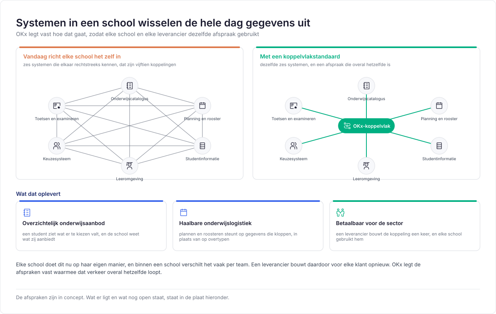

# OKx-meta

Een school laat haar systemen de hele dag gegevens uitwisselen om onderwijs mogelijk te maken. Elke school richt dat nu zelf in, en binnen een school verschilt het vaak per team. **OKx legt vast hoe die uitwisseling gaat**, zodat het onderwijsaanbod overzichtelijk wordt en de onderwijslogistiek haalbaar en betaalbaar blijft.



Dit is de publieke werkomgeving waar die afspraken ontstaan, in het open en samen met de sector. Wat releasebaar is verhuist naar [`Npuls-OKx/Public`](https://github.com/Npuls-OKx/Public); bestaat een document in beide repositories, dan is de versie daar de vastgelegde en de versie hier de werkversie. OKx is onderdeel van [Npuls, pijler Leren Zonder Drempels](https://npuls.nl/onderwerpen/ontsluiten-onderwijsaanbod). Waar OKx aansluit op bestaande standaarden en referentiearchitecturen staat in [`project/context.md`](project/context.md#standaarden-en-referentiearchitecturen).

## Status


Wat hier staat is grotendeels concept en voorstel. Van de zeven [statussen](project/status.md) die een product doorloopt zijn 5 en 7 leeg, en release 0.0.1 kreeg geen review. Het werk beweegt sindsdien tussen status 1 en 4, bij de vraag wat een instelling moet kunnen.

| | |
|---|---|
| Wat er ligt | Een informatiemodel met begrippenlijst, de hoofdplaat informatiestromen, een eerste pakket koppelvlakspecificaties in Public als release 0.0.1, en leerroute 1 uitgewerkt tot op processtap |
| Wat nu bepaald wordt | De vorm waarin de oplevering uitkomt. Dat wacht op een scherper beeld van wat een instelling moet kunnen |
| Waar het naartoe gaat | Per leerroute een best practice die een instelling herkent, en de capabilities die een voorziening daarvoor nodig heeft |

Voluit, met de herkomst per uitspraak: [`project/context.md`](project/context.md#status-van-het-werk).

## Oplevering

| Product | Waar |
|---|---|
| Koppelvlakspecificaties, de hoofdoplevering | [Public](https://github.com/Npuls-OKx/Public/tree/dev/Koppelvlakspecificaties) |
| Informatie- en gegevensmodellen | [Public](https://github.com/Npuls-OKx/Public/tree/dev/Informatie-en-gegevensmodellen) |
| Referentiemateriaal: principes, uitgangspunten, besluiten, kaderscenario's | [Public](https://github.com/Npuls-OKx/Public/tree/dev/Referentiemateriaal) |
| Kaderstelling en modellen | deze repository |

Waarvoor OKx die levert en wat elk resultaat van de uitwerking vraagt staat in [`project/context.md`](project/context.md); hoe de set wordt opgedeeld in [deel 4 van de leesroute](project/leesroute.md#deel-4-deliverables).

## Leesroutes

Een leesroute brengt een lezer in een vaste volgorde langs wat hij nodig heeft. Er is er een uitgewerkt; de andere rijen wijzen naar de plek waar dat werk vandaag staat.

| Lezer | Route | Stand |
|---|---|---|
| Wie nieuw aanhaakt bij OKx | [Leesroute OKx](project/leesroute.md): zeven delen door beide repositories, langs context, historie, scope, deliverables, besluiten en beheer | 45 minuten, met verdieping drie uur |
| Wie wil bouwen tegen een koppelvlak, de implementerende partijen | [Koppelvlakspecificaties in Public](https://github.com/Npuls-OKx/Public/blob/dev/Koppelvlakspecificaties/README.md), met de leesvolgorde daar | Alles staat er als concept. De bouwfase begint later; wat nu kan is meelezen en bijdragen aan de specificatie |
| Wie wil bijdragen | [`CONTRIBUTING.md`](CONTRIBUTING.md) voor de werkwijze en [`project/bijdragen-voor-beginners.md`](project/bijdragen-voor-beginners.md) voor de eerste stappen | 20 minuten. Een eigen route volgt in de beheerfase |
| Een AI-agent | [`AGENTS.md`](AGENTS.md): de harde regels, de product-flow en de skills | eerst dit |

## Repository

```text
meta/
├── project/                          wat OKx is en hoe je het leest: context, historie, status, leesroute
│   ├── projectdocumentatie/          de bronstukken, zoals het projectplan
│   └── img/                          de platen van het programma en de gegenereerde beelden
├── architecture/
│   ├── docs/
│   │   ├── specificatie/             begrippenlijst, leerroute-uitwerking, interactieketens, keuzevraagstukken
│   │   ├── externe-kaders/           MOSA en de andere kaders waar OKx op aansluit
│   │   ├── kwalificatiedossier/      de bron waar de keten begint
│   │   ├── leeruitkomsten/           de sleutel tussen specificatie en resultaat
│   │   └── mappingsessies-instellingen/   wat instellingen in werksessies inbrachten
│   ├── model/                        het ArchiMate-model, het informatiemodel en de modeldoorloop
│   ├── meetings/                     de verslagen per sessie
│   └── agent-artifacts/              onderzoek, plannen en ontwerpen van agents
├── presentaties/                     de decks per gremium, met het platenmanifest
├── tools/
│   ├── scripts/                      de generatoren en de controles op model, platen en documenten
│   └── tests/                        de testgevallen daarbij
├── archief/MOKA/                     het MOKA-sjabloon, de guidelines en de uitwerking erop
└── AGENTS.md                         de werkwijze voor agents, met de harde regels
```

Waar iets ontstaat: de releasebare en geversioneerde artefacten in [`Npuls-OKx/Public`](https://github.com/Npuls-OKx/Public), de kaderstelling en uitwerking van voorbereidend werk hier, en het besluit erachter als architectuurbesluit in Public.

## Meepraten

Vragen en open gesprekken gaan via [Discussions](https://github.com/Npuls-OKx/meta/discussions) en concrete wijzigingen lopen via issues en pull requests.

## Privacy

Sessies die deze werkomgeving voeden kunnen opgenomen en met AI getranscribeerd worden; de facilitator kondigt dat vooraf aan. Bij bezwaar volgt anonimisering in het transcript of beëindiging van de deelname. Niet-publieke informatie hoort niet in deze repository. Volledige toelichting: [`project/privacy-meetings-en-transcriptie.md`](project/privacy-meetings-en-transcriptie.md).

Contact voor afstemming: niek.derksen@surf.nl.
