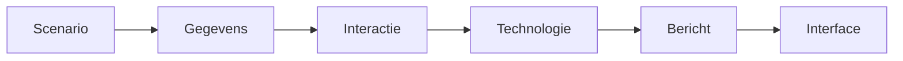
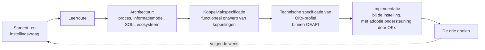

# OKx-meta

De publieke werkomgeving van **OKx**: hier ontstaan de producten van het project, in het open en samen met de sector. Het keteninzicht, de modellen, de kaderstelling en de specificaties worden hier gemaakt, besproken en herzien, en wat releasebaar is verhuist naar Public. OKx is onderdeel van [Npuls, pijler Leren Zonder Drempels](https://npuls.nl/project-onderwijskoppelingen).

De releaseartefacten staan in [`Npuls-OKx/Public`](https://github.com/Npuls-OKx/Public): wat in deze kennisbank tot een releasebaar artefact rijpt, verhuist daarheen. Bestaat een document in beide repositories, dan is de versie in Public de vastgelegde en de versie hier de werkversie.

## Doel

1. Komen tot gezamenlijke taal en standaarden voor gegevensuitwisseling die een scala aan flexibilisering mogelijk maken in het mbo.
2. Komen tot functionele en technische gegevensuitwisseling voor het mbo, hbo en wo die studentmobiliteit ondersteunen.
3. Pilot studentmobiliteit starten in het mbo: implementatie en realisatie van de digitale koppelingen, met eventueel gebruik van SURF-diensten.

## Scope

| | |
|---|---|
| Onderwijssoort | Start bij het mbo, daarna het hoger onderwijs |
| Leerroutes | De reguliere leerroute eerst, met temporiseren en versnellen erna; de flexibele en modulaire routes volgen als verschil daarop. De [negen leerroutes van Npuls](architecture/docs/specificatie/leerroute-uitwerking/img/README.md) staan als tekening bij elkaar, met per route de keten van persona, uitwerking, scenario's en voorbeeldregels |
| Bereik | Binnen een instelling eerst, federatie tussen instellingen gefaseerd |
| Buiten scope | De onderwijskundige keuze van een instelling. OKx legt de vorm van de uitwisseling vast, niet hoe een school haar onderwijs inricht |

De afbakening staat als architectuurbesluit vast in [ADR 0008](https://github.com/Npuls-OKx/Public/blob/dev/Referentiemateriaal/adr/0008-scope-planning-eerst-intra-instelling.md).

## Deliverables

| Deliverable | Wat het is | Waar het staat |
|---|---|---|
| Koppelvlakspecificatie | De specificaties waarmee een partij een koppelvlak bouwt: per component de diensten, per koppeling het berichtgedrag, met de schema's erbij | [Public, Koppelvlakspecificaties](https://github.com/Npuls-OKx/Public/tree/dev/Koppelvlakspecificaties) |
| Informatie- en gegevensmodellen | De taal van de keten: de begrippenfamilies, de objecttypen en hun samenhang, tot aan het technische gegevensmodel | [Public, Informatie-en-gegevensmodellen](https://github.com/Npuls-OKx/Public/tree/dev/Informatie-en-gegevensmodellen) |
| Referentiemateriaal | De onderbouwing: principes, uitgangspunten, architectuurbesluiten en de kaderscenario's per leerroute | [Public, Referentiemateriaal](https://github.com/Npuls-OKx/Public/tree/dev/Referentiemateriaal) |
| Kaderstelling en modellen | Het ArchiMate-model, de hoofdplaat informatiestromen, de interactieketens en de voorbeelduitwerkingen | deze repository |

De koppelvlakspecificatie is de hoofdoplevering: een set specificaties van koppelingen die als functioneel ontwerp dient voor een implementatie, bij voorkeur als [OEAPI-profiel](https://oeapi.eu/v6.0/#/technical/consumers-and-profiles/profiling-guidelines). Valt een eis buiten de profielvorm, dan komt een andere generieke standaard in beeld. Het uitgangspunt is OEAPI tenzij. De opdeling van de volledige set en de verwachte vorm per product staan in [#421](https://github.com/Npuls-OKx/meta/issues/421), met de [leesroute](doc/leesroute-okx.md) als ingang erop.

## Totstandkoming deliverables

De route naar een vastgelegde afspraak volgt de [AMIGO-aanpak](https://www.edustandaard.nl/amigo/aanpak/) van Edustandaard.



Elke specificatie van koppelvlakken begint bij een wens in de student- en instellingsreis en sluit de cirkel bij de drie doelen.



| Laag | Wat het is |
|---|---|
| Informatiestroom | De beweging van gegevens tussen twee componenten, zichtbaar op de hoofdplaat |
| Koppeling | De gestandaardiseerde realisatie van die stroom |
| Koppelvlak | De verzameling koppelingen van precies een component |

Een eis die buiten een technische standaard valt, wordt een signalering richting die standaard. De werkwijze staat in [`CONTRIBUTING.md`](CONTRIBUTING.md) en de [product-flow](.agents/skills/okx-product-flow/SKILL.md).

Deze route wordt aangescherpt terwijl zij wordt gelopen. De stap die nu het meeste werk vraagt is de laag van de instelling: wat een instelling doet, in welke volgorde, en welke informatie daarbij beweegt. Dat beeld ontstaat per leerroute, in drie lagen: een persona, een leerroutedocument daarop, en informatiemodel-voorbeeldregels per fase. De [leesroute](doc/leesroute-okx.md#stand-van-de-route) zegt waar dat staat.

## Leeswijzer

| Wie binnenkomt | Begint bij | Tijd |
|---|---|---|
| Wie nieuw aanhaakt bij OKx | [De leesroute](doc/leesroute-okx.md): zes delen door beide repositories, langs context, historie, scope, deliverables, besluiten en beheer | 45 min, met verdieping drie uur |
| Wie wil bijdragen | [`CONTRIBUTING.md`](CONTRIBUTING.md) voor de werkwijze, [`doc/Bijdragen-voor-beginners.md`](doc/Bijdragen-voor-beginners.md) voor de eerste stappen | 20 min |
| Een AI-agent | [`AGENTS.md`](AGENTS.md): de harde regels, de product-flow en de skills | eerst dit |
| Wie wil bouwen tegen een koppelvlak | [Koppelvlakspecificaties in Public](https://github.com/Npuls-OKx/Public/blob/dev/Koppelvlakspecificaties/README.md), met de leesvolgorde daar | 1 uur |

## Repository

```text
meta/
├── doc/                              projectcontext, release en versionering, en deze leesroute
├── architecture/
│   ├── docs/
│   │   ├── specificatie/             begrippenlijst, leerroute-uitwerking, interactieketens, keuzevraagstukken
│   │   ├── externe-kaders/           MOSA en de andere kaders waar OKx op aansluit
│   │   ├── kwalificatiedossier/      de bron waar de keten begint
│   │   ├── leeruitkomsten/           de sleutel tussen specificatie en resultaat
│   │   └── mappingsessies-instellingen/   wat instellingen in werksessies inbrachten
│   ├── model/                        het ArchiMate-model, het informatiemodel en de hoofdplaat per versie
│   ├── meetings/                     de verslagen per sessie
│   └── agent-artifacts/              onderzoek, plannen en ontwerpen van agents
├── OKE/                              de eerste subdomein-uitwerking, examen en beoordeling
├── moka-koppelvlakspecificaties/     de MOKA-templates waarop een specificatie rust
├── presentaties/                     de decks per gremium, met het platenmanifest
├── scripts/                          de generatoren en de controles op model, platen en documenten
└── AGENTS.md                         de werkwijze voor agents, met de harde regels
```

Waar iets ontstaat: de releasebare en geversioneerde artefacten in [`Npuls-OKx/Public`](https://github.com/Npuls-OKx/Public), de kaderstelling en uitwerking van voorbereidend werk hier, en het besluit erachter als architectuurbesluit in Public.

## Standaarden en referentiearchitecturen

Waar passend sluiten de uitwerkingen aan op de [Open Education API](https://openonderwijsapi.nl/v6.0/), als profiel bovenop de standaard en niet als afsplitsing ervan. We onderhouden nauwe verbinding met sectorarchitecturen als MORA en HORA: deze kennisbank wijzigt deze niet direct. Eventuele OKx uitwerkingen kunnen later als onderbouwd voorstel richting de referentiearchitecturen gaan. De verhouding met ROSA en het Kernmodel Onderwijsinformatie ligt vast in de architectuurbesluiten.

## Meepraten

Vragen en open gesprekken gaan via [Discussions](https://github.com/Npuls-OKx/meta/discussions) en concrete wijzigingen lopen via issues en pull requests.

## Privacy

Sessies die deze kennisbank voeden kunnen opgenomen en met AI getranscribeerd worden; de facilitator kondigt dat vooraf aan. Bij bezwaar volgt anonimisering in het transcript of beëindiging van de deelname. Niet-publieke informatie hoort niet in deze repository. Volledige toelichting: [`doc/Privacy-meetings-en-transcriptie.md`](doc/Privacy-meetings-en-transcriptie.md).

Contact voor afstemming: niek.derksen@surf.nl.
