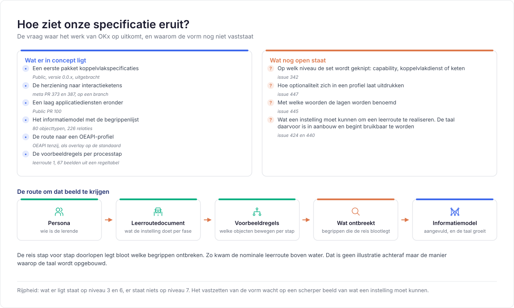

# OKx-meta

De publieke werkomgeving van **OKx**: hier ontstaan de producten van het project, in het open en samen met de sector. Het keteninzicht, de modellen, de kaderstelling en de specificaties worden hier gemaakt, besproken en herzien, en wat releasebaar is verhuist naar Public. OKx is onderdeel van [Npuls, pijler Leren Zonder Drempels](https://npuls.nl/project-onderwijskoppelingen).

Bestaat een document in beide repositories, dan is de versie in [`Npuls-OKx/Public`](https://github.com/Npuls-OKx/Public) de vastgelegde en de versie hier de werkversie. Waar OKx aansluit op bestaande standaarden en referentiearchitecturen staat in [`doc/OKx_Context.md`](doc/OKx_Context.md#standaarden-en-referentiearchitecturen).



## Status

Wat hier staat is grotendeels concept en voorstel. Van de zeven [rijpheidsniveaus](doc/OKx_Rijpheid.md) zijn 5 en 7 leeg, en de uitgave die niveau 6 haalde kreeg geen review. Het werk staat daarmee terug op niveau 1: wat een instelling moet kunnen.

| | |
|---|---|
| Wat er ligt | Een informatiemodel met begrippenlijst, de hoofdplaat informatiestromen, een eerste pakket koppelvlakspecificaties in Public uit augustus 2026, en leerroute 1 uitgewerkt tot op processtap |
| Wat nu bepaald wordt | De vorm waarin de oplevering uitkomt. Dat wacht op een scherper beeld van wat een instelling moet kunnen |
| Waar het naartoe gaat | Per leerroute een best practice die een instelling herkent, en de capabilities die een voorziening daarvoor nodig heeft |

Voluit, met de herkomst per uitspraak: [`doc/OKx_Context.md`](doc/OKx_Context.md#status-van-het-werk).

## Oplevering

| Product | Waar |
|---|---|
| Koppelvlakspecificaties, de hoofdoplevering | [Public](https://github.com/Npuls-OKx/Public/tree/dev/Koppelvlakspecificaties) |
| Informatie- en gegevensmodellen | [Public](https://github.com/Npuls-OKx/Public/tree/dev/Informatie-en-gegevensmodellen) |
| Referentiemateriaal: principes, uitgangspunten, besluiten, kaderscenario's | [Public](https://github.com/Npuls-OKx/Public/tree/dev/Referentiemateriaal) |
| Kaderstelling en modellen | deze repository |

Waarvoor OKx die levert en wat elk resultaat van de uitwerking vraagt staat in [`doc/OKx_Context.md`](doc/OKx_Context.md); hoe de set wordt opgedeeld in [deel 4 van de leesroute](doc/leesroute-okx.md#deel-4-deliverables).

## Leesroutes

Een leesroute brengt een lezer in een vaste volgorde langs wat hij nodig heeft. Er is er een; de volgende komen wanneer het werk zover is.

| Lezer | Route | Tijd |
|---|---|---|
| Wie nieuw aanhaakt bij OKx | [Leesroute OKx](doc/leesroute-okx.md): zes delen door beide repositories, langs context, historie, scope, deliverables, besluiten en beheer | 45 min, met verdieping drie uur |
| Wie wil bouwen tegen een koppelvlak | Volgt wanneer de specificaties bouwklaar zijn. Voor nu: [Koppelvlakspecificaties in Public](https://github.com/Npuls-OKx/Public/blob/dev/Koppelvlakspecificaties/README.md), met de leesvolgorde daar | |
| Wie wil bijdragen | Volgt in de beheerfase. Voor nu: [`CONTRIBUTING.md`](CONTRIBUTING.md) voor de werkwijze en [`doc/Bijdragen-voor-beginners.md`](doc/Bijdragen-voor-beginners.md) voor de eerste stappen | 20 min |
| Een AI-agent | [`AGENTS.md`](AGENTS.md): de harde regels, de product-flow en de skills | eerst dit |

## Repository

```text
meta/
├── doc/                              projectcontext, de leesroute, release en versionering
├── architecture/
│   ├── docs/
│   │   ├── specificatie/             begrippenlijst, leerroute-uitwerking, interactieketens, keuzevraagstukken
│   │   ├── externe-kaders/           MOSA en de andere kaders waar OKx op aansluit
│   │   ├── kwalificatiedossier/      de bron waar de keten begint
│   │   ├── leeruitkomsten/           de sleutel tussen specificatie en resultaat
│   │   └── mappingsessies-instellingen/   wat instellingen in werksessies inbrachten
│   ├── model/                        het ArchiMate-model, het informatiemodel en de hoofdplaat per versie
│   ├── meetings/                     de verslagen per sessie
│   └── agent-artifacts/              onderzoek, plannen en ontwerpen van agents
├── OKE/                              de eerste subdomein-uitwerking, examen en beoordeling
├── moka-koppelvlakspecificaties/     de MOKA-templates waarop een specificatie rust
├── presentaties/                     de decks per gremium, met het platenmanifest
├── scripts/                          de generatoren en de controles op model, platen en documenten
└── AGENTS.md                         de werkwijze voor agents, met de harde regels
```

Waar iets ontstaat: de releasebare en geversioneerde artefacten in [`Npuls-OKx/Public`](https://github.com/Npuls-OKx/Public), de kaderstelling en uitwerking van voorbereidend werk hier, en het besluit erachter als architectuurbesluit in Public.

## Meepraten

Vragen en open gesprekken gaan via [Discussions](https://github.com/Npuls-OKx/meta/discussions) en concrete wijzigingen lopen via issues en pull requests.

## Privacy

Sessies die deze werkomgeving voeden kunnen opgenomen en met AI getranscribeerd worden; de facilitator kondigt dat vooraf aan. Bij bezwaar volgt anonimisering in het transcript of beëindiging van de deelname. Niet-publieke informatie hoort niet in deze repository. Volledige toelichting: [`doc/Privacy-meetings-en-transcriptie.md`](doc/Privacy-meetings-en-transcriptie.md).

Contact voor afstemming: niek.derksen@surf.nl.
