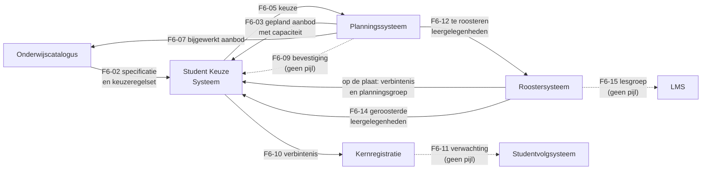

# Implementatieplan #567, blok A: fase 6 opnieuw opgebouwd

Relateert aan: #567 (blok A, taken A1 tot en met A6). Bron van de besluiten: sessie "Keuzedeelmodel en informatiemodel", 17 november 2026, 10:03 (Niels van Duin, Niek Derksen). Raakt aan: #331 #436 #446 #562 #547 #402 #529.

## Uitgangspunt

| | |
|---|---|
| Tak | `567-verbeterronde-leerroute-uitwerking`, vanaf `dev` op `636593d` (informatiemodel 0.3.1, hoofdplaat 1.7.2) |
| Nulmeting controleur | 275 regels, 18 bevindingen, 56 signaleringen; in fase 6 geen bevinding |
| `model.archimate` | sha256 `1dc2aafbc1af8c9a8ad8d2d7e17c12a16fbfb67c2e275167c124cdfaa3d74ced`, voor en na gelijk |
| Fase 6 nu | 8 beelden, 12 regels; variant capaciteitsgestuurd: 4 beelden in fase 6 |
| Wat de plaat al draagt | de drie lagen voor specificatie, aanbod en verbintenis, elk met hun verbinding (`wordt aangeboden als`, aggregatie, `Groepeert tot` naar `Lesgroep`). Blok A vraagt daarom geen nieuw objecttype |

## De keten na blok A

Een doorgetrokken lijn staat op hoofdplaat 1.7.2, een gestippelde nog niet. De bevestiging volgt de sessie: planning koppelt direct na de keuze terug. De plaat laat de verbintenis pas na het roosteren terugkomen, van het roostersysteem (`id-7a7e0a17…`); de vraag bij F6-09 legt die twee routes naast elkaar.

## Het doorlopende voorbeeld K0037 (A3)

Fase 1 legt de specificatie van K0037 al gelaagd vast (F1-08). Fase 6 zet het aanbod en de verbintenis er laag voor laag naast, met dezelfde namen:

| Laag | Specificatie (fase 1) | Aanbod (fase 6) | Verbintenis (fase 6) |
|---|---|---|---|
| Programma | `Keuzedeel specificatie` K0037 Farmaceutische Patientenzorg | `Keuzedeel aanbod` K0037, periode 7, locatie A | `Keuzedeel aanbod verbintenis`, bij planning |
| Onderwijseenheid | `Onderwijseenheid specificatie` D1-K1 | `Onderwijseenheid aanbod` D1-K1, periode 7, 18 plaatsen | `Onderwijseenheid aanbod verbintenis`, bij planning |
| Leeronderdeel | `Leeronderdeel specificatie` Het medicatieoverzicht opstellen; Zorg aan specifieke doelgroepen | `Leergelegenheid` per leeronderdeel, periode 7 | `Leergelegenheid verbintenis`, bij het roosteren, gegroepeerd tot een `Lesgroep` |

De relaties volgen het patroon van F1-08: een specialisatie naar het algemene type (`Keuzedeel aanbod` naar `Opleidingsprogramma aanbod`) en daaronder de aggregatie die de plaat op dat algemene type draagt. Elk aanbodobject verwijst met `wordt aangeboden als` naar zijn specificatielaag; elke verbintenis hangt aan haar aanbod. Een verdere instantie van een type dat eerder ontstond, draagt `nieuwe_instantie`.

## Beelden van fase 6, oud naar nieuw

| Nieuw | Stap | Soort | Van naar, pijl | Objecten | Taak | Was |
|---|---|---|---|---|---|---|
| F6-01 | S1 | ontstaat, planner | | `Keuzedeel aanbod` met `Onderwijseenheid aanbod` en twee `Leergelegenheid` genest, elk met verwijzing naar de specificatielaag | A3 | F6-01 |
| F6-02 | S1 | stroomt | OC naar SKS, `id-5f2568d7…` | `Keuzedeel specificatie` met de lagen eronder, `Student keuze regelset` met `Keuzedeelruimte`; geen `Keuzedeel aanbod` | A1 | F6-02 |
| F6-03 | S1 | stroomt | Planning naar SKS, `id-6268df4c…` | `Keuzedeel aanbod`, `Onderwijseenheid aanbod` met capaciteit; zin: zonder aanbod meldt het SKS dat aan planning over `id-726d0826…` | A2 | nieuw |
| F6-04 | S2 | ontstaat, student | | `Aanmelding` (direct gekozen), `Keuzedeel aanbod verbintenis` met `Onderwijseenheid aanbod verbintenis` genest | A3, A6 | F6-03 |
| F6-05 | S2 | stroomt | SKS naar Planning, `id-726d0826…` | beide verbintenissen | A3 | F6-04 |
| F6-06 | S3 | verandert, planner | | `Keuzedeel aanbod`, `Onderwijseenheid aanbod`: 1 groep, 18 plaatsen | A3 | F6-05 |
| F6-07 | S4 | stroomt | Planning naar OC, `id-020f091d…` | `Keuzedeel aanbod`, `Onderwijseenheid aanbod` | A3 | F6-06 |
| F6-08 | S5 | ontstaat en verandert, planner | | `Inschrijving`; beide verbintenissen naar ingeschreven | A3 | F6-07 |
| F6-09 | S5 | stroomt | Planning naar SKS, geen pijl op de hoofdplaat | beide verbintenissen, ingeschreven | A4 | nieuw |
| F6-10 | S5 | stroomt | SKS naar KRS, `id-642ea2bf…` | beide verbintenissen | A4 | F6-08 |
| F6-11 | S5 | stroomt | KRS naar SVS, geen pijl op de hoofdplaat | beide verbintenissen, met verwijzing naar `Keuzedeel resultaat` en `Onderwijseenheid resultaat` als verwachting | A4 | nieuw |
| F6-12 | S6 | stroomt | Planning naar Rooster, `id-08467fe3…` | twee `Leergelegenheid`, `Planningsgroep` | A4 | nieuw |
| F6-13 | S6 | verandert en ontstaat, roosteraar | | `Leergelegenheid` naar geroosterd; `Leergelegenheid verbintenis` (`nieuwe_instantie`) met verwijzing `Groepeert tot` naar de lesgroep | A3, A4 | nieuw |
| F6-14 | S6 | stroomt | Rooster naar SKS, `id-7aaf2959…` | geroosterde `Leergelegenheid`, `Leergelegenheid verbintenis` | A4 | nieuw |
| F6-15 | S6 | stroomt | Rooster naar LMS, geen pijl op de hoofdplaat | `Lesgroep`, `Leergelegenheid verbintenis`, `Student` | A4 | nieuw |

Drie regels voor de hele tabel:

- Elke regel met een verbintenis, ook in een stroomt-beeld, draagt in `relaties` de verwijzing naar haar aanbod, en elk aanbod de verwijzing naar zijn specificatielaag.
- `Onderwijseenheid aanbod` en `Leergelegenheid` ontstaan al in F2-08, `Onderwijseenheid aanbod verbintenis` en `Leergelegenheid verbintenis` in F4-09, `Aanmelding` en `Inschrijving` in fase 3. In F6-01, F6-04, F6-08 en F6-13 dragen zij daarom `nieuwe_instantie`.
- Elke pijl-id controleer ik met de hand tegen `stromen.json` op afzender en ontvanger, want de controleur toetst dat niet.

De `zin` van F6-04 zegt dat direct kiezen op het keuzemoment de regel is en de voorkeurslijst de uitzondering, en dat het SKS eerst het aanbod op de eigen locatie toont en daarna breder, als eigen logica zonder objecttype (A6).

Fase 6 groeit van 8 naar 15 beelden. `Lesgroep` staat alleen in een stroomt-regel en als verwijzing, en krijgt hier geen ontstaat-regel: die hoort bij fase 4, en ontstaat-regels vallen buiten deze ronde.

## De kop van fase 6

| Wat | Wijziging |
|---|---|
| `bron` | aangevuld met de sessie van 17 november 2026 |
| Stap S2 | `Voorkeurslijst samenstellen in het studentkeuzesysteem` wordt `Keuzedeel kiezen in het studentkeuzesysteem` (A6, besloten door de opdrachtgever op 24 november 2026). Het kaderscenario noemt nog de voorkeurslijst; dat verschil gaat als signalering naar Public |
| Stap S6 | nieuw: `Gekozen keuzedeel roosteren en deelnemers delen` |
| Uitwisseling OC naar SKS | krijgt een `afwijking`: het aanbod komt van planning (F6-03), de catalogus levert specificatie en regelset |
| Uitwisseling Planning naar Rooster | `beeld_in_fase: 7` vervalt, het beeld staat nu in fase 6 (F6-12) |
| Uitwisseling Rooster naar LMS en KRS naar SVS | `beeld_in_fase: 4` vervalt (F6-15 en F6-11); de `afwijking` bij Rooster naar LMS blijft |
| `verwacht` en `dekking` | ongewijzigd |

## Vragen die in de regeltabel landen

Waar de plaat iets mist of anders noemt, komt een `vraag` op het beeld. Het model wijzigt niet.

| Beeld | Vraag |
|---|---|
| F6-02 | De pijl van de catalogus naar het SKS heet `Opleidingsprogramma aanbod`, terwijl er besloten is dat over die lijn specificatie en regelset gaan. Hoort het label naar de specificatie? De oude vraag over de plek van de regelset sluit: op de specificatie |
| F6-03 | De pijl van planning naar het SKS noemt `geplande leergelegenheden`, terwijl de keuze bij planning op programma en onderwijseenheid valt. Welke laag hoort in het label? |
| F6-09 | Planning bevestigt de verbintenis direct na de keuze, over een lijn die de plaat niet kent. De plaat brengt de verbintenis met de planningsgroep na het roosteren terug, van het roostersysteem naar het SKS (`id-7a7e0a17…`). Welke route klopt, of horen ze allebei? |
| F6-11 | De plaat kent geen lijn van de kernregistratie naar het studentvolgsysteem; wel een van het SKS naar het studentvolgsysteem (`id-3aefce69…`). Het beeld volgt de sessie en F4-11; welke afzender klopt, legt de PR voor aan Niels van Duin |
| F6-12 | `Planningsgroep` is op de plaat een compositie van `Plaatsingsgroep`, terwijl een keuzedeelgroep studenten uit meer plaatsingsgroepen samenbrengt |

## Variant capaciteitsgestuurd (A5)

| Beeld | Wijziging |
|---|---|
| F6-C01 | titel en stap naar de animocheck als controle op de capaciteitsplanning uit F2-C01, niet als de planning zelf; objecttype van `Leergelegenheid` naar `Onderwijseenheid aanbod`, want daar valt de keuze |
| F6-C02 | vervalt: planning naar het SKS staat nu in de basis (F6-03), en een variant tekent niet opnieuw wat er al staat |
| F6-C03, F6-C04 | worden F6-C02 en F6-C03; de keuze en de toewijzing op `Onderwijseenheid aanbod verbintenis` in plaats van `Leergelegenheid verbintenis` |
| kop fase 6 | `voorafgegaan_door` en `vervangt` naar de nieuwe ID's; de toelichting zegt niet langer dat het aanbod via de catalogus komt |

## Buiten blok A

- B1 tot en met B4 (regelset in blokken, verzoek tot aanbod in F6-01, roostermoment, locatie) volgen na blok A. B2 voegt beelden toe vooraan in fase 6; de ID's schuiven dan nog een keer op, met de variant mee.
- `Keuzedeel aanbod` stroomt al in F2-09 en ontstaat volgens de verwachting in fase 6. Dat is een vraag over fase-verwachtingen en valt buiten deze ronde.
- De bevinding "fase 4: geen ontstaat-regel voor Lesgroep, Planningsgroep" blijft staan.
- Het antwoord aan de inbrenger van #331 is een eigen stap.

## Volgorde van uitvoeren

1. **Proef op F6-01 tot en met F6-03.** Regels invoeren, de keten draaien en de drie beelden zelf bekijken (`soffice --headless --convert-to png`). Toont de renderer de verwijzing van aanbod naar specificatielaag niet leesbaar, dan stop ik en meld dat, in plaats van de renderer in deze ronde aan te passen.
2. De overige beelden van de basis, F6-04 tot en met F6-15, met de kop van fase 6.
3. De variant capaciteitsgestuurd.
4. De keten uit de skill: `exporteer-componenten.py`, `controleer-leerroute-uitwerking-model.py`, `teken-leerroute-uitwerking-model.py`, `teken-fasenplaten.py`, `genereer-leerroute-uitwerking-model-lr1.py`, `validate-docs.py` op het leesdocument en het invulblad, en `python3 -W error::ResourceWarning -m unittest discover -s tools/tests`.
5. sha256 van `model.archimate` vergelijken met de nulmeting.
6. Review in verse contexten: tester, semantiek, schrijfstijl.
7. De takenlijst in #567 bijwerken. Niels van Duin loopt fase 6 na in de pull request zodra B2 de nummering heeft vastgelegd, zodat zijn reactie naar de definitieve beeld-ID's verwijst.

## Nareken per criterium

| Criterium | Hoe ik het nareken |
|---|---|
| 1 Elke taak doorgevoerd of afgewezen | A1 tot en met A6 aangevinkt in #567, elk met het beeld-ID erbij |
| 2 F6-02 zonder `Keuzedeel aanbod`, aanbod via planning | een query op de regeltabel: de regels van F6-02 bevatten geen `Keuzedeel aanbod`; er is een stroomt-regel met afzender `Planningssysteem` en ontvanger `Student Keuze Systeem (SKS)` in de basis |
| 3 Doorlopend voorbeeld per laag | een query op de regeltabel: elke regel in fase 6 met een verbintenis draagt een relatie naar haar aanbod, en elk aanbod een naar zijn specificatielaag; daarna per beeld nagelopen in het leesdocument (F6-04, F6-05, F6-08 tot en met F6-11, F6-13 tot en met F6-15) |
| 4 Model ongewijzigd | sha256 voor en na gelijk; de vijf vragen hierboven staan in de regeltabel |
| 5 Controleur en beelden | de bevindingen blijven op 18; de controleur meldt een signalering per regel zonder pijl, dus ik verwacht er ongeveer acht bij (twee regels in F6-09, twee in F6-11, drie in F6-15, en de afwijking bij OC naar SKS) en elke verschuiving staat herleid in de pull request; beelden en fasenplaten hertekend; tests groen |
| 6 Niels heeft nagelopen | zijn reactie staat in de pull request; dat gebeurt na de uitwerking |
