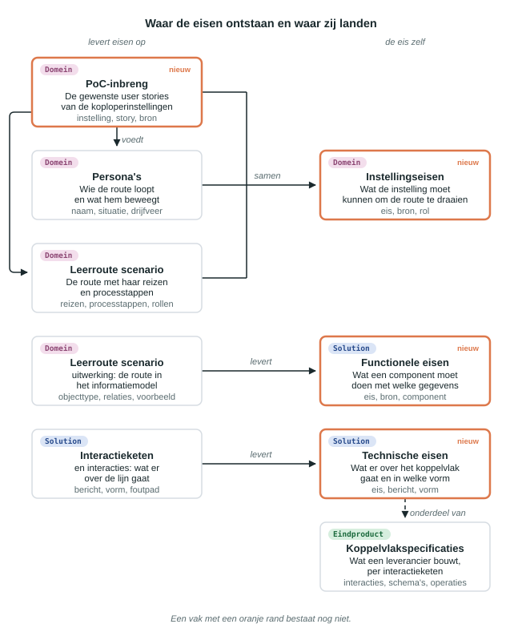

# Requirements in de productafbakening

Waar ontstaan de eisen van OKx, en waar landen zij? Dit stuk legt de varianten naast elkaar en tekent het voorstel uit, zodat erover te besluiten is.

Relateert aan: #554, #558

## De vraag

De sjablonen voor de adviesgroep noemen per hoofdstuk welke laag daar ontstaat: een journey brengt user stories naar boven, een procesbeschrijving bedrijfseisen, een gegevenshoofdstuk functionele eisen, een interactiehoofdstuk technische eisen. Die lagen moeten ergens landen, en de plaat zegt nu niet waar.

De bedrijfs- en functionele eisen **zitten al in de leerroute scenario's**, zoals die nu geschreven zijn. Alleen staan zij er als lopende tekst, en daarmee zijn zij niet te tellen, niet te prioriteren en niet aan een testgeval te hangen.

## Het voorstel

De keten van links naar rechts, met de vier nieuwe artefacten in een oranje rand:

| Stap | Wat er gebeurt |
|---|---|
| **PoC-inbreng** | wat koploperscholen in de sessies hebben ingebracht, per school vastgelegd. Dit is zelf een artefact en geen losse herinnering: zonder die vastlegging is de grootst gemene deler later niet te verantwoorden |
| **Persona's** | de inbreng krijgt een gezicht: wie de route loopt en wat hem beweegt |
| **Leerroute scenario** | de route met haar reizen en processtappen, geschreven vanuit de persona's en gevoed door de inbreng |
| **Bedrijfseisen** | wat de instelling moet kunnen om die route te draaien, afgeleid uit het scenario |
| **Leerroute scenario uitwerking** | het scenario stap voor stap naast het informatiemodel |
| **Functionele eisen** | wat een component moet doen met welke gegevens, afgeleid uit scenario en uitwerking samen |
| **Interacties en ketens** | hier liggen de technische eisen **zelf** vast; zij krijgen geen eigen artefact |
| **Pakket van eisen** | de eisen bij elkaar, genummerd en herleidbaar naar hun bron |

De plaat is te hertekenen met `tools/scripts/teken-requirementsvoorstel.py`.

## Waarom technische eisen geen eigen artefact krijgen

Dat lijkt inconsequent, en het is een bewust verschil.

Een **interactiespecificatie is zelf het contract**. Wat er over de lijn gaat, in welke vorm, en wat er gebeurt bij een fout: dat *is* de technische eis. Die er nog eens apart naast zetten levert twee teksten over hetzelfde, en die gaan uit de pas lopen.

Een **leerroute scenario beschrijft, en zijn uitwerking toetst**. De eis is daar geen inhoud maar een conclusie: uit de beschrijving volgt dat de instelling iets moet kunnen. Zo'n conclusie hoort apart, want in lopende tekst is zij niet terug te vinden.

## Moeten de eisen in de leerroute scenario uitwerking zelf?

Nee, en om dezelfde reden. De uitwerking is een toets: zij legt het scenario naast het model en laat zien waar het model tekortschiet. Zodra de eisen er als hoofdstuk in komen, is het twee documenten in een band, en de eis raakt zoek tussen de bouwstenen.

Wat er wel in hoort, staat er al: het hoofdstuk **Hiaten in het model**. Dat is de oogst van de toets, en elke regel daaruit wordt een functionele eis in het register.

## De voorwaarde bij elk eisenartefact

Een eisenartefact is een **register en geen tweede verhaal**. Per regel een nummer, de eis in een zin, en het nummer van de bron waaruit hij komt.

| | |
|---|---|
| De bron blijft leidend | het leerroute scenario beschrijft, het register telt. Wijkt een eis af van zijn bron, dan wint de bron en is het register fout |
| Een eis verwijst omlaag en omhoog | een functionele eis noemt de bedrijfseis waaruit hij komt. Zonder die ketting is de herkomst na een halfjaar weg |
| Geen toelichting in het register | zodra er uitleg in komt te staan, loopt het uit de pas met het scenario, en dan was het beter geweest de eisen helemaal in hun bronproduct te laten |

## De varianten die afvielen

| | Waarom niet |
|---|---|
| **Pakket van eisen op de solutionlaag** | een pakket van eisen is een vraag en geen oplossing; het hoort niet in de laag die de oplossing beschrijft |
| **Pakket van eisen als zuivere aggregatie**, met alle eisen in hun bronproduct | dan is het een aanzicht en geen product: niets om aan te wijzen, te versioneren of over te dragen aan een leverancier |
| **Alle drie de lagen als eigen artefact**, dus ook de technische | twee teksten over hetzelfde contract, zie hierboven |

## Wat dit betekent voor de sjablonen

Niets dat nu moet veranderen. De sjablonen noteren per hoofdstuk alleen de **nummers** van de eisen die daar ontstaan; waar die nummers vandaan komen en waar zij landen is precies wat dit besluit vastlegt.
