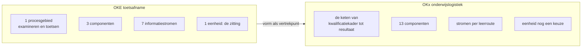

# De OKE-vorm tegenover de scope van OKx

Relateert aan: #422, #421, #396, #342, #445.

## 1. Inleiding

### 1.1 Context

De [OKE-afsprakenset voor mbo-toetsafname](https://www.edustandaard.nl/app/uploads/2026/06/OKE-MBO-toetsafname-specs-v1.0.1_20260527definitief.pdf) was het vertrekpunt voor de vorm van de OKx-oplevering. Die afsprakenset noemt OKx zelf als opvolger: hoofdstuk 5 schrijft dat OKE gebruikmaakt van OOAPI en nieuwe wensen richting OOAPI levert, "net zoals toekomstige OKX trajecten dat zullen doen".

De vormdiscussie binnen OKx loopt sindsdien door: de omvang van de koppelvlakspecificatie, de herziening naar interactieketens, en de vraag wat als OEAPI-profiel naar buiten gaat. Dit verslag legt de onderbouwing van die discussie vast.

### 1.2 Doel

Vijf vragen:

1. Welke eigenschappen van de OKE-vorm zijn bruikbaar binnen de scope van OKx.
2. Welke eigenschappen vragen een eigen uitwerking, met de reden erbij.
3. Wat OKE oplost met het beschrijven van functiegebieden, en wat daarvoor bij OKx nodig zou zijn.
4. Welke eenheid in OKx de rol zou kunnen vervullen die de zitting in OKE vervult.
5. Wat dat betekent voor de vorm van de oplevering.

Dit verslag beslist geen van deze vragen. Het levert de onderbouwing waarmee het team kan kiezen; het besluit zelf hoort als architectuurbesluit in Public en verwijst naar dit verslag terug.

### 1.3 Scope

In scope: de vergelijking van beide trajecten op procesgebied, aantal componenten, aantal informatiestromen, de dragende eenheid, de belanghebbenden en de documentvorm.

De inhoud van de OKE-specificatie blijft bij Edustandaard. De vorm van de OKx-oplevering wordt uitgewerkt in #421. Het besluit zelf hoort als architectuurbesluit in Public. Al het overige valt buiten dit verslag.

## 2. Wat de OKE-afsprakenset is

Versie 1.0.1, definitief, 27 mei 2026, 104 paginas, een document. Ondertitel: afsprakenset op basis van de AMIGO-aanpak en OOAPI.

| Hoofdstuk | Inhoud |
|---|---|
| 1 Inleiding | Begrippenlijst (1.1) en bronnen (1.2) |
| 2 Scenario | Scenariobeschrijving (2.1), processen (2.2), uitgangspunten (2.3), voorbeelden van systeemlandschap (2.4) |
| 3 Informatiestromen | Zeven stromen, 3.0 tot 3.6, elk met informatieobjecten, interacties en het koppelvlak waar de stroom landt |
| 4 Gegevensmodel | Dertien objecten, elk met de OOAPI-naam en de Nederlandse term ernaast |
| 5 Koppelvlakken | Drie koppelvlakken, met authenticatie, autorisatie en de OAuth-scopes |

Drie functionaliteiten dragen het scenario (2.1): Deelnemerregistratie (DR/SIS), Toetsplanning (TPL) en Toetsafname (TA). De zeven informatiestromen zijn de toetscatalogus, de toetsdeelnemers, het zittingsplan, het toetsdeelnemerresultaat, het zittingsverslag, het studentresultaat en de analyse.

Die drie zijn functionaliteiten en geen applicaties. Het systeemlandschap staat er apart bij, en wel als **voorbeeld** (2.4). De afsprakenset zegt daarmee wat er geimplementeerd moet worden en laat open in welk product dat landt. Dit verslag leest dat als een bewuste keuze; de afsprakenset motiveert haar niet met zoveel woorden. Binnen OKx wordt voor zo'n functionaliteit het woord functiegebied gebruikt.

Het procesgebied ligt vast tegen bestaande kaders (2.2): de processen staan uitgewerkt in de MORA-procesketen Examineren, en in ROSA binnen het ketenproces Toetsen van het ketendomein Examineren en Toetsen, met vijf deelprocessen.

De dragende eenheid is de **zitting**: een toetsafname op een bepaald moment op een bepaalde locatie (2.1, stap C). Alle zeven stromen hangen aan die eenheid, van het inplannen tot het vaststellen van het resultaat.

## 3. Wat de scope van OKx is

| As | Vindplaats |
|---|---|
| De keten van kwalificatiekader tot resultaat, met zeven begrippenfamilies | Het [informatiemodel](https://github.com/Npuls-OKx/Public/blob/dev/Informatie-en-gegevensmodellen/informatiemodel.md): 80 objecttypen en 226 relaties |
| Negen Npuls-leerroutes, met de reguliere route eerst en de andere als verschil daarop | Het [kaderscenario leerroute 1](https://github.com/Npuls-OKx/Public/blob/dev/Referentiemateriaal/kaderscenario's/leerroute-1-regulier.md) |
| Binnen een instelling eerst, federatie gefaseerd | [ADR 0008](https://github.com/Npuls-OKx/Public/blob/dev/Referentiemateriaal/adr/0008-scope-planning-eerst-intra-instelling.md) |
| Dertien applicatiecomponenten in het model, waarvan zeven met een eigen document | `componenten.json` en [Applicatiecomponenten](https://github.com/Npuls-OKx/Public/tree/dev/Koppelvlakspecificaties/Applicatiecomponenten) |
| Drie interactiepatronen en vierentwintig datamodelschema's uitgebracht | [Koppelvlakspecificaties](https://github.com/Npuls-OKx/Public/tree/dev/Koppelvlakspecificaties) |
| Een dienstlaag tussen component en endpoint in voorbereiding | [Public PR 100](https://github.com/Npuls-OKx/Public/pull/100) |

De onderwijskundige keuze van een instelling blijft buiten scope. Daardoor ligt het procesgebied van OKx minder vast dan dat van OKE: waar de examenketen in MORA is uitgewerkt, kent de onderwijslogistiek per instelling eigen inrichtingskeuzes. Dat verschil is de aanleiding van #396, waarin vastligt dat tussen de leerroutes en de koppelvlakspecificatie nog geen product staat dat zegt wat een instelling moet kunnen.

## 4. De vergelijking

| As | OKE | OKx | Wat dat betekent |
|---|---|---|---|
| Procesgebied | Een ketenproces, uitgewerkt in MORA en ROSA (2.2) | De onderwijslogistieke keten, met inrichtingskeuzes per instelling | Het procesgebied ligt bij OKx niet vast, dus een product dat dat vastlegt ontbreekt nog; zie #396 |
| Componenten | Drie functionaliteiten (2.1) | Dertien in het model, zeven met een document | Een document per component houdt bij dit aantal geen overzicht; een laag erboven zou dat opvangen |
| Informatiestromen | Zeven, genummerd en gesloten (3.0 tot 3.6) | Per leerroute een eigen verzameling, met de reguliere route als baseline | De set groeit met elke leerroute, dus een nummering over de hele set gaat schuiven |
| Dragende eenheid | De zitting: moment en locatie (2.1 stap C) | Nog een keuze, zie hoofdstuk 6 | Zonder zo'n eenheid heeft een stroom geen natuurlijke begrenzing |
| Belanghebbenden | Acht instellingen, drie toetsleveranciers, zes systeemleveranciers, vijf coordinerende partijen | Dezelfde soorten partijen, en daarnaast de rollen rond planning, roostering en studentkeuze | Meer partijen aan tafel betekent meer afstemming per stroom |
| Documentvorm | Een afsprakenset van 104 paginas | Twee releasepakketten met eigen versielijnen | Een bundeling van deze omvang loopt vast op reviewbaarheid; zie hoofdstuk 7 |
| Verhouding tot de standaard | Gebruikt OOAPI en levert wensen terug (5) | Hetzelfde uitgangspunt: OEAPI tenzij, zie #342 | Hier is geen verschil dat om een eigen vorm vraagt |
| Technische laag | Gescheiden van de semantische laag, met Edukoppeling en OAuth 2.0 (5) | Hetzelfde onderscheid | Hier is geen verschil dat om een eigen vorm vraagt |
| Wat beschreven wordt | Drie functionaliteiten, met het systeemlandschap als voorbeeld ernaast (2.1 en 2.4) | Dertien applicatiecomponenten, met de naam van het component in de koppeling | Zie hoofdstuk 5: dit is de as waar de winst van OKE zit, en waar OKx de vertaling nog mist |

## 5. Wat OKE oplost en OKx nog niet: het functiegebied

### 5.1 De winst bij OKE

OKE beschrijft drie functionaliteiten en zet het systeemlandschap ernaast als voorbeeld (2.1 en 2.4). Wie de afsprakenset implementeert leest wat zijn functiegebied moet kunnen, en bepaalt zelf in welk product dat landt.

Dat lost een discussie op die OKx telkens opnieuw voert: wat een component precies is. In de SI-afstemming van 28 oktober 2026 benoemde Niek Derksen dat als de plek waar het vastloopt:

> Hetgene waar we nu op stuk lopen is iedere keer de discussie over: wat is een OC? En die discussie ga je aan als je applicatiecomponenten benoemt. Dit is precies wat OKE goed gedaan heeft op dat vlak. Die hebben gewoon functiegebieden beschreven en gezegd: dit is wat deze functiegebieden moeten implementeren. En je ziet zelf maar binnen je applicatie waar het dan hangt.

Niels van Duin redeneert vanuit hetzelfde punt vanaf de koppelvlakkant:

> Ik heb hier wel een applicatiecomponent OC, maar voor de koppeling wil ik het alleen maar hebben over het stukje dienst dat in het koppelvlak en in de applicatie zit. En het zal mij worst wezen wat de applicatiecomponent zelf doet. Ik wil alleen het stukje functiegebied binnen die applicatie concreet gemaakt hebben.

De eigenschap die dit bij OKE mogelijk maakt is de afbakening. Het ketenproces ligt vast in MORA en ROSA (2.2), het aantal stromen is gesloten (3.0 tot 3.6), en de drie functionaliteiten volgen daaruit. Wie weet welke stromen er zijn, weet welke functiegebieden er nodig zijn.

### 5.2 Waarom OKx die lijst nog niet heeft

Bij OKx ontbreekt precies die afbakening. Het procesgebied kent inrichtingskeuzes per instelling, en de verzameling informatiestromen groeit met elke leerroute. Daardoor is de lijst functiegebieden geen vertaling van iets dat al vastligt, maar zelf de uitkomst van werk dat nog loopt. Niek Derksen in diezelfde sessie:

> Ik weet niet wat die capabilities zijn. Ik kan het niet inschatten. Ik weet niet wat de informatiebehoefte van de keten is.

De volgorde is daarmee omgekeerd aan die bij OKE.

| | OKE | OKx |
|---|---|---|
| Vertrekpunt | Een afgebakend ketenproces uit MORA en ROSA | Een keten met keuzes per instelling |
| Gevolg | De stromen liggen vast, dus de functiegebieden volgen | De stromen volgen pas uit de uitwerking per leerroute |
| Wat eerst moet | De afspraak per stroom | Het beeld van wat de keten nodig heeft |

Een tweede verschil zit in de omvang van zo'n gebied. OKE komt uit op drie; OKx heeft dertien componenten in het model en kent kandidaten op meerdere niveaus tegelijk, van een business capability die een doel bereikt tot een koppelvlakdienst die een component moet kunnen. Welke van die niveaus het functiegebied is, is binnen het team nog geen gedeelde taal.

### 5.3 Wat ervoor nodig zou zijn

Dit verslag kan niet zeggen welke functiegebieden OKx heeft. Wat het wel kan is benoemen wat er aan vooraf gaat, op grond van het materiaal.

| Wat | Waarom het eerst komt | Waar het ligt |
|---|---|---|
| Een gedeelde betekenis van functiegebied, capability en koppelvlakdienst | Zonder die taal kan het team instemmen zonder hetzelfde te bedoelen | #445 |
| Een beeld van de informatiebehoefte per fase van de keten | De functiegebieden volgen uit de stromen, en de stromen uit de instellingsreizen | De milestone `Instellingsreizen per leerroute`, met #440 |
| Een keuze op welk niveau een functiegebied ligt | Het bepaalt of OKx op drie, vijftien of dertig gebieden uitkomt | #342 |

De eerste kandidaat die in de sessie werd genoemd, met de aantekening dat niemand hem aandurft: het maken van een onderwijsspecificatiestructuur die uitgewisseld kan worden. Niels van Duin noemde als kleinste eenheid met waarde een onderwijsspecificatie-distributeur, uitdrukkelijk een distributeur en geen maker, omdat het maken buiten het koppelvlak valt. Beide uitspraken zijn hier opgenomen als vindplaats, niet als uitkomst.

## 6. De eenheid die waarde draagt

In OKE is de zitting de eenheid: zij is te plannen, af te nemen, te beoordelen en vast te stellen, en elke stroom hangt eraan.

OKx kent die eenheid nog niet. Drie kandidaten liggen voor.

| Kandidaat | Wat de eenheid dan draagt | Wat ertegen pleit |
|---|---|---|
| De leeruitkomst | De sleutel die specificatie, aanbod en resultaat verbindt, vastgelegd in [ADR 0026](https://github.com/Npuls-OKx/Public/blob/dev/Referentiemateriaal/adr/0026-leeruitkomst-als-verbindende-sleutel.md) | Zij is een verwijzing en geen logistieke gebeurtenis, dus een stroom begint er zelden en eindigt er zelden |
| De leergelegenheid of het geplande aanbod | Een eenheid met een moment en een plaats, het naaste equivalent van de zitting | Zij bestaat pas na het plannen, en de helft van de keten ligt ervoor |
| De keuze van de student | De gebeurtenis waar waarde voor de student ontstaat, en de aanleiding van het grootste deel van de stromen | Zij raakt meerdere componenten tegelijk, waardoor een stroom moeilijk te begrenzen is |

De keuze hiertussen bepaalt hoe de set wordt opgedeeld. Dit verslag draagt die keuze niet; zij hoort bij #421, met de proefopstellingen die user stories en businesswaarde namens instellingen ophalen als invoer.

## 7. Advies

### 7.1 Wat dit verslag aanraadt

**De opbouw van OKE is bruikbaar, per interactieketen in plaats van per afsprakenset.** Scenario met uitgangspunten, informatiestromen met hun interacties, een gegevensmodel met de standaardnamen ernaast, en koppelvlakken met de technische laag apart: die volgorde is navolgbaar en bewezen. Wat haar bij OKE laat werken is dat het aantal stromen vastligt. Per keten ligt dat aantal ook vast, dus daar is dezelfde opbouw houdbaar.

**De bundeling in een document loopt bij deze omvang vast.** Bij zeven stromen en drie functionaliteiten werkt een set van 104 paginas. Bij dertien componenten en een verzameling die per leerroute groeit, loopt zij vast op omvang en op reviewbaarheid. Een samenstelling per releasepakket, met een versielijn per pakket, houdt dat hanteerbaar. Wat ertegen pleit: een lezer die het geheel wil overzien heeft dan geen enkel document meer, en de samenhang moet elders komen te staan.

**Het beschrijven van functiegebieden in plaats van applicaties is de grootste winst van OKE, en tegelijk het verst weg.** Het vraagt een afbakening die OKx nog niet heeft. Het advies is daarom om die vorm als richtpunt te houden en niet als eerstvolgende stap: eerst de taal (#445) en het beeld van de informatiebehoefte uit de instellingsreizen, dan de lijst functiegebieden, dan pas de vorm waarin zij beschreven worden.

**De verhouding tot de standaard en de scheiding van de technische laag zijn bruikbaar zoals OKE ze legt.** OOAPI gebruiken en wensen terugleveren is hetzelfde uitgangspunt als OEAPI tenzij; de scheiding van Edukoppeling en OAuth 2.0 van de semantische laag is dat ook. Hier ziet dit verslag geen reden voor een eigen vorm.

### 7.2 Suggesties voor de uitwerking

| Suggestie | Waarom | Raakt |
|---|---|---|
| Laat elke interactieketen dezelfde vijf onderdelen dragen, in dezelfde volgorde als OKE | Een lezer treft dan overal hetzelfde aan, en een ontbrekend onderdeel valt op | De lopende ketens in meta |
| Laat de nummering van informatiestromen per keten sluiten in plaats van over de set | De set groeit met elke leerroute; een doorlopende nummering gaat dan schuiven | #342 |
| Benoem per keten expliciet welke eenheid haar draagt, zoals de zitting dat in OKE doet | Zonder zo'n eenheid heeft een stroom geen natuurlijke begrenzing | #421 |
| Houd het systeemlandschap als voorbeeld naast de specificatie, niet erin | Dat is wat OKE de ruimte geeft om over functiegebieden te praten | #396, #445 |

### 7.3 Wat dit verslag openlaat

1. **Welke eenheid OKx draagt.** Hoofdstuk 6 noemt drie kandidaten met wat tegen elk pleit. De keuze vraagt invoer die dit verslag niet heeft: user stories en businesswaarde opgehaald bij instellingen. Hoort bij #421.
2. **Welke functiegebieden OKx kent, en op welk niveau zij liggen.** Hoofdstuk 5 laat zien wat daaraan voorafgaat. Hoort bij #445 en de instellingsreizen.
3. **Of een product tussen leerroute en koppelvlak nodig is**, en zo ja welke vorm. Dit verslag stelt vast dat OKE dat gat niet heeft omdat MORA en ROSA het dichten, en dat OKx het wel heeft. Wat eraan moet gebeuren staat in #396.
4. **Wat niet geverifieerd kon worden.** Of OKE het systeemlandschap bewust als voorbeeld neerzet staat niet in de afsprakenset; dat is een lezing van dit verslag. Hoeveel van de 104 paginas aan de drie koppelvlakken besteed is, is niet geteld, dus de uitspraak over reviewbaarheid steunt op de omvang en niet op een meting per onderdeel.

## 8. Bronnen

| Bron | Gebruikt voor |
|---|---|
| [OKE MBO-toetsafname afsprakenset 1.0.1, 27 mei 2026](https://www.edustandaard.nl/app/uploads/2026/06/OKE-MBO-toetsafname-specs-v1.0.1_20260527definitief.pdf) | Hoofdstuk 2 en de OKE-kolom in hoofdstuk 4, met de paragraaf per uitspraak |
| Het [informatiemodel](https://github.com/Npuls-OKx/Public/blob/dev/Informatie-en-gegevensmodellen/informatiemodel.md) met `informatiemodel.json` | De aantallen objecttypen en relaties |
| [ADR 0008](https://github.com/Npuls-OKx/Public/blob/dev/Referentiemateriaal/adr/0008-scope-planning-eerst-intra-instelling.md) en [ADR 0026](https://github.com/Npuls-OKx/Public/blob/dev/Referentiemateriaal/adr/0026-leeruitkomst-als-verbindende-sleutel.md) | De afbakening en de verbindende sleutel |
| Het [kaderscenario leerroute 1](https://github.com/Npuls-OKx/Public/blob/dev/Referentiemateriaal/kaderscenario's/leerroute-1-regulier.md) | De keten en de leerroutes |
| #396, #342, #421, #445 en [Public PR 100](https://github.com/Npuls-OKx/Public/pull/100) | De lopende uitwerkingen per suggestie |
| SI-afstemming "Product breakdown: OKx-leerroutes en specificatiestructuur", 28 oktober 2026 | De citaten in hoofdstuk 5 en de stand van de taal binnen het team |
