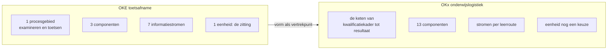

# De OKE-vorm tegenover de scope van OKx

Relateert aan: #422, #421, #396, #342.

## 1. Inleiding

### 1.1 Context

De [OKE-afsprakenset voor mbo-toetsafname](https://www.edustandaard.nl/app/uploads/2026/06/OKE-MBO-toetsafname-specs-v1.0.1_20260527definitief.pdf) was het vertrekpunt voor de vorm van de OKx-oplevering. Die afsprakenset noemt OKx zelf als opvolger: hoofdstuk 5 schrijft dat OKE gebruikmaakt van OOAPI en nieuwe wensen richting OOAPI levert, "net zoals toekomstige OKX trajecten dat zullen doen".

De vormdiscussie binnen OKx loopt sindsdien door: de omvang van de koppelvlakspecificatie, de herziening naar interactieketens, en de vraag wat als OEAPI-profiel naar buiten gaat. Dit verslag legt de onderbouwing van die discussie vast.

### 1.2 Doel

Vier vragen:

1. Welke eigenschappen van de OKE-vorm dragen over naar de scope van OKx.
2. Welke eigenschappen vragen een eigen uitwerking, met de reden erbij.
3. Welke eenheid in OKx de rol vervult die de zitting in OKE vervult.
4. Welke gevolgen dat heeft voor de vorm van de oplevering.

Geslaagd wanneer het team hierop een besluit kan nemen dat als architectuurbesluit in Public kan landen.

### 1.3 Scope

In scope: de vergelijking van beide trajecten op procesgebied, aantal componenten, aantal informatiestromen, de dragende eenheid, de belanghebbenden en de documentvorm.

De inhoud van de OKE-specificatie blijft bij Edustandaard. De vorm van de OKx-oplevering wordt uitgewerkt in #421. Het besluit zelf hoort als architectuurbesluit in Public. Al het overige valt buiten dit verslag.

## 2. Wat de OKE-afsprakenset is

Versie 1.0.1, definitief, 27 mei 2026, 104 paginas, een document. Ondertitel: afsprakenset op basis van de AMIGO-aanpak en OOAPI.

| Hoofdstuk | Inhoud |
|---|---|
| 1 Inleiding | Begrippenlijst (1.1) en bronnen (1.2) |
| 2 Scenario | Scenariobeschrijving (2.1), processen (2.2), uitgangspunten (2.3), voorbeelden van systeemlandschap (2.4) |
| 3 Informatiestromen | Zeven stromen, 3.0 tot 3.6, elk met informatieobjecten, interacties en het koppelvlak waar de stroom landt |
| 4 Gegevensmodel | Dertien objecten, elk met de OOAPI-naam en de Nederlandse term ernaast |
| 5 Koppelvlakken | Drie koppelvlakken, met authenticatie, autorisatie en de OAuth-scopes |

Drie functionaliteiten dragen het scenario (2.1): Deelnemerregistratie (DR/SIS), Toetsplanning (TPL) en Toetsafname (TA). De zeven informatiestromen zijn de toetscatalogus, de toetsdeelnemers, het zittingsplan, het toetsdeelnemerresultaat, het zittingsverslag, het studentresultaat en de analyse.

Het procesgebied ligt vast tegen bestaande kaders (2.2): de processen staan uitgewerkt in de MORA-procesketen Examineren, en in ROSA binnen het ketenproces Toetsen van het ketendomein Examineren en Toetsen, met vijf deelprocessen.

De dragende eenheid is de **zitting**: een toetsafname op een bepaald moment op een bepaalde locatie (2.1, stap C). Alle zeven stromen hangen aan die eenheid, van het inplannen tot het vaststellen van het resultaat.

## 3. Wat de scope van OKx is

| As | Vindplaats |
|---|---|
| De keten van kwalificatiekader tot resultaat, met zeven begrippenfamilies | Het [informatiemodel](https://github.com/Npuls-OKx/Public/blob/dev/Informatie-en-gegevensmodellen/informatiemodel.md): 80 objecttypen en 226 relaties |
| Negen Npuls-leerroutes, met de reguliere route eerst en de andere als verschil daarop | Het [kaderscenario leerroute 1](https://github.com/Npuls-OKx/Public/blob/dev/Referentiemateriaal/kaderscenario's/leerroute-1-regulier.md) |
| Binnen een instelling eerst, federatie gefaseerd | [ADR 0008](https://github.com/Npuls-OKx/Public/blob/dev/Referentiemateriaal/adr/0008-scope-planning-eerst-intra-instelling.md) |
| Dertien applicatiecomponenten in het model, waarvan zeven met een eigen document | `componenten.json` en [Applicatiecomponenten](https://github.com/Npuls-OKx/Public/tree/dev/Koppelvlakspecificaties/Applicatiecomponenten) |
| Drie interactiepatronen en vierentwintig datamodelschema's uitgebracht | [Koppelvlakspecificaties](https://github.com/Npuls-OKx/Public/tree/dev/Koppelvlakspecificaties) |
| Een dienstlaag tussen component en endpoint in voorbereiding | [Public PR 100](https://github.com/Npuls-OKx/Public/pull/100) |

De onderwijskundige keuze van een instelling blijft buiten scope. Daardoor ligt het procesgebied van OKx minder vast dan dat van OKE: waar de examenketen in MORA is uitgewerkt, kent de onderwijslogistiek per instelling eigen inrichtingskeuzes. Dat verschil is de aanleiding van #396, waarin vastligt dat tussen de leerroutes en de koppelvlakspecificatie nog geen product staat dat zegt wat een instelling moet kunnen.

## 4. De vergelijking

| As | OKE | OKx | Gevolg voor de vorm |
|---|---|---|---|
| Procesgebied | Een ketenproces, uitgewerkt in MORA en ROSA (2.2) | De onderwijslogistieke keten, met inrichtingskeuzes per instelling | De processen vragen eerst een eigen product: de instellingsspecificatie uit #396 |
| Componenten | Drie functionaliteiten (2.1) | Dertien in het model, zeven met een document | Een document per component houdt geen overzicht; de set vraagt een laag erboven |
| Informatiestromen | Zeven, genummerd en gesloten (3.0 tot 3.6) | Per leerroute een eigen verzameling, met de reguliere route als baseline | De set groeit met elke leerroute, dus de nummering kan niet sluiten zoals bij OKE |
| Dragende eenheid | De zitting: moment en locatie (2.1 stap C) | Nog een keuze, zie hoofdstuk 5 | Zonder die eenheid heeft een stroom geen natuurlijke begrenzing |
| Belanghebbenden | Acht instellingen, drie toetsleveranciers, zes systeemleveranciers, vijf coordinerende partijen | Dezelfde soorten partijen, en daarnaast de rollen rond planning, roostering en studentkeuze | Meer partijen aan tafel betekent meer besluiten per stroom |
| Documentvorm | Een afsprakenset van 104 paginas | Twee releasepakketten met eigen versielijnen | De bundeling in een document draagt niet over |
| Verhouding tot de standaard | Gebruikt OOAPI en levert wensen terug (5) | Hetzelfde uitgangspunt: OEAPI tenzij, zie #342 | Deze eigenschap draagt onverkort over |
| Technische laag | Gescheiden van de semantische laag, met Edukoppeling en OAuth 2.0 (5) | Hetzelfde onderscheid | Draagt onverkort over |

## 5. De eenheid die waarde draagt

In OKE is de zitting de eenheid: zij is te plannen, af te nemen, te beoordelen en vast te stellen, en elke stroom hangt eraan.

OKx kent die eenheid nog niet. Drie kandidaten liggen voor.

| Kandidaat | Wat de eenheid dan draagt | Wat ertegen pleit |
|---|---|---|
| De leeruitkomst | De sleutel die specificatie, aanbod en resultaat verbindt, vastgelegd in [ADR 0026](https://github.com/Npuls-OKx/Public/blob/dev/Referentiemateriaal/adr/0026-leeruitkomst-als-verbindende-sleutel.md) | Zij is een verwijzing en geen logistieke gebeurtenis, dus een stroom begint er zelden en eindigt er zelden |
| De leergelegenheid of het geplande aanbod | Een eenheid met een moment en een plaats, het naaste equivalent van de zitting | Zij bestaat pas na het plannen, en de helft van de keten ligt ervoor |
| De keuze van de student | De gebeurtenis waar waarde voor de student ontstaat, en de aanleiding van het grootste deel van de stromen | Zij raakt meerdere componenten tegelijk, waardoor een stroom moeilijk te begrenzen is |

De keuze hiertussen bepaalt hoe de set wordt opgedeeld. Dit verslag draagt die keuze niet; zij hoort bij #421, met de proefopstellingen die user stories en businesswaarde namens instellingen ophalen als invoer.

## 6. Besluitvoorstel

### Context

OKE levert een afsprakenset voor een afgebakend ketenproces, met drie componenten, zeven gesloten informatiestromen en de zitting als dragende eenheid. OKx draagt de onderwijslogistieke keten met dertien componenten, negen leerroutes en een dragende eenheid die nog een keuze is.

### Afweging

De opbouw van OKE is navolgbaar en bewezen: scenario met uitgangspunten, informatiestromen met hun interacties, een gegevensmodel met de standaardnamen ernaast, en koppelvlakken met de technische laag apart. Die opbouw werkt omdat het aantal stromen vastligt.

De bundeling in een document werkt bij zeven stromen en drie componenten. Bij dertien componenten en een verzameling die per leerroute groeit, loopt die bundeling vast op omvang en op reviewbaarheid.

### Besluit

OKx neemt de **opbouw** van de OKE-afsprakenset over, per interactieketen in plaats van per afsprakenset: elke keten draagt haar scenario, haar informatiestromen met interacties, haar gegevensobjecten en haar koppelvlakken, met de technische laag gescheiden van de semantische.

De **bundeling in een document** draagt niet over. De set wordt per releasepakket samengesteld, met een versielijn per pakket.

### Gevolgen

| Gevolg | Raakt |
|---|---|
| Elke interactieketen draagt de vijf onderdelen van de OKE-opbouw, zodat een lezer dezelfde volgorde aantreft | De lopende ketens in meta |
| De nummering van informatiestromen sluit per keten en niet over de set | #342 |
| De dragende eenheid per keten wordt expliciet benoemd, zoals de zitting dat in OKE is | #421 |
| Een product tussen leerroute en koppelvlak is nodig om het procesgebied vast te leggen | #396 |
| De verhouding tot de standaard en de scheiding van de technische laag blijven zoals OKE die legt | #342 en de uitgangspunten in Public |

## 7. Bronnen

| Bron | Gebruikt voor |
|---|---|
| [OKE MBO-toetsafname afsprakenset 1.0.1, 27 mei 2026](https://www.edustandaard.nl/app/uploads/2026/06/OKE-MBO-toetsafname-specs-v1.0.1_20260527definitief.pdf) | Hoofdstuk 2 en de OKE-kolom in hoofdstuk 4, met de paragraaf per uitspraak |
| Het [informatiemodel](https://github.com/Npuls-OKx/Public/blob/dev/Informatie-en-gegevensmodellen/informatiemodel.md) met `informatiemodel.json` | De aantallen objecttypen en relaties |
| [ADR 0008](https://github.com/Npuls-OKx/Public/blob/dev/Referentiemateriaal/adr/0008-scope-planning-eerst-intra-instelling.md) en [ADR 0026](https://github.com/Npuls-OKx/Public/blob/dev/Referentiemateriaal/adr/0026-leeruitkomst-als-verbindende-sleutel.md) | De afbakening en de verbindende sleutel |
| Het [kaderscenario leerroute 1](https://github.com/Npuls-OKx/Public/blob/dev/Referentiemateriaal/kaderscenario's/leerroute-1-regulier.md) | De keten en de leerroutes |
| #396, #342, #421 en [Public PR 100](https://github.com/Npuls-OKx/Public/pull/100) | De lopende uitwerkingen per gevolg |
