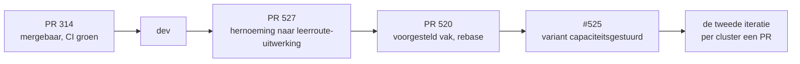

# Dekking van de reviewsessies tegenover de stand van de leerroute-uitwerking

Dit verslag legt vier reviewsessies naast de stand van de voorbeelduitwerking en naast de open issues in GitHub, en adviseert over de volgorde waarin het werk landt. Het beslist niets: de volgordekeuze en de scopekeuzes liggen bij de opdrachtgever.

## Inleiding

### Context

De voorbeelduitwerking van leerroute 1, tot 10 november 2026 *modeldoorloop* genoemd, is het instrument waarmee OKx het informatiemodel aan een echte opleiding toetst. Zij ligt sinds 29 september ter review in [PR 314](https://github.com/Npuls-OKx/meta/pull/314). In vier sessies tussen 28 oktober en 10 november is zij fase voor fase doorgelopen met Niels van Duin en Garik Hakopian. Die sessies leverden bevindingen op die deels in issues staan, deels al verwerkt zijn en deels nergens vastliggen.

De opdrachtgever meldt dat het overzicht verloren is. Dat is navolgbaar: er staan 209 open issues, waarvan 35 onder de milestone van deze uitwerking, en het is van buitenaf niet te zien welke daarvan al afgerond werk beschrijven.

### Doel

1. Welke onderwerpen zijn in de vier sessies besproken die het informatiemodel of de leerroute-uitwerking raken?
2. Welke daarvan zijn al gedekt door een open issue, welke deels, en welke nergens?
3. Wat is de stand van de leerroute-uitwerking zelf, per fase?
4. Hoeveel werk staat er nog, en in welke orde kan dat landen?
5. Landt dat werk op PR 314 of in nieuwe pull requests nadat 314 gemerged is?

### Scope

Dit verslag gaat over de inhoud van de leerroute-uitwerking en het informatiemodel. Het gaat niet over de interactieketenspecificaties zelf (milestone *Interactieketenspecificaties opstellen*), niet over de requirementsboom en niet over de backlogopzet die Garik Hakopian naast GitHub maakt.

## De bronnen

| Sessie | Datum | Duur | Omvang | Gelezen |
|---|---|---|---|---|
| Review informatiemodel en planningsfasen F1-F2 | 28 oktober 2026 | 1u24 | 88.789 bytes | samenvatting en eerste deel |
| Review informatiemodel doorloopstap F3-01 | 4 november 2026 | 1u12 | 77.896 bytes | volledig |
| OKX-interactieketens en gegevensuitwisseling | 4 november 2026 | 3u13 | 176.190 bytes | volledig |
| OKX-werkverdeling en leerrouteontwerp | 10 november 2026 | 0u52 | 47.503 bytes | volledig |

De opdracht noemde drie transcripten. De sessie van 28 oktober is er als vierde bij gekomen omdat de sessie van 4 november vaststelt dat haar uitkomsten op dat moment nog niet waren doorgevoerd: *"review informatiemodel fase 1 tot fase 2. Nou ja, die wijzigingen moet ik nog doorvoeren."* Van die vierde sessie is de samenvatting en het eerste deel van het transcript gelezen, niet het geheel; wat hier over 28 oktober staat rust dus deels op de door een taalmodel gemaakte samenvatting en niet op het woordelijke transcript. De werkwijze rond opname en transcriptie staat in [privacy-meetings-en-transcriptie.md](../../../project/privacy-meetings-en-transcriptie.md); een transcript draagt geen toon en geen bedoeling, alleen woorden.

## De stand van de leerroute-uitwerking

Gemeten op branch `526-naam-leerroute-uitwerking`, die bovenop `290-fase-8` staat en dus de stand van PR 314 draagt inclusief de merge met `dev` van 6 november.

| | |
|---|---|
| Regels in de tabel | 275 |
| Fasen | 8 |
| Beelden | 67 |
| Bevindingen van de controleur | 13 |
| Signaleringen | 57 |
| Register van de reviewronde | 38 bevindingen, alle op `doorgevoerd` |
| Testgevallen | 657 groen |

### Per fase

| Fase | Naam | Beelden | Regels | Uitwisselingen | Verwachte objecttypen |
|---|---|---|---|---|---|
| 1 | Kwalificatiekader analyseren en grofmazig ontwerpen | 13 | 111 | 1 | 18 |
| 2 | Publiceren en planbaar maken | 9 | 44 | 3 | 7 |
| 3 | Instroom, intake en plaatsing | 8 | 24 | 2 | 7 |
| 4 | Detailleren, roosteren en inschrijven | 11 | 45 | 6 | 6 |
| 5 | Onderwijs uitvoeren en voortgang begeleiden | 5 | 16 | 4 | 11 |
| 6 | Organiseren van keuzemomenten | 8 | 12 | 7 | 2 |
| 7 | Bijsturen planning en aanbod | 6 | 6 | 3 | 0 |
| 8 | Examineren, vaststellen en diplomeren | 7 | 17 | 3 | 9 |

Fase 1 draagt 111 van de 275 regels, veertig procent, en fase 6 en 7 samen achttien. Dat is geen fout maar het gevolg van de opzet: fase 1 ontleedt het kwalificatiedossier tot op de leeruitkomst, en de latere fasen verplaatsen die objecten. Het betekent wel dat een correctie in fase 1 zwaarder doorwerkt dan een correctie verderop.

Alle acht fasen staan op `dekking: volledig`. Dat zegt dat elk gat in de dekkingscontrole een motivering draagt, niet dat de inhoud is uitgereviewd. Fase 7 en 8 zijn in geen van de vier sessies inhoudelijk doorgelopen: de sessie van 4 november middag stopte na fase 6.

### Wat de controleur meldt

De dertien bevindingen zijn alle van dezelfde soort: een objecttype dat binnen de scope van OKx valt en in geen enkele fase-verwachting staat. Veertien objecttypen hebben die status; dertien ervan leveren een bevinding.

```
Eindkwalificatie              Minor aanbod verbintenis      Onderwijslocatie vlekkenplan
Expertise of functieprofiel   Minor resultaat               Onderwijsvorm
Landelijk Opleidingsprofiel   Minor ruimte                  Organisatie-eenheid
Minor                         Onderwijslocatie              Werkveld of beroepenveld
Minor aanbod                  Onderwijslocatie type
```

Vier daarvan gaan over de locatie en de organisatie-eenheid. Vijf gaan over de minor, die in leerroute 1 niet voorkomt. De overige vijf raken het kwalificatiekader en het hoger onderwijs.

Daarnaast draagt de tabel vijf objecttypen die noch het informatiemodel noch de conceptplaat kent: `Onderwijskundige taxonomie`, `Nominale Leerroute`, `Zitting`, `Zittingsrapport` en `Examendossier`. Alleen `Nominale Leerroute` draagt `voorstel: true` en wordt daarmee gestippeld getekend; de andere vier staan er als gewone regel en leveren een signalering. Dat is een inconsistentie: de tabel heeft een mechanisme om een nog niet gemodelleerd objecttype als voorstel te tonen, en vier van de vijf gebruiken het niet.

## De stand in GitHub

209 open issues, 195 met een milestone. De zes grootste:

| Open | Milestone |
|---|---|
| 47 | Begrippenkader en informatiemodel verdiepen |
| 35 | Voorbeelduitwerking leerroute 1 per fase afmaken |
| 16 | Aanbod- en keuzevraagstukken verdiepen (LR1-3) |
| 16 | Informatiestromen hoofdplaat: onderhoudbaar en gevalideerd |
| 15 | Agent-harness verbeteren |
| 12 | Interne research en sectoranalyse |

### De kern van het overzichtsprobleem

PR 314 sluit 21 issues. Daarvan staan er 18 onder de milestone *Voorbeelduitwerking leerroute 1 per fase afmaken*, die 35 open issues heeft. Meer dan de helft van die milestone beschrijft dus **afgerond werk dat op een merge wacht**:

```
sluit met PR 314 (18)   283 284 285 286 287 288 289 290 293 294 295 296
                        407 439 495 496 497 498
blijft open (17)        247 317 344 350 411 501 502 503 504 505 506
                        508 510 525 526 529 530
```

Twee andere issues die PR 314 sluit, 499 en 500, staan onder *Aanbod- en keuzevraagstukken verdiepen*; 406 is al gesloten.

Dit is de belangrijkste verklaring voor het verloren overzicht, en het is met een merge op te lossen in plaats van met een herindeling.

## Wat de sessies hebben besproken

Veertig onderwerpen, geclusterd. Per cluster staat wat er is gezegd en waar het landt. Citaten zijn woordelijk uit het transcript; de lezing eromheen is afleiding.

### Terminologie en structuur

De sessie van 4 november ochtend heeft de taal van de specificaties vastgezet. *Koppeling* vervalt als term, omdat zij bij architecten en leveranciers staat voor de geimplementeerde, geauthenticeerde verbinding die een leverancier bouwt. Niels: *"een koppeling is een fysieke geauthenticeerde mogelijkheid tot uitwisseling tussen twee systemen."* In de plaats daarvan: een **interactieketen** is een logische bundeling van interacties die samen waarde oplevert, ongeveer een op een met een business capability; daaronder **interacties**; daaronder **operaties** als kleinste herbruikbare eenheid, een HTTP-methode op een endpoint, ondergebracht bij een **koppelvlakdienst** met een aanbieder- en een afnemersymbool. Het woord *capability* wordt vermeden richting IAM'ers en instellingen, omdat die in ketens denken.

Daarnaast is besloten dat de uitwerking out-of-scope voorstappen blijft tonen. Niels: *"om het verhaal onderwijs tot de juiste interactieketen te komen, moeten we een stukje de voorstand en achterstand meenemen."* Garik merkte daarbij op dat iets wat je raakt daarmee in scope is om iets over te zeggen, en Niek bevestigde dat: conceptueel weten wat er binnenkomt, zonder te beschrijven wat het in detail inhoudt.

Een open vorm-vraag: is de interactieketen *onderwijsaanbod* te groot? Niek: *"eigenlijk is het onderwijsontwerp en onderwijsaanbod, en zijn dat misschien nog wel twee losse ketens."*

### Eigenaarschap van het onderwijsaanbod

Dit is het zwaarste openstaande punt en het is in twee sessies niet beslecht. Niek en Garik redeneren vanuit het bronsysteemprincipe: het planningssysteem maakt het aanbod en informeert zowel de catalogus als de kernregistratie direct. Garik: *"dat is niet een goede design. Dat maakt OC veel te belangrijk, een. En twee, de echte bron van de data is waar je het moet ophalen in de andere componenten."* Niek daarop: *"anders krijg je de kans op data divergatie."*

Niels redeneert vanuit de praktijk van leerroute 1: *"eigenlijk het moment dat ik verzoek aan planning, heb ik al besloten dat ik het ga aanbieden. Het is alleen van planning valideren alleen even of het ook daadwerkelijk kan."* Niek vatte het verschil zo: *"je ziet het verschil tussen een systeem dat leidend is en een systeem dat ondersteunend is."*

Er is een tussenvorm genoemd die het dichtst bij een oplossing komt: de catalogus is eigenaar van de specificatie en van een `verzoek tot aanbod`, en het aanbodobject zelf ontstaat, wijzigt en stroomt alleen vanuit het planningssysteem. Letterlijk vastgesteld is alleen dat er niets is vastgesteld: *"volgens mij is daar nog niks op besloten."*

### Fase 1, onderwijsontwerp

De studentkeuzeregelset op F1-07 moet splitsen in twee blokken: beroepsspecifieke keuzedelen en generieke. Generiek zijn de keuzedelen die in elk domein aangeboden kunnen worden, met Duurzaam Ondernemen als het voorbeeld dat Niels noemt en Nederlands 1F of Duits 1F als vakken. Beroepsspecifiek is wat alleen vanuit deze opleiding gekozen mag worden. Niek: *"omdat we in Jochem zitten timmeren we hier met deze keuzes specifiek aan de voorkant dicht; terwijl als je straks naar flexibelere fases gaat, dan moet die keuzeregelset dynamisch opgebouwd worden afhankelijk van leeruitkomsten die je haalt."*

De specificatie draagt het ontwerpende team en niet de locatie. Niels: *"bij de specificatie hangt er wel een team aan die het ontworpen heeft, maar die hoeft niet, kan op meerdere locaties aangeboden worden."*

De constraints die een planningssysteem nodig heeft zitten in de onderwijsspecificatie: studiebelastingsuren met begeleide en onbegeleide tijd, ruimtetype, menselijke inzet met expertise, en de set lokalen waarbinnen het mag plaatsvinden. OKx lost het planningsprobleem niet op, dat is NP-hard, maar levert de constraints gestandaardiseerd aan.

### Fase 2, planbaar maken en aanbod

De locatie valt definitief in het opleidingsprogramma-aanbod. Niels: *"in het opleidingsprogramma-aanbod maak ik definitief waar ik het allemaal ga aanbieden"*, en op de vraag of elk aanbod een vaste locatie heeft: *"heeft een stamlocatie, zou ik dan zeggen."*

Daaruit volgt een inrichtingsgevolg dat de uitwisseling vermenigvuldigt. Niels: *"ik moet al tegen mijn 25 instanties van mijn planningssysteem, die op locatie zit, gaan zeggen: deze specificatie wil ik aanbieden op deze 25 locaties. Dus ik krijg 25 berichten."*

### Fase 3, instroom, intake en plaatsing

Zes correcties, waarvan twee al verwerkt. De regel die de hele fase beheerst is deze, en zij is belangrijker dan de losse punten:

> Je ziet eigenlijk al dat je hier nooit alleen de verbintenis verstuurt, maar ook eigenlijk het aanbod en daarin de relatie tot de locatie. **Want de verbintenis zelf draagt niet de locatie.**

En de samenvatting die Niek er zelf aan gaf: *"dat is al een goede vondst, die locaties moeten overal bij."* Concreet genoemd bij F3-01, F3-02, F3-03, F3-04, F3-07 en F3-08. Daarnaast: aanmelding en inschrijving zijn een status op een verbintenis en geen eigen objecten, want *"anders maak je weer een object aan wat een aparte levenscyclus heeft, dat weer beheerd moet worden."*

### Fase 4, detailleren, plaatsen en roosteren

Het zwaartepunt van de sessie van 4 november middag. Tien beelden geraakt:

| Beeld | Wat er moet gebeuren |
|---|---|
| F4-01 | de hele specificatiestructuur als input, met de toetsonderdeelspecificatie erbij |
| F4-02, F4-03 | vervallen in hun vorm: de fijne uitwerking gebeurt in het LMS, terug komt een referentie en een status |
| F4-04 | de resultaatstructuur naar het SVS en niet naar het KRS, met zak- en slaagregeling en de formatieve structuur erbij |
| F4-05 | vervalt en gaat op in F4-04 |
| F4-06 | lege plaatsingsgroepen gaan al vlak na F3-01 naar planning; F4-06 koppelt daarna de ingeschreven studenten |
| F4-07, F4-08 | de lesgroep als object, uit een specificatie meerdere gelegenheden |
| F4-10 | de lesgroepen komen uit het roostersysteem, en de route loopt via het studentkeuzesysteem |
| F4-11 | planninggroepen met studenten naar het SVS |

### Fase 5, onderwijsuitvoering

Formatieve toetsing wordt niet door de keten gepland. Niels: *"formatieve voortgang wordt niet gepland via het ecosysteem wat hierboven beschreven is. Dat doet een docent in de les."* De resultaten stromen van het LMS naar het SVS en worden daar tegen de formatieve resultaatstructuur geplaatst; leergelegenheid en onderwijseenheid horen niet in dat bericht. En F5-05 moet het studiebeeld uitbreiden met de formatieve resultaatstructuur, zodat zichtbaar is of een student klaar is voor summatieve examinering.

### Fase 6, keuzedelen, en het nieuwe concept

Fase 6 is de minst uitgewerkte fase: acht beelden met twaalf regels, tegen fase 1 met dertien beelden en 111 regels. Dat is in de sessie van 10 november ook vastgesteld. Niek over F6-06: *"deze zou sowieso alles fout kunnen zijn, dus daar moeten we even rekening mee houden."*

Drie dingen. F6-01 mist een processtap: het verzoek tot aanbod van de catalogus naar planning en het geplande aanbod terug. Niels: *"de eerste stap zou moeten zijn: wij gaan dit keuzedeel in ons assortiment opnemen, planning check, en ontsluiten naar KRS en de buitenwereld. Dus behandel het als een opleiding. Dat stukje mis ik helemaal."* F6-02 draagt te weinig informatiedichtheid en mist de locatie.

En dan het nieuwe concept, dat de aanleiding voor deze analyse was.

#### Het vastgestelde roostermoment

Niels beschrijft een werkwijze die in mbo-land best practice is voor keuzedelen:

> Normaal gesproken zou dit zijn dat je in je planningsregel die naar rooster gaat vastzet dat dit een te plannen leergelegenheid uit mijn leerspecificatie is. En ik stel vast dat hij altijd op donderdagmiddag tussen het vijfde en het achtste uur gaat plaatsvinden. En dat doe je over de volledige breedte van alle keuzedelen zodat een student zijn beschikbaarheid altijd reeel is.

De noodzaak is hard: *"als je dit niet doet, dan heb je geen student die uberhaupt een keuzedeel kan volgen."* De reden is dat generieke keuzedelen opleidingsoverstijgend worden aangeboden, dus moeten planners over organisatie-eenheden heen afspreken dat zij op hetzelfde moment vallen. Niek zag er direct de aard van in: *"dit is dus eigenlijk een techniek om dat constraint satisfaction makkelijker te maken."*

De plaatsingsvraag bleef open en kent drie kandidaten, alle drie in de sessie genoemd:

| Kandidaat | Argument | Tegen |
|---|---|---|
| attribuut op de specificatie | Niels: *"in je leerspecificatie van je opleiding moet je in ieder geval aangeven dat dit op een vast moment gaat plaatsvinden"*, omdat het opleidingsoverstijgend gebruikt wordt | Niek: *"dit raakt alle specificaties"*; een keuzedeel krijgt dan prioriteit over elke andere specificatie |
| op de keuzedeelruimte | Niek: dan maakt het niet uit welk keuzedeel je eraan koppelt; je legt het op een punt vast en alle specificaties die je eraan hangt voldoen eraan | de ruimte is een eigenschap van het programma, niet van het aanbod |
| in het verzoek tot aanbod | Niels: *"ik kijk trouwens dat deze zelfs in het verzoek tot aanbod meegenomen moet worden"*; Niek: nodig zodra het naar leerroute 7 tot 9 gaat | zegt niets over de specificatie zelf, dus de reservering is niet af te dwingen |

De conclusie waar de sessie op uitkwam, van Niels:

> Volgens mij is dit ook gewoon een stukje plannen-en-roosteren-logica die we in dat gebied moeten plaatsen, en dat we eigenlijk alleen maar het keuzedeel moeten taggen van: let op, dit is een keuzedeel. Dan kan een onderwijsplanner op het moment dat je een periode gaat plannen die handeling doen. Dat hoort in de functionaliteit van plannen, en dan maakt het planfunctionaliteit en niet uitwisselingsfunctionaliteit.

Twee waarschuwingen staan er letterlijk bij. Niels: *"dit is de Jochem-oplossing en dit gaat niet meer werken op het moment dat alles modulair is opgebouwd."* En Niek: *"dit is precies die keuzemechaniek die ons straks in onze reet gaat bijten met modulair onderwijs als we hier een verkeerde keus maken."* Niels wil de aanname bovendien nog bij scholen toetsen: hij noemt haar *"voor 95 procent zeker"* de werkwijze.

Dit verslag neemt die conclusie niet over als besluit. Zij is in een sessie van vijftig minuten bereikt, aan het eind, met het expliciete voorbehoud dat de keuze later duur kan worden. Zij hoort door een eigen afweging heen.

### Onderwijslocatie, dwars door de fasen

De vier locatie-objecttypen komen nergens in de regeltabel voor. De semantiek is in de sessie wel vastgezet: *"onderwijslocatie is gewoon letterlijk het adres van de poort"*, en een vlekkenplan *"bevat lokalen, die op meerdere locaties zouden kunnen zijn."* De richting loopt van bovenaf indirect via de organisatie-eenheid en van onderaf direct uit wat de les nodig heeft, want *"als we die link directer leggen, dan sta je weer heel veel ambiguiteit toe."* Het doel formuleerde Niek zo: *"het gaat erom dat je die onderwijslocaties kunt toewijzen aan ieder object."*

Er staat een tegenspraak in het transcript die het modelleren blokkeert: Niek zei *"een vlekkenplan bestaat uit onderwijslocaties"* en Niels *"een vlekkenplan bevat lokalen."* Die twee lopen tegen elkaar in, en het informatiemodel kent `Onderwijslocatie vlekkenplan` als objecttype.

### Fase 7 en 8

Niet doorgelopen. De sessie van 4 november middag stopte na fase 6. De tabel draagt bij F7-05 en F8-05 wel vragen, en F8-03 en F8-05 dragen de drie objecttypen die het model niet kent.

## Dekking in GitHub
Negenenveertig bevindingen zijn tegen de 209 open issues gelegd, en elke dekkingsclaim is daarna door een tweede ronde tegengelezen die haar mocht weerleggen. Die tweede ronde weerlegde 21 van de 49 claims en verlaagde acht statussen; zij verhoogde er geen. Dat is de bedoelde richting: een te hoge claim laat werk verdwijnen.
| Status | Aantal | Betekenis |
|---|---|---|
| gedekt | 15 | een open issue beschrijft de bevinding met acceptatiecriteria |
| deels | 26 | een of meer issues raken haar, maar een deel blijft onbeschreven |
| niet | 8 | geen enkel open issue beschrijft haar |

### Per cluster
| Code | Bevinding | Status | Issues |
|---|---|---|---|
| | **Terminologie en structuur** | | |
| A1 | Koppeling vervalt als term; de lagen worden interactieketen, interactie, operatie en koppelvlakdienst, met aa... | deels | #445, #372, #386 |
| A2 | Applicatiediensten modelleren naast applicatiecomponenten, alleen waar zij een interactieketen raken. | gedekt | #514, #515 |
| A3 | Data-eigenaarschap in een eigen document per applicatiecomponent in plaats van per interactieketen. | niet | geen |
| A4 | De interactieketen onderwijsaanbod is mogelijk te groot: onderwijsontwerp en onderwijsaanbod als twee ketens. | niet | geen |
| A5 | Voorstappen en nastappen buiten de scope horen in de uitwerking om de datarelaties te ankeren. | deels | #439 |
| A6 | De plaat heet 1.7.1 in plaats van 1.7a, want semantic versioning geldt overal in de repository. | niet | geen |
| A7 | Eerst een integrale ecosysteembeschrijving, daarna modulair knippen. | niet | geen |
| A8 | Meerdere routes naast de blauwdruk accepteren; RijnIJssel en Summa zijn het bewijs dat er meer wegen zijn. | deels | #444, #522 |
| | **Eigenaarschap en bronsysteem** | | |
| B1 | Het eigenaarschap van het onderwijsaanbod is onbeslist: planning beheert het aanbod, of de catalogus besluit ... | deels | #436, #513, #264 |
| B2 | Het RIO-model wordt leidend voor de uitwisseling richting RIO en AII, met de onderwijscatalogus als bron, vas... | gedekt | #513 |
| | **Fase 1, onderwijsontwerp** | | |
| C1 | F1-07: de studentkeuzeregelset splitsen in een beroepsspecifiek en een generiek blok, met dynamische regelset... | deels | #409, #331, #332, #398 |
| C2 | De onderwijsspecificatie draagt het ontwerpende team en niet de locatie; de lokaalbehoefte ontstaat van onder... | deels | #505, #439, #264, #509 |
| C3 | De constraints die planning nodig heeft zitten in de onderwijsspecificatie: begeleide en onbegeleide studiebe... | deels | #509, #439, #264, #72 |
| | **Fase 2, planbaar maken en aanbod** | | |
| D1 | De locatie valt definitief in het opleidingsprogramma-aanbod; elk aanbod heeft een stamlocatie | deels | #505, #434, #8 |
| D2 | Planning staat per locatie: een verzoek tot aanbod gaat naar 25 locatiegebonden planninginstanties, dus 25 be... | deels | #80, #91 |
| | **Fase 3, instroom, intake en plaatsing** | | |
| E1 | F3-01 en F3-02: het opleidingsprogramma-aanbod hangt via de organisatie-eenheid aan een onderwijslocatie, met... | gedekt | #505 |
| E2 | F3-03: twee objecten erbij die het opleidingsprogramma-aanbod aan de verbintenis koppelen, met de locatie erbij | gedekt | #504 |
| E3 | Aanmelding en inschrijving zijn een status op een verbintenis, geen eigen objecten | gedekt | #504 |
| E4 | F3-07: de plaatsingsgroep ontstaat in het KRS en niet in het intakesysteem (VERWERKT) | deels | #495 |
| E5 | F3-08: leeruitkomst vervalt als sleutel voor vrijstelling; vrijstelling landt als vrijgesteld onderdeel in de... | deels | #496, #398 |
| E6 | F3-08: de link plaatsingsgroep, SLB'er, student en locatie expliciet opnemen | deels | #496 |
| E7 | F3-07: de inschrijving komt van de voorziening centraal aanmelden en niet van het intakesysteem (VERWERKT op ... | niet | geen |
| E8 | De locatie reist mee met het aanbod en niet met de verbintenis; genoemd bij F3-03, F3-04, F3-07 en F3-08 | deels | #505, #504, #496, #506 |
| | **Fase 4, detailleren en roosteren** | | |
| F1 | F4-01 moet de hele specificatiestructuur uit fase 1 als input tonen, met de toetsonderdeelspecificatie erbij | deels | #503 |
| F2 | F4-02 en F4-03 vervallen in hun huidige vorm: uitwerken gebeurt in het LMS, terug komt een referentie (URL) e... | gedekt | #501 |
| F3 | F4-05 vervalt en gaat op in F4-04; summatieve resultaatstructuur naar het SVS, met zak- en slaagregeling en d... | gedekt | #502 |
| F4 | Lege plaatsingsgroepen gaan al vlak na F3-01 van het KRS naar planning, met opleiding en locatie en zonder st... | gedekt | #506 |
| F5 | F4-07 en F4-08: de lesgroep als object, uit een leerspecificatie meerdere leer- en lesgelegenheden op grond v... | deels | #507, #509, #286, #389 |
| F6 | F4-10: de lesgroepen komen uit het roostersysteem en niet uit het KRS (VERWERKT in PR 314) | gedekt | #497 |
| F7 | F4-10: de route loopt van roostersysteem naar SKS en van SKS naar LMS; de derde route via de kernregistratie ... | gedekt | #529, #511 |
| F8 | F4-11: planninggroepen met studenten naar het SVS voor aanwezigheidsregistratie en begeleiding, met eventueel... | deels | #511, #264, #286 |
| F9 | De plaatsingsgroep draagt opleiding en locatie, anders weet planning niet in welke planningsomgeving de groep... | deels | #506, #505, #235 |
| | **Fase 5, onderwijsuitvoering** | | |
| G1 | Formatieve toetsing wordt niet door de keten gepland; de docent doet dat in het LMS en de resultaten landen v... | gedekt | #508 |
| G2 | F5-04: leergelegenheid en onderwijseenheid-resultaat uit het resultaatbericht, want de resultaatstructuur los... | gedekt | #498 |
| G3 | F5-05: het studiebeeld uitbreiden met de formatieve resultaatstructuur, zodat zichtbaar is of een student kla... | gedekt | #508 |
| | **Fase 6, keuzedelen** | | |
| H1 | F6-01 moet de studentkeuzeregelset en de keuzedeelruimte als eerder uitgewisselde input tonen; al verwerkt in... | gedekt | #499 |
| H2 | F6-06 laat het keuzemoment via de jaaruitzetting van de plaatsingsgroep lopen; verwerkt, met de triggervraag ... | gedekt | #500, #512 |
| H3 | F6-01 mist de processtap verzoek tot aanbod van de catalogus naar planning en het geplande keuzedeelaanbod te... | deels | #510, #499, #288, #402 |
| H4 | F6-02 draagt te weinig informatiedichtheid en mist de onderwijslocatie; de plaat loopt achter op de wijziging... | deels | #288, #264, #332, #505, #331 |
| H5 | F6-06 kan in zijn geheel fout zijn en vraagt een volledige herijking, niet alleen de correctie op de pijl | deels | #500, #288, #512, #264 |
| H6 | Nieuw concept: het vastgestelde roostermoment (voorkeurstijdslot) waarop keuzedelen instellingsbreed worden a... | deels | #104, #402, #403 |
| | **Fase 7 en 8** | | |
| I1 | Fase 7 en 8 zijn in de drie sessies niet inhoudelijk doorgelopen; de openstaande vragen bij F7-05 en F8-05 bl... | deels | #289, #290, #264, #389, #438 |
| | **Onderwijslocatie** | | |
| J1 | Semantiek: onderwijslocatie is het adres van de poort en een vlekkenplan bevat lokalen, wat botst met het obj... | deels | #505, #264 |
| J2 | Van bovenaf hangt de locatie indirect via de organisatie-eenheid aan het aanbod, van onderaf komt zij direct ... | deels | #505, #403 |
| J3 | Het doel is dat onderwijslocaties aan ieder object toewijsbaar zijn; het vlekkenplan is daarbij bijzaak | deels | #505, #8, #369 |
| J4 | Geen van de vier objecttypen `Onderwijslocatie`, `Onderwijslocatie type`, `Onderwijslocatie vlekkenplan` en `... | deels | #505 |
| | **Werkwijze** | | |
| K1 | De 33 bevindingen van Niels uit de sessie van 4 november ochtend moeten gecontroleerd worden op juiste interp... | niet | geen |
| K2 | Garik maakt een high-level backlog buiten GitHub, naast de bestaande issues, en legt die donderdag 13:30 voor | niet | geen |
| K3 | Twee zolderkamersessies gepland, maandag vanaf 10:00, om de leerroute-uitwerkingen af te maken | niet | geen |

### Wat nergens staat
Acht bevindingen zijn door geen enkel open issue belegd. Drie daarvan vragen geen issue: twee zijn werkafspraken uit de sessie van 10 november (de backlogopzet van Garik Hakopian en de zolderkamersessies) en een is een reviewactie voor Niels van Duin (de 38 bevindingen uit zijn ronde staan alle op `doorgevoerd` in het register, maar of de interpretatie klopt kan alleen hij vaststellen).

Vier vragen wel een issue, en een vijfde staat op `deels` terwijl het concept zelf onbelegd is:

- **A3** (niet): Data-eigenaarschap in een eigen document per applicatiecomponent in plaats van per interactieketen.
- **A4** (niet): De interactieketen onderwijsaanbod is mogelijk te groot: onderwijsontwerp en onderwijsaanbod als twee ketens.
- **A6** (niet): De plaat heet 1.7.1 in plaats van 1.7a, want semantic versioning geldt overal in de repository.
- **A7** (niet): Eerst een integrale ecosysteembeschrijving, daarna modulair knippen.
- **H6** (deels): Nieuw concept: het vastgestelde roostermoment (voorkeurstijdslot) waarop keuzedelen instellingsbreed worden aangeboden, en de vraag waar dat concept landt

Bij H6, het vastgestelde roostermoment, staat de status op `deels` omdat de drie varianten van de planningsmethodiek wel belegd zijn: #104 intekenen op niet gepland aanbod, #402 capaciteitsgestuurd en #403 roostergestuurd. Het concept zelf, het vastgestelde moment en de vraag waar het landt, komt in geen open of gesloten issue voor.

### Een dekkingsclaim die de merge raakt
De tegenleesronde vond een gevolg van de correctie van 6 november dat nog niet is bijgewerkt. Criterium 2 van [#495](https://github.com/Npuls-OKx/meta/issues/495) luidt: *"De stroom vanuit het intakesysteem naar het KRS draagt de uitkomst van de intake en niet de plaatsingsgroep."* Die stroom bestaat in F3-07 niet meer: de afzender is op aanwijzing van de opdrachtgever gewijzigd naar de voorziening voor centraal aanmelden, omdat hoofdplaat v1.7a geen lijn van het intakesysteem naar de kernregistratie heeft. PR 314 draagt `Closes #495`, dus bij de merge sluit een issue op een criterium dat de uitwerking tegenspreekt. Dat criterium hoort bijgewerkt voordat 314 merget.

## Hoeveel werk er staat

De bevindingen raken beelden in fase 1 tot en met 6. Geschat op de beeld-ID's die in de sessies bij naam zijn genoemd:

| Fase | Beelden in de fase | Geraakt door een bevinding |
|---|---|---|
| 1 | 13 | 3 (F1-05, F1-06, F1-07) |
| 2 | 9 | 3 (F2-01, F2-03, F2-08) |
| 3 | 8 | 6 (F3-01 tot F3-04, F3-07, F3-08) |
| 4 | 11 | 10 (F4-01 tot F4-08, F4-10, F4-11) |
| 5 | 5 | 3 (F5-01, F5-04, F5-05) |
| 6 | 8 | 3 (F6-01, F6-02, F6-06) |
| 7 | 6 | 0 |
| 8 | 7 | 0 |
| **totaal** | **67** | **28** |

Achtentwintig van de 67 beelden, en fase 4 vrijwel geheel. Dat is geen reeks correcties maar een tweede iteratie over de uitwerking.

Daarbij hoort een harde beperking. Drie bevindingen vragen een objecttype dat het informatiemodel niet kent: de lesgroep, het vastgestelde roostermoment en de relaties van de onderwijslocatie naar de specificatie- en aanbodlagen. Het model wijzigt alleen de modelleur in Archi; harde regel 1 van [AGENTS.md](../../../AGENTS.md) verbiedt een agent elk `.archimate`-bestand aan te raken. De uitwerking kan daar wel op vooruitlopen: een regel met `voorstel: true` toont een nog niet gemodelleerd objecttype gestippeld en levert een signalering in plaats van een bevinding. Dat mechanisme bestaat en wordt nu een keer gebruikt, bij `Nominale Leerroute` op F2-03.

## Advies

### De volgorde

Dit verslag raadt aan PR 314 te mergen voordat de tweede iteratie begint, en de iteratie daarna in pull requests per cluster te laten landen.



### Wat ervoor pleit

**De huidige staat van 314 is bederfelijk.** De tak is op 6 november met `dev` samengevoegd: 39 conflicten, 54 hunks, waarvan een bestand met de hand moest, `tools/scripts/teken-hoofdplaat-ruim.py`, met zeven conflicthunks en twee functiefamilies naast elkaar. Sinds die merge staat `dev` stil. Vijf open pull requests raken precies dat ene bestand en zijn test: 364, 373, 377, 387 en 520. Landt een van die vijf eerst, dan moet die handmatige samenvoeging opnieuw.

**De merge lost het overzichtsprobleem grotendeels op.** Achttien van de 35 open issues onder de milestone sluiten ermee. Een herindeling van de backlog doet dat niet.

**De tweede iteratie is te groot voor dezelfde pull request.** PR 314 is nu 126 bestanden en +3460/-769 regels, open sinds 29 september. Achtentwintig beelden erbij maakt hem onreviewbaar, en de reviewer kan dan niet meer zien wat hij in ronde een al heeft goedgekeurd. Niels reviewt per fase; dat werkt alleen met een vaste basis om tegen af te zetten.

**De opdrachtgever heeft deze route zelf al gekozen.** Op 6 november: *"ik wil eigenlijk toch die hele modeldoorloop mergen. En dan maar issues gaan open maken op stappen die niet goed zijn. Want er staat te veel open."*

### Wat ertegen pleit, en wat dat kost

**Er landt inhoud op `dev` waarvan bekend is dat zij niet klopt.** F4-02 en F4-03 staan in de verkeerde richting, de locaties ontbreken in alle fasen, F6-01 mist een processtap en F6-06 kan geheel fout zijn. Wie `dev` leest zonder de issues erbij, leest dat als vastgesteld.

De kosten daarvan zijn te beperken en niet weg te nemen. Wat helpt: de uitwerking draagt al een statusaanduiding en een vragenlijst, de zeventien openstaande issues beschrijven precies wat er niet klopt, en de leesroute noemt de uitwerking concept. Wat niet helpt: een lezer van buiten, en daar is de publieke kennisbank voor bedoeld, ziet die issues niet. Het alternatief, 314 dicht houden tot de tweede iteratie klaar is, betekent dat de 67 beelden en 275 regels nog weken onzichtbaar blijven voor de instellingen en leveranciers die er nu om vragen, en dat de handmatige samenvoeging waarschijnlijk nog een keer gedaan moet worden.

**Een tussenvorm is overwogen en afgeraden.** De correcties die klein en ondubbelzinnig zijn alsnog in 314 meenemen, en de rest later. Dat is wat op 6 november met F3-07 is gedaan, en dat werkte: vijf regels, vijf signaleringen minder, de plaat klopt. Het schaalt niet naar achtentwintig beelden, en de grens tussen klein en groot is per bevinding een discussie die de merge opnieuw uitstelt.

### De clusters

De tweede iteratie valt in zeven clusters die los van elkaar kunnen landen. De volgorde binnen de lijst is de aanbevolen volgorde, want de latere clusters leunen op de eerdere.

| Cluster | Wat erin zit | Afhankelijk van |
|---|---|---|
| 1 Hernoeming | PR 527, modeldoorloop wordt leerroute-uitwerking | 314 op dev |
| 2 Locatie door de keten | de vier locatie-objecttypen in fase 1 tot 6, met de vlekkenplanvraag eerst | de modelronde voor de relaties, of `voorstel` |
| 3 Fase 4 herzien | tien beelden, de zwaarste cluster | hernoeming |
| 4 Fase 6 herzien | de ontbrekende processtap, de informatiedichtheid, F6-06 opnieuw | hernoeming |
| 5 Het vastgestelde roostermoment | de plaatsingsvraag beslechten, daarna verwerken | cluster 4, en een toets bij scholen |
| 6 Fase 1, 2, 3 en 5 bijwerken | de resterende negen beelden | hernoeming |
| 7 Fase 7 en 8 reviewen | nog niet doorgelopen; vraagt eerst een sessie | de zolderkamersessies |

Cluster 2 en 5 vragen beide een beslissing voordat er iets te bouwen is: de richting van het vlekkenplan, en de plaats van het roostermoment. Die twee horen in een sessie en niet in een pull request.

## Onzekerheden

**Het transcript van 28 oktober is niet volledig gelezen.** Van die sessie is de samenvatting en het eerste deel van het transcript gelezen. Wat hier over fase 1 en 2 staat rust dus deels op een door een taalmodel gemaakte samenvatting. Drie van haar punten zijn in de tabel wel teruggevonden en dus geverifieerd: de opsplitsing van F2-04 in drie stappen staat er (F2-04 specificatie op haalbaarheid toetsen, F2-05 aanbodvraag per opleiding bepalen, F2-06 jaarplanning op instellingsniveau vaststellen), de toestand `grofmazig gepland` bestaat met de sessie van 28 oktober letterlijk als bron, en het vakexamen Nederlands 3F staat op F2-07. Een punt is niet teruggevonden: het weglaten van de studiebelastingsuren en de onbegeleide onderwijstijd uit F2-01. Die velden staan er nog. Of dat een openstaand punt is of een later herzien besluit, is uit de bronnen niet op te maken.

**De aanname onder het vastgestelde roostermoment is niet geverifieerd.** Niels noemt haar best practice in mbo-land en *"voor 95 procent zeker"*, en wil haar bij andere scholen toetsen. Dit verslag heeft die toets niet gedaan en kan dus niet zeggen of de werkwijze algemeen is of de werkwijze van een paar instellingen.

**Het geschatte werkvolume van achtentwintig beelden is een afleiding.** Het is geteld op de beeld-ID's die in de sessies bij naam vallen. Een bevinding die een beeld raakt zonder het te noemen is niet meegeteld, en een genoemd beeld kan bij uitwerking meer of minder blijken te vragen.

**De dekkingsclassificatie is een inschatting van leesbaarheid en geen formele toets.** Zij is per bevinding gemaakt door de open issues te doorzoeken en daarna door een tweede ronde tegengelezen die de claims mocht weerleggen. Bij twijfel is de lagere dekking gekozen, omdat een te hoge claim werk laat verdwijnen. Een issue dat het onderwerp raakt zonder de bevinding te beschrijven, geldt hier niet als dekking.

**De tegenspraak over het vlekkenplan is niet opgelost.** Dit verslag stelt haar vast en kiest geen kant.

## Wat dit verslag openlaat

1. Het eigenaarschap van het onderwijsaanbod. Twee lezingen, geen besluit, en het raakt F2-09 en F3-01 rechtstreeks.
2. De plaats van het vastgestelde roostermoment. Drie kandidaten met hun kosten; de sessie koos de goedkoopste en waarschuwde er zelf voor.
3. De richting van de relatie tussen vlekkenplan en onderwijslocatie.
4. Of de interactieketen onderwijsaanbod splitst in onderwijsontwerp en onderwijsaanbod.
5. Of de studiebelastingsuren en de onbegeleide onderwijstijd uit F2-01 moeten.
6. Of fase 7 en 8 in de huidige vorm de review in kunnen, of eerst een eigen ronde vragen.

## Het werk, als issues

Vijf nieuwe issues staan onder de milestone *Leerroute-uitwerking: tweede iteratie na de reviewronde*. Zij dekken de vier bevindingen die nergens stonden, plus het nieuwe concept uit de sessie van 10 november.

| Issue | Bevinding | Wat het oplevert |
|---|---|---|
| [#531](https://github.com/Npuls-OKx/meta/issues/531) | H6 | de afweging waar het vastgestelde roostermoment landt, met de drie kandidaten en hun prijs |
| [#532](https://github.com/Npuls-OKx/meta/issues/532) | A6 | de hernoeming van 1.7a naar 1.7.1 op zes plekken, en een test die een letterversie laat falen |
| [#533](https://github.com/Npuls-OKx/meta/issues/533) | A3 | het data-eigenaarschap per applicatiecomponent als eigen document |
| [#534](https://github.com/Npuls-OKx/meta/issues/534) | A4 | de keuze of de interactieketen onderwijsaanbod splitst, met het gevolg voor de snede |
| [#535](https://github.com/Npuls-OKx/meta/issues/535) | A7 | de volgorde als werkafspraak: eerst de integrale beschrijving, dan knippen |

De zesentwintig bevindingen op `deels` krijgen geen nieuw issue. Daar bestaat al een issue dat het onderwerp draagt, en een tweede issue ernaast maakt het overzicht slechter in plaats van beter. Wat er per bevinding nog aan mist staat in de matrix hierboven; dat hoort als uitbreiding in het bestaande issue en niet als duplicaat. De zwaarste gevallen, met het issue dat verbreed moet worden:

| Bevinding | Issue | Wat het issue nog niet draagt |
|---|---|---|
| E8, J1 tot J4 | [#505](https://github.com/Npuls-OKx/meta/issues/505) | de regel dat de locatie met het aanbod meereist en niet met de verbintenis, en dat zij in fase 1, 2, 4 en 6 ook hoort; het issue dekt F3-01 en F3-02 |
| C1 | [#331](https://github.com/Npuls-OKx/meta/issues/331), [#409](https://github.com/Npuls-OKx/meta/issues/409) | de splitsing van de regelset in een beroepsspecifiek en een generiek blok, met de voorbeeldwaarden |
| H3, H4, H5 | [#288](https://github.com/Npuls-OKx/meta/issues/288), [#499](https://github.com/Npuls-OKx/meta/issues/499), [#510](https://github.com/Npuls-OKx/meta/issues/510) | de ontbrekende processtap in F6-01, de informatiedichtheid van F6-02, en dat F6-06 geheel opnieuw kan moeten |
| A1 | [#445](https://github.com/Npuls-OKx/meta/issues/445) | de laagindeling keten, interactie, operatie en koppelvlakdienst, en dat de term koppeling van betekenis verandert |
| F5 | [#507](https://github.com/Npuls-OKx/meta/issues/507) | de vraag van Niels of drie groepjes in een lokaal met dezelfde docent ook een lesgroep zijn |
| B1 | [#436](https://github.com/Npuls-OKx/meta/issues/436), [#513](https://github.com/Npuls-OKx/meta/issues/513) | dat er na twee sessies niets is besloten, en dat de tussenvorm met `verzoek tot aanbod` op tafel lag |

Een voorstel dat dit verslag niet zelf uitvoert: de zeventien issues die na de merge van PR 314 onder milestone 17 overblijven horen naar milestone 26, zodat milestone 17 de eerste iteratie draagt en met de merge leeg raakt. Dat is een herindeling van werk van anderen, en de afspraak uit de sessie van 10 november is dat zulke verschuivingen eerst op een lijst komen en niet uit eigen beweging gebeuren.
