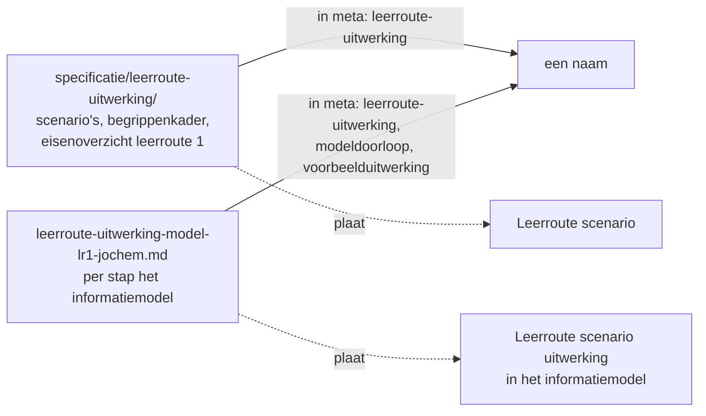

# Namen naast de product-breakdown

Relateert aan: #585, #540, #577

## Inleiding

De opdrachtgever, 26 november 2026: "we hebben geen kader scenario meer dat heet nu leerroute scenario", met de vraag de hele plaat van de product-breakdown ernaast te leggen. Een lezer moet een document, een plaat en een issue zonder vertaling aan elkaar kunnen koppelen (#585).

Vragen:

1. Welke naam draagt elk product op de plaat, en welke namen gebruikt meta voor hetzelfde product?
2. Waar wijken die namen af, en wat ligt per verschil voor de hand: hernoemen, laten staan als historie, of een vraag aan de opdrachtgever?

Scope: alle markdown in meta, met `archief/` erbuiten. Meetingverslagen onder `architecture/meetings/` staan apart geteld, want zij zijn historie. De telling is gedaan na de hernoeming van kaderscenario in dezelfde pull request. JSON, SVG en scripts staan alleen genoemd waar zij een naam aan de lezer tonen.

## Maat

| Bron | Vindplaats |
|---|---|
| De plaat, versie 0.2.0 | [product-breakdown-v0.2.0.svg](../../product-breakdown/img/product-breakdown-v0.2.0.svg), de opschriften van de vakken |
| De tabel | [product-breakdown/README.md](../../product-breakdown/README.md), sectie Artifacts |
| De sjablonen, die de plaatnamen al volgen | [sjablonen/README.md](../../docs/sjablonen/README.md), tabel "Plek in de productafbakening" |

Een aantal is het aantal treffers zonder onderscheid in hoofdletters, als `aantal in bestanden`. Tussen haakjes staat het bestand met de meeste treffers.

## Domeinarchitectuur

| Plaat | Namen in meta | Voorstel |
|---|---|---|
| Leerroute scenario | `leerroute scenario` 80 in 19, waarvan 30 uit deze pull request. `kaderscenario` in lopende tekst 160 in 37 bestanden die bewust blijven staan, zie [Laten staan](#laten-staan). `leerroutedocument` 3 in 3 ([project/leesroute.md](../../../project/leesroute.md), [project/context.md](../../../project/context.md), product-breakdown) | Kaderscenario hernoemd in deze pull request. `Leerroutedocument` hernoemen in de leesroute en de context; de product-breakdown noemt het al als oude naam |
| Leerroute scenario uitwerking in het informatiemodel | `leerroute-uitwerking` 246 in 59 ([begrippenlijst.md](../../docs/specificatie/begrippen/begrippenlijst.md)). `leerroute-uitwerking-model` 80 in 21 (de skill [okx-leerroute-uitwerking-model](../../../.agents/skills/okx-leerroute-uitwerking-model/SKILL.md)). `modeldoorloop` 20 in 5 ([deck 3 november](../../../presentaties/src/261103_werkgroep_okx_voortgang.md), [sbis-randgeval](../../docs/onderzoek/sbis-randgeval/README.md)). `voorbeelduitwerking` 79 in 30. Documenttitel: "De opleiding van Jochem in het informatiemodel". `leerroute scenario uitwerking` 24 in 8, alleen in de sjablonen | Vraag 1. Meta gebruikt `leerroute-uitwerking` voor twee producten, zie [Dubbele betekenis](#dubbele-betekenis) |
| Begrippenlijst | `begrippenlijst` 85 in 32; `begrippenkader` 117 in 44 ([leerroute-uitwerking-lr1.md](../../docs/specificatie/leerroute-uitwerking/doc/leerroute-uitwerking-lr1.md)) | Laten staan. De tabel noemt het begrippenkader als het volledige model achter de lijst, en AGENTS.md noemt het de voorloper |
| ArchiMate-model OKx | `ArchiMate-model` | Gelijk |
| Architectuurprincipes | `architectuurprincipes` 24 in 13, ook `principes` | Gelijk |
| Informatiemodel OKx | `informatiemodel OKx` 36 in 13, ook `informatiemodel` | Gelijk |
| Applicatiediensten | `applicatiedienst` 105 in 17, vooral in de decks van 15 september | Gelijk. De tabel houdt applicatiedienst (domein) en koppelvlakdienst (solution) uit elkaar; de [laag-2-analyse](../voorbeelduitwerking-leerroute-1/laag-2-componenten-en-diensten.md) beschrijft de verwarring van toen als historie |

## Solutionarchitectuur

| Plaat | Namen in meta | Voorstel |
|---|---|---|
| Interacties | `koppelingspecificatie` 163 in 41 (de skill [okx-koppelingspecificatie](../../../.agents/skills/okx-koppelingspecificatie/SKILL.md)); `koppelingen` 181 in 50 plus 47 in verslagen; `interactie` 241 in 48 | Vraag 2. De tabel zegt "Public, nu nog als koppelingen" en parkeert de indeling tot leerroute 1 is doorgerekend |
| Interactieketens | `interactieketen` 94 in 15; `keten onderwijsaanbod` en verwanten 18 in 4, in dezelfde README als `interactieketen onderwijsaanbod` | Gelijk. De korte vorm `keten` in de mermaid van de product-breakdown is leesbaar naast de lange vorm in de backlog |
| JSON-schema's | `JSON-schema` 17 in 8; `datamodelschema` 62 in 21 ([leerroute-uitwerking-model-lr1-jochem.md](../../model/informatiemodel/leerroute-uitwerking-model-lr1-jochem.md)) | Hernoemen in lopende tekst bij het eerstvolgende werk aan een document; in de decks en de voorbeelduitwerking laten staan als historie |
| Applicatiecomponenten | `applicatiecomponent` 74 in 31; `referentiecomponent` 57 in 28 plus 19 in verslagen | Vraag 3 |
| Koppelvlakdiensten | `koppelvlakdienst` 49 in 15 | Gelijk |
| Operaties | `operatie` | Gelijk |
| Logisch gegevensmodel | `logisch gegevensmodel` 22 in 11 | Gelijk |
| Architectuurbesluiten | `architectuurbesluit` 37 in 28, `ADR` 285 in 74 | Gelijk. ADR is de vakterm tussen haakjes volgens de schrijfstijl |
| Uitgangspunten | `uitgangspunten` | Gelijk |
| Auth-standaard | `auth-standaard` 10 in 4 | Gelijk |
| Interactiepatronen | `interactiepatroon` | Gelijk |

## Projectmanagement, eindproduct en bronnen

| Plaat | Namen in meta | Voorstel |
|---|---|---|
| Releasebeheer | `releasebeheer` 2 in 1, alleen de product-breakdown; `release-management` 23 in 12, met het bestand [project/release-management-en-versionering.md](../../../project/release-management-en-versionering.md) en de map in Public | Laten staan. Bestandsnamen en de Public-map dragen de Engelse naam; de lopende tekst kan bij eerstvolgend werk "releasebeheer (release management)" worden |
| Backlog | `backlog` 60 in 7; `requirementsboom` 156 in 61 | Laten staan. De tabel legt de backlog vast als de requirementsboom in Public: twee namen voor rol en document |
| Roadmap | `roadmap` 40 in 14 | Gelijk |
| Koppelvlakspecificaties | `koppelvlakspecificatie` 275 in 62 | Gelijk |
| OEAPI-profielen | `OEAPI-profiel` 30 in 16; `gebruiksprofiel` 21 in 8, bijna alles in de voorbeelduitwerking | Laten staan als historie |
| Conformiteitstesten | `conformiteitstest` 2 in 1; `conformance` 21 in 7, vooral een onderzoeksverslag | Laten staan. De schrijfstijl vraagt de Nederlandse term met de vakterm erachter, en zo staat het in de tabel |
| Adoptiedocumenten | `adoptiedocument` 1 in 1; `transitiepad` 3 in 1, beide in de product-breakdown | Gelijk |
| Bestaande maatwerk koppelingen en leveranciersbelangen | `inbreng leveranciers` 6 in 1, de tabel van de product-breakdown | Hernoemen in de tabel van de product-breakdown, die hier nog de naam van versie 0.1.0 draagt (versietabel, regel 0.2.0) |
| PoC-inbreng | `PoC-inbreng` 18 in 7, vooral de sjablonen | Gelijk. Het vak staat op de plaat en in de sectie Eisen bij de producten; een rij in de tabel Artifacts volgt nog |
| OEAPI-standaard | `OEAPI-standaard` 2 in 2; `Open Education API` 13 in 9 | Gelijk. Ook voor dit vak volgt nog een rij in de tabel Artifacts |
| Leerroutes, Persona's, MORA | dezelfde namen | Gelijk |

## Namen naast de plaat

| Naam | In meta | Voorstel |
|---|---|---|
| Product-breakdown zelf | `product breakdown` 18 in 3 (README, deck 8 november); `productafbakening` 16 in 8 (de sjablonen, de map [requirements-in-de-productafbakening](../requirements-in-de-productafbakening/README.md)) | Vraag 4 |
| Hoofdplaat informatiestromen | `hoofdplaat` 327 in 50; `hoofdplaat informatiestromen` en `informatiestromen hoofdplaat` 46 in 23; de map heet `informatiestromen hoofdplaat OKx` | Laten staan. Zij hoort bij het vak ArchiMate-model, zoals de tabel zegt |
| Scenario-uitwerking | `scenario-uitwerking` 72 in 22, de scenario's 1.1 tot en met 3.4 in [scenario-uitwerkingen](../../docs/specificatie/leerroute-uitwerking/doc/scenario-uitwerkingen/README.md) | Vraag 5. Alleen de capaciteitstabel van de product-breakdown noemt haar |
| Kaderstellend scenario | 5 in 5, waaronder de skill [okx-oeapi-scenario-uitwerking](../../../.agents/skills/okx-oeapi-scenario-uitwerking/SKILL.md) en het manifest [.agents/skills.json](../../../.agents/skills.json) | Hernoemen in de OKx-skill en het manifest naar leerroute scenario; de gevendorde skill `amigo-aanpak` blijft zoals zij is |
| Interactieketen | zie Solutionarchitectuur | Gelijk |

## Dubbele betekenis

Meta gebruikt `leerroute-uitwerking` voor twee verschillende producten. Dat is het belangrijkste verschil met de plaat.

| Product | Vindplaats | Wat ervoor pleit |
|---|---|---|
| De map met scenario's, begrippenkader en eisenoverzicht | [specificatie/leerroute-uitwerking/README.md](../../docs/specificatie/leerroute-uitwerking/README.md), die zichzelf "de kaderstellende leerroute-uitwerking" noemt | Het sjabloon Leerroute scenario linkt zeven keer naar [leerroute-uitwerking-lr1.md](../../docs/specificatie/leerroute-uitwerking/doc/leerroute-uitwerking-lr1.md) in deze map ([gegenereerd/leerroute-scenario.md](../../docs/sjablonen/gegenereerd/leerroute-scenario.md)) |
| De stap-voor-stapuitwerking in het informatiemodel | [leerroute-uitwerking-model-lr1-jochem.md](../../model/informatiemodel/leerroute-uitwerking-model-lr1-jochem.md) | De tabel van de product-breakdown noemt dit product "Leerroute-uitwerking" en linkt hierheen |

Afleiding: wie in meta "de leerroute-uitwerking" leest, kan beide bedoelen. De plaat lost dat op met twee namen. Drie richtingen liggen open:

| Richting | Kosten |
|---|---|
| Lopende tekst volgt de plaat: "leerroute scenario" voor de map, "leerroute scenario uitwerking" voor het model | Raakt ruim 240 treffers en AGENTS.md; map- en bestandsnamen blijven en wijken dan af van hun tekst |
| Alleen de product-breakdown en de skill volgen de plaat; de rest bij eerstvolgend werk | Klein; de dubbele betekenis blijft elders tot het werk er langskomt |
| De plaat volgt meta | Botst met de sjablonen, die de plaatnamen al dragen en naar de adviesgroep zijn gegaan |

## Laten staan

| Plek | Treffers | Reden |
|---|---|---|
| Links en paden naar Public, `Referentiemateriaal/kaderscenario's/` | 533 | De map in Public heet zo; een link breekt anders |
| `architecture/agent-artifacts/voorbeelduitwerking-leerroute-1/` | 50 | Plan en analyse, werkpakketten op 2 oktober 2026 gesloten |
| Featureplannen #567 en onderzoeksverslagen | 9 | Gesloten werk, historie |
| Decks onder `presentaties/src/` | 13 | Gegeven presentaties, historie zoals een verslag |
| Platen met een versie: product-breakdown 0.1.0 en 0.2.0, sectorketen 0.2.0 met haar bron `project/sectorketen-producten.json`, de kopie in `presentaties/src/public/platen/` | 22 | Een gewijzigde plaat krijgt een nieuw nummer. De beschrijving (aria-label) van product-breakdown 0.2.0 noemt nog "het kaderscenario"; dat hoort bij versie 0.2.1 |
| Scripts en tests: `publiceer-informatiemodel.py`, `controleer-leerroute-uitwerking-model.py`, `leerroute-uitwerking-model-varianten.py`, vier tests | 26 | Docstrings en namen, buiten het bereik van de tests. `test_sjablonen.py` bewaakt juist dat "Kaderscenario" uit de plaat blijft |
| De regeltabel, het leesdocument en de generator van de leerroute-uitwerking voor leerroute 1 | 39 | De opdrachtgever handelt deze bestanden af in ander werk |
| De rij Leerroute scenario in de product-breakdown | 1 | Noemt kaderscenario bewust als eerdere naam, naast leerroutedocument |

## Public

Voor het OKx-team, dat dit in Public uitvoert. Deze pull request raakt alleen meta.

1. De map `Referentiemateriaal/kaderscenario's/` hernoemen. Meta verwijst er 533 keer naar, waarvan 302 vanuit [leerroute-uitwerking-model-lr1-jochem.md](../../model/informatiemodel/leerroute-uitwerking-model-lr1-jochem.md) en 180 vanuit [begrippen-extractie.json](../../docs/specificatie/begrippen/begrippen-extractie.json). Na de hernoeming volgt in meta een ronde die de links en `tools/scripts/publiceer-informatiemodel.py` (constante `KADERSCENARIO`) bijwerkt.
2. De koptekst en de inleiding van `leerroute-1-regulier.md` in die map, voor zover zij "kaderscenario" noemen.
3. `publiceer-informatiemodel.py` schrijft bij elke publicatie "Ankertabel kaderscenario leerroute 1" in het releasepakket `Informatie-en-gegevensmodellen/`. Die tekst volgt de keuze bij punt 1.
4. `Koppelvlakspecificaties/Koppelingen/` naar interacties, zodra vraag 2 beantwoord is.

## Advies

1. De product-breakdown eerst gelijktrekken met haar eigen plaat: de rijen Leerroute-uitwerking en Inbreng leveranciers, en een rij voor PoC-inbreng en OEAPI-standaard. Klein werk, en de README is de maat waar de rest naar verwijst.
2. Vraag 1 beantwoorden voordat iemand `leerroute-uitwerking` aanraakt, want daar zit de dubbele betekenis.
3. De overige verschillen meenemen bij het eerstvolgende werk aan een document. Een grote ronde over historie levert de lezer weinig op.

## Vragen

1. Welke naam krijgt de stap-voor-stapuitwerking in de lopende tekst van meta: "leerroute scenario uitwerking" zoals op de plaat, of blijft "leerroute-uitwerking" en krijgt de map `specificatie/leerroute-uitwerking/` een andere naam in de tekst? Voorkeur: de plaatnaam, met "modeldoorloop" en "voorbeelduitwerking" als historie.
2. Heet een stroom per doel tussen aanbieder en afnemers voortaan "interactie", ook in de skill okx-koppelingspecificatie en de 163 treffers van `koppelingspecificatie`? Opties: nu hernoemen, of wachten tot de indeling na leerroute 1 vastligt. Voorkeur: wachten, zoals de product-breakdown zegt.
3. Is "referentiecomponent" een synoniem van "applicatiecomponent", of het MORA-begrip achter de OKx-component? Voorkeur: synoniem, en in lopende tekst de plaatnaam.
4. Heet dit overzicht "product-breakdown" of "productafbakening"? De schrijfstijl vraagt de Nederlandse term met de vakterm erachter. Voorkeur: "productafbakening (product breakdown)", met de map `architecture/product-breakdown/` ongewijzigd.
5. Is een scenario-uitwerking (1.1 tot en met 3.4) een onderdeel van het leerroute scenario of een eigen product? Voorkeur: onderdeel, als variant op de route.

## Onzekerheden

- De tellingen zijn tekstueel. Een treffer van `interactie` of `koppelingen` kan ook het gewone woord zijn; de getallen geven de omvang; een werklijst vraagt een lezing per treffer.
- De plaat is gelezen uit de opschriften in de SVG; deze analyse vergelijkt namen, en laat de verbindingen tussen de vakken rusten.
- Of de decks historie zijn, of levend materiaal dat nog eens getoond wordt, is een aanname van deze analyse.
