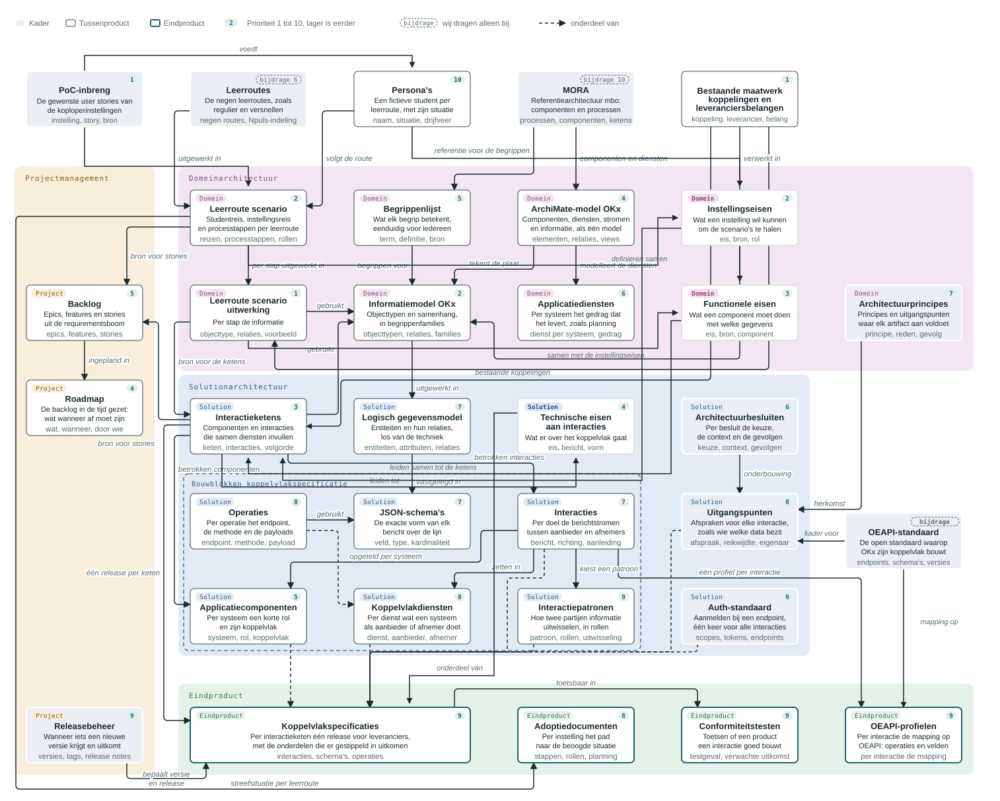
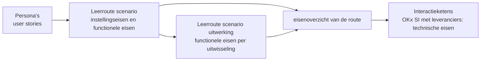

# Sjablonen voor de adviesgroep

Vijf Word-sjablonen waarmee een OKx-product wordt opgeschreven. Elk sjabloon draagt de naam van zijn product in de [productafbakening](../../product-breakdown/README.md), en samen leveren zij het pakket van eisen waarop de solutionlaag bouwt.

## Plek in de productafbakening



Vijf vakken op deze plaat hebben een sjabloon. Elk sjabloon opent met een uitsnede van de plaat waarin het eigen vak is uitgelicht, met eronder de hele plaat in het klein en een kader om de uitsnede.

| Product op de plaat | Sjabloon | Wie vult in | Levert |
|---|---|---|---|
| Persona's | `OKx sjabloon Persona's.docx` | adviesgroep | user stories, `US-LR<route>-<volgnummer>` |
| Leerroute scenario | `OKx sjabloon Leerroute scenario.docx` | adviesgroep | instellingseisen `IE-LR<route>-<volgnummer>` en functionele eisen `FE-LR<route>-<volgnummer>` |
| Leerroute scenario uitwerking in het informatiemodel | `OKx sjabloon Leerroute scenario uitwerking in het informatiemodel.docx` | adviesgroep | functionele eisen per uitwisseling, en de hiaten in het model |
| Informatiemodel OKx | `OKx sjabloon Informatiemodel OKx.docx` | adviesgroep | de begrippen waarin de andere documenten hun eisen schrijven |
| Interactieketens | `OKx sjabloon Interactieketens.docx` | OKx SI met de leveranciers | technische eisen aan interacties |

## Van behoefte naar technische eis



Een eis staat uitgeschreven op de plek waar hij ontstaat en komt terug in het eisenoverzicht aan het eind van het sjabloon. Dat overzicht neemt OKx SI over en vertaalt het met de leveranciers naar technische eisen. Een eis is daarbij een voorstel voor een sectorafspraak: opgesteld uit de inbreng van afzonderlijke instellingen, en daarna de grond voor de technische specificatie.

| Soort | Opent met | Voorbeeld uit leerroute 1 |
|---|---|---|
| user story | `Als <persona> wil ik` | Als student wil ik bij mijn keuzedeelruimte een geprioriteerde voorkeurslijst opgeven, met als doel dat ik niet zonder keuzedeel kom te zitten wanneer mijn eerste keuze vol is |
| instellingseis | `De instelling kan` | De instelling kan per keuzedeelruimte de voorkeursvolgorde van de student vastleggen voordat zij plaatst |
| functionele eis | de applicatiecomponent van de hoofdplaat | Het Student Keuze Systeem legt per keuzedeelruimte de `Aanmeldingen` van een student vast in volgorde van voorkeur, elk op een `Keuzedeel aanbod` met zijn onderwijsperiode en optioneel de onderwijslocatie |

Elk sjabloon dat een eis levert draagt in de inleiding het hoofdstuk **Kwaliteit van een eis**, met per soort de criteria en een zwak naast een sterk voorbeeld. Het uitgewerkte geheel, een eisenoverzicht voor [leerroute 1](../specificatie/leerroute-uitwerking/doc/leerroute-uitwerking-lr1.md), staat klaar in pull request 563.

## Vaste nummers

Een nummer is vast en uniek, met drie cijfers, zoals `IE-LR1-001`.

1. Een nummer wordt een keer uitgegeven en verandert daarna niet.
2. Een nieuwe eis krijgt het eerstvolgende vrije nummer van zijn soort.
3. Een eis die vervalt houdt zijn nummer, met de status vervallen.
4. Het eisenoverzicht van het leerroute scenario is het nummerregister van de route; ook de uitwerking haalt daar haar nummers.

De requirementsboom in Public draagt een eigen reeks. Die wordt later herzien en neemt deze nummers dan over.

## Opbouw van een sjabloon

| Deel | Wat erin staat |
|---|---|
| omslag | titel, versie, auteurs en datum |
| inleiding | productplaatsing, doelstelling, de eisen die het document levert, kwaliteit van een eis, en de aggregatiestap |
| sjabloononderdelen | een vast stuk dat de invuller kopieert tot het onderwerp gedekt is |
| slot | eisenoverzicht, afwijkingen per instelling, observaties en signaleringen |

Een **sjabloononderdeel** draagt vier dingen: een link naar het uitgewerkte voorbeeld, genummerde acceptatiecriteria, de soort eis die het oplevert, en de invultabel twee keer: eerst ingevuld met leerroute 1, daarna leeg.

| Sjabloon | Sjabloononderdelen |
|---|---|
| Persona's | het portret, de reis per processtap; per persona, student of actor binnen de instelling |
| Leerroute scenario | routeprofiel, reis, scenario binnen de route, procesfase, informatie en systemen |
| Leerroute scenario uitwerking | A processtap, B uitwisseling |
| Interactieketens | een interactie, genummerd als `IS-<keten>-<volgnummer>` |
| Informatiemodel OKx | volgt de hoofdstukken van het [informatiemodel OKx](../../model/informatiemodel/informatiemodel.md) |

Twee aanwijzingen staan in elk sjabloon. **De invuller aggregeert**: hij haalt op bij meerdere instellingen en schrijft op wat zij delen; wat bij een instelling afwijkt staat onder `Afwijkingen per instelling`. En **koppen blijven staan**: een herschreven kop maakt een ingevuld sjabloon onvergelijkbaar met een ander.

## Onderhoud

De Word-bestanden worden gebouwd en niet met de hand bewerkt.

| Plek | Wat er staat |
|---|---|
| deze map | de vijf `.docx`-bestanden en het Npuls-sjabloon `Npuls Word template uitgebreid.dotx` |
| `bron/sjablonen.json` | per sjabloon de opbouw, de criteria, de voorbeelden en het vak op de plaat |
| `gegenereerd/` | de afgeleide skeletten, hun beelden en de Word-referentie |

Wijzig `bron/sjablonen.json`, of voor de gedeelde teksten `tools/scripts/maak-sjabloon-uit-document.py`, en bouw daarna opnieuw:

```bash
python3 tools/scripts/maak-sjabloon-uit-document.py      # skeletten en beelden
python3 tools/scripts/bouw-sjabloon-referentie.py        # alleen na een wijziging in de huisstijl
python3 tools/scripts/bouw-sjablonen-docx.py
python3 -m unittest tools.tests.test_sjablonen
```

De inhoudsopgave in een sjabloon is een Word-veld; de lezer werkt haar bij met Ctrl+A en F9. De testsuite bewaakt onder meer dat Word de bestanden kan openen, dat een skelet gelijk loopt met zijn bron, en dat elk nummer drie cijfers draagt. Zij draait alleen in de workflow `Model` en is daarmee nog geen poort voor een wijziging aan de sjablonen. De bouw vraagt `pandoc`, `librsvg2-bin` en `libreoffice-writer`, die in [de Dockerfile](../../../.devcontainer/Dockerfile) staan.

Relateert aan: #554, #557, #561
