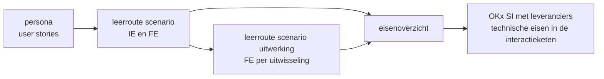

# Sjablonen voor de adviesgroep

Vijf sjablonen waarmee de adviesgroep een OKx-product zelf kan opschrijven. Zij horen bij een invulverzoek van OKx SI: de solutionlaag kan pas zeggen wat zij nodig heeft wanneer de producten eronder er liggen.

Open het Word-bestand. Elk sjabloon draagt de naam van zijn product zoals die in de productafbakening staat. Elk sjabloon is **afgeleid uit de uitwerking die er al ligt**, dus het draagt elke kop, elke tabel en elk beeld van dat document.

| Product | Sjabloon | Afgeleid uit |
|---|---|---|
| persona | `OKx sjabloon Persona's.docx` | twee sjabloononderdelen, met [persona Jochem](../specificatie/leerroute-uitwerking/doc/persona_jochem.md) als voorbeeld |
| leerroute scenario | `OKx sjabloon Leerroute scenario.docx` | vijf sjabloononderdelen, met [leerroute 1 scenario](../specificatie/leerroute-uitwerking/doc/leerroute-uitwerking-lr1.md) als voorbeeld |
| informatiemodel viewpoint | `OKx sjabloon Informatiemodel OKx.docx` | [informatiemodel OKx](../../model/informatiemodel/informatiemodel.md) |
| leerroute scenario uitwerking in het informatiemodel | `OKx sjabloon Leerroute scenario uitwerking in het informatiemodel.docx` | twee sjabloononderdelen, met [de uitwerking met Jochem](../../model/informatiemodel/leerroute-uitwerking-model-lr1-jochem.md) als voorbeeld |
| interactieketen | `OKx sjabloon Interactieketens.docx` | [keten onderwijsaanbod](https://github.com/Npuls-OKx/meta/blob/e05b4444a29a09b92cc8afd73bce69af78f1ac12/architecture/docs/specificatie/interactieketen-onderwijsaanbod/README.md), nog in review |

## Opbouw van een sjabloon

| Pagina | Wat erop staat |
|---|---|
| 1 | de omslag: titel, ondertitel, versie, wie het uitgeeft, wie het invult en wanneer |
| 2 | de inleiding, met de doelstelling van het document, de eisen die het levert, de kwaliteit van een eis en de business analyse |
| daarna | de inhoudsopgave, en dan de hoofdstukken uit de uitwerking |

De inhoudsopgave is een Word-veld en staat leeg tot hij wordt bijgewerkt; dat doet de lezer met Ctrl+A en F9, en de tekst in het veld zegt dat ook.

## De productafbakening

De basis onder de vijf sjablonen is de [productafbakening](../../product-breakdown/README.md), versie 0.2.0: welke producten OKx maakt, in welke volgorde zij op elkaar bouwen, en wat een eindproduct is.

Elk sjabloon opent met het hoofdstuk **Productplaatsing**: een uitsnede van die plaat met het eigen vak uitgelicht en de buren eromheen zichtbaar, en hoogstens drie regels eronder. Onder de uitsnede staat de hele plaat in het klein, met een kader om het stuk waarop is ingezoomd: zo ziet de invuller waar hij zich in het geheel bevindt. Zo ziet een invuller waar zijn document op bouwt en wat erop verder bouwt, zonder de hele plaat te lezen.

**Het vak wordt afgeleid en niet opgemeten.** In de configuratie staat alleen de naam van het vak; de generator zoekt die kop in de SVG en neemt de rechthoek die haar omsluit. Verschuift de plaat, dan klopt de uitlichting nog steeds, en een naam die niet bestaat laat de generator weigeren.

Deze pull request wijzigt de plaat zelf op drie punten:

| Wat | Waarom |
|---|---|
| `Kaderscenario` werd `Leerroute scenario` | de productnaam uit #556 |
| de voortgangsregel werd een steekwoordregel | wat erin staat verandert niet elke week; de voortgang wel |
| `OEAPI-standaard` is toegevoegd, naast de solutionlaag | de open standaard waarop OKx bouwt, met een lijn naar de uitgangspunten en naar de OEAPI-profielen. Het staat naast het vlak en niet erin: OEAPI wordt pas relevant op de solutionlaag wanneer vaststaat wat de business wil |
| `Inbreng leveranciers` werd `Bestaande maatwerk koppelingen en leveranciersbelangen` | wat er werkelijk als input binnenkomt, met een lijn erbij naar de interactieketens |

De presentatie in `presentaties/src/public/platen/` draagt een eigen kopie van de plaat die al afweek van de bron; die is niet meegewijzigd.

## Sjabloononderdeel

Vier sjablonen zijn opgebouwd uit **sjabloononderdelen**: een vast stuk met een invultabel dat de invuller kopieert tot het onderwerp gedekt is. De naam voorkomt verwarring met het functionele bouwblok uit de architectuur, de bedrijfsfunctionaliteit of eis: een tweede betekenis voor hetzelfde woord verwart de lezer die beide documenten naast elkaar heeft.

Elk sjabloononderdeel draagt vier dingen, in deze volgorde:

| Deel | Wat erin staat |
|---|---|
| Voorbeeld | de plek in de voorbeelduitwerking waar hetzelfde al is uitgewerkt, als link |
| Acceptatiecriteria | een genummerde lijst, een criterium per regel, zodat de invuller en de solutionlaag hetzelfde afvinken |
| Soort eis | wat dit onderdeel oplevert: user stories, instellingseisen, functionele eisen, of context |
| Ingevuld voorbeeld, daarna Vul in | dezelfde tabel twee keer: eerst ingevuld met leerroute 1 en Jochem, daarna leeg; bij de interactieketen volgt het ingevulde voorbeeld later |

Het opdrachtblok blijft staan: het is de opdracht, en de uitwerking komt eronder. Zo leest een acceptatiecriterium, hier van het sjabloononderdeel `informatie en systemen`:

> 1. er staat een ArchiMate-plaat of een SVG-render daarvan, met de scope van deze fase uitgelicht op de hoofdplaat informatiestromen;
> 2. elk informatieobject draagt de term uit de begrippenlijst;
> 3. elk informatieobject heeft precies een bronsysteem;
> 4. elke functionele eis staat uitgeschreven en genummerd, opent met de component en noemt de instellingseis waaruit hij komt;
> 5. elke instellingseis uit de reizen, de scenario's en de procesfasen heeft minstens een functionele eis, hier of in de leerroute scenario uitwerking.

Het informatiemodel viewpoint volgt de koppen van zijn bron. Daar leidt de generator de criteria af uit wat de voorbeelduitwerking in dat hoofdstuk levert: een mermaid-diagram vraagt om een procesplaat, een tabel om een ingevulde tabel.

## Kwaliteit van een eis

De solutionlaag bouwt op wat in een sjabloon als eis staat. Een eis is bruikbaar wanneer een leverancier hem kan lezen zonder de instelling te bellen, en is een voorstel voor een sectorafspraak: opgesteld uit de inbreng van afzonderlijke instellingen, vastgelegd als afspraak, en daarna de grond voor de technische specificatie. Een functionele eis noemt zijn informatieobjecten met het objecttype uit de begrippenlijst, en kiest het objecttype dat bij het moment past: een `Aanmelding` op aanbod is een wens, een verbintenis bestaat pas wanneer zij is aangegaan. Elk sjabloon dat een eis levert, draagt daarom in de inleiding het hoofdstuk **Kwaliteit van een eis**: per soort de criteria, en een zwak naast een sterk voorbeeld.

| Soort | Opent met | Zwak | Sterk |
|---|---|---|---|
| user story | `Als <persona> wil ik` | Als student wil ik een overzichtelijke app voor mijn keuzedelen | Als student wil ik bij mijn keuzedeelruimte een geprioriteerde voorkeurslijst opgeven, met als doel dat ik niet zonder keuzedeel kom te zitten wanneer mijn eerste keuze vol is |
| instellingseis | `De instelling kan` | De instelling wil flexibel omgaan met keuzedelen | De instelling kan per keuzedeelruimte de voorkeursvolgorde van de student vastleggen voordat zij plaatst |
| functionele eis | de applicatiecomponent van de hoofdplaat | Het systeem ondersteunt voorkeuren voor keuzedelen | Het Student Keuze Systeem legt per keuzedeelruimte de `Aanmeldingen` van een student vast in volgorde van voorkeur, elk op een `Keuzedeel aanbod` met zijn onderwijsperiode en optioneel de onderwijslocatie |

De criteria en de voorbeelden staan in `EISSOORTEN` in `tools/scripts/maak-sjabloon-uit-document.py`; welke soorten een sjabloon draagt staat in `eissoorten` in de configuratie.

## Persona

Een persona is een portret van een mens in de scope van OKx: wat hij in zijn onderwijs meemaakt, wat hem daarin beweegt, en wat de gang van zaken met hem doet. Een herkenbaar iemand aan wie een ontwerpkeuze te toetsen is.

Drie dingen staan in dat sjabloon voorop. **Een persona is een student of een actor binnen de instelling**: de onderwijsontwerper, de planner, de roostermaker, de docent, de studieloopbaanbegeleider, de examinator of het leerbedrijf. Het sjabloon vraagt naast de student minstens een persona vanuit de instelling, en draagt daarvoor een voorbeeld van de planner; de bestaande persona's Jochem, Linda en Larissa zijn alle drie student. **Het document loopt in tandem met het leerroute scenario**: het procesbeeld daar bepaalt welke stappen de persona doorloopt, en wat de persona meemaakt scherpt dat procesbeeld aan. En **elke behoefte wordt een user story**, bij de stap waar zij ontstaat; het leerroute scenario leidt daar de instellingseisen uit af.

Het sjabloon draagt twee sjabloononderdelen die zich per persona herhalen:

| Sjabloononderdeel | Wat erin staat |
|---|---|
| **het portret** | naam, rol, situatie, waarom juist deze route, wat hem beweegt, wat het moeilijk maakt, waaraan hij merkt dat het goed gaat |
| **de reis per processtap** | een rij per stap uit het procesbeeld van het scenario: wat hij doet, wat hij moet weten, wat het met hem doet, en de user story die daaruit volgt |

## Leerroute scenario

Het sjabloon bestaat uit de sjabloononderdelen waaruit elk scenario is opgebouwd, los van de hoofdstukindeling van leerroute 1:

| Sjabloononderdeel | Hoe vaak | Levert |
|---|---|---|
| routeprofiel | een keer | context |
| reis | per persona | instellingseisen, uit de user stories van het persona-document |
| scenario binnen de route | per scenario | instellingseisen |
| procesfase | per fase | instellingseisen |
| informatie en systemen | per fase, of een keer | functionele eisen |

Elke eis staat uitgeschreven in de tabel van het onderdeel waar hij ontstaat. De notatie ligt vast: `IE-LR<route>-<volgnummer>` voor een instellingseis, `FE-LR<route>-<volgnummer>` voor een functionele eis, en een functionele eis noemt de instellingseis waaruit hij komt.

Het sjabloon sluit met het **Eisenoverzicht**: alle eisen bij elkaar, met hun herkomst en eigen acceptatiecriteria. Samen met het eisenoverzicht van de uitwerking is dat het pakket dat OKx SI overneemt en met de leveranciers naar technische eisen vertaalt.

## Leerroute scenario uitwerking

De uitwerking is een herhaling van twee sjabloononderdelen.

| Sjabloononderdeel | Wat erin staat |
|---|---|
| **A, processtap** | nummer, processtap, actor, applicatiecomponent, welk objecttype daar ontstaat, **de relaties naar elementen die in eerdere onderdelen ontstonden**, en de ingevulde voorbeeldwaarde |
| **B, uitwisseling** | nummer, van welke component naar welke, de aanleiding, het hele ingevulde informatievoorbeeld met zijn relaties, en **de functionele eisen aan de leverende en de afnemende component** |

Beide onderdelen dragen een ingevoegd beeld en een ingevulde tabel uit de uitwerking van Jochem, en bewust een complex geval: bij A het keuzedeel als eigen programmaspecificatie (F1-08), bij B het verzoek om onderwijsaanbod dat de hele specificatiestructuur meeneemt naar planning (F2-03).

Herhaal A tot er een uitwisseling plaatsvindt, zet dan B neer, en ga verder met A. De functionele eisen nummeren door vanaf het laatste nummer in het leerroute scenario en komen bij elkaar in het **Eisenoverzicht**; wat het informatiemodel niet kon dragen staat onder **Hiaten in het model**, met de functionele eis die eruit volgt. Dat sjabloon staat in `opbouw` in de configuratie.

## Interactieketen

Het interactieketen-sjabloon draagt **een sjabloononderdeel voor een interactie**, dat zich herhaalt tot de keten af is. Het vraagt per interactie om de aanbieder en de afnemer met naam en versie, de aanleiding, het bericht, de functionele eisen die de interactie verwezenlijkt, het antwoord, het foutpad en wat een herhaalde aanroep doet.

De nummering staat als conventie uitgelegd: `IS` voor interactiespecificatie, dan de afkorting van de keten, dan een volgnummer. `IS-OA-01` is de eerste interactie van de keten onderwijsaanbod. Een ingevuld voorbeeld volgt zodra de keten onderwijsaanbod uit pull request 373 op `dev` staat.

## Scope is een keuze van de business analist

Een hoofdstuk is een interactie, en waar het begint en eindigt bepaalt de business analist. De maat staat in elk sjabloon: de **kleinst mogelijke eenheid die waarde oplevert voor zowel de student als de instelling**, groter dan een enkele interactie en kleiner dan het hele ecosysteem. Een scope die daarboven zit levert een eis die niemand kan bouwen, een scope die daaronder zit levert een eis die niemand mist.

## Pakket van eisen

De sjablonen leveren samen het pakket van eisen waarop de solutionlaag bouwt. De eisen staan **uitgeschreven in het sjabloon**, op de plek waar zij ontstaan en in het eisenoverzicht aan het eind. OKx kent drie soorten, en de keuze voor die indeling staat in [eisen in de productafbakening](../../agent-artifacts/requirements-in-de-productafbakening/README.md):

| Soort | Komt uit | Zegt wat |
|---|---|---|
| **instellingseis** | de PoC-inbreng, de persona's en de leerroute scenario's | de instelling moet kunnen om de route te draaien |
| **functionele eis** | de instellingseisen en de leerroute scenario uitwerking | een component moet doen met welke gegevens |
| **technische eis** | de interactieketens, die zelf uit de eisen voortkomen | er over het koppelvlak gaat en in welke vorm |

De naam is **instellingseis**: OKx spreekt met publieke onderwijsinstellingen.



| Sjabloon | Levert |
|---|---|
| persona | behoeften, geschreven als user story |
| leerroute scenario | instellingseisen en functionele eisen, in het eisenoverzicht |
| leerroute scenario uitwerking | functionele eisen per uitwisseling, in het eisenoverzicht, en de hiaten in het model |
| interactieketen | technische eisen aan interacties, met de functionele eisen die elke interactie verwezenlijkt; OKx SI vult dit sjabloon in met de leveranciers |
| informatiemodel viewpoint | de begrippen waarin de andere documenten hun eisen schrijven |

Het register dat de eisen van alle routes bij elkaar brengt loopt via #558. Leerroute 1 koppelen aan die eisen loopt via #557.

## Soort eis per onderdeel

Een reis van een persona brengt een behoefte naar boven: een **user story**. Een reis, een scenario of een procesfase in het leerroute scenario zegt wat de instelling moet kunnen: **instellingseisen**. Een gegevens- of systeemonderdeel en een uitwisseling zeggen wat een component moet doen: **functionele eisen**. Een interactie zegt wat er over het koppelvlak gaat: **technische eisen**. Het routeprofiel en het informatiemodel viewpoint geven context.

De soort staat in `laag` in de configuratie, per sjabloon of per sjabloononderdeel.

## Wat niet in elke route hoort

Een route kent niet alles wat leerroute 1 kent. Keuzedelen heten in het sjabloon daarom `Kiesbare onderdelen` en zijn **optioneel**: leerroute 9 kan ze niet hebben. Zo'n hoofdstuk opent met de voorwaarde en met de aanwijzing de kop te laten staan met de reden eronder.

Achtergrondtheorie hoort helemaal niet in een route. De verdieping over CSP en NP-hard staat daarom niet in het sjabloon; die hoort in de leesroute, en dat loopt via #556.

## Een kop is een label

Een kop noemt wat eronder staat. Hij stelt geen vraag en hij vat niet samen. `Wat betekent "regulier studeren"?` wordt dus `Kenmerken van de route`, en `Wat levert dit document op?` wordt `Opbrengst`.

Een kop die in de bron een vraag is, krijgt zijn label in `kop_labels` in de configuratie. Staat hij daar niet, dan kapt de generator hem af tot zijn onderwerp; dat is een terugval en geen oplossing, en een testgeval faalt zodra er een vraagkop in een sjabloon staat. De nummering wordt opnieuw opgebouwd, want de bron telt op drie plekken 3.2.1.1.

## Wat de generator met de uitwerking doet

| Onderdeel | Wat ermee gebeurt |
|---|---|
| kop | wordt een feitelijk label, met de termen van die ene uitwerking vervangen door een invulhaak zoals `<student>`; de nummering komt uit het Npuls-sjabloon |
| hoofdstuk | krijgt het blok met voorbeeld, acceptatiecriteria en de laag in de requirementketen |
| hoofdstuk dat niet elke route raakt | wordt optioneel, met de voorwaarde erboven |
| beeld | gaat als beeld mee, verkleind tot wat een A4 nodig heeft; een vectorbeeld wordt een PNG, want het Word-formaat draagt geen SVG |
| tabel | houdt haar kopregel en krijgt evenveel lege rijen als het origineel had |
| verwijzing | wordt volledig, want een Word-bestand staat niet in de repository |
| hoofdstuk buiten de grens | valt weg; `weglaten_tot` en `weglaten_vanaf` zeggen waar het sjabloon begint en eindigt |

Het leerroute-scenario begint bij de route zelf. De hoofdstukken over OKx, de deliverable-keten en de negen leerroutes horen in de leesroute en de context van de repository en niet in elk scenario opnieuw; dat loopt via #556.

## De invuller aggregeert

Elk sjabloon opent met dezelfde aanwijzing. Tussen de inbreng van instellingen en een ingevuld sjabloon zit een analysestap: ophalen bij meerdere instellingen, de grootst gemene deler bepalen, en die opschrijven. Een instelling spreekt voor haar eigen praktijk en niet voor de sector.

Zonder die stap wordt een sjabloon een verzameling instellingsgewoonten en geen kaderstelling. Elk sjabloon draagt daarom een hoofdstuk `Afwijkingen per instelling`, zodat wat afwijkt bewaard blijft zonder dat het kader erdoor verschuift.

## Koppen blijven staan

Een kop die is herschreven of weggehaald maakt zijn hoofdstuk onvindbaar, en een ingevuld sjabloon is daarna niet meer naast een ander te leggen. Later leest een parser uit het agent-harnas deze documenten per kop terug naar de kennisbank; dat is de tweede reden, en hij staat hier en niet in het sjabloon zelf.

## Opbouw

| Plek | Wat er staat |
|---|---|
| deze map | de vijf `.docx`-bestanden, want de adviesgroep moet er een kunnen openen zonder iets te bouwen |
| `bron/sjablonen.json` | per sjabloon de uitwerking waaruit het komt, de invulhaken, de koplabels en de grenzen |
| `gegenereerd/` | de afgeleide skeletten, hun beelden en de Word-referentie; hier bewerkt niemand iets met de hand |

Wijzig dus `bron/sjablonen.json` of de uitwerking zelf, en leid daarna opnieuw af:

```bash
python3 tools/scripts/maak-sjabloon-uit-document.py      # skelet en beelden uit de uitwerking
python3 tools/scripts/bouw-sjabloon-referentie.py        # alleen na een wijziging in de huisstijl
python3 tools/scripts/bouw-sjablonen-docx.py
python3 tools/scripts/bouw-sjablonen-docx.py --controleer
```

De referentie komt uit **[Npuls Word template uitgebreid.dotx](<Npuls Word template uitgebreid.dotx>)**, het sjabloon van Npuls zelf: de omslag met het logo, de kleuren, Arial, de genummerde koppen en de kop- en voetteksten. Dat bestand wordt niet bewerkt.

Pandoc zoekt daarnaast een handvol stijlen op hun Engelse naam die het Npuls-sjabloon niet kent. `bouw-sjabloon-referentie.py` zet die erbij met Npuls-waarden: een tabel met randen, een citaat met een oranje kantlijn, links in `#3D68EC`, en `nl-NL` als taal zodat Word niet elk woord onderstreept. De titel krijgt ruimte boven zich, anders loopt hij door het logo van de omslag. De tekstkleur wordt expliciet zwart gezet: het Npuls-sjabloon laat hem op automatisch staan, en op de gekleurde omslag kiest Word dan wit. In de voettekst van het sjabloon staat letterlijk `[titel]`; de bouwer vervangt die door de titel van het sjabloon, want het is geen veld dat Word zelf vult.

Twee pakketten in de dev-container horen hierbij: `librsvg2-bin` zet een vectorbeeld om naar PNG, en `libreoffice-writer` laat een gebouwd sjabloon bekijken. Beide staan in [de Dockerfile](../../../.devcontainer/Dockerfile).

## Controle

```bash
python3 -m unittest tools.tests.test_sjablonen
```

`tools/tests/test_sjablonen.py` faalt wanneer:

- een kop een vraag stelt, met een vraagwoord opent, of een eigen nummer draagt naast dat van Word;
- een hoofdstuk het blok mist, het artefact niet uit de bron komt, of de user stories buiten het persona-document staan;
- de acceptatiecriteria geen genummerde lijst zijn, of een sjabloononderdeel zijn ingevulde voorbeeld mist;
- het woord bouwblok of bouwsteen in een sjabloon staat;
- een sjabloon dat een eis levert het hoofdstuk Kwaliteit van een eis mist, of het eisenoverzicht ontbreekt;
- een acceptatiecriterium geen context noemt, of de optionele hoofdstukken verdwenen zijn;
- de referentie niet uit het Npuls-sjabloon komt, een stijl mist die pandoc zoekt, de titel door het logo loopt, of `[titel]` in de voettekst blijft staan;
- een beeld als beschrijving in het document staat, of een genoemd beeld niet bestaat, of een SVG in het skelet staat;
- een skelet afwijkt van wat de generator nu uit die uitwerking maakt, dus het sjabloon loopt achter op de bron;
- een skelet een relatieve verwijzing draagt die in Word nergens heen wijst;
- een skelet de aggregatiestap, de requirementketen of de schrijfruimte mist;
- een tabel geen kopregel heeft, want een lege kopregel wordt in Word een lege rij;
- een `.docx` niet in versiebeheer staat of achterloopt op zijn skelet;
- een beeld ontbreekt of een SVG in het skelet staat;
- een alinea een alinea of een tabel bevat, want **Word weigert dat bestand te openen**;
- een onderdeel van het pakket geen content-type draagt, of het hoofddocument als sjabloon in plaats van als document is aangemerkt;
- de voorpagina meer draagt dan de omslag, of de inhoudsopgave voor de inleiding staat;
- de tekstkleur niet expliciet zwart is, want op de gekleurde omslag kiest Word dan wit.

**Deze controle is nog geen poort.** De testsuite draait in de workflow `Model`, en die start alleen wanneer een `*.archimate`-bestand wijzigt. Een pull request die alleen aan de sjablonen raakt, draait de testgevallen dus niet.

Relateert aan: #554
