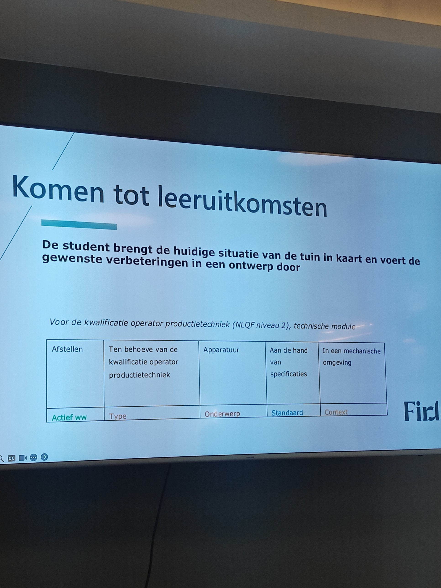

# De vorm van een leeruitkomst

Bronmateriaal voor het vastleggen van de vorm waarin een leeruitkomst wordt geschreven. Relateert aan: #347 en #345.

De [begrippenlijst](../begrippenlijst.md) zegt wat een leeruitkomst is. Hoe zij geschreven wordt stond nergens vast, terwijl de negen leeruitkomsten in de voorbeelduitwerking van leerroute 1 alle dezelfde opbouw volgen. Die opbouw blijkt een landelijke norm te hebben.

## De vorm is het Tuning-model

De [Handleiding Formuleren leeruitkomsten](https://nlqf.nl/wp-content/uploads/2025/06/Handleiding_Formuleren_leeruitkomsten_2020_NCP_NLQF_28122020.pdf) van het Nationaal Coordinatiepunt NLQF, versie december 2020, schrijft het Tuning-model voor. Dat model komt uit het Tuning Project van Educational Structures in Europe uit 2000, ontwikkeld binnen het Bologna-proces.

> Uit deze onderdelen volgt de opbouw van een leeruitkomst:
> Actief werkwoord + Type + Onderwerp + Standaard + Context

De handleiding beschrijft per plek wat erin hoort:

| Plek | Wat erin hoort |
|---|---|
| Actief werkwoord | Wat de lerende dient te kunnen. Een taxonomie helpt bij de keuze; nooit meer dan een werkwoord per leeruitkomst |
| Type | Aan welke eindkwalificatie de leeruitkomst bijdraagt, en om welke vaardigheden en competenties uit de Body of Knowledge and Skills het gaat |
| Onderwerp | Het deskundigheidsgebied waarop de leeruitkomst wordt toegepast |
| Standaard | Welke richtlijnen, standaarden, methodiek of benaderingen gehanteerd moeten of mogen worden |
| Context | In welke omgeving de lerende het laat zien |

Het voorbeeld uit de handleiding, met de scopeaanduiding erboven:

*Voor de kwalificatie operator productietechniek (NLQF niveau 2), technische module*

| Afstellen | Ten behoeve van de kwalificatie operator productietechniek | Apparatuur | Aan de hand van specificaties | In een mechanische omgeving |
|---|---|---|---|---|
| Actief ww | Type | Onderwerp | Standaard | Context |



*De slide "Komen tot leeruitkomsten" van Firda geeft hetzelfde voorbeeld letterlijk weer. Opgenomen met bronvermelding; de onderliggende bron is de handleiding van het NCP NLQF, in opdracht van het ministerie van OCW.*

## Een taxonomie per niveau

De handleiding behandelt drie taxonomieen en maakt een keuze, en dat is meer dan de constatering dat zij elkaar niet tegenspreken.

| Taxonomie | Waarvoor | Waarom |
|---|---|---|
| Romiszowski | Middelbaar beroepsonderwijs, NLQF 1 tot 4 | Scheidt kennis van vaardigheden, en laat alle vaardigheidsdomeinen terugkomen in plaats van alleen het cognitieve |
| SOLO (Biggs) | Hoger onderwijs, NLQF 5 tot 8 | Betrouwbaarder dan Bloom, houdt rekening met onderliggende cognitieve processen en past bij het constructivistische onderwijsklimaat |
| Bloom | Niet aanbevolen | De handleiding verwijst ernaar, en kiest SOLO erboven |

De taxonomie dient twee doelen: inventariseren welke kennis en vaardigheden aan bod komen, en het juiste actieve werkwoord kiezen.

### De indeling van Romiszowski

Kennis is informatie die in het hoofd is opgeslagen; een vaardigheid is een handeling die iemand op deskundige wijze uitvoert om een doel te bereiken. Elke concrete eindterm draagt een code van twee of drie letters.

| Hoofdcategorie | Onderverdeling | Code |
|---|---|---|
| Feitelijke kennis (F) | feiten, procedure | `Ff`, `Fp` |
| Begripsmatige kennis (B) | begrip, principe | `Bb`, `Bp` |
| Reproductieve vaardigheid (R) | cognitief, psychomotorisch, reactief, interactief | `Rc`, `Rpm`, `Rr`, `Ri` |
| Productieve vaardigheid (P) | cognitief, psychomotorisch, reactief, interactief | `Pc`, `Ppm`, `Pr`, `Pi` |

Reproductieve handelingen vragen weinig planning en kenmerken zich door herhaling en standaardprocedures. Productieve handelingen vragen planning en creativiteit, en kennen geen pasklare oplossing. De vier domeinen zijn cognitief (denken), reactief (reageren op), psychomotorisch (handelen) en interactief (communiceren).

## Wat dit betekent voor de brug naar het hoger onderwijs

De vraag onder #345 was of het hbo-kader naar leeruitkomsten vertaalt in dezelfde toon als het mbo. De handleiding beantwoordt die vraag zelf: **de vorm is voor beide gelijk en de taxonomie verschilt per niveau**.

```
mbo, NLQF 1-4            ho, NLQF 5-8
      |                        |
      +---- Tuning-model ------+     dezelfde vijf plekken
      |                        |
 Romiszowski                 SOLO     verschillende taxonomie
```

Daarmee is de toon geen OKx-afspraak maar een landelijke norm, en hoeft OKx alleen vast te leggen dat zij hem volgt.

## Wat dit betekent voor het informatiemodel

| Waarneming | Gevolg |
|---|---|
| `Type` verwijst naar de eindkwalificatie, letterlijk "ten behoeve van de kwalificatie X" | Het is een verwijzing naar het kwalificatiekader, geen beroepsrol |
| Kwalificatie, NLQF-niveau en module staan boven de tabel, buiten de zin | Het niveau is een metagegeven naast de leeruitkomst, geen onderdeel van de formulering |
| De taxonomie hangt af van het NLQF-niveau | Een leeruitkomst draagt een paar van taxonomie en code, waarbij het niveau bepaalt welke taxonomie van toepassing is |

De aanvulbare opsomming `complexityLevel` uit het [gearchiveerde conceptmodel](../../leerroute-uitwerking/doc/archief-conceptmodellen.md) zette de taxonomie in de waarde (`bloom1-6`, `solo0-4`). Dat werkt voor SOLO en Bloom, en loopt vast op Romiszowski, die twee assen kent en codes als `Rpm` oplevert.

De negen leeruitkomsten in [`modeldoorloop-lr1.json`](../../../../model/informatiemodel/modeldoorloop-lr1.json) dragen alle vijf de plekken, met het type achteraan tussen haakjes in plaats van op plek twee, en zonder taxonomiecode:

> Verleent farmaceutische patientenzorg, volgens de vigerende protocollen en met navolgbare vastlegging, in een levensechte apotheekomgeving (apothekersassistent NLQF 4, kerntaak B1-K1)

## Het uitgangspunt van de instelling landt in de standaard

Een instelling die duurzaam werken vooropstelt zet dat in de standaard en niet in het werkwoord: het ontwerp versterkt de biodiversiteit en verstoort de bestaande natuurwaarden niet. Duurzaamheid is daar geen handeling maar het criterium waarop het resultaat wordt beoordeeld, en daarmee toetsbaar.

Dat sluit aan op de handleiding, die bij de standaard vraagt welke richtlijnen en benaderingen gehanteerd moeten worden. Het maakt de begrippenfamilie `Onderwijskundig kader instelling` concreet: de standaard is de plek waar de invulling door de instelling de leeruitkomst binnenkomt.

## De controle uit de handleiding

De handleiding sluit af met tien controlevragen. Vier daarvan zijn machinaal te toetsen en vormen de basis voor een controlescript:

1. Omvat de leeruitkomst alle vijf de plekken uit het Tuning-model.
2. Draagt de leeruitkomst niet meer dan een actief werkwoord.
3. Is een taxonomie toegepast om het werkwoord te kiezen.
4. Past de taxonomie bij het NLQF-niveau: Romiszowski tot en met 4, SOLO vanaf 5.

De overige zes vragen een menselijk oordeel: of het beroepsveld is meegenomen, of de student begrijpt wat er wordt verwacht, of de gedetailleerdheid bij het niveau past, of de context bij het NLQF-niveau past, of de leeruitkomst haalbaar is en in lijn met professionele normen, en of de leeruitkomsten onderling in lijn zijn.

## Bronnen

| Bron | Wat zij bijdraagt |
|---|---|
| [Handleiding Formuleren leeruitkomsten, NCP NLQF, december 2020](https://nlqf.nl/wp-content/uploads/2025/06/Handleiding_Formuleren_leeruitkomsten_2020_NCP_NLQF_28122020.pdf) | Het Tuning-model als voorgeschreven vorm, de taxonomiekeuze per niveau, en de checklist |
| [Bijlage Taxonomie van Romiszowski](https://maken.wikiwijs.nl/bestanden/1070846/Bijlage-Taxonomie-van-Romiszowski.pdf) | De twaalf codes met hun betekenis en voorbeelden |
| Firda, slide "Komen tot leeruitkomsten" | De waarneming dat instellingen deze vorm in de praktijk hanteren |
