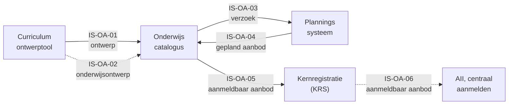
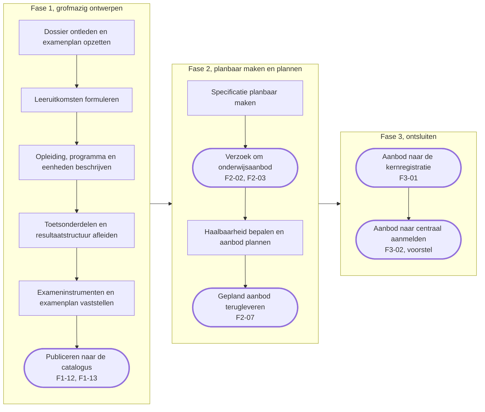
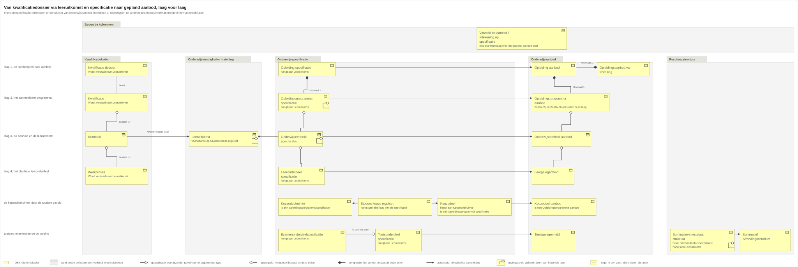
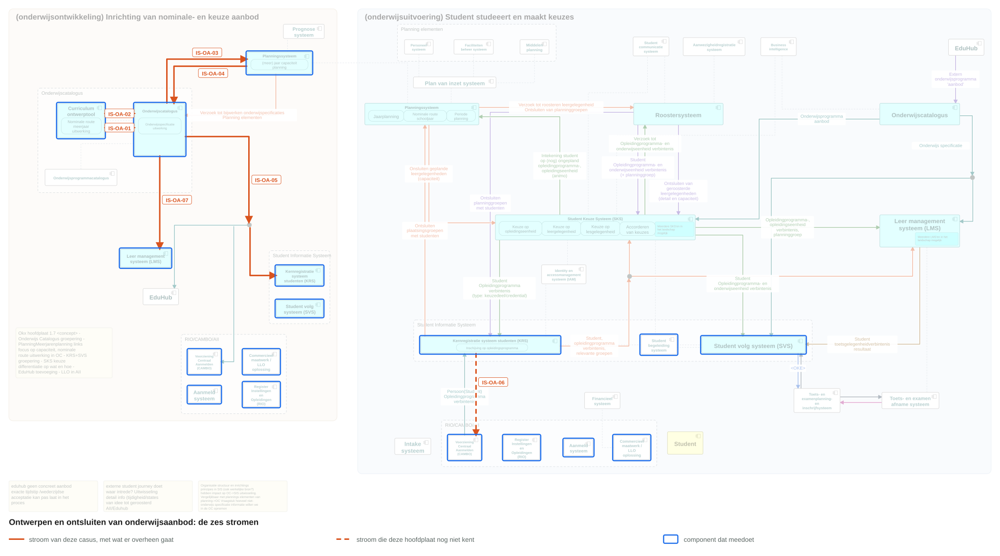
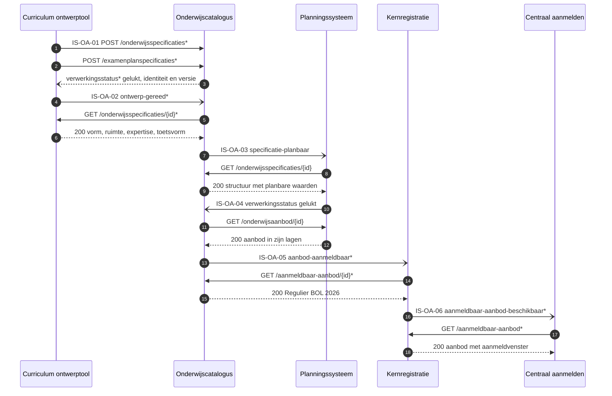

# Interactiespecificatie: ontwerpen en ontsluiten van onderwijsaanbod

| In een oogopslag | |
|---|---|
| Wat deze specificatie dekt | De informatiestromen waarmee een instelling onderwijsaanbod ontwerpt en ontsluit, van kwalificatiedossier tot aanmeldbaar aanbod. Leerroute 1, fase 1 tot en met 3, beeld F1-01 tot en met F3-02 |
| Voor wie | De informatiemanager of architect die uitvraagt, en de software-architect van de leverancier die bouwt. De onderwijskundige onderbouwing staat in de [leerroute-uitwerking](../leerroute-uitwerking/doc/leerroute-uitwerking-lr1.md) |
| Wat een leverancier ermee bouwt | Per eenheid het contract tussen 2 componenten: de operaties met hun pad en hun statuscodes, de berichtvelden met hun grond, en een voorbeeldpayload die tegen haar schema valideert |
| Hoe een instelling dit gebruikt | Zij wijst in de [kiesbare eenheden](#de-kiesbare-eenheden) aan welke zij uitvraagt, als eis aan een leverancier |
| Hoe de status leest | Een operatie, een pad en een schema dragen `vastgelegd` zodra [Public](https://github.com/Npuls-OKx/Public/tree/dev/Koppelvlakspecificaties) ze draagt, en `voorstel` zodra deze specificatie ze voorstelt, met een `$id` op `/voorstel` |
| Grond | De objecttypen komen uit het [informatiemodel](../../../model/informatiemodel/informatiemodel.md); [S6](#signaleringen-en-openstaande-punten) telt de modelregels die een aanname dragen. Hier begint de catalogus van interactiespecificaties |
| Scope | Binnen 1 instelling ([ADR 0008](https://github.com/Npuls-OKx/Public/blob/dev/Referentiemateriaal/adr/0008-scope-planning-eerst-intra-instelling.md)), leerroute 1 met [persona Jochem](../leerroute-uitwerking/doc/persona_jochem.md). Fase 4 en later, en elke andere leerroute, volgen als eigen snede |

## Leeswijzer

| Deel | Wat erin staat |
|---|---|
| [1 Wat dit bereikt](#1-wat-dit-bereikt) | Het scenario, de actoren, de kiesbare eenheden |
| [2 Het proces](#2-het-proces) | De fasen en de stappen, en waar informatie een component verlaat |
| [3 Het informatiemodel](#3-het-informatiemodel) | De objecttypen per familie, en de ontwerpkeuzes |
| [4 Het ecosysteem](#4-het-ecosysteem) | De stromen op hoofdplaat v1.7, en wie wat bezit |
| [5 De diensten](#5-de-diensten-per-component) | Per endpoint de eigenaar met zijn status |
| [6 De stromen](#6-de-stromen) | De keten in operaties, de schema's, en wat Public ermee doet |
| [Verdieping per stroom](#de-eenheden) | Per eenheid de operaties, de berichtvelden, een voorbeeldpayload uit [casus.md](casus.md) |
| [Signaleringen](#signaleringen-en-openstaande-punten) | Wat een besluit vraagt |

## 1. Wat dit bereikt

### Het scenario

1. Een onderwijsontwerper ontleedt het kwalificatiedossier Apothekersassistent (crebo 23450) in kwalificatie, kerntaken en werkprocessen.
2. Hij zet het examenplan op met een eerste resultaatstructuur en bindt cohort 2026 eraan, dat van Jochem, met de keuzedeeleis van 720 studiebelastingsuren (SBU).
3. Hij vertaalt het dossier naar leeruitkomsten in de stem van de instelling, verdiept met vaardigheid, kennis en inzicht uit CompetentNL.
4. Daarop bouwt hij de opleidingsspecificatie met programma, eenheden en leeronderdelen, elk met vorm, leeromgeving, docentprofiel en studiebelasting.
5. De keuzedeelruimte krijgt een eigen programmaspecificatie met een `Student keuze regelset`, waaruit Jochem later kiest.
6. De examencommissie stelt het examenplan met zijn resultaatstructuur vast.
7. Het ontwerp gaat als gelinkt geheel naar de onderwijscatalogus (IS-OA-01, IS-OA-02).
8. De catalogus maakt de specificatie planbaar en verzoekt planning om aanbod (IS-OA-03).
9. De planner bepaalt haalbaarheid en levert gepland aanbod terug, per laag verwijzend naar specificatie en verzoek (IS-OA-04).
10. De catalogus ontsluit `Regulier BOL 2026` aan de kernregistratie en die aan centraal aanmelden, waar Jochem zijn startmoment kiest (IS-OA-05, IS-OA-06).

Deze snede voltooit zich voordat Jochem zich orienteert: wat hij ziet is het resultaat ervan.

### Wat de actoren eruit halen

| Actor | Story | Eenheden |
|---|---|---|
| Onderwijsontwerper | Het dossier naar leeruitkomsten vertalen, daaraan de specificatiestructuur hangen en die planbaar maken, zodat elke schakel terugleest wat de student leert | IS-OA-01, IS-OA-03 |
| Examencommissie | Het examenplan met zijn resultaatstructuur vaststellen, zodat alleen een vastgesteld plan de catalogus bereikt | IS-OA-01, IS-OA-02 |
| Planner | Het verzoek met de planbare waarden ontvangen, zodat haalbaarheid blijkt uit prognose en capaciteit samen | IS-OA-03, IS-OA-04 |
| Onderwijscatalogus | Het geplande aanbod terugnemen en aanmeldbaar aanbod ontsluiten, zodat elk afnemend systeem bij de bezitter ophaalt | IS-OA-04, IS-OA-05 |
| Kernregistratie | Het aanbod ontsluiten aan AII (centraal aanmelden), zodat de aspirant-student zijn startmoment centraal kiest | IS-OA-06 |

### De kiesbare eenheden

| Id | Van | Naar | Wat zij levert | Waarop een leverancier bouwt | Beeld |
|---|---|---|---|---|---|
| IS-OA-01 | Curriculum ontwerptool | Onderwijscatalogus | Leeruitkomsten, de specificatiestructuur tot leeronderdeel, en de summatieve resultaatstructuur | De levering is de eenheid van aanname: opvragen `vastgelegd`, innemen met bevindingen `voorstel`. Het besluit ligt in [ADR 0020](https://github.com/Npuls-OKx/Public/blob/dev/Referentiemateriaal/adr/0020-curriculumontwerp-onderwijscatalogus-happy-flow-synchronisatie-en-federatie-adopt-klonen.md) | [F1-12](../../../model/informatiemodel/img/regels/f1-12-de-opleiding-zoals-ontworpen-naar-de-catalogus.svg) |
| IS-OA-02 | Curriculum ontwerptool | Onderwijscatalogus | Het onderwijs- en examenontwerp: vorm, leeromgeving, docent- en examinatorprofiel, studiebelasting, toetsvorm | Een overlay op de dragende schema's van Public, meereizend op de resource van IS-OA-01: `voorstel`, van de conceptplaat Onderwijsontwerp | [F1-13](../../../model/informatiemodel/img/regels/f1-13-het-onderwijs-en-examenontwerp-mee-naar-de-catalogus-conceptplaat.svg) |
| IS-OA-03 | Onderwijscatalogus | Planningssysteem | Het verzoek tot aanbod, met de planbare waarden per eenheid | Koppeling OC-P&R, [interactie I1 en I2](https://github.com/Npuls-OKx/Public/blob/dev/Koppelvlakspecificaties/Interactiepatronen/onderwijscatalogus-planning-en-roostering.md): `vastgelegd` | [F2-03](../../../model/informatiemodel/img/regels/f2-03-verzoek-met-specificatiestructuur-en-planbare-waarden-naar-planning.svg) |
| IS-OA-04 | Planningssysteem | Onderwijscatalogus | Het geplande aanbod in zijn lagen, elk verwijzend naar specificatie en verzoek | Dezelfde koppeling, interactie I3 en I5: `vastgelegd` | [F2-07](../../../model/informatiemodel/img/regels/f2-07-het-geplande-aanbod-terug-naar-de-catalogus.svg) |
| IS-OA-05 | Onderwijscatalogus | Kernregistratie (KRS) | Het aanmeld- en inschrijfbare `Opleidingsprogramma aanbod` | Een eigen resource `/aanmeldbaar-aanbod` bij de catalogus: het meldpatroon `inrichtingsstatus` `vastgelegd`, de aanmeldbare snede `voorstel` | [F3-01](../../../model/informatiemodel/img/regels/f3-01-aanmeldbaar-aanbod-naar-de-kernregistratie.svg) |
| IS-OA-06 | Kernregistratie (KRS) | AII (centraal aanmelden) | Hetzelfde aanbod, voor het systeem waarin Jochem zich aanmeldt | Dezelfde snede een schakel verder: `voorstel`, met de inhoudelijke keuzes bij de afstemming met AII | [F3-02](../../../model/informatiemodel/img/regels/f3-02-aanmeldbaar-aanbod-van-de-kernregistratie-naar-aii.svg) |

Elke eenheid draagt haar operaties, haar berichtvelden en haar voorbeeldpayload in haar [verdieping](#de-eenheden), met de stand per operatie, per pad en per schema. Vindplaats per regel: [voorbeeld-lr1-regels.json](../../../model/informatiemodel/voorbeeld-lr1-regels.json). Definities: [begrippenlijst](../begrippen/begrippenlijst.md). Wat een besluit vraagt: [signaleringen](#signaleringen-en-openstaande-punten).

### De componenten en de stromen

Stippellijn: elke operatie staat op voorstel.

## 2. Het proces

Van kwalificatiedossier tot aanmeldbaar aanbod, met de regels per beeld in de [voorbeelduitwerking](../../../model/informatiemodel/voorbeeld-lr1-regels.json).

### De keten in beeld

De afgeronde knopen zijn de momenten waarop informatie een component verlaat. IS-OA-03, IS-OA-04 en IS-OA-05 lopen over een pijl die v1.7 al tekent.

### De stappen per fase

Fase 1 volgt het MORA-hoofdproces Ontwikkelen, procesketen 6 Onderwijsontwikkeling; fase 2 Plannen en roosteren, procesketen 4 Onderwijslogistiek; fase 3 Informeren, aanmelden, intake en plaatsen. Uitsnedes van hoofdplaat v1.7: [fase 1](../../../model/informatiemodel/img/hoofdplaat/f1.svg), [fase 2](../../../model/informatiemodel/img/hoofdplaat/f2.svg), [fase 3](../../../model/informatiemodel/img/hoofdplaat/f3.svg).

| Fase | Stap | Rol of eenheid | Beelden |
|---|---|---|---|
| 1 | Kwalificatiedossier analyseren | onderwijsontwerper | F1-01 |
| 1 | Examenplan opstellen | onderwijsontwerper | F1-02 |
| 1 | Kwalificatiedossier vertalen naar leeruitkomsten | onderwijsontwerper | F1-03 tot en met F1-06 |
| 1 | Opleidingsspecificatie met programma en eenheden | onderwijsontwerper | F1-07 |
| 1 | Keuzedeel als eigen programmaspecificatie | onderwijsontwerper | F1-08 |
| 1 | Toetsonderdelen en resultaatstructuur afleiden | onderwijsontwerper | F1-09 |
| 1 | Exameninstrumenten bepalen of inkopen | examencommissie | F1-10 |
| 1 | Examenplan vaststellen | examencommissie | F1-11 |
| 1 | Grofmazig resultaat publiceren | IS-OA-01, IS-OA-02 | F1-12, F1-13 |
| 2 | Specificatie planbaar maken | onderwijsontwerper | F2-01 |
| 2 | Planningssysteem verzoeken om onderwijsaanbod | planner, IS-OA-03 | F2-02, F2-03 |
| 2 | Haalbaarheid bepalen en aanbod plannen | planner | F2-04 tot en met F2-06 |
| 2 | Gepland aanbod terugleveren | IS-OA-04 | F2-07 |
| 3 | Het gepubliceerde aanbod ontsluiten | IS-OA-05 | F3-01 |
| 3 | Het gepubliceerde aanbod doorgeven | IS-OA-06 | F3-02 |

Van fase 3 draagt deze snede het ontsluiten; aanmelden, intake, plaatsen en inschrijven beginnen bij F3-03, met de studieloopbaanbegeleider (SLB'er) als nieuwe rol.

## 3. Het informatiemodel

Deze interactie draagt de objecttypen uit het [informatiemodel OKx](../../../model/informatiemodel/informatiemodel.md). Per objecttype staat de instantie uit de casus Apothekersassistent (crebo 23450) in [casus.md](casus.md), met haar uuid en haar versie.

Elke laag van de opleiding keert terug in het kwalificatiekader, in de specificatie en in het aanbod, met de leeruitkomst als sleutel ertussen en het verzoek tot aanbod op de grens. De keuzedeelruimte, de toetsen en de examens staan eronder. De [selectie](uitsnede-onderwijsaanbod.json) draagt deze uitsnede.

### De objecttypen per familie

| Familie | Objecttypen in deze snede | Beelden |
|---|---|---|
| Kwalificatiekader mbo | `Kwalificatie dossier`, `Kwalificatie`, `Kerntaak`, `Werkproces` | F1-01 |
| Onderwijskundig kader instelling | `Leeruitkomst`, `Competenties / Skills`, `Vaardigheid`, `Kennis`, `Inzicht` | F1-03, F1-04, F1-12 |
| Onderwijsspecificatie | `Opleiding specificatie`, `Opleidingsprogramma specificatie`, `Onderwijseenheid specificatie`, `Leeronderdeel specificatie`, `Keuzedeelruimte`, `Keuzedeel`, `Student keuze regelset`, `Toetsonderdeel specificatie`, `Examenonderdeelspecificatie` | F1-05 tot en met F1-09, F1-12, F2-03 |
| Onderwijsaanbod | `Opleidingsaanbod van Instelling`, `Opleiding aanbod`, `Opleidingsprogramma aanbod`, `Onderwijseenheid aanbod`, `Leergelegenheid`, `Toetsgelegenheid`, `Keuzedeel aanbod` | F2-04, F2-07, F3-01, F3-02 |
| Resultaatstructuur | `Summatieve resultaat structuur`, `Examenonderdeel weging`, `Summatief Afrondingscriterium`, `Formatieve resultaat structuur` | F1-02, F1-09, F1-12 |
| Buiten de kolommen | `Cohort / periode`, `Verzoek tot Aanbod / Intekening op specificatie`, `Examenplan`, `Medewerker`, `Onderwijslocatie`, `Organisatie-eenheid` | F1-02, F1-11, F2-02, F2-03, F2-05 |

`Competenties / Skills`, `Kennis`, `Inzicht`, `Vaardigheid` en `Examenplan` dragen scope `buiten`: zij reizen mee als verdieping. `Onderwijsverbintenis` en `Onderwijsresultaat` beginnen bij F3-03. Het onderwijs- en examenontwerp van IS-OA-02 voegt `Onderwijsvorm`, `Onderwijslocatie type` en `Expertise of functieprofiel` toe.

### De ontwerpkeuzes die hier gelden

De nummering volgt de [ontwerpkeuzes](../../../model/informatiemodel/informatiemodel.md#ontwerpkeuzes).

| Keuze | Waar zij in deze snede valt |
|---|---|
| 1 Leeruitkomst als sleutel | F1-12, elk type verwijst ernaar |
| 2 Kader vertaald | F1-01 en F1-03, `Wordt vertaald naar` |
| 4 Niveau vrij | blok B1-K1 op kerntaakniveau |
| 5 Zelfstandig | F1-08, keuzedeel als eigen specificatie |
| 6 Student kiest | F1-07 en F1-12, de regelset |
| 9 Examenonderdeel | F1-09 en F1-12, beide typen |
| 10 Resultaatstructuur | F1-12 publiceert, F1-02 toont herkomst |
| 11 Competentie | F1-04, vaardigheid, kennis, inzicht eronder |
| 12 Keuzedeelruimte | F1-07, F1-08, F2-07, dezelfde vorm |
| 13 Intekenen | F2-02 verzoek, F2-07 aanbod |
| 16 Geldigheid | de versie op de specificatie, de periode op het aanbod |
| 17 Cohort | F1-02 bindt cohort 2026 aan de structuur |

Keuze 3, 7 en 8 raken de rand, bij een tweede instelling of vanaf F3-03.

## 4. Het ecosysteem

De plaat licht de stromen van deze snede uit op hoofdplaat v1.7: de componenten die meedoen zijn omlijnd, bij elke stroom staat wat er overheen gaat, en IS-OA-01, IS-OA-02 en IS-OA-06 staan gestippeld: zij krijgen hun lijn op een volgende plaatversie.

De stromen staan met hun lading in [stromen-onderwijsaanbod.json](stromen-onderwijsaanbod.json), het markeerbestand achter de plaat.

### De stromen op de hoofdplaat

| Aanduiding | Koppeling op de plaat | Wat de plaat vandaag tekent |
|---|---|---|
| IS-OA-01 | volgt | het ontwerpen valt binnen de catalogus, en de [dienstpagina van de ontwerptool](https://github.com/Npuls-OKx/Public/blob/dev/Koppelvlakspecificaties/Applicatiecomponenten/curriculum-ontwerptool.md) draagt nog geen endpoints |
| IS-OA-02 | volgt | dezelfde lijn als IS-OA-01, van de conceptplaat Onderwijsontwerp |
| IS-OA-03 | OC-P&R, interactie I1 en I2 | een pijl, met het [interactiepatroon OC-P&R](https://github.com/Npuls-OKx/Public/blob/dev/Koppelvlakspecificaties/Interactiepatronen/onderwijscatalogus-planning-en-roostering.md) eronder: endpoints en meldpatronen (webhooks) |
| IS-OA-04 | OC-P&R, interactie I3 en I5 | hetzelfde patroon, de andere richting |
| IS-OA-05 | OC-KRS in de beeldregels, OC-SIS op de plaat | een pijl, met het interactiepatroon OC-SIS eronder voor specificatie en resultaatstructuur |
| IS-OA-06 | volgt | een knooppunt (junction) achter de pijl van IS-OA-05, rechtstreeks naar CAMBO |

### Wie wat bezit

| Component | Bezit | Wat het hier ontsluit |
|---|---|---|
| Curriculum ontwerptool | het ontwerp in bewerking | het ontwerp aan de catalogus |
| Onderwijscatalogus | de specificaties en de resultaatstructuren | de planbare specificatie, en aanmeldbaar aanbod |
| Planningssysteem | het onderwijsaanbod | het geplande aanbod in zijn lagen |
| Kernregistratie (KRS) | de verbintenissen, de voortgang en de resultaten | het aanbod aan centraal aanmelden |

Grond: [uitgangspunt U3, resource-eigenaarschap](https://github.com/Npuls-OKx/Public/blob/dev/Koppelvlakspecificaties/uitgangspunten.md#u3-resource-eigenaarschap). Elk systeem is de enige bron van zijn eigen resource, en over de koppeling gaat een verwijzing (uuid), met de inhoud op opvraag.

## 5. De diensten per component

Een applicatiedienst zegt wat er over een koppeling moet kunnen; wie hem vervult volgt uit [resource-eigenaarschap](https://github.com/Npuls-OKx/Public/blob/dev/Koppelvlakspecificaties/uitgangspunten.md#u3-resource-eigenaarschap). De dienstnamen komen uit de [dienstenlijst](https://github.com/Npuls-OKx/Public/blob/d0c20d99b110b29ccf6b0e50109f7d54ffd88d7a/Koppelvlakspecificaties/Applicatiediensten/README.md), vastgezet op commit d0c20d99, want die map staat nog niet op `dev`.

Elk endpoint staat hieronder bij de component die het bezit; de [componentpagina](https://github.com/Npuls-OKx/Public/tree/dev/Koppelvlakspecificaties/Applicatiecomponenten) draagt er de parameters en de statuscodes bij.

| Component | Diensten die deze snede vraagt | Endpoints en meldingen `vastgelegd` | Endpoints en meldingen `voorstel` | Eenheden |
|---|---|---|---|---|
| Curriculum ontwerptool | onderwijsspecificatie-inname-afnemer, verwerkingsuitkomst-afnemer, afleverabonnement-afnemer | geen: zij draagt vandaag nog geen koppelvlak | `verwerkingsstatus`, `specificatie-status-gewijzigd`, `/abonnementen`, en `/onderwijsspecificaties/{id}` en `/examenplanspecificaties/{id}`, elk met `/delta` | IS-OA-01, IS-OA-02 |
| Onderwijscatalogus | onderwijsspecificatie-inname-aanbieder, onderwijsspecificatiestructuur-aanbieder, planbaar-onderwijsaanbod-afnemer, verwerkingsuitkomst-afnemer, afleverabonnement-aanbieder en -afnemer | `GET /onderwijsspecificaties` met `/{id}` en `/{id}/delta`, `/examenplanspecificaties/{id}`, `/abonnementen`, `verwerkingsstatus`, `inrichtingsstatus` | `POST /onderwijsspecificaties`, `POST /examenplanspecificaties`, `/leveringen/{leveringId}`, `/aanmeldbaar-aanbod` met `/{id}` en `/{id}/delta`, en de melding `ontwerp-gereed` | IS-OA-01 tot en met IS-OA-05 |
| Planningssysteem | onderwijsspecificatiestructuur-afnemer, planbaar-onderwijsaanbod-aanbieder, verwerkingsuitkomst-aanbieder, afleverabonnement-aanbieder en -afnemer | `/onderwijsaanbod` met `/{id}`, `/abonnementen`, `specificatie-planbaar`, `-gewijzigd` en `-status-gewijzigd` | geen: deze snede vraagt niets erbij | IS-OA-03, IS-OA-04 |
| Kernregistratie (KRS) | aanmeldbaar-onderwijsaanbod-afnemer en -aanbieder, beide voorstel | geen | de melding `aanbod-aanmeldbaar`, `/aanmeldbaar-aanbod` met `/{id}`, `/abonnementen`, en de melding `verwerkingsstatus` | IS-OA-05, IS-OA-06 |
| AII (centraal aanmelden) | aanmeldbaar-onderwijsaanbod-afnemer, voorstel | geen | de melding `aanmeldbaar-aanbod-beschikbaar`, `/abonnementen` | IS-OA-06 |

Dezelfde resourcenaam komt tweemaal in de keten voor: `/aanmeldbaar-aanbod` bij de catalogus voor de kernregistratie, en bij de kernregistratie voor centraal aanmelden, met dezelfde parameters en statuscodes. Een leverancier bouwt hem per bezitter (W13).

## 6. De stromen

### De keten in operaties

Elk paar legt eerst zijn afleveradres vast met `POST /abonnementen`. Een `*` markeert wat op deze koppeling nog een voorstel is, een pad of een melding; de verdieping noemt de werkbrief erbij.

### De eenheden

De lading en de stand per eenheid staan in [de kiesbare eenheden](#de-kiesbare-eenheden). Elke verdieping draagt de operaties met hun statuscodes, de berichtvelden met hun grond, de voorbeeldpayloads en de werkbrieven: [IS-OA-01](stroom-is-oa-01.md), [IS-OA-02](stroom-is-oa-02.md), [IS-OA-03](stroom-is-oa-03.md), [IS-OA-04](stroom-is-oa-04.md), [IS-OA-05](stroom-is-oa-05.md) en [IS-OA-06](stroom-is-oa-06.md).

### De schema's en wat Public ermee doet

Elke voorbeeldpayload in de verdiepingen noemt achter de taalaanduiding van haar codeblok de schema's waartegen zij valideert, in de vorm `schema=intake-outcome`. Twee schema's achter elkaar staan voor een dragend schema met een overlay erop. De controle `python3 scripts/controleer-interactiespec.py` haalt elke payload langs die schema's en meldt elke sleutel die geen schema verklaart.

De kolom Status zegt waarop een leverancier zich vastlegt: `vastgelegd` bij een schema dat [Npuls-OKx/Public](https://github.com/Npuls-OKx/Public/tree/dev/Informatie-en-gegevensmodellen/schemas) draagt, daar met het label alfa, en `voorstel` bij een schema uit [schemas/](schemas/), met een `$id` op `/voorstel`.

De laatste kolom is wat deze specificatie aan Public teruggeeft. Een voorstel landt door het in de schemamap daar op te nemen: de `$id` wisselt naar `/alfa`, de verwijzingen ertussen worden bestandsrelatief, en dat is additief en daarmee MINOR ([versionering](https://github.com/Npuls-OKx/Public/blob/dev/Informatie-en-gegevensmodellen/regels.md)). De kolom noemt de werkbrief, met de afwijking erbij waar de landing meer vraagt.

| Schema | Nederlandse naam | Status | Eenheden | Werkbrief en afwijking |
|---|---|---|---|---|
| `arrangement-status.json` | Inrichtingsstatus | voorstel | IS-OA-05 | W4: het schema vult de rij `inrichtingsstatus` die de dienstpagina aankondigt |
| `education-design.json` | Onderwijsontwerp | voorstel | IS-OA-02 | WB-01 tot en met WB-08: met `allOf` gecomponeerd in de twee dragende schema's |
| `education-offering.json` | Onderwijsaanbod | vastgelegd | IS-OA-04 | W1 van IS-OA-06: de statuswaarde `aanmeldbaar` in de gesloten lijst is MAJOR |
| `education-offering-delta.json` | Onderwijsaanbod-delta | voorstel | IS-OA-05 | W7, naar het model van education-specification-delta.json |
| `education-specification.json` | Onderwijsspecificatie | vastgelegd | IS-OA-01 tot en met IS-OA-03 | WB-01 van IS-OA-02: de ontwerpvelden erin met `allOf` |
| `expertise-profile.json` | Expertise- of functieprofiel | voorstel | IS-OA-02 | WB-03, met `organisationUnitId` op organisation-unit.json |
| `intake-finding.json` | Innamebevinding | voorstel | IS-OA-01 | W15, met de codelijst in regels.md naast die van bottleneck.json |
| `intake-outcome.json` | Innameuitkomst | voorstel | IS-OA-01 | W14: naast processing-status.json, of de sleutels `deliveryId` en `findings` daarin. `specificationReference` daar voorwaardelijk maken is MAJOR |
| `intake-rejection.json` | Innameafkeuring | voorstel | IS-OA-01 | W16: als antwoordlichaam bij 400 en 409, met die 409 erbij op de componentpagina's |
| `learning-resource-group.json` | Leermiddelgroep | voorstel | IS-OA-02 | WB-06, met de leermiddelkoppeling in gebruiksprofielen.md erop |
| `offering-open-for-application.json` | Aanmeldbaar aanbod | voorstel | IS-OA-05, IS-OA-06 | W2 en W11: als gebruiksprofiel van education-offering.json, met een profiel per afnemer |
| `offering-processing-status.json` | Verwerkingsstatus van aanbod | voorstel | IS-OA-06 | W6, naast processing-status.json met het aanbod als onderwerp |
| `offering-reference.json` | Aanbod-referentie | voorstel | IS-OA-05, IS-OA-06 | W8: het vervangt de inline vorm in offering-processing-status.json, MAJOR voor wie daarop valideert |
| `offering-request.json` | Verzoek tot aanbod | voorstel | IS-OA-03 | W1 van IS-OA-03: naast specification-reference.json, dat in interactie I7 en in processing-status.json ongewijzigd blijft |
| `offering-status-changed.json` | Aanbod-status-gewijzigd | voorstel | IS-OA-05, IS-OA-06 | W1 en W5, met de meldingssoort per koppeling op de componentpagina |
| `processing-status.json` | Verwerkingsstatus | vastgelegd | IS-OA-02, IS-OA-04 | W14 van IS-OA-01: de sleutels van de inname erin of ernaast |
| `result-structure.json` | Resultaatstructuur en examenplan | vastgelegd | IS-OA-01, IS-OA-02 | W7 van IS-OA-01: de formatieve wortel als enumwaarde erbij |
| `room-type.json` | Onderwijslocatie type | voorstel | IS-OA-02 | WB-02, met `locationIds` op location.json |
| `specification-reference.json` | Specificatie-referentie | vastgelegd | IS-OA-03 | W3 van IS-OA-01: kopmetadata in de respons erbij |
| `student-choice-rule.json` | Student keuze regel | voorstel | IS-OA-01, IS-OA-03 | W9: in `rules` van rule-set.json, MINOR naast de vrije vorm en MAJOR bij dichtzetten |

Een schema zonder eigen payload draagt de losse objecten waarnaar een ander schema wijst, en komt mee in diens validatie.

Wat er naast de schema's landt:

| Wat erbij komt | Waar | Versie-impact |
|---|---|---|
| De paden en meldingen uit [paragraaf 5](#5-de-diensten-per-component), met hun parameters en statuscodes | de componentpagina's, plus een nieuwe voor centraal aanmelden | Nieuwe endpoints |
| De meldingssoorten `ontwerp-gereed`, `aanbod-aanmeldbaar`, `aanmeldbaar-aanbod-beschikbaar` en `inrichtingsstatus` | de gesloten lijst `events` in subscription.json | MAJOR voor wie op die lijst valideert |
| Een stabiel `eventId` op elke melding, dat U5 voor herhaalbare verwerking vraagt | de eventschema's in Public | Optioneel MINOR, verplicht MAJOR |
| De diensten voor de inname en voor aanmeldbaar aanbod, met het gebruiksprofiel per koppeling eronder | de dienstenlijst en gebruiksprofielen.md | Nieuwe dienstpagina's |
| De Nederlandse naam per nieuwe sleutel, en het begrip levering als eenheid van aanname | mapping.md en de begrippenlijst | Geen schemawijziging |
| Een objecttype per verwijzing uit [S19](#signaleringen-en-openstaande-punten), met een definitie erbij | het informatiemodel en de begrippenlijst | Geen schemawijziging |

## Signaleringen en openstaande punten

| Nr | Signalering | Besluit |
|---|---|---|
| S1 | De beeldregels citeren het kaderscenario in Public, de stories staan in [leerroute-uitwerking-lr1.md](../leerroute-uitwerking/doc/leerroute-uitwerking-lr1.md) | welk bestand normatief is |
| S2 | IS-OA-05 heet OC-KRS in de beeldregels en OC-SIS op v1.7; het [interactiepatroon](https://github.com/Npuls-OKx/Public/blob/dev/Koppelvlakspecificaties/Interactiepatronen/onderwijscatalogus-studentinformatiesysteem.md) vat KRS en studentvolgsysteem samen, en hetzelfde pijl-id draagt de stroom naar CAMBO | een naam en een pijl per koppeling |
| S3 | IS-OA-06 loopt via de kernregistratie naar AII op gezag van de sectorarchitect, v1.7 ontsluit rechtstreeks aan CAMBO | richting, component en naam |
| S5 | De stroomregels van IS-OA-01 en IS-OA-02 dragen geen koppeling-ID: op v1.7 valt het ontwerpen binnen de catalogus | een eigen lijn op de plaat |
| S6 | 79 van de 145 regels dragen een aanname, bij F1-13 alle 11; 26 objecttypen komen van de conceptplaat en 13 van de 33 missen een definitie | de grond per eenheid zichtbaar maken |
| S7 | B01 tot en met B10 staan open (issues 283 en 284): de clustering, de keuzedeelruimte in de resultaatstructuur, exacte geplande capaciteit | de bevindingen wegen voor een eenheid vastligt |
| S8 | Fase 1 en 2 dragen procesketen 6 en 4; informeren, aanmelden, intake en plaatsen valt onder keten 5 | de ketentoewijzing van fase 3 |
| S9 | [U5](https://github.com/Npuls-OKx/Public/blob/dev/Koppelvlakspecificaties/uitgangspunten.md#u5-bericht-versus-kanaal) laat het afleveringsmechanisme bij de partijen, `subscription.json` dekt de OC-P&R-events, en OC-SIS kent nog geen interactie voor een afleveradres | het afleveradres per koppeling |
| S10 | Story-0007, story-0022 en story-0023 staan op de onderwijsontwikkelaar, het voorbeeld noemt de planner | de actor per story |
| S11 | 7 van de 24 stromen op v1.7 dragen een koppelingspecificatie, de aangehaalde [ADR's](https://github.com/Npuls-OKx/Public/tree/dev/Referentiemateriaal/adr) staan op Voorstel en elk schema in Public op alfa | wanneer een stand van voorstel naar vastgelegd gaat |
| S12 | De dienstenlijst staat op commit d0c20d99 van `feature/restructure-and-versioning`, de enige plek waar `Applicatiediensten/` vandaag leeft | welke branch normatief is |
| S13 | IS-OA-01 levert het ontwerp met POST, IS-OA-02 meldt gereed en laat de catalogus ophalen | een aanleverpatroon van ontwerptool naar catalogus |
| S14 | De dienstenlijst schrijft `specificatie-beschikbaar` en `verwerkingsuitkomst`, de componentpagina's `specificatie-planbaar` en `verwerkingsstatus`; dezelfde statusmelding heet `aanbod-aanmeldbaar` bij IS-OA-05 en `aanmeldbaar-aanbod-beschikbaar` bij IS-OA-06 | een naam per bericht |
| S15 | Interactie I3 valt uiteen: ontvangen, gestart en afgekeurd bij IS-OA-03, gelukt en nietGelukt bij IS-OA-04 | de knip bevestigen |
| S16 | De schema's en [mapping.md](https://github.com/Npuls-OKx/Public/blob/dev/Informatie-en-gegevensmodellen/mapping.md) dragen Engelse veldnamen met de Nederlandse naam ernaast, [voorbeeldpayloads.md](https://github.com/Npuls-OKx/Public/blob/dev/Informatie-en-gegevensmodellen/voorbeeldpayloads.md) en [U7](https://github.com/Npuls-OKx/Public/blob/dev/Koppelvlakspecificaties/uitgangspunten.md#u7-payload-plat-met-verwijzingen-en-de-sleutelconventie) Nederlandse sleutels; deze snede volgt de schema's, zodat elke payload valideert | een sleuteltaal, op een plek |
| S17 | De uitkomst van de inname landt in `processing-status.json` met `deliveryId` en `findings` erbij, of in [intake-outcome.json](schemas/intake-outcome.json) ernaast; het voorstel vraagt `specificationReference` alleen op `gelukt`, waar dat schema hem altijd verplicht | welke landing, en of die versoepeling daar mag (MAJOR) |
| S18 | Twee gesloten lijsten vragen een waarde erbij: `events` in `subscription.json` voor de nieuwe meldingssoorten, en `status` in `education-offering.json` voor `aanmeldbaar` | of die lijsten open gaan; elke waarde erbij is MAJOR voor wie erop valideert |
| S19 | Verwijzingen zonder onderwerp in het informatiemodel: de inrichting achter `arrangementReference`, `Plaatsingsgroep` op de aanbodlaag, het toetsinstrument, de leermiddelgroep, de resultaateenheidspecificatie en de publicatie bij centraal aanmelden | het objecttype per verwijzing |
| S20 | De inhoud van IS-OA-06 staat als V1 tot en met V10 in [Public#112](https://github.com/Npuls-OKx/Public/issues/112), van de aanbodlagen en het aanmeldvenster tot de terugmelding en het locatieniveau | per regel een antwoord van AII |

S4, waar de dienst voor aanmeldbaar aanbod hoort, is beslecht: de catalogus krijgt de eigen resource `/aanmeldbaar-aanbod`, en `/onderwijsaanbod` blijft bij het planningssysteem.

Open beeldvragen: het generieke basisdeel (F1-09), de keuzedeelruimte in de summatieve resultaatstructuur (F1-12), en de container voor geclusterde leeronderdelen, met de vraag of het onderwijsontwerp daar landt of bij het leeronderdeel (F1-06, F2-01).

Verder open:

| Punt | Stand |
|---|---|
| De fase-2 update van de ontwerptool, de route naar het intakesysteem vanaf F3-04, en de stories van roosteraar en student | volgen elk als eigen snede |
| `Onderwijsvorm`, `Onderwijslocatie type`, `Onderwijslocatie` en `Organisatie-eenheid` staan in F1-06 nog onder hun conceptplaat-naam | de namen gelijktrekken |
| Het versieformaat: `2026.1` in de voorbeelduitwerking naast het patroon `n.n.n` van de schema's | een aanduiding per specificatie |
| De bewaartermijn van een afgehandelde levering, en of een lijstopvraag op `/leveringen` erbij hoort | W17 van IS-OA-01 |
| Het aanmeldvenster en de uiterste inschrijfdatum staan nog niet in [casus.md](casus.md), terwijl IS-OA-05 en IS-OA-06 dezelfde waarden dragen | een regel daar houdt beide eenheden gelijk |
| [offering-open-for-application.json](schemas/offering-open-for-application.json) sluit zijn objecten om de snede uit te drukken | of het profiel open gaat voor latere velden |
| Elke verdieping nummert haar operaties en haar werkbrieven zelf: O1, I1, C1, W1 en WB-01 beginnen elk een reeks | een nummering over de stromen |
| `Competenties / skills` naast `Competenties / Skills`, `Schaartste van mensen` (F2-05), `Opleiding aanbod` naast `Opleidingaanbod` | blokkeren een kruiscontrole op naam |
