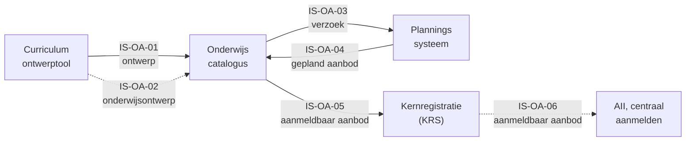
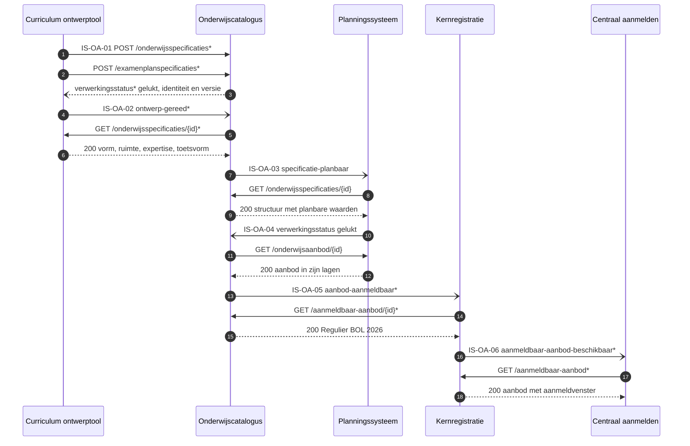

# Interactiespecificatie: ontwerpen en ontsluiten van onderwijsaanbod

| In een oogopslag | |
|---|---|
| Wat deze specificatie dekt | De informatiestromen waarmee een instelling onderwijsaanbod ontwerpt en ontsluit, van kwalificatiedossier tot aanmeldbaar aanbod. Leerroute 1, fase 1 tot en met 3, beeld F1-01 tot en met F3-02 |
| Voor wie | De informatiemanager of architect die uitvraagt, en de software-architect van de leverancier die bouwt. De onderwijskundige onderbouwing staat in de [leerroute-uitwerking](../leerroute-uitwerking/doc/leerroute-uitwerking-lr1.md) |
| Wat een leverancier ermee bouwt | Per eenheid het contract tussen 2 componenten: de operaties met hun pad en hun statuscodes, de berichtvelden met hun grond, en een voorbeeldpayload die tegen haar schema valideert |
| Hoe een instelling dit gebruikt | Zij wijst in de [zes eenheden](#1-zes-eenheden-tussen-vijf-componenten) aan welke zij uitvraagt, als eis aan een leverancier |
| Hoe de status leest | Een operatie, een pad en een schema dragen `vastgelegd` zodra [Public](https://github.com/Npuls-OKx/Public/tree/dev/Koppelvlakspecificaties) ze draagt, en `voorstel` zodra deze specificatie ze voorstelt, met een `$id` op `/voorstel` |
| De casus | Apothekersassistent, crebo 23450, cohort 2026 met de keuzedeeleis van 720 studiebelastingsuren (SBU), uitmondend in `Regulier BOL 2026` waar [persona Jochem](../leerroute-uitwerking/doc/persona_jochem.md) zich aanmeldt. Elke identificatie staat in [casus.md](casus.md) |
| Grond | De objecttypen komen uit het [informatiemodel](../../../model/informatiemodel/informatiemodel.md); [S6](signaleringen.md) telt de modelregels die een aanname dragen. Hier begint de catalogus van interactiespecificaties |
| Scope | Binnen 1 instelling ([ADR 0008](https://github.com/Npuls-OKx/Public/blob/dev/Referentiemateriaal/adr/0008-scope-planning-eerst-intra-instelling.md)). Deze snede voltooit zich voordat Jochem zich orienteert: wat hij ziet is het resultaat ervan. Fase 4 en later, en elke andere leerroute, volgen als eigen snede |

## Leeswijzer

| Deel | Wat erin staat |
|---|---|
| [1 Zes eenheden tussen vijf componenten](#1-zes-eenheden-tussen-vijf-componenten) | Per eenheid het beeld van haar lading, en wat elke actor eruit haalt |
| [2 Van kwalificatiedossier tot aanmeldbaar aanbod](#2-van-kwalificatiedossier-tot-aanmeldbaar-aanbod) | De vijftien stappen met hun beeld, en waar informatie een component verlaat |
| [3 Elke laag keert driemaal terug](#3-elke-laag-keert-driemaal-terug) | De objecttypen per familie, en de ontwerpkeuzes |
| [4 De stromen op hoofdplaat v1.7](#4-de-stromen-op-hoofdplaat-v17) | Wat de plaat vandaag tekent, en wie wat bezit |
| [5 Elk endpoint staat bij zijn bezitter](#5-elk-endpoint-staat-bij-zijn-bezitter) | Per endpoint de eigenaar met zijn status |
| [6 De keten in operaties](#6-de-keten-in-operaties) | De volgorde over alle zes de eenheden, met de verdieping per eenheid |
| [Verdieping per eenheid](#de-verdieping-per-eenheid) | Per eenheid de operaties, de berichtvelden, een voorbeeldpayload uit [casus.md](casus.md) |
| [naar-public.md](naar-public.md) | De twintig schema's met hun landing in Public, en wat er naast de schema's bij komt |
| [signaleringen.md](signaleringen.md) | Tweeentwintig punten die een besluit vragen |

## 1. Zes eenheden tussen vijf componenten

Een stippellijn staat voor een eenheid waarvan elke operatie nog een voorstel is. Een instelling wijst hier aan welke eenheid zij uitvraagt.

| Id | Van | Naar | Wat zij levert | Waarop een leverancier bouwt |
|---|---|---|---|---|
| IS-OA-01 | Curriculum ontwerptool | Onderwijscatalogus | Leeruitkomsten, de specificatiestructuur tot leeronderdeel, en de summatieve resultaatstructuur | De levering is de eenheid van aanname: opvragen `vastgelegd`, innemen met bevindingen `voorstel`. Het besluit ligt in [ADR 0020](https://github.com/Npuls-OKx/Public/blob/dev/Referentiemateriaal/adr/0020-curriculumontwerp-onderwijscatalogus-happy-flow-synchronisatie-en-federatie-adopt-klonen.md) |
| IS-OA-02 | Curriculum ontwerptool | Onderwijscatalogus | Het onderwijs- en examenontwerp: vorm, leeromgeving, docent- en examinatorprofiel, studiebelasting, toetsvorm | Een overlay op de dragende schema's van Public, meereizend op de resource van IS-OA-01: `voorstel`, van de conceptplaat Onderwijsontwerp |
| IS-OA-03 | Onderwijscatalogus | Planningssysteem | Het verzoek tot aanbod, met de planbare waarden per eenheid | Koppeling OC-P&R, [interactie I1 en I2](https://github.com/Npuls-OKx/Public/blob/dev/Koppelvlakspecificaties/Interactiepatronen/onderwijscatalogus-planning-en-roostering.md): `vastgelegd` |
| IS-OA-04 | Planningssysteem | Onderwijscatalogus | Het geplande aanbod in zijn lagen, elk verwijzend naar specificatie en verzoek | Dezelfde koppeling, interactie I3 en I5: `vastgelegd` |
| IS-OA-05 | Onderwijscatalogus | Kernregistratie (KRS) | Het aanmeld- en inschrijfbare `Opleidingsprogramma aanbod` | Een eigen resource `/aanmeldbaar-aanbod` bij de catalogus: het meldpatroon `inrichtingsstatus` `vastgelegd`, de aanmeldbare snede `voorstel` |
| IS-OA-06 | Kernregistratie (KRS) | AII (centraal aanmelden) | Hetzelfde aanbod, voor het systeem waarin Jochem zich aanmeldt | Dezelfde snede een schakel verder: `voorstel`, met de inhoudelijke keuzes bij de afstemming met AII |

### IS-OA-01, het ontwerp reist als gelinkt geheel

Links staat wat de ontwerper bouwde, rechts de catalogus die het opneemt. De pijlen naar de leeruitkomsten lopen door de hele structuur: die sleutel maakt het een geheel in plaats van losse documenten.

### IS-OA-02, het onderwijsontwerp reist mee op dezelfde resource

De blokken hier hangen onder de typen van IS-OA-01 en vormen geen eigen resource. Elk blok komt van de conceptplaat Onderwijsontwerp, en elke regel in dit beeld draagt een aanname.

### IS-OA-03, het verzoek draagt de structuur en de planbare waarden

Het `Verzoek tot Aanbod` staat op de grens tussen specificatie en aanbod: links wat vastligt, rechts wat de planner ermee gaat doen. De planbare waarden hangen per eenheid, want haalbaarheid blijkt per eenheid.

### IS-OA-04, het geplande aanbod verwijst per laag terug

Elke aanbodlaag draagt twee verwijzingen: naar de specificatie waaruit zij volgt en naar het verzoek waarop zij antwoordt. Daarmee leest elke schakel terug waarom dit aanbod bestaat.

### IS-OA-05, de aanmeldbare snede is een eigen resource

Alleen het `Opleidingsprogramma aanbod` gaat mee, en niet de lagen eronder. Die snede staat bij de catalogus op `/aanmeldbaar-aanbod`, los van `/onderwijsaanbod` bij het planningssysteem.

### IS-OA-06, dezelfde snede een schakel verder

De vorm is die van IS-OA-05, met de kernregistratie nu als bezitter. Welke velden AII vraagt staat open: [Public#112](https://github.com/Npuls-OKx/Public/issues/112) draagt die vraag als V1 tot en met V10.

### Wat de actoren eruit halen

| Actor | Story | Eenheden |
|---|---|---|
| Onderwijsontwerper | Het dossier naar leeruitkomsten vertalen, daaraan de specificatiestructuur hangen en die planbaar maken, zodat elke schakel terugleest wat de student leert | IS-OA-01, IS-OA-03 |
| Examencommissie | Het examenplan met zijn resultaatstructuur vaststellen, zodat alleen een vastgesteld plan de catalogus bereikt | IS-OA-01, IS-OA-02 |
| Planner | Het verzoek met de planbare waarden ontvangen, zodat haalbaarheid blijkt uit prognose en capaciteit samen | IS-OA-03, IS-OA-04 |
| Onderwijscatalogus | Het geplande aanbod terugnemen en aanmeldbaar aanbod ontsluiten, zodat elk afnemend systeem bij de bezitter ophaalt | IS-OA-04, IS-OA-05 |
| Kernregistratie | Het aanbod ontsluiten aan AII (centraal aanmelden), zodat de aspirant-student zijn startmoment centraal kiest | IS-OA-06 |

Elke eenheid draagt haar operaties, haar berichtvelden en haar voorbeeldpayload in haar [verdieping](#de-verdieping-per-eenheid). Vindplaats per regel: [voorbeeld-lr1-regels.json](../../../model/informatiemodel/voorbeeld-lr1-regels.json). Definities: [begrippenlijst](../begrippen/begrippenlijst.md).

## 2. Van kwalificatiedossier tot aanmeldbaar aanbod

De dikomlijnde knopen zijn de momenten waarop informatie een component verlaat, en daar valt dus een eenheid. Alle vijf de andere stappen blijven binnen een component.

### De vijftien stappen met hun beeld

| Fase | Stap | Rol of eenheid | Beelden |
|---|---|---|---|
| 1 | Kwalificatiedossier analyseren: kwalificatie, kerntaken en werkprocessen | onderwijsontwerper | F1-01 |
| 1 | Examenplan opstellen met een eerste resultaatstructuur, gebonden aan cohort 2026 | onderwijsontwerper | F1-02 |
| 1 | Kwalificatiedossier vertalen naar leeruitkomsten in de stem van de instelling, verdiept met vaardigheid, kennis en inzicht uit CompetentNL | onderwijsontwerper | F1-03 tot en met F1-06 |
| 1 | Opleidingsspecificatie met programma en eenheden, elk met vorm, leeromgeving, docentprofiel en studiebelasting | onderwijsontwerper | F1-07 |
| 1 | Keuzedeel als eigen programmaspecificatie, met de `Student keuze regelset` waaruit Jochem later kiest | onderwijsontwerper | F1-08 |
| 1 | Toetsonderdelen en resultaatstructuur afleiden | onderwijsontwerper | F1-09 |
| 1 | Exameninstrumenten bepalen of inkopen | examencommissie | F1-10 |
| 1 | Examenplan vaststellen | examencommissie | F1-11 |
| 1 | Grofmazig resultaat publiceren | IS-OA-01, IS-OA-02 | F1-12, F1-13 |
| 2 | Specificatie planbaar maken | onderwijsontwerper | F2-01 |
| 2 | Planningssysteem verzoeken om onderwijsaanbod | planner, IS-OA-03 | F2-02, F2-03 |
| 2 | Haalbaarheid bepalen en aanbod plannen | planner | F2-04 tot en met F2-06 |
| 2 | Gepland aanbod terugleveren | IS-OA-04 | F2-07 |
| 3 | `Regulier BOL 2026` ontsluiten aan de kernregistratie | IS-OA-05 | F3-01 |
| 3 | Hetzelfde aanbod doorgeven aan centraal aanmelden | IS-OA-06 | F3-02 |

| Fase | MORA-hoofdproces en procesketen | Uitsnede van hoofdplaat v1.7 |
|---|---|---|
| 1 | Ontwikkelen, procesketen 6 Onderwijsontwikkeling | [fase 1](../../../model/informatiemodel/img/hoofdplaat/f1.svg) |
| 2 | Plannen en roosteren, procesketen 4 Onderwijslogistiek | [fase 2](../../../model/informatiemodel/img/hoofdplaat/f2.svg) |
| 3 | Informeren, aanmelden, intake en plaatsen | [fase 3](../../../model/informatiemodel/img/hoofdplaat/f3.svg) |

Van fase 3 draagt deze snede het ontsluiten. Aanmelden, intake, plaatsen en inschrijven beginnen bij F3-03, met de studieloopbaanbegeleider (SLB'er) als nieuwe rol.

## 3. Elke laag keert driemaal terug

Elke laag van de opleiding staat driemaal op deze plaat: in het kwalificatiekader, in de specificatie en in het aanbod, met de leeruitkomst als sleutel ertussen en het verzoek tot aanbod op de grens. De keuzedeelruimte, de toetsen en de examens staan eronder.

### Zes families dragen deze snede

| Familie | Objecttypen in deze snede | Beelden |
|---|---|---|
| Kwalificatiekader mbo | `Kwalificatie dossier`, `Kwalificatie`, `Kerntaak`, `Werkproces` | F1-01 |
| Onderwijskundig kader instelling | `Leeruitkomst`, `Competenties / Skills`, `Vaardigheid`, `Kennis`, `Inzicht` | F1-03, F1-04, F1-12 |
| Onderwijsspecificatie | `Opleiding specificatie`, `Opleidingsprogramma specificatie`, `Onderwijseenheid specificatie`, `Leeronderdeel specificatie`, `Keuzedeelruimte`, `Keuzedeel`, `Student keuze regelset`, `Toetsonderdeel specificatie`, `Examenonderdeelspecificatie` | F1-05 tot en met F1-09, F1-12, F2-03 |
| Onderwijsaanbod | `Opleidingsaanbod van Instelling`, `Opleiding aanbod`, `Opleidingsprogramma aanbod`, `Onderwijseenheid aanbod`, `Leergelegenheid`, `Toetsgelegenheid`, `Keuzedeel aanbod` | F2-04, F2-07, F3-01, F3-02 |
| Resultaatstructuur | `Summatieve resultaat structuur`, `Examenonderdeel weging`, `Summatief Afrondingscriterium`, `Formatieve resultaat structuur` | F1-02, F1-09, F1-12 |
| Buiten de kolommen | `Cohort / periode`, `Verzoek tot Aanbod / Intekening op specificatie`, `Examenplan`, `Medewerker`, `Onderwijslocatie`, `Organisatie-eenheid` | F1-02, F1-11, F2-02, F2-03, F2-05 |

`Competenties / Skills`, `Kennis`, `Inzicht`, `Vaardigheid` en `Examenplan` dragen scope `buiten`: zij reizen mee als verdieping. `Onderwijsverbintenis` en `Onderwijsresultaat` beginnen bij F3-03. Het onderwijs- en examenontwerp van IS-OA-02 voegt `Onderwijsvorm`, `Onderwijslocatie type` en `Expertise of functieprofiel` toe.

### De ontwerpkeuzes die hier gelden

| Keuze | Waar zij in deze snede valt |
|---|---|
| 1 Leeruitkomst als sleutel | F1-12, elk type verwijst ernaar |
| 2 Kader vertaald | F1-01 en F1-03, `Wordt vertaald naar` |
| 4 Niveau vrij | blok B1-K1 op kerntaakniveau |
| 5 Zelfstandig | F1-08, keuzedeel als eigen specificatie |
| 6 Student kiest | F1-07 en F1-12, de regelset |
| 9 Examenonderdeel | F1-09 en F1-12, beide typen |
| 10 Resultaatstructuur | F1-12 publiceert, F1-02 toont herkomst |
| 11 Competentie | F1-04, vaardigheid, kennis, inzicht eronder |
| 12 Keuzedeelruimte | F1-07, F1-08, F2-07, dezelfde vorm |
| 13 Intekenen | F2-02 verzoek, F2-07 aanbod |
| 16 Geldigheid | de versie op de specificatie, de periode op het aanbod |
| 17 Cohort | F1-02 bindt cohort 2026 aan de structuur |

De nummering volgt de [ontwerpkeuzes](../../../model/informatiemodel/informatiemodel.md#ontwerpkeuzes). Keuze 3, 7 en 8 raken de rand, bij een tweede instelling of vanaf F3-03.

## 4. De stromen op hoofdplaat v1.7

De componenten die meedoen zijn omlijnd, bij elke stroom staat wat er overheen gaat, en IS-OA-01, IS-OA-02 en IS-OA-06 staan gestippeld: zij krijgen hun lijn op een volgende plaatversie. De stromen staan met hun lading in [stromen-onderwijsaanbod.json](stromen-onderwijsaanbod.json), het markeerbestand achter de plaat.

| Aanduiding | Koppeling op de plaat | Wat de plaat vandaag tekent |
|---|---|---|
| IS-OA-01 | volgt | het ontwerpen valt binnen de catalogus, en de [dienstpagina van de ontwerptool](https://github.com/Npuls-OKx/Public/blob/dev/Koppelvlakspecificaties/Applicatiecomponenten/curriculum-ontwerptool.md) draagt nog geen endpoints |
| IS-OA-02 | volgt | dezelfde lijn als IS-OA-01, van de conceptplaat Onderwijsontwerp |
| IS-OA-03 | OC-P&R, interactie I1 en I2 | een pijl, met het [interactiepatroon OC-P&R](https://github.com/Npuls-OKx/Public/blob/dev/Koppelvlakspecificaties/Interactiepatronen/onderwijscatalogus-planning-en-roostering.md) eronder: endpoints en meldpatronen (webhooks) |
| IS-OA-04 | OC-P&R, interactie I3 en I5 | hetzelfde patroon, de andere richting |
| IS-OA-05 | OC-KRS in de beeldregels, OC-SIS op de plaat | een pijl, met het interactiepatroon OC-SIS eronder voor specificatie en resultaatstructuur |
| IS-OA-06 | volgt | een knooppunt (junction) achter de pijl van IS-OA-05, rechtstreeks naar CAMBO |

### Wie wat bezit

| Component | Bezit | Wat het hier ontsluit |
|---|---|---|
| Curriculum ontwerptool | het ontwerp in bewerking | het ontwerp aan de catalogus |
| Onderwijscatalogus | de specificaties en de resultaatstructuren | de planbare specificatie, en aanmeldbaar aanbod |
| Planningssysteem | het onderwijsaanbod | het geplande aanbod in zijn lagen |
| Kernregistratie (KRS) | de verbintenissen, de voortgang en de resultaten | het aanbod aan centraal aanmelden |

Grond: [uitgangspunt U3, resource-eigenaarschap](https://github.com/Npuls-OKx/Public/blob/dev/Koppelvlakspecificaties/uitgangspunten.md#u3-resource-eigenaarschap). Elk systeem is de enige bron van zijn eigen resource, en over de koppeling gaat een verwijzing (uuid), met de inhoud op opvraag.

## 5. Elk endpoint staat bij zijn bezitter

| Component | Diensten die deze snede vraagt | Endpoints en meldingen `vastgelegd` | Endpoints en meldingen `voorstel` | Eenheden |
|---|---|---|---|---|
| Curriculum ontwerptool | onderwijsspecificatie-inname-afnemer, verwerkingsuitkomst-afnemer, afleverabonnement-afnemer | geen: zij draagt vandaag nog geen koppelvlak | `verwerkingsstatus`, `specificatie-status-gewijzigd`, `/abonnementen`, en `/onderwijsspecificaties/{id}` en `/examenplanspecificaties/{id}`, elk met `/delta` | IS-OA-01, IS-OA-02 |
| Onderwijscatalogus | onderwijsspecificatie-inname-aanbieder, onderwijsspecificatiestructuur-aanbieder, planbaar-onderwijsaanbod-afnemer, verwerkingsuitkomst-afnemer, afleverabonnement-aanbieder en -afnemer | `GET /onderwijsspecificaties` met `/{id}` en `/{id}/delta`, `/examenplanspecificaties/{id}`, `/abonnementen`, `verwerkingsstatus`, `inrichtingsstatus` | `POST /onderwijsspecificaties`, `POST /examenplanspecificaties`, `/leveringen/{leveringId}`, `/aanmeldbaar-aanbod` met `/{id}` en `/{id}/delta`, en de melding `ontwerp-gereed` | IS-OA-01 tot en met IS-OA-05 |
| Planningssysteem | onderwijsspecificatiestructuur-afnemer, planbaar-onderwijsaanbod-aanbieder, verwerkingsuitkomst-aanbieder, afleverabonnement-aanbieder en -afnemer | `/onderwijsaanbod` met `/{id}`, `/abonnementen`, `specificatie-planbaar`, `-gewijzigd` en `-status-gewijzigd` | geen: deze snede vraagt niets erbij | IS-OA-03, IS-OA-04 |
| Kernregistratie (KRS) | aanmeldbaar-onderwijsaanbod-afnemer en -aanbieder, beide voorstel | geen | de melding `aanbod-aanmeldbaar`, `/aanmeldbaar-aanbod` met `/{id}`, `/abonnementen`, en de melding `verwerkingsstatus` | IS-OA-05, IS-OA-06 |
| AII (centraal aanmelden) | aanmeldbaar-onderwijsaanbod-afnemer, voorstel | geen | de melding `aanmeldbaar-aanbod-beschikbaar`, `/abonnementen` | IS-OA-06 |

Een applicatiedienst zegt wat er over een koppeling moet kunnen, en de bezitter van de resource vervult hem. De dienstnamen staan op commit d0c20d99 van de [dienstenlijst](https://github.com/Npuls-OKx/Public/blob/d0c20d99b110b29ccf6b0e50109f7d54ffd88d7a/Koppelvlakspecificaties/Applicatiediensten/README.md), want die map staat nog niet op `dev`; de [componentpagina](https://github.com/Npuls-OKx/Public/tree/dev/Koppelvlakspecificaties/Applicatiecomponenten) draagt de parameters en de statuscodes.

`/aanmeldbaar-aanbod` komt tweemaal voor, bij de catalogus en bij de kernregistratie, met dezelfde parameters en statuscodes. Een leverancier bouwt hem per bezitter (W13).

## 6. De keten in operaties

Een `*` markeert wat op deze koppeling nog een voorstel is, een pad of een melding; de verdieping noemt de werkbrief erbij. Elk paar legt eerst zijn afleveradres vast met `POST /abonnementen`.

### De verdieping per eenheid

| Eenheid | Verdieping | Wat erin staat |
|---|---|---|
| IS-OA-01 | [stroom-is-oa-01.md](stroom-is-oa-01.md) | Acht operaties, de levering als eenheid van aanname, zeventien werkbrieven |
| IS-OA-02 | [stroom-is-oa-02.md](stroom-is-oa-02.md) | Zes operaties, de overlay op de dragende schema's |
| IS-OA-03 | [stroom-is-oa-03.md](stroom-is-oa-03.md) | Zes operaties, het verzoek tot aanbod met de planbare waarden |
| IS-OA-04 | [stroom-is-oa-04.md](stroom-is-oa-04.md) | Vier operaties, het geplande aanbod per laag |
| IS-OA-05 | [stroom-is-oa-05.md](stroom-is-oa-05.md) | Zes operaties, de aanmeldbare snede als eigen resource |
| IS-OA-06 | [stroom-is-oa-06.md](stroom-is-oa-06.md) | Vijf operaties, dezelfde snede met de kernregistratie als bezitter |

Dit hoofddocument toont wat er stroomt, de verdieping zegt exact wat erin staat: de operaties met hun statuscodes, de berichtvelden met hun grond, de voorbeeldpayloads en de werkbrieven.

### Wat deze snede aan Public teruggeeft

| Wat | Waar | Omvang |
|---|---|---|
| Twintig schema's met hun landing en versie-impact, waarvan dertien een voorstel | [naar-public.md](naar-public.md) | 13 nieuwe schema's, 7 bestaande die een veld of een waarde erbij vragen |
| Tweeentwintig signaleringen die een besluit vragen | [signaleringen.md](signaleringen.md) | 2 ervan staan op de agenda van de kerngroep techniek |

De twee op de agenda zijn [Public#112](https://github.com/Npuls-OKx/Public/issues/112), intekenen, aanmelden en inschrijven naast de definities van AII, en [Public#113](https://github.com/Npuls-OKx/Public/issues/113), waar de keuzeregelset aangrijpt. Beide vragen afstemming buiten deze specificatie.
