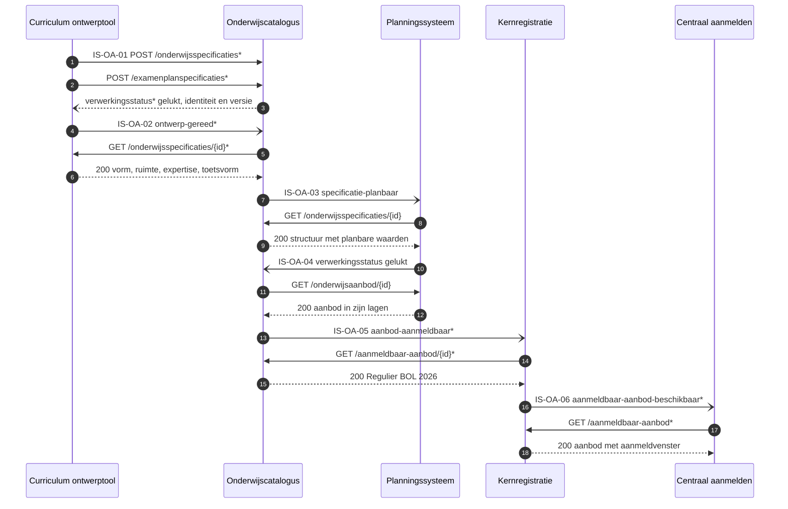

# Interactieketenspecificatie: ontwerpen en ontsluiten van onderwijsaanbod

| | |
|---|---|
| **Doel** | Vastleggen welke informatie tussen welke systemen gaat wanneer een instelling onderwijsaanbod ontwerpt en ontsluit, zo precies dat een leverancier het bouwt |
| **Doelgroep** | De informatiemanager en architect van een instelling die uitvraagt, en de software-architect en implementatiespecialist van een leverancier die bouwt |
| **Dient als input voor** | Een eis in een aanbesteding, een bouwopdracht aan een leverancier, en de koppelvlakspecificaties in [Npuls-OKx/Public](https://github.com/Npuls-OKx/Public/tree/dev/Koppelvlakspecificaties) |
| **Kaderstelling** | [Kaderscenario leerroute 1](https://github.com/Npuls-OKx/Public/blob/dev/Referentiemateriaal/kaderscenario's/leerroute-1-regulier.md) met [persona Jochem](../leerroute-uitwerking/doc/persona_jochem.md), het [informatiemodel OKx](../../../model/informatiemodel/informatiemodel.md), en de [voorbeelduitwerking](../../../model/informatiemodel/voorbeeld-leerroute-1-jochem.md) die per stap toont wat er ontstaat |
| **Inhoud** | Zes interactiespecificaties tussen vijf applicatiecomponenten, elk met haar operaties, berichten en een voorbeeldpayload die valideert |
| **Stand** | IS-OA-03 en IS-OA-04 liggen vast in Public. IS-OA-02 en IS-OA-06 zijn voorstel. IS-OA-01 en IS-OA-05 zijn deels vastgelegd, met de wijziging per regel erbij |

## Leeswijzer

| Deel | Inhoud |
|---|---|
| [1 De informatiestromen](#1-de-informatiestromen) | Welke informatie waarheen gaat, met per stroom het beeld van wat erover gaat |
| [2 Wat de partijen hiermee bereiken](#2-wat-de-partijen-hiermee-bereiken) | De student, de instelling en de leverancier |
| [3 Wie bezit welk gegeven](#3-wie-bezit-welk-gegeven) | Per applicatiecomponent de gegevens die daar ontstaan |
| [4 Koppelvlakdiensten](#4-koppelvlakdiensten) | Per component de diensten met hun endpoints en meldingen |
| [5 De keten in operaties](#5-de-keten-in-operaties) | De volgorde over alle zes de interactiespecificaties |
| [6 De interactiespecificaties](#6-de-interactiespecificaties) | Per stroom het contract: operaties, berichten, voorbeeldpayload |
| [schemas/](schemas/README.md) | De twintig schema's van deze keten, met hun stand |
| [signaleringen.md](signaleringen.md) | Tweeentwintig punten die een besluit vragen |

Elk objecttype, elke relatie en elke instantie in dit document komt uit het [informatiemodel OKx](../../../model/informatiemodel/informatiemodel.md) en uit de [voorbeelduitwerking van leerroute 1](../../../model/informatiemodel/voorbeeld-leerroute-1-jochem.md). Dit document herhaalt die niet: het verwijst erheen op de plek waar een stroom valt.

## 1. De informatiestromen

De componenten die meedoen zijn omlijnd en bij elke stroom staat wat er overheen gaat. IS-OA-01, IS-OA-02 en IS-OA-06 staan gestippeld: zij krijgen hun lijn op een volgende plaatversie.

| Nr | Naam | Van | Naar | Wat erover gaat | Stand |
|---|---|---|---|---|---|
| IS-OA-01 | Ontwerp naar de catalogus | Curriculum ontwerptool | Onderwijscatalogus | Leeruitkomsten, de specificatiestructuur tot leeronderdeel, en de summatieve resultaatstructuur | Opvragen vastgelegd, innemen met bevindingen voorstel ([ADR 0020](https://github.com/Npuls-OKx/Public/blob/dev/Referentiemateriaal/adr/0020-curriculumontwerp-onderwijscatalogus-happy-flow-synchronisatie-en-federatie-adopt-klonen.md)) |
| IS-OA-02 | Onderwijsontwerp naar de catalogus | Curriculum ontwerptool | Onderwijscatalogus | Vorm, leeromgeving, docent- en examinatorprofiel, studiebelasting, toetsvorm | Voorstel: een overlay op de dragende schema's, meereizend op de resource van IS-OA-01 |
| IS-OA-03 | Verzoek om aanbod naar planning | Onderwijscatalogus | Planningssysteem | Het verzoek tot aanbod, met de planbare waarden per eenheid | Vastgelegd: [interactiepatroon OC-P&R](https://github.com/Npuls-OKx/Public/blob/dev/Koppelvlakspecificaties/Interactiepatronen/onderwijscatalogus-planning-en-roostering.md), interactie I1 en I2 |
| IS-OA-04 | Gepland aanbod naar de catalogus | Planningssysteem | Onderwijscatalogus | Het geplande aanbod in zijn lagen, elk verwijzend naar specificatie en verzoek | Vastgelegd: dezelfde koppeling, interactie I3 en I5 |
| IS-OA-05 | Aanmeldbaar aanbod naar de kernregistratie | Onderwijscatalogus | Kernregistratie (KRS) | Het aanmeld- en inschrijfbare `Opleidingsprogramma aanbod` | De melding `inrichtingsstatus` vastgelegd, de aanmeldbare snede voorstel op een eigen resource |
| IS-OA-06 | Aanmeldbaar aanbod naar centraal aanmelden | Kernregistratie (KRS) | AII (centraal aanmelden) | Hetzelfde aanbod, voor het systeem waarin Jochem zich aanmeldt | Voorstel, met de inhoudelijke keuzes bij de afstemming met AII |

Een instelling wijst hier aan welke interactiespecificatie zij uitvraagt. De aanduiding blijft staan ook als de naam verandert, zodat een eis in een aanbesteding ernaar kan verwijzen.

### IS-OA-01 Ontwerp naar de catalogus

Links staat wat de ontwerper bouwde, rechts de catalogus die het opneemt. De pijlen naar de leeruitkomsten lopen door de hele structuur: die sleutel maakt het een geheel in plaats van losse documenten.

Hoe deze objecten ontstaan: [F1-02 tot en met F1-11](../../../model/informatiemodel/voorbeeld-leerroute-1-jochem.md#fase-1-kwalificatiekader-analyseren-en-grofmazig-ontwerpen) in de voorbeelduitwerking, van het ontleden van het kwalificatiedossier tot het vaststellen van het examenplan.

### IS-OA-02 Onderwijsontwerp naar de catalogus

De blokken hangen onder de typen van IS-OA-01 en vormen geen eigen resource. Elk blok komt van de conceptplaat Onderwijsontwerp, en elke regel in dit beeld draagt een aanname.

Hoe deze objecten ontstaan: [F1-06](../../../model/informatiemodel/voorbeeld-leerroute-1-jochem.md#f1-06---de-eenheidspecificatie-met-haar-onderwijsontwerp-vorm-ruimte-mensen-en-middelen) voor de eenheid en [F1-10](../../../model/informatiemodel/voorbeeld-leerroute-1-jochem.md#f1-10---de-examenonderdeelspecificatie-met-haar-toetsvorm-instrumenten-materiaal-en-ruimte) voor het examenonderdeel.

### IS-OA-03 Verzoek om aanbod naar planning

Het `Verzoek tot Aanbod` staat op de grens tussen specificatie en aanbod: links wat vastligt, rechts wat de planner ermee gaat doen. De planbare waarden hangen per eenheid, want haalbaarheid blijkt per eenheid.

Hoe deze objecten ontstaan: [F1-05 tot en met F1-10](../../../model/informatiemodel/voorbeeld-leerroute-1-jochem.md#fase-1-kwalificatiekader-analyseren-en-grofmazig-ontwerpen) voor de specificatiestructuur, [F2-01 en F2-02](../../../model/informatiemodel/voorbeeld-leerroute-1-jochem.md#fase-2-publiceren-en-planbaar-maken) voor het planbaar maken en het verzoek.

### IS-OA-04 Gepland aanbod naar de catalogus

Elke aanbodlaag draagt twee verwijzingen: naar de specificatie waaruit zij volgt en naar het verzoek waarop zij antwoordt. Daarmee leest elke schakel terug waarom dit aanbod bestaat.

Hoe deze objecten ontstaan: [F2-04](../../../model/informatiemodel/voorbeeld-leerroute-1-jochem.md#f2-04---het-aanbod-gepland-opleiding-programma-eenheid-gelegenheid), waar de planner het aanbod in zijn vier lagen plant.

### IS-OA-05 Aanmeldbaar aanbod naar de kernregistratie

Alleen het `Opleidingsprogramma aanbod` gaat mee, met zijn `Opleiding aanbod` erboven, en niet de lagen eronder. Die snede staat bij de catalogus op een eigen resource, los van het aanbod bij het planningssysteem.

Hoe deze objecten ontstaan: [F2-04](../../../model/informatiemodel/voorbeeld-leerroute-1-jochem.md#f2-04---het-aanbod-gepland-opleiding-programma-eenheid-gelegenheid), dezelfde planning die IS-OA-04 terugleverde.

### IS-OA-06 Aanmeldbaar aanbod naar centraal aanmelden

De vorm is die van IS-OA-05, met de kernregistratie nu als bezitter. Welke velden AII vraagt staat open: [Public#112](https://github.com/Npuls-OKx/Public/issues/112) draagt die vraag als V1 tot en met V10.

Hoe deze objecten ontstaan: [F2-04](../../../model/informatiemodel/voorbeeld-leerroute-1-jochem.md#f2-04---het-aanbod-gepland-opleiding-programma-eenheid-gelegenheid), via IS-OA-05 een schakel eerder.

## 2. Wat de partijen hiermee bereiken

| Partij | Wat deze keten mogelijk maakt |
|---|---|
| **De student** | Ziet bij centraal aanmelden het aanbod waarop hij zich kan aanmelden, met het startmoment, de leerweg en de locatie erbij, en met de keuzedeelruimte die hij later invult. Wat hij ziet is het ontwerp van zijn opleiding, een keten verderop |
| **De instelling** | Ontwerpt een opleiding een keer en levert haar aan elk volgend systeem zonder overtypen. De ontwerper hangt de structuur aan de leeruitkomst, de planner krijgt de planbare waarden mee in het verzoek, de examencommissie stelt het examenplan vast voordat het de catalogus bereikt, en elke schakel leest terug waarom een aanbod bestaat |
| **De leverancier** | Weet wat hij bouwt voordat hij offreert: per interactiespecificatie de endpoints, de volgorde en de berichten, met per regel of die vastligt of een voorstel is. Hij bouwt tegen een contract dat elke andere leverancier in de sector ook bouwt |
| **De sector** | Legt de grootste gemene deler vast in plaats van per instelling een eigen koppeling. Wat hier als voorstel staat, landt in [Npuls-OKx/Public](https://github.com/Npuls-OKx/Public/tree/dev/Koppelvlakspecificaties) en geldt daarna voor iedereen |

## 3. Wie bezit welk gegeven

Een component bezit hier het objecttype waarvan hij in de voorbeelduitwerking het bronsysteem is, en dat is de enige bron ervan ([U3](https://github.com/Npuls-OKx/Public/blob/dev/Koppelvlakspecificaties/uitgangspunten.md#u3-resource-eigenaarschap)). Over een koppeling gaat daarom een verwijzing, met de inhoud op opvraag.

De plaat is afgeleid uit [voorbeeld-lr1-regels.json](../../../model/informatiemodel/voorbeeld-lr1-regels.json) en wordt getekend met `python3 tools/scripts/teken-gegevens-per-component.py`. Verschuift een objecttype daar naar een ander systeem, dan verschuift het hier mee.

## 4. Koppelvlakdiensten

| Component | Dienst | Endpoints en meldingen | Stand |
|---|---|---|---|
| Curriculum ontwerptool | onderwijsspecificatie-inname-afnemer | `verwerkingsstatus` | Voorstel: dit component draagt vandaag geen koppelvlak |
| Curriculum ontwerptool | verwerkingsuitkomst-afnemer | `specificatie-status-gewijzigd` | Voorstel, als boven |
| Curriculum ontwerptool | onderwijsspecificatiestructuur-afnemer | `/onderwijsspecificaties/{id}` en `/examenplanspecificaties/{id}`, elk met `/delta` | Voorstel: de catalogus haalt het ontwerp op na de melding `ontwerp-gereed` |
| Curriculum ontwerptool | afleverabonnement-afnemer | `/abonnementen` | Voorstel, als boven |
| Onderwijscatalogus | onderwijsspecificatiestructuur-aanbieder | `GET /onderwijsspecificaties` met `/{id}` en `/{id}/delta`, en `/examenplanspecificaties/{id}` | Vastgelegd |
| Onderwijscatalogus | onderwijsspecificatie-inname-aanbieder | `POST /onderwijsspecificaties`, `POST /examenplanspecificaties`, `/leveringen/{leveringId}` | Voorstel: drie paden erbij, additief |
| Onderwijscatalogus | aanmeldbaar-onderwijsaanbod-aanbieder | `/aanmeldbaar-aanbod` met `/{id}` en `/{id}/delta` | Voorstel: een eigen resource naast `/onderwijsaanbod` |
| Onderwijscatalogus | verwerkingsuitkomst-afnemer | `verwerkingsstatus`, `inrichtingsstatus` | Vastgelegd; het payloadschema van `inrichtingsstatus` is voorstel |
| Onderwijscatalogus | afleverabonnement-aanbieder | `/abonnementen` | Vastgelegd; de meldingssoorten `ontwerp-gereed` en `aanbod-aanmeldbaar` komen erbij |
| Planningssysteem | planbaar-onderwijsaanbod-aanbieder | `/onderwijsaanbod` met `/{id}` | Vastgelegd |
| Planningssysteem | onderwijsspecificatiestructuur-afnemer | `specificatie-planbaar`, `specificatie-gewijzigd`, `specificatie-status-gewijzigd` | Vastgelegd |
| Planningssysteem | afleverabonnement-aanbieder | `/abonnementen` | Vastgelegd |
| Kernregistratie (KRS) | aanmeldbaar-onderwijsaanbod-afnemer | de melding `aanbod-aanmeldbaar` | Voorstel |
| Kernregistratie (KRS) | aanmeldbaar-onderwijsaanbod-aanbieder | `/aanmeldbaar-aanbod` met `/{id}`, `/abonnementen`, en de melding `verwerkingsstatus` | Voorstel: dezelfde resourcenaam als bij de catalogus, per bezitter gebouwd |
| AII (centraal aanmelden) | aanmeldbaar-onderwijsaanbod-afnemer | de melding `aanmeldbaar-aanbod-beschikbaar`, `/abonnementen` | Voorstel, met de inhoudelijke keuzes bij de afstemming met AII |

Een applicatiedienst zegt wat er over een koppeling moet kunnen, en de bezitter van de resource vervult hem. De dienstnamen staan op commit d0c20d99 van de [dienstenlijst](https://github.com/Npuls-OKx/Public/blob/d0c20d99b110b29ccf6b0e50109f7d54ffd88d7a/Koppelvlakspecificaties/Applicatiediensten/README.md), want die map staat nog niet op `dev`. De [componentpagina](https://github.com/Npuls-OKx/Public/tree/dev/Koppelvlakspecificaties/Applicatiecomponenten) draagt de parameters en de statuscodes.

## 5. De keten in operaties

Een `*` markeert wat op deze koppeling nog een voorstel is, een pad of een melding. Elk paar legt eerst zijn afleveradres vast met `POST /abonnementen`.

## 6. De interactiespecificaties

| Nr | Naam | Wat erover gaat | Operaties |
|---|---|---|---|
| IS-OA-01 | [Ontwerp naar de catalogus](is-oa-01.md) | De levering als eenheid van aanname: de catalogus neemt het ontwerp in, toetst het en kent identiteit en versie toe | 8 |
| IS-OA-02 | [Onderwijsontwerp naar de catalogus](is-oa-02.md) | De uitvoeringskenmerken als overlay op de specificaties die IS-OA-01 al droeg | 6 |
| IS-OA-03 | [Verzoek om aanbod naar planning](is-oa-03.md) | De catalogus meldt dat een specificatie planbaar is, de planner haalt de structuur op | 6 |
| IS-OA-04 | [Gepland aanbod naar de catalogus](is-oa-04.md) | De planner meldt dat het aanbod er is, de catalogus haalt het op | 4 |
| IS-OA-05 | [Aanmeldbaar aanbod naar de kernregistratie](is-oa-05.md) | De aanmeldbare snede als eigen resource, met de inrichtingsstatus terug | 6 |
| IS-OA-06 | [Aanmeldbaar aanbod naar centraal aanmelden](is-oa-06.md) | Dezelfde snede met de kernregistratie als bezitter, richting AII | 5 |

Elke interactiespecificatie draagt hetzelfde: de volgorde tussen de twee componenten als sequentiediagram, de operaties met hun parameters, statuscodes en foutgedrag, per bericht de velden met de grond waarop zij bestaan, een voorbeeldpayload die tegen haar schema valideert, en wat dit in Public toevoegt of wijzigt.

De voorbeeldpayloads gebruiken de vaste identificaties uit [casus.md](casus.md), zodat dezelfde opleiding door de hele keten dezelfde uuid draagt. De controle `python3 tools/scripts/controleer-interactiespec.py` haalt elke payload langs haar schema en meldt elke sleutel die geen schema verklaart.
