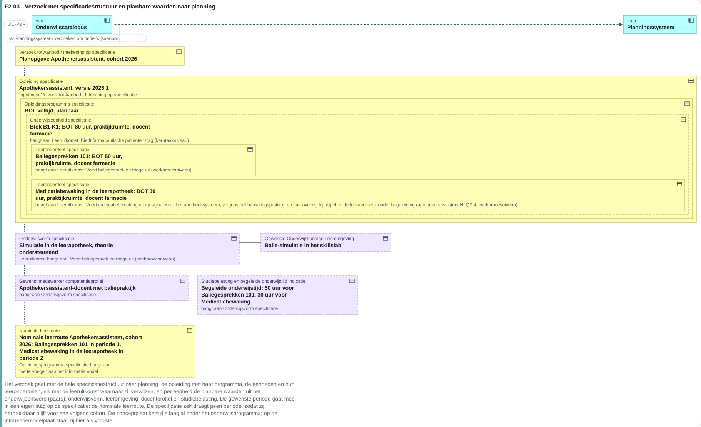
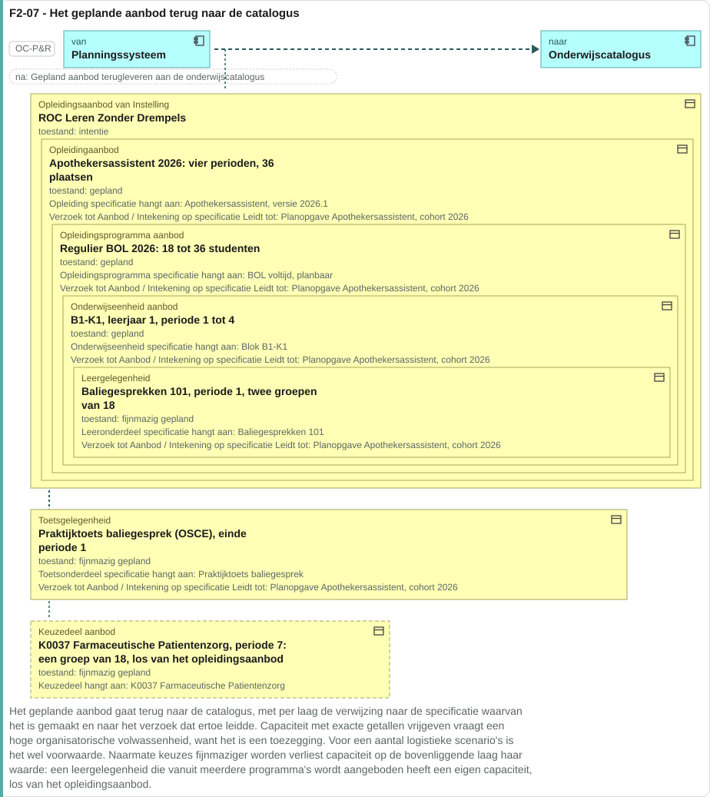
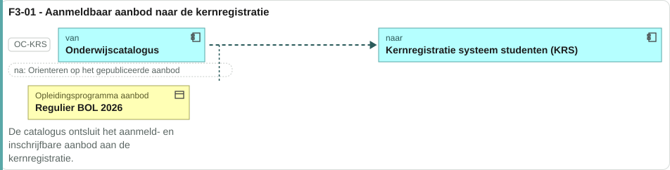
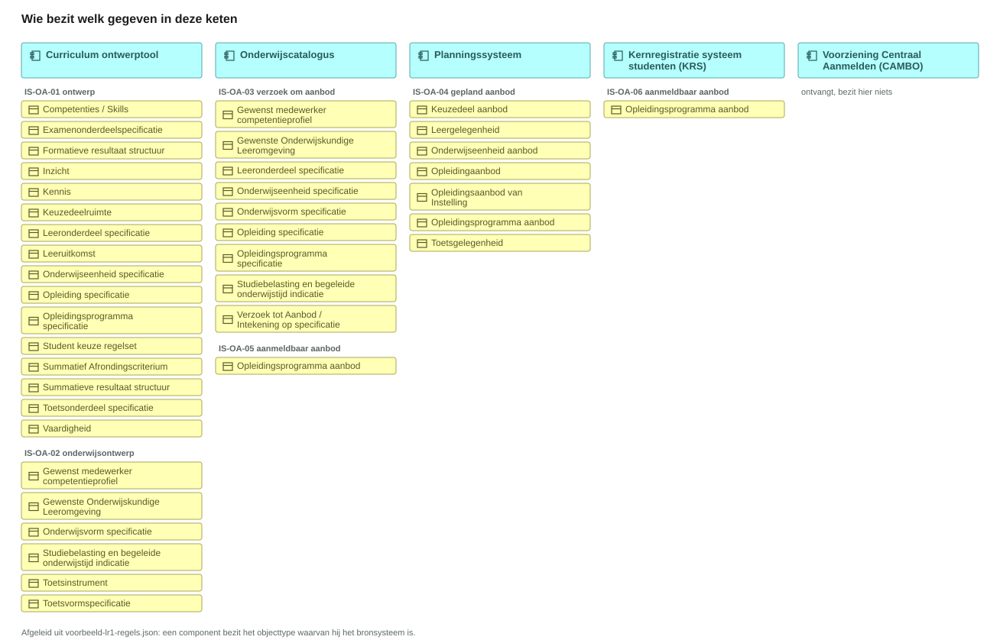
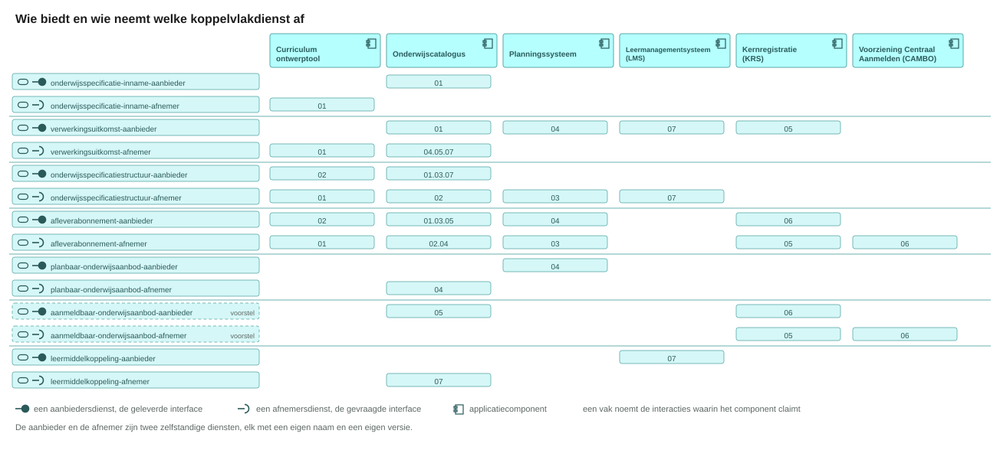
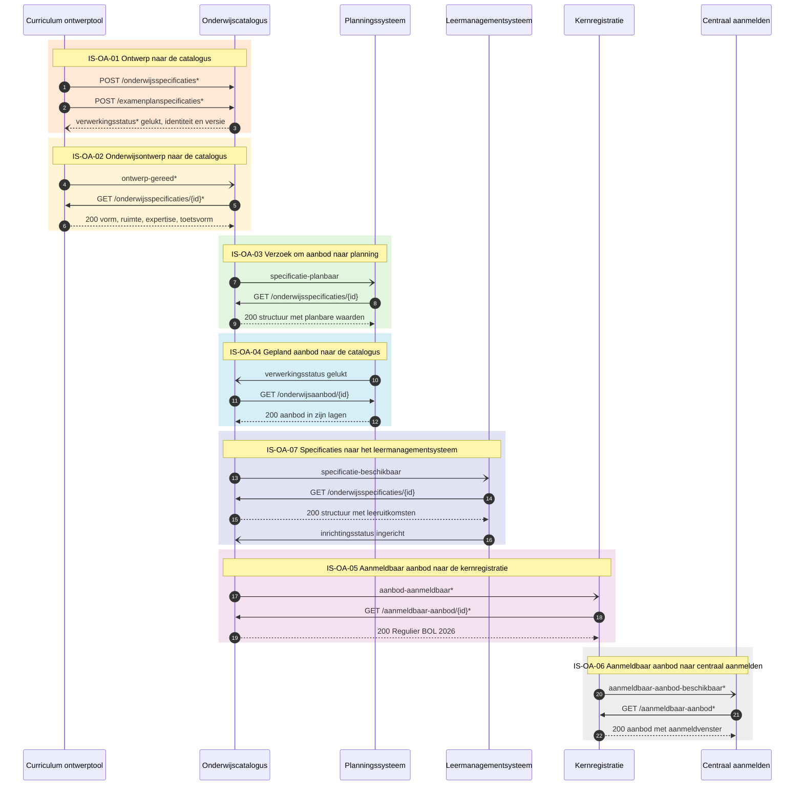

# Interactieketenspecificatie: ontwerpen en ontsluiten van onderwijsaanbod

| | |
|---|---|
| **Document doel** | Zet uiteen welke informatie tussen welke systemen gaat wanneer een instelling onderwijsaanbod ontwerpt en ontsluit, ten behoeve van de bouw of de verificatie van een implementatie volgens deze specificatie |
| **Doelgroep** | De informatiemanager en architect van een instelling die uitvraagt, en de software-architect en implementatiespecialist van een leverancier die bouwt |
| **Dient als input voor** | Een eis in een aanbesteding, een bouwopdracht aan een leverancier, en de koppelvlakspecificaties in [Npuls-OKx/Public](https://github.com/Npuls-OKx/Public/tree/dev/Koppelvlakspecificaties) |
| **Kaderstelling** | [Kaderscenario leerroute 1](https://github.com/Npuls-OKx/Public/blob/dev/Referentiemateriaal/kaderscenario's/leerroute-1-regulier.md) met [persona Jochem](../leerroute-uitwerking/doc/persona_jochem.md), het [informatiemodel OKx](../../../model/informatiemodel/informatiemodel.md), en de [voorbeelduitwerking](../../../model/informatiemodel/voorbeeld-leerroute-1-jochem.md) die per stap toont wat er ontstaat |
| **Inhoud** | Zeven interactiespecificaties tussen zes applicatiecomponenten, elk met haar operaties, berichten en een voorbeeldpayload die valideert |
| **Status** | IS-OA-03, IS-OA-04 en IS-OA-07 liggen vast in Public. IS-OA-02 en IS-OA-06 zijn voorstel. IS-OA-01 en IS-OA-05 zijn deels vastgelegd, met de wijziging per regel erbij |

## Leeswijzer

| Deel | Inhoud |
|---|---|
| [1 De informatiestromen](#1-de-informatiestromen) | Welke informatie waarheen gaat, met per stroom het beeld van wat erover gaat |
| [2 Wat deze keten oplevert](#2-wat-deze-keten-oplevert) | Waarvoor deze keten dient, per partij, en wat erop bouwt |
| [3 Gegevensoorsprong en bronsysteem](#3-gegevensoorsprong-en-bronsysteem) | Per applicatiecomponent de gegevens die daar ontstaan |
| [4 Koppelvlakdiensten](#4-koppelvlakdiensten) | Per component de diensten met hun endpoints en meldingen |
| [5 De interactieketen](#5-de-interactieketen) | De volgorde over alle zeven de interactiespecificaties |
| [6 De interactiespecificaties](#6-de-interactiespecificaties) | Per stroom het contract: operaties, berichten, voorbeeldpayload |
| [schemas/](schemas/README.md) | De twintig schema's van deze keten, met hun stand |
| [signaleringen.md](signaleringen.md) | Achtentwintig punten die een besluit vragen |

Elk objecttype en elke instantie hier komt uit het [informatiemodel OKx](../../../model/informatiemodel/informatiemodel.md) en de [voorbeelduitwerking van leerroute 1](../../../model/informatiemodel/voorbeeld-leerroute-1-jochem.md). Dit document herhaalt die niet, het verwijst erheen waar een stroom valt.

## 1. De informatiestromen

De componenten die meedoen zijn omlijnd en bij elke stroom staat wat er overheen gaat. IS-OA-01, IS-OA-02 en IS-OA-06 staan gestippeld: zij krijgen hun lijn op een volgende plaatversie.

| Nr | Naam | Van | Naar | Wat erover gaat | Stand |
|---|---|---|---|---|---|
| IS-OA-01 | Ontwerp naar de catalogus | Curriculum ontwerptool | Onderwijscatalogus | Leeruitkomsten, de specificatiestructuur tot leeronderdeel, en de summatieve resultaatstructuur | Opvragen vastgelegd, innemen met bevindingen voorstel ([ADR 0020](https://github.com/Npuls-OKx/Public/blob/dev/Referentiemateriaal/adr/0020-curriculumontwerp-onderwijscatalogus-happy-flow-synchronisatie-en-federatie-adopt-klonen.md)) |
| IS-OA-02 | Onderwijsontwerp naar de catalogus | Curriculum ontwerptool | Onderwijscatalogus | Vorm, leeromgeving, docent- en examinatorprofiel, studiebelasting, toetsvorm | Voorstel: een overlay op de dragende schema's, meereizend op de resource van IS-OA-01 |
| IS-OA-03 | Verzoek om aanbod naar planning | Onderwijscatalogus | Planningssysteem | Het verzoek tot aanbod, met de planbare waarden per eenheid | Vastgelegd: [interactiepatroon OC-P&R](https://github.com/Npuls-OKx/Public/blob/dev/Koppelvlakspecificaties/Interactiepatronen/onderwijscatalogus-planning-en-roostering.md), interactie I1 en I2 |
| IS-OA-04 | Gepland aanbod naar de catalogus | Planningssysteem | Onderwijscatalogus | Het geplande aanbod in zijn lagen, elk verwijzend naar specificatie en verzoek | Vastgelegd: dezelfde koppeling, interactie I3 en I5 |
| IS-OA-05 | Aanmeldbaar aanbod naar de kernregistratie | Onderwijscatalogus | Student Informatie Systeem: kernregistratie (KRS) en studentvolgsysteem (SVS) | Het aanmeld- en inschrijfbare `Opleidingsprogramma aanbod` | De melding `inrichtingsstatus` vastgelegd, de aanmeldbare snede voorstel op een eigen resource |
| IS-OA-06 | Aanmeldbaar aanbod naar centraal aanmelden | Kernregistratie (KRS) | RIO/CAMBO/AII: de voorziening voor centraal aanmelden, het aanmeldsysteem, RIO en een commerciele of LLO-oplossing | Hetzelfde aanbod, voor het systeem waarin Jochem zich aanmeldt | Voorstel, met de inhoudelijke keuzes bij de afstemming met AII |
| IS-OA-07 | Specificaties naar het leermanagementsysteem | Onderwijscatalogus | Leermanagementsysteem (LMS) | De specificatiestructuur tot leeronderdeel plus de formatieve resultaatstructuur, waarmee de leeromgeving wordt ingericht | Vastgelegd: [interactiepatroon OC-LMS](https://github.com/Npuls-OKx/Public/blob/dev/Koppelvlakspecificaties/Interactiepatronen/onderwijscatalogus-leermanagementsysteem.md), interactie L1 tot en met L6 |

Een instelling wijst hier aan welke interactiespecificatie zij uitvraagt; de aanduiding blijft staan ook als de naam verandert. Twee stromen landen op een groep in plaats van op een vak, en wie op een systeem in die groep aansluit krijgt dezelfde informatie.

### IS-OA-01 Ontwerp naar de catalogus

Links staat wat de ontwerper bouwde, rechts de catalogus die het opneemt. De pijlen naar de leeruitkomsten lopen door de hele structuur: die sleutel maakt het een geheel in plaats van losse documenten.

Ontstaan in [F1-02 tot en met F1-11](../../../model/informatiemodel/voorbeeld-leerroute-1-jochem.md#fase-1-kwalificatiekader-analyseren-en-grofmazig-ontwerpen), van het ontleden van het dossier tot het vaststellen van het examenplan.

### IS-OA-02 Onderwijsontwerp naar de catalogus

De blokken hangen onder de typen van IS-OA-01 en vormen geen eigen resource. Elk blok komt van de conceptplaat Onderwijsontwerp, en elke regel in dit beeld draagt een aanname.

Ontstaan in [F1-06](../../../model/informatiemodel/voorbeeld-leerroute-1-jochem.md#f1-06---de-eenheidspecificatie-met-haar-onderwijsontwerp-vorm-ruimte-mensen-en-middelen) en [F1-10](../../../model/informatiemodel/voorbeeld-leerroute-1-jochem.md#f1-10---de-examenonderdeelspecificatie-met-haar-toetsvorm-instrumenten-materiaal-en-ruimte).

### IS-OA-03 Verzoek om aanbod naar planning

Het `Verzoek tot Aanbod` staat op de grens tussen specificatie en aanbod: links wat vastligt, rechts wat de planner ermee gaat doen. De planbare waarden hangen per eenheid, want haalbaarheid blijkt per eenheid.

Ontstaan in [F1-05 tot en met F1-10](../../../model/informatiemodel/voorbeeld-leerroute-1-jochem.md#fase-1-kwalificatiekader-analyseren-en-grofmazig-ontwerpen) en [F2-01 en F2-02](../../../model/informatiemodel/voorbeeld-leerroute-1-jochem.md#fase-2-publiceren-en-planbaar-maken).

### IS-OA-04 Gepland aanbod naar de catalogus

Elke aanbodlaag draagt twee verwijzingen: naar de specificatie waaruit zij volgt en naar het verzoek waarop zij antwoordt. Daarmee leest elke schakel terug waarom dit aanbod bestaat.

Ontstaan in [F2-04](../../../model/informatiemodel/voorbeeld-leerroute-1-jochem.md#f2-04---het-aanbod-gepland-opleiding-programma-eenheid-gelegenheid), waar de planner het aanbod in zijn vier lagen plant.

### IS-OA-05 Aanmeldbaar aanbod naar de kernregistratie

Alleen het `Opleidingsprogramma aanbod` gaat mee, met zijn `Opleiding aanbod` erboven, en niet de lagen eronder. Die snede staat bij de catalogus op een eigen resource, los van het aanbod bij het planningssysteem.

Ontstaan in [F2-04](../../../model/informatiemodel/voorbeeld-leerroute-1-jochem.md#f2-04---het-aanbod-gepland-opleiding-programma-eenheid-gelegenheid), dezelfde planning die IS-OA-04 terugleverde.

### IS-OA-06 Aanmeldbaar aanbod naar centraal aanmelden

De vorm is die van IS-OA-05, met de kernregistratie nu als bezitter. Welke velden AII vraagt staat open: [Public#112](https://github.com/Npuls-OKx/Public/issues/112) draagt die vraag als V1 tot en met V10.

Ontstaan in [F2-04](../../../model/informatiemodel/voorbeeld-leerroute-1-jochem.md#f2-04---het-aanbod-gepland-opleiding-programma-eenheid-gelegenheid), via IS-OA-05 een schakel eerder.

### IS-OA-07 Specificaties naar het leermanagementsysteem

De leeromgeving krijgt de volledige specificatieboom plus de formatieve resultaatstructuur, en richt zich in tot op leeronderdeelniveau. Daaronder vult zij haar eigen lesniveau in, waar de catalogus buiten staat.

Ontstaan in [F1-05 tot en met F1-09](../../../model/informatiemodel/voorbeeld-leerroute-1-jochem.md#fase-1-kwalificatiekader-analyseren-en-grofmazig-ontwerpen) en [F2-04](../../../model/informatiemodel/voorbeeld-leerroute-1-jochem.md#f2-04---het-aanbod-gepland-opleiding-programma-eenheid-gelegenheid).

## 2. Wat deze keten oplevert

| Partij | Waarvoor deze keten dient |
|---|---|
| **De sector** | Een eenduidige beschrijving en publicatie van het onderwijsaanbod, waarop elke volgende interactieketen bouwt. Zonder die ene beschrijving spreekt elk systeem zijn eigen taal en wordt elke koppeling maatwerk |
| **De instelling** | Een opleiding een keer ontwerpen en aan elk volgend systeem leveren zonder overtypen. De planner krijgt de planbare waarden mee in het verzoek, de examencommissie stelt het examenplan vast voordat het de catalogus bereikt, de leeromgeving richt zich in op dezelfde specificatie, en elke schakel leest terug waarom een aanbod bestaat |
| **De student** | Ziet bij centraal aanmelden het aanbod waarop hij zich kan aanmelden, met startmoment, leerweg en locatie erbij. Wat hij ziet is het ontwerp van zijn opleiding, een keten verderop |
| **De leverancier** | Weet wat hij bouwt voordat hij offreert: per interactiespecificatie de endpoints, de volgorde en de berichten, met per regel of die vastligt of een voorstel is. Hij bouwt tegen een contract dat elke andere leverancier in de sector ook bouwt |

De catalogus publiceert een keer, en een groep systemen neemt af: planning, het studentinformatiesysteem, centraal aanmelden en de leeromgeving. Daarom zijn de ontvangers op de plaat als groep omlijnd.

| Wat hierop bouwt | Wat die keten eraan heeft |
|---|---|
| Keuzedelen kiesbaar maken ([#363](https://github.com/Npuls-OKx/meta/issues/363)) | De keuzedeelruimte met haar regelset staat al beschreven en gepubliceerd; die keten laat Jochem erin kiezen |
| Aanmelden, intake en inschrijven (vanaf F3-03) | Het aanmeldbare aanbod bestaat, met zijn aanmeldvenster, dus kan er een verbintenis op ontstaan |
| Roosteren en uitvoeren (fase 4 en later) | De specificatie en het geplande aanbod liggen vast, en de leeromgeving is erop ingericht |

## 3. Gegevensoorsprong en bronsysteem

Een component bezit hier het objecttype waarvan hij in de voorbeelduitwerking het bronsysteem is, en dat is de enige bron ervan ([U3](https://github.com/Npuls-OKx/Public/blob/dev/Koppelvlakspecificaties/uitgangspunten.md#u3-resource-eigenaarschap)). Over een koppeling gaat daarom een verwijzing, met de inhoud op opvraag.

De plaat komt uit [voorbeeld-lr1-regels.json](../../../model/informatiemodel/voorbeeld-lr1-regels.json), getekend met `python3 scripts/teken-gegevens-per-component.py`. Verschuift een objecttype daar naar een ander systeem, dan verschuift het hier mee.

## 4. Koppelvlakdiensten

Een dienst zegt wat er over een koppeling moet kunnen, en elk component kan hem claimen; de aanbieder en de afnemer zijn twee losse diensten. Een leverancier die meer dan een component in een product draagt, legt dat product daarom op deze laag.

| Component | Dienst | Endpoints en meldingen | Eenheid | Stand |
|---|---|---|---|---|
| Curriculum ontwerptool | onderwijsspecificatie-inname-afnemer | `POST /onderwijsspecificaties`, `POST /examenplanspecificaties`, `/leveringen/{leveringId}` | IS-OA-01 | Voorstel: dit component draagt vandaag geen koppelvlak |
| Curriculum ontwerptool | verwerkingsuitkomst-afnemer | `verwerkingsstatus`, `specificatie-status-gewijzigd` | IS-OA-01 | Voorstel, als boven |
| Curriculum ontwerptool | onderwijsspecificatiestructuur-afnemer | `GET /onderwijsspecificaties` met `/{id}`, en de melding `specificatie-status-gewijzigd` | IS-OA-01 | Vastgelegd |
| Curriculum ontwerptool | onderwijsspecificatiestructuur-aanbieder | `/onderwijsspecificaties/{id}` en `/examenplanspecificaties/{id}`, elk met `/delta`, en de melding `ontwerp-gereed` | IS-OA-02 | Voorstel: de catalogus haalt het ontwerp op na de melding |
| Curriculum ontwerptool | afleverabonnement-afnemer | `POST /abonnementen` bij de catalogus | IS-OA-01 | Voorstel, als boven |
| Curriculum ontwerptool | afleverabonnement-aanbieder | `/abonnementen` | IS-OA-02 | Voorstel, als boven |
| Onderwijscatalogus | onderwijsspecificatiestructuur-aanbieder | `GET /onderwijsspecificaties` met `/{id}` en `/{id}/delta`, `/examenplanspecificaties/{id}`, en de meldingen `specificatie-planbaar`, `specificatie-beschikbaar` en `specificatie-status-gewijzigd` | IS-OA-01, IS-OA-03, IS-OA-07 | Vastgelegd |
| Onderwijscatalogus | onderwijsspecificatiestructuur-afnemer | `/onderwijsspecificaties/{id}` bij de ontwerptool, na de melding `ontwerp-gereed` | IS-OA-02 | Voorstel |
| Onderwijscatalogus | onderwijsspecificatie-inname-aanbieder | `POST /onderwijsspecificaties`, `POST /examenplanspecificaties`, `/leveringen/{leveringId}` | IS-OA-01 | Voorstel: drie paden erbij, additief |
| Onderwijscatalogus | verwerkingsuitkomst-aanbieder | `verwerkingsstatus` en `specificatie-status-gewijzigd` naar de ontwerptool | IS-OA-01 | Vastgelegd als melding, het endpoint op de ontwerptool is voorstel |
| Onderwijscatalogus | verwerkingsuitkomst-afnemer | `verwerkingsstatus`, `inrichtingsstatus`, `leermiddelkoppeling-beschikbaar` | IS-OA-04, IS-OA-05, IS-OA-07 | Vastgelegd; de payloadschema's van `inrichtingsstatus` en de leermiddelkoppeling zijn voorstel |
| Onderwijscatalogus | planbaar-onderwijsaanbod-afnemer | `GET /onderwijsaanbod` met `/{id}` bij het planningssysteem | IS-OA-04 | Vastgelegd |
| Onderwijscatalogus | aanmeldbaar-onderwijsaanbod-aanbieder | `/aanmeldbaar-aanbod` met `/{id}` en `/{id}/delta`, en de melding `aanbod-aanmeldbaar` | IS-OA-05 | Voorstel: een eigen resource naast `/onderwijsaanbod`, en een dienst die de dienstenlijst nog niet kent |
| Onderwijscatalogus | leermiddelkoppeling-afnemer | `/leermiddelkoppelingen/{id}` bij het leermanagementsysteem | IS-OA-07 | Vastgelegd |
| Onderwijscatalogus | afleverabonnement-aanbieder | `/abonnementen`, die de abonnementen op haar eigen meldingen aanneemt | IS-OA-01, IS-OA-03, IS-OA-05 | Vastgelegd; de meldingssoort `aanbod-aanmeldbaar` komt erbij |
| Onderwijscatalogus | afleverabonnement-afnemer | `POST /abonnementen` bij de ontwerptool en bij het planningssysteem | IS-OA-02, IS-OA-04 | Vastgelegd op het planningssysteem, voorstel op de ontwerptool |
| Planningssysteem | onderwijsspecificatiestructuur-afnemer | `specificatie-planbaar`, `specificatie-gewijzigd`, `specificatie-status-gewijzigd` | IS-OA-03 | Vastgelegd |
| Planningssysteem | planbaar-onderwijsaanbod-aanbieder | `/onderwijsaanbod` met `/{id}` | IS-OA-04 | Vastgelegd |
| Planningssysteem | verwerkingsuitkomst-aanbieder | `verwerkingsstatus` naar de catalogus | IS-OA-04 | Vastgelegd |
| Planningssysteem | afleverabonnement-afnemer | `POST /abonnementen` bij de catalogus, op haar meldingen | IS-OA-03 | Vastgelegd |
| Planningssysteem | afleverabonnement-aanbieder | `/abonnementen` | IS-OA-04 | Vastgelegd |
| Leermanagementsysteem (LMS) | onderwijsspecificatiestructuur-afnemer | `specificatie-beschikbaar`, `specificatie-status-gewijzigd` | IS-OA-07 | Vastgelegd |
| Leermanagementsysteem (LMS) | leermiddelkoppeling-aanbieder | `/leermiddelkoppelingen/{id}` en de melding `leermiddelkoppeling-beschikbaar` | IS-OA-07 | Vastgelegd; de payload staat op de componentpagina als nog uit te werken |
| Leermanagementsysteem (LMS) | verwerkingsuitkomst-aanbieder | `inrichtingsstatus` naar de catalogus | IS-OA-07 | Vastgelegd als melding; het payloadschema is voorstel |
| Kernregistratie (KRS) | aanmeldbaar-onderwijsaanbod-afnemer | de melding `aanbod-aanmeldbaar`, en `GET /aanmeldbaar-aanbod/{id}` bij de catalogus | IS-OA-05 | Voorstel |
| Kernregistratie (KRS) | afleverabonnement-afnemer | `POST /abonnementen` bij de catalogus | IS-OA-05 | Vastgelegd als pad, de meldingssoorten voorstel (W5) |
| Kernregistratie (KRS) | afleverabonnement-aanbieder | `/abonnementen` | IS-OA-06 | Voorstel op deze koppeling |
| Kernregistratie (KRS) | aanmeldbaar-onderwijsaanbod-aanbieder | `/aanmeldbaar-aanbod` met `/{id}`, `/abonnementen`, en de melding `aanmeldbaar-aanbod-beschikbaar` | IS-OA-06 | Voorstel: dezelfde resourcenaam als bij de catalogus, per bezitter gebouwd |
| Kernregistratie (KRS) | verwerkingsuitkomst-aanbieder | `inrichtingsstatus` naar de catalogus | IS-OA-05 | Vastgelegd als melding; het payloadschema is voorstel |
| Voorziening Centraal Aanmelden (CAMBO) | aanmeldbaar-onderwijsaanbod-afnemer | de melding `aanmeldbaar-aanbod-beschikbaar`, en `GET /aanmeldbaar-aanbod` bij de kernregistratie | IS-OA-06 | Voorstel, met de inhoudelijke keuzes bij de afstemming met AII |
| Voorziening Centraal Aanmelden (CAMBO) | afleverabonnement-afnemer | `POST /abonnementen` bij de kernregistratie | IS-OA-06 | Voorstel op deze koppeling |

De dienstnamen komen uit de [dienstenlijst](https://github.com/Npuls-OKx/Public/blob/d0c20d99b110b29ccf6b0e50109f7d54ffd88d7a/Koppelvlakspecificaties/Applicatiediensten/README.md) op commit d0c20d99; `aanmeldbaar-onderwijsaanbod` staat daar nog niet in en wordt hier voorgesteld. De [componentpagina](https://github.com/Npuls-OKx/Public/tree/dev/Koppelvlakspecificaties/Applicatiecomponenten) draagt de parameters en de statuscodes.

`/aanmeldbaar-aanbod` komt tweemaal voor, bij de catalogus en bij de kernregistratie, met dezelfde parameters en statuscodes. Een leverancier bouwt hem per bezitter (W13).

## 5. De interactieketen

Elk gekleurd kader is een interactiespecificatie, met haar aanduiding erboven. Een `*` markeert wat op die koppeling nog een voorstel is, een pad of een melding; elk paar legt eerst zijn afleveradres vast met `POST /abonnementen`.

## 6. De interactiespecificaties

| Nr | Naam | Wat erover gaat | Operaties |
|---|---|---|---|
| IS-OA-01 | [Ontwerp naar de catalogus](is-oa-01.md) | De levering als eenheid van aanname: de catalogus neemt het ontwerp in, toetst het en kent identiteit en versie toe | 8 |
| IS-OA-02 | [Onderwijsontwerp naar de catalogus](is-oa-02.md) | De uitvoeringskenmerken als overlay op de specificaties die IS-OA-01 al droeg | 6 |
| IS-OA-03 | [Verzoek om aanbod naar planning](is-oa-03.md) | De catalogus meldt dat een specificatie planbaar is, de planner haalt de structuur op | 6 |
| IS-OA-04 | [Gepland aanbod naar de catalogus](is-oa-04.md) | De planner meldt dat het aanbod er is, de catalogus haalt het op | 4 |
| IS-OA-05 | [Aanmeldbaar aanbod naar de kernregistratie](is-oa-05.md) | De aanmeldbare snede als eigen resource, met de inrichtingsstatus terug | 6 |
| IS-OA-06 | [Aanmeldbaar aanbod naar centraal aanmelden](is-oa-06.md) | Dezelfde snede met de kernregistratie als bezitter, richting AII | 5 |
| IS-OA-07 | [Specificaties naar het leermanagementsysteem](is-oa-07.md) | De catalogus meldt dat een specificatie beschikbaar is, de leeromgeving haalt haar op en meldt haar inrichting terug | 6 |

Elke interactiespecificatie draagt hetzelfde: de volgorde tussen de twee componenten als sequentiediagram, de operaties met hun parameters, statuscodes en foutgedrag, per bericht de velden met de grond waarop zij bestaan, een voorbeeldpayload die tegen haar schema valideert, en wat dit in Public toevoegt of wijzigt.

De voorbeeldpayloads gebruiken de vaste identificaties uit [casus.md](casus.md), zodat dezelfde opleiding door de hele keten dezelfde uuid draagt. De controle `python3 scripts/controleer-interactiespec.py` haalt elke payload langs haar schema en meldt elke sleutel die geen schema verklaart.
