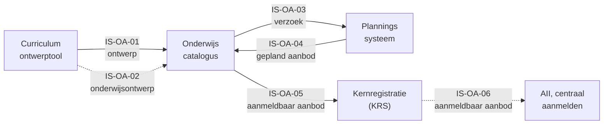
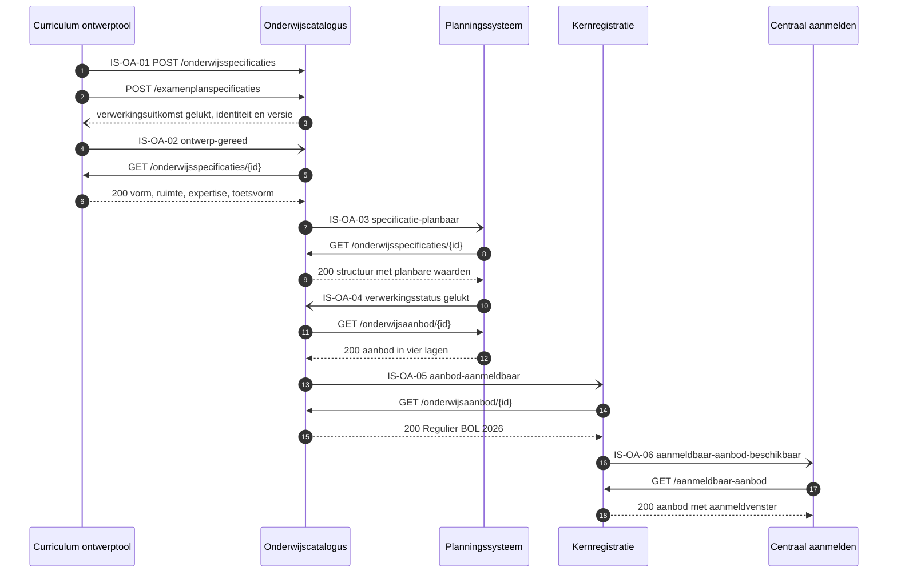

# Interactiespecificatie: ontwerpen en ontsluiten van onderwijsaanbod

| In een oogopslag | |
|---|---|
| Wat deze specificatie dekt | Zes informatiestromen waarmee een instelling onderwijsaanbod ontwerpt en ontsluit, van kwalificatiedossier tot aanmeldbaar aanbod. Leerroute 1, fase 1 tot en met 3, beeld F1-01 tot en met F3-02 |
| Voor wie | De informatiemanager of architect van een instelling die uitvraagt, en de software-architect van de leverancier die bouwt. De onderwijskundige onderbouwing staat in de [leerroute-uitwerking](../leerroute-uitwerking/doc/leerroute-uitwerking-lr1.md) |
| Wat een leverancier ermee bouwt | Per eenheid de koppeling tussen 2 componenten: welke objecttypen erover gaan, welke diensten in [Public](https://github.com/Npuls-OKx/Public/tree/dev/Koppelvlakspecificaties) ze dragen, welke dienst volgt |
| Hoe een instelling dit gebruikt | Zij wijst in de [kiesbare eenheden](#de-kiesbare-eenheden) aan welke zij uitvraagt, als eis aan een leverancier |
| Status | Concept, eerste deel van een catalogus van interactiespecificaties. De objecttypen komen uit het [informatiemodel](../../../model/informatiemodel/informatiemodel.md); 79 van de 145 modelregels dragen een aanname |
| Scope | Binnen 1 instelling ([ADR 0008](https://github.com/Npuls-OKx/Public/blob/dev/Referentiemateriaal/adr/0008-scope-planning-eerst-intra-instelling.md)), leerroute 1 met [persona Jochem](../leerroute-uitwerking/doc/persona_jochem.md). Fase 4 en later, en elke andere leerroute, volgen als eigen snede |

## Leeswijzer

Vijf minuten tot het besluit, twintig tot de werking.

| Deel | Wat erin staat | Tijd |
|---|---|---|
| [1 Wat dit bereikt](#1-wat-dit-bereikt) | Het scenario, de actoren met hun story, de zes eenheden | 4 min |
| [2 Het proces](#2-het-proces) | Drie fasen, veertien stappen, en waar informatie een component verlaat | 3 min |
| [3 Het informatiemodel](#3-het-informatiemodel) | De 33 objecttypen per familie met een instantie, en de geldende ontwerpkeuzes | 4 min |
| [4 Het ecosysteem](#4-het-ecosysteem) | De zes stromen op hoofdplaat v1.7, en wie wat bezit | 2 min |
| [5 De diensten](#5-de-diensten-per-component) | Per component de diensten, en wat het vandaag serveert | 2 min |
| [6 De zes stromen](#6-de-zes-stromen) | De keten in operaties, de eenheden, de werkbrieven | 3 min |
| [Verdieping per stroom](#de-eenheden) | Per eenheid de operaties, de berichtvelden, een voorbeeldpayload | 10 min elk |
| [Signaleringen](#signaleringen-en-openstaande-punten) | Wat een besluit vraagt voor de uitvraag | 1 min |

## 1. Wat dit bereikt

### Het scenario

1. Een onderwijsontwerper ontleedt het kwalificatiedossier Apothekersassistent (crebo 23450) in kwalificatie, kerntaken en werkprocessen.
2. Hij zet het examenplan op met een eerste resultaatstructuur en bindt cohort 2026 eraan, dat van Jochem, met de keuzedeeleis van 720 studiebelastingsuren (SBU).
3. Hij vertaalt het dossier naar leeruitkomsten in de stem van de instelling en verdiept die naar vaardigheid, kennis en inzicht uit CompetentNL.
4. Daarop bouwt hij de opleidingsspecificatie met programma, eenheden en leeronderdelen, elk met vorm, leeromgeving, docentprofiel en studiebelasting.
5. De keuzedeelruimte krijgt een eigen programmaspecificatie met een `Student keuze regelset`, waaruit Jochem later kiest.
6. De examencommissie werkt de examenonderdelen uit en stelt het examenplan met de resultaatstructuur vast.
7. Het ontwerp gaat als gelinkt geheel naar de onderwijscatalogus, verwijzend naar de leeruitkomst (IS-OA-01, IS-OA-02).
8. De catalogus vult de specificatie aan tot planbare specificatie en verzoekt planning om aanbod (IS-OA-03).
9. De planner bepaalt haalbaarheid binnen de jaarplanning en levert gepland aanbod terug, per laag verwijzend naar specificatie en verzoek (IS-OA-04).
10. De catalogus ontsluit `Regulier BOL 2026` aan de kernregistratie en die aan centraal aanmelden, waar Jochem zijn startmoment kiest (IS-OA-05, IS-OA-06).

Deze snede voltooit zich voordat Jochem zich orienteert: wat hij ziet is het resultaat ervan.

### Wat de actoren eruit halen

| Actor | Story | Eenheden |
|---|---|---|
| Onderwijsontwerper | Het dossier naar leeruitkomsten vertalen en daaraan de specificatiestructuur hangen, zodat elke schakel terugleest wat de student leert | IS-OA-01 |
| Onderwijsontwerper | De specificatie planbaar maken, zodat de planner het aanbod op die waarden baseert | IS-OA-03 |
| Examencommissie | Het examenplan met zijn resultaatstructuur vaststellen, zodat alleen een vastgesteld plan de catalogus bereikt | IS-OA-01, IS-OA-02 |
| Planner | Het verzoek met de planbare waarden ontvangen, zodat haalbaarheid blijkt uit prognose en capaciteit samen | IS-OA-03, IS-OA-04 |
| Onderwijscatalogus | Het geplande aanbod terugnemen en aanmeldbaar aanbod ontsluiten, zodat elk afnemend systeem bij de bezitter ophaalt | IS-OA-04, IS-OA-05 |
| Kernregistratie | Het aanbod ontsluiten aan AII, zodat de aspirant-student zijn startmoment centraal kiest | IS-OA-06 |

### De kiesbare eenheden

| Id | Van | Naar | Wat zij levert | Beeld en stand |
|---|---|---|---|---|
| IS-OA-01 | Curriculum ontwerptool | Onderwijscatalogus | Leeruitkomsten, de specificatiestructuur tot leeronderdeel, en de summatieve resultaatstructuur | [F1-12](../../../model/informatiemodel/img/regels/f1-12-de-opleiding-zoals-ontworpen-naar-de-catalogus.svg). Dienst volgt, [ADR 0020](https://github.com/Npuls-OKx/Public/blob/dev/Referentiemateriaal/adr/0020-curriculumontwerp-onderwijscatalogus-happy-flow-synchronisatie-en-federatie-adopt-klonen.md) noemt welke |
| IS-OA-02 | Curriculum ontwerptool | Onderwijscatalogus | Het onderwijs- en examenontwerp: vorm, leeromgeving, docent- en examinatorprofiel, studiebelasting, toetsvorm | [F1-13](../../../model/informatiemodel/img/regels/f1-13-het-onderwijs-en-examenontwerp-mee-naar-de-catalogus-conceptplaat.svg). Voorstel, van de conceptplaat Onderwijsontwerp |
| IS-OA-03 | Onderwijscatalogus | Planningssysteem | Het verzoek tot aanbod, met de planbare waarden per eenheid | [F2-03](../../../model/informatiemodel/img/regels/f2-03-verzoek-met-specificatiestructuur-en-planbare-waarden-naar-planning.svg). Koppeling OC-P&R, [interactie I1 en I2](https://github.com/Npuls-OKx/Public/blob/dev/Koppelvlakspecificaties/Interactiepatronen/onderwijscatalogus-planning-en-roostering.md) |
| IS-OA-04 | Planningssysteem | Onderwijscatalogus | Het geplande aanbod in 4 lagen, elk verwijzend naar specificatie en verzoek | [F2-07](../../../model/informatiemodel/img/regels/f2-07-het-geplande-aanbod-terug-naar-de-catalogus.svg). Koppeling OC-P&R, interactie I3 en I5 |
| IS-OA-05 | Onderwijscatalogus | Kernregistratie (KRS) | Het aanmeld- en inschrijfbare `Opleidingsprogramma aanbod` | [F3-01](../../../model/informatiemodel/img/regels/f3-01-aanmeldbaar-aanbod-naar-de-kernregistratie.svg). Koppeling OC-KRS, dienst volgt |
| IS-OA-06 | Kernregistratie (KRS) | AII (centraal aanmelden) | Hetzelfde aanbod, voor het systeem waarin Jochem zich aanmeldt | [F3-02](../../../model/informatiemodel/img/regels/f3-02-aanmeldbaar-aanbod-van-de-kernregistratie-naar-aii.svg). Voorstel, afstemming volgt |

Vindplaats per regel: [voorbeeld-lr1-regels.json](../../../model/informatiemodel/voorbeeld-lr1-regels.json). Definities: [begrippenlijst](../begrippen/begrippenlijst.md). Wat per eenheid een besluit vraagt: [signaleringen](#signaleringen-en-openstaande-punten).

### De componenten en de stromen



Stippellijn: stand voorstel.

## 2. Het proces

Van kwalificatiedossier tot aanmeldbaar aanbod: drie fasen, veertien stappen, 22 beelden en 145 regels uit de [voorbeelduitwerking](../../../model/informatiemodel/voorbeeld-lr1-regels.json).

### De keten in beeld


De afgeronde knopen zijn de momenten waarop informatie een component verlaat. Fase 3 staat als twee rijen in de tabel, omdat ontsluiten en doorgeven elk hun eigen stroom dragen. IS-OA-03, IS-OA-04 en IS-OA-05 lopen over een pijl die v1.7 al tekent; [hoofdstuk 6](#6-de-zes-stromen) zet de zes in operaties.

### Fase 1, kwalificatiekader analyseren en grofmazig ontwerpen

MORA-hoofdproces Ontwikkelen, procesketen 6 Onderwijsontwikkeling. Uitsnede van hoofdplaat v1.7: [fase 1](../../../model/informatiemodel/img/hoofdplaat/f1.svg).

| Stap | Rol of eenheid | Beelden |
|---|---|---|
| Kwalificatiedossier analyseren | onderwijsontwerper | F1-01 |
| Examenplan opstellen | onderwijsontwerper | F1-02 |
| Kwalificatiedossier vertalen naar leeruitkomsten | onderwijsontwerper | F1-03 tot en met F1-06 |
| Opleidingsspecificatie met programma en eenheden | onderwijsontwerper | F1-07 |
| Keuzedeel als eigen programmaspecificatie | onderwijsontwerper | F1-08 |
| Toetsonderdelen en resultaatstructuur afleiden | onderwijsontwerper | F1-09 |
| Exameninstrumenten bepalen of inkopen | examencommissie | F1-10 |
| Examenplan vaststellen | examencommissie | F1-11 |
| Grofmazig resultaat publiceren | IS-OA-01, IS-OA-02 | F1-12, F1-13 |

### Fase 2, publiceren en planbaar maken

MORA-hoofdproces Plannen en roosteren, procesketen 4 Onderwijslogistiek. Uitsnede: [fase 2](../../../model/informatiemodel/img/hoofdplaat/f2.svg).

| Stap | Rol of eenheid | Beelden |
|---|---|---|
| Specificatie planbaar maken | onderwijsontwerper | F2-01 |
| Planningssysteem verzoeken om onderwijsaanbod | planner, IS-OA-03 | F2-02, F2-03 |
| Haalbaarheid bepalen en aanbod plannen | planner | F2-04 tot en met F2-06 |
| Gepland aanbod terugleveren | IS-OA-04 | F2-07 |

### Fase 3, instroom, intake en plaatsing: de eerste stap

MORA-hoofdproces Informeren, aanmelden, intake en plaatsen. Uitsnede: [fase 3](../../../model/informatiemodel/img/hoofdplaat/f3.svg).

| Stap | Rol of eenheid | Beelden |
|---|---|---|
| Orienteren op het gepubliceerde aanbod: ontsluiten | IS-OA-05 | F3-01 |
| Orienteren op het gepubliceerde aanbod: doorgeven | IS-OA-06, voorstel | F3-02 |

Van fase 3 draagt deze snede het ontsluiten van aanbod; aanmelden, intake, plaatsen en inschrijven beginnen bij F3-03, met de SLB'er als nieuwe rol.

## 3. Het informatiemodel

Deze interactie draagt 33 objecttypen uit het [informatiemodel OKx](../../../model/informatiemodel/informatiemodel.md), uit vijf van de zeven begrippenfamilies, elk met een instantie uit de casus Apothekersassistent (crebo 23450) als bewijs.


Elke laag van de opleiding keert drie keer terug: in het kwalificatiekader, in de specificatie en in het aanbod, met de leeruitkomst als sleutel ertussen en het verzoek tot aanbod op de grens. De keuzedeelruimte, de toetsen en de examens staan in de rijen eronder. De [selectie](uitsnede-onderwijsaanbod.json) draagt de keuze van deze uitsnede.

### Kwalificatiekader mbo

| Objecttype | Instantie | Beeld |
|---|---|---|
| `Kwalificatie dossier` | Apothekersassistent, crebo 23450 | F1-01 |
| `Kwalificatie` | Apothekersassistent, 27141 | F1-01 |
| `Kerntaak` | B1-K1 Biedt farmaceutische patiëntenzorg | F1-01 |
| `Werkproces` | B1-K1-W1 Neemt de zorgvraag in behandeling | F1-01 |

### Onderwijskundig kader instelling

| Objecttype | Instantie | Beeld |
|---|---|---|
| `Leeruitkomst` | Biedt farmaceutische patiëntenzorg (kerntaakniveau) | F1-03, F1-12 |
| `Competenties / Skills` | Skills bij deze leeruitkomst (CompetentNL) | F1-04, F1-12 |
| `Vaardigheid` | Communicatieve vaardigheden (laag 2) | F1-04, F1-12 |
| `Kennis` | Farmacie (ISCED-F 0916) | F1-04, F1-12 |
| `Inzicht` | Risico van een geneesmiddel | F1-04, F1-12 |

`Competenties / Skills`, `Kennis`, `Inzicht`, `Vaardigheid` en `Examenplan` dragen scope `buiten`: zij reizen mee als verdieping.

### Onderwijsspecificatie

| Objecttype | Instantie | Beeld |
|---|---|---|
| `Opleiding specificatie` | Apothekersassistent, versie 2026.1 | F1-07, F1-12, F2-03 |
| `Opleidingsprogramma specificatie` | BOL voltijd | F1-07, F1-12, F2-03 |
| `Onderwijseenheid specificatie` | Blok B1-K1 | F1-05, F1-12, F2-03 |
| `Leeronderdeel specificatie` | Baliegesprekken 101 | F1-05, F1-12, F2-03 |
| `Keuzedeelruimte` | 720 SBU, mbo-4 | F1-07, F1-12 |
| `Keuzedeel` | K0037 Farmaceutische Patientenzorg | F1-08 |
| `Student keuze regelset` | Kiesbaar: K0037 of K0262 | F1-07, F1-12 |
| `Toetsonderdeel specificatie` | Praktijktoets baliegesprek (OSCE) | F1-09, F1-12 |
| `Examenonderdeelspecificatie` | Proeve van bekwaamheid B1-K1 | F1-09, F1-12 |

### Onderwijsaanbod

| Objecttype | Instantie | Beeld |
|---|---|---|
| `Opleidingsaanbod van Instelling` | ROC Leren Zonder Drempels | F2-04, F2-07 |
| `Opleidingaanbod` | Apothekersassistent 2026, 48 plaatsen | F2-04, F2-07 |
| `Opleidingsprogramma aanbod` | Regulier BOL 2026 | F2-04, F2-07, F3-01, F3-02 |
| `Onderwijseenheid aanbod` | B1-K1, periode 1 tot 4 | F2-04, F2-07 |
| `Leergelegenheid` | Baliegesprekken 101, twee groepen | F2-04, F2-07 |
| `Toetsgelegenheid` | Praktijktoets baliegesprek, periode 1 | F2-04, F2-07 |
| `Keuzedeelaanbod` | K0037, periode 7 | F2-07 |

### Resultaatstructuur en buiten de kolommen

| Objecttype | Instantie | Beeld |
|---|---|---|
| `Summatieve resultaat structuur` | Kerntaken en keuzedelen, alle voldoende | F1-02, F1-12 |
| `Examenonderdeel weging` | Proeve B1-K1, weging 2 | F1-09 |
| `Summatief Afrondingscriterium` | Kerntaken voldoende, basisdeel behaald | F1-09, F1-12 |
| `Formatieve resultaat structuur` | Voortgang per onderwijseenheid | F1-12 |
| `Cohort / periode` | Cohort 2026 | F1-02 |
| `Verzoek tot Aanbod / Intekening op specificatie` | Planopgave cohort 2026 | F2-02, F2-03 |
| `Examenplan` | Examenplan cohort 2026 | F1-02, F1-11 |
| `Medewerker` | Docent 4711 | F2-05 |

`Onderwijsverbintenis` en `Onderwijsresultaat` beginnen bij F3-03.

### De ontwerpkeuzes die hier gelden

De nummering volgt de [ontwerpkeuzes](../../../model/informatiemodel/informatiemodel.md#ontwerpkeuzes) van het informatiemodel.

| Keuze | Waar zij in deze snede valt |
|---|---|
| 1 Leeruitkomst als sleutel | F1-12, elk type verwijst ernaar |
| 2 Kader vertaald | F1-01 en F1-03, `Wordt vertaald naar` |
| 4 Niveau vrij | blok B1-K1 op kerntaakniveau |
| 5 Zelfstandig | F1-08, keuzedeel als eigen specificatie |
| 6 Student kiest | F1-07 en F1-12, de regelset |
| 9 Examenonderdeel | F1-09 en F1-12, beide typen |
| 10 Resultaatstructuur | F1-12 publiceert, F1-02 toont herkomst |
| 11 Competentie | F1-04, vaardigheid, kennis, inzicht eronder |
| 12 Keuzedeelruimte | F1-07, F1-08, F2-07, dezelfde vorm |
| 13 Intekenen | F2-02 verzoek, F2-07 aanbod |
| 16 Geldigheid | `versie 2026.1` op de specificatie, periode op aanbod |
| 17 Cohort | F1-02 bindt cohort 2026 aan de structuur |

Keuze 3, 7 en 8 raken de rand, bij een tweede instelling of vanaf F3-03.

## 4. Het ecosysteem

De plaat licht de zes stromen uit op hoofdplaat v1.7: de componenten die meedoen zijn omlijnd, bij elke stroom staat wat er overheen gaat, en IS-OA-01, IS-OA-02 en IS-OA-06 staan gestippeld, want zij krijgen hun lijn op een volgende plaatversie.


De zes staan met hun lading in [stromen-onderwijsaanbod.json](stromen-onderwijsaanbod.json). De plaat komt uit het model met deze aanroep.

```text
python3 scripts/teken-hoofdplaat-ruim.py \
  --uit architecture/docs/specificatie/interactie-onderwijsaanbod/img/hoofdplaat-onderwijsaanbod.svg \
  --markeer architecture/docs/specificatie/interactie-onderwijsaanbod/stromen-onderwijsaanbod.json
```

### De zes stromen op de hoofdplaat

| Aanduiding | Koppeling | Stand vandaag |
|---|---|---|
| IS-OA-01 | volgt | de [dienstpagina van de ontwerptool](https://github.com/Npuls-OKx/Public/blob/dev/Koppelvlakspecificaties/Applicatiecomponenten/curriculum-ontwerptool.md) laat deze koppeling aan een volgend pakket; ADR 0020 noemt de diensten |
| IS-OA-02 | volgt | voorstel, van de conceptplaat Onderwijsontwerp |
| IS-OA-03 | OC-P&R, interactie I1 en I2 | gespecificeerd: het [interactiepatroon OC-P&R](https://github.com/Npuls-OKx/Public/blob/dev/Koppelvlakspecificaties/Interactiepatronen/onderwijscatalogus-planning-en-roostering.md) draagt endpoints en meldpatronen (webhooks) |
| IS-OA-04 | OC-P&R, interactie I3 en I5 | gespecificeerd |
| IS-OA-05 | OC-KRS in de beeldregels, OC-SIS op de plaat | pijl en koppeling bestaan, de dienst volgt |
| IS-OA-06 | volgt | voorstel: de route via de kernregistratie vraagt afstemming |

### Wie wat bezit

| Component | Bezit | Wat het hier levert |
|---|---|---|
| Curriculum ontwerptool | het ontwerp in bewerking | het ontwerp aan de catalogus, die het distribueert |
| Onderwijscatalogus | de onderwijsspecificaties en de resultaatstructuren | de planbare specificatie aan planning, aanmeldbaar aanbod aan de kernregistratie |
| Planningssysteem | het onderwijsaanbod | het geplande aanbod, per laag verwijzend naar specificatie en verzoek |
| Kernregistratie (KRS) | de verbintenissen, de voortgang en de resultaten | het aanbod aan centraal aanmelden |

Grond: [uitgangspunt U3, resource-eigenaarschap](https://github.com/Npuls-OKx/Public/blob/dev/Koppelvlakspecificaties/uitgangspunten.md#u3-resource-eigenaarschap). Elk systeem is de enige bron van zijn eigen resource, en over de koppeling gaat een verwijzing (uuid), met de inhoud op opvraag.

## 5. De diensten per component

Een applicatiedienst zegt wat er over een koppeling moet kunnen; wie hem vervult volgt uit [resource-eigenaarschap](https://github.com/Npuls-OKx/Public/blob/dev/Koppelvlakspecificaties/uitgangspunten.md#u3-resource-eigenaarschap). De namen komen uit de [dienstenlijst](https://github.com/Npuls-OKx/Public/blob/d0c20d99b110b29ccf6b0e50109f7d54ffd88d7a/Koppelvlakspecificaties/Applicatiediensten/README.md).

| Component | Diensten die deze snede vraagt | Wat het vandaag serveert | Eenheden |
|---|---|---|---|
| Curriculum ontwerptool | onderwijsspecificatie-inname-afnemer, verwerkingsuitkomst-afnemer, afleverabonnement-afnemer | De [dienstpagina](https://github.com/Npuls-OKx/Public/blob/dev/Koppelvlakspecificaties/Applicatiecomponenten/curriculum-ontwerptool.md) laat deze koppeling aan een volgend pakket | IS-OA-01, IS-OA-02 |
| Onderwijscatalogus | onderwijsspecificatie-inname-aanbieder, onderwijsspecificatiestructuur-aanbieder, planbaar-onderwijsaanbod-afnemer, verwerkingsuitkomst-afnemer, afleverabonnement-aanbieder en -afnemer | `/onderwijsspecificaties` met `/{id}` en `/{id}/delta`, `/abonnementen`, `verwerkingsstatus` | IS-OA-01 tot en met IS-OA-05 |
| Planningssysteem | onderwijsspecificatiestructuur-afnemer, planbaar-onderwijsaanbod-aanbieder, verwerkingsuitkomst-aanbieder, afleverabonnement-aanbieder en -afnemer | `/onderwijsaanbod` met `/{id}`, `/abonnementen`, en drie meldingen over de specificatie | IS-OA-03, IS-OA-04 |
| Kernregistratie (KRS) | aanmeldbaar-onderwijsaanbod-afnemer en -aanbieder, beide voorstel | Meldpatronen (webhooks) voor specificatie en resultaatstructuur | IS-OA-05, IS-OA-06 |
| AII (centraal aanmelden) | aanmeldbaar-onderwijsaanbod-afnemer, voorstel | Het model kent het vak `Voorziening Centraal Aanmelden (CAMBO)` zonder applicatiedienst | IS-OA-06 |

De verplichting staat op de dienstpagina, de parameters en statuscodes op de [componentpagina](https://github.com/Npuls-OKx/Public/tree/dev/Koppelvlakspecificaties/Applicatiecomponenten); de [werkbrieven](#de-werkbrieven) noemen wat ontbreekt.

## 6. De zes stromen

### De keten in operaties



Elk paar legt eerst zijn afleveradres vast met `POST /abonnementen`.

### De eenheden

| Eenheid | Van | Naar | Wat erover gaat | Stand | Verdieping |
|---|---|---|---|---|---|
| IS-OA-01 | Curriculum ontwerptool | Onderwijscatalogus | Leeruitkomsten, specificatiestructuur tot leeronderdeel, summatieve resultaatstructuur | Voorstel, innamecontract open | [stroom-is-oa-01.md](stroom-is-oa-01.md) |
| IS-OA-02 | Curriculum ontwerptool | Onderwijscatalogus | Onderwijsvorm, ruimtetype, expertiseprofielen, studiebelasting, toetsvorm, toetsinstrument | Voorstel, uit de conceptplaat | [stroom-is-oa-02.md](stroom-is-oa-02.md) |
| IS-OA-03 | Onderwijscatalogus | Planningssysteem | Het verzoek tot aanbod met de planbare specificatiestructuur | Gespecificeerd, planbare waarden open | [stroom-is-oa-03.md](stroom-is-oa-03.md) |
| IS-OA-04 | Planningssysteem | Onderwijscatalogus | Het geplande aanbod in vier lagen, verwijzend naar specificatie en verzoek | Gespecificeerd, schema's op alfa | [stroom-is-oa-04.md](stroom-is-oa-04.md) |
| IS-OA-05 | Onderwijscatalogus | Kernregistratie (KRS) | Het aanmeldbare `Opleidingsprogramma aanbod`, instantie `Regulier BOL 2026` | Koppeling staat, operaties open | [stroom-is-oa-05.md](stroom-is-oa-05.md) |
| IS-OA-06 | Kernregistratie (KRS) | AII | Hetzelfde aanbod per startmoment, met aanmeldvenster | Voorstel, richting open | [stroom-is-oa-06.md](stroom-is-oa-06.md) |

### De werkbrieven

| Wat de beelden vragen | Schema of document | Versie-impact | Eenheid |
|---|---|---|---|
| Onderwijsvorm, ruimtetype, expertiseprofiel, uren per tijdsoort, capaciteit, groepsgrootte, tijdvenster, geclusterde leergelegenheid | `education-specification.json` | MINOR per veld; de enum `specificatieType` brekend voor een strenge afnemer | IS-OA-02, IS-OA-03 |
| Verwijzing naar het verzoek per laag, waarden voor toetsgelegenheid, keuzedeelaanbod, instelling | `education-offering.json`, enum `aanbodType` | MINOR optioneel, MAJOR verplicht | IS-OA-04 |
| Aanmeldbaarheid: `aanmeldvenster`, `codes`, `bron`, `uitersteInschrijfdatum`, status aanmeldbaar | `education-offering.json` | MINOR per veld, MAJOR voor de statuswaarde | IS-OA-05, IS-OA-06 |
| Toetskenmerken, toetsinstrument, formatieve resultaatstructuur als eigen wortel | `result-structure.json` | MINOR, enumwaarde en optionele velden | IS-OA-01, IS-OA-02 |
| Competenties met vaardigheid, kennis en inzicht eronder; getypeerde regels met bereiken | `learning-outcome.json`, `rule-set.json` | MINOR naast de vrije vorm, MAJOR bij dichtzetten | IS-OA-01, IS-OA-03 |
| Foutmodel, melding-id, meldingssoorten voor aanbod en inrichting, stabiel `eventId` | `processing-status.json`, `subscription.json` | MINOR optioneel, MAJOR op de gesloten lijst | IS-OA-03 tot en met IS-OA-06 |
| Zes nieuwe schema's: verzoek, expertiseprofiel, aanbod-aanmeldbaar, inrichtingsstatus, aanbodstatus, aanbod-delta | `schemas/` | MINOR, additief per schema | IS-OA-02 tot en met IS-OA-06 |
| Innamecontract, endpointtabel van de ontwerptool, operaties voor aanmeldbaar aanbod, gebruiksprofiel | dienstpagina's, `gebruiksprofielen.md` | Nieuwe endpoints, geen schemawijziging | IS-OA-01, IS-OA-02, IS-OA-06 |
| Objecttype of definitie: resultaateenheidspecificatie, plaatsingsgroep, de vier aanbodlagen | informatiemodel, begrippenlijst | Geen schemawijziging | IS-OA-01 tot en met IS-OA-04 |

## Signaleringen en openstaande punten

Elke signalering noemt wat een besluit vraagt.

| Nr | Signalering | Besluit |
|---|---|---|
| S1 | De beeldregels citeren het kaderscenario in Public, de stories staan in [leerroute-uitwerking-lr1.md](../leerroute-uitwerking/doc/leerroute-uitwerking-lr1.md) | welk bestand normatief is |
| S2 | IS-OA-05 heet OC-KRS in de beeldregels en OC-SIS op v1.7; het [interactiepatroon](https://github.com/Npuls-OKx/Public/blob/dev/Koppelvlakspecificaties/Interactiepatronen/onderwijscatalogus-studentinformatiesysteem.md) vat KRS en studentvolgsysteem samen, en hetzelfde pijl-id draagt de stroom naar CAMBO | een naam en een pijl per koppeling |
| S3 | IS-OA-06 loopt via de kernregistratie naar AII op gezag van de sectorarchitect, v1.7 ontsluit rechtstreeks aan CAMBO | richting, component en naam |
| S4 | IS-OA-05 ontsluit aanbod uit de catalogus, terwijl U3 het aanbod bij planning legt | waar de dienst hoort |
| S5 | IS-OA-01 en IS-OA-02 dragen 29 van de 48 stroomregels zonder koppeling-ID: op v1.7 valt het ontwerpen binnen de catalogus | een eigen lijn op de plaat |
| S6 | 79 van de 145 regels dragen een aanname, bij F1-13 alle 11; 26 objecttypen komen van de conceptplaat en 13 van de 33 missen een definitie, waaronder `Leergelegenheid` | de grond per eenheid zichtbaar maken |
| S7 | B01 tot en met B10 staan open (issues 283 en 284): de clustering, de keuzedeelruimte in de resultaatstructuur, exacte geplande capaciteit | de bevindingen wegen voor een eenheid vastligt |
| S8 | Fase 1 en 2 dragen procesketen 6 en 4; informeren, aanmelden, intake en plaatsen valt onder keten 5 | de ketentoewijzing van fase 3 |
| S9 | [U5](https://github.com/Npuls-OKx/Public/blob/dev/Koppelvlakspecificaties/uitgangspunten.md#u5-bericht-versus-kanaal) laat het afleveringsmechanisme bij de partijen, en `subscription.json` dekt de 4 OC-P&R-events | het afleveradres per koppeling |
| S10 | Story-0007, story-0022 en story-0023 staan op de onderwijsontwikkelaar, het voorbeeld noemt de planner | de actor per story |
| S11 | 7 van de 24 stromen op v1.7 dragen een koppelingspecificatie, de aangehaalde [ADR's](https://github.com/Npuls-OKx/Public/tree/dev/Referentiemateriaal/adr) staan op Voorstel, elk schema op alfa | waarop een leverancier zich vastlegt |
| S12 | De [dienstenlijst](https://github.com/Npuls-OKx/Public/blob/d0c20d99b110b29ccf6b0e50109f7d54ffd88d7a/Koppelvlakspecificaties/Applicatiediensten/README.md) staat op een vastgezet commit van `feature/restructure-and-versioning` | welke branch normatief is |
| S13 | IS-OA-01 levert het ontwerp met POST, IS-OA-02 meldt gereed en laat de catalogus ophalen | een aanleverpatroon van ontwerptool naar catalogus |
| S14 | De dienstenlijst schrijft `specificatie-beschikbaar` en `verwerkingsuitkomst`, de componentpagina's `specificatie-planbaar` en `verwerkingsstatus` | een naam per bericht |
| S15 | Interactie I3 valt uiteen: ontvangen, gestart en afgekeurd bij IS-OA-03, gelukt en nietGelukt bij IS-OA-04 | de knip bevestigen |

Open beeldvragen:

| Vraag | Beeld |
|---|---|
| Het generieke basisdeel | F1-09 |
| De keuzedeelruimte in de summatieve resultaatstructuur | F1-12 |
| De container voor geclusterde leeronderdelen | F2-01 |

Verder open:

| Punt | Stand |
|---|---|
| De fase-2 update van de ontwerptool | wacht op een beeld |
| De route naar het intakesysteem | begint bij F3-04, buiten deze snede |
| De stories van roosteraar en student | volgen in fase 4 en 6 |
| `Onderwijsvorm`, `Onderwijslocatie type`, `Onderwijslocatie` en `Organisatie-eenheid` staan in F1-06 nog onder hun conceptplaat-naam | de namen gelijktrekken in de voorbeelduitwerking |
| Het versieformaat: `2026.1` in de voorbeelduitwerking naast het patroon `n.n.n` van de schema's | een aanduiding per specificatie |
| Elke verdieping nummert haar operaties zelf: O1, I1 en C1 beginnen elk een reeks | een nummering over de zes stromen |
| `Competenties / skills` naast `Competenties / Skills`, `Schaartste van mensen` (F2-05), `Opleiding aanbod` naast `Opleidingaanbod` | blokkeren een kruiscontrole op naam |
