# IS-OA-01 Ontwerp naar de catalogus

| | |
|---|---|
| **Document doel** | Zet uiteen hoe de curriculum ontwerptool het vastgestelde ontwerp van een opleiding aan de onderwijscatalogus levert, ten behoeve van de bouw of de verificatie van een implementatie volgens deze specificatie |
| **Doelgroep** | De implementatiespecialist en de tester bij een instelling of een leverancier, en wie een profiel of consumer bouwt |
| **Dient als input voor** | De bouw van het koppelvlak, de testgevallen erbij, en de acceptatie van een opgeleverde koppeling |
| **Kaderstelling** | De [interactieketen](README.md) waarin deze specificatie valt, het [informatiemodel OKx](../../../model/informatiemodel/informatiemodel.md), en beeld F1-12 van de [voorbeelduitwerking](../../../model/informatiemodel/voorbeeld-leerroute-1-jochem.md) |
| **Inhoud** | Acht operaties met hun statuscodes, acht toetsen met hun moment, acht berichten met hun velden, en twee voorbeeldpayloads die valideren |
| **Status** | Het opvragen ligt vast in Public. Het innemen met bevindingen is voorstel, met per regel wat dat in Public toevoegt |

De lading: de leeruitkomsten, de specificatiestructuur tot leeronderdeel met de keuzedeelruimte en haar keuzeregels, en de resultaatstructuur met de toets- en examenonderdelen, alles verankerd op de leeruitkomst. De uuid's, de versies en de namen in de voorbeeldpayloads komen uit [casus.md](casus.md).

## 1. Interactie

| Bronsysteem | Doelsysteem | Koppeling | Beeld | Status | Applicatiedienst |
|---|---|---|---|---|---|
| Curriculum ontwerptool | Onderwijscatalogus | volgt, [S5](signaleringen.md) | F1-12 | Voorstel: hoofdplaat v1.7 laat het ontwerpen binnen de catalogus vallen, en een interactiepatroon voor deze lijn volgt | [onderwijsspecificatie-inname](https://github.com/Npuls-OKx/Public/blob/d0c20d99b110b29ccf6b0e50109f7d54ffd88d7a/Koppelvlakspecificaties/Applicatiediensten/onderwijsspecificatie-inname-aanbieder.md): de ontwerptool levert, de catalogus neemt in |

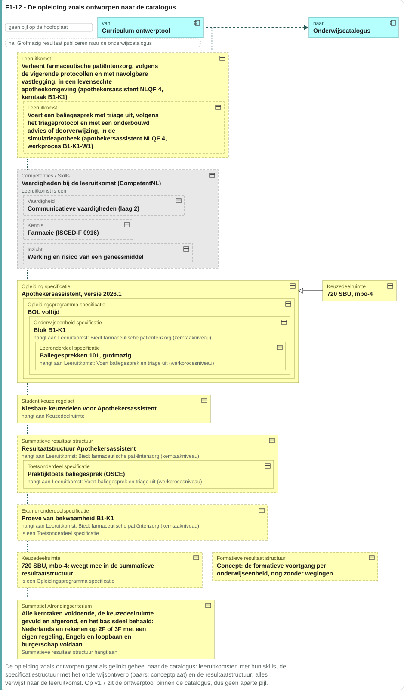

Links staat wat de ontwerper bouwde, rechts de catalogus die het opneemt. Elk type verwijst naar een leeruitkomst, en die sleutel maakt de levering een geheel.

De taak van deze interactie in het proces: de ontwerper heeft het grofmazige ontwerp af en de examencommissie heeft het examenplan vastgesteld, en dat geheel moet de catalogus in voordat er iets planbaar of aanmeldbaar van kan worden. Zij staat aan het eind van [fase 1](../../../model/informatiemodel/voorbeeld-leerroute-1-jochem.md#fase-1-kwalificatiekader-analyseren-en-grofmazig-ontwerpen) en voor [fase 2](../../../model/informatiemodel/voorbeeld-leerroute-1-jochem.md#fase-2-publiceren-en-planbaar-maken).

| Applicatiecomponent | Functie in deze interactie |
|---|---|
| Curriculum ontwerptool | Levert de vastgestelde structuur aan, verwerkt de uitkomst, en gebruikt de identiteit en versie die de catalogus toekent voortaan als verwijzing |
| Onderwijscatalogus | Valideert de vorm en de verwijzingen bij de poort, rekent de studielast en het manifest na na aanname, kent identiteit en versie toe, en meldt de uitkomst terug |

De status per regel hieronder zegt waar een artefact staat.

| Status | Waar het artefact staat |
|---|---|
| `vastgelegd` | [Npuls-OKx/Public](https://github.com/Npuls-OKx/Public/tree/dev/Koppelvlakspecificaties) draagt hem: een pad op een componentpagina, een enumwaarde in een melding of een schema in [Informatie-en-gegevensmodellen](https://github.com/Npuls-OKx/Public/tree/dev/Informatie-en-gegevensmodellen/schemas) |
| `voorstel` | Deze specificatie stelt hem voor, onderbouwd uit [de casus](casus.md) en het [informatiemodel](../../../model/informatiemodel/informatiemodel.md). Een voorgesteld schema staat in [schemas/](schemas/) en draagt een `$id` die eindigt op `/voorstel` |

## 2. Interactiespecificatie

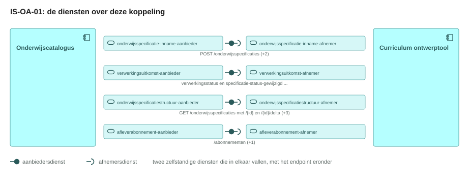

De aanbiedersdienst en de afnemersdienst staan als twee eigen blokken tegenover elkaar, met de bal die in de kom valt. Het sequentiediagram eronder zet dezelfde operaties in de tijd.

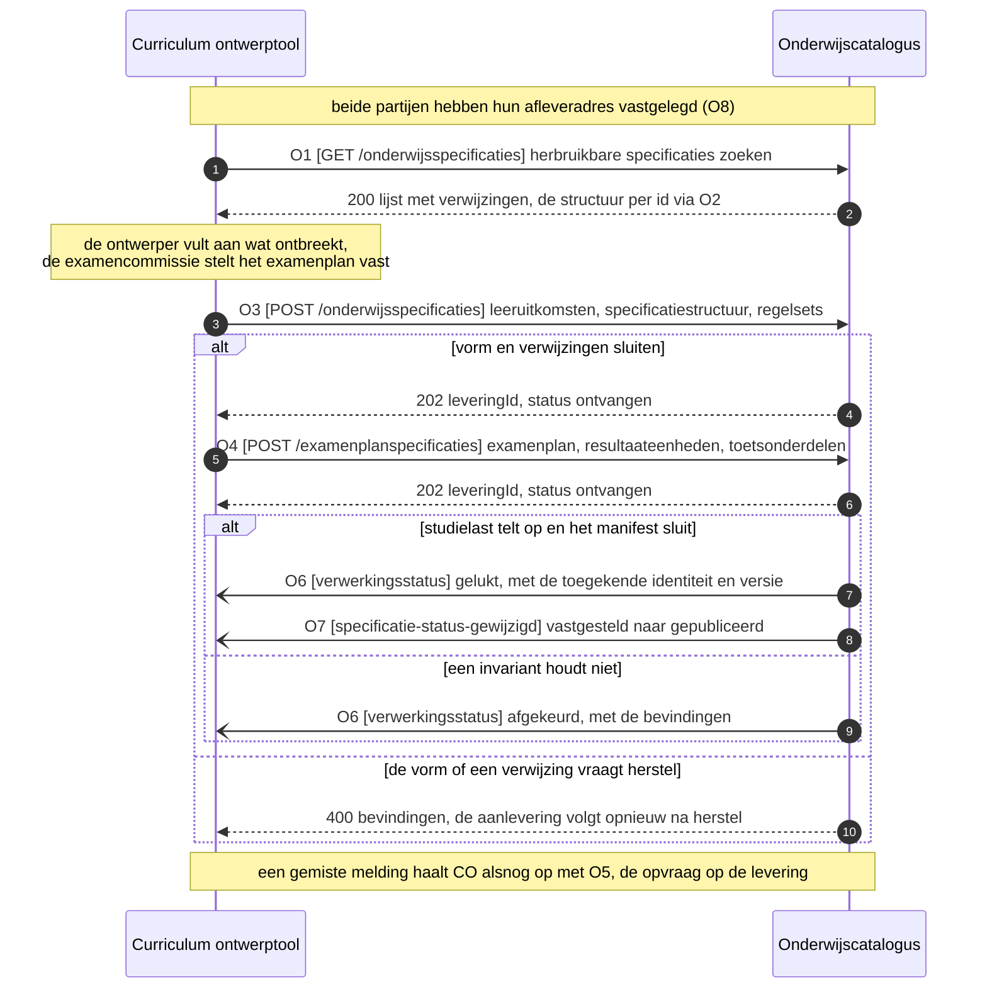

Afkeuring is een geldige uitkomst van de inname. Bij de poort komt zij synchroon terug als 400 met de bevindingen; na aanname komt zij op O6 als `afgekeurd` met dezelfde bevindingen. Het kanaal blijft in beide gevallen staan, en de ontwerptool stelt haar eigen beeld bij op een terminale uitkomst: gelukt, niet gelukt of afgekeurd.

## 3. Operaties en berichtspecificatie

Een operatie is een pad met een methode erop: `GET /onderwijsspecificaties` is er een, `POST /onderwijsspecificaties` een andere. Zij draagt een nummer dat terugkomt in het sequentiediagram hierboven en in de berichtspecificatie hieronder. `CO` is de curriculum ontwerptool, `OC` de onderwijscatalogus.

Een leverancier claimt een dienst, geen operatietabel. Hier staat per dienst wat die claim kost: welke operaties erbij horen, met hun parameters, hun request body en hun responses.

Wie het endpoint bouwt verschilt per patroon, en bij een melding is dat omgekeerd aan wat de naam suggereert.

| Patroon | Wie levert het gegeven | Wie bouwt het endpoint | Wie roept aan |
|---|---|---|---|
| Ophalen | de aanbieder | de aanbieder | de afnemer |
| Aanleveren | de afnemer | de aanbieder | de afnemer |
| Melden | de aanbieder | de afnemer, op haar `callbackUrl` | de aanbieder |

Een query parameter verandert het endpoint niet: het pad blijft gelijk en de parameters komen in de query string. Het contract staat bij de dienst die het endpoint bouwt; de tegenhanger wijst ernaar. De afspraken die voor elke dienst in deze keten gelden, staan in de [interactieketenspecificatie](README.md#5-afspraken-die-elke-dienst-nakomt).

#### onderwijsspecificatiestructuur-aanbieder, bij de onderwijscatalogus


Deze dienst ontsluit de vastgestelde specificatiestructuur en meldt een statuswijziging. Zij draagt daarmee twee patronen.

##### O1 · `GET /onderwijsspecificaties` · ophalen

| | |
|---|---|
| Query parameters | `status` (optioneel, default `gepubliceerd`), `gewijzigdSinds` (optioneel, RFC 3339), `leeruitkomstId` (voorstel, W3) |
| `200 OK` | `application/json`, de [lijst met verwijzingen](#o1-get-onderwijsspecificaties-ophalen) |
| `400 Bad Request` | geen response body; de client corrigeert de parameter en bepaalt de retry |
| Voorbeeld | `GET /onderwijsspecificaties?status=gepubliceerd&gewijzigdSinds=2026-09-01T00:00:00Z` |


**Bericht: de lijst met verwijzingen**

Schema [`specification-reference.json`](https://github.com/Npuls-OKx/Public/blob/dev/Koppelvlakspecificaties/Datamodelschema's/specification-reference.json)

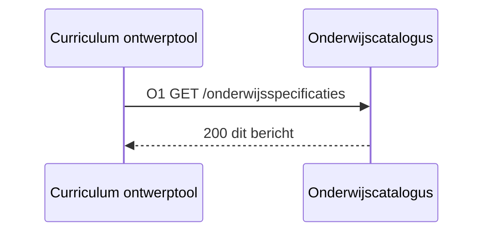

<!-- erd -->
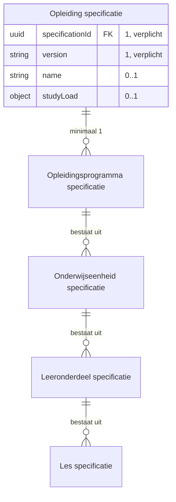

| Lijn | Betekenis |
|---|---|
| `\|\|--o{` | het eerste bestaat uit nul of meer van het tweede |
| `PK` en `FK` | de sleutel van het object, en een verwijzing naar een ander object |
| tekst achter een attribuut | de multipliciteit in dit bericht, en of het veld verplicht is |

<!-- /erd -->

Het antwoord op O1 draagt een verwijzing per specificatie, waarna O2 de structuur per id levert. De [componentpagina van de onderwijscatalogus](https://github.com/Npuls-OKx/Public/blob/dev/Koppelvlakspecificaties/Applicatiecomponenten/onderwijscatalogus.md) legt die vorm vast als een lijst van [specification-reference.json](https://github.com/Npuls-OKx/Public/blob/dev/Informatie-en-gegevensmodellen/schemas/specification-reference.json): een array, zonder omhullend object.

| Veld | Nederlands | Type | Kardinaliteit | Verplicht | Objecttype | Grond |
|---|---|---|---|---|---|---|
| `specificationId` | `specificatieId` | uuid | 1 | ja | `Opleiding specificatie`, de wortel van een herbruikbare structuur | specification-reference.json, verplicht |
| `version` | `versie` | string | 1 | ja | `Opleiding specificatie`, de laatste versie binnen de gevraagde status | specification-reference.json, verplicht |
| `name` | `naam` | string | 0..1 | nee, voorgestelde sleutel bij W3 | `Opleiding specificatie` | W3 vraagt kopmetadata, zodat de keuze voor hergebruik op de belofte van de specificatie rust |
| `studyLoad` | `studielast` | object: `value`, `unit` | 0..1 | nee, voorgestelde sleutel bij W3 | `Opleiding specificatie` | W3, dezelfde grond; de vorm volgt [volume.json](https://github.com/Npuls-OKx/Public/blob/dev/Informatie-en-gegevensmodellen/schemas/volume.json) |

Een array zonder omhulling draagt geen plek voor een vervolgverwijzing of een totaal. Paginering, die W14 van [IS-OA-03](is-oa-03.md#4-werkbrieven-de-issueset-die-hieruit-volgt) vraagt op dezelfde opvraag, komt daarmee op een omhullend object uit: MAJOR voor wie op de array van vandaag valideert. Signalering [S21](signaleringen.md) draagt dat punt.

##### O2 · `GET /onderwijsspecificaties/{id}` · ophalen

| | |
|---|---|
| Query parameters | `versie` (optioneel, default de laatst gepubliceerde) |
| `200 OK` | `application/json`, de volledige structuur ([het bericht](#o3-post-onderwijsspecificaties-aanleveren)) |
| `400 Bad Request` | onbekende versie |
| `404 Not Found` | onbekend `id` |
| Delta | `GET /onderwijsspecificaties/{id}/delta` met `van` en `naar`, beide verplicht; response `application/json-patch+json` (RFC 6902) |


De response draagt dezelfde structuur als de request body van O3: [de onderwijsspecificatiestructuur](#o3-post-onderwijsspecificaties-aanleveren).

##### O7 · webhook `specificatie-status-gewijzigd` · melden

| | |
|---|---|
| Transport | HTTP POST naar de `callbackUrl` die de afnemer met O8 registreerde |
| Request body | [offering-status-changed.json](schemas/offering-status-changed.json) ([het bericht](#o7-webhook-specificatie-status-gewijzigd-melden)) |
| `200 OK` | geen response body; bevestigt de ontvangst, niet het oordeel |
| Bij uitblijven | retry met exponential backoff, daarna dead letter queue |
| Idempotentie | op `eventId`: een herhaalde delivery heeft geen extra effect (W12) |


**Bericht: de statuswijziging**

Schema [`specification-status-changed.json`](https://github.com/Npuls-OKx/Public/blob/dev/Koppelvlakspecificaties/Datamodelschema's/specification-status-changed.json)

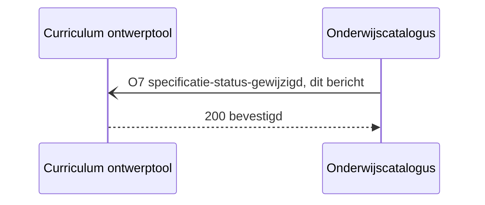

<!-- erd -->
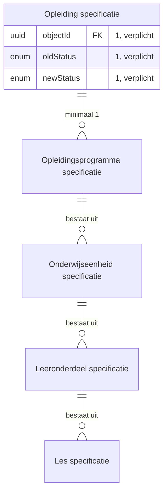

| Lijn | Betekenis |
|---|---|
| `\|\|--o{` | het eerste bestaat uit nul of meer van het tweede |
| `PK` en `FK` | de sleutel van het object, en een verwijzing naar een ander object |
| tekst achter een attribuut | de multipliciteit in dit bericht, en of het veld verplicht is |

<!-- /erd -->

Volgt [specification-status-changed.json](https://github.com/Npuls-OKx/Public/blob/dev/Informatie-en-gegevensmodellen/schemas/specification-status-changed.json).

| Veld | Nederlands | Type | Kardinaliteit | Verplicht | Objecttype | Grond |
|---|---|---|---|---|---|---|
| `objectId` | `objectId` | uuid | 1 | ja | `Opleiding specificatie`, de wortel van de opgenomen structuur | specification-status-changed.json, verplicht |
| `oldStatus` | `oudeStatus` | enum | 1 | ja | `Opleiding specificatie`, `vastgesteld` bij opname | specification-status-changed.json, verplicht; F1-11 zet de wortel op `vastgesteld` |
| `newStatus` | `nieuweStatus` | enum | 1 | ja | `Opleiding specificatie`, `gepubliceerd` zodra de catalogus publiceert | specification-status-changed.json, verplicht; ADR 0020 legt het publicatiebesluit bij de catalogus |
| `eventId` | `eventId` | uuid | 0..1 | nee, voorgestelde sleutel bij W12 | kanaaleigenschap, geen objecttype | U5, herhaalbare verwerking |

#### onderwijsspecificatiestructuur-afnemer, bij de curriculum ontwerptool


Deze dienst roept O1 en O2 aan bij de aanbieder hierboven, en host de `callbackUrl` voor O7 (W2). De parameters en de responses staan daar.

#### onderwijsspecificatie-inname-aanbieder, bij de onderwijscatalogus


Deze dienst neemt een elders ontworpen specificatie aan, stelt haar vast en houdt de uitkomst van de levering opvraagbaar. Het gegeven stroomt hier naar de aanbieder toe, en zij bouwt de endpoints (W1).

##### O3 · `POST /onderwijsspecificaties` · aanleveren

| | |
|---|---|
| Request body | `application/json`, de specificatiestructuur ([het bericht](#o3-post-onderwijsspecificaties-aanleveren)) |
| `202 Accepted` | de levering met haar `leveringId`; het inhoudelijke oordeel volgt asynchroon op O6 |
| `400 Bad Request` | [intake-rejection.json](schemas/intake-rejection.json) met de bevindingen, zodra de vorm of een verwijzing herstel vraagt ([het bericht](#o3-post-onderwijsspecificaties-aanleveren)) |
| `409 Conflict` | de catalogus draagt de wortel al op dezelfde versie |
| Atomiciteit | de levering wordt in haar geheel aangenomen of afgewezen; bij afwijzing blijft de catalogus in de toestand van ervoor |


**Bericht: de onderwijsspecificatiestructuur**

Schema [`education-specification.json`](https://github.com/Npuls-OKx/Public/blob/dev/Koppelvlakspecificaties/Datamodelschema's/education-specification.json) · voorbeeldpayload [`is-oa-01-onderwijsspecificatiestructuur.json`](voorbeeldpayloads/is-oa-01-onderwijsspecificatiestructuur.json)

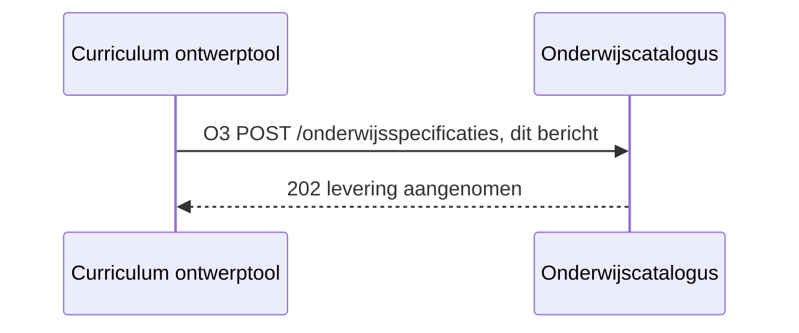

<!-- erd -->
```mermaid
erDiagram
    "Leeronderdeel specificatie" ||--o{ "Les specificatie" : "bestaat uit"
    "Onderwijseenheid specificatie" ||--o{ "Leeronderdeel specificatie" : "bestaat uit"
    "Opleidingsprogramma specificatie" ||--o{ "Onderwijseenheid specificatie" : "bestaat uit"
    "Summatieve resultaat structuur" ||--o{ "Examenonderdeel weging" : "bestaat uit"
    "Summatieve resultaat structuur" ||--o{ "Toetsonderdeel specificatie" : "bestaat uit"
    "Cohort / periode" }o--o{ "Summatieve resultaat structuur" : "Groepeert Studenten op toepasbare"
    "Keuzedeel" }o--o{ "Keuzedeelruimte" : "hangt samen met"
    "Leeronderdeel specificatie" }o--o{ "Leeruitkomst" : "hangt samen met"
    "Leeruitkomst" }o--o{ "Student keuze regelset" : "voorwaarde op"
    "Les specificatie" }o--o{ "Leeruitkomst" : "hangt samen met"
    "Onderwijseenheid specificatie" }o--o{ "Leeruitkomst" : "hangt samen met"
    "Opleiding specificatie" }o--o{ "Leeruitkomst" : "hangt samen met"
    "Opleidingsprogramma specificatie" }o--o{ "Leeruitkomst" : "hangt samen met"
    "Organisatie-eenheid" }o--o{ "Leeronderdeel specificatie" : "Voert uit"
    "Organisatie-eenheid" }o--o{ "Les specificatie" : "Voert uit"
    "Organisatie-eenheid" }o--o{ "Onderwijseenheid specificatie" : "Voert uit"
    "Organisatie-eenheid" }o--o{ "Opleiding specificatie" : "Voert uit"
    "Organisatie-eenheid" }o--o{ "Opleidingsprogramma specificatie" : "Voert uit"
    "Organisatie-eenheid" }o--o{ "Toetsonderdeel specificatie" : "Voert uit"
    "Student keuze regelset" }o--o{ "Keuzedeel" : "hangt samen met"
    "Student keuze regelset" }o--o{ "Keuzedeelruimte" : "hangt samen met"
    "Student keuze regelset" }o--o{ "Leeronderdeel specificatie" : "hangt samen met"
    "Student keuze regelset" }o--o{ "Les specificatie" : "hangt samen met"
    "Student keuze regelset" }o--o{ "Onderwijseenheid specificatie" : "hangt samen met"
    "Student keuze regelset" }o--o{ "Opleiding specificatie" : "hangt samen met"
    "Student keuze regelset" }o--o{ "Opleidingsprogramma specificatie" : "hangt samen met"
    "Summatieve resultaat structuur" }o--o{ "Leeruitkomst" : "hangt samen met"
    "Toetsonderdeel specificatie" }o--o{ "Leeruitkomst" : "hangt samen met"
    "Opleiding specificatie" ||--o{ "Opleidingsprogramma specificatie" : "minimaal 1"
    "Keuzedeel" ||--|| "Opleidingsprogramma specificatie" : "is een"
    "Keuzedeelruimte" ||--|| "Opleidingsprogramma specificatie" : "is een"
    "Opleiding specificatie" {
        enum curriculumType "0..1"
        string description "0..1"
        uuid id PK "1..1"
        uuid learningOutcomeId FK "0..1"
        array manifest FK "0..n"
        uuid manifest[].specificationId FK "0..n"
        string manifest[].version "0..n"
        string name "1..1"
        uuid parentSpecificationId FK "1..1"
        array ruleSetReferences FK "0..n"
        enum specificationType "1..1"
        enum status "0..1"
        object studyLoad "1..1"
        number studyLoad.value "1..1"
        date validFrom "0..1"
        date validUntil "0..1"
        string version "1..1"
    }
    "Opleidingsprogramma specificatie" {
        enum curriculumType "0..1"
        string programmeType "0..1, verplicht"
        enum programmeLayer "0..1, verplicht"
        enum learningPathway "0..1, verplicht"
        string targetGroup "0..1, verplicht"
        string cohort FK "0..1"
        string description "0..1"
        uuid id PK "1..1"
        uuid learningOutcomeId FK "0..1"
        array manifest FK "0..n"
        uuid manifest[].specificationId FK "0..n"
        string manifest[].version "0..n"
        string name "1..1"
        object organisation FK "0..1"
        uuid parentSpecificationId FK "1..1"
        array ruleSetReferences FK "0..n"
        enum specificationType "1..1"
        date startDate "0..1"
        enum status "0..1"
        object studyLoad "1..1"
        number studyLoad.value "1..1"
        date validFrom "0..1"
        date validUntil "0..1"
        string version "1..1"
    }
    "Keuzedeel" {
        string programmeType "0..1, verplicht"
        string electiveUnitClass "0..1, verplicht"
        string description "0..1"
        uuid id PK "1..1"
        uuid learningOutcomeId FK "0..1"
        string name "1..1"
        enum specificationType "1..1"
        enum status "0..1"
        object studyLoad "1..1"
        number studyLoad.value "1..1"
        string version "1..1"
    }
    "Onderwijseenheid specificatie" {
        string description "0..1"
        string explanation "0..1"
        uuid id PK "1..1"
        uuid learningOutcomeId FK "0..1"
        uuid manifest[].specificationId FK "0..n"
        string manifest[].version "0..n"
        string name "1..1"
        uuid parentSpecificationId FK "1..1"
        enum specificationType "1..1"
        enum status "0..1"
        object studyLoad "1..1"
        number studyLoad.value "1..1"
        string version "1..1"
    }
    "Leeronderdeel specificatie" {
        string timeDistribution "0..1"
        string description "0..1"
        string explanation "0..1"
        uuid id PK "1..1"
        uuid learningOutcomeId FK "0..1"
        string name "1..1"
        uuid parentSpecificationId FK "1..1"
        enum specificationType "1..1"
        enum status "0..1"
        object studyLoad "1..1"
        number studyLoad.value "1..1"
        string version "1..1"
    }
    "Keuzedeelruimte" {
        string description "0..1"
        uuid id PK "1..1"
        string name "1..1"
        uuid parentSpecificationId FK "1..1"
        array ruleSetReferences FK "0..n"
        enum specificationType "1..1"
        enum status "0..1"
        object studyLoad "1..1"
        number studyLoad.value "1..1"
        string version "1..1"
    }
    "Leeruitkomst" {
        uuid learningOutcomeId FK "0..1, verplicht"
        array learningOutcomes "0..n"
    }
    "Student keuze regelset" {
        array ruleSetReferences "0..n, verplicht"
        array ruleSets "0..n"
    }
    "Cohort / periode" {
        string cohort "0..1, verplicht"
    }
    "Toetsonderdeel specificatie" { }
    "Summatieve resultaat structuur" { }
    "Organisatie-eenheid" { }
    "Les specificatie" { }
    "Examenonderdeel weging" { }
```

| Lijn | Betekenis |
|---|---|
| `\|\|--o{` | het eerste bestaat uit nul of meer van het tweede |
| `\|\|--\|\|` | het tweede is een soort van het eerste |
| `}o--o{` | de twee hangen samen, met het opschrift erbij |
| `PK` en `FK` | de sleutel van het object, en een verwijzing naar een ander object |
| tekst achter een attribuut | de multipliciteit in dit bericht, en of het veld verplicht is |

<!-- /erd -->

Volgt [education-specification.json](https://github.com/Npuls-OKx/Public/blob/dev/Informatie-en-gegevensmodellen/schemas/education-specification.json). Het `specificationType` bepaalt het objecttype.

| `specificationType` | Objecttype | Instantie in F1-12 |
|---|---|---|
| `opleidingsspecificatie` | `Opleiding specificatie` | Apothekersassistent |
| `opleidingsprogrammaspecificatie` | `Opleidingsprogramma specificatie`, en `Keuzedeel` bij `programmeType` `keuzedeelprogramma` | BOL voltijd, Regulier BOL 2026 |
| `onderwijseenheidspecificatie` | `Onderwijseenheid specificatie` | Blok B1-K1 |
| `leeronderdeelspecificatie` | `Leeronderdeel specificatie` | Baliegesprekken 101 |
| `keuzedeelruimtespecificatie` | `Keuzedeelruimte` | 720 SBU, mbo-4 |

| Veld | Nederlands | Type | Kardinaliteit | Verplicht | Objecttype | Grond |
|---|---|---|---|---|---|---|
| `id` | `id` | uuid | 1 | ja | het objecttype uit de tabel hierboven | education-specification.json, verplicht |
| `specificationType` | `specificatieType` | enum | 1 | ja | idem | education-specification.json verplicht; het informatiemodel verbijzondert `Keuzedeelruimte` en `Keuzedeel` uit `Opleidingsprogramma specificatie` |
| `version` | `versie` | string, semver | 1 | ja | idem, W4 en W10 | education-specification.json verplicht; regels.md legt de versie-uitgifte bij de catalogus |
| `parentSpecificationId` | `bovenliggendSpecificatieId` | uuid of null | 1 | ja | de aggregatie tussen de specificatie-objecttypen | education-specification.json verplicht; het informatiemodel aggregeert programma naar eenheid naar leeronderdeel, en `Opleiding specificatie` componeert minimaal een programma |
| `learningOutcomeId` | `leeruitkomstId` | uuid | 0..1 | ja in deze stroom, buiten `keuzedeelruimtespecificatie` om (W5) | `Leeruitkomst` | ontwerpkeuze 1; elke specificatielaag draagt een associatie naar `Leeruitkomst` |
| `name` | `naam` | string | 1 | ja | het objecttype uit de tabel hierboven | education-specification.json, verplicht |
| `studyLoad` | `studielast` | object: `value` plus `unit` | 1 | ja | idem, telt bottom-up op binnen onderdeel-van | education-specification.json verplicht, de vorm in volume.json; regels.md, aggregatie-invariant |
| `status` | `status` | enum | 1 | ja in deze stroom: `vastgesteld` bij aanlevering | idem | education-specification.json optioneel; ADR 0020 en F1-11 laten de wortel vastgesteld aankomen |
| `manifest` | `manifest` | array van `specificationId`, `version`, `relation` | 0..n | ja zodra er onderdelen of varianten zijn | de gepinde versie per onderdeel | de vorm in [manifest-item.json](https://github.com/Npuls-OKx/Public/blob/dev/Informatie-en-gegevensmodellen/schemas/manifest-item.json); regels.md, momentopname en manifest |
| `ruleSetReferences` | `regelsetVerwijzingen` | array uuid | 0..n | ja op de keuzedeelruimte | `Student keuze regelset` | regels.md, keuzedelen staan als wortel en zijn bereikbaar via de regelset; het informatiemodel verbindt `Student keuze regelset` met `Keuzedeelruimte` |
| `description` | `omschrijving` | string | 0..1 | nee | het objecttype uit de tabel hierboven | education-specification.json, optioneel |
| `curriculumType` | `curriculumtype` | enum `nominaal`, `hybride`, `flexibel` | 0..1 | nee | `Opleiding specificatie`, `Opleidingsprogramma specificatie` | education-specification.json optioneel; F1-12 draagt Apothekersassistent als nominaal |
| `programmeType` | `programmatype` | string, open lijst | 0..1 | ja op een programma | `Opleidingsprogramma specificatie`, `Keuzedeel` | education-specification.json optioneel, met `keuzedeelprogramma` in de open lijst |
| `programmeLayer` | `programmaLaag` | enum `leerweg`, `doelgroep` | 0..1 | ja op een programma | `Opleidingsprogramma specificatie` | education-specification.json optioneel; het informatiemodel aggregeert `Opleidingsprogramma specificatie` op zichzelf, wat de twee lagen draagt |
| `learningPathway` | `leerweg` | enum `BOL`, `BBL` | 0..1 | ja op een programma | `Opleidingsprogramma specificatie` | education-specification.json optioneel; F1-12 draagt BOL voltijd |
| `targetGroup` | `doelgroep` | string, open lijst | 0..1 | ja op de doelgroeplaag | `Opleidingsprogramma specificatie` | education-specification.json optioneel; de casus draagt Regulier BOL 2026 |
| `electiveUnitClass` | `keuzedeelKlasse` | string, open lijst | 0..1 | ja op een keuzedeelprogramma | `Keuzedeel` | education-specification.json optioneel; de regelset selecteert op deze klasse |
| `cohort` | `cohort` | string | 0..1 | ja op de doelgroeplaag | `Cohort / periode` | education-specification.json optioneel; het informatiemodel laat `Cohort / periode` studenten groeperen op de toepasbare resultaatstructuur |
| `startDate`, `validFrom`, `validUntil` | `startdatum`, `geldigVanaf`, `geldigTot` | date | 0..1 elk | ja op de doelgroeplaag | geldigheid per ontwerpkeuze 16 | education-specification.json optioneel; regels.md laat temporele geldigheid via deze velden lopen |
| `timeDistribution` | `tijdsverdeling` | string, open lijst BOT, OOT, BPV | 0..1 | nee | `Leeronderdeel specificatie` | education-specification.json, optioneel |

**Bericht: de leeruitkomsten uit het kwalificatiekader**

Schema [`learning-outcome.json`](https://github.com/Npuls-OKx/Public/blob/dev/Koppelvlakspecificaties/Datamodelschema's/learning-outcome.json) · voorbeeldpayload [`is-oa-01-onderwijsspecificatiestructuur.json`](voorbeeldpayloads/is-oa-01-onderwijsspecificatiestructuur.json)


<!-- erd -->
```mermaid
erDiagram
    "Kerntaak" ||--o{ "Werkproces" : "bestaat uit"
    "Kwalificatie" ||--o{ "Kerntaak" : "bestaat uit"
    "Kwalificatie dossier" ||--o{ "Kwalificatie" : "bevat"
    "Kerntaak" }o--o{ "Leeruitkomst" : "Wordt vertaald naar"
    "Kwalificatie" }o--o{ "Leeruitkomst" : "Wordt vertaald naar"
    "Kwalificatie dossier" }o--o{ "Leeruitkomst" : "Wordt vertaald naar"
    "Werkproces" }o--o{ "Leeruitkomst" : "Wordt vertaald naar"
    "Leeruitkomst" {
        uuid id PK "1, verplicht"
        string version "1, verplicht"
        string name "1, verplicht"
        uuid parentLearningOutcomeId FK "1, verplicht"
        array indicativeVolume "1..n, verplicht"
        integer nlqfLevel "0..1"
        string description "0..1, 0..1, 0..n"
        array behaviour "0..n"
        number indicativeVolume[].value "1..n"
        string result "0..1"
        object source FK "1..1"
        string taxonomyCode "0..1"
    }
    "Kwalificatie dossier" {
        object source "1, verplicht"
    }
    "Kwalificatie" {
        object source "1, verplicht"
    }
    "Kerntaak" {
        object source "1, verplicht"
    }
    "Werkproces" {
        object source "1, verplicht"
    }
    "Keuzedeel" {
        object source "1, verplicht"
    }
    "Waarde document (diploma / certificaat)" {
        string credentialDocument "0..1"
    }
```

| Lijn | Betekenis |
|---|---|
| `\|\|--o{` | het eerste bestaat uit nul of meer van het tweede |
| `}o--o{` | de twee hangen samen, met het opschrift erbij |
| `PK` en `FK` | de sleutel van het object, en een verwijzing naar een ander object |
| tekst achter een attribuut | de multipliciteit in dit bericht, en of het veld verplicht is |

<!-- /erd -->

Volgt [learning-outcome.json](https://github.com/Npuls-OKx/Public/blob/dev/Informatie-en-gegevensmodellen/schemas/learning-outcome.json).

| Veld | Nederlands | Type | Kardinaliteit | Verplicht | Objecttype | Grond |
|---|---|---|---|---|---|---|
| `id` | `id` | uuid | 1 | ja | `Leeruitkomst` | learning-outcome.json, verplicht |
| `version` | `versie` | string, semver | 1 | ja | `Leeruitkomst` | learning-outcome.json verplicht, patroon `n.n.n` |
| `name` | `naam` | string | 1 | ja | `Leeruitkomst`, in de stem van de instelling | learning-outcome.json verplicht; `Kerntaak` en `Werkproces` dragen de relatie `Wordt vertaald naar` richting `Leeruitkomst` |
| `source` | `bron` | object: `standard`, `type`, `code` | 1 | ja | `Kwalificatie dossier`, `Kwalificatie`, `Kerntaak`, `Werkproces`, `Keuzedeel`, via het `type` | learning-outcome.json verplicht, de vorm in [source.json](https://github.com/Npuls-OKx/Public/blob/dev/Informatie-en-gegevensmodellen/schemas/source.json) |
| `parentLearningOutcomeId` | `bovenliggendLeeruitkomstId` | uuid of null | 1 | ja | `Leeruitkomst`, de aggregatie tussen de niveaus | learning-outcome.json verplicht; het informatiemodel aggregeert `Leeruitkomst` op zichzelf |
| `indicativeVolume` | `indicatieveOmvang` | array van `value` plus `unit` SBU of EC | 1..n | ja | `Leeruitkomst` | learning-outcome.json verplicht, de vorm in [volume.json](https://github.com/Npuls-OKx/Public/blob/dev/Informatie-en-gegevensmodellen/schemas/volume.json); [ADR 0004](https://github.com/Npuls-OKx/Public/blob/dev/Referentiemateriaal/adr/0004-leeruitkomsten-sbu-ec-logistieke-containergrootte.md) |
| `nlqfLevel` | `nlqfNiveau` | integer 1 tot 8 | 0..1 | nee | `Leeruitkomst`, draagt het mbo-niveau van de keuzedeelruimte | learning-outcome.json optioneel; F1-12 draagt de keuzedeelruimte als 720 SBU op mbo-4 |
| `credentialDocument` | `waardedocument` | string | 0..1 | nee | `Waarde document (diploma / certificaat)` | learning-outcome.json optioneel; het informatiemodel verbindt het waardedocument aan het `Summatief Afrondingscriterium` |
| `description`, `result`, `behaviour` | `omschrijving`, `resultaat`, `gedrag` | string, string, array string | 0..1, 0..1, 0..n | nee | `Leeruitkomst` | learning-outcome.json optioneel; [gebruiksprofielen.md](https://github.com/Npuls-OKx/Public/blob/dev/Informatie-en-gegevensmodellen/gebruiksprofielen.md) vraagt deze velden voor het leermanagementsysteem |

`Competenties / Skills` met `Vaardigheid`, `Kennis` en `Inzicht` eronder zijn de verdieping die F1-12 meestuurt en krijgen hun veld via [W6](#4-werkbrieven-de-issueset-die-hieruit-volgt).

**Bericht: de studentkeuzeregelsets**

Schema [`student-choice-rule.json`](schemas/student-choice-rule.json) · voorbeeldpayload [`is-oa-01-onderwijsspecificatiestructuur.json`](voorbeeldpayloads/is-oa-01-onderwijsspecificatiestructuur.json)


<!-- erd -->
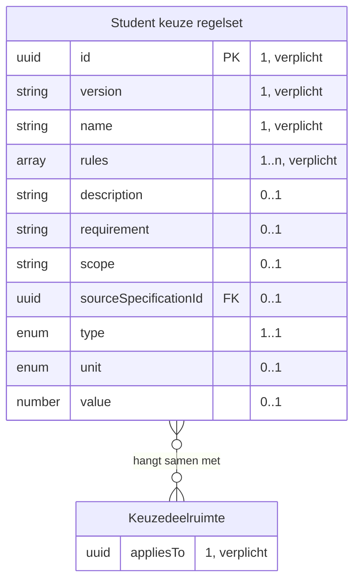

| Lijn | Betekenis |
|---|---|
| `}o--o{` | de twee hangen samen, met het opschrift erbij |
| `PK` en `FK` | de sleutel van het object, en een verwijzing naar een ander object |
| tekst achter een attribuut | de multipliciteit in dit bericht, en of het veld verplicht is |

<!-- /erd -->

Volgt [rule-set.json](https://github.com/Npuls-OKx/Public/blob/dev/Informatie-en-gegevensmodellen/schemas/rule-set.json).

| Veld | Nederlands | Type | Kardinaliteit | Verplicht | Objecttype | Grond |
|---|---|---|---|---|---|---|
| `id` | `id` | uuid | 1 | ja | `Student keuze regelset` | rule-set.json, verplicht |
| `version` | `versie` | string | 1 | ja | `Student keuze regelset` | rule-set.json, verplicht |
| `name` | `naam` | string | 1 | ja | `Student keuze regelset` | rule-set.json, verplicht |
| `appliesTo` | `vanToepassingOp` | uuid | 1 | ja | `Keuzedeelruimte` | rule-set.json verplicht; het informatiemodel verbindt `Student keuze regelset` met `Keuzedeelruimte` |
| `rules` | `regels` | array object, de vorm in [student-choice-rule.json](schemas/student-choice-rule.json) | 1..n | ja | `Student keuze regelset`, getypeerde vorm | rule-set.json verplicht, met het regelobject vrij; regels.md laat de voorwaarde vooraf in behaalde leeruitkomsten uitdrukken |
| `description` | `omschrijving` | string | 0..1 | nee | `Student keuze regelset` | rule-set.json, optioneel |

rule-set.json laat het regelobject vrij: elke sleutel binnen een regel staat daar buiten elk schema. Deze eenheid typeert dat object in [student-choice-rule.json](schemas/student-choice-rule.json), een overlay op rule-set.json die de regelset zelf onaangeroerd laat, en belegt de overname bij W9. Dezelfde namen gelden in [IS-OA-03](is-oa-03.md) en staan bij elkaar in [casus.md](casus.md#de-regelsets); de Nederlandse namen volgen de voorbeeldpayloads in Public.

| Veld | Nederlands | Wat zij draagt | Grond |
|---|---|---|---|
| `type` | `type` | het regeltype uit de gesloten set | [regelset-payload.md](../student-keuze/regelset-payload.md), de gesloten set regeltypen |
| `scope` | `bereik` | waar de regel over gaat | regelset-payload.md, benoemde bereiken met een opsomming of een selectie op een specificatie-attribuut |
| `electiveUnit` | `keuzedeel` | het keuzedeel waarop de regel slaat | het informatiemodel verbindt `Student keuze regelset` met `Keuzedeel` |
| `precondition` | `voorwaardeVooraf` | de deelnamevoorwaarde, met `requiredLearningOutcomeId` en `status` eronder | het informatiemodel draagt `Leeruitkomst` als voorwaarde op `Student keuze regelset`; regels.md drukt de voorwaarde in behaalde leeruitkomsten uit |
| `value` plus `unit` | `waarde` plus `eenheid` | de maat bij een omvangregel | de vorm van volume.json; F1-12 draagt de keuzedeelruimte als 720 SBU |
| `requirement` | `eis` | het resultaat dat de regel verlangt | de schaal `voldoende-onvoldoende` in [result-model.json](https://github.com/Npuls-OKx/Public/blob/dev/Informatie-en-gegevensmodellen/schemas/result-model.json) |
| `sourceSpecificationId` | `bronSpecificatieId` | de specificatie waaruit de maat komt | de `studyLoad` van de keuzedeelruimte in education-specification.json |

De sleutel `source` (`bron`) blijft daarmee de vorm van [source.json](https://github.com/Npuls-OKx/Public/blob/dev/Informatie-en-gegevensmodellen/schemas/source.json) op de leeruitkomst: een object met `standard`, `type` en `code`.

**Bericht: de afkeuring bij de poort**

Schema [`intake-rejection.json`](schemas/intake-rejection.json) · voorbeeldpayload [`is-oa-01-afkeuring-bij-de-poort.json`](voorbeeldpayloads/is-oa-01-afkeuring-bij-de-poort.json)

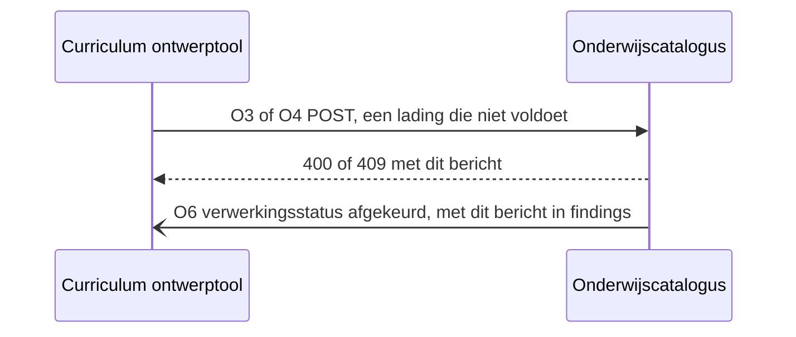

<!-- erd -->
Dit bericht draagt geen objecttype uit het informatiemodel: de velden zijn eigenschappen van het contract.
<!-- /erd -->

Een bevinding zegt op welke grond de catalogus een aanlevering afkeurt. Bij de poort staat zij in het response body van O3 en O4, de vorm in [intake-rejection.json](schemas/intake-rejection.json); na aanname staat zij in `findings` op O6. Het item volgt [intake-finding.json](schemas/intake-finding.json).

| Veld | Nederlands | Type | Kardinaliteit | Verplicht | Objecttype | Grond |
|---|---|---|---|---|---|---|
| `code` | `code` | enum, de codes uit 3.3 | 1 | ja | contracteigenschap, geen objecttype | de invarianten in regels.md, de vorm van `code` in [bottleneck.json](https://github.com/Npuls-OKx/Public/blob/dev/Informatie-en-gegevensmodellen/schemas/bottleneck.json) |
| `description` | `omschrijving` | string | 1 | ja | contracteigenschap | bottleneck.json, verplicht |
| `location` | `locatie` | string, JSON Pointer (RFC 6901) | 0..1 | ja zodra de bevinding een element in de lading raakt | contracteigenschap | de lading is een plat document met arrays ([U7](https://github.com/Npuls-OKx/Public/blob/dev/Koppelvlakspecificaties/uitgangspunten.md#u7-payload-plat-met-verwijzingen-en-de-sleutelconventie)), dus wijst een pointer de plek aan |
| `involvedSpecificationIds` | `betrokkenSpecificatieIds` | array uuid | 0..n | ja op een bevinding over de structuur | de specificatie-objecttypen | bottleneck.json draagt dezelfde sleutel |
| `expectedValue`, `foundValue` | `verwachteWaarde`, `aangetroffenWaarde` | string, string | 0..1 elk | ja op `studielastTeltNietOp` en `manifestMismatch` | contracteigenschap | de aggregatie-invariant en de manifestpin in regels.md gaan over twee waarden die gelijk horen te zijn |

De uitkomst zodra de levering de onderwijseenheid aanlevert zonder al haar leeronderdelen:

Voorbeeldpayload: [`is-oa-01-verwerkingsstatus-afgekeurd.json`](voorbeeldpayloads/is-oa-01-verwerkingsstatus-afgekeurd.json)

Dit is wat de catalogus zegt over de uitsnede in paragraaf 5: die payload toont de lijn van kerntaak B1-K1 met een leeronderdeel, en een complete levering draagt ook Medicatiebewaking en de overige kerntaken.

Bij de poort staat de afkeuring zonder levering, hier op een ontbrekende leeruitkomst:

Voorbeeldpayload: [`is-oa-01-afkeuring-bij-de-poort.json`](voorbeeldpayloads/is-oa-01-afkeuring-bij-de-poort.json)

##### O4 · `POST /examenplanspecificaties` · aanleveren

| | |
|---|---|
| Request body | `application/json`, de resultaatstructuur ([het bericht](#o4-post-examenplanspecificaties-aanleveren)) |
| `202 Accepted` | als O3 |
| `400 Bad Request` | als O3. Een `appliesTo` naar een opleidingsprogrammaspecificatie buiten de catalogus geeft code `verwijzingOnbekend`: O3 gaat voor |
| `409 Conflict` | als O3 |
| Naamgeving | de resource heet naar het examenplan en draagt een resultaatstructuur ([S28](signaleringen.md)) |


**Bericht: de resultaatstructuur**

Schema [`result-structure.json`](https://github.com/Npuls-OKx/Public/blob/dev/Koppelvlakspecificaties/Datamodelschema's/result-structure.json) · voorbeeldpayload [`is-oa-01-resultaatstructuur.json`](voorbeeldpayloads/is-oa-01-resultaatstructuur.json)

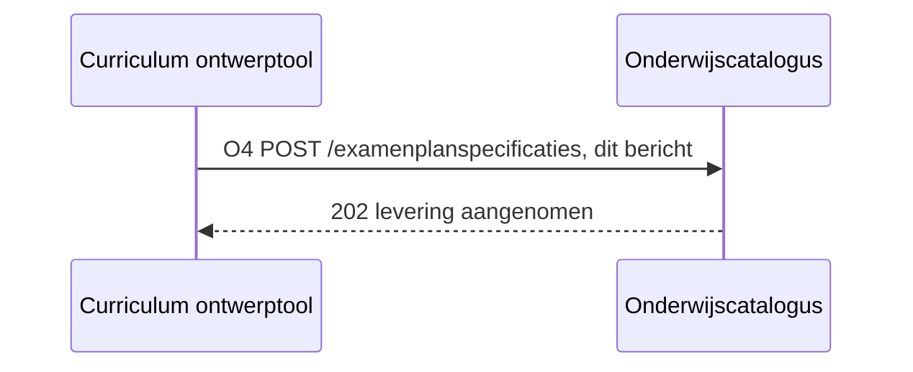

<!-- erd -->
```mermaid
erDiagram
    "Formatieve resultaat structuur" ||--o{ "Toetsonderdeel specificatie" : "bestaat uit"
    "Formatieve resultaat structuur" ||--o{ "Toetsonderdeel weging" : "bestaat uit"
    "Kerntaak" ||--o{ "Werkproces" : "bestaat uit"
    "Kwalificatie" ||--o{ "Kerntaak" : "bestaat uit"
    "Leeronderdeel specificatie" ||--o{ "Les specificatie" : "bestaat uit"
    "Onderwijseenheid specificatie" ||--o{ "Leeronderdeel specificatie" : "bestaat uit"
    "Opleidingsprogramma specificatie" ||--o{ "Onderwijseenheid specificatie" : "bestaat uit"
    "Summatieve resultaat structuur" ||--o{ "Examenonderdeel weging" : "bestaat uit"
    "Summatieve resultaat structuur" ||--o{ "Toetsonderdeel specificatie" : "bestaat uit"
    "Examenonderdeel weging" }o--o{ "Examenonderdeelspecificatie" : "hangt samen met"
    "Examenonderdeelspecificatie" }o--o{ "Leeruitkomst" : "hangt samen met"
    "Examenplan" }o--o{ "Kerntaak" : "hangt samen met"
    "Examenplan" }o--o{ "Summatieve resultaat structuur" : "kent"
    "Kerntaak" }o--o{ "Leeruitkomst" : "Wordt vertaald naar"
    "Kwalificatie" }o--o{ "Leeruitkomst" : "Wordt vertaald naar"
    "Leeronderdeel specificatie" }o--o{ "Leeruitkomst" : "hangt samen met"
    "Leeruitkomst" }o--o{ "Student keuze regelset" : "voorwaarde op"
    "Les specificatie" }o--o{ "Leeruitkomst" : "hangt samen met"
    "Onderwijseenheid specificatie" }o--o{ "Leeruitkomst" : "hangt samen met"
    "Opleidingsprogramma specificatie" }o--o{ "Leeruitkomst" : "hangt samen met"
    "Student keuze regelset" }o--o{ "Keuzedeelruimte" : "hangt samen met"
    "Student keuze regelset" }o--o{ "Leeronderdeel specificatie" : "hangt samen met"
    "Student keuze regelset" }o--o{ "Les specificatie" : "hangt samen met"
    "Student keuze regelset" }o--o{ "Onderwijseenheid specificatie" : "hangt samen met"
    "Student keuze regelset" }o--o{ "Opleidingsprogramma specificatie" : "hangt samen met"
    "Summatieve resultaat structuur" }o--o{ "Leeruitkomst" : "hangt samen met"
    "Summatieve resultaat structuur" }o--o{ "Summatief Afrondingscriterium" : "hangt samen met"
    "Toetsonderdeel specificatie" }o--o{ "Leeruitkomst" : "hangt samen met"
    "Toetsonderdeel weging" }o--o{ "Toetsonderdeel specificatie" : "hangt samen met"
    "Werkproces" }o--o{ "Leeruitkomst" : "Wordt vertaald naar"
    "Examenonderdeelspecificatie" ||--|| "Toetsonderdeel specificatie" : "is van het soort"
    "Keuzedeelruimte" ||--|| "Opleidingsprogramma specificatie" : "is een"
    "Summatieve resultaat structuur" {
        object resultModel "1, verplicht"
        enum nature "0..1, verplicht"
        uuid appliesTo FK "0..1, verplicht op het examenplan"
        uuid assesses FK "0..1, verplicht op een resultaateenheid"
        string description "0..1"
        uuid id PK "1..1"
        object learningOutcome FK "0..1"
        uuid learningOutcomeId FK "0..1, verplicht buiten de keuzedeel-resultaateenheid om"
        array manifest FK "0..n, verplicht zodra er onderdelen zijn"
        uuid manifest[].specificationId FK "0..n"
        string manifest[].version "0..n"
        string name "1..1"
        uuid parentSpecificationId FK "1..1"
        array ruleSetReferences FK "0..n, verplicht op de keuzedeel-resultaateenheid"
        enum specificationType "1..1"
        string status "1..1"
        date validFrom "0..1, verplicht op het examenplan"
        date validUntil "0..1, verplicht op het examenplan"
        string version "1..1"
    }
    "Examenplan" { }
    "Examenonderdeel weging" {
        number weighting "0..1, verplicht"
    }
    "Toetsonderdeel weging" {
        number weighting "0..1, verplicht"
    }
    "Toetsonderdeel specificatie" {
        string assessmentForm "0..1, verplicht"
        string description "0..1"
        uuid id PK "1..1"
        object learningOutcome FK "0..1"
        uuid learningOutcomeId FK "0..1, verplicht op een toetsonderdeel"
        string name "1..1"
        enum nature "0..1, verplicht op een toetsonderdeel"
        uuid parentSpecificationId FK "1..1"
        object resultModel "1..1"
        enum specificationType "1..1"
        string status "1..1"
        string version "1..1"
    }
    "Examenonderdeelspecificatie" {
        string assessmentForm "0..1, verplicht"
        string establishedBy "0..1"
    }
    "Opleidingsprogramma specificatie" {
        uuid appliesTo "0..1, verplicht"
    }
    "Onderwijseenheid specificatie" {
        uuid assesses "0..1, verplicht"
    }
    "Keuzedeelruimte" {
        uuid assesses "0..1, verplicht"
    }
    "Leeruitkomst" {
        uuid learningOutcomeId FK "0..1, verplicht"
    }
    "Kerntaak" {
        object learningOutcome "0..1"
    }
    "Werkproces" {
        object learningOutcome "0..1"
    }
    "Kwalificatie" {
        object learningOutcome "0..1"
    }
    "Formatieve resultaat structuur" {
        enum nature "0..1, verplicht"
        integer decimalPlaces "0..1"
        number passMark "0..1"
        object resultModel "1..1"
        string scale "0..1"
    }
    "Summatief Afrondingscriterium" {
        enum aggregation "0..1, verplicht"
        boolean mandatory "0..1, verplicht"
        array ruleSetReferences FK "0..n"
    }
    "Student keuze regelset" {
        array ruleSetReferences "0..n, verplicht"
    }
    "Leeronderdeel specificatie" { }
    "Les specificatie" { }
```

| Lijn | Betekenis |
|---|---|
| `\|\|--o{` | het eerste bestaat uit nul of meer van het tweede |
| `\|\|--\|\|` | het tweede is een soort van het eerste |
| `}o--o{` | de twee hangen samen, met het opschrift erbij |
| `PK` en `FK` | de sleutel van het object, en een verwijzing naar een ander object |
| tekst achter een attribuut | de multipliciteit in dit bericht, en of het veld verplicht is |

<!-- /erd -->

Volgt [result-structure.json](https://github.com/Npuls-OKx/Public/blob/dev/Informatie-en-gegevensmodellen/schemas/result-structure.json).

| `specificationType` | Objecttype | Instantie in F1-12 |
|---|---|---|
| `examenplanspecificatie` | `Summatieve resultaat structuur`, met `Examenplan` als vastgesteld geheel | Resultaatstructuur Apothekersassistent |
| `resultaateenheidspecificatie` | drager van `Examenonderdeel weging` en `Toetsonderdeel weging`, zonder eigen objecttype (W11) | Resultaat kerntaak B1-K1, Resultaat keuzedelen |
| `toetsonderdeelspecificatie` | `Toetsonderdeel specificatie`, en `Examenonderdeelspecificatie` bij een examen-toetsvorm | Praktijktoets baliegesprek (OSCE), Proeve van bekwaamheid B1-K1 |

| Veld | Nederlands | Type | Kardinaliteit | Verplicht | Objecttype | Grond |
|---|---|---|---|---|---|---|
| `id` | `id` | uuid | 1 | ja | het objecttype uit de tabel hierboven | result-structure.json, verplicht |
| `specificationType` | `specificatieType` | enum | 1 | ja | idem | result-structure.json, verplicht |
| `version` | `versie` | string, semver | 1 | ja | idem | result-structure.json verplicht, patroon `n.n.n` |
| `parentSpecificationId` | `bovenliggendSpecificatieId` | uuid of null | 1 | ja | de aggregatie binnen de resultaatstructuur | result-structure.json verplicht; het informatiemodel aggregeert `Summatieve resultaat structuur` op zichzelf en naar `Toetsonderdeel specificatie` |
| `name` | `naam` | string | 1 | ja | idem | result-structure.json, verplicht |
| `status` | `status` | string | 1 | ja | idem, `concept` bij de formatieve structuur | result-structure.json verplicht; F1-11 zet examenplan en resultaatstructuur op vastgesteld |
| `resultModel` | `resultaatmodel` | object: `scale`, `passMark`, `decimalPlaces` | 1 | ja | `Summatieve resultaat structuur` | result-structure.json verplicht, de vorm in result-model.json |
| `appliesTo` | `geldtVoor` | uuid | 0..1 | ja op het examenplan | `Opleidingsprogramma specificatie` | result-structure.json optioneel, met de doelgroeplaag als onderwerp in het `$comment` |
| `assesses` | `beoordeelt` | uuid | 0..1 | ja op een resultaateenheid | `Onderwijseenheid specificatie` of `Keuzedeelruimte` | result-structure.json optioneel; het logisch gegevensmodel laat een resultaateenheid een keuzedeelruimte beoordelen (open beeldvraag bij F1-12) |
| `learningOutcomeId` | `leeruitkomstId` | uuid | 0..1 | ja buiten de keuzedeel-resultaateenheid om | `Leeruitkomst` | result-structure.json optioneel; [ADR 0022](https://github.com/Npuls-OKx/Public/blob/dev/Referentiemateriaal/adr/0022-resultaatbegrippen-conform-rosa-koi.md) maakt de leeruitkomst de sleutel waarop het resultaat valt |
| `learningOutcome` | `leeruitkomst` | object: `type`, `code` | 0..1 | nee, leesbare aanduiding naast de sleutel | `Kerntaak`, `Werkproces`, `Kwalificatie` | result-structure.json optioneel, de vorm in [learning-outcome-designation.json](https://github.com/Npuls-OKx/Public/blob/dev/Informatie-en-gegevensmodellen/schemas/learning-outcome-designation.json) |
| `nature` | `aard` | enum `summatief`, `formatief` | 0..1 | ja op een toetsonderdeel | `Summatieve resultaat structuur`, `Formatieve resultaat structuur` (W7) | result-structure.json optioneel; F1-12 stuurt de formatieve structuur als concept mee |
| `assessmentForm` | `toetsvorm` | string, open lijst | 0..1 | ja op een toetsonderdeel | `Toetsonderdeel specificatie`, `Examenonderdeelspecificatie` | result-structure.json optioneel; het informatiemodel maakt `Examenonderdeelspecificatie` een soort van `Toetsonderdeel specificatie` |
| `aggregation` | `aggregatie` | enum | 0..1 | ja op examenplan en resultaateenheid | `Summatief Afrondingscriterium` (W8) | result-structure.json optioneel; regels.md zet de rekenregel op de resultaateenheid |
| `weighting` | `weging` | number | 0..1 | ja op resultaateenheid en toetsonderdeel, 0 bij formatief | `Examenonderdeel weging`, `Toetsonderdeel weging` | result-structure.json optioneel; F1-09 draagt de proeve met weging 2 |
| `mandatory` | `verplicht` | boolean | 0..1 | ja op resultaateenheid en toetsonderdeel | `Summatief Afrondingscriterium` | result-structure.json optioneel; het afrondingscriterium bepaalt het recht op het waardedocument |
| `ruleSetReferences` | `regelsetVerwijzingen` | array uuid | 0..n | ja op de keuzedeel-resultaateenheid | `Student keuze regelset` | result-structure.json optioneel; regels.md laat regelsets op elke specificatie staan |
| `manifest` | `manifest` | array van `specificationId`, `version`, `relation` | 0..n | ja zodra er onderdelen zijn | de gepinde versie per onderdeel | de vorm in manifest-item.json; regels.md, momentopname en manifest |
| `validFrom`, `validUntil` | `geldigVanaf`, `geldigTot` | date | 0..1 elk | ja op het examenplan | geldigheid per ontwerpkeuze 16 | result-structure.json optioneel; regels.md laat temporele geldigheid via deze velden lopen |
| `description` | `omschrijving` | string | 0..1 | nee | het objecttype uit de tabel hierboven | result-structure.json, optioneel |

De keuzedeelruimte in de summatieve resultaatstructuur loopt via `assesses` op de resultaateenheid, met de meetellende keuzedeelresultaten in de regelset. Dat beantwoordt de open beeldvraag bij F1-12.

##### O5 · `GET /leveringen/{leveringId}` · ophalen

| | |
|---|---|
| Query parameters | geen |
| `200 OK` | `application/json`, de huidige toestand van de levering |
| `404 Not Found` | onbekend `leveringId`, of de bewaartermijn is verstreken (W17) |


De response draagt hetzelfde bericht als O6: [de verwerkingsstatus](#o6-webhook-verwerkingsstatus-melden).

**Validatie en foutcodes**

De implementator van beide componenten gaat met deze fouten om. De validatie kent twee momenten: bij de poort antwoordt de catalogus synchroon met een statuscode, en na aanname rekent zij de inhoud na en meldt de uitkomst asynchroon op O6.

| Code | Wat moet kloppen | Moment | Grond |
|---|---|---|---|
| `vormFout` | De lading valideert tegen education-specification.json of result-structure.json | poort, 400 | het schema in Public |
| `ouderOnbekend` | `parentSpecificationId` wijst naar de levering of naar de catalogus | poort, 400 | regels.md, twee soorten ouder-verwijzing |
| `leeruitkomstOnbekend` | Elke `learningOutcomeId` staat in `learningOutcomes` of bij de catalogus | poort, 400 | ontwerpkeuze 1, ADR 0026 |
| `verwijzingOnbekend` | `ruleSetReferences`, `appliesTo` en `assesses` lossen op | poort, 400 | regels.md, regels staan buiten de specificatie |
| `statusNietVastgesteld` | De wortel draagt `vastgesteld` | poort, 400 | ADR 0020, beeldregel F1-11 |
| `versieConflict` | De versie van de wortel is nieuw voor de catalogus en volgt het patroon `n.n.n` | poort, 409 | regels.md, versionering |
| `studielastTeltNietOp` | De studielast van de onderdelen telt op naar de ouder binnen onderdeel-van | na aanname, O6 `afgekeurd` | regels.md, aggregatie-invariant |
| `manifestMismatch` | Elke pin in het `manifest` wijst naar een geleverde of opgenomen versie | na aanname, O6 `afgekeurd` | regels.md, momentopname en manifest |

Een bevinding draagt de code, een leesbare omschrijving en de plek in de lading als JSON Pointer (RFC 6901), met de verwachte en de aangetroffen waarde waar een maat in het spel is. De vorm staat in [intake-finding.json](schemas/intake-finding.json).

De acht codes zijn de enum `properties.code` van [intake-finding.json](schemas/intake-finding.json); die lijst is leidend en deze tabel zegt per code wat er moet kloppen.

#### onderwijsspecificatie-inname-afnemer, bij de curriculum ontwerptool


Deze dienst roept O3, O4 en O5 aan bij de aanbieder hierboven. De request bodies en de responses staan daar.

#### verwerkingsuitkomst-aanbieder, bij de onderwijscatalogus


Deze dienst meldt wat een verwerking opleverde. Zij verstuurt; de `callbackUrl` staat bij de afnemer.

##### O6 · webhook `verwerkingsstatus` · melden

| | |
|---|---|
| Transport | HTTP POST naar de `callbackUrl` die de afnemer met O8 registreerde |
| Request body | [processing-status.json](https://github.com/Npuls-OKx/Public/blob/dev/Koppelvlakspecificaties/Datamodelschema's/processing-status.json); `afgekeurd` en `nietGelukt` dragen hun bevindingen ([het bericht](#o6-webhook-verwerkingsstatus-melden)), de sleutels erbij zijn voorstel (W14) |
| `200 OK` | geen response body |
| Bij uitblijven | retry met exponential backoff, daarna dead letter queue |
| Idempotentie | op `eventId` (W12) |


**Bericht: de verwerkingsstatus**

Schema [`intake-outcome.json`](schemas/intake-outcome.json) · voorbeeldpayload [`is-oa-01-verwerkingsstatus-gelukt.json`](voorbeeldpayloads/is-oa-01-verwerkingsstatus-gelukt.json)

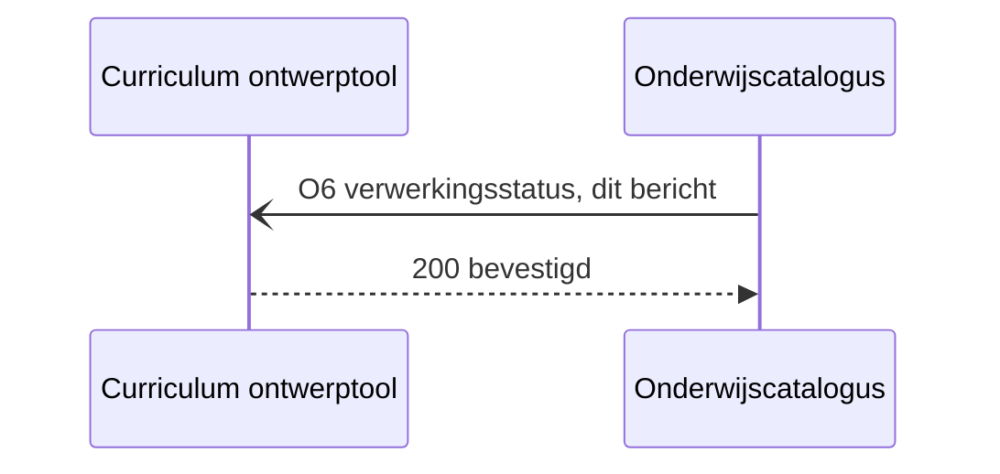

<!-- erd -->
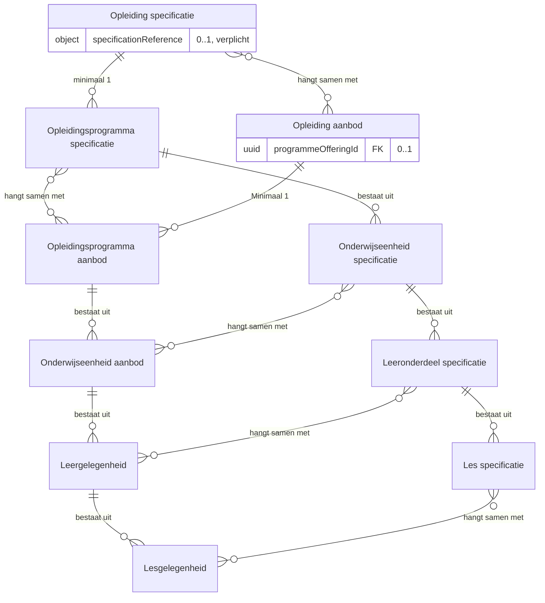

| Lijn | Betekenis |
|---|---|
| `\|\|--o{` | het eerste bestaat uit nul of meer van het tweede |
| `}o--o{` | de twee hangen samen, met het opschrift erbij |
| `PK` en `FK` | de sleutel van het object, en een verwijzing naar een ander object |
| tekst achter een attribuut | de multipliciteit in dit bericht, en of het veld verplicht is |

<!-- /erd -->

Volgt [processing-status.json](https://github.com/Npuls-OKx/Public/blob/dev/Informatie-en-gegevensmodellen/schemas/processing-status.json), met de sleutels die deze eenheid voorstelt in [intake-outcome.json](schemas/intake-outcome.json).

| Veld | Nederlands | Type | Kardinaliteit | Verplicht | Objecttype | Grond |
|---|---|---|---|---|---|---|
| `deliveryId` | `leveringId` | uuid | 1 | ja, voorgestelde sleutel bij W14 | contracteigenschap, geen objecttype | de correlatie tussen het antwoord op O3 of O4 en de uitkomst op O6, die O5 ook als opvraag teruggeeft |
| `status` | `status` | enum `ontvangen`, `gestart`, `afgekeurd`, `gelukt`, `nietGelukt` | 1 | ja | de toestand van de inname | processing-status.json, verplicht |
| `specificationReference` | `specificatieVerwijzing` | object: `specificationId`, `version` | 0..1 | ja op `gelukt`, met de identiteit en versie die de catalogus toekent (W4 en W14) | `Opleiding specificatie` | processing-status.json verplicht, de vorm in [specification-reference.json](https://github.com/Npuls-OKx/Public/blob/dev/Informatie-en-gegevensmodellen/schemas/specification-reference.json) |
| `findings` | `bevindingen` | array object, de vorm in 4.4 | 0..n | ja op `afgekeurd` en `nietGelukt`, voorgestelde sleutel bij W14 | contracteigenschap, geen objecttype | de invarianten in regels.md, die een grond per afkeuring vragen |
| `programmeOfferingId` | `opleidingsaanbodId` | uuid of null | 0..1 | nee, leeg in deze stroom | `Opleiding aanbod`, gevuld in IS-OA-04 | processing-status.json, optioneel |
| `eventId` | `eventId` | uuid | 0..1 | nee, voorgestelde sleutel bij W12 | kanaaleigenschap, geen objecttype | [U5](https://github.com/Npuls-OKx/Public/blob/dev/Koppelvlakspecificaties/uitgangspunten.md#u5-bericht-versus-kanaal), herhaalbare verwerking |

Het antwoord op O4, zodra de catalogus de resultaatstructuur aanneemt:

Voorbeeldpayload: [`is-oa-01-verwerkingsstatus-gestart.json`](voorbeeldpayloads/is-oa-01-verwerkingsstatus-gestart.json)

De uitkomst op O6, zodra de catalogus Apothekersassistent opneemt:

Voorbeeldpayload: [`is-oa-01-verwerkingsstatus-gelukt.json`](voorbeeldpayloads/is-oa-01-verwerkingsstatus-gelukt.json)

De leveringId's en het eventId staan met de overige identificaties in [casus.md](casus.md#het-innamecontract).

**De toestanden van een levering**

Elke aangenomen levering draagt een `leveringId` dat de catalogus toekent en stabiel houdt. De uitkomst komt langs twee wegen terug: als melding op O6 en als opvraag op O5, zodat een gemiste melding alsnog te halen is ([U4](https://github.com/Npuls-OKx/Public/blob/dev/Koppelvlakspecificaties/uitgangspunten.md#u4-notify-then-pull)).

| Status | Wat de catalogus meldt | Wat de ontwerptool daarop doet |
|---|---|---|
| `ontvangen` | de levering is aangenomen, als antwoord op O3 of O4 | het `leveringId` bewaren en de uitkomst afwachten |
| `gestart` | het narekenen loopt | de uitkomst afwachten |
| `gelukt` | de toegekende identiteit en versie staan in `specificationReference` | die verwijzing voortaan als sleutel gebruiken |
| `afgekeurd` | de bevindingen staan in `findings` | de lading herstellen en opnieuw aanleveren |
| `nietGelukt` | de verwerking liep vast, met de bevinding erbij | opnieuw aanleveren |

Na `gelukt` meldt de catalogus de publicatiestap op O7 als `vastgesteld` naar `gepubliceerd`. Het afleveradres van een melding ligt bij instelling en leverancier, binnen de vier eigenschappen die [U5](https://github.com/Npuls-OKx/Public/blob/dev/Koppelvlakspecificaties/uitgangspunten.md#u5-bericht-versus-kanaal) eist.

De vijf waarden zijn de enum `properties.status` van [intake-outcome.json](schemas/intake-outcome.json).

#### verwerkingsuitkomst-afnemer, bij de curriculum ontwerptool


Deze dienst host de `callbackUrl` voor O6 (W2) en antwoordt met `200 OK`. Zij bevestigt de ontvangst en niet het oordeel: wat zij met de bevindingen doet valt buiten dit koppelvlak.

#### afleverabonnement-aanbieder, bij de onderwijscatalogus


Deze dienst neemt de subscriptions aan op de events die de catalogus zelf publiceert, en levert daarna af op de geregistreerde `callbackUrl`.

##### O8 · `POST /abonnementen` · aanleveren

| | |
|---|---|
| Request body | [subscription.json](https://github.com/Npuls-OKx/Public/blob/dev/Koppelvlakspecificaties/Datamodelschema's/subscription.json): `callbackUrl` en de `events` waarop de afnemer zich abonneert |
| `201 Created` | de subscription met haar `id` |
| `400 Bad Request` | onbekend event of een onbruikbare `callbackUrl` |
| Idempotentie | op `callbackUrl` plus event: een herhaalde registratie overschrijft de vorige |


De request body is [subscription.json](https://github.com/Npuls-OKx/Public/blob/dev/Koppelvlakspecificaties/Datamodelschema's/subscription.json) in Npuls-OKx/Public; deze keten stelt er geen velden bij voor.

#### afleverabonnement-afnemer, bij de curriculum ontwerptool


Deze dienst registreert haar `callbackUrl` bij de aanbieder met O8, en ontvangt daarna O6 en O7 (W2).

## 4. Werkbrieven: de issueset die hieruit volgt

Deze regels horen niet in de koppelvlakspecificatie zelf. Elk van hen wordt een issue in Npuls-OKx/Public of in meta, en blijft hier staan tot dat issue er is.

| Nr | Wat erbij moet | Waar | Versie-impact |
|---|---|---|---|
| W1 | Het innamecontract uit [hoofdstuk 3](#3-operaties-en-berichtspecificatie) overnemen: de paden `POST /onderwijsspecificaties`, `POST /examenplanspecificaties` en `GET /leveringen/{leveringId}`, met hun statuscodes, de levering als eenheid van aanname en de bevinding als grond bij afkeuring | [onderwijsspecificatie-inname-aanbieder.md](https://github.com/Npuls-OKx/Public/blob/d0c20d99b110b29ccf6b0e50109f7d54ffd88d7a/Koppelvlakspecificaties/Applicatiediensten/onderwijsspecificatie-inname-aanbieder.md), paragraaf Endpoints, en [onderwijscatalogus.md](https://github.com/Npuls-OKx/Public/blob/dev/Koppelvlakspecificaties/Applicatiecomponenten/onderwijscatalogus.md) | Additief: drie paden komen erbij op de catalogus, de bestaande opvragingen en payloadschema's blijven gelijk |
| W2 | Endpointtabel voor de curriculum ontwerptool met `verwerkingsstatus` POST en `POST /abonnementen`, de diensten die zij als ontvanger implementeert | [curriculum-ontwerptool.md](https://github.com/Npuls-OKx/Public/blob/dev/Koppelvlakspecificaties/Applicatiecomponenten/curriculum-ontwerptool.md) | Additief: bestaande paden en schema's, nieuw koppelvlak op een component zonder endpoints |
| W3 | Parameter `leeruitkomstId` op het zoeken naar hergebruik, en kopmetadata (`name`, `studyLoad`) in de respons, zodat de ontwerper kan kiezen op wat de specificatie belooft | [onderwijscatalogus.md](https://github.com/Npuls-OKx/Public/blob/dev/Koppelvlakspecificaties/Applicatiecomponenten/onderwijscatalogus.md) en [specification-reference.json](https://github.com/Npuls-OKx/Public/blob/dev/Informatie-en-gegevensmodellen/schemas/specification-reference.json) | MINOR: additieve parameter en additieve optionele velden |
| W4 | Regel hoe de toegekende identiteit zich verhoudt tot de id's waarmee de ontwerptool aanlevert, met `specificationReference` als terugweg | [regels.md](https://github.com/Npuls-OKx/Public/blob/dev/Informatie-en-gegevensmodellen/regels.md), naast de regel dat de catalogus versienummers uitgeeft | Geen schemawijziging |
| W5 | Gebruiksprofiel voor deze koppeling: `educationSpecifications` volledig met manifest, `learningOutcomes` volledig met inhoudsvelden, `ruleSets` volledig, en `learningOutcomeId` verplicht buiten de `keuzedeelruimtespecificatie` om | [gebruiksprofielen.md](https://github.com/Npuls-OKx/Public/blob/dev/Informatie-en-gegevensmodellen/gebruiksprofielen.md) | Geen schemawijziging |
| W6 | Veld voor `Competenties / Skills` met `Vaardigheid`, `Kennis` en `Inzicht` eronder, elk met standaard en code | [learning-outcome.json](https://github.com/Npuls-OKx/Public/blob/dev/Informatie-en-gegevensmodellen/schemas/learning-outcome.json) | MINOR: optionele array, met een eigen schema voor het competentie-item |
| W7 | Type voor de `Formatieve resultaat structuur` als eigen wortel naast het examenplan | [result-structure.json](https://github.com/Npuls-OKx/Public/blob/dev/Informatie-en-gegevensmodellen/schemas/result-structure.json), enum `specificationType` | MINOR: additieve enumwaarde. Strikt validerende ontvangers krijgen de waarde vooraf |
| W8 | Drager voor het generieke basisdeel in het `Summatief Afrondingscriterium`: Nederlands en rekenen, Engels, loopbaan en burgerschap | result-structure.json via `ruleSetReferences` op het examenplan, plus een resultaateenheid in de instantie | Geen schemawijziging, wel een uitwerking van de regels en de instantie |
| W9 | Het getypeerde regelobject uit [student-choice-rule.json](schemas/student-choice-rule.json) overnemen in `rules`, met de Engelse sleutels uit [het bericht](#o3-post-onderwijsspecificaties-aanleveren), en het gelijktrekken met de vier Nederlandse regeltypen en de bereiken van [regelset-payload.md](../student-keuze/regelset-payload.md) | [rule-set.json](https://github.com/Npuls-OKx/Public/blob/dev/Informatie-en-gegevensmodellen/schemas/rule-set.json) | MINOR voor het getypeerde regelobject naast de vrije vorm, MAJOR bij dichtzetten en bij overname van `ruleSetId` als sleutelnaam |
| W10 | Releaseaanduiding naast `version` voor de vorm 2026.1 uit de voorbeelduitwerking, die buiten het semver-patroon valt | [education-specification.json](https://github.com/Npuls-OKx/Public/blob/dev/Informatie-en-gegevensmodellen/schemas/education-specification.json), of semver in de [voorbeelduitwerking](../../../model/informatiemodel/voorbeeld-lr1-regels.json) | MINOR voor een additief veld, of geen schemawijziging bij semver in het voorbeeld |
| W11 | Objecttype voor de `resultaateenheidspecificatie`, de laag tussen examenplan en toetsonderdeel | [informatiemodel.md](../../../model/informatiemodel/informatiemodel.md) en [begrippenlijst.md](../begrippen/begrippenlijst.md) | Geen schemawijziging: informatiemodel en begrippenlijst |
| W12 | Een stabiel `eventId` op O6 en O7, waarop de ontvanger een herhaald bericht herkent, zoals [U5](https://github.com/Npuls-OKx/Public/blob/dev/Koppelvlakspecificaties/uitgangspunten.md#u5-bericht-versus-kanaal) voor herhaalbare verwerking vraagt | [processing-status.json](https://github.com/Npuls-OKx/Public/blob/dev/Informatie-en-gegevensmodellen/schemas/processing-status.json) en [specification-status-changed.json](https://github.com/Npuls-OKx/Public/blob/dev/Informatie-en-gegevensmodellen/schemas/specification-status-changed.json), gelijk aan W6 van IS-OA-05 en W8 van IS-OA-06 | Optioneel: MINOR. Verplicht: MAJOR |
| W13 | De Engelse sleuteltaal van de payload vastleggen in de uitgangspunten, zodat [U7](https://github.com/Npuls-OKx/Public/blob/dev/Koppelvlakspecificaties/uitgangspunten.md#u7-payload-plat-met-verwijzingen-en-de-sleutelconventie) en de voorbeeldpayloads dezelfde sleutels dragen als de schema's | [uitgangspunten.md](https://github.com/Npuls-OKx/Public/blob/dev/Koppelvlakspecificaties/uitgangspunten.md), [voorbeeldpayloads.md](https://github.com/Npuls-OKx/Public/blob/dev/Informatie-en-gegevensmodellen/voorbeeldpayloads.md) | Geen schemawijziging: de schema's dragen de Engelse sleutels al, documentatie volgt |
| W14 | De sleutels `deliveryId` en `findings` op de verwerkingsstatus, met [intake-outcome.json](schemas/intake-outcome.json) als vorm. Twee landingen: beide sleutels in processing-status.json, of dit schema ernaast voor de inname. Het voorstel vraagt `specificationReference` op `gelukt` en laat hem vrij op een afkeuring, waar processing-status.json hem altijd verplicht | [processing-status.json](https://github.com/Npuls-OKx/Public/blob/dev/Informatie-en-gegevensmodellen/schemas/processing-status.json) | Twee optionele sleutels erbij: MINOR. De voorwaardelijke `specificationReference` in processing-status.json zelf: MAJOR, omdat een ontvanger die op zijn aanwezigheid rekent dan bijstelt. Een eigen schema voor de inname houdt het additief: MINOR. Dat schema draagt daarnaast het `eventId` uit W12 |
| W15 | [intake-finding.json](schemas/intake-finding.json) als schema voor de bevinding, met de codes uit 3.3 naast de knelpuntcodes van bottleneck.json. [W15 van IS-OA-03](is-oa-03.md#4-werkbrieven-de-issueset-die-hieruit-volgt) vraagt voor het lichaam bij 400 en 404 op de opvragingen een eigen foutschema naar het model van bottleneck.json: de acht codes hier dragen de gronden van een inname en laten een onbekend id of een onbekende versie buiten de lijst. De meldingen van de andere eenheden houden hun leesbare `reason` | de [schemamap](https://github.com/Npuls-OKx/Public/tree/dev/Informatie-en-gegevensmodellen/schemas) in Public, naast bottleneck.json, plus de codelijst in regels.md | Nieuw schema, additief: MINOR |
| W16 | [intake-rejection.json](schemas/intake-rejection.json) als response body bij 400 en 409 op O3 en O4 | de schemamap in Public, en de statuscodekolom op de dienstpagina | Nieuw schema, additief: MINOR. De statuscode 409 komt erbij naast de set die de componentpagina's dragen |
| W17 | Het begrip levering en haar bewaartermijn: hoelang O5 de uitkomst van een afgehandelde levering teruggeeft, en of een lijstopvraag op `/leveringen` daarbij hoort | [begrippenlijst.md](../begrippen/begrippenlijst.md) en de dienstpagina van de inname | Geen schemawijziging: begrip en dienstafspraak |
| W18 | Paginering op O1: de componentpagina's in Public kennen vandaag geen pagineringsparameters, terwijl een catalogus met duizenden specificaties erom vraagt | de componentpagina van de onderwijscatalogus in Public |
| W19 | `GET /examenplanspecificaties/{id}/delta` met `van` en `naar`, zodat de resultaatstructuur dezelfde twee vormen draagt als de onderwijsspecificatie. [U11](https://github.com/Npuls-OKx/Public/blob/dev/Koppelvlakspecificaties/uitgangspunten.md#u11-toekomstvaste-endpoints-volledige-structuur-en-delta) eist beide vormen op een structuurresource | de componentpagina van de onderwijscatalogus in Public |

Wat deze eenheid verder raakt staat in de [signaleringen](signaleringen.md) van de interactiespecificatie: S5 vraagt een koppeling-ID en een eigen lijn op de hoofdplaat, S6 de grond per objecttype. Het aanleverpatroon dat S13 openlaat, staat voor deze eenheid in paragraaf 3: de ontwerptool levert met POST, en de catalogus meldt de uitkomst terug.

De voorgestelde schema's staan in [schemas/](schemas/) en dragen een `$id` die eindigt op `/voorstel`.

| Schema | Wat het draagt | Werkbrief |
|---|---|---|
| [intake-outcome.json](schemas/intake-outcome.json) | de toestand van een levering, op O3, O4, O5 en O6 | W14 |
| [intake-finding.json](schemas/intake-finding.json) | een bevinding met haar code, plek en waarden | W15 |
| [intake-rejection.json](schemas/intake-rejection.json) | het response body bij een afkeuring aan de poort | W16 |
