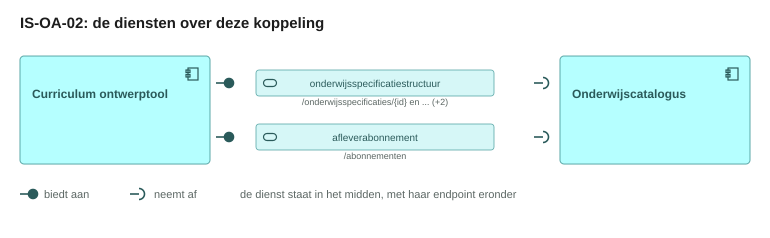
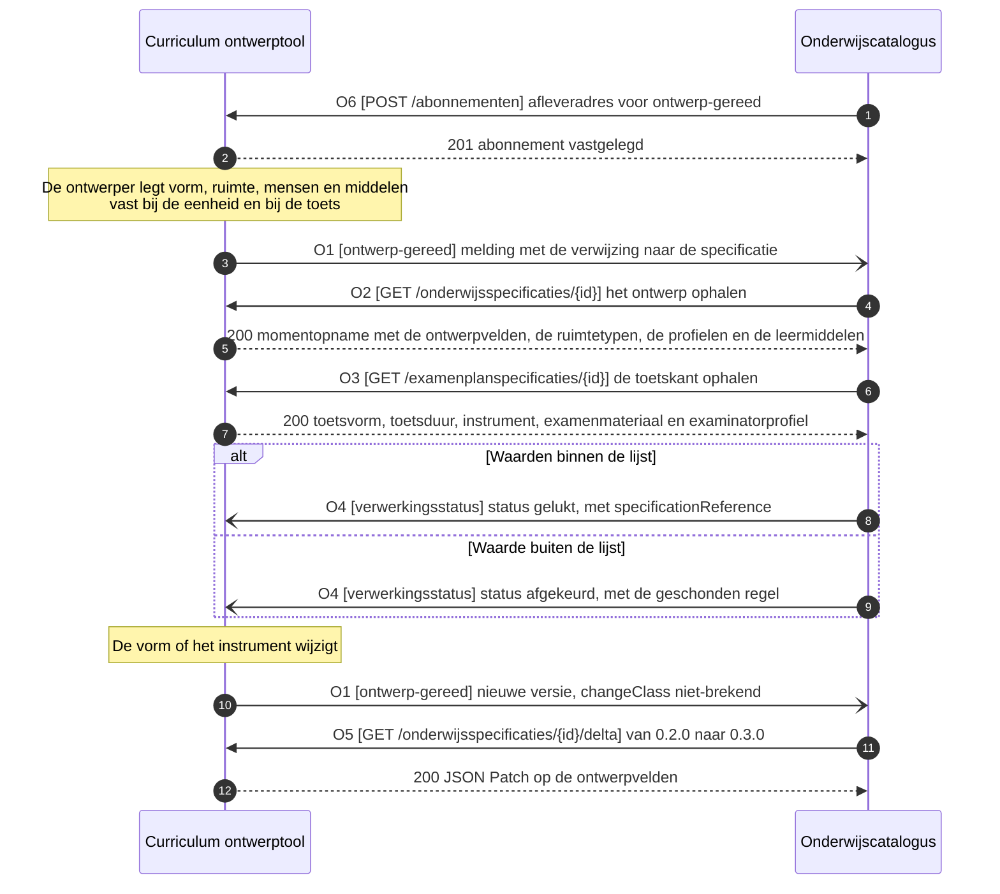
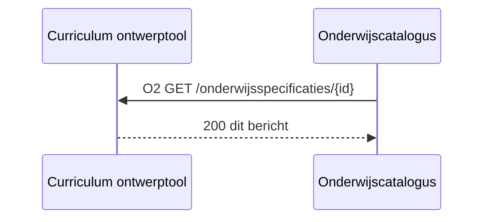
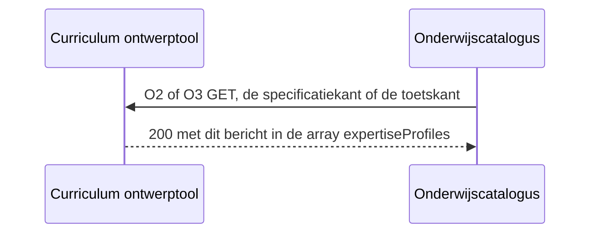
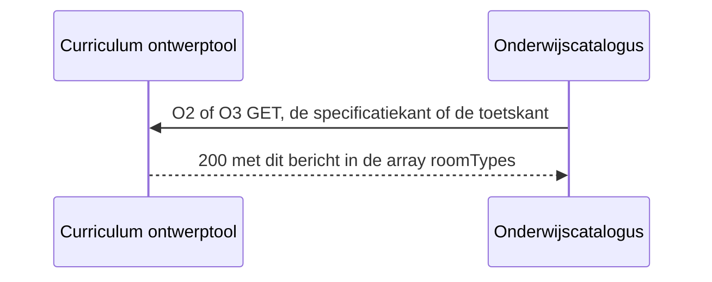
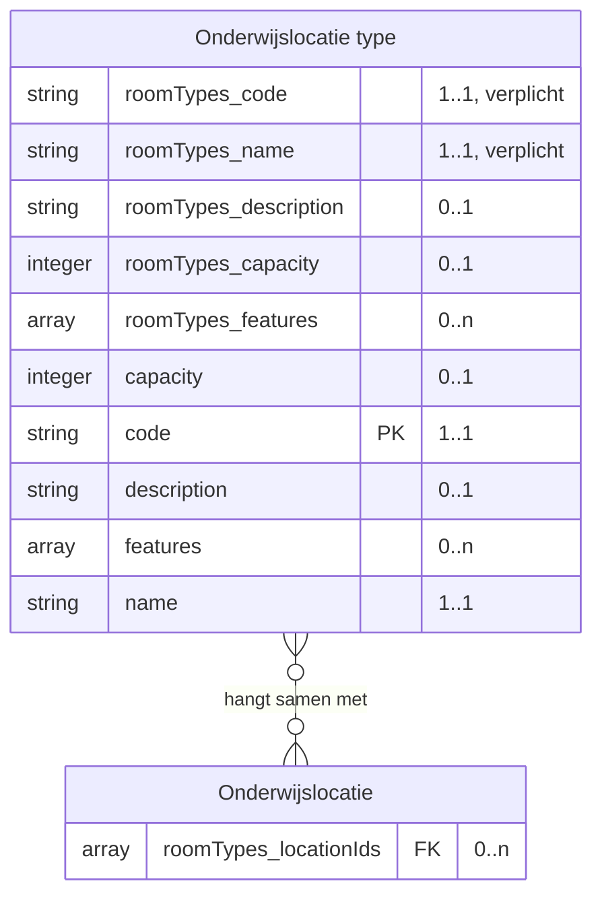
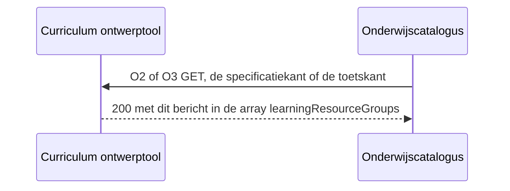
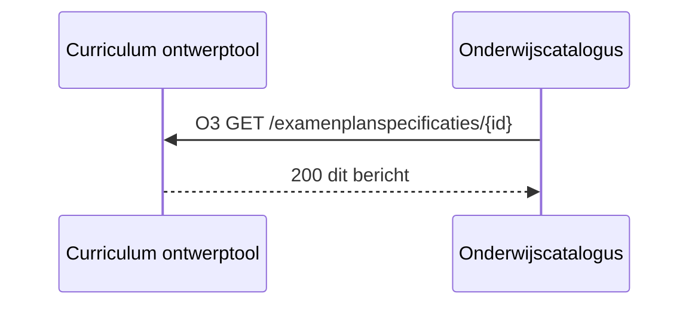

# IS-OA-02 Onderwijsontwerp naar de catalogus

| | |
|---|---|
| **Document doel** | Zet uiteen hoe de curriculum ontwerptool de uitvoeringskenmerken van het ontwerp aan de onderwijscatalogus levert, ten behoeve van de bouw of de verificatie van een implementatie volgens deze specificatie |
| **Doelgroep** | De implementatiespecialist en de tester bij een instelling of een leverancier, en wie een profiel of consumer bouwt |
| **Dient als input voor** | De bouw van het koppelvlak, de testgevallen erbij, en de acceptatie van een opgeleverde koppeling |
| **Kaderstelling** | De [interactieketenspecificatie](README.md) waarin deze specificatie valt, het [informatiemodel OKx](../../../model/informatiemodel/informatiemodel.md), en beeld F1-13 van de [voorbeelduitwerking](../../../model/informatiemodel/voorbeeld-leerroute-1-jochem.md) |
| **Inhoud** | Zes operaties met hun statuscodes, vijf berichten met hun velden, vier voorgestelde schema's, en twee voorbeeldpayloads die valideren |
| **Status** | Voorstel. Elke operatie staat op voorstel, en elk schema dat deze eenheid toevoegt draagt een `$id` die op `/voorstel` eindigt; de dragende schema's in Public staan op alfa |

De lading: de onderwijsvorm, het gevraagde ruimtetype, de expertiseprofielen van docent en examinator, de leermiddelen, de verdeling van de studiebelasting, de toetsvorm en het toetsinstrument, elk als veld op de specificatie die [IS-OA-01](is-oa-01.md) al draagt. De uuid's, de versies en de namen in de voorbeeldpayloads komen uit [casus.md](casus.md).

## 1. Interactie

| Bronsysteem | Doelsysteem | Koppeling | Beeld | Status | Applicatiedienst |
|---|---|---|---|---|---|
| Curriculum ontwerptool | Onderwijscatalogus | volgt, [S5](signaleringen.md). De [dienstpagina van de ontwerptool](https://github.com/Npuls-OKx/Public/blob/dev/Koppelvlakspecificaties/Applicatiecomponenten/curriculum-ontwerptool.md) laat de endpoints aan een volgend pakket, [ADR 0020](https://github.com/Npuls-OKx/Public/blob/dev/Referentiemateriaal/adr/0020-curriculumontwerp-onderwijscatalogus-happy-flow-synchronisatie-en-federatie-adopt-klonen.md) legt de richting vast | F1-13, van de conceptplaat Onderwijsontwerp | Voorstel: op hoofdplaat v1.7 valt het ontwerpen binnen de catalogus, en de objecttypen achter de lading komen van de conceptplaat ([S6](signaleringen.md)) | `Onderwijs beheer` van de onderwijscatalogus neemt de lading aan, gevoed door `Curriculum ontwerp` van de ontwerptool ([componenten.json](../../../model/informatiemodel/componenten.json)) |


De blokken hangen onder de typen van IS-OA-01 en vormen geen eigen resource. Elk blok komt van de conceptplaat Onderwijsontwerp, en elke regel in dit beeld draagt een aanname.

De uitvoeringskenmerken ontstaan in [F1-06](../../../model/informatiemodel/voorbeeld-leerroute-1-jochem.md#f1-06---de-eenheidspecificatie-met-haar-onderwijsontwerp-vorm-ruimte-mensen-en-middelen) bij de eenheid en in [F1-10](../../../model/informatiemodel/voorbeeld-leerroute-1-jochem.md#f1-10---de-examenonderdeelspecificatie-met-haar-toetsvorm-instrumenten-materiaal-en-ruimte) bij de toets, beide binnen [fase 1](../../../model/informatiemodel/voorbeeld-leerroute-1-jochem.md#fase-1-kwalificatiekader-analyseren-en-grofmazig-ontwerpen).

De taak van deze interactie in het proces: de ontwerper heeft vorm, ruimte, mensen en middelen bij de eenheid en bij de toets vastgelegd, en dat geheel moet de catalogus in voordat planning het tegen de beschikbare ruimtes en mensen legt. Dezelfde waarden gaan in [F2-03 van IS-OA-03](is-oa-03.md#o2-get-onderwijsspecificatiesid-ophalen) door naar planning, en de knelpuntcodes `expertiseTekort` en `ruimteTekort` uit [bottleneck.json](https://github.com/Npuls-OKx/Public/blob/dev/Informatie-en-gegevensmodellen/schemas/bottleneck.json) rusten erop. Daarom landen zij hier als veld op de specificatie.

| Applicatiecomponent | Functie in deze interactie |
|---|---|
| Curriculum ontwerptool | Houdt het ontwerp in bewerking, meldt dat het gereed is, en levert de uitvoeringskenmerken op de opvraag van de catalogus |
| Onderwijscatalogus | Legt haar afleveradres vast, haalt de specificatiekant en de toetskant op, beoordeelt de waarden tegen de waardelijst, en meldt de uitkomst terug |

De status per regel hieronder zegt waar een artefact staat.

| Status | Waar het artefact staat |
|---|---|
| `vastgelegd` | [Npuls-OKx/Public](https://github.com/Npuls-OKx/Public/tree/dev/Koppelvlakspecificaties) draagt hem: een pad op een componentpagina, een enumwaarde in een melding of een schema in [Informatie-en-gegevensmodellen](https://github.com/Npuls-OKx/Public/tree/dev/Informatie-en-gegevensmodellen/schemas), daar op alfa |
| `voorstel` | Deze specificatie stelt hem voor, onderbouwd uit [de casus](casus.md) en het [informatiemodel](../../../model/informatiemodel/informatiemodel.md). Een voorgesteld schema staat in [schemas/](schemas/) en draagt een `$id` die eindigt op `/voorstel`, zodat de status meereist met het bestand |

## 2. Interactiespecificatie



De aanbiedersdienst en de afnemersdienst staan als twee eigen blokken tegenover elkaar, met de bal die in de kom valt. Het sequentiediagram eronder zet dezelfde operaties in de tijd.



De lading rijdt mee op de koppeling die [IS-OA-01](is-oa-01.md) voluit beschrijft: de ontwerptool houdt het ontwerp in bewerking vast en meldt dat het gereed is, waarna de catalogus het ophaalt ([U3](https://github.com/Npuls-OKx/Public/blob/dev/Koppelvlakspecificaties/uitgangspunten.md#u3-resource-eigenaarschap) en [U4](https://github.com/Npuls-OKx/Public/blob/dev/Koppelvlakspecificaties/uitgangspunten.md#u4-notify-then-pull)). Een volgende ontwerpversie loopt over dezelfde melding, en O5 geeft de delta tussen twee versies.

## 3. Operaties en berichtspecificatie

Een operatie is een pad met een methode erop: `GET /onderwijsspecificaties/{id}` is er een, `GET /examenplanspecificaties/{id}` een andere. Zij draagt een nummer dat terugkomt in het sequentiediagram hierboven en in de berichtspecificatie hieronder. `CO` is de curriculum ontwerptool, `OC` de onderwijscatalogus.

Een leverancier claimt een dienst, geen operatietabel. Hier staat per dienst wat die claim kost: welke operaties erbij horen, met hun parameters, hun request body en hun responses.

Wie het endpoint bouwt verschilt per patroon, en bij een melding is dat omgekeerd aan wat de naam suggereert.

| Patroon | Wie levert het gegeven | Wie bouwt het endpoint | Wie roept aan |
|---|---|---|---|
| Ophalen | de aanbieder | de aanbieder | de afnemer |
| Aanleveren | de afnemer | de aanbieder | de afnemer |
| Melden | de aanbieder | de afnemer, op haar `callbackUrl` | de aanbieder |

Een query parameter verandert het endpoint niet: het pad blijft gelijk en de parameters komen in de query string. Het contract staat bij de dienst die het endpoint bouwt; de tegenhanger wijst ernaar. De afspraken die voor elke dienst in deze keten gelden, staan in de [interactieketenspecificatie](README.md#5-afspraken-die-elke-dienst-nakomt).

De paden bestaan in Public op de onderwijscatalogus, die de opgenomen specificatie bezit; deze eenheid draait de richting om en legt hetzelfde pad op de ontwerptool, die het ontwerp in bewerking bezit, met een voorvoegsel per bezitter. Elke operatie hieronder staat daarom op voorstel, en WB-07 brengt haar naar de componentpagina's in Public. Authenticatie per operatie volgt de [auth-standaard](https://github.com/Npuls-OKx/Public/blob/dev/Koppelvlakspecificaties/auth-standaard.md).

Waar de lading van F1-13 landt, van de conceptplaat naar het [informatiemodel](../../../model/informatiemodel/informatiemodel.md) en het schema:

| Objecttype op de conceptplaat | Objecttype in het informatiemodel | Sleutel in de payload | Nederlandse naam | Schema |
|---|---|---|---|---|
| `Onderwijsvorm specificatie` | `Onderwijsvorm` | `educationForm`, met `explanation` voor de leesbare vorm | onderwijsvorm, toelichting | education-design.json, voorstel |
| `Gewenste Onderwijskundige Leeromgeving`, `Onderwijsruimte type` | `Onderwijslocatie type` (OEAPI `roomType`) | `roomType` plus `roomTypes` | onderwijslocatieType, onderwijslocatieTypen | room-type.json, voorstel |
| `Onderwijs locatie`, `Lokaaltypes` | `Onderwijslocatie` | `roomTypes[].locationIds` | locatieIds | room-type.json, voorstel; de locatie zelf location.json, alfa |
| `Gewenst medewerker competentieprofiel`, `Medewerker Type / Expertise Profiel` | `Expertise of functieprofiel` | `expertiseProfileIds` plus `expertiseProfiles` | expertiseprofielIds, expertiseprofielen | expertise-profile.json, voorstel |
| `Competenties / skills`, `Vaardigheid`, `Kennis` | `Competenties / Skills`, `Vaardigheid`, `Kennis`, `Inzicht`, scope buiten | `expertiseProfiles[].competences` | competenties | expertise-profile.json, voorstel |
| `Studiebelasting en begeleide onderwijstijd indicatie` | attribuut van de specificatie | `studyLoad` plus `timeDistributions` | studielast, tijdsverdelingen | volume.json, alfa; de verdeling education-design.json, voorstel |
| `Collectie van Leermiddelgroepen`, `Leermiddelgroep` | zonder objecttype | `learningResourceGroupIds` plus `learningResourceGroups` | leermiddelgroepIds, leermiddelgroepen | learning-resource-group.json, voorstel |
| `Toetsvormspecificatie`, `Toetsvorm` | `Toetsonderdeel specificatie` | `assessmentForm` plus `assessmentDuration` | toetsvorm, toetsduur | result-structure.json, alfa; de duur education-design.json, voorstel |
| `Toetsinstrument` | zonder objecttype | `assessmentInstrumentId` | toetsinstrumentId | learning-resource-group.json, voorstel |

De ontwerptool levert per onderwijseenheid-, leeronderdeel- en toetsonderdeelspecificatie de sleutels hieronder over de operaties, en de catalogus neemt ze onveranderd over met O2 en O3.

De sleutels in de payload zijn Engels, zoals de schema's in Public ze dragen; [mapping.md](https://github.com/Npuls-OKx/Public/blob/dev/Informatie-en-gegevensmodellen/mapping.md) legt per schema de Nederlandse naam ernaast. Enumwaarden blijven Nederlands, en elk schema draagt de Nederlandse naam per veld in `DutchName`.

De kolom Grond hieronder opent met de status van het veld en noemt daarna waarop het veld bestaat: een objecttype of relatie uit het informatiemodel, een instantie uit de beelden F1-06, F1-10 en F1-13, of een schema in Public.

Casus Apothekersassistent, kwalificatiedossier 23450, met de instantiewaarden uit F1-06, F1-10 en F1-13. De uuid's, de codes, de versies en de namen staan in [casus.md](casus.md); de specificaties volgen daar de [voorbeeldpayloads](https://github.com/Npuls-OKx/Public/blob/dev/Informatie-en-gegevensmodellen/voorbeeldpayloads.md) in Public, en de profielen, de ruimtetypen en de leermiddelgroepen dragen een identificatie van deze snede. De ontwerpvelden komen additief bovenop de grofmazige specificatie van IS-OA-01, dus loopt de versie van `0.1.0` naar `0.2.0`.

#### onderwijsspecificatiestructuur-aanbieder, bij de curriculum ontwerptool


Deze dienst ontsluit het ontwerp dat nog in bewerking is, en meldt dat het gereed is. Zij draagt daarmee twee patronen.

##### O1 · webhook `ontwerp-gereed` · melden

| | |
|---|---|
| Transport | HTTP POST naar de `callbackUrl` die de afnemer met O6 registreerde |
| Request body | de verwijzing naar de specificatie met haar versie en haar `changeClass` (wijzigingsklasse), zonder de structuur zelf |
| `200 OK` | geen response body; bevestigt de ontvangst, niet het oordeel |
| Bij uitblijven | retry met exponential backoff, daarna dead letter queue |
| Idempotentie | op `eventId`: een herhaalde delivery heeft geen extra effect ([ADR 0018](https://github.com/Npuls-OKx/Public/blob/dev/Referentiemateriaal/adr/0018-enterprise-messaging-patronen-voor-betrouwbare-koppelvlakken.md)) |


De melding draagt een verwijzing en geen structuur; de catalogus haalt daarna op met O2 en O3 ([U4](https://github.com/Npuls-OKx/Public/blob/dev/Koppelvlakspecificaties/uitgangspunten.md#u4-notify-then-pull)).

##### O2 · `GET /onderwijsspecificaties/{id}` · ophalen

| | |
|---|---|
| Query parameters | `versie` (optioneel, default de laatst vastgestelde) |
| `200 OK` | `application/json`, de momentopname met de [ontwerpvelden op de onderwijsspecificatie](#o2-get-onderwijsspecificatiesid-ophalen), en de ruimtetypen, de expertiseprofielen en de leermiddelgroepen ernaast |
| `400 Bad Request` | een onbekende versie |
| `404 Not Found` | een onbekend `id` |
| Neveneffect | geen: de opvraag laat het ontwerp in bewerking onaangeroerd |


**Bericht: de ontwerpvelden op de onderwijsspecificatie**

Schema [`education-design.json`](schemas/education-design.json) en [`education-specification.json`](https://github.com/Npuls-OKx/Public/blob/dev/Koppelvlakspecificaties/Datamodelschema's/education-specification.json) · voorbeeldpayload [`is-oa-02-ontwerpvelden-specificatie.json`](voorbeeldpayloads/is-oa-02-ontwerpvelden-specificatie.json)



<!-- erd -->
```mermaid
erDiagram
    "Competenties / Skills" ||--o{ "Inzicht" : "bestaat uit"
    "Competenties / Skills" ||--o{ "Kennis" : "bestaat uit"
    "Competenties / Skills" ||--o{ "Vaardigheid" : "bestaat uit"
    "Expertise of functieprofiel" ||--o{ "Competenties / Skills" : "bestaat uit"
    "Leeronderdeel specificatie" ||--o{ "Les specificatie" : "bestaat uit"
    "Onderwijseenheid specificatie" ||--o{ "Leeronderdeel specificatie" : "bestaat uit"
    "Opleidingsprogramma specificatie" ||--o{ "Onderwijseenheid specificatie" : "bestaat uit"
    "Summatieve resultaat structuur" ||--o{ "Examenonderdeel weging" : "bestaat uit"
    "Summatieve resultaat structuur" ||--o{ "Toetsonderdeel specificatie" : "bestaat uit"
    "Cohort / periode" }o--o{ "Summatieve resultaat structuur" : "Groepeert Studenten op toepasbare"
    "Examenonderdeel weging" }o--o{ "Examenonderdeelspecificatie" : "hangt samen met"
    "Examenonderdeelspecificatie" }o--o{ "Leeruitkomst" : "hangt samen met"
    "Expertise of functieprofiel" }o--o{ "Opleiding specificatie" : "Benodigd voor uitvoering van"
    "Keuzedeel" }o--o{ "Keuzedeelruimte" : "hangt samen met"
    "Leeronderdeel specificatie" }o--o{ "Leeruitkomst" : "hangt samen met"
    "Leeronderdeel specificatie" }o--o{ "Onderwijsvorm" : "beschrijft"
    "Leeruitkomst" }o--o{ "Student keuze regelset" : "voorwaarde op"
    "Les specificatie" }o--o{ "Leeruitkomst" : "hangt samen met"
    "Onderwijseenheid specificatie" }o--o{ "Leeruitkomst" : "hangt samen met"
    "Onderwijsvorm" }o--o{ "Onderwijslocatie type" : "Indicatie voor gebruik van"
    "Opleiding specificatie" }o--o{ "Leeruitkomst" : "hangt samen met"
    "Opleidingsprogramma specificatie" }o--o{ "Leeruitkomst" : "hangt samen met"
    "Organisatie-eenheid" }o--o{ "Examenonderdeelspecificatie" : "Voert uit"
    "Organisatie-eenheid" }o--o{ "Expertise of functieprofiel" : "Heeft behoefte aan"
    "Organisatie-eenheid" }o--o{ "Leeronderdeel specificatie" : "Voert uit"
    "Organisatie-eenheid" }o--o{ "Les specificatie" : "Voert uit"
    "Organisatie-eenheid" }o--o{ "Onderwijseenheid specificatie" : "Voert uit"
    "Organisatie-eenheid" }o--o{ "Opleiding specificatie" : "Voert uit"
    "Organisatie-eenheid" }o--o{ "Opleidingsprogramma specificatie" : "Voert uit"
    "Organisatie-eenheid" }o--o{ "Toetsonderdeel specificatie" : "Voert uit"
    "Student keuze regelset" }o--o{ "Keuzedeel" : "hangt samen met"
    "Student keuze regelset" }o--o{ "Keuzedeelruimte" : "hangt samen met"
    "Student keuze regelset" }o--o{ "Leeronderdeel specificatie" : "hangt samen met"
    "Student keuze regelset" }o--o{ "Les specificatie" : "hangt samen met"
    "Student keuze regelset" }o--o{ "Onderwijseenheid specificatie" : "hangt samen met"
    "Student keuze regelset" }o--o{ "Opleiding specificatie" : "hangt samen met"
    "Student keuze regelset" }o--o{ "Opleidingsprogramma specificatie" : "hangt samen met"
    "Summatieve resultaat structuur" }o--o{ "Leeruitkomst" : "hangt samen met"
    "Toetsonderdeel specificatie" }o--o{ "Leeruitkomst" : "hangt samen met"
    "Opleiding specificatie" ||--o{ "Opleidingsprogramma specificatie" : "minimaal 1"
    "Examenonderdeelspecificatie" ||--|| "Toetsonderdeel specificatie" : "is van het soort"
    "Keuzedeel" ||--|| "Opleidingsprogramma specificatie" : "is een"
    "Keuzedeelruimte" ||--|| "Opleidingsprogramma specificatie" : "is een"
    "Leeruitkomst" ||--|| "Competenties / Skills" : "is een"
    "Onderwijsvorm" {
        string educationForm "0..1"
    }
    "Onderwijslocatie type" {
        string roomType "0..1"
    }
    "Expertise of functieprofiel" {
        array expertiseProfileIds FK "0..n"
    }
    "Onderwijseenheid specificatie" {
        string description "0..1"
        string explanation "0..1"
        uuid id PK "1..1"
        uuid learningOutcomeId FK "0..1"
        uuid manifest[].specificationId FK "0..n"
        string manifest[].version "0..n"
        string name "1..1"
        uuid parentSpecificationId FK "1..1"
        enum specificationType "1..1"
        enum status "0..1"
        object studyLoad "1..1"
        number studyLoad.value "1..1"
        string timeDistributions[].timeDistribution "1..1"
        object timeDistributions[].volume "1..1"
        string version "1..1"
    }
    "Leeronderdeel specificatie" {
        string description "0..1"
        string explanation "0..1"
        uuid id PK "1..1"
        uuid learningOutcomeId FK "0..1"
        string name "1..1"
        uuid parentSpecificationId FK "1..1"
        enum specificationType "1..1"
        enum status "0..1"
        object studyLoad "1..1"
        number studyLoad.value "1..1"
        string timeDistribution "0..1"
        string timeDistributions[].timeDistribution "1..1"
        object timeDistributions[].volume "1..1"
        string version "1..1"
    }
    "Toetsonderdeel specificatie" {
        enum assessmentDuration.unit "1..1"
        number assessmentDuration.value "1..1"
    }
    "Examenonderdeelspecificatie" { }
    "Opleiding specificatie" {
        enum curriculumType "0..1"
        string description "0..1"
        uuid id PK "1..1"
        uuid learningOutcomeId FK "0..1"
        array manifest FK "0..n"
        uuid manifest[].specificationId FK "0..n"
        string manifest[].version "0..n"
        string name "1..1"
        uuid parentSpecificationId FK "1..1"
        array ruleSetReferences FK "0..n"
        enum specificationType "1..1"
        enum status "0..1"
        object studyLoad "1..1"
        number studyLoad.value "1..1"
        date validFrom "0..1"
        date validUntil "0..1"
        string version "1..1"
    }
    "Opleidingsprogramma specificatie" {
        string cohort FK "0..1"
        enum curriculumType "0..1"
        string description "0..1"
        uuid id PK "1..1"
        uuid learningOutcomeId FK "0..1"
        enum learningPathway "0..1"
        array manifest FK "0..n"
        uuid manifest[].specificationId FK "0..n"
        string manifest[].version "0..n"
        string name "1..1"
        object organisation FK "0..1"
        uuid parentSpecificationId FK "1..1"
        enum programmeLayer "0..1"
        string programmeType "0..1"
        array ruleSetReferences FK "0..n"
        enum specificationType "1..1"
        date startDate "0..1"
        enum status "0..1"
        object studyLoad "1..1"
        number studyLoad.value "1..1"
        string targetGroup "0..1"
        date validFrom "0..1"
        date validUntil "0..1"
        string version "1..1"
    }
    "Keuzedeel" {
        string description "0..1"
        string electiveUnitClass "0..1"
        uuid id PK "1..1"
        uuid learningOutcomeId FK "0..1"
        string name "1..1"
        string programmeType "0..1"
        enum specificationType "1..1"
        enum status "0..1"
        object studyLoad "1..1"
        number studyLoad.value "1..1"
        string version "1..1"
    }
    "Keuzedeelruimte" {
        string description "0..1"
        uuid id PK "1..1"
        string name "1..1"
        uuid parentSpecificationId FK "1..1"
        array ruleSetReferences FK "0..n"
        enum specificationType "1..1"
        enum status "0..1"
        object studyLoad "1..1"
        number studyLoad.value "1..1"
        string version "1..1"
    }
    "Summatieve resultaat structuur" { }
    "Leeruitkomst" {
        array learningOutcomes "0..n"
    }
    "Student keuze regelset" {
        array ruleSets "0..n"
    }
    "Cohort / periode" { }
    "Organisatie-eenheid" { }
    "Competenties / Skills" { }
    "Les specificatie" { }
    "Examenonderdeel weging" { }
    "Inzicht" { }
    "Kennis" { }
    "Vaardigheid" { }
```

| Lijn | Betekenis |
|---|---|
| `\|\|--o{` | het eerste bestaat uit nul of meer van het tweede |
| `\|\|--\|\|` | het tweede is een soort van het eerste |
| `}o--o{` | de twee hangen samen, met het opschrift erbij |
| `PK` en `FK` | de sleutel van het object, en een verwijzing naar een ander object |
| tekst achter een attribuut | de multipliciteit in dit bericht, en of het veld verplicht is |

<!-- /erd -->

Per onderwijseenheid- of leeronderdeelspecificatie in de array `educationSpecifications` van [education-specification.json](https://github.com/Npuls-OKx/Public/blob/dev/Informatie-en-gegevensmodellen/schemas/education-specification.json).

| Veld | Nederlandse naam | Type | Kardinaliteit | Verplicht | Objecttype | Grond |
|---|---|---|---|---|---|---|
| `educationForm` | onderwijsvorm | string, open lijst simulatie, theorie, praktijk, beroepspraktijkvorming, zelfstudie | 0..1 | nee | `Onderwijsvorm` | voorstel, WB-01. `Leeronderdeel specificatie` beschrijft `Onderwijsvorm`; F1-06 en F1-13 dragen "Simulatie in de leerapotheek, theorie ondersteunend" |
| `roomType` | onderwijslocatieType | string, de code van een profiel in `roomTypes` | 0..1 | nee | `Onderwijslocatie type` | voorstel, WB-02. `Onderwijsvorm` is indicatie voor gebruik van `Onderwijslocatie type`; F1-13 draagt "Balie-simulatie in het skillslab" |
| `expertiseProfileIds` | expertiseprofielIds | array van uuid | 0..n | nee | `Expertise of functieprofiel` | voorstel, WB-04. F1-13 draagt "Apothekersassistent-docent met baliepraktijk" aan de onderwijsvorm |
| `learningResourceGroupIds` | leermiddelgroepIds | array van uuid | 0..n | nee | `Leermiddelgroep`, conceptplaat | voorstel, WB-06. F1-06 hangt `Collectie van Leermiddelgroepen` aan de leeronderdeelspecificatie, met "Leermiddelen voor de baliesimulatie" |
| `studyLoad` | studielast | object, [volume.json](https://github.com/Npuls-OKx/Public/blob/dev/Informatie-en-gegevensmodellen/schemas/volume.json) | 1..1 | ja | attribuut van de specificatie | vastgelegd in education-specification.json |
| `timeDistribution` | tijdsverdeling | string, open lijst BOT, OOT, BPV | 0..1 | nee | attribuut van de specificatie | vastgelegd in education-specification.json |
| `timeDistributions` | tijdsverdelingen | array van object met `timeDistribution` en `volume` | 0..n | nee | attribuut van de specificatie, op de conceptplaat `Studiebelasting en begeleide onderwijstijd indicatie` | voorstel, WB-05. F1-06 en F1-13 dragen "BOT 50 / OOT 50 SBU", een verdeling over delen waar het schema vandaag een waarde draagt |
| `explanation` | toelichting | string | 0..1 | nee | attribuut van de specificatie | vastgelegd in education-specification.json |

De som van `timeDistributions` sluit op `studyLoad` van dezelfde specificatie: Baliegesprekken 101 draagt 600 SBU, verdeeld over BOT 300 en OOT 300.

De voorbeeldpayload is het antwoord op O2 en valideert tegen education-specification.json en tegen education-design.json.

**Bericht: de expertiseprofielen**

Schema [`expertise-profile.json`](schemas/expertise-profile.json) · voorbeeldpayload [`is-oa-02-ontwerpvelden-specificatie.json`](voorbeeldpayloads/is-oa-02-ontwerpvelden-specificatie.json) en [`is-oa-02-ontwerpvelden-toetsonderdeel.json`](voorbeeldpayloads/is-oa-02-ontwerpvelden-toetsonderdeel.json)



<!-- erd -->
```mermaid
erDiagram
    "Competenties / Skills" ||--o{ "Inzicht" : "bestaat uit"
    "Competenties / Skills" ||--o{ "Kennis" : "bestaat uit"
    "Competenties / Skills" ||--o{ "Vaardigheid" : "bestaat uit"
    "Expertise of functieprofiel" ||--o{ "Competenties / Skills" : "bestaat uit"
    "Organisatie-eenheid" }o--o{ "Expertise of functieprofiel" : "Heeft behoefte aan"
    "Expertise of functieprofiel" {
        uuid expertiseProfiles_id PK "1..1, verplicht"
        string expertiseProfiles_name "1..1, verplicht"
        string expertiseProfiles_role "0..1"
        string expertiseProfiles_description "0..1"
        uuid id PK "1..1"
        string name "1..1"
        string version "0..1"
    }
    "Organisatie-eenheid" {
        uuid expertiseProfiles_organisationUnitId FK "0..1"
    }
    "Vaardigheid" {
        enum expertiseProfiles_competences_type "1..1, verplicht"
        enum competences[].type "1..1"
    }
    "Kennis" {
        enum expertiseProfiles_competences_type "1..1, verplicht"
        enum competences[].type "1..1"
    }
    "Inzicht" {
        enum expertiseProfiles_competences_type "1..1, verplicht"
        enum competences[].type "1..1"
    }
    "Competenties / Skills" { }
```

| Lijn | Betekenis |
|---|---|
| `\|\|--o{` | het eerste bestaat uit nul of meer van het tweede |
| `}o--o{` | de twee hangen samen, met het opschrift erbij |
| `PK` en `FK` | de sleutel van het object, en een verwijzing naar een ander object |
| tekst achter een attribuut | de multipliciteit in dit bericht, en of het veld verplicht is |

<!-- /erd -->

De array `expertiseProfiles` staat naast `educationSpecifications`, net als `ruleSets` in beide dragende schema's. Vorm in [expertise-profile.json](schemas/expertise-profile.json).

| Veld | Nederlandse naam | Type | Kardinaliteit | Verplicht | Objecttype | Grond |
|---|---|---|---|---|---|---|
| `expertiseProfiles[].id` | id | uuid | 1..1 | ja | `Expertise of functieprofiel` | voorstel, WB-03, [U7](https://github.com/Npuls-OKx/Public/blob/dev/Koppelvlakspecificaties/uitgangspunten.md#u7-payload-plat-met-verwijzingen-en-de-sleutelconventie) |
| `expertiseProfiles[].name` | naam | string | 1..1 | ja | `Expertise of functieprofiel` | voorstel, WB-03. F1-13 draagt de profielnaam |
| `expertiseProfiles[].role` | rol | string, open lijst docent, examinator, praktijkbegeleider | 0..1 | nee | `Expertise of functieprofiel` | voorstel, WB-03. F1-06 draagt de docent, F1-10 de examinator, en `Collectie van Medewerkertypes` in F1-06 draagt "Docent farmacie en praktijkbegeleider" |
| `expertiseProfiles[].description` | omschrijving | string | 0..1 | nee | `Expertise of functieprofiel` | voorstel, WB-03 |
| `expertiseProfiles[].organisationUnitId` | organisatieEenheidId | uuid | 0..1 | nee | `Organisatie-eenheid` | voorstel, WB-03. `Organisatie-eenheid` heeft behoefte aan `Expertise of functieprofiel` en voert de specificatie uit; de eenheid zelf volgt [organisation-unit.json](https://github.com/Npuls-OKx/Public/blob/dev/Informatie-en-gegevensmodellen/schemas/organisation-unit.json) |
| `expertiseProfiles[].competences[].type` | type | enum vaardigheid, kennis, inzicht | 1..1 | ja | `Vaardigheid`, `Kennis`, `Inzicht` | voorstel, WB-03. `Competenties / Skills` aggregeert die drie |
| `expertiseProfiles[].competences[].name` | naam | string | 1..1 | ja | idem | voorstel, WB-03. F1-06 draagt "Didactische en communicatieve vaardigheden", F1-10 "Beoordelen en feedback geven" |
| `expertiseProfiles[].competences[].framework` | kader | string, open lijst competentnl, isced-f | 0..1 | nee | scope buiten het informatiemodel | voorstel, WB-03. `standard` in [source.json](https://github.com/Npuls-OKx/Public/blob/dev/Informatie-en-gegevensmodellen/schemas/source.json) noemt competentnl als vervolgwaarde; F1-06 draagt CompetentNL en ISCED-F |
| `expertiseProfiles[].competences[].code` | code | string | 0..1 | nee | scope buiten het informatiemodel | voorstel, WB-03. F1-06 draagt "Farmacie (ISCED-F 0916)" |
| `expertiseProfiles[].competences[].level` | niveau | string | 0..1 | nee | scope buiten het informatiemodel | voorstel, WB-03. F1-06 draagt "CompetentNL laag 2" |

De sleutel `source` blijft voorbehouden aan de vorm van source.json op de leeruitkomst en op de aanbodinstantie, zoals [casus.md](casus.md) vastlegt. Daarom draagt de competentie haar kader onder `framework`.

**Bericht: de ruimtetypen**

Schema [`room-type.json`](schemas/room-type.json) · voorbeeldpayload [`is-oa-02-ontwerpvelden-specificatie.json`](voorbeeldpayloads/is-oa-02-ontwerpvelden-specificatie.json) en [`is-oa-02-ontwerpvelden-toetsonderdeel.json`](voorbeeldpayloads/is-oa-02-ontwerpvelden-toetsonderdeel.json)



<!-- erd -->


| Lijn | Betekenis |
|---|---|
| `}o--o{` | de twee hangen samen, met het opschrift erbij |
| `PK` en `FK` | de sleutel van het object, en een verwijzing naar een ander object |
| tekst achter een attribuut | de multipliciteit in dit bericht, en of het veld verplicht is |

<!-- /erd -->

De array `roomTypes` staat naast `educationSpecifications`. Vorm in [room-type.json](schemas/room-type.json).

| Veld | Nederlandse naam | Type | Kardinaliteit | Verplicht | Objecttype | Grond |
|---|---|---|---|---|---|---|
| `roomTypes[].code` | code | string | 1..1 | ja | `Onderwijslocatie type` | voorstel, WB-02. De specificatie wijst het profiel aan met deze code; OEAPI draagt de sleutel `roomType` |
| `roomTypes[].name` | naam | string | 1..1 | ja | `Onderwijslocatie type` | voorstel, WB-02. F1-06 draagt "Praktijkruimte met baliesimulatie" |
| `roomTypes[].description` | omschrijving | string | 0..1 | nee | `Onderwijslocatie type` | voorstel, WB-02 |
| `roomTypes[].capacity` | capaciteit | integer | 0..1 | nee | `Onderwijslocatie type` | voorstel, WB-02. F1-06 draagt "voor 24 studenten"; dezelfde sleutel als in [group.json](https://github.com/Npuls-OKx/Public/blob/dev/Informatie-en-gegevensmodellen/schemas/group.json) |
| `roomTypes[].features` | kenmerken | array van string, open lijst | 0..n | nee | `Onderwijslocatie type` | voorstel, WB-02. F1-06 draagt "balie-opstelling mogelijk" en "Praktijklokalen met servicebalie", F1-10 "afsluitbaar voor examinering" |
| `roomTypes[].locationIds` | locatieIds | array van uuid | 0..n | nee | `Onderwijslocatie` | voorstel, WB-02. `Onderwijslocatie type` verwijst naar `Onderwijslocatie`, die `Lokaaltypes` aggregeert; F1-06 draagt "Vestiging Zuid" en casus.md de vestiging van deze casus |

Het profiel zegt welke ruimte het ontwerp vraagt. Het lokaal zelf volgt bij roosteren, zoals F1-06 vastlegt: de gewenste leeromgeving is een ruimteprofiel.

**Bericht: de leermiddelgroepen**

Schema [`learning-resource-group.json`](schemas/learning-resource-group.json) · voorbeeldpayload [`is-oa-02-ontwerpvelden-specificatie.json`](voorbeeldpayloads/is-oa-02-ontwerpvelden-specificatie.json) en [`is-oa-02-ontwerpvelden-toetsonderdeel.json`](voorbeeldpayloads/is-oa-02-ontwerpvelden-toetsonderdeel.json)



<!-- erd -->
Dit bericht draagt geen objecttype uit het informatiemodel: de velden zijn eigenschappen van het contract.
<!-- /erd -->

De array `learningResourceGroups` staat naast `educationSpecifications` en draagt zowel de leermiddelen als het toetsinstrument. Vorm in [learning-resource-group.json](schemas/learning-resource-group.json).

| Veld | Nederlandse naam | Type | Kardinaliteit | Verplicht | Objecttype | Grond |
|---|---|---|---|---|---|---|
| `learningResourceGroups[].id` | id | uuid | 1..1 | ja | `Leermiddelgroep`, conceptplaat | voorstel, WB-06. [gebruiksprofielen.md](https://github.com/Npuls-OKx/Public/blob/dev/Informatie-en-gegevensmodellen/gebruiksprofielen.md) verwacht `id` in de leermiddelkoppeling-payload |
| `learningResourceGroups[].version` | versie | string, patroon `n.n.n` | 0..1 | nee | idem | voorstel, WB-06. gebruiksprofielen.md verwacht `versie` |
| `learningResourceGroups[].name` | naam | string | 1..1 | ja | idem | voorstel, WB-06. F1-06 draagt "Leermiddelen voor de baliesimulatie", F1-10 "Beoordelingsformulier met rubric" |
| `learningResourceGroups[].description` | omschrijving | string | 0..1 | nee | idem | voorstel, WB-06 |
| `learningResourceGroups[].purpose` | doel | enum onderwijs, toetsing | 0..1 | nee | idem | voorstel, WB-06. F1-06 draagt de leermiddelen bij het leeronderdeel, F1-10 het examenmateriaal bij de proeve |
| `learningResourceGroups[].sourcing` | herkomst | enum ingekocht, geconstrueerd | 0..1 | nee | idem | voorstel, WB-06. F1-10 draagt "ingekocht bij de branche", en de stap heet "exameninstrumenten bepalen, inkopen of construeren" |
| `learningResourceGroups[].resources` | leermiddelen | array van string | 0..n | nee | idem | voorstel, WB-06. F1-06 draagt "Apotheekbalie-opstelling, receptenlijnsysteem, oefenmedicatie", F1-10 "oefenrecepten, casuskaarten, baliemateriaal" |
| `learningResourceGroups[].partOfLearningResourceGroupId` | valtBinnenLeermiddelgroepId | uuid of null | 0..1 | nee | `Collectie van Leermiddelgroepen`, conceptplaat | voorstel, WB-06. F1-10: `Toetsinstrument` is een `Collectie van Leermiddelgroepen` die `Leermiddelgroep` aggregeert; [location.json](https://github.com/Npuls-OKx/Public/blob/dev/Informatie-en-gegevensmodellen/schemas/location.json) draagt dezelfde vorm als `partOfLocationId` |
| `learningResourceGroups[].specificationReference` | specificatieVerwijzing | object, [specification-reference.json](https://github.com/Npuls-OKx/Public/blob/dev/Informatie-en-gegevensmodellen/schemas/specification-reference.json) | 0..1 | nee | idem | voorstel, WB-06. gebruiksprofielen.md verwacht per specificatie een `specificatieVerwijzing` voor de route over de leermiddelkoppeling |

##### O3 · `GET /examenplanspecificaties/{id}` · ophalen

| | |
|---|---|
| Query parameters | `versie` (optioneel, default de laatst vastgestelde) |
| `200 OK` | `application/json`, de toetskant met de [ontwerpvelden op het toetsonderdeel](#o3-get-examenplanspecificatiesid-ophalen): toetsvorm, toetsduur, instrument, examenmateriaal en examinatorprofiel |
| `400 Bad Request` | als O2 |
| `404 Not Found` | als O2 |
| Neveneffect | als O2 |


**Bericht: de ontwerpvelden op het toetsonderdeel**

Schema [`education-design.json`](schemas/education-design.json) en [`result-structure.json`](https://github.com/Npuls-OKx/Public/blob/dev/Koppelvlakspecificaties/Datamodelschema's/result-structure.json) · voorbeeldpayload [`is-oa-02-ontwerpvelden-toetsonderdeel.json`](voorbeeldpayloads/is-oa-02-ontwerpvelden-toetsonderdeel.json)



<!-- erd -->
```mermaid
erDiagram
    "Competenties / Skills" ||--o{ "Inzicht" : "bestaat uit"
    "Competenties / Skills" ||--o{ "Kennis" : "bestaat uit"
    "Competenties / Skills" ||--o{ "Vaardigheid" : "bestaat uit"
    "Expertise of functieprofiel" ||--o{ "Competenties / Skills" : "bestaat uit"
    "Formatieve resultaat structuur" ||--o{ "Toetsonderdeel specificatie" : "bestaat uit"
    "Formatieve resultaat structuur" ||--o{ "Toetsonderdeel weging" : "bestaat uit"
    "Leeronderdeel specificatie" ||--o{ "Les specificatie" : "bestaat uit"
    "Onderwijseenheid specificatie" ||--o{ "Leeronderdeel specificatie" : "bestaat uit"
    "Summatieve resultaat structuur" ||--o{ "Examenonderdeel weging" : "bestaat uit"
    "Summatieve resultaat structuur" ||--o{ "Toetsonderdeel specificatie" : "bestaat uit"
    "Examenonderdeel weging" }o--o{ "Examenonderdeelspecificatie" : "hangt samen met"
    "Leeronderdeel specificatie" }o--o{ "Onderwijsvorm" : "beschrijft"
    "Onderwijsvorm" }o--o{ "Onderwijslocatie type" : "Indicatie voor gebruik van"
    "Summatieve resultaat structuur" }o--o{ "Summatief Afrondingscriterium" : "hangt samen met"
    "Toetsonderdeel weging" }o--o{ "Toetsonderdeel specificatie" : "hangt samen met"
    "Examenonderdeelspecificatie" ||--|| "Toetsonderdeel specificatie" : "is van het soort"
    "Toetsonderdeel specificatie" {
        string assessmentForm "0..1"
        enum assessmentDuration.unit "1..1"
        number assessmentDuration.value "1..1"
        string description "0..1"
        uuid id PK "1..1"
        object learningOutcome FK "0..1"
        uuid learningOutcomeId FK "0..1, verplicht op een toetsonderdeel"
        string name "1..1"
        enum nature "0..1, verplicht op een toetsonderdeel"
        uuid parentSpecificationId FK "1..1"
        object resultModel "1..1"
        enum specificationType "1..1"
        string status "1..1"
        string version "1..1"
    }
    "Onderwijslocatie type" {
        string roomType "0..1"
    }
    "Expertise of functieprofiel" {
        array expertiseProfileIds FK "0..n"
    }
    "Onderwijseenheid specificatie" {
        string timeDistributions[].timeDistribution "1..1"
        object timeDistributions[].volume "1..1"
    }
    "Leeronderdeel specificatie" {
        string timeDistributions[].timeDistribution "1..1"
        object timeDistributions[].volume "1..1"
    }
    "Examenonderdeelspecificatie" {
        string establishedBy "0..1"
    }
    "Onderwijsvorm" { }
    "Summatieve resultaat structuur" {
        uuid appliesTo FK "0..1, verplicht op het examenplan"
        uuid assesses FK "0..1, verplicht op een resultaateenheid"
        string description "0..1"
        uuid id PK "1..1"
        object learningOutcome FK "0..1"
        uuid learningOutcomeId FK "0..1, verplicht buiten de keuzedeel-resultaateenheid om"
        array manifest FK "0..n, verplicht zodra er onderdelen zijn"
        uuid manifest[].specificationId FK "0..n"
        string manifest[].version "0..n"
        string name "1..1"
        uuid parentSpecificationId FK "1..1"
        object resultModel "1..1"
        array ruleSetReferences FK "0..n, verplicht op de keuzedeel-resultaateenheid"
        enum specificationType "1..1"
        string status "1..1"
        date validFrom "0..1, verplicht op het examenplan"
        date validUntil "0..1, verplicht op het examenplan"
        string version "1..1"
    }
    "Formatieve resultaat structuur" {
        integer decimalPlaces "0..1"
        number passMark "0..1"
        object resultModel "1..1"
        string scale "0..1"
    }
    "Examenonderdeel weging" { }
    "Toetsonderdeel weging" { }
    "Summatief Afrondingscriterium" {
        array ruleSetReferences FK "0..n"
    }
    "Competenties / Skills" { }
    "Les specificatie" { }
    "Inzicht" { }
    "Kennis" { }
    "Vaardigheid" { }
```

| Lijn | Betekenis |
|---|---|
| `\|\|--o{` | het eerste bestaat uit nul of meer van het tweede |
| `\|\|--\|\|` | het tweede is een soort van het eerste |
| `}o--o{` | de twee hangen samen, met het opschrift erbij |
| `PK` en `FK` | de sleutel van het object, en een verwijzing naar een ander object |
| tekst achter een attribuut | de multipliciteit in dit bericht, en of het veld verplicht is |

<!-- /erd -->

Per toetsonderdeelspecificatie in de array `educationSpecifications` van [result-structure.json](https://github.com/Npuls-OKx/Public/blob/dev/Informatie-en-gegevensmodellen/schemas/result-structure.json).

| Veld | Nederlandse naam | Type | Kardinaliteit | Verplicht | Objecttype | Grond |
|---|---|---|---|---|---|---|
| `assessmentForm` | toetsvorm | string, open lijst | 0..1 | nee | `Toetsonderdeel specificatie` | vastgelegd in result-structure.json |
| `roomType` | onderwijslocatieType | string, de code van een profiel in `roomTypes` | 0..1 | nee | `Onderwijslocatie type` | voorstel, WB-02. F1-10 draagt "Praktijkruimte met baliesimulatie, afsluitbaar voor examinering", een eigen profiel naast dat van het onderwijs |
| `assessmentDuration` | toetsduur | object met `value` en `unit` minuten of uren | 0..1 | nee | `Toetsvorm`, conceptplaat | voorstel, WB-08. F1-10 draagt "Praktijkbeoordeling aan de balie, 45 minuten" |
| `assessmentInstrumentId` | toetsinstrumentId | uuid | 0..1 | nee | `Toetsinstrument`, conceptplaat | voorstel, WB-06. F1-10 en F1-13 dragen "Beoordelingsformulier met rubric" |
| `expertiseProfileIds` | expertiseprofielIds | array van uuid | 0..n | nee | `Expertise of functieprofiel` | voorstel, WB-04. F1-10 hangt "Examinator met baliepraktijk en toetsbekwaamheid" aan de toetsvormspecificatie |

De arrays `roomTypes`, `expertiseProfiles` en `learningResourceGroups` komen in dezelfde vorm mee als op [O2](#o2-get-onderwijsspecificatiesid-ophalen). De voorbeeldpayload is het antwoord op O3 en valideert tegen result-structure.json en tegen education-design.json.

##### O5 · `GET /onderwijsspecificaties/{id}/delta` · ophalen

| | |
|---|---|
| Query parameters | `van` en `naar`, beide verplicht en beide een versie |
| `200 OK` | `application/json-patch+json` (RFC 6902), de vorm in [education-specification-delta.json](https://github.com/Npuls-OKx/Public/blob/dev/Informatie-en-gegevensmodellen/schemas/education-specification-delta.json) |
| `400 Bad Request` | een versiepaar dat de bezitter mist ([U11](https://github.com/Npuls-OKx/Public/blob/dev/Koppelvlakspecificaties/uitgangspunten.md#u11-toekomstvaste-endpoints-volledige-structuur-en-delta)) |
| `404 Not Found` | een onbekend `id` |
| Tweede pad | `GET /examenplanspecificaties/{id}/delta`, met dezelfde parameters en responses (WB-11) |
| Voorbeeld | `GET /onderwijsspecificaties/{id}/delta?van=0.2.0&naar=0.3.0` |


De patch draagt de ontwerpvelden uit het bericht op [O2](#o2-get-onderwijsspecificatiesid-ophalen) en op [O3](#o3-get-examenplanspecificatiesid-ophalen); de volledige structuur komt over die twee operaties.

**De versie van een ontwerp**

Deze eenheid verhoogt de versie van de specificatie die IS-OA-01 draagt, en is de enige in deze keten die een versieverhoging beschrijft: de identiteit blijft, de versie loopt op, en de melding zegt welke klasse de wijziging heeft.

| Wat er gebeurt | Wat de versie doet | Wat de melding draagt |
|---|---|---|
| Het ontwerp komt additief bovenop de grofmazige specificatie van IS-OA-01 | `0.1.0` naar `0.2.0`, MINOR binnen dezelfde identiteit | O1 `ontwerp-gereed` met `changeClass` (wijzigingsklasse) `niet-brekend` |
| De catalogus neemt de waarden over | de opgenomen versie staat in `specificationReference` | O4 `verwerkingsstatus` met status `gelukt` |
| Een waarde valt buiten de waardelijst | de vorige versie blijft staan | O4 `verwerkingsstatus` met status `afgekeurd` en de geschonden regel |
| De vorm of het instrument wijzigt | `0.2.0` naar `0.3.0` | O1 opnieuw, waarna O5 de JSON Patch tussen die twee versies geeft |

#### onderwijsspecificatiestructuur-afnemer, bij de onderwijscatalogus


Deze dienst haalt het ontwerp op bij de aanbieder hierboven met O2, O3 en O5, en host de `callbackUrl` voor O1 (WB-07). Zij beoordeelt de waarden tegen de waardelijst en meldt de uitkomst terug; de parameters en de responses van de opvragingen staan daar.

##### O4 · webhook `verwerkingsstatus` · melden

| | |
|---|---|
| Transport | HTTP POST naar de `callbackUrl` die de ontwerptool bij de catalogus registreerde, met [O8 van IS-OA-01](is-oa-01.md#o8-post-abonnementen-aanleveren) |
| Request body | [processing-status.json](https://github.com/Npuls-OKx/Public/blob/dev/Informatie-en-gegevensmodellen/schemas/processing-status.json): de status, met `specificationReference` op `gelukt` |
| `200 OK` | geen response body |
| `afgekeurd` | de geschonden regel met het veld en de waarde die de controle raakte |
| Bij uitblijven | retry met exponential backoff, daarna dead letter queue |
| Idempotentie | op `eventId` ([ADR 0018](https://github.com/Npuls-OKx/Public/blob/dev/Referentiemateriaal/adr/0018-enterprise-messaging-patronen-voor-betrouwbare-koppelvlakken.md)) |


De lading staat in Public en deze eenheid stelt er geen velden bij voor: [IS-OA-01](is-oa-01.md#o6-webhook-verwerkingsstatus-melden) beschrijft de verwerkingsstatus veld voor veld.

**Validatie en foutafhandeling**

De controle kent twee lagen: het dragende schema in Public laat de vorm door, en de overlay [education-design.json](schemas/education-design.json) beoordeelt de waarde. Op O4 draagt `afgekeurd` de geschonden regel met het veld en de waarde die de controle raakte, waarna de vorige versie blijft staan.

| Waarde in de payload | Wat result-structure.json ermee doet | Wat education-design.json ermee doet |
|---|---|---|
| een toetsduur in `min` | laat hem door | keurt hem af: `assessmentDuration` draagt minuten of uren |
| een competentie van het type `skill` | laat hem door | keurt hem af: `type` draagt vaardigheid, kennis of inzicht |
| een leermiddelgroep met doel `examen` | laat hem door | keurt hem af: `purpose` draagt onderwijs of toetsing |

`programmeOfferingId` (opleidingsaanbodId) blijft leeg op O4: deze eenheid meldt op een specificatie en niet op aanbod.

#### afleverabonnement-aanbieder, bij de curriculum ontwerptool


Deze dienst neemt de abonnementen aan op de melding die de ontwerptool zelf publiceert, en levert daarna af op de geregistreerde `callbackUrl`.

##### O6 · `POST /abonnementen` · aanleveren

| | |
|---|---|
| Request body | [subscription.json](https://github.com/Npuls-OKx/Public/blob/dev/Informatie-en-gegevensmodellen/schemas/subscription.json): `callbackUrl` en de `events` waarop de afnemer zich abonneert, hier `ontwerp-gereed` |
| `201 Created` | de subscription met haar `id` |
| `400 Bad Request` | een onbekend event of een onbruikbare `callbackUrl` |
| Idempotentie | op `callbackUrl` plus event: een herhaalde registratie overschrijft de vorige |


De request body is [subscription.json](https://github.com/Npuls-OKx/Public/blob/dev/Informatie-en-gegevensmodellen/schemas/subscription.json) in Npuls-OKx/Public; deze eenheid stelt er geen velden bij voor en vraagt alleen de waarde `ontwerp-gereed` in de gesloten lijst `events` (WB-10).

#### afleverabonnement-afnemer, bij de onderwijscatalogus


Deze dienst registreert haar `callbackUrl` bij de aanbieder met O6, en ontvangt daarna O1 (WB-07).

## 4. Schemas

| Schema | Wat het draagt | Objecttype | Status |
|---|---|---|---|
| [education-design.json](schemas/education-design.json) | De ontwerpvelden op een specificatie, plus de arrays met de objecten waarnaar zij wijzen | `Onderwijsvorm`, en de attributen van de specificatie | voorstel |
| [room-type.json](schemas/room-type.json) | Het ruimteprofiel dat het ontwerp vraagt, met capaciteit, kenmerken en de locaties waar het bestaat | `Onderwijslocatie type`, `Onderwijslocatie` | voorstel |
| [expertise-profile.json](schemas/expertise-profile.json) | Het gevraagde medewerkerprofiel met zijn competenties, en de organisatie-eenheid met die behoefte | `Expertise of functieprofiel`, `Competenties / Skills`, `Organisatie-eenheid` | voorstel |
| [learning-resource-group.json](schemas/learning-resource-group.json) | De leermiddelen bij een leeronderdeel en het toetsinstrument bij een examenonderdeel | `Leermiddelgroep` en `Collectie van Leermiddelgroepen`, van de conceptplaat | voorstel |
| [education-specification.json](https://github.com/Npuls-OKx/Public/blob/dev/Informatie-en-gegevensmodellen/schemas/education-specification.json) | De specificatie zelf, met `studyLoad`, `timeDistribution` en `explanation` | `Onderwijseenheid specificatie`, `Leeronderdeel specificatie` | vastgelegd, alfa |
| [result-structure.json](https://github.com/Npuls-OKx/Public/blob/dev/Informatie-en-gegevensmodellen/schemas/result-structure.json) | Het toetsonderdeel, met `assessmentForm`, `weighting` en `resultModel` | `Toetsonderdeel specificatie`, `Examenonderdeelspecificatie` | vastgelegd, alfa |
| [volume.json](https://github.com/Npuls-OKx/Public/blob/dev/Informatie-en-gegevensmodellen/schemas/volume.json) | De omvang per tijdsoort in `timeDistributions` | attribuut van de specificatie | vastgelegd, alfa |
| [specification-reference.json](https://github.com/Npuls-OKx/Public/blob/dev/Informatie-en-gegevensmodellen/schemas/specification-reference.json) | De verwijzing op de leermiddelgroep en in de verwerkingsstatus | `Onderwijseenheid specificatie` | vastgelegd, alfa |
| [processing-status.json](https://github.com/Npuls-OKx/Public/blob/dev/Informatie-en-gegevensmodellen/schemas/processing-status.json) | De uitkomst op O4 | de toestand van de inname | vastgelegd, alfa |
| [subscription.json](https://github.com/Npuls-OKx/Public/blob/dev/Informatie-en-gegevensmodellen/schemas/subscription.json) | Het afleveradres op O6 | kanaaleigenschap | vastgelegd, alfa |

Elk schema draagt zijn status in zijn `$id`. De schema's die deze eenheid voorstelt staan in [schemas/](schemas/) en eindigen op `/voorstel`; de dragende schema's staan in Public en eindigen op `/alfa`.

## 5. Werkbrieven: de issueset die hieruit volgt

Deze regels horen niet in de koppelvlakspecificatie zelf. Elk van hen wordt een issue in Npuls-OKx/Public of in meta, en blijft hier staan tot dat issue er is. Wat er in Public gebeurt om dit voorstel daar te laten landen. De versie-impact volgt de versionering uit de [regels bij de schema's](https://github.com/Npuls-OKx/Public/blob/dev/Informatie-en-gegevensmodellen/regels.md): een additief veld is MINOR, en een wijziging van de uitvoeringsvorm draagt `changeClass` (wijzigingsklasse) `niet-brekend`.

Per schema:

| Schema | Wat Public ervoor doet | Versie-impact |
|---|---|---|
| [education-design.json](schemas/education-design.json) | Opnemen in `schemas/`, en in education-specification.json en result-structure.json per specificatieobject met `allOf` componeren, zodat de ontwerpvelden daar gelden. De arrays `roomTypes`, `expertiseProfiles` en `learningResourceGroups` komen naast `ruleSets`. De `$id` gaat van `/voorstel` naar `/alfa`, en de verwijzingen kunnen dan bestandsrelatief worden zoals de rest | Nieuw schema met additieve optionele velden en arrays, MINOR op het releasepakket |
| [room-type.json](schemas/room-type.json) | Opnemen in `schemas/`, met de waardelijst per ruimtesoort open. `locationIds` sluit aan op location.json | Nieuw schema, MINOR |
| [expertise-profile.json](schemas/expertise-profile.json) | Opnemen in `schemas/`. `organisationUnitId` sluit aan op organisation-unit.json, en `framework` op de open lijst van `standard` in source.json | Nieuw schema, MINOR |
| [learning-resource-group.json](schemas/learning-resource-group.json) | Opnemen in `schemas/`, en de leermiddelkoppeling-payload in gebruiksprofielen.md hierop zetten: dezelfde groep reist binnen de specificatie-payload en los over die koppeling | Nieuw schema, MINOR. De route over de leermiddelkoppeling raakt het meldpatroon `leermiddelkoppeling-beschikbaar` op de catalogus |
| [education-specification.json](https://github.com/Npuls-OKx/Public/blob/dev/Informatie-en-gegevensmodellen/schemas/education-specification.json) | De `allOf` naar education-design.json, plus de arrays eromheen | MINOR |
| [result-structure.json](https://github.com/Npuls-OKx/Public/blob/dev/Informatie-en-gegevensmodellen/schemas/result-structure.json) | Als education-specification.json | MINOR |
| [subscription.json](https://github.com/Npuls-OKx/Public/blob/dev/Informatie-en-gegevensmodellen/schemas/subscription.json) | De waarde `ontwerp-gereed` in de gesloten lijst `events` | Additief voor de abonnee en brekend voor wie op de lijst valideert, MAJOR |
| [mapping.md](https://github.com/Npuls-OKx/Public/blob/dev/Informatie-en-gegevensmodellen/mapping.md) | De Nederlandse naam per nieuwe sleutel, zoals elk schema die in `DutchName` draagt | Geen schemawijziging |
| [informatiemodel](https://github.com/Npuls-OKx/Public/blob/dev/Informatie-en-gegevensmodellen/informatiemodel.md) en [begrippen](https://github.com/Npuls-OKx/Public/blob/dev/Informatie-en-gegevensmodellen/begrippen.md) | Een objecttype voor `Toetsinstrument` en `Leermiddelgroep`, en een definitie bij `Onderwijsvorm`, `Onderwijslocatie type` en `Expertise of functieprofiel` | Geen schemawijziging |

Per werkbrief:

| Nr | Wat er in Public gebeurt | Waar | Versie-impact | Grond |
|---|---|---|---|---|
| WB-01 | Veld `educationForm` (onderwijsvorm), string uit een open lijst met simulatie, theorie, praktijk, beroepspraktijkvorming en zelfstudie | education-design.json, gecomponeerd in education-specification.json | Additief optioneel veld, MINOR | F1-13 en F2-03 dragen `Onderwijsvorm specificatie`, het informatiemodel kent `Onderwijsvorm` en de [begrippenlijst](../begrippen/begrippenlijst.md) houdt het zonder definitie |
| WB-02 | Veld `roomType` (onderwijslocatieType), de OEAPI-naam die het informatiemodel bij `Onderwijslocatie type` draagt, plus het profiel zelf in room-type.json en de array `roomTypes`. Het onderwijs en het examen dragen elk hun eigen code: F1-13 noemt het skillslab, F1-10 de afsluitbare variant | education-design.json en room-type.json, gecomponeerd in education-specification.json en result-structure.json | Nieuw schema met een additief veld en een additieve array, MINOR | Knelpuntcode `ruimteTekort` veronderstelt het ruimtetype, `Onderwijslocatie type` staat zonder definitie |
| WB-03 | Schema voor het expertiseprofiel met `id`, `name`, `role`, `description`, `organisationUnitId` en `competences`, plus de array `expertiseProfiles` naast `ruleSets` in beide payloads | expertise-profile.json | Nieuw schema met een additieve array, MINOR | Knelpuntcode `expertiseTekort` veronderstelt het profiel, `Expertise of functieprofiel` aggregeert `Competenties / Skills` en staat zonder definitie |
| WB-04 | Veld `expertiseProfileIds` (expertiseprofielIds), array van uuid | education-design.json, gecomponeerd in beide dragende schema's | Additief optioneel veld, MINOR | F1-13 hangt `Gewenst medewerker competentieprofiel` aan de onderwijsvorm en aan de toetsvorm |
| WB-05 | Veld `timeDistributions` (tijdsverdelingen), array van `timeDistribution` met `volume` uit volume.json, naast het bestaande enkelvoudige `timeDistribution` | education-design.json, gecomponeerd in education-specification.json | Additief optioneel veld, MINOR. Het enkelvoudige veld blijft geldig | F1-06 en F1-13 noemen BOT 50 en OOT 50 SBU, een verdeling over delen, waar het schema vandaag een waarde draagt |
| WB-06 | Veld `assessmentInstrumentId` (toetsinstrumentId) en `learningResourceGroupIds` (leermiddelgroepIds), plus het instrument en de leermiddelen in learning-resource-group.json met de array `learningResourceGroups`. Het instrument en de leermiddelen delen dat schema, en de open keuze tussen een eigen instrumentschema en de leermiddelkoppeling-payload sluit daarmee: dezelfde groep reist beide routes | learning-resource-group.json, education-design.json, en gebruiksprofielen.md voor de leermiddelkoppeling | Nieuw schema met een additief veld, MINOR | F1-10 en F1-13 dragen `Toetsinstrument` als `Collectie van Leermiddelgroepen`, van de conceptplaat Onderwijsontwerp. [informatiemodel.json](../../../model/informatiemodel/informatiemodel.json) kent dat objecttype nog niet, en gebruiksprofielen.md verwacht voor de leermiddelkoppeling `id`, `versie` en een `specificatieVerwijzing` per specificatie |
| WB-07 | De meldpatronen O1 en O4, de paden van O2, O3, O5 en O6 op de ontwerptool met een voorvoegsel per bezitter naast het gelijknamige pad van de catalogus, en het gebruiksprofiel van deze koppeling: welk deel van de payload over O2 en O3 meekomt | [curriculum-ontwerptool.md](https://github.com/Npuls-OKx/Public/blob/dev/Koppelvlakspecificaties/Applicatiecomponenten/curriculum-ontwerptool.md) en [onderwijscatalogus.md](https://github.com/Npuls-OKx/Public/blob/dev/Koppelvlakspecificaties/Applicatiecomponenten/onderwijscatalogus.md), plus [gebruiksprofielen.md](https://github.com/Npuls-OKx/Public/blob/dev/Informatie-en-gegevensmodellen/gebruiksprofielen.md) | Nieuwe endpoints en een nieuw profiel, MINOR op het koppelvlakpakket | ADR 0020 vraagt operaties voor aanleggen, uitwerken, publiceren en wijzigen met statusfeedback naar de ontwerptool |
| WB-08 | Toetskenmerken naast de toetsvorm. `assessmentDuration` (toetsduur) landt met deze eenheid in education-design.json, omdat F1-10 een waarde draagt. `assessmentMode` (afnamevorm), `permittedResources` (hulpmiddelen) en `attemptCount` (aantal pogingen) wachten op een waarde in de casus | education-design.json voor de toetsduur, result-structure.json voor de rest | Additieve optionele velden, MINOR | Bevinding B04 bij F1-09 van de leverancierslezing vraagt afnamevorm, toetsduur, hulpmiddelen en aantal pogingen, issue 283. F1-10 draagt "Praktijkbeoordeling aan de balie, 45 minuten" |
| WB-09 | Het besluit op welk niveau `educationForm` landt: de leeronderdeelspecificatie, of de gewenste leergelegenheid die de catalogus uit geclusterde leeronderdelen vormt. Elk ontwerpveld is optioneel op elk niveau, dus een leverancier die het ontwerp bij het leeronderdeel legt levert conform; het open punt is wat de catalogus bij de eenheid mag verwachten | education-design.json, samen met WB-01 | Zolang het veld optioneel blijft kost het verschuiven van het niveau niets | F1-06 legt het ontwerp bij de leeronderdelen en de toetsbare uitkomsten bij de eenheid. Bevinding B06 bij F2-01 legt het rijpheidskenmerk planbaar op de gewenste leergelegenheid en het inhoudelijk clusteren bij de catalogus, issue 284 |
| WB-10 | De waarde `ontwerp-gereed` in de lijst waarop een partij zich abonneert | [subscription.json](https://github.com/Npuls-OKx/Public/blob/dev/Informatie-en-gegevensmodellen/schemas/subscription.json), eigenschap `events` | Waarden toevoegen aan een gesloten lijst: additief voor de abonnee en brekend voor wie erop valideert, MAJOR | De enum draagt vandaag `verwerkingsstatus` voor de terugmelding op O4, en O1 vraagt een eigen waarde om in te richten |
| WB-11 | Het delta-endpoint bij het examenplan, naast dat van de onderwijsspecificatie, met `van` en `naar` als verplichte versies | onderwijscatalogus.md en curriculum-ontwerptool.md | Nieuw endpoint, MINOR op het koppelvlakpakket | [U11](https://github.com/Npuls-OKx/Public/blob/dev/Koppelvlakspecificaties/uitgangspunten.md#u11-toekomstvaste-endpoints-volledige-structuur-en-delta) zet naast de volledige structuur een delta op dezelfde resource; Public draagt die vandaag bij de onderwijsspecificatie |

Alle overige lading van fase 1, van de leeruitkomst tot de resultaatstructuur, draagt [IS-OA-01](README.md#1-de-informatiestromen).
