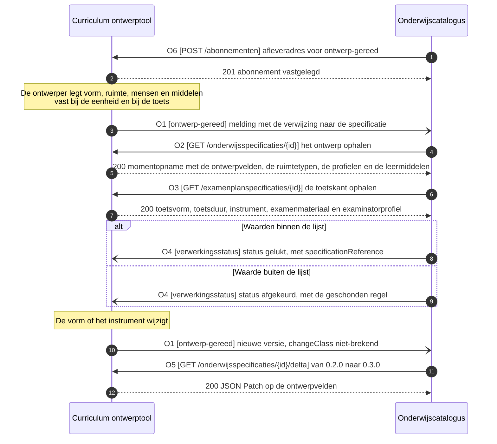

# IS-OA-02 Onderwijsontwerp naar de catalogus

Deze eenheid levert de uitvoeringskenmerken van het ontwerp aan de onderwijscatalogus: de onderwijsvorm, het gevraagde ruimtetype, de expertiseprofielen van docent en examinator, de leermiddelen, de verdeling van de studiebelasting, de toetsvorm en het toetsinstrument, elk als veld op de specificatie die [IS-OA-01](README.md#1-de-informatiestromen) al draagt.

De uuid's, de versies en de namen in de voorbeeldpayloads hieronder komen uit [casus.md](casus.md), de vaste identificaties van deze interactiespecificatie. Deze eenheid is de enige die een versieverhoging beschrijft.

De status staat in het artefact zelf. Een operatie, een endpoint en een schema dragen `vastgelegd` zodra Public ze draagt, en `voorstel` zolang deze specificatie ze voorstelt. Een voorgesteld schema draagt een `$id` die op `/voorstel` eindigt, zodat de status meereist met het bestand.

## De eenheid

| | |
|---|---|
| Bronsysteem | Curriculum ontwerptool, applicatiedienst `Curriculum ontwerp` |
| Doelsysteem | Onderwijscatalogus |
| Koppeling | Curriculum ontwerptool naar onderwijscatalogus. De [dienstpagina van de ontwerptool](https://github.com/Npuls-OKx/Public/blob/dev/Koppelvlakspecificaties/Applicatiecomponenten/curriculum-ontwerptool.md) laat de endpoints aan een volgend pakket, [ADR 0020](https://github.com/Npuls-OKx/Public/blob/dev/Referentiemateriaal/adr/0020-curriculumontwerp-onderwijscatalogus-happy-flow-synchronisatie-en-federatie-adopt-klonen.md) legt de richting vast |
| Beeld | F1-13, het onderwijs- en examenontwerp mee naar de catalogus, van de conceptplaat Onderwijsontwerp |
| Status | Voorstel. Elke operatie hieronder staat op voorstel, en elk schema dat deze eenheid toevoegt draagt een `$id` op `/voorstel`. De dragende schema's in Public staan op alfa, en de objecttypen achter de lading komen van de conceptplaat ([voorbeeld-lr1-regels.json](../../../model/informatiemodel/voorbeeld-lr1-regels.json)) |
| Applicatiedienst | `Onderwijs beheer` van de onderwijscatalogus neemt de lading aan, gevoed door `Curriculum ontwerp` van de ontwerptool ([componenten.json](../../../model/informatiemodel/componenten.json)) |
| Schemas | [education-design.json](schemas/education-design.json), [room-type.json](schemas/room-type.json), [expertise-profile.json](schemas/expertise-profile.json) en [learning-resource-group.json](schemas/learning-resource-group.json), elk op voorstel. [De schemas](#de-schemas) zegt wat elk draagt |
| Sleuteltaal | De sleutels in de payload zijn Engels, zoals de schema's in Public ze dragen; [mapping.md](https://github.com/Npuls-OKx/Public/blob/dev/Informatie-en-gegevensmodellen/mapping.md) legt per schema de Nederlandse naam ernaast. Enumwaarden blijven Nederlands, en elk schema draagt de Nederlandse naam per veld in `DutchName` |
| Toetsbare eis | De ontwerptool levert per onderwijseenheid-, leeronderdeel- en toetsonderdeelspecificatie de sleutels uit [de berichtspecificatie](#de-berichtspecificatie) over [de operaties](#de-operaties), en de catalogus neemt ze onveranderd over met O2 en O3. De eis is vandaag af te dwingen: een payload valideert tegen het dragende schema in Public en tegen [education-design.json](schemas/education-design.json), die de waardelijsten beoordeelt |


Dezelfde waarden gaan in [F2-03 van IS-OA-03](is-oa-03.md#de-eenheid) door naar planning, en de knelpuntcodes `expertiseTekort` en `ruimteTekort` uit [bottleneck.json](https://github.com/Npuls-OKx/Public/blob/dev/Informatie-en-gegevensmodellen/schemas/bottleneck.json) rusten erop. Daarom landen zij hier als veld op de specificatie.

## De stroom



## De operaties

Deze lading rijdt mee op de koppeling die [IS-OA-01](README.md#1-de-informatiestromen) voluit beschrijft: de ontwerptool houdt het ontwerp in bewerking vast en meldt dat het gereed is, waarna de catalogus het ophaalt ([U3](https://github.com/Npuls-OKx/Public/blob/dev/Koppelvlakspecificaties/uitgangspunten.md#u3-resource-eigenaarschap) en [U4](https://github.com/Npuls-OKx/Public/blob/dev/Koppelvlakspecificaties/uitgangspunten.md#u4-notify-then-pull)). Authenticatie per operatie volgt de [auth-standaard](https://github.com/Npuls-OKx/Public/blob/dev/Koppelvlakspecificaties/auth-standaard.md).

| Nr | Pad of meldpatroon (webhook) | Methode | Parameters | Statuscodes | Foutgedrag | Status |
|---|---|---|---|---|---|---|
| O1 | `ontwerp-gereed` op OC | POST | geen | 200 | Bevestiging met 200. Zonder bevestiging herhaalt de melder met oplopende wachttijd (backoff) en daarna via de wachtrij voor onbestelbare berichten (dead letter channel). Een herhaald event blijft zonder extra effect door het event-id ([ADR 0018](https://github.com/Npuls-OKx/Public/blob/dev/Referentiemateriaal/adr/0018-enterprise-messaging-patronen-voor-betrouwbare-koppelvlakken.md)) | voorstel |
| O2 | `/onderwijsspecificaties/{id}` op CO | GET | `versie` (optioneel, standaard de laatst vastgestelde) | 200, 400, 404 | Alleen-lezen en zonder neveneffect. 404 bij een onbekend id, 400 bij een onbekende versie | voorstel |
| O3 | `/examenplanspecificaties/{id}` op CO | GET | `versie` (optioneel, standaard de laatst vastgestelde) | 200, 400, 404 | Als O2 | voorstel |
| O4 | `verwerkingsstatus` op CO, payload [processing-status.json](https://github.com/Npuls-OKx/Public/blob/dev/Informatie-en-gegevensmodellen/schemas/processing-status.json) met `programmeOfferingId` (opleidingsaanbodId) op `null`, want deze eenheid meldt op een specificatie | POST | geen | 200 | `afgekeurd` draagt de geschonden regel met het veld en de waarde die de controle raakte, waarna de vorige versie blijft staan. Herhaling als O1 | voorstel |
| O5 | `/onderwijsspecificaties/{id}/delta` en `/examenplanspecificaties/{id}/delta` op CO | GET | `van` en `naar`, beide verplicht en beide een versie | 200, 400, 404 | JSON Patch volgens RFC 6902, vorm in [education-specification-delta.json](https://github.com/Npuls-OKx/Public/blob/dev/Informatie-en-gegevensmodellen/schemas/education-specification-delta.json). 400 bij een versiepaar dat de bezitter mist ([U11](https://github.com/Npuls-OKx/Public/blob/dev/Koppelvlakspecificaties/uitgangspunten.md#u11-toekomstvaste-endpoints-volledige-structuur-en-delta)) | voorstel |
| O6 | `/abonnementen` op CO, payload [subscription.json](https://github.com/Npuls-OKx/Public/blob/dev/Informatie-en-gegevensmodellen/schemas/subscription.json) met `events` op `ontwerp-gereed` | POST | geen | 201, 400 | Herhaalbaar zonder extra effect (idempotent) op afleveradres plus soort melding: een herhaalde registratie overschrijft de vorige | voorstel |

Waarop elke operatie rust. De paden bestaan in Public op de onderwijscatalogus, die de opgenomen specificatie bezit; deze eenheid draait de richting om en legt hetzelfde pad op de ontwerptool, die het ontwerp in bewerking bezit.

| Nr | Wat Public vandaag draagt | Wat deze eenheid toevoegt |
|---|---|---|
| O1 | De vorm van een dunne melding met een verwijzing (U4), en de lijst `events` in subscription.json | Het meldpatroon `ontwerp-gereed` op de catalogus (WB-07) en de waarde in die lijst (WB-10) |
| O2 | `GET /onderwijsspecificaties/{id}` op de [onderwijscatalogus](https://github.com/Npuls-OKx/Public/blob/dev/Koppelvlakspecificaties/Applicatiecomponenten/onderwijscatalogus.md), met [education-specification.json](https://github.com/Npuls-OKx/Public/blob/dev/Informatie-en-gegevensmodellen/schemas/education-specification.json) als payload | Hetzelfde pad op de ontwerptool met een voorvoegsel per bezitter (WB-07), en de ontwerpvelden in de payload (WB-01 tot en met WB-06) |
| O3 | `GET /examenplanspecificaties/{id}` op de onderwijscatalogus, met [result-structure.json](https://github.com/Npuls-OKx/Public/blob/dev/Informatie-en-gegevensmodellen/schemas/result-structure.json) als payload | Als O2, met de toetsvelden (WB-02, WB-04, WB-06, WB-08) |
| O4 | Het schema processing-status.json en de eventwaarde `verwerkingsstatus` | Het meldpatroon op de ontwerptool (WB-07) |
| O5 | `GET /onderwijsspecificaties/{id}/delta` op de onderwijscatalogus | Hetzelfde pad op de ontwerptool, en dezelfde delta bij het examenplan (WB-11) |
| O6 | `POST /abonnementen` op de onderwijscatalogus | Hetzelfde pad op de ontwerptool, zodat de catalogus zich op `ontwerp-gereed` abonneert (WB-07) |

### Meereizen met de specificatie

Het ontwerp reist mee op de resource van IS-OA-01 en krijgt geen eigen resource. Wat daarvoor pleit:

| Grond | Wat zij zegt |
|---|---|
| [bottleneck.json](https://github.com/Npuls-OKx/Public/blob/dev/Informatie-en-gegevensmodellen/schemas/bottleneck.json) | De knelpuntcodes `ruimteTekort` en `expertiseTekort` dragen `involvedSpecificationIds`: planning meldt het knelpunt op de specificatie, dus hoort het ruimtetype en het profiel bij die specificatie te staan |
| F1-13 en [F2-03 van IS-OA-03](is-oa-03.md#de-eenheid) | Het ontwerp stroomt met dezelfde pijl van de ontwerptool naar de catalogus als de specificatie, en dezelfde waarden gaan daarna naar planning |
| [gebruiksprofielen.md](https://github.com/Npuls-OKx/Public/blob/dev/Informatie-en-gegevensmodellen/gebruiksprofielen.md) | Het verschil per koppeling staat in het gebruiksprofiel: het schema legt de vorm vast, het profiel wat een koppeling ervan gebruikt. Een afnemer die het ontwerp laat staan, laat het staan in zijn profiel |
| [regels.md](https://github.com/Npuls-OKx/Public/blob/dev/Informatie-en-gegevensmodellen/regels.md) | De versie loopt op de specificatie: het ontwerp erbij is MINOR binnen dezelfde identiteit, met `changeClass` (wijzigingsklasse) `niet-brekend`. Een eigen resource zou een tweede versielijn openen |

De leermiddelgroepen gaan daarnaast ook los: gebruiksprofielen.md parkeert een leermiddelkoppeling-payload met per specificatie een `specificatieVerwijzing`, en [learning-resource-group.json](schemas/learning-resource-group.json) draagt dat veld. Binnen deze payload wijst de specificatie de groep aan, en op die route draagt de groep de verwijzing zelf.

## De schemas

Elk schema draagt zijn status in zijn `$id`. De schema's die deze eenheid voorstelt staan in [schemas/](schemas/) en eindigen op `/voorstel`; de dragende schema's staan in Public en eindigen op `/alfa`.

| Schema | Wat het draagt | Objecttype | Status |
|---|---|---|---|
| [education-design.json](schemas/education-design.json) | De ontwerpvelden op een specificatie, plus de arrays met de objecten waarnaar zij wijzen | `Onderwijsvorm`, en de attributen van de specificatie | voorstel |
| [room-type.json](schemas/room-type.json) | Het ruimteprofiel dat het ontwerp vraagt, met capaciteit, kenmerken en de locaties waar het bestaat | `Onderwijslocatie type`, `Onderwijslocatie` | voorstel |
| [expertise-profile.json](schemas/expertise-profile.json) | Het gevraagde medewerkerprofiel met zijn competenties, en de organisatie-eenheid met die behoefte | `Expertise of functieprofiel`, `Competenties / Skills`, `Organisatie-eenheid` | voorstel |
| [learning-resource-group.json](schemas/learning-resource-group.json) | De leermiddelen bij een leeronderdeel en het toetsinstrument bij een examenonderdeel | `Leermiddelgroep` en `Collectie van Leermiddelgroepen`, van de conceptplaat | voorstel |
| [education-specification.json](https://github.com/Npuls-OKx/Public/blob/dev/Informatie-en-gegevensmodellen/schemas/education-specification.json) | De specificatie zelf, met `studyLoad`, `timeDistribution` en `explanation` | `Onderwijseenheid specificatie`, `Leeronderdeel specificatie` | vastgelegd, alfa |
| [result-structure.json](https://github.com/Npuls-OKx/Public/blob/dev/Informatie-en-gegevensmodellen/schemas/result-structure.json) | Het toetsonderdeel, met `assessmentForm`, `weighting` en `resultModel` | `Toetsonderdeel specificatie`, `Examenonderdeelspecificatie` | vastgelegd, alfa |
| [volume.json](https://github.com/Npuls-OKx/Public/blob/dev/Informatie-en-gegevensmodellen/schemas/volume.json) | De omvang per tijdsoort in `timeDistributions` | attribuut van de specificatie | vastgelegd, alfa |
| [specification-reference.json](https://github.com/Npuls-OKx/Public/blob/dev/Informatie-en-gegevensmodellen/schemas/specification-reference.json) | De verwijzing op de leermiddelgroep en in de verwerkingsstatus | `Onderwijseenheid specificatie` | vastgelegd, alfa |
| [processing-status.json](https://github.com/Npuls-OKx/Public/blob/dev/Informatie-en-gegevensmodellen/schemas/processing-status.json) | De uitkomst op O4 | de toestand van de inname | vastgelegd, alfa |
| [subscription.json](https://github.com/Npuls-OKx/Public/blob/dev/Informatie-en-gegevensmodellen/schemas/subscription.json) | Het afleveradres op O6 | kanaaleigenschap | vastgelegd, alfa |

### Waarom deze knip

| De knip | Waarom zij daar valt |
|---|---|
| De ontwerpvelden staan als overlay op de dragende schema's, op de specificatie die IS-OA-01 al draagt | education-specification.json en result-structure.json dragen hun specificaties in dezelfde array `educationSpecifications`, dus dekt een enkele overlay de specificatiekant en de toetskant. De payload blijft plat, met een verwijzing per object ([U7](https://github.com/Npuls-OKx/Public/blob/dev/Koppelvlakspecificaties/uitgangspunten.md#u7-payload-plat-met-verwijzingen-en-de-sleutelconventie)) |
| De toetsvelden staan in dezelfde overlay als de onderwijsvelden | Op de conceptplaat is `Toetsvormspecificatie` een `Onderwijsvorm specificatie`: dezelfde vorm, nu voor het examen. Een eigen schema zou de gedeelde velden verdubbelen |
| Het ruimtetype staat apart, en de specificatie wijst het aan met een code | Meerdere specificaties wijzen hetzelfde profiel aan, en planning legt het tegen de beschikbare ruimtes voor `ruimteTekort`. De code is de sleutel die bij een type hoort, zoals `source.code` het kwalificatiekader aanwijst; daarmee draagt het profiel geen uuid die de instelling moet uitgeven |
| Het expertiseprofiel staat apart, met de competenties erin | `Vaardigheid`, `Kennis` en `Inzicht` dragen scope buiten in het informatiemodel: CompetentNL en ISCED-F houden hun betekenis, en het profiel draagt de verwijzing daarheen. Een eigen schema per laag zou een kader nabouwen dat buiten OKx leeft |
| De leermiddelen en het toetsinstrument delen een schema | Op de conceptplaat is `Toetsinstrument` een `Collectie van Leermiddelgroepen`, die `Leermiddelgroep` aggregeert. `partOfLearningResourceGroupId` draagt die aggregatie, zoals `partOfLocationId` dat in location.json doet. Dit beslecht de open keuze in WB-06 |

De overlay beoordeelt wat het dragende schema doorlaat. Een toetsduur in `min`, een competentie van het type `skill` en een leermiddelgroep met doel `examen` passeren result-structure.json en vallen af op education-design.json.

## De berichtspecificatie

Waar de lading van F1-13 landt, van de conceptplaat naar het [informatiemodel](../../../model/informatiemodel/informatiemodel.md) en het schema:

| Objecttype op de conceptplaat | Objecttype in het informatiemodel | Sleutel in de payload | Nederlandse naam | Schema |
|---|---|---|---|---|
| `Onderwijsvorm specificatie` | `Onderwijsvorm` | `educationForm`, met `explanation` voor de leesbare vorm | onderwijsvorm, toelichting | education-design.json, voorstel |
| `Gewenste Onderwijskundige Leeromgeving`, `Onderwijsruimte type` | `Onderwijslocatie type` (OEAPI `roomType`) | `roomType` plus `roomTypes` | onderwijslocatieType, onderwijslocatieTypen | room-type.json, voorstel |
| `Onderwijs locatie`, `Lokaaltypes` | `Onderwijslocatie` | `roomTypes[].locationIds` | locatieIds | room-type.json, voorstel; de locatie zelf location.json, alfa |
| `Gewenst medewerker competentieprofiel`, `Medewerker Type / Expertise Profiel` | `Expertise of functieprofiel` | `expertiseProfileIds` plus `expertiseProfiles` | expertiseprofielIds, expertiseprofielen | expertise-profile.json, voorstel |
| `Competenties / skills`, `Vaardigheid`, `Kennis` | `Competenties / Skills`, `Vaardigheid`, `Kennis`, `Inzicht`, scope buiten | `expertiseProfiles[].competences` | competenties | expertise-profile.json, voorstel |
| `Studiebelasting en begeleide onderwijstijd indicatie` | attribuut van de specificatie | `studyLoad` plus `timeDistributions` | studielast, tijdsverdelingen | volume.json, alfa; de verdeling education-design.json, voorstel |
| `Collectie van Leermiddelgroepen`, `Leermiddelgroep` | zonder objecttype | `learningResourceGroupIds` plus `learningResourceGroups` | leermiddelgroepIds, leermiddelgroepen | learning-resource-group.json, voorstel |
| `Toetsvormspecificatie`, `Toetsvorm` | `Toetsonderdeel specificatie` | `assessmentForm` plus `assessmentDuration` | toetsvorm, toetsduur | result-structure.json, alfa; de duur education-design.json, voorstel |
| `Toetsinstrument` | zonder objecttype | `assessmentInstrumentId` | toetsinstrumentId | learning-resource-group.json, voorstel |

De kolom Grond hieronder opent met de status van het veld en noemt daarna waarop het veld bestaat: een objecttype of relatie uit het informatiemodel, een instantie uit de beelden F1-06, F1-10 en F1-13, of een schema in Public.

### Bericht 1: de ontwerpvelden op de onderwijsspecificatie

Per onderwijseenheid- of leeronderdeelspecificatie in de array `educationSpecifications` van [education-specification.json](https://github.com/Npuls-OKx/Public/blob/dev/Informatie-en-gegevensmodellen/schemas/education-specification.json).

| Veld | Nederlandse naam | Type | Kardinaliteit | Verplicht | Objecttype | Grond |
|---|---|---|---|---|---|---|
| `educationForm` | onderwijsvorm | string, open lijst simulatie, theorie, praktijk, beroepspraktijkvorming, zelfstudie | 0..1 | nee | `Onderwijsvorm` | voorstel, WB-01. `Leeronderdeel specificatie` beschrijft `Onderwijsvorm`; F1-06 en F1-13 dragen "Simulatie in de leerapotheek, theorie ondersteunend" |
| `roomType` | onderwijslocatieType | string, de code van een profiel in `roomTypes` | 0..1 | nee | `Onderwijslocatie type` | voorstel, WB-02. `Onderwijsvorm` is indicatie voor gebruik van `Onderwijslocatie type`; F1-13 draagt "Balie-simulatie in het skillslab" |
| `expertiseProfileIds` | expertiseprofielIds | array van uuid | 0..n | nee | `Expertise of functieprofiel` | voorstel, WB-04. F1-13 draagt "Apothekersassistent-docent met baliepraktijk" aan de onderwijsvorm |
| `learningResourceGroupIds` | leermiddelgroepIds | array van uuid | 0..n | nee | `Leermiddelgroep`, conceptplaat | voorstel, WB-06. F1-06 hangt `Collectie van Leermiddelgroepen` aan de leeronderdeelspecificatie, met "Leermiddelen voor de baliesimulatie" |
| `studyLoad` | studielast | object, [volume.json](https://github.com/Npuls-OKx/Public/blob/dev/Informatie-en-gegevensmodellen/schemas/volume.json) | 1..1 | ja | attribuut van de specificatie | vastgelegd in education-specification.json |
| `timeDistribution` | tijdsverdeling | string, open lijst BOT, OOT, BPV | 0..1 | nee | attribuut van de specificatie | vastgelegd in education-specification.json |
| `timeDistributions` | tijdsverdelingen | array van object met `timeDistribution` en `volume` | 0..n | nee | attribuut van de specificatie, op de conceptplaat `Studiebelasting en begeleide onderwijstijd indicatie` | voorstel, WB-05. F1-06 en F1-13 dragen "BOT 50 / OOT 50 SBU", een verdeling over delen waar het schema vandaag een waarde draagt |
| `explanation` | toelichting | string | 0..1 | nee | attribuut van de specificatie | vastgelegd in education-specification.json |

De som van `timeDistributions` sluit op `studyLoad` van dezelfde specificatie: Baliegesprekken 101 draagt 600 SBU, verdeeld over BOT 300 en OOT 300.

### Bericht 2: de ontwerpvelden op het toetsonderdeel

Per toetsonderdeelspecificatie in de array `educationSpecifications` van [result-structure.json](https://github.com/Npuls-OKx/Public/blob/dev/Informatie-en-gegevensmodellen/schemas/result-structure.json).

| Veld | Nederlandse naam | Type | Kardinaliteit | Verplicht | Objecttype | Grond |
|---|---|---|---|---|---|---|
| `assessmentForm` | toetsvorm | string, open lijst | 0..1 | nee | `Toetsonderdeel specificatie` | vastgelegd in result-structure.json |
| `roomType` | onderwijslocatieType | string, de code van een profiel in `roomTypes` | 0..1 | nee | `Onderwijslocatie type` | voorstel, WB-02. F1-10 draagt "Praktijkruimte met baliesimulatie, afsluitbaar voor examinering", een eigen profiel naast dat van het onderwijs |
| `assessmentDuration` | toetsduur | object met `value` en `unit` minuten of uren | 0..1 | nee | `Toetsvorm`, conceptplaat | voorstel, WB-08. F1-10 draagt "Praktijkbeoordeling aan de balie, 45 minuten" |
| `assessmentInstrumentId` | toetsinstrumentId | uuid | 0..1 | nee | `Toetsinstrument`, conceptplaat | voorstel, WB-06. F1-10 en F1-13 dragen "Beoordelingsformulier met rubric" |
| `expertiseProfileIds` | expertiseprofielIds | array van uuid | 0..n | nee | `Expertise of functieprofiel` | voorstel, WB-04. F1-10 hangt "Examinator met baliepraktijk en toetsbekwaamheid" aan de toetsvormspecificatie |

### Bericht 3: het expertiseprofiel

De array `expertiseProfiles` staat naast `educationSpecifications`, net als `ruleSets` in beide dragende schema's. Vorm in [expertise-profile.json](schemas/expertise-profile.json).

| Veld | Nederlandse naam | Type | Kardinaliteit | Verplicht | Objecttype | Grond |
|---|---|---|---|---|---|---|
| `expertiseProfiles[].id` | id | uuid | 1..1 | ja | `Expertise of functieprofiel` | voorstel, WB-03, [U7](https://github.com/Npuls-OKx/Public/blob/dev/Koppelvlakspecificaties/uitgangspunten.md#u7-payload-plat-met-verwijzingen-en-de-sleutelconventie) |
| `expertiseProfiles[].name` | naam | string | 1..1 | ja | `Expertise of functieprofiel` | voorstel, WB-03. F1-13 draagt de profielnaam |
| `expertiseProfiles[].role` | rol | string, open lijst docent, examinator, praktijkbegeleider | 0..1 | nee | `Expertise of functieprofiel` | voorstel, WB-03. F1-06 draagt de docent, F1-10 de examinator, en `Collectie van Medewerkertypes` in F1-06 draagt "Docent farmacie en praktijkbegeleider" |
| `expertiseProfiles[].description` | omschrijving | string | 0..1 | nee | `Expertise of functieprofiel` | voorstel, WB-03 |
| `expertiseProfiles[].organisationUnitId` | organisatieEenheidId | uuid | 0..1 | nee | `Organisatie-eenheid` | voorstel, WB-03. `Organisatie-eenheid` heeft behoefte aan `Expertise of functieprofiel` en voert de specificatie uit; de eenheid zelf volgt [organisation-unit.json](https://github.com/Npuls-OKx/Public/blob/dev/Informatie-en-gegevensmodellen/schemas/organisation-unit.json) |
| `expertiseProfiles[].competences[].type` | type | enum vaardigheid, kennis, inzicht | 1..1 | ja | `Vaardigheid`, `Kennis`, `Inzicht` | voorstel, WB-03. `Competenties / Skills` aggregeert die drie |
| `expertiseProfiles[].competences[].name` | naam | string | 1..1 | ja | idem | voorstel, WB-03. F1-06 draagt "Didactische en communicatieve vaardigheden", F1-10 "Beoordelen en feedback geven" |
| `expertiseProfiles[].competences[].framework` | kader | string, open lijst competentnl, isced-f | 0..1 | nee | scope buiten het informatiemodel | voorstel, WB-03. `standard` in [source.json](https://github.com/Npuls-OKx/Public/blob/dev/Informatie-en-gegevensmodellen/schemas/source.json) noemt competentnl als vervolgwaarde; F1-06 draagt CompetentNL en ISCED-F |
| `expertiseProfiles[].competences[].code` | code | string | 0..1 | nee | scope buiten het informatiemodel | voorstel, WB-03. F1-06 draagt "Farmacie (ISCED-F 0916)" |
| `expertiseProfiles[].competences[].level` | niveau | string | 0..1 | nee | scope buiten het informatiemodel | voorstel, WB-03. F1-06 draagt "CompetentNL laag 2" |

De sleutel `source` blijft voorbehouden aan de vorm van source.json op de leeruitkomst en op de aanbodinstantie, zoals [casus.md](casus.md) vastlegt. Daarom draagt de competentie haar kader onder `framework`.

### Bericht 4: het ruimtetype

De array `roomTypes` staat naast `educationSpecifications`. Vorm in [room-type.json](schemas/room-type.json).

| Veld | Nederlandse naam | Type | Kardinaliteit | Verplicht | Objecttype | Grond |
|---|---|---|---|---|---|---|
| `roomTypes[].code` | code | string | 1..1 | ja | `Onderwijslocatie type` | voorstel, WB-02. De specificatie wijst het profiel aan met deze code; OEAPI draagt de sleutel `roomType` |
| `roomTypes[].name` | naam | string | 1..1 | ja | `Onderwijslocatie type` | voorstel, WB-02. F1-06 draagt "Praktijkruimte met baliesimulatie" |
| `roomTypes[].description` | omschrijving | string | 0..1 | nee | `Onderwijslocatie type` | voorstel, WB-02 |
| `roomTypes[].capacity` | capaciteit | integer | 0..1 | nee | `Onderwijslocatie type` | voorstel, WB-02. F1-06 draagt "voor 24 studenten"; dezelfde sleutel als in [group.json](https://github.com/Npuls-OKx/Public/blob/dev/Informatie-en-gegevensmodellen/schemas/group.json) |
| `roomTypes[].features` | kenmerken | array van string, open lijst | 0..n | nee | `Onderwijslocatie type` | voorstel, WB-02. F1-06 draagt "balie-opstelling mogelijk" en "Praktijklokalen met servicebalie", F1-10 "afsluitbaar voor examinering" |
| `roomTypes[].locationIds` | locatieIds | array van uuid | 0..n | nee | `Onderwijslocatie` | voorstel, WB-02. `Onderwijslocatie type` verwijst naar `Onderwijslocatie`, die `Lokaaltypes` aggregeert; F1-06 draagt "Vestiging Zuid" en casus.md de vestiging van deze casus |

Het profiel zegt welke ruimte het ontwerp vraagt. Het lokaal zelf volgt bij roosteren, zoals F1-06 vastlegt: de gewenste leeromgeving is een ruimteprofiel.

### Bericht 5: de leermiddelgroep

De array `learningResourceGroups` staat naast `educationSpecifications` en draagt zowel de leermiddelen als het toetsinstrument. Vorm in [learning-resource-group.json](schemas/learning-resource-group.json).

| Veld | Nederlandse naam | Type | Kardinaliteit | Verplicht | Objecttype | Grond |
|---|---|---|---|---|---|---|
| `learningResourceGroups[].id` | id | uuid | 1..1 | ja | `Leermiddelgroep`, conceptplaat | voorstel, WB-06. [gebruiksprofielen.md](https://github.com/Npuls-OKx/Public/blob/dev/Informatie-en-gegevensmodellen/gebruiksprofielen.md) verwacht `id` in de leermiddelkoppeling-payload |
| `learningResourceGroups[].version` | versie | string, patroon `n.n.n` | 0..1 | nee | idem | voorstel, WB-06. gebruiksprofielen.md verwacht `versie` |
| `learningResourceGroups[].name` | naam | string | 1..1 | ja | idem | voorstel, WB-06. F1-06 draagt "Leermiddelen voor de baliesimulatie", F1-10 "Beoordelingsformulier met rubric" |
| `learningResourceGroups[].description` | omschrijving | string | 0..1 | nee | idem | voorstel, WB-06 |
| `learningResourceGroups[].purpose` | doel | enum onderwijs, toetsing | 0..1 | nee | idem | voorstel, WB-06. F1-06 draagt de leermiddelen bij het leeronderdeel, F1-10 het examenmateriaal bij de proeve |
| `learningResourceGroups[].sourcing` | herkomst | enum ingekocht, geconstrueerd | 0..1 | nee | idem | voorstel, WB-06. F1-10 draagt "ingekocht bij de branche", en de stap heet "exameninstrumenten bepalen, inkopen of construeren" |
| `learningResourceGroups[].resources` | leermiddelen | array van string | 0..n | nee | idem | voorstel, WB-06. F1-06 draagt "Apotheekbalie-opstelling, receptenlijnsysteem, oefenmedicatie", F1-10 "oefenrecepten, casuskaarten, baliemateriaal" |
| `learningResourceGroups[].partOfLearningResourceGroupId` | valtBinnenLeermiddelgroepId | uuid of null | 0..1 | nee | `Collectie van Leermiddelgroepen`, conceptplaat | voorstel, WB-06. F1-10: `Toetsinstrument` is een `Collectie van Leermiddelgroepen` die `Leermiddelgroep` aggregeert; [location.json](https://github.com/Npuls-OKx/Public/blob/dev/Informatie-en-gegevensmodellen/schemas/location.json) draagt dezelfde vorm als `partOfLocationId` |
| `learningResourceGroups[].specificationReference` | specificatieVerwijzing | object, [specification-reference.json](https://github.com/Npuls-OKx/Public/blob/dev/Informatie-en-gegevensmodellen/schemas/specification-reference.json) | 0..1 | nee | idem | voorstel, WB-06. gebruiksprofielen.md verwacht per specificatie een `specificatieVerwijzing` voor de route over de leermiddelkoppeling |

## Voorbeeldpayload

Casus Apothekersassistent, kwalificatiedossier 23450, met de instantiewaarden uit F1-06, F1-10 en F1-13. De uuid's, de codes, de versies en de namen staan in [casus.md](casus.md); de specificaties volgen daar de [voorbeeldpayloads](https://github.com/Npuls-OKx/Public/blob/dev/Informatie-en-gegevensmodellen/voorbeeldpayloads.md) in Public, en de profielen, de ruimtetypen en de leermiddelgroepen dragen een identificatie van deze snede. De ontwerpvelden komen additief bovenop de grofmazige specificatie van IS-OA-01, dus loopt de versie van `0.1.0` naar `0.2.0`.

De specificatiekant, het antwoord op O2. Deze payload valideert tegen education-specification.json en tegen education-design.json:

```json schema=education-specification,education-design
{
  "educationSpecifications": [
    {
      "id": "402c2342-d897-4df4-a667-7fc5bd930944",
      "specificationType": "onderwijseenheidspecificatie",
      "version": "0.2.0",
      "parentSpecificationId": "7ae25c1e-ee27-43a2-a001-761ee39ea5c7",
      "learningOutcomeId": "12301838-92d4-4040-aea2-050bb131ceb7",
      "name": "Blok B1-K1",
      "studyLoad": { "value": 2000, "unit": "SBU" },
      "educationForm": "simulatie",
      "roomType": "skillslab",
      "expertiseProfileIds": ["8e1dcda7-ef4e-45d0-931a-e47c3c77ddef"],
      "explanation": "Simulatie in de leerapotheek, theorie ondersteunend"
    },
    {
      "id": "327c8263-3516-4b5a-8d57-c16241ec008d",
      "specificationType": "leeronderdeelspecificatie",
      "version": "0.2.0",
      "parentSpecificationId": "402c2342-d897-4df4-a667-7fc5bd930944",
      "learningOutcomeId": "78f25d62-9fd4-45c4-aa04-3d22f59213f5",
      "name": "Baliegesprekken 101",
      "studyLoad": { "value": 600, "unit": "SBU" },
      "timeDistributions": [
        { "timeDistribution": "BOT", "volume": { "value": 300, "unit": "SBU" } },
        { "timeDistribution": "OOT", "volume": { "value": 300, "unit": "SBU" } }
      ],
      "educationForm": "simulatie",
      "roomType": "skillslab",
      "expertiseProfileIds": ["8e1dcda7-ef4e-45d0-931a-e47c3c77ddef"],
      "learningResourceGroupIds": ["7f220267-c1ec-4052-bfc0-fe6517f6f820"],
      "explanation": "Balie-simulatie in het skillslab, theorie ondersteunend"
    }
  ],
  "roomTypes": [
    {
      "code": "skillslab",
      "name": "Skillslab met baliesimulatie",
      "capacity": 24,
      "features": ["balie-opstelling", "receptenlijnsysteem"],
      "locationIds": ["59807057-a6f1-473b-9084-114644557a68"]
    }
  ],
  "expertiseProfiles": [
    {
      "id": "8e1dcda7-ef4e-45d0-931a-e47c3c77ddef",
      "name": "Apothekersassistent-docent met baliepraktijk",
      "role": "docent",
      "organisationUnitId": "d9561371-5ece-482d-a675-a076e63f980f",
      "competences": [
        { "type": "vaardigheid", "name": "Didactische en communicatieve vaardigheden", "framework": "competentnl", "level": "laag 2" },
        { "type": "kennis", "name": "Farmacie", "framework": "isced-f", "code": "0916" }
      ]
    }
  ],
  "learningResourceGroups": [
    {
      "id": "7f220267-c1ec-4052-bfc0-fe6517f6f820",
      "version": "0.1.0",
      "name": "Leermiddelen voor de baliesimulatie",
      "purpose": "onderwijs",
      "resources": ["apotheekbalie-opstelling", "receptenlijnsysteem", "oefenmedicatie"]
    }
  ]
}
```

De toetskant, het antwoord op O3. Deze payload valideert tegen result-structure.json en tegen education-design.json:

```json schema=result-structure,education-design
{
  "educationSpecifications": [
    {
      "id": "941f180d-b0af-4933-a580-6ab654dfadda",
      "specificationType": "toetsonderdeelspecificatie",
      "version": "0.2.0",
      "parentSpecificationId": "0512c773-9c1b-42c4-ae0d-9af8554f2462",
      "learningOutcomeId": "12301838-92d4-4040-aea2-050bb131ceb7",
      "learningOutcome": { "type": "kerntaak", "code": "B1-K1" },
      "name": "Proeve van bekwaamheid B1-K1",
      "nature": "summatief",
      "assessmentForm": "proeveVanBekwaamheid",
      "weighting": 2,
      "resultModel": { "scale": "cijfer-1-10", "passMark": 5.5, "decimalPlaces": 1 },
      "mandatory": true,
      "status": "concept",
      "roomType": "skillslab-examen",
      "assessmentDuration": { "value": 45, "unit": "minuten" },
      "assessmentInstrumentId": "da138f60-ebb1-4853-870f-7e7d642873f2",
      "expertiseProfileIds": ["4037f1a2-c182-4f2d-ae00-bfb06b076337"],
      "description": "Proeve van bekwaamheid in de simulatieapotheek"
    }
  ],
  "roomTypes": [
    {
      "code": "skillslab-examen",
      "name": "Skillslab met baliesimulatie, afsluitbaar",
      "capacity": 24,
      "features": ["balie-opstelling", "afsluitbaar voor examinering"],
      "locationIds": ["59807057-a6f1-473b-9084-114644557a68"]
    }
  ],
  "expertiseProfiles": [
    {
      "id": "4037f1a2-c182-4f2d-ae00-bfb06b076337",
      "name": "Examinator met baliepraktijk en toetsbekwaamheid",
      "role": "examinator",
      "organisationUnitId": "d9561371-5ece-482d-a675-a076e63f980f",
      "competences": [
        { "type": "vaardigheid", "name": "Beoordelen en feedback geven", "framework": "competentnl", "level": "laag 2" },
        { "type": "kennis", "name": "Farmacie en toetsing", "framework": "isced-f", "code": "0916" }
      ]
    }
  ],
  "learningResourceGroups": [
    {
      "id": "da138f60-ebb1-4853-870f-7e7d642873f2",
      "version": "0.1.0",
      "name": "Beoordelingsformulier met rubric",
      "purpose": "toetsing",
      "sourcing": "ingekocht",
      "partOfLearningResourceGroupId": null
    },
    {
      "id": "36e392b0-a153-4b61-8e09-17b612adea91",
      "version": "0.1.0",
      "name": "Examenmateriaal baliesimulatie",
      "purpose": "toetsing",
      "sourcing": "geconstrueerd",
      "resources": ["oefenrecepten", "casuskaarten", "baliemateriaal"],
      "partOfLearningResourceGroupId": "da138f60-ebb1-4853-870f-7e7d642873f2"
    }
  ]
}
```

## De werkbrieven

Wat er in Public gebeurt om dit voorstel daar te laten landen. De versie-impact volgt de versionering uit de [regels bij de schema's](https://github.com/Npuls-OKx/Public/blob/dev/Informatie-en-gegevensmodellen/regels.md): een additief veld is MINOR, en een wijziging van de uitvoeringsvorm draagt `changeClass` (wijzigingsklasse) `niet-brekend`.

Per schema:

| Schema | Wat Public ervoor doet | Versie-impact |
|---|---|---|
| [education-design.json](schemas/education-design.json) | Opnemen in `schemas/`, en in education-specification.json en result-structure.json per specificatieobject met `allOf` componeren, zodat de ontwerpvelden daar gelden. De arrays `roomTypes`, `expertiseProfiles` en `learningResourceGroups` komen naast `ruleSets`. De `$id` gaat van `/voorstel` naar `/alfa`, en de verwijzingen kunnen dan bestandsrelatief worden zoals de rest | Nieuw schema met additieve optionele velden en arrays, MINOR op het releasepakket |
| [room-type.json](schemas/room-type.json) | Opnemen in `schemas/`, met de waardelijst per ruimtesoort open. `locationIds` sluit aan op location.json | Nieuw schema, MINOR |
| [expertise-profile.json](schemas/expertise-profile.json) | Opnemen in `schemas/`. `organisationUnitId` sluit aan op organisation-unit.json, en `framework` op de open lijst van `standard` in source.json | Nieuw schema, MINOR |
| [learning-resource-group.json](schemas/learning-resource-group.json) | Opnemen in `schemas/`, en de leermiddelkoppeling-payload in gebruiksprofielen.md hierop zetten: dezelfde groep reist binnen de specificatie-payload en los over die koppeling | Nieuw schema, MINOR. De route over de leermiddelkoppeling raakt het meldpatroon `leermiddelkoppeling-beschikbaar` op de catalogus |
| [education-specification.json](https://github.com/Npuls-OKx/Public/blob/dev/Informatie-en-gegevensmodellen/schemas/education-specification.json) | De `allOf` naar education-design.json, plus de arrays eromheen | MINOR |
| [result-structure.json](https://github.com/Npuls-OKx/Public/blob/dev/Informatie-en-gegevensmodellen/schemas/result-structure.json) | Als education-specification.json | MINOR |
| [subscription.json](https://github.com/Npuls-OKx/Public/blob/dev/Informatie-en-gegevensmodellen/schemas/subscription.json) | De waarde `ontwerp-gereed` in de gesloten lijst `events` | Additief voor de abonnee en brekend voor wie op de lijst valideert, MAJOR |
| [mapping.md](https://github.com/Npuls-OKx/Public/blob/dev/Informatie-en-gegevensmodellen/mapping.md) | De Nederlandse naam per nieuwe sleutel, zoals elk schema die in `DutchName` draagt | Geen schemawijziging |
| [informatiemodel](https://github.com/Npuls-OKx/Public/blob/dev/Informatie-en-gegevensmodellen/informatiemodel.md) en [begrippen](https://github.com/Npuls-OKx/Public/blob/dev/Informatie-en-gegevensmodellen/begrippen.md) | Een objecttype voor `Toetsinstrument` en `Leermiddelgroep`, en een definitie bij `Onderwijsvorm`, `Onderwijslocatie type` en `Expertise of functieprofiel` | Geen schemawijziging |

Per werkbrief:

| Nr | Wat er in Public gebeurt | Waar | Versie-impact | Grond |
|---|---|---|---|---|
| WB-01 | Veld `educationForm` (onderwijsvorm), string uit een open lijst met simulatie, theorie, praktijk, beroepspraktijkvorming en zelfstudie | education-design.json, gecomponeerd in education-specification.json | Additief optioneel veld, MINOR | F1-13 en F2-03 dragen `Onderwijsvorm specificatie`, het informatiemodel kent `Onderwijsvorm` en de [begrippenlijst](../begrippen/begrippenlijst.md) houdt het zonder definitie |
| WB-02 | Veld `roomType` (onderwijslocatieType), de OEAPI-naam die het informatiemodel bij `Onderwijslocatie type` draagt, plus het profiel zelf in room-type.json en de array `roomTypes`. Het onderwijs en het examen dragen elk hun eigen code: F1-13 noemt het skillslab, F1-10 de afsluitbare variant | education-design.json en room-type.json, gecomponeerd in education-specification.json en result-structure.json | Nieuw schema met een additief veld en een additieve array, MINOR | Knelpuntcode `ruimteTekort` veronderstelt het ruimtetype, `Onderwijslocatie type` staat zonder definitie |
| WB-03 | Schema voor het expertiseprofiel met `id`, `name`, `role`, `description`, `organisationUnitId` en `competences`, plus de array `expertiseProfiles` naast `ruleSets` in beide payloads | expertise-profile.json | Nieuw schema met een additieve array, MINOR | Knelpuntcode `expertiseTekort` veronderstelt het profiel, `Expertise of functieprofiel` aggregeert `Competenties / Skills` en staat zonder definitie |
| WB-04 | Veld `expertiseProfileIds` (expertiseprofielIds), array van uuid | education-design.json, gecomponeerd in beide dragende schema's | Additief optioneel veld, MINOR | F1-13 hangt `Gewenst medewerker competentieprofiel` aan de onderwijsvorm en aan de toetsvorm |
| WB-05 | Veld `timeDistributions` (tijdsverdelingen), array van `timeDistribution` met `volume` uit volume.json, naast het bestaande enkelvoudige `timeDistribution` | education-design.json, gecomponeerd in education-specification.json | Additief optioneel veld, MINOR. Het enkelvoudige veld blijft geldig | F1-06 en F1-13 noemen BOT 50 en OOT 50 SBU, een verdeling over delen, waar het schema vandaag een waarde draagt |
| WB-06 | Veld `assessmentInstrumentId` (toetsinstrumentId) en `learningResourceGroupIds` (leermiddelgroepIds), plus het instrument en de leermiddelen in learning-resource-group.json met de array `learningResourceGroups`. Het instrument en de leermiddelen delen dat schema, en de open keuze tussen een eigen instrumentschema en de leermiddelkoppeling-payload sluit daarmee: dezelfde groep reist beide routes | learning-resource-group.json, education-design.json, en gebruiksprofielen.md voor de leermiddelkoppeling | Nieuw schema met een additief veld, MINOR | F1-10 en F1-13 dragen `Toetsinstrument` als `Collectie van Leermiddelgroepen`, van de conceptplaat Onderwijsontwerp. [informatiemodel.json](../../../model/informatiemodel/informatiemodel.json) kent dat objecttype nog niet, en gebruiksprofielen.md verwacht voor de leermiddelkoppeling `id`, `versie` en een `specificatieVerwijzing` per specificatie |
| WB-07 | De meldpatronen O1 en O4, de paden van O2, O3, O5 en O6 op de ontwerptool met een voorvoegsel per bezitter naast het gelijknamige pad van de catalogus, en het gebruiksprofiel van deze koppeling: welk deel van de payload over O2 en O3 meekomt | [curriculum-ontwerptool.md](https://github.com/Npuls-OKx/Public/blob/dev/Koppelvlakspecificaties/Applicatiecomponenten/curriculum-ontwerptool.md) en [onderwijscatalogus.md](https://github.com/Npuls-OKx/Public/blob/dev/Koppelvlakspecificaties/Applicatiecomponenten/onderwijscatalogus.md), plus [gebruiksprofielen.md](https://github.com/Npuls-OKx/Public/blob/dev/Informatie-en-gegevensmodellen/gebruiksprofielen.md) | Nieuwe endpoints en een nieuw profiel, MINOR op het koppelvlakpakket | ADR 0020 vraagt operaties voor aanleggen, uitwerken, publiceren en wijzigen met statusfeedback naar de ontwerptool |
| WB-08 | Toetskenmerken naast de toetsvorm. `assessmentDuration` (toetsduur) landt met deze eenheid in education-design.json, omdat F1-10 een waarde draagt. `assessmentMode` (afnamevorm), `permittedResources` (hulpmiddelen) en `attemptCount` (aantal pogingen) wachten op een waarde in de casus | education-design.json voor de toetsduur, result-structure.json voor de rest | Additieve optionele velden, MINOR | Bevinding B04 bij F1-09 van de leverancierslezing vraagt afnamevorm, toetsduur, hulpmiddelen en aantal pogingen, issue 283. F1-10 draagt "Praktijkbeoordeling aan de balie, 45 minuten" |
| WB-09 | Het besluit op welk niveau `educationForm` landt: de leeronderdeelspecificatie, of de gewenste leergelegenheid die de catalogus uit geclusterde leeronderdelen vormt. Elk ontwerpveld is optioneel op elk niveau, dus een leverancier die het ontwerp bij het leeronderdeel legt levert conform; het open punt is wat de catalogus bij de eenheid mag verwachten | education-design.json, samen met WB-01 | Zolang het veld optioneel blijft kost het verschuiven van het niveau niets | F1-06 legt het ontwerp bij de leeronderdelen en de toetsbare uitkomsten bij de eenheid. Bevinding B06 bij F2-01 legt het rijpheidskenmerk planbaar op de gewenste leergelegenheid en het inhoudelijk clusteren bij de catalogus, issue 284 |
| WB-10 | De waarde `ontwerp-gereed` in de lijst waarop een partij zich abonneert | [subscription.json](https://github.com/Npuls-OKx/Public/blob/dev/Informatie-en-gegevensmodellen/schemas/subscription.json), eigenschap `events` | Waarden toevoegen aan een gesloten lijst: additief voor de abonnee en brekend voor wie erop valideert, MAJOR | De enum draagt vandaag `verwerkingsstatus` voor de terugmelding op O4, en O1 vraagt een eigen waarde om in te richten |
| WB-11 | Het delta-endpoint bij het examenplan, naast dat van de onderwijsspecificatie, met `van` en `naar` als verplichte versies | onderwijscatalogus.md en curriculum-ontwerptool.md | Nieuw endpoint, MINOR op het koppelvlakpakket | [U11](https://github.com/Npuls-OKx/Public/blob/dev/Koppelvlakspecificaties/uitgangspunten.md#u11-toekomstvaste-endpoints-volledige-structuur-en-delta) zet naast de volledige structuur een delta op dezelfde resource; Public draagt die vandaag bij de onderwijsspecificatie |

Alle overige lading van fase 1, van de leeruitkomst tot de resultaatstructuur, draagt [IS-OA-01](README.md#1-de-informatiestromen).
