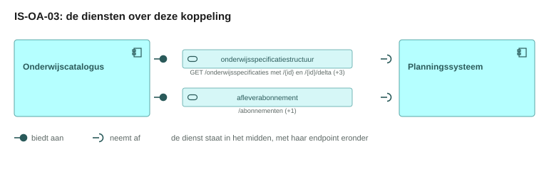
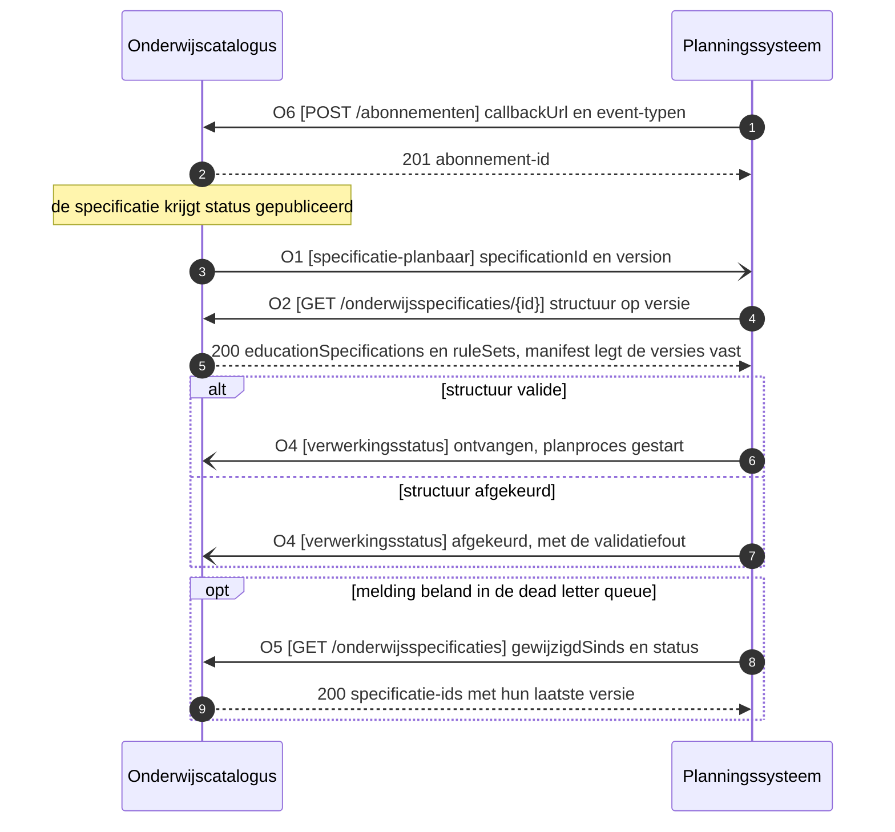
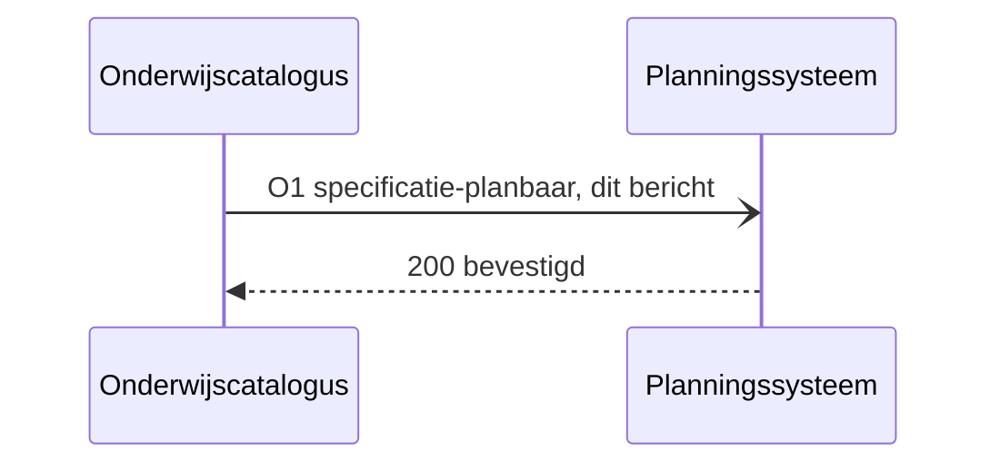
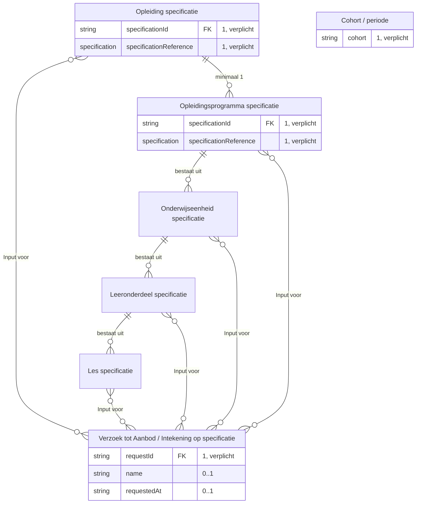
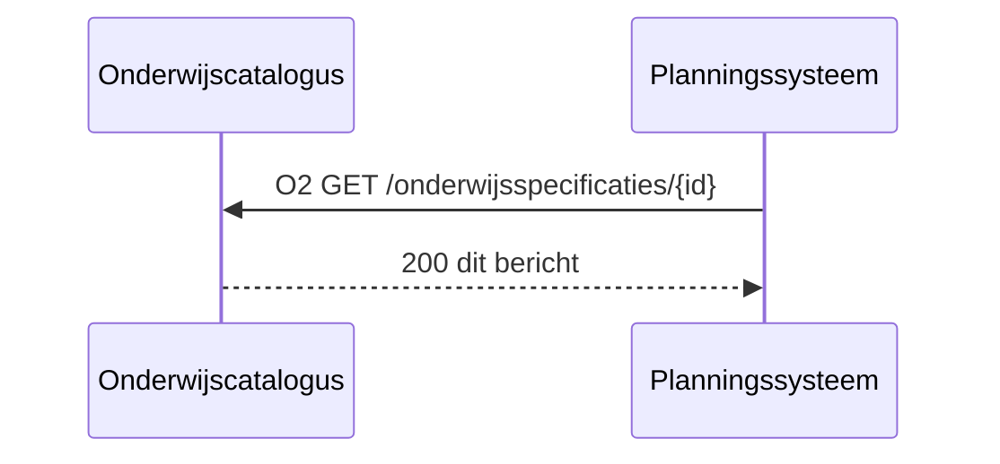
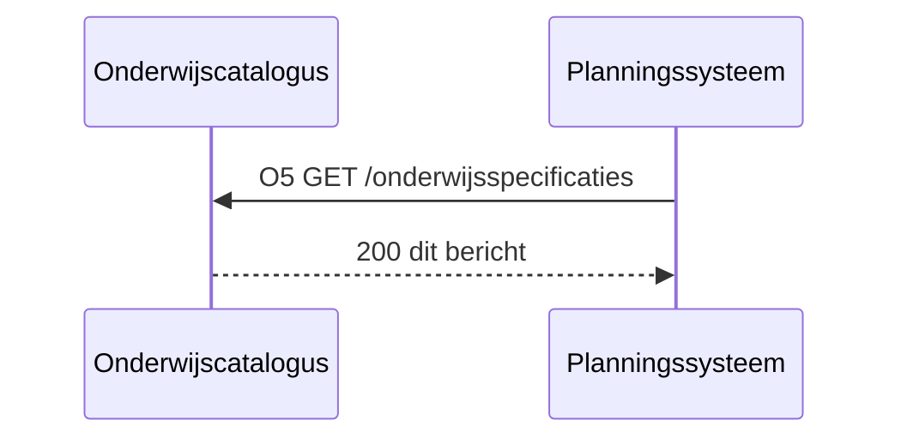
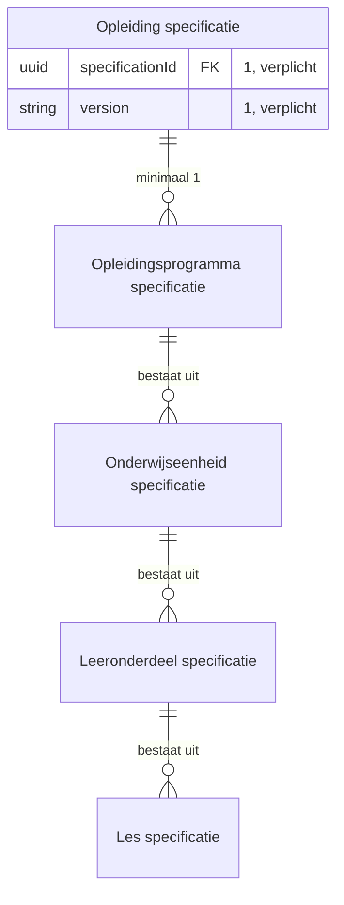
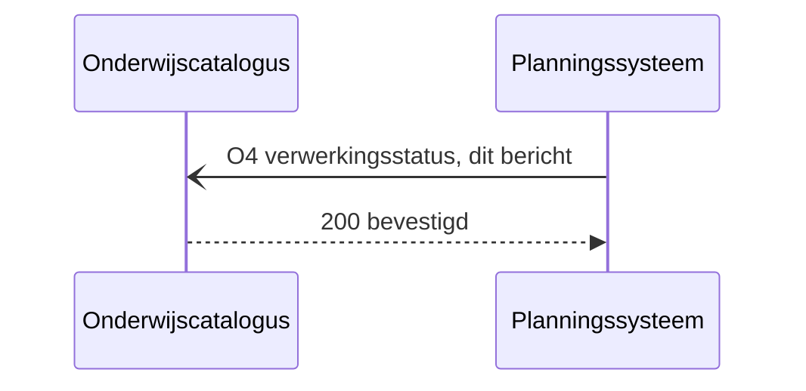
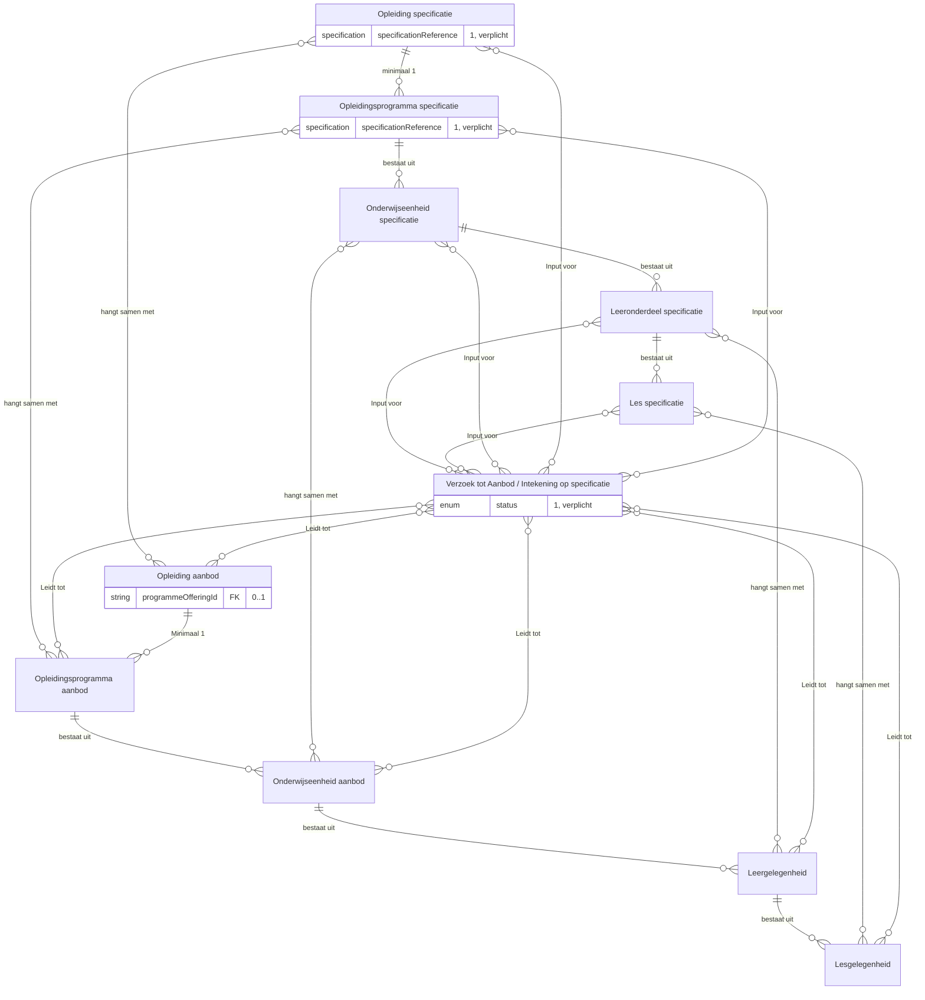
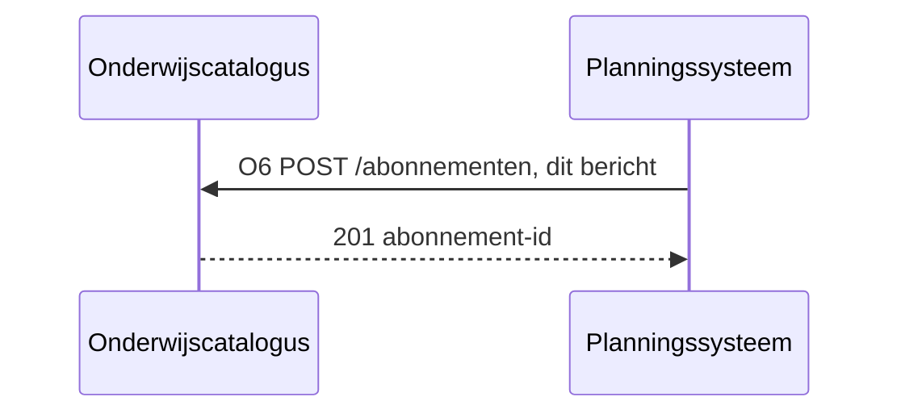

# IS-OA-03 Verzoek om aanbod naar planning

| | |
|---|---|
| **Document doel** | Zet uiteen hoe de onderwijscatalogus het planningssysteem de planbare specificatiestructuur van een opleiding met haar planbare waarden levert, als verzoek om daarvan onderwijsaanbod te maken, ten behoeve van de bouw of de verificatie van een implementatie volgens deze specificatie |
| **Doelgroep** | De implementatiespecialist en de tester bij een instelling of een leverancier, en wie een profiel of consumer bouwt |
| **Dient als input voor** | De bouw van het koppelvlak, de testgevallen erbij, en de acceptatie van een opgeleverde koppeling |
| **Kaderstelling** | De [interactieketen](README.md) waarin deze specificatie valt, het [informatiemodel OKx](../../../model/informatiemodel/informatiemodel.md), en beeld F2-03 van de [voorbeelduitwerking](../../../model/informatiemodel/voorbeeld-leerroute-1-jochem.md) |
| **Inhoud** | Zes operaties met hun statuscodes, vier functionele eisen met hun toetsgeval, vijf berichten met hun velden, en drie voorbeeldpayloads die valideren |
| **Status** | Elke operatie ligt vast in het interactiepatroon OC-P&R. Wat deze eenheid erbij voorstelt draagt per regel de stand `voorstel`, met de werkbrief erbij |

De lading: het verzoek tot aanbod voor cohort 2026, met de opleiding, haar programma, de eenheden en hun leeronderdelen, en per specificatie de leeruitkomst waarnaar zij verwijst. De planbare waarden uit het onderwijsontwerp staan in [werkbrief](#5-werkbrieven-de-issueset-die-hieruit-volgt) W2 tot en met W7. De uuid's, de versies en de namen in de voorbeeldpayloads komen uit [casus.md](casus.md); [IS-OA-04](is-oa-04.md) meldt het aanbod terug op dezelfde uuid en dezelfde versie.

## 1. Interactie

| Bronsysteem | Doelsysteem | Koppeling | Beeld | Status | Applicatiedienst |
|---|---|---|---|---|---|
| Onderwijscatalogus, bezitter van de onderwijsspecificaties ([U3](https://github.com/Npuls-OKx/Public/blob/dev/Koppelvlakspecificaties/uitgangspunten.md#u3-resource-eigenaarschap)) | Planningssysteem, bezitter van het onderwijsaanbod | OC-P&R, interactie I1, I2, I3, I7 en I8 van het [interactiepatroon onderwijscatalogus naar planning en roostering](https://github.com/Npuls-OKx/Public/blob/dev/Koppelvlakspecificaties/Interactiepatronen/onderwijscatalogus-planning-en-roostering.md) | F2-03, met de regels in [voorbeeld-lr1-regels.json](../../../model/informatiemodel/voorbeeld-lr1-regels.json) | Vastgelegd: het interactiepatroon OC-P&R draagt elke operatie hieronder, en de schema's achter [de berichten](#3-operaties-en-berichtspecificatie) staan in Public op alfa | `Onderwijsspecificatie uitwerking` op de onderwijscatalogus ontsluit de structuur, `(meer) jaar capaciteit planning` en `Periode planning` op het planningssysteem nemen haar aan (hoofdplaat v1.7) |


Het `Verzoek tot Aanbod` staat op de grens tussen specificatie en aanbod: links wat vastligt, rechts wat de planner ermee gaat doen. De planbare waarden hangen per eenheid, want haalbaarheid blijkt per eenheid.

De specificatiestructuur in dit verzoek ontstaat in [fase 1](../../../model/informatiemodel/voorbeeld-leerroute-1-jochem.md#fase-1-kwalificatiekader-analyseren-en-grofmazig-ontwerpen) en komt via [IS-OA-01](is-oa-01.md) de catalogus binnen; het verzoek zelf valt in [fase 2](../../../model/informatiemodel/voorbeeld-leerroute-1-jochem.md#fase-2-publiceren-en-planbaar-maken), bij beeld F2-02 en F2-03.

De taak van deze interactie in het proces: de specificatie is gepubliceerd en daarmee planbaar, en het planningssysteem heeft haar structuur en haar planbare waarden nodig voordat het er aanbod van kan maken.

| Applicatiecomponent | Functie in deze interactie |
|---|---|
| Onderwijscatalogus | Meldt dat de specificatie planbaar is, levert de structuur op de gevraagde versie of de wijziging tussen twee versies, neemt het afleveradres van het planningssysteem aan, en neemt de verwerkingsstatus terug |
| Planningssysteem | Legt zijn afleveradres vast, haalt de structuur op na de melding, meldt de ontvangst en de afkeur terug, en haalt na een gemiste melding de betrokken specificaties alsnog op |

De status per regel hieronder zegt waar een artefact staat.

| Status | Waar het artefact staat |
|---|---|
| `vastgelegd` | [Npuls-OKx/Public](https://github.com/Npuls-OKx/Public/tree/dev/Koppelvlakspecificaties) draagt hem: een operatie in het interactiepatroon OC-P&R, een pad op een componentpagina of een schema in [Informatie-en-gegevensmodellen](https://github.com/Npuls-OKx/Public/tree/dev/Informatie-en-gegevensmodellen/schemas) |
| `voorstel` | Deze specificatie stelt hem voor, met de werkbrief erbij. Een voorgesteld schema staat in [schemas/](schemas/) en draagt een `$id` die op `/voorstel` eindigt, zodat de status meereist met het bestand |

## 2. Interactiespecificatie



De aanbiedersdienst en de afnemersdienst staan als twee eigen blokken tegenover elkaar, met de bal die in de kom valt. Het sequentiediagram eronder zet dezelfde operaties in de tijd.



Het planproces loopt daarna los van deze aanroep. De uitkomst, met de verwijzing naar het `Opleiding aanbod`, komt terug in [IS-OA-04](README.md#1-de-informatiestromen), op dezelfde `specificationId` en `version` als deze melding.

## 3. Operaties en berichtspecificatie

Een operatie is een pad met een methode erop: `GET /onderwijsspecificaties/{id}` is er een, `GET /onderwijsspecificaties` een andere. Zij draagt een nummer dat terugkomt in het sequentiediagram hierboven en bij het bericht dat zij draagt. `OC` is de onderwijscatalogus, `PL` het planningssysteem.

Een leverancier claimt een dienst, geen operatietabel. Hier staat per dienst wat die claim kost: welke operaties erbij horen, met hun parameters, hun request body en hun responses.

Wie het endpoint bouwt verschilt per patroon, en bij een melding is dat omgekeerd aan wat de naam suggereert.

| Patroon | Wie levert het gegeven | Wie bouwt het endpoint | Wie roept aan |
|---|---|---|---|
| Ophalen | de aanbieder | de aanbieder | de afnemer |
| Aanleveren | de afnemer | de aanbieder | de afnemer |
| Melden | de aanbieder | de afnemer, op haar `callbackUrl` | de aanbieder |

Een query parameter verandert het endpoint niet: het pad blijft gelijk en de parameters komen in de query string. Het contract staat bij de dienst die het endpoint bouwt; de tegenhanger wijst ernaar. De afspraken die voor elke dienst in deze keten gelden, staan in de [interactieketenspecificatie](README.md#5-afspraken-die-elke-dienst-nakomt), en authenticatie op elk endpoint volgt de [auth-standaard](https://github.com/Npuls-OKx/Public/blob/dev/Koppelvlakspecificaties/auth-standaard.md). Elke GET is alleen-lezen en geeft bij herhaling hetzelfde resultaat.

Elk veld komt uit een schema in [Informatie-en-gegevensmodellen/schemas](https://github.com/Npuls-OKx/Public/tree/dev/Informatie-en-gegevensmodellen/schemas). De sleutel in de payload draagt de Engelse naam uit het schema, met de Nederlandse naam uit [mapping.md](https://github.com/Npuls-OKx/Public/blob/dev/Informatie-en-gegevensmodellen/mapping.md) in de kolom ernaast; enumwaarden blijven Nederlands. De objecttypen komen uit het [informatiemodel OKx](../../../model/informatiemodel/informatiemodel.md), met de definities in de [begrippenlijst](../begrippen/begrippenlijst.md).

Elke operatie staat op een componentpagina in Public: de [dienstpagina van het planningssysteem](https://github.com/Npuls-OKx/Public/blob/dev/Koppelvlakspecificaties/Applicatiecomponenten/planningssysteem.md) draagt `specificatie-planbaar`, de [dienstpagina van de onderwijscatalogus](https://github.com/Npuls-OKx/Public/blob/dev/Koppelvlakspecificaties/Applicatiecomponenten/onderwijscatalogus.md) draagt de specificatiepaden, `verwerkingsstatus` en `/abonnementen`, elk met zijn payloadschema erbij. [De werkbrieven](#5-werkbrieven-de-issueset-die-hieruit-volgt) dragen wat deze eenheid daar bovenop vraagt, met het nummer in de regel Stand per operatie.

#### onderwijsspecificatiestructuur-aanbieder, bij de onderwijscatalogus


Deze dienst meldt dat een specificatie planbaar is en ontsluit haar structuur, als geheel en als wijziging tussen twee versies. Zij draagt daarmee twee patronen.

##### O1 · webhook `specificatie-planbaar` · melden

| | |
|---|---|
| Interactie | I1 van het [interactiepatroon OC-P&R](https://github.com/Npuls-OKx/Public/blob/dev/Koppelvlakspecificaties/Interactiepatronen/onderwijscatalogus-planning-en-roostering.md): melden dat de specificatie planbaar is |
| Transport | HTTP POST naar de `callbackUrl` die het planningssysteem met O6 registreerde |
| Request body | [specification-reference.json](https://github.com/Npuls-OKx/Public/blob/dev/Informatie-en-gegevensmodellen/schemas/specification-reference.json) ([het bericht](#o1-webhook-specificatie-planbaar-melden)) |
| `200 OK` | geen response body; bevestigt de ontvangst, niet het oordeel |
| Bij uitblijven | retry met exponential backoff, daarna dead letter queue |
| Idempotentie | op `specificationId` plus `version`: een tweede delivery wijst hetzelfde verzoek aan, waarop het planningssysteem haar herkent. W13 belegt een eigen `eventId` |
| Voorbehoud | Met het [verzoek tot aanbod](#o1-webhook-specificatie-planbaar-melden) erbij op `voorstel` (W1) en het `eventId` op `voorstel` (W13) |


**Bericht: het verzoek tot aanbod**

Schema [`specification-reference.json`](https://github.com/Npuls-OKx/Public/blob/dev/Informatie-en-gegevensmodellen/schemas/specification-reference.json) · voorbeeldpayload [`is-oa-03-specificatieverwijzing.json`](voorbeeldpayloads/is-oa-03-specificatieverwijzing.json)



<!-- erd -->


| Lijn | Betekenis |
|---|---|
| `\|\|--o{` | het eerste bestaat uit nul of meer van het tweede |
| `}o--o{` | de twee hangen samen, met het opschrift erbij |
| `PK` en `FK` | de sleutel van het object, en een verwijzing naar een ander object |
| tekst achter een attribuut | de multipliciteit in dit bericht, en of het veld verplicht is |

<!-- /erd -->

Dit bericht draagt het `Verzoek tot Aanbod / Intekening op specificatie`, met de referentie als enige inhoud ([U4](https://github.com/Npuls-OKx/Public/blob/dev/Koppelvlakspecificaties/uitgangspunten.md#u4-notify-then-pull)).

| Veld | Nederlandse naam | Type | Kardinaliteit | Verplicht | Objecttype | Status |
|---|---|---|---|---|---|---|
| `specificationId` | `specificatieId` | string, uuid | 1 | ja | `Opleiding specificatie` of `Opleidingsprogramma specificatie`, de specificatie die planbaar is | vastgelegd |
| `version` | `versie` | string | 1 | ja | idem | vastgelegd |

Casus Apothekersassistent, kwalificatiedossier crebo 23450, met de instantiewaarden uit beeld F2-03. De melding van O1:

Voorbeeldpayload: [`is-oa-03-specificatieverwijzing.json`](voorbeeldpayloads/is-oa-03-specificatieverwijzing.json)

Werkbrief W1 geeft de planopgave een eigen identiteit in [offering-request.json](schemas/offering-request.json), dat de referentie hierboven omhult. Beeld F2-02 en F2-03 dragen de instantie, `Planopgave Apothekersassistent, cohort 2026`.

| Veld | Nederlandse naam | Type | Kardinaliteit | Verplicht | Objecttype | Status |
|---|---|---|---|---|---|---|
| `requestId` | `verzoekId` | string, uuid | 1 | ja | `Verzoek tot Aanbod / Intekening op specificatie` | voorstel, W1 |
| `specificationReference` | `specificatieVerwijzing` | specification-reference.json | 1 | ja | `Opleiding specificatie` of `Opleidingsprogramma specificatie`, de specificatie die planbaar is | schema vastgelegd, de plek erin voorstel, W1 |
| `name` | `naam` | string | 0..1 | nee | `Verzoek tot Aanbod / Intekening op specificatie` | voorstel, W1 |
| `cohort` | `cohort` | string | 1 | ja | `Cohort / periode`, het cohort waarvoor het aanbod wordt gevraagd | voorstel, W1 |
| `requestedAt` | `aanvraagmoment` | string, datum | 0..1 | nee | `Verzoek tot Aanbod / Intekening op specificatie` | voorstel, W1 |
| `expectedIntake` | `verwachteInstroom` | integer | 0..1 | nee | idem, de instroom waartegen planning haar capaciteit zet | voorstel, W1 |

Dezelfde melding in de vorm die werkbrief W1 voorstelt, met de planopgave eromheen. Het verzoek-id staat in [casus.md](casus.md#het-verzoek-tot-aanbod), het aanvraagmoment ligt voor het aanmeldvenster dat [IS-OA-05](is-oa-05.md) op dit aanbod opent:

Voorbeeldpayload: [`is-oa-03-verzoek-tot-aanbod.json`](voorbeeldpayloads/is-oa-03-verzoek-tot-aanbod.json)

##### O2 · `GET /onderwijsspecificaties/{id}` · ophalen

| | |
|---|---|
| Interactie | I2 van het [interactiepatroon OC-P&R](https://github.com/Npuls-OKx/Public/blob/dev/Koppelvlakspecificaties/Interactiepatronen/onderwijscatalogus-planning-en-roostering.md): de volledige structuur ophalen |
| Query parameters | `versie` (optioneel, default de laatst gepubliceerde) |
| `200 OK` | `application/json`, de volledige structuur ([het bericht](#o2-get-onderwijsspecificatiesid-ophalen)) |
| `400 Bad Request` | onbekende versie; geen response body, de aanroeper bepaalt de retry |
| `404 Not Found` | onbekend `id` |
| Voorbehoud | Met het response body bij 400 en 404 op `voorstel` (W15) |


**Bericht: de onderwijsspecificatiestructuur**

Schema [`education-specification.json`](https://github.com/Npuls-OKx/Public/blob/dev/Informatie-en-gegevensmodellen/schemas/education-specification.json) · voorbeeldpayload [`is-oa-03-onderwijsspecificatiestructuur.json`](voorbeeldpayloads/is-oa-03-onderwijsspecificatiestructuur.json)



<!-- erd -->
```mermaid
erDiagram
    "Leeronderdeel specificatie" ||--o{ "Les specificatie" : "bestaat uit"
    "Onderwijseenheid specificatie" ||--o{ "Leeronderdeel specificatie" : "bestaat uit"
    "Opleidingsprogramma specificatie" ||--o{ "Onderwijseenheid specificatie" : "bestaat uit"
    "Summatieve resultaat structuur" ||--o{ "Examenonderdeel weging" : "bestaat uit"
    "Summatieve resultaat structuur" ||--o{ "Toetsonderdeel specificatie" : "bestaat uit"
    "Cohort / periode" }o--o{ "Summatieve resultaat structuur" : "Groepeert Studenten op toepasbare"
    "Examenplan" }o--o{ "Summatieve resultaat structuur" : "kent"
    "Keuzedeel" }o--o{ "Keuzedeelruimte" : "hangt samen met"
    "Leeronderdeel specificatie" }o--o{ "Leeruitkomst" : "hangt samen met"
    "Leeruitkomst" }o--o{ "Student keuze regelset" : "voorwaarde op"
    "Les specificatie" }o--o{ "Leeruitkomst" : "hangt samen met"
    "Onderwijseenheid specificatie" }o--o{ "Leeruitkomst" : "hangt samen met"
    "Opleiding specificatie" }o--o{ "Leeruitkomst" : "hangt samen met"
    "Opleidingsprogramma specificatie" }o--o{ "Leeruitkomst" : "hangt samen met"
    "Organisatie-eenheid" }o--o{ "Leeronderdeel specificatie" : "Voert uit"
    "Organisatie-eenheid" }o--o{ "Les specificatie" : "Voert uit"
    "Organisatie-eenheid" }o--o{ "Onderwijseenheid specificatie" : "Voert uit"
    "Organisatie-eenheid" }o--o{ "Opleiding specificatie" : "Voert uit"
    "Organisatie-eenheid" }o--o{ "Opleidingsprogramma specificatie" : "Voert uit"
    "Organisatie-eenheid" }o--o{ "Toetsonderdeel specificatie" : "Voert uit"
    "Student keuze regelset" }o--o{ "Keuzedeel" : "hangt samen met"
    "Student keuze regelset" }o--o{ "Keuzedeelruimte" : "hangt samen met"
    "Student keuze regelset" }o--o{ "Leeronderdeel specificatie" : "hangt samen met"
    "Student keuze regelset" }o--o{ "Les specificatie" : "hangt samen met"
    "Student keuze regelset" }o--o{ "Onderwijseenheid specificatie" : "hangt samen met"
    "Student keuze regelset" }o--o{ "Opleiding specificatie" : "hangt samen met"
    "Student keuze regelset" }o--o{ "Opleidingsprogramma specificatie" : "hangt samen met"
    "Summatieve resultaat structuur" }o--o{ "Leeruitkomst" : "hangt samen met"
    "Toetsonderdeel specificatie" }o--o{ "Leeruitkomst" : "hangt samen met"
    "Opleiding specificatie" ||--o{ "Opleidingsprogramma specificatie" : "minimaal 1"
    "Keuzedeel" ||--|| "Opleidingsprogramma specificatie" : "is een"
    "Keuzedeelruimte" ||--|| "Opleidingsprogramma specificatie" : "is een"
    "Student keuze regelset" {
        array ruleSets "0..n"
        array ruleSetReferences "0..n"
        string id PK "1, verplicht"
        array rules "1..n, verplicht"
    }
    "Leeruitkomst" {
        array learningOutcomes "0"
        string learningOutcomeId FK "0..1"
    }
    "Opleiding specificatie" {
        enum curriculumType "0..1"
        string description "0..1"
        uuid id PK "1..1"
        uuid learningOutcomeId FK "0..1"
        array manifest FK "0..n"
        uuid manifest[].specificationId FK "0..n"
        string manifest[].version "0..n"
        string name "1..1"
        uuid parentSpecificationId FK "1..1"
        array ruleSetReferences FK "0..n"
        enum specificationType "1..1"
        enum status "0..1"
        object studyLoad "1..1"
        number studyLoad.value "1..1"
        date validFrom "0..1"
        date validUntil "0..1"
        string version "1..1"
    }
    "Opleidingsprogramma specificatie" {
        enum curriculumType "0..1"
        string programmeType "0..1"
        string cohort FK "0..1"
        string description "0..1"
        uuid id PK "1..1"
        uuid learningOutcomeId FK "0..1"
        enum learningPathway "0..1"
        array manifest FK "0..n"
        uuid manifest[].specificationId FK "0..n"
        string manifest[].version "0..n"
        string name "1..1"
        object organisation FK "0..1"
        uuid parentSpecificationId FK "1..1"
        enum programmeLayer "0..1"
        array ruleSetReferences FK "0..n"
        enum specificationType "1..1"
        date startDate "0..1"
        enum status "0..1"
        object studyLoad "1..1"
        number studyLoad.value "1..1"
        string targetGroup "0..1"
        date validFrom "0..1"
        date validUntil "0..1"
        string version "1..1"
    }
    "Keuzedeel" {
        string electiveUnitClass "0..1"
        string description "0..1"
        uuid id PK "1..1"
        uuid learningOutcomeId FK "0..1"
        string name "1..1"
        string programmeType "0..1"
        enum specificationType "1..1"
        enum status "0..1"
        object studyLoad "1..1"
        number studyLoad.value "1..1"
        string version "1..1"
    }
    "Cohort / periode" {
        string cohort "0..1"
    }
    "Leeronderdeel specificatie" {
        string timeDistribution "0..1"
        string description "0..1"
        string explanation "0..1"
        uuid id PK "1..1"
        uuid learningOutcomeId FK "0..1"
        string name "1..1"
        uuid parentSpecificationId FK "1..1"
        enum specificationType "1..1"
        enum status "0..1"
        object studyLoad "1..1"
        number studyLoad.value "1..1"
        string version "1..1"
    }
    "Organisatie-eenheid" {
        organisation organisation "0..1"
    }
    "Onderwijseenheid specificatie" {
        string description "0..1"
        string explanation "0..1"
        uuid id PK "1..1"
        uuid learningOutcomeId FK "0..1"
        uuid manifest[].specificationId FK "0..n"
        string manifest[].version "0..n"
        string name "1..1"
        uuid parentSpecificationId FK "1..1"
        enum specificationType "1..1"
        enum status "0..1"
        object studyLoad "1..1"
        number studyLoad.value "1..1"
        string version "1..1"
    }
    "Keuzedeelruimte" {
        string appliesTo "1, verplicht"
        string description "0..1"
        uuid id PK "1..1"
        string name "1..1"
        uuid parentSpecificationId FK "1..1"
        array ruleSetReferences FK "0..n"
        enum specificationType "1..1"
        enum status "0..1"
        object studyLoad "1..1"
        number studyLoad.value "1..1"
        string version "1..1"
    }
    "Toetsonderdeel specificatie" { }
    "Examenplan" { }
    "Summatieve resultaat structuur" { }
    "Les specificatie" { }
    "Examenonderdeel weging" { }
```

| Lijn | Betekenis |
|---|---|
| `\|\|--o{` | het eerste bestaat uit nul of meer van het tweede |
| `\|\|--\|\|` | het tweede is een soort van het eerste |
| `}o--o{` | de twee hangen samen, met het opschrift erbij |
| `PK` en `FK` | de sleutel van het object, en een verwijzing naar een ander object |
| tekst achter een attribuut | de multipliciteit in dit bericht, en of het veld verplicht is |

<!-- /erd -->

Volgt [education-specification.json](https://github.com/Npuls-OKx/Public/blob/dev/Informatie-en-gegevensmodellen/schemas/education-specification.json), met het [gebruiksprofiel](https://github.com/Npuls-OKx/Public/blob/dev/Informatie-en-gegevensmodellen/gebruiksprofielen.md) voor deze koppeling.

| Veld | Nederlandse naam | Type | Kardinaliteit | Verplicht | Objecttype | Status |
|---|---|---|---|---|---|---|
| `educationSpecifications` | `onderwijsspecificaties` | array | 1..n | ja | de specificatietypen uit de tabel hieronder | vastgelegd |
| `ruleSets` | `regelsets` | array | 0..n | nee | `Student keuze regelset` | vastgelegd |
| `learningOutcomes` | `leeruitkomsten` | array | 0 | nee | `Leeruitkomst`. Het gebruiksprofiel laat de inhoud bij de koppelingen die haar nodig hebben ([ADR 0026](https://github.com/Npuls-OKx/Public/blob/dev/Referentiemateriaal/adr/0026-leeruitkomst-als-verbindende-sleutel.md)) | vastgelegd |

Per element van `educationSpecifications`:

| Veld | Nederlandse naam | Type | Kardinaliteit | Verplicht | Objecttype | Status |
|---|---|---|---|---|---|---|
| `id` | `id` | string, uuid | 1 | ja | het type dat `specificationType` aanwijst | vastgelegd |
| `specificationType` | `specificatieType` | enum, waarden in de tabel hieronder | 1 | ja | idem | vastgelegd |
| `version` | `versie` | string, patroon `n.n.n` | 1 | ja | idem | vastgelegd |
| `parentSpecificationId` | `bovenliggendSpecificatieId` | string, uuid of null | 1 | ja | de aggregatie tussen twee specificatietypen | vastgelegd |
| `name` | `naam` | string | 1 | ja | het type dat `specificationType` aanwijst | vastgelegd |
| `studyLoad` | `studielast` | [volume.json](https://github.com/Npuls-OKx/Public/blob/dev/Informatie-en-gegevensmodellen/schemas/volume.json): `value` (waarde) en `unit` (eenheid) SBU of EC | 1 | ja | idem | vastgelegd |
| `learningOutcomeId` | `leeruitkomstId` | string, uuid | 0..1 | nee | `Leeruitkomst`, als verbindende sleutel | vastgelegd |
| `description`, `explanation` | `omschrijving`, `toelichting` | string | 0..1 | nee | het type dat `specificationType` aanwijst | vastgelegd |
| `status` | `status` | enum: concept, vastgesteld, gepubliceerd, gedeactiveerd, vervallen, gearchiveerd | 0..1 | nee | idem | vastgelegd |
| `curriculumType` | `curriculumtype` | enum: nominaal, hybride, flexibel | 0..1 | nee | `Opleiding specificatie`, `Opleidingsprogramma specificatie` | vastgelegd |
| `programmeType` | `programmatype` | string, open lijst | 0..1 | nee | `Opleidingsprogramma specificatie` | vastgelegd |
| `programmeLayer` | `programmaLaag` | enum: leerweg, doelgroep | 0..1 | nee | idem | vastgelegd |
| `learningPathway` | `leerweg` | enum: BOL, BBL | 0..1 | nee | idem | vastgelegd |
| `targetGroup` | `doelgroep` | string, open lijst | 0..1 | nee | idem | vastgelegd |
| `electiveUnitClass` | `keuzedeelKlasse` | string, open lijst | 0..1 | nee | `Keuzedeel` | vastgelegd |
| `cohort` | `cohort` | string | 0..1 | nee | `Cohort / periode` | vastgelegd |
| `startDate`, `validFrom`, `validUntil` | `startdatum`, `geldigVanaf`, `geldigTot` | string, datum | 0..1 | nee | het type dat `specificationType` aanwijst | vastgelegd |
| `timeDistribution` | `tijdsverdeling` | string, open lijst: BOT, OOT, BPV | 0..1 | nee | `Leeronderdeel specificatie` | vastgelegd |
| `organisation` | `organisatie` | [organisation-unit.json](https://github.com/Npuls-OKx/Public/blob/dev/Informatie-en-gegevensmodellen/schemas/organisation-unit.json) | 0..1 | nee | `Organisatie-eenheid` | vastgelegd |
| `ruleSetReferences` | `regelsetVerwijzingen` | array van uuid | 0..n | nee | `Student keuze regelset` | vastgelegd |
| `manifest` | `manifest` | array van [manifest-item.json](https://github.com/Npuls-OKx/Public/blob/dev/Informatie-en-gegevensmodellen/schemas/manifest-item.json): `specificationId`, `version`, `relation` | 0..n | nee | legt per onderdeel de versie vast waarop de planning rust | vastgelegd |

De waarden van `specificationType` slaan terug op deze objecttypen:

| Waarde | Objecttype |
|---|---|
| `opleidingsspecificatie` | `Opleiding specificatie` |
| `opleidingsprogrammaspecificatie` | `Opleidingsprogramma specificatie`, en voor een keuzedeelprogramma `Keuzedeel` |
| `onderwijseenheidspecificatie` | `Onderwijseenheid specificatie` |
| `leeronderdeelspecificatie` | `Leeronderdeel specificatie` |
| `keuzedeelruimtespecificatie` | `Keuzedeelruimte` |
| `toetsonderdeelspecificatie` | `Toetsonderdeel specificatie` |
| `examenplanspecificatie` | `Examenplan`, dat buiten de kolommen van het informatiemodel staat |
| `resultaateenheidspecificatie` | werkbrief W11 belegt het objecttype |

Per element van `ruleSets`, schema [rule-set.json](https://github.com/Npuls-OKx/Public/blob/dev/Informatie-en-gegevensmodellen/schemas/rule-set.json):

| Veld | Nederlandse naam | Type | Kardinaliteit | Verplicht | Objecttype | Status |
|---|---|---|---|---|---|---|
| `id`, `version`, `name` | `id`, `versie`, `naam` | string, `id` als uuid | 1 | ja | `Student keuze regelset` | vastgelegd |
| `description` | `omschrijving` | string | 0..1 | nee | idem | vastgelegd |
| `appliesTo` | `vanToepassingOp` | string, uuid | 1 | ja | `Keuzedeelruimte`, de specificatie waarop de regelset geldt | vastgelegd |
| `rules` | `regels` | array van object | 1..n | ja | `Student keuze regelset`. Werkbrief W9 belegt de regelvorm | vastgelegd als sleutel, de regelvorm erin voorstel, W9 |

Het antwoord van O2, met de opleiding, de programmalaag leerweg en de programmalaag doelgroep, de eenheid Blok B1-K1 met haar leeronderdelen, en de keuzedeelruimte uit F1-07 met de regelset waarnaar zij verwijst. De identificaties en versies staan in [casus.md](casus.md) en volgen daar de [voorbeeldpayloads](https://github.com/Npuls-OKx/Public/blob/dev/Informatie-en-gegevensmodellen/voorbeeldpayloads.md) in Public, zodat elke uuid naar hetzelfde object wijst en IS-OA-04 op dezelfde waarden terugmeldt.

Voorbeeldpayload: [`is-oa-03-onderwijsspecificatiestructuur.json`](voorbeeldpayloads/is-oa-03-onderwijsspecificatiestructuur.json)

De tweede regel geeft de volgordebepaling waarop het planningssysteem plant: keuzedeel K0037 is kiesbaar zodra de leeruitkomst op kerntaakniveau behaald is, waarbij de sleutel volstaat en de inhoud bij de catalogus blijft. [IS-OA-01](is-oa-01.md) levert dezelfde regelset op dezelfde versie aan de catalogus.

De sleutels binnen `rules` staan als voorstel, omdat rule-set.json daar een vrij object toestaat. Hun vorm staat in [student-choice-rule.json](schemas/student-choice-rule.json), de overlay die IS-OA-01 bij werkbrief W9 voorstelt. Dezelfde namen gelden in IS-OA-01 en staan bij elkaar in [casus.md](casus.md#de-regelsets):

| Voorstel | Nederlandse naam |
|---|---|
| `type` | `type` |
| `scope` | `bereik` |
| `electiveUnit` | `keuzedeel` |
| `precondition` | `voorwaardeVooraf` |
| `requiredLearningOutcomeId` | `vereisteLeeruitkomstId` |
| `status` | `status` |
| `value` plus `unit` | `waarde` plus `eenheid` |
| `requirement` | `eis` |
| `sourceSpecificationId` | `bronSpecificatieId` |

##### O3 · `GET /onderwijsspecificaties/{id}/delta` · ophalen

| | |
|---|---|
| Interactie | I2 van het [interactiepatroon OC-P&R](https://github.com/Npuls-OKx/Public/blob/dev/Koppelvlakspecificaties/Interactiepatronen/onderwijscatalogus-planning-en-roostering.md): de wijziging ophalen |
| Query parameters | `van` en `naar`, beide een versie en beide verplicht |
| `200 OK` | `application/json-patch+json` (RFC 6902), de wijziging tussen beide versies |
| `400 Bad Request` | onbekende versie; geen response body, de aanroeper bepaalt de retry |
| `404 Not Found` | onbekend `id` |
| Voorbehoud | Met het response body bij 400 en 404 op `voorstel` (W15) |


De response draagt de wijziging op dezelfde structuur als O2: [de onderwijsspecificatiestructuur](#o2-get-onderwijsspecificatiesid-ophalen).

##### O5 · `GET /onderwijsspecificaties` · ophalen

| | |
|---|---|
| Interactie | I7 van het [interactiepatroon OC-P&R](https://github.com/Npuls-OKx/Public/blob/dev/Koppelvlakspecificaties/Interactiepatronen/onderwijscatalogus-planning-en-roostering.md): herstellen na een gemiste melding |
| Query parameters | `status` (optioneel, default `gepubliceerd`), `gewijzigdSinds` (optioneel, een tijdstempel), paginering (voorstel, W14) |
| `200 OK` | `application/json`, de [lijst met verwijzingen](#o5-get-onderwijsspecificaties-ophalen) |
| `400 Bad Request` | geen response body; de aanroeper corrigeert de parameter en bepaalt de retry |
| Bedoeld voor | herstel na een gemiste melding, waarbij de reguliere stroom meldinggedreven blijft |
| Voorbehoud | Met paginering op `voorstel` (W14) |


**Bericht: de lijst met verwijzingen**

Schema [`specification-reference.json`](https://github.com/Npuls-OKx/Public/blob/dev/Informatie-en-gegevensmodellen/schemas/specification-reference.json)



<!-- erd -->


| Lijn | Betekenis |
|---|---|
| `\|\|--o{` | het eerste bestaat uit nul of meer van het tweede |
| `PK` en `FK` | de sleutel van het object, en een verwijzing naar een ander object |
| tekst achter een attribuut | de multipliciteit in dit bericht, en of het veld verplicht is |

<!-- /erd -->

Volgt [specification-reference.json](https://github.com/Npuls-OKx/Public/blob/dev/Informatie-en-gegevensmodellen/schemas/specification-reference.json), als array zonder omhullend object: per specificatie het id en de laatste versie binnen de gevraagde status, waarna O2 de structuur levert. De [componentpagina van de onderwijscatalogus](https://github.com/Npuls-OKx/Public/blob/dev/Koppelvlakspecificaties/Applicatiecomponenten/onderwijscatalogus.md) legt die vorm vast.

| Veld | Nederlandse naam | Type | Kardinaliteit | Verplicht | Objecttype | Status |
|---|---|---|---|---|---|---|
| `specificationId` | `specificatieId` | uuid | 1 | ja | `Opleiding specificatie`, de wortel van de opgenomen structuur | vastgelegd |
| `version` | `versie` | string | 1 | ja | `Opleiding specificatie` | vastgelegd |

W14 vraagt paginering op deze opvraag, en die landt op een omhullend object: MAJOR voor wie op de array van vandaag valideert. [W3 van IS-OA-01](is-oa-01.md#4-werkbrieven-de-issueset-die-hieruit-volgt) vraagt `name` en `studyLoad` erbij voor het zoeken naar hergebruik, wat additief blijft.

Een opvraag antwoordt met een HTTP-foutcode en een melding valt terug op herhalen; de implementator van beide componenten gaat met die fouten om. Het lichaam bij de foutcode staat als voorstel: W15 belegt het lichaam bij 400 en 404 op O2, O3 en O5, en W8 de validatiefout binnen de melding `verwerkingsstatus` van O4.

#### onderwijsspecificatiestructuur-afnemer, bij het planningssysteem


Deze dienst host de `callbackUrl` voor O1 en haalt daarna de structuur op met O2, O3 en O5; de parameters en de responses staan bij de aanbieder hierboven. Zij meldt met O4 terug wat zij met die structuur deed, een melding die de dienstenlijst op `verwerkingsuitkomst-aanbieder` belegt en die [de keten](README.md#4-koppelvlakdiensten) daar voor IS-OA-04 claimt.

##### O4 · webhook `verwerkingsstatus` · melden

| | |
|---|---|
| Interactie | I3 van het [interactiepatroon OC-P&R](https://github.com/Npuls-OKx/Public/blob/dev/Koppelvlakspecificaties/Interactiepatronen/onderwijscatalogus-planning-en-roostering.md): de ontvangst en de afkeur terugmelden |
| Transport | HTTP POST naar de `callbackUrl` van de onderwijscatalogus, die het meldpatroon `verwerkingsstatus` draagt |
| Request body | [processing-status.json](https://github.com/Npuls-OKx/Public/blob/dev/Informatie-en-gegevensmodellen/schemas/processing-status.json) met status `ontvangen`, `gestart` of `afgekeurd` ([het bericht](#o4-webhook-verwerkingsstatus-melden)) |
| `200 OK` | geen response body; bevestigt de ontvangst, niet het oordeel |
| Bij uitblijven | als O1: retry met exponential backoff, daarna dead letter queue |
| Idempotentie | als O1 |
| Bij afkeuring | een afgekeurde structuur komt langs deze weg terug, waarbij O2 beschikbaar blijft voor een nieuwe poging |
| Voorbehoud | Met het veld voor de validatiefout op `voorstel` (W8) |


**Bericht: de verwerkingsstatus**

Schema [`processing-status.json`](https://github.com/Npuls-OKx/Public/blob/dev/Informatie-en-gegevensmodellen/schemas/processing-status.json)



<!-- erd -->


| Lijn | Betekenis |
|---|---|
| `\|\|--o{` | het eerste bestaat uit nul of meer van het tweede |
| `}o--o{` | de twee hangen samen, met het opschrift erbij |
| `PK` en `FK` | de sleutel van het object, en een verwijzing naar een ander object |
| tekst achter een attribuut | de multipliciteit in dit bericht, en of het veld verplicht is |

<!-- /erd -->

Volgt [processing-status.json](https://github.com/Npuls-OKx/Public/blob/dev/Informatie-en-gegevensmodellen/schemas/processing-status.json), met de drie waarden die de toestandentabel hieronder uitschrijft.

| Veld | Nederlandse naam | Type | Kardinaliteit | Verplicht | Objecttype | Status |
|---|---|---|---|---|---|---|
| `status` | `status` | enum: ontvangen, gestart, afgekeurd, gelukt, nietGelukt | 1 | ja | `Verzoek tot Aanbod / Intekening op specificatie` | vastgelegd |
| `specificationReference` | `specificatieVerwijzing` | specification-reference.json | 1 | ja | `Opleiding specificatie` of `Opleidingsprogramma specificatie` | vastgelegd |
| `programmeOfferingId` | `opleidingsaanbodId` | string, uuid of null | 0..1 | nee | `Opleiding aanbod`, gevuld bij `gelukt` en daarmee de overgang naar IS-OA-04 | vastgelegd |

**De toestanden van het verzoek**

De melding `verwerkingsstatus` draagt binnen deze eenheid de waarden `ontvangen`, `gestart` en `afgekeurd`.

| Status | Wat het planningssysteem meldt | Wat daarop volgt |
|---|---|---|
| `ontvangen` | de opgehaalde structuur is aangenomen | het planproces start |
| `gestart` | het planproces loopt | de uitkomst komt terug in [IS-OA-04](is-oa-04.md), op dezelfde `specificationId` en `version` |
| `afgekeurd` | de structuur is afgekeurd, met de validatiefout erbij (W8) | O2 blijft beschikbaar voor een nieuwe poging |

Het veld `programmeOfferingId` blijft in deze stroom leeg en raakt gevuld bij `gelukt`, de overgang naar IS-OA-04.

#### afleverabonnement-aanbieder, bij de onderwijscatalogus


Deze dienst neemt de abonnementen aan op de meldingen die de catalogus zelf publiceert, en levert daarna af op de geregistreerde `callbackUrl`.

##### O6 · `POST /abonnementen` · aanleveren

| | |
|---|---|
| Interactie | I8 van het [interactiepatroon OC-P&R](https://github.com/Npuls-OKx/Public/blob/dev/Koppelvlakspecificaties/Interactiepatronen/onderwijscatalogus-planning-en-roostering.md): het afleveradres vastleggen |
| Request body | [subscription.json](https://github.com/Npuls-OKx/Public/blob/dev/Informatie-en-gegevensmodellen/schemas/subscription.json): de `callbackUrl` en de `events` waarop het planningssysteem zich abonneert ([het bericht](#o6-post-abonnementen-aanleveren)) |
| `201 Created` | het abonnement met zijn `id` |
| `400 Bad Request` | onbekend event of een onbruikbare `callbackUrl`; de aanroeper bepaalt de retry |
| Idempotentie | op `callbackUrl` plus event-type: een herhaalde registratie overschrijft de vorige |


**Bericht: het abonnement**

Schema [`subscription.json`](https://github.com/Npuls-OKx/Public/blob/dev/Informatie-en-gegevensmodellen/schemas/subscription.json)



<!-- erd -->
Dit bericht draagt geen objecttype uit het informatiemodel: de velden zijn eigenschappen van het contract.
<!-- /erd -->

Dit bericht richt het kanaal in en vervalt zodra de aflevering over een bus of broker loopt ([U5](https://github.com/Npuls-OKx/Public/blob/dev/Koppelvlakspecificaties/uitgangspunten.md#u5-bericht-versus-kanaal)).

| Veld | Nederlandse naam | Type | Kardinaliteit | Verplicht | Objecttype | Status |
|---|---|---|---|---|---|---|
| `callbackUrl` | `callbackUrl` | string, uri | 1 | ja | inrichting van de koppeling | vastgelegd |
| `events` | `events` | array, enum: specificatie-planbaar, specificatie-gewijzigd, specificatie-status-gewijzigd, verwerkingsstatus | 1..n | ja | inrichting van de koppeling | vastgelegd |
| `id` | `id` | string, uuid | 0..1 | toegekend in de respons | inrichting van de koppeling | vastgelegd |

#### afleverabonnement-afnemer, bij het planningssysteem


Deze dienst registreert haar `callbackUrl` bij de aanbieder met O6, en ontvangt daarna de melding van O1.

## 4. Functionele eisen

De eisen komen uit het interactiepatroon OC-P&R. Een instelling citeert het eis-id en toetst op de genoemde operaties.

| Id | Eis | Operaties | Toetsgeval |
|---|---|---|---|
| [functionele-eis-0001](https://github.com/Npuls-OKx/Public/blob/dev/Koppelvlakspecificaties/Interactiepatronen/onderwijscatalogus-planning-en-roostering.md#functionele-eis-0001) | De onderwijscatalogus laat het planningssysteem weten dat een specificatie gereed is om te plannen, waarna het planningssysteem een opleidingsaanbod met referentie teruglevert | O1, O2, O4 | Een specificatie die status `gepubliceerd` krijgt levert een melding op, en de daaropvolgende opvraag geeft dezelfde `specificationId` en `version` terug |
| [functionele-eis-0002](https://github.com/Npuls-OKx/Public/blob/dev/Koppelvlakspecificaties/Interactiepatronen/onderwijscatalogus-planning-en-roostering.md#functionele-eis-0002) | Het planningssysteem werkt de planning bij wanneer een specificatie wijzigt, met de wijziging of de volledige structuur als keuze voor de ontvanger ([U11](https://github.com/Npuls-OKx/Public/blob/dev/Koppelvlakspecificaties/uitgangspunten.md#u11-toekomstvaste-endpoints-volledige-structuur-en-delta)) | O2, O3 | Beide vormen staan op dezelfde resource: de volledige structuur op `{id}` en de wijziging op `{id}/delta` tussen twee versies |
| [functionele-eis-0006](https://github.com/Npuls-OKx/Public/blob/dev/Koppelvlakspecificaties/Interactiepatronen/onderwijscatalogus-planning-en-roostering.md#functionele-eis-0006) | Beide partijen halen de informatie na een gemiste melding alsnog op | O5 | Een opvraag met `gewijzigdSinds` op een tijdstip voor de gemiste melding geeft de betrokken specificatie terug |
| [functionele-eis-0007](https://github.com/Npuls-OKx/Public/blob/dev/Koppelvlakspecificaties/Interactiepatronen/onderwijscatalogus-planning-en-roostering.md#functionele-eis-0007) | Beide partijen leggen een afleveradres vast voordat meldingen worden afgeleverd | O6 | Een tweede registratie op dezelfde `callbackUrl` en hetzelfde event-type overschrijft de eerste, zodat dat adres de melding langs een enkele registratie ontvangt |

Eis 0003 en 0004 landen op IS-OA-04, eis 0005 op de statusmelding die naast deze eenheid loopt.

## 5. Werkbrieven: de issueset die hieruit volgt

Deze regels horen niet in de koppelvlakspecificatie zelf. Elk van hen wordt een issue in Npuls-OKx/Public of in meta, en blijft hier staan tot dat issue er is.

Elke werkbrief belegt een veld of schema dat de beelden F2-01 en F2-03 vragen, en noemt wat elk schema in Public ervoor opneemt. Een veld buiten de schema's draagt zijn Engelse naam als voorstel, met de Nederlandse naam erachter.

| Nr | Wat erbij moet | Waar | Versie-impact |
|---|---|---|---|
| W1 | Een eigen bericht voor het verzoek: een `requestId` (verzoekId), een `name` (naam), het aangevraagde cohort, het aanvraagmoment en de verwachte instroom. Het objecttype `Verzoek tot Aanbod / Intekening op specificatie` reist nu mee als de specificatie-referentie van bericht 1 | [offering-request.json](schemas/offering-request.json), het schema waarnaar O1 en [het bericht](#o1-webhook-specificatie-planbaar-melden) verwijzen, in Public opnemen naast specification-reference.json | Minor: een nieuw schema naast specification-reference.json, dat in I7 en processing-status.json ongewijzigd blijft |
| W2 | De onderwijsvorm per leeronderdeel, in F2-03 "Simulatie in de leerapotheek, theorie ondersteunend". Het objecttype `Onderwijsvorm` staat in het informatiemodel | education-specification.json, veld `educationForm` (onderwijsvorm) op de leeronderdeelspecificatie, de sleutel die [education-design.json](schemas/education-design.json) draagt bij werkbrief WB-01 van [IS-OA-02](is-oa-02.md) | Minor: optioneel veld, bestaande implementaties blijven geldig |
| W3 | Het gevraagde type leeromgeving, in F2-03 "Balie-simulatie in het skillslab". Het objecttype `Onderwijslocatie type` bestaat, en location.json noemt alleen de concrete locatie aan de aanbodkant | education-specification.json, veld `roomType` (onderwijslocatieType) op de leeronderdeelspecificatie, de naam die het informatiemodel bij `Onderwijslocatie type` annoteert | Minor: optioneel veld |
| W4 | Het gevraagde docentprofiel, in F2-03 "Apothekersassistent-docent met baliepraktijk". Het objecttype `Expertise of functieprofiel` bestaat zonder schema | nieuw schema `expertise-profile.json`, plus veld `expertiseProfileIds` (expertiseprofielIds) in education-specification.json | Minor: een nieuw schema en een optioneel veld |
| W5 | De verdeling van begeleide en overige onderwijstijd in uren, in F2-01 "BOT 50 / OOT 50 SBU". `timeDistribution` (tijdsverdeling) draagt nu een enkele waarde uit een open lijst | education-specification.json, een array `timeDistributions` (tijdsverdelingen) met per soort een [volume.json](https://github.com/Npuls-OKx/Public/blob/dev/Informatie-en-gegevensmodellen/schemas/volume.json) | Minor zolang `timeDistribution` blijft staan. Vervangen van dat veld wordt major |
| W6 | De gevraagde capaciteit en de gewenste groepsgrootte, in F2-01 op het programma en op de eenheid. `minStudentCount`, `maxStudentCount` en `groups` liggen in education-offering.json, dat planning bezit | education-specification.json, velden `requestedCapacity` (gevraagdeCapaciteit) en `preferredGroupSize` (gewensteGroepsgrootte) | Minor: optionele velden |
| W7 | Het tijdvenster per eenheid, de plek in de opleidingsduur uit F2-01. De specificatie draagt nu `startDate`, `validFrom` en `validUntil`, die de geldigheid vastleggen | education-specification.json, veld `timeWindow` (tijdvenster) met een verwijzing naar het bestaande [period.json](https://github.com/Npuls-OKx/Public/blob/dev/Informatie-en-gegevensmodellen/schemas/period.json) | Minor: optioneel veld op een bestaand schema |
| W8 | Het foutmodel bij status `afgekeurd`, dat het interactieoverzicht belooft. processing-status.json draagt `status`, `programmeOfferingId` en `specificationReference` | processing-status.json, veld `errors` (fouten) met een `code` en een `description`, naar het model van [bottleneck.json](https://github.com/Npuls-OKx/Public/blob/dev/Informatie-en-gegevensmodellen/schemas/bottleneck.json) | Minor: optioneel veld, met een eigen codelijst voor validatiefouten |
| W9 | De regelvorm, met een vastgelegde naam per sleutel. `rules` is een array van vrije objecten, en de sleutels die de volgordebepaling van eis 0001 dragen (`type`, `scope`, `electiveUnit`, `precondition` met daarin `requiredLearningOutcomeId` en `status`) staan getypeerd in [student-choice-rule.json](schemas/student-choice-rule.json) | rule-set.json, de regelvormen als benoemde varianten in `$defs` | Minor als de varianten naast de vrije vorm komen. Dichtzetten van `rules` wordt major |
| W10 | De container voor inhoudelijk geclusterde leeronderdelen, de gewenste leergelegenheid uit bevinding B06 en B07. `leergelegenheid` bestaat nu als waarde van `offeringType` (aanbodType) in education-offering.json | education-specification.json, een waarde in de enum `specificationType` | Minor voor de verzender. Een ontvanger die de enum streng valideert ziet een brekende wijziging, dus met een conformiteitstoets (conformance test) erbij |
| W11 | Een objecttype of een definitie bij de enumwaarde `resultaateenheidspecificatie`; de overige waarden van de enum slaan terug op een objecttype in de tabel hierboven | informatiemodel OKx, of de waarde uit education-specification.json | Major zodra de waarde vervalt, omdat een bestaande payload dan afkeurt |
| W12 | Een afspraak over het versieformaat. education-specification.json eist het patroon `n.n.n`, beeld F2-03 noteert "versie 2026.1", specification-reference.json laat `version` een vrije tekenreeks en de voorbeeldpayload hierboven volgt de pin `0.1.0` uit Public | beide schema's, met een patroon dat de instellingspraktijk dekt | Minor bij het verruimen van het patroon. Dichtzetten van specification-reference.json wordt major |
| W13 | Een eigen `eventId` (gebeurtenisId) op de melding van O1, waarop de ontvanger een tweede aflevering herkent. Het [interactieoverzicht](https://github.com/Npuls-OKx/Public/blob/dev/Koppelvlakspecificaties/Interactiepatronen/onderwijscatalogus-planning-en-roostering.md#interactieoverzicht) legt die herkenning bij het event-id, en bericht 1 draagt `specificationId` en `version`, waarop deze eenheid haar laat rusten | specification-reference.json, of een omhullend meldingsschema naast processing-status.json en subscription.json | Minor: optioneel veld. Verplicht stellen wordt major |
| W14 | Paginering op de lijstopvraag van O5, die vandaag elke gepubliceerde specificatie in een antwoord teruggeeft. Het interactiepatroon OC-P&R zet paginering onder de mogelijke uitbreidingen (v-next) | interactiepatroon OC-P&R en de componentpagina onderwijscatalogus, met parameters op `/onderwijsspecificaties` en een vaste standaardwaarde | Minor: optionele parameters met een standaardwaarde die het antwoord van vandaag teruggeeft |
| W15 | Het lichaam bij de HTTP-foutcodes 400 en 404 van O2, O3 en O5, waar W8 het foutmodel binnen de melding `verwerkingsstatus` belegt | een foutschema in Public, naar het model van [bottleneck.json](https://github.com/Npuls-OKx/Public/blob/dev/Informatie-en-gegevensmodellen/schemas/bottleneck.json), met een verwijzing erheen op elke opvraag | Minor: een nieuw schema naast de bestaande statuscodes |

Wat deze werkbrieven open laten: de clustering uit bevinding B02, B06 en B07 raakt zowel de specificatiekant als de aanbodkant, en het besluit daarover gaat voor op W10.
