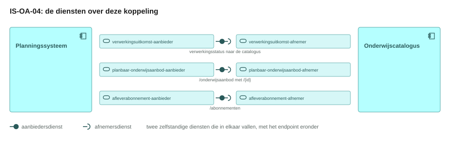
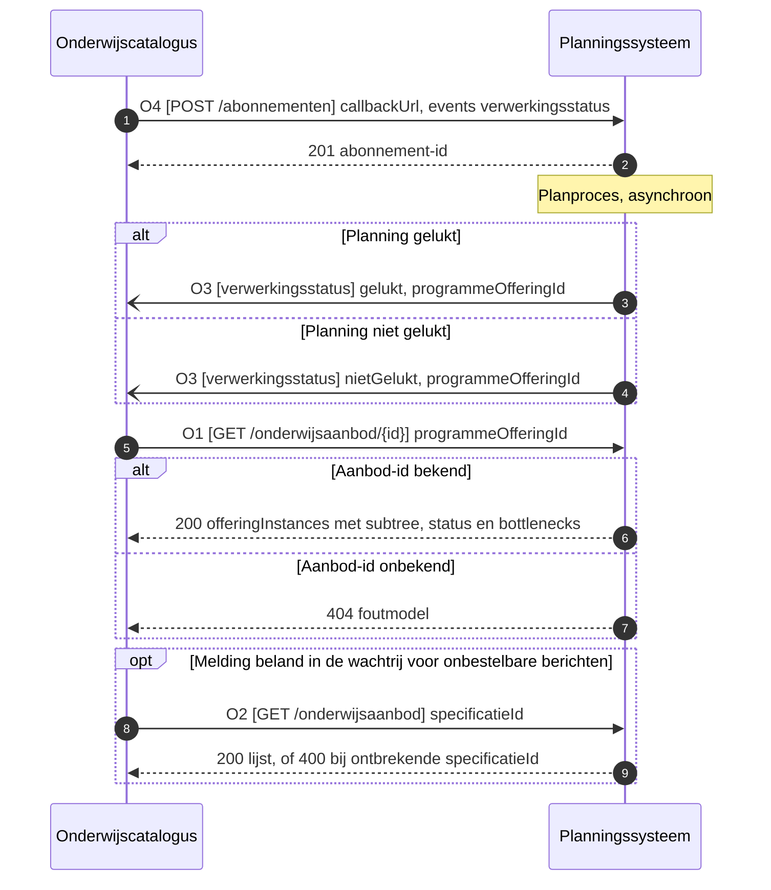
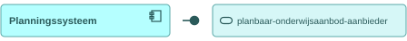
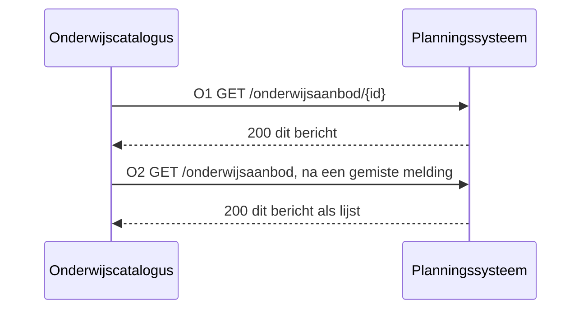
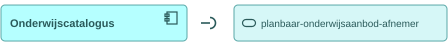
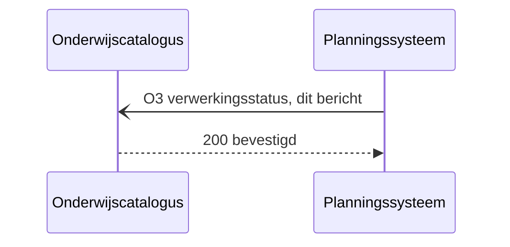
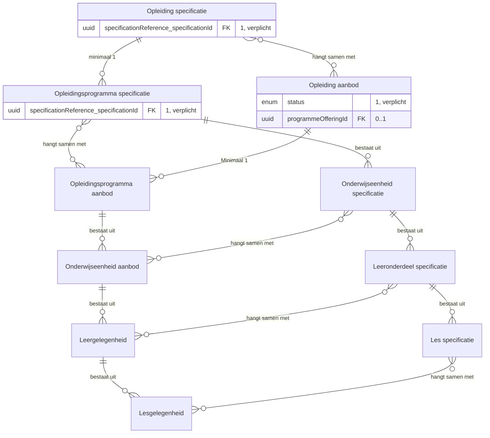
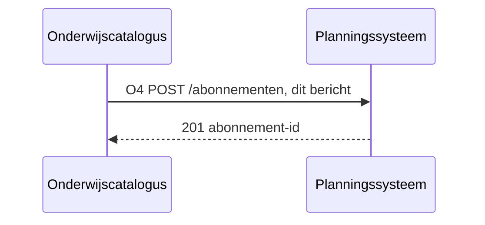
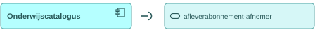

# IS-OA-04 Gepland aanbod naar de catalogus

| | |
|---|---|
| **Document doel** | Zet uiteen hoe het planningssysteem het geplande onderwijsaanbod in zijn lagen aan de onderwijscatalogus levert, ten behoeve van de bouw of de verificatie van een implementatie volgens deze specificatie |
| **Doelgroep** | De implementatiespecialist en de tester bij een instelling of een leverancier, en wie een profiel of consumer bouwt |
| **Dient als input voor** | De bouw van het koppelvlak, de testgevallen erbij, en de acceptatie van een opgeleverde koppeling |
| **Kaderstelling** | De [interactieketen](README.md) waarin deze specificatie valt, het [informatiemodel OKx](../../../model/informatiemodel/informatiemodel.md), beeld F2-07 van de [voorbeelduitwerking](../../../model/informatiemodel/voorbeeld-leerroute-1-jochem.md), en [functionele-eis-0001](https://github.com/Npuls-OKx/Public/blob/dev/Koppelvlakspecificaties/Interactiepatronen/onderwijscatalogus-planning-en-roostering.md#functionele-eis-0001), [functionele-eis-0003](https://github.com/Npuls-OKx/Public/blob/dev/Koppelvlakspecificaties/Interactiepatronen/onderwijscatalogus-planning-en-roostering.md#functionele-eis-0003), [functionele-eis-0006](https://github.com/Npuls-OKx/Public/blob/dev/Koppelvlakspecificaties/Interactiepatronen/onderwijscatalogus-planning-en-roostering.md#functionele-eis-0006) en [functionele-eis-0007](https://github.com/Npuls-OKx/Public/blob/dev/Koppelvlakspecificaties/Interactiepatronen/onderwijscatalogus-planning-en-roostering.md#functionele-eis-0007) van het interactiepatroon |
| **Inhoud** | Vier operaties met hun statuscodes, drie berichten met hun velden, en twee voorbeeldpayloads die valideren |
| **Status** | Vastgelegd: de componentpagina's in Public dragen elke operatie hieronder, en de schema's achter [de berichten](#3-operaties-en-berichtspecificatie) staan daar op alfa. Wat deze eenheid erbij voorstelt draagt per regel de stand `voorstel`, met de werkbrief erbij |

De lading: het geplande onderwijsaanbod in de lagen opleiding, programma, eenheid en gelegenheid, elk met een verwijzing naar de specificatie waaruit het volgt, met de locaties en de organisatie-eenheden erbij. De uuid's, de versies en de namen in de voorbeeldpayload komen uit [casus.md](casus.md); de specificatie waarnaar `specificationReference` wijst is dezelfde als die waarop [IS-OA-03](is-oa-03.md) het verzoek aanbiedt, op dezelfde uuid en dezelfde versie.

## 1. Interactie

| Bronsysteem | Doelsysteem | Koppeling | Beeld | Status | Applicatiedienst |
|---|---|---|---|---|---|
| Planningssysteem (bezitter van het onderwijsaanbod, [U3](https://github.com/Npuls-OKx/Public/blob/dev/Koppelvlakspecificaties/uitgangspunten.md#u3-resource-eigenaarschap)) | Onderwijscatalogus | OC-P&R, interactie I3, I5, I7 en I8 van het [interactiepatroon](https://github.com/Npuls-OKx/Public/blob/dev/Koppelvlakspecificaties/Interactiepatronen/onderwijscatalogus-planning-en-roostering.md) | F2-07, met de regels in [voorbeeld-lr1-regels.json](../../../model/informatiemodel/voorbeeld-lr1-regels.json) | Vastgelegd: de koppeling staat op de hoofdplaat, en het interactiepatroon in Public draagt deze vier interacties | Het [planningssysteem](https://github.com/Npuls-OKx/Public/blob/dev/Koppelvlakspecificaties/Applicatiecomponenten/planningssysteem.md) ontsluit `/onderwijsaanbod` en neemt het abonnement aan; de [onderwijscatalogus](https://github.com/Npuls-OKx/Public/blob/dev/Koppelvlakspecificaties/Applicatiecomponenten/onderwijscatalogus.md) neemt `verwerkingsstatus` aan |


Elke aanbodlaag draagt twee verwijzingen: naar de specificatie waaruit zij volgt en naar het verzoek waarop zij antwoordt. Daarmee leest de catalogus terug waarom dit aanbod bestaat.

De vier lagen ontstaan in [F2-04](../../../model/informatiemodel/voorbeeld-leerroute-1-jochem.md#f2-04---het-aanbod-gepland-opleiding-programma-eenheid-gelegenheid), waar de planner het aanbod plant.

De taak van deze interactie in het proces: de planner heeft het aanbod in zijn lagen gepland, en dat aanbod moet bij de catalogus staan voordat er iets aanmeldbaar van kan worden. Zij staat aan het eind van [fase 2](../../../model/informatiemodel/voorbeeld-leerroute-1-jochem.md#fase-2-publiceren-en-planbaar-maken) en voor [fase 3](../../../model/informatiemodel/voorbeeld-leerroute-1-jochem.md#fase-3-instroom-intake-en-plaatsing).

| Applicatiecomponent | Functie in deze interactie |
|---|---|
| Planningssysteem | Plant het aanbod, meldt de uitkomst van de planpoging, en ontsluit het geplande aanbod voor opvraag; het aanbod blijft bij planning staan |
| Onderwijscatalogus | Legt haar afleveradres vast, neemt de melding aan, haalt het aanbod daarna op, en haalt een gemiste melding alsnog in met de lijstopvraag op de specificatie |

`offeringType` loopt tot en met `leergelegenheid`, en `status` sluit de planning af op `gepland`. Het roostersysteem meldt het rooster daarna aan planning en catalogus langs hetzelfde patroon.

| Laag | Wat zij vastlegt | Wie haar bezit |
|---|---|---|
| `Leergelegenheid` | het venster: `period`, de voor dat venster gereserveerde `locationId`, en de capaciteit per groep in `groups` | planningssysteem, langs deze eenheid |
| `Lesgelegenheid` | het lesmoment binnen dat venster: dag, tijdstip en ruimte | roostersysteem, [buiten deze koppeling](https://github.com/Npuls-OKx/Public/blob/dev/Koppelvlakspecificaties/Interactiepatronen/onderwijscatalogus-planning-en-roostering.md#context-doorwerking-naar-het-roostersysteem) |

De status per regel hieronder zegt waar een artefact staat.

| Status | Waar het artefact staat |
|---|---|
| `vastgelegd` | [Npuls-OKx/Public](https://github.com/Npuls-OKx/Public/tree/dev/Koppelvlakspecificaties) draagt hem: een pad op een componentpagina, een enumwaarde in een melding of een schema in [Informatie-en-gegevensmodellen](https://github.com/Npuls-OKx/Public/tree/dev/Informatie-en-gegevensmodellen/schemas) |
| `voorstel` | Deze specificatie stelt hem voor, onderbouwd uit [de casus](casus.md) en het [informatiemodel](../../../model/informatiemodel/informatiemodel.md), met de werkbrief erbij. Een voorgesteld schema draagt een `$id` die eindigt op `/voorstel`, zodat de stand meereist met het bestand |

## 2. Interactiespecificatie



De aanbiedersdienst en de afnemersdienst staan als twee eigen blokken tegenover elkaar, met de bal die in de kom valt. Het sequentiediagram eronder zet dezelfde operaties in de tijd.



## 3. Operaties en berichtspecificatie

Een operatie is een pad met een methode erop: `GET /onderwijsaanbod/{id}` is er een, `GET /onderwijsaanbod` een andere. Zij draagt een nummer dat terugkomt in het sequentiediagram hierboven, en de rij Interactie noemt de interactie uit het [interactiepatroon OC-P&R](https://github.com/Npuls-OKx/Public/blob/dev/Koppelvlakspecificaties/Interactiepatronen/onderwijscatalogus-planning-en-roostering.md) die zij uitvoert. `OC` is de onderwijscatalogus, `P` het planningssysteem.

Een leverancier claimt een dienst, geen operatietabel. Hier staat per dienst wat die claim kost: welke operaties erbij horen, met hun parameters, hun request body en hun responses.

Wie het endpoint bouwt verschilt per patroon, en bij een melding is dat omgekeerd aan wat de naam suggereert.

| Patroon | Wie levert het gegeven | Wie bouwt het endpoint | Wie roept aan |
|---|---|---|---|
| Ophalen | de aanbieder | de aanbieder | de afnemer |
| Aanleveren | de afnemer | de aanbieder | de afnemer |
| Melden | de aanbieder | de afnemer, op haar `callbackUrl` | de aanbieder |

Een query parameter verandert het endpoint niet: het pad blijft gelijk en de parameters komen in de query string. Het contract staat bij de dienst die het endpoint bouwt; de tegenhanger wijst ernaar. De afspraken die voor elke dienst in deze keten gelden, staan in de [interactieketenspecificatie](README.md#5-afspraken-die-elke-dienst-nakomt).

De [dienstpagina van het planningssysteem](https://github.com/Npuls-OKx/Public/blob/dev/Koppelvlakspecificaties/Applicatiecomponenten/planningssysteem.md) draagt `/onderwijsaanbod/{id}`, `/onderwijsaanbod` en `/abonnementen`, de [dienstpagina van de onderwijscatalogus](https://github.com/Npuls-OKx/Public/blob/dev/Koppelvlakspecificaties/Applicatiecomponenten/onderwijscatalogus.md) het meldpatroon `verwerkingsstatus`, elk met zijn payloadschema erbij. Verificatie van de aflevering en de dubbele ontvangst staat in het [interactieoverzicht](https://github.com/Npuls-OKx/Public/blob/dev/Koppelvlakspecificaties/Interactiepatronen/onderwijscatalogus-planning-en-roostering.md#interactieoverzicht). [De werkbrieven](#4-werkbrieven-de-issueset-die-hieruit-volgt) dragen wat deze eenheid bovenop de dienstpagina's vraagt, met het nummer in de rij Stand.

Elk veld in een berichttabel komt uit een schema in [Informatie-en-gegevensmodellen/schemas](https://github.com/Npuls-OKx/Public/tree/dev/Informatie-en-gegevensmodellen/schemas). De sleutel in de payload draagt de Engelse naam uit het schema, met de Nederlandse naam uit [mapping.md](https://github.com/Npuls-OKx/Public/blob/dev/Informatie-en-gegevensmodellen/mapping.md) in de kolom ernaast; enumwaarden blijven Nederlands. De objecten staan plat met verwijzingen ([U7](https://github.com/Npuls-OKx/Public/blob/dev/Koppelvlakspecificaties/uitgangspunten.md#u7-payload-plat-met-verwijzingen-en-de-sleutelconventie)). De padnamen en de queryparameters volgen Public en blijven Nederlands. De objecttypen komen uit het [informatiemodel OKx](../../../model/informatiemodel/informatiemodel.md); de definities staan in de [begrippenlijst](../begrippen/begrippenlijst.md).

#### planbaar-onderwijsaanbod-aanbieder, bij het planningssysteem



Deze dienst ontsluit het geplande onderwijsaanbod in zijn lagen, per aanbod-id en per specificatie. Het aanbod blijft bij planning staan, en de opvraag haalt het daar op.

##### O1 · `GET /onderwijsaanbod/{id}` · ophalen

| | |
|---|---|
| Query parameters | `status`, optioneel, filtert de onderliggende instanties |
| `200 OK` | `application/json`, het aanbod met zijn onderliggende instanties ([het bericht](#o1-get-onderwijsaanbodid-ophalen)) |
| `400 Bad Request` | een ongeldige filterwaarde |
| `404 Not Found` | onbekend aanbod-id |
| Idempotentie | alleen-lezen: herhalen levert hetzelfde resultaat |
| Interactie | I5 van het [interactiepatroon](https://github.com/Npuls-OKx/Public/blob/dev/Koppelvlakspecificaties/Interactiepatronen/onderwijscatalogus-planning-en-roostering.md), het geplande aanbod ophalen |
| Voorbehoud | Met de verwijzing naar het verzoek op `voorstel` (W1) |

**Bericht: het geplande onderwijsaanbod**

Schema [education-offering.json](https://github.com/Npuls-OKx/Public/blob/dev/Informatie-en-gegevensmodellen/schemas/education-offering.json) · voorbeeldpayload [`is-oa-04-gepland-onderwijsaanbod.json`](voorbeeldpayloads/is-oa-04-gepland-onderwijsaanbod.json)



<!-- erd -->
```mermaid
erDiagram
    "Leergelegenheid" ||--o{ "Lesgelegenheid" : "bestaat uit"
    "Leeronderdeel specificatie" ||--o{ "Les specificatie" : "bestaat uit"
    "Onderwijseenheid aanbod" ||--o{ "Leergelegenheid" : "bestaat uit"
    "Onderwijseenheid specificatie" ||--o{ "Leeronderdeel specificatie" : "bestaat uit"
    "Opleidingsprogramma aanbod" ||--o{ "Onderwijseenheid aanbod" : "bestaat uit"
    "Opleidingsprogramma specificatie" ||--o{ "Onderwijseenheid specificatie" : "bestaat uit"
    "Leergelegenheid" }o--o{ "Onderwijslocatie" : "wordt gegeven op"
    "Leeronderdeel specificatie" }o--o{ "Leergelegenheid" : "hangt samen met"
    "Les specificatie" }o--o{ "Lesgelegenheid" : "hangt samen met"
    "Lesgelegenheid" }o--o{ "Onderwijslocatie" : "wordt gegeven op"
    "Onderwijseenheid aanbod" }o--o{ "Onderwijslocatie" : "wordt gegeven op"
    "Onderwijseenheid specificatie" }o--o{ "Onderwijseenheid aanbod" : "hangt samen met"
    "Opleiding aanbod" }o--o{ "Onderwijslocatie" : "Wordt gegeven op"
    "Opleiding specificatie" }o--o{ "Opleiding aanbod" : "hangt samen met"
    "Opleidingsprogramma aanbod" }o--o{ "Onderwijslocatie" : "wordt gegeven op"
    "Opleidingsprogramma specificatie" }o--o{ "Opleidingsprogramma aanbod" : "hangt samen met"
    "Organisatie-eenheid" }o--o{ "Leeronderdeel specificatie" : "Voert uit"
    "Organisatie-eenheid" }o--o{ "Les specificatie" : "Voert uit"
    "Organisatie-eenheid" }o--o{ "Onderwijseenheid specificatie" : "Voert uit"
    "Organisatie-eenheid" }o--o{ "Opleiding specificatie" : "Voert uit"
    "Organisatie-eenheid" }o--o{ "Opleidingsprogramma specificatie" : "Voert uit"
    "Opleiding aanbod" ||--o{ "Opleidingsprogramma aanbod" : "Minimaal 1"
    "Opleiding specificatie" ||--o{ "Opleidingsprogramma specificatie" : "minimaal 1"
    "Opleiding aanbod" {
        enum offeringType "1, verplicht"
        array bottlenecks "0..n"
        string cohort FK "0..1"
        string executingTeamId FK "0..1"
        array groups FK "0..n"
        string id PK "1..1"
        string locationId FK "0..1"
        integer maxStudentCount "0..1"
        integer minStudentCount "0..1"
        string name "1..1"
        string parentOfferingId FK "1..1"
        object period "0..1"
        enum status "1..1"
        string version "1..1"
    }
    "Opleidingsprogramma aanbod" {
        enum offeringType "1, verplicht"
        array bottlenecks "0..n"
        string cohort FK "0..1"
        string executingTeamId FK "0..1"
        array groups FK "0..n"
        string id PK "1..1"
        string locationId FK "0..1"
        integer maxStudentCount "0..1"
        integer minStudentCount "0..1"
        string name "1..1"
        string parentOfferingId FK "1..1"
        object period "0..1"
        date period.start "0..1"
        enum status "1..1"
        string version "1..1"
    }
    "Onderwijseenheid aanbod" {
        enum offeringType "1, verplicht"
        array bottlenecks "0..n"
        string cohort FK "0..1"
        string executingTeamId FK "0..1"
        array groups FK "0..n"
        string id PK "1..1"
        string locationId FK "0..1"
        integer maxStudentCount "0..1"
        integer minStudentCount "0..1"
        string name "1..1"
        string parentOfferingId FK "1..1"
        object period "0..1"
        enum status "1..1"
        string version "1..1"
    }
    "Leergelegenheid" {
        enum offeringType "1, verplicht"
        array bottlenecks "0..n"
        string cohort FK "0..1"
        string executingTeamId FK "0..1"
        array groups FK "0..n"
        string id PK "1..1"
        string locationId FK "0..1"
        integer maxStudentCount "0..1"
        integer minStudentCount "0..1"
        string name "1..1"
        string parentOfferingId FK "1..1"
        object period "0..1"
        date period.start "0..1"
        enum status "1..1"
        string version "1..1"
    }
    "Opleiding specificatie" {
        object specificationReference "1, verplicht"
    }
    "Opleidingsprogramma specificatie" {
        object specificationReference "1, verplicht"
    }
    "Onderwijseenheid specificatie" {
        object specificationReference "1, verplicht"
    }
    "Leeronderdeel specificatie" {
        object specificationReference "1, verplicht"
    }
    "Cohort / periode" {
        string cohort "0..1"
    }
    "Onderwijslocatie" {
        uuid locationId FK "0..1"
    }
    "Organisatie-eenheid" {
        uuid executingTeamId FK "0..1"
    }
    "Plaatsingsgroep" {
        array groups "0..n"
        uuid groups[].id PK "0..n"
    }
    "Lesgelegenheid" { }
    "Les specificatie" { }
```

| Lijn | Betekenis |
|---|---|
| `\|\|--o{` | het eerste bestaat uit nul of meer van het tweede |
| `}o--o{` | de twee hangen samen, met het opschrift erbij |
| `PK` en `FK` | de sleutel van het object, en een verwijzing naar een ander object |
| tekst achter een attribuut | de multipliciteit in dit bericht, en of het veld verplicht is |

<!-- /erd -->

Volgt [education-offering.json](https://github.com/Npuls-OKx/Public/blob/dev/Informatie-en-gegevensmodellen/schemas/education-offering.json). Per item in `offeringInstances`:

| Veld | Nederlandse naam | Type | Kardinaliteit | Verplicht | Objecttype | Status |
|---|---|---|---|---|---|---|
| `id` | `id` | uuid | 1 | ja | de aanbodlaag zelf | vastgelegd |
| `offeringType` | `aanbodType` | enum: `opleidingsaanbod`, `opleidingsprogramma-aanbod`, `onderwijseenheid-aanbod`, `leergelegenheid` | 1 | ja | `Opleiding aanbod`, `Opleidingsprogramma aanbod`, `Onderwijseenheid aanbod`, `Leergelegenheid` | vastgelegd |
| `version` | `versie` | string, semver | 1 | ja | de lifecycle van de aanbodlaag | vastgelegd |
| `parentOfferingId` | `bovenliggendAanbodId` | uuid, leeg op een root | 1 | ja | de bovenliggende aanbodlaag (compositie en aggregatie in het model) | vastgelegd |
| `specificationReference` | `specificatieVerwijzing` | object: `specificationId` plus `version` | 1 | ja | `Opleiding specificatie`, `Opleidingsprogramma specificatie`, `Onderwijseenheid specificatie`, `Leeronderdeel specificatie` | vastgelegd |
| `name` | `naam` | string | 1 | ja | de aanbodlaag zelf | vastgelegd |
| `status` | `status` | enum: `inPlanning`, `gepland`, `nietRealiseerbaar`, `geannuleerd` | 1 | ja | de toestand van de aanbodlaag | vastgelegd |
| `bottlenecks` | `knelpunten` | array van `code` plus `description` plus `involvedSpecificationIds` | 0..n | nee | de geschonden randvoorwaarde, codelijst in [regels.md](https://github.com/Npuls-OKx/Public/blob/dev/Informatie-en-gegevensmodellen/regels.md) | vastgelegd |
| `cohort` | `cohort` | string | 0..1 | nee | `Cohort / periode` | vastgelegd |
| `period` | `periode` | object: `start` plus `end`, datum | 0..1 | nee | de geldigheid van de aanbodlaag (ontwerpkeuze 16) | vastgelegd |
| `minStudentCount`, `maxStudentCount` | `minAantalStudenten`, `maxAantalStudenten` | integer | 0..1 | nee | de capaciteit van de aanbodlaag | vastgelegd |
| `locationId` | `locatieId` | uuid | 0..1 | nee | `Onderwijslocatie`, relatie `wordt gegeven op` | vastgelegd |
| `executingTeamId` | `uitvoerendTeamId` | uuid | 0..1 | nee | `Organisatie-eenheid`; het model legt haar relatie `Voert uit` op de specificatie | vastgelegd |
| `groups` | `groepen` | array van `id`, `name`, `capacity` | 0..n | nee | `Plaatsingsgroep`, zie werkbrief W5 | vastgelegd |

Naast `offeringInstances` draagt de payload `locations` (`Onderwijslocatie` met `Onderwijslocatie type` in `locationType`) en `organisationUnits` (`Organisatie-eenheid`, met `Medewerker` als uuid in `professionalIds`).

Het aanbod dat O1 teruggeeft staat in [`is-oa-04-gepland-onderwijsaanbod.json`](voorbeeldpayloads/is-oa-04-gepland-onderwijsaanbod.json). Apothekersassistent, crebo 23450, cohort 2026, met de instanties uit F2-07. De uuid's en de versies staan in [casus.md](casus.md) en volgen daar het [voorbeeld onderwijsaanbod](https://github.com/Npuls-OKx/Public/blob/dev/Informatie-en-gegevensmodellen/voorbeeldpayloads.md#voorbeeld-onderwijsaanbod) en de [voorbeeld onderwijsspecificatie](https://github.com/Npuls-OKx/Public/blob/dev/Informatie-en-gegevensmodellen/voorbeeldpayloads.md#voorbeeld-onderwijsspecificatie) in Public, zodat de keten van verzoek naar aanbod op dezelfde sleutel loopt en [IS-OA-05](is-oa-05.md) hetzelfde aanbod verder ontsluit. De keuzedeelspecificatie K0037 en de instelling dragen een uuid van deze snede, omdat dat voorbeeld hen nog niet kent.

`Keuzedeel aanbod` staat als root, los van het opleidingsaanbod, met een eigen groep: een keuzedeel is herbruikbaar over opleidingen heen en de catalogus bereikt het via de regelset op de keuzedeelruimte ([regels.md](https://github.com/Npuls-OKx/Public/blob/dev/Informatie-en-gegevensmodellen/regels.md)). Loopt de planning vast, dan draagt de instantie `status` `nietRealiseerbaar` met `bottlenecks`, en blijft de rest van de payload gelijk.

##### O2 · `GET /onderwijsaanbod` · ophalen

| | |
|---|---|
| Query parameters | `specificatieId`, verplicht. `versie`, optioneel, standaard alle versies |
| `200 OK` | `application/json`, dezelfde instanties als O1, als lijst op de specificatie |
| `400 Bad Request` | zonder `specificatieId` |
| Idempotentie | alleen-lezen: herhalen levert hetzelfde resultaat |
| Bedoeld voor | herstel nadat een melding op O3 haar doel miste |
| Interactie | I7 van het [interactiepatroon](https://github.com/Npuls-OKx/Public/blob/dev/Koppelvlakspecificaties/Interactiepatronen/onderwijscatalogus-planning-en-roostering.md), het aanbod op een specificatie opvragen |

De response draagt hetzelfde bericht als O1: [het geplande onderwijsaanbod](#o1-get-onderwijsaanbodid-ophalen).

#### planbaar-onderwijsaanbod-afnemer, bij de onderwijscatalogus



Deze dienst roept O1 en O2 aan bij de aanbieder hierboven en neemt het opgehaalde aanbod op. De parameters en de responses staan daar.

#### verwerkingsuitkomst-aanbieder, bij het planningssysteem


Deze dienst meldt wat een planpoging opleverde. Zij verstuurt; de `callbackUrl` staat bij de afnemer.

##### O3 · webhook `verwerkingsstatus` · melden

| | |
|---|---|
| Transport | HTTP POST naar de `callbackUrl` die de afnemer met O4 registreerde |
| Request body | [processing-status.json](https://github.com/Npuls-OKx/Public/blob/dev/Informatie-en-gegevensmodellen/schemas/processing-status.json) met de uitkomst van de planpoging ([het bericht](#o3-webhook-verwerkingsstatus-melden)) |
| `200 OK` | geen response body; de catalogus bevestigt de ontvangst en haalt het aanbod daarna op met O1 |
| Bij uitblijven | retry met exponential backoff, daarna dead letter queue; herstel loopt via O2 |
| Idempotentie | het [interactieoverzicht](https://github.com/Npuls-OKx/Public/blob/dev/Koppelvlakspecificaties/Interactiepatronen/onderwijscatalogus-planning-en-roostering.md#interactieoverzicht) eist haar op het status-id; een eigen melding-id staat op `voorstel` (W7) |
| Interactie | I3 van het [interactiepatroon](https://github.com/Npuls-OKx/Public/blob/dev/Koppelvlakspecificaties/Interactiepatronen/onderwijscatalogus-planning-en-roostering.md), de uitkomst van de planpoging melden |
| Voorbehoud | Met het eigen melding-id op `voorstel` (W7) |

**Bericht: de verwerkingsstatus van de planpoging**

Schema [processing-status.json](https://github.com/Npuls-OKx/Public/blob/dev/Informatie-en-gegevensmodellen/schemas/processing-status.json) · voorbeeldpayload [`is-oa-04-verwerkingsstatus-gelukt.json`](voorbeeldpayloads/is-oa-04-verwerkingsstatus-gelukt.json)



<!-- erd -->


| Lijn | Betekenis |
|---|---|
| `\|\|--o{` | het eerste bestaat uit nul of meer van het tweede |
| `}o--o{` | de twee hangen samen, met het opschrift erbij |
| `PK` en `FK` | de sleutel van het object, en een verwijzing naar een ander object |
| tekst achter een attribuut | de multipliciteit in dit bericht, en of het veld verplicht is |

<!-- /erd -->

Volgt [processing-status.json](https://github.com/Npuls-OKx/Public/blob/dev/Informatie-en-gegevensmodellen/schemas/processing-status.json).

| Veld | Nederlandse naam | Type | Kardinaliteit | Verplicht | Objecttype | Status |
|---|---|---|---|---|---|---|
| `status` | `status` | enum: `ontvangen`, `gestart`, `afgekeurd`, `gelukt`, `nietGelukt` | 1 | ja | de planpoging op `Opleiding aanbod` | vastgelegd |
| `programmeOfferingId` | `opleidingsaanbodId` | uuid, mag leeg zijn | 0..1 | nee | `Opleiding aanbod` | vastgelegd |
| `specificationReference.specificationId` | `specificatieVerwijzing.specificatieId` | uuid | 1 | ja | `Opleiding specificatie` of `Opleidingsprogramma specificatie` | vastgelegd |
| `specificationReference.version` | `specificatieVerwijzing.versie` | string | 1 | ja | de versie van diezelfde specificatie | vastgelegd |

De melding die de catalogus aanneemt, met de planpoging op `gelukt`: [`is-oa-04-verwerkingsstatus-gelukt.json`](voorbeeldpayloads/is-oa-04-verwerkingsstatus-gelukt.json).

**De toestanden van de planpoging**

De planpoging meldt zich als dunne gebeurtenis, en de catalogus haalt de inhoud erna op ([U4](https://github.com/Npuls-OKx/Public/blob/dev/Koppelvlakspecificaties/uitgangspunten.md#u4-notify-then-pull)). Mist de melding haar doel, dan haalt de catalogus hetzelfde aanbod alsnog op met O2, de lijstopvraag op de specificatie.

| Status | Wat planning meldt | Wat de catalogus daarop doet |
|---|---|---|
| `gelukt` | de planpoging slaagde, met het `programmeOfferingId` erbij | het aanbod ophalen met O1 en opnemen |
| `nietGelukt` | de planpoging liep vast, met het `programmeOfferingId` erbij | het aanbod ophalen met O1 en de knelpunten per laag lezen |

De laag zelf draagt haar eigen toestand in `status`, van `inPlanning` naar `gepland`, `nietRealiseerbaar` of `geannuleerd`, met de knelpunten erbij in `bottlenecks`. Het afleveringsmechanisme van `verwerkingsstatus` ligt bij instelling en leverancier, binnen de eigenschappen die [ADR 0018](https://github.com/Npuls-OKx/Public/blob/dev/Referentiemateriaal/adr/0018-enterprise-messaging-patronen-voor-betrouwbare-koppelvlakken.md) eist ([U5](https://github.com/Npuls-OKx/Public/blob/dev/Koppelvlakspecificaties/uitgangspunten.md#u5-bericht-versus-kanaal)).

#### verwerkingsuitkomst-afnemer, bij de onderwijscatalogus


Deze dienst host de `callbackUrl` voor O3 en antwoordt met `200 OK`. Zij bevestigt daarmee de ontvangst, en haalt het aanbod daarna op met O1.

#### afleverabonnement-aanbieder, bij het planningssysteem


Deze dienst neemt de abonnementen aan op de meldingen die het planningssysteem zelf verstuurt, en levert daarna af op de geregistreerde `callbackUrl`.

##### O4 · `POST /abonnementen` · aanleveren

| | |
|---|---|
| Request body | [subscription.json](https://github.com/Npuls-OKx/Public/blob/dev/Informatie-en-gegevensmodellen/schemas/subscription.json): `callbackUrl` en de `events` waarop de afnemer zich abonneert ([het bericht](#o4-post-abonnementen-aanleveren)) |
| `201 Created` | het abonnement met zijn `id` |
| `400 Bad Request` | onbekend event of een onbruikbare `callbackUrl` |
| Idempotentie | op `callbackUrl` plus event: een herhaalde registratie overschrijft de vorige |
| Interactie | I8 van het [interactiepatroon](https://github.com/Npuls-OKx/Public/blob/dev/Koppelvlakspecificaties/Interactiepatronen/onderwijscatalogus-planning-en-roostering.md), het afleveradres vastleggen |

**Bericht: het afleveradres**

Schema [subscription.json](https://github.com/Npuls-OKx/Public/blob/dev/Informatie-en-gegevensmodellen/schemas/subscription.json)



<!-- erd -->
Dit bericht draagt geen objecttype uit het informatiemodel: de velden zijn eigenschappen van het contract.
<!-- /erd -->

Volgt [subscription.json](https://github.com/Npuls-OKx/Public/blob/dev/Informatie-en-gegevensmodellen/schemas/subscription.json). `callbackUrl` (uri, 1, verplicht) en `events` (array uit `specificatie-planbaar`, `specificatie-gewijzigd`, `specificatie-status-gewijzigd`, `verwerkingsstatus`; 1..n, verplicht) dragen in het Engels en in het Nederlands dezelfde naam. Zij richten het kanaal in en staan daarmee buiten het informatiemodel (U5).

#### afleverabonnement-afnemer, bij de onderwijscatalogus



Deze dienst registreert haar `callbackUrl` bij de aanbieder met O4, en ontvangt daarna O3.

## 4. Werkbrieven: de issueset die hieruit volgt

Deze regels horen niet in de koppelvlakspecificatie zelf. Elk van hen wordt een issue in Npuls-OKx/Public of in meta, en blijft hier staan tot dat issue er is.

Wat het beeld toont en de schema's nog vragen. De schema's dragen alfa ([U1](https://github.com/Npuls-OKx/Public/blob/dev/Koppelvlakspecificaties/uitgangspunten.md#u1-indicatief-en-onderbouwend-niet-voorschrijvend)); een wijziging hier verzet de versie van het pakket informatie- en gegevensmodellen, en daarmee de pin die de koppelvlakspecificatie eronder noemt.

| Nr | Wat erbij moet | In welk schema | Versie-impact |
|---|---|---|---|
| W1 | Een verwijzing naar het `Verzoek tot Aanbod / Intekening op specificatie` per aanbodlaag, voorgestelde naam `offeringRequestId` (Nederlands `verzoekId`). F2-07 toont de relatie `Leidt tot` op elke laag; de payload draagt de specificatieverwijzing | `education-offering.json`, veld op `offeringInstances` | Optioneel toevoegen is additief (MINOR). Verplicht stellen breekt elke bestaande instantie (MAJOR) |
| W2 | De aanbodwaarde voor `Toetsgelegenheid`, met `Examengelegenheid` als specialisatie ervan | `education-offering.json`, enum `offeringType` | Additief (MINOR). Een consument die de enum streng valideert weigert de nieuwe waarde tot hij de nieuwe versie overneemt |
| W3 | Een manier om een `Keuzedeel aanbod` als root te herkennen: een eigen waarde in `offeringType`, of een verwijzing naar de regelset waaruit het kiesbaar is. Het model maakt `Keuzedeel aanbod` een specialisatie van `Opleidingsprogramma aanbod`, de voorbeeldpayload in Public plaatst een keuzedeel onder een onderwijseenheid-aanbod | `education-offering.json`, enum `offeringType` of nieuw veld | Additief (MINOR), met een herziening van de voorbeeldpayload in Public |
| W4 | De instellingslaag `Opleidingsaanbod van Instelling` als adresseerbare instantie. Vandaag reist de instelling mee als `organisationUnits` met `unitType` `instelling` | `education-offering.json`, enum `offeringType` | Additief (MINOR); de keuze kan ook zijn de laag bij de organisatie-eenheid te laten en dan vervalt de werkbrief |
| W5 | Het objecttype achter `groups`. Het model verbindt `Plaatsingsgroep` met de verbintenis, terwijl de capaciteit per groep op het aanbod staat | [informatiemodel](../../../model/informatiemodel/informatiemodel.md), relatie bij `Plaatsingsgroep` | Modelwijziging zonder schemagevolg; de veldnaam blijft gelijk |
| W6 | Meerdere bovenliggende lagen per leergelegenheid. B10 noemt een leergelegenheid die vanuit meerdere programma's wordt aangeboden; `parentOfferingId` draagt een enkele waarde | `education-offering.json`, `parentOfferingId` naar een array | Brekend voor elke consument die het veld als enkele waarde leest (MAJOR) |
| W7 | Een eigen `id` op de melding, waarop de ontvanger dubbele aflevering herkent. Het interactieoverzicht eist idempotentie op het status-id | `processing-status.json` | Optioneel additief (MINOR), verplicht brekend (MAJOR) |
| W8 | De statuswaarde voor de uitkomst van de acceptatietoets bij een late wijziging, waar het sequentiediagram spreekt van een bijgewerkte versieverwijzing zonder herplanning | `processing-status.json`, enum `status` | Additief (MINOR) |
| W9 | Een gebruiksprofiel voor de terugweg: welke delen van de aanbodpayload meegaan naar de catalogus, zoals `locations` en `organisationUnits` | [gebruiksprofielen.md](https://github.com/Npuls-OKx/Public/blob/dev/Informatie-en-gegevensmodellen/gebruiksprofielen.md) | Documentwijziging zonder schemagevolg |

## 5. Wat open blijft

| Punt | Stand |
|---|---|
| Exacte geplande capaciteit vrijgeven is een toezegging en vraagt organisatorische volwassenheid, terwijl een aantal logistieke scenario's erop leunt | B10 bij F2-07, [issue 284](https://github.com/Npuls-OKx/meta/issues/284) |
| Capaciteit op een bovenliggende laag verliest waarde naarmate de keuzes fijnmaziger worden | B10, raakt W6 |
| Clustering van leeronderdelen tot een leergelegenheid is zelden een op een | B02 en B06, [issue 283](https://github.com/Npuls-OKx/meta/issues/283) |
| `Opleiding aanbod` in het model naast `Opleidingaanbod` in de [voorbeelduitwerking](../../../model/informatiemodel/voorbeeld-lr1-regels.json) en in [README.md](README.md) | een schrijfwijze per objecttype |
| De voorbeelduitwerking geeft de opleidingsspecificatie versie 2026.1, de voorbeeldpayload in Public pint 0.1.0 | een versieaanduiding per specificatie; deze eenheid volgt de voorbeeldpayload in Public en pint 0.1.0, net als IS-OA-03 |
| `Keuzedeel aanbod`, `Leergelegenheid`, `Onderwijseenheid aanbod` en `Opleidingsprogramma aanbod` missen een definitie in de [begrippenlijst](../begrippen/begrippenlijst.md) | een definitie per objecttype, gelegd naast MORA en het Kernmodel Onderwijsinformatie |
