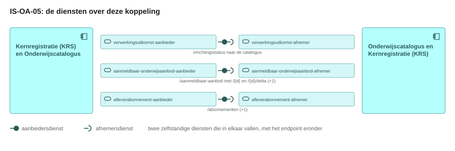
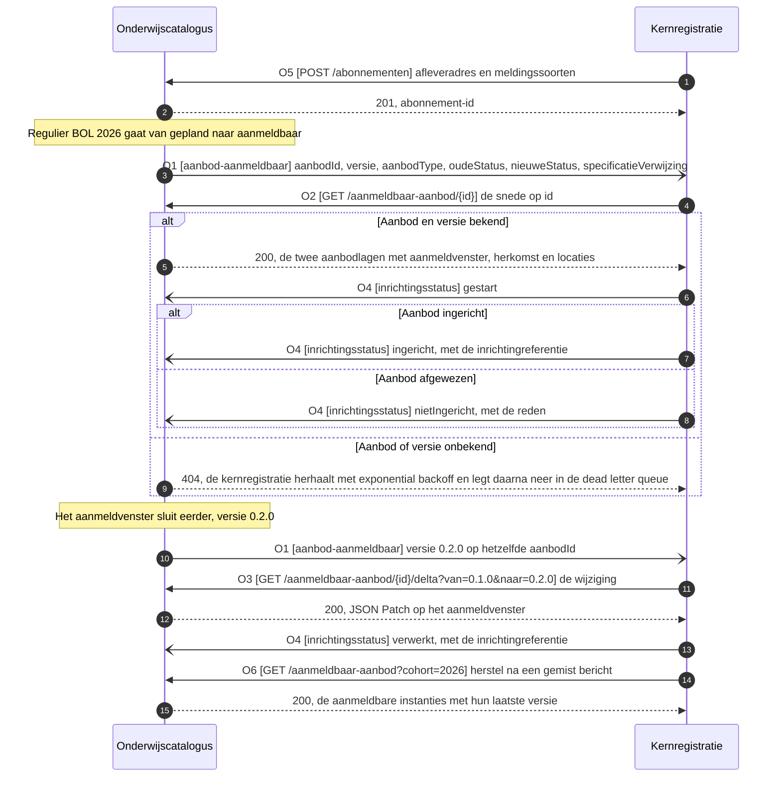
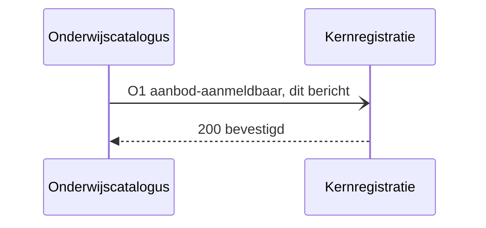
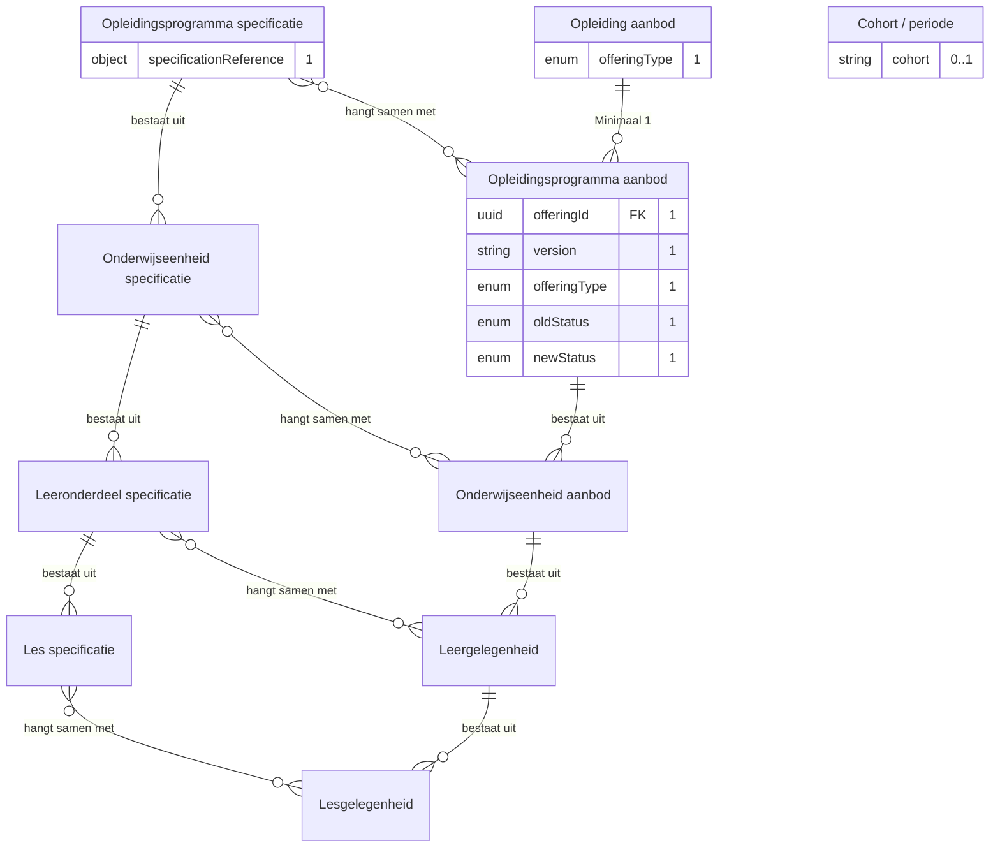
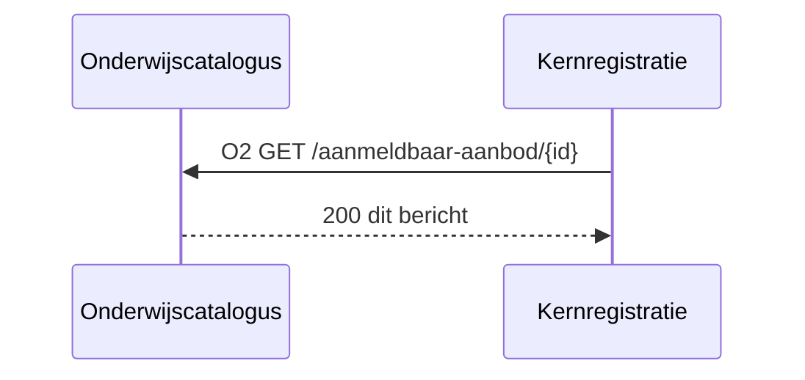
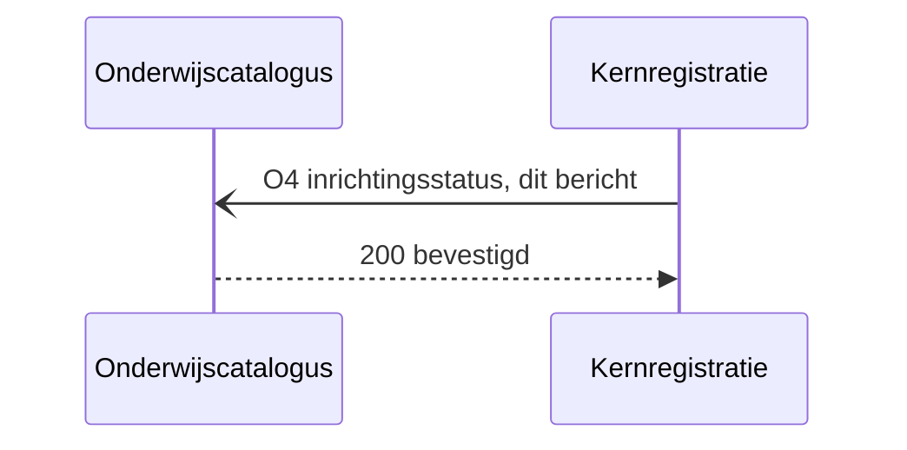
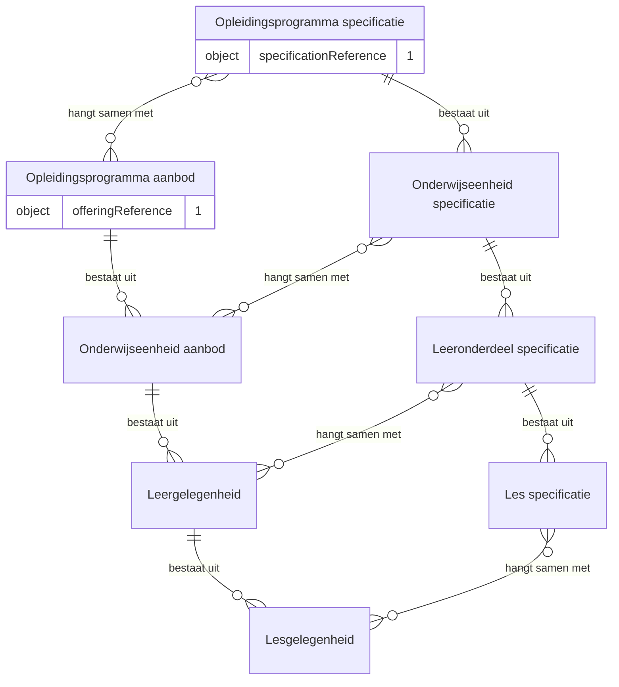

# IS-OA-05 Aanmeldbaar aanbod naar de kernregistratie

| | |
|---|---|
| **Document doel** | Zet uiteen hoe de onderwijscatalogus het aanmeldbare onderwijsaanbod aan de kernregistratie levert, ten behoeve van de bouw of de verificatie van een implementatie volgens deze specificatie |
| **Doelgroep** | De implementatiespecialist en de tester bij een instelling of een leverancier, en wie een profiel of consumer bouwt |
| **Dient als input voor** | De bouw van het koppelvlak, de testgevallen erbij, en de acceptatie van een opgeleverde koppeling |
| **Kaderstelling** | De [interactieketen](README.md) waarin deze specificatie valt, het [informatiemodel OKx](../../../model/informatiemodel/informatiemodel.md), en beeld F3-01 van de [voorbeelduitwerking](../../../model/informatiemodel/voorbeeld-leerroute-1-jochem.md), met de grond per regel in [voorbeeld-lr1-regels.json](../../../model/informatiemodel/voorbeeld-lr1-regels.json) |
| **Inhoud** | Zes operaties met hun statuscodes, drie berichten met hun velden, tien eisen met hun toetsgeval, en vijf voorbeeldpayloads die valideren |
| **Status** | De melding `inrichtingsstatus` ligt vast in Public. De aanmeldbare snede op een eigen resource is voorstel, met per regel wat dat in Public toevoegt |

De lading: het aanmeld- en inschrijfbare `Opleidingsprogramma aanbod`, instantie `Regulier BOL 2026`, met zijn `Opleiding aanbod` erboven, het aanmeldvenster, de instroomcapaciteit en de herkomst in het kwalificatiekader. De uuid's, de versies en de namen in de voorbeeldpayloads komen uit [casus.md](casus.md).

## 1. Interactie

| Bronsysteem | Doelsysteem | Koppeling | Beeld | Status | Applicatiedienst |
|---|---|---|---|---|---|
| Onderwijscatalogus | Kernregistratie systeem studenten (KRS) | OC-KRS volgens de beeldregels, OC-SIS volgens hoofdplaat v1.7 ([S-A](#7-signaleringen)) | F3-01 | De pijl en de koppeling staan op v1.7. Het [interactiepatroon OC-SIS](https://github.com/Npuls-OKx/Public/blob/dev/Koppelvlakspecificaties/Interactiepatronen/onderwijscatalogus-studentinformatiesysteem.md) dekt specificatie en resultaatstructuur en draagt het meldpatroon `inrichtingsstatus`; het aanbod komt met deze eenheid erbij | [planbaar-onderwijsaanbod-aanbieder](https://github.com/Npuls-OKx/Public/blob/d0c20d99b110b29ccf6b0e50109f7d54ffd88d7a/Koppelvlakspecificaties/Applicatiediensten/planbaar-onderwijsaanbod-aanbieder.md) bij de catalogus, [planbaar-onderwijsaanbod-afnemer](https://github.com/Npuls-OKx/Public/blob/d0c20d99b110b29ccf6b0e50109f7d54ffd88d7a/Koppelvlakspecificaties/Applicatiediensten/planbaar-onderwijsaanbod-afnemer.md) bij de kernregistratie: de catalogus ontsluit, de kernregistratie neemt af. Werkbrief W9 belegt de dienst voor aanmeldbaar aanbod |


Het `Opleidingsprogramma aanbod` gaat mee met zijn `Opleiding aanbod` erboven, en de lagen eronder blijven bij hun bezitter. Die snede staat bij de catalogus op `/aanmeldbaar-aanbod`.

De objecten ontstaan in [F2-04](../../../model/informatiemodel/voorbeeld-leerroute-1-jochem.md#f2-04---het-aanbod-gepland-opleiding-programma-eenheid-gelegenheid), waar de planner het aanbod in zijn lagen plant en [IS-OA-04](is-oa-04.md) het aan de catalogus terugmeldt.

De taak van deze interactie in het proces: de catalogus zet het geplande aanbod op aanmeldbaar, en de kernregistratie richt daarop de `Aanmelding` en de `Opleidingsprogramma aanbod verbintenis` in, voordat een aspirant-student zich aanmeldt. Zij opent [fase 3](../../../model/informatiemodel/voorbeeld-leerroute-1-jochem.md#fase-3-instroom-intake-en-plaatsing), na de planning in [fase 2](../../../model/informatiemodel/voorbeeld-leerroute-1-jochem.md#fase-2-publiceren-en-planbaar-maken).

| Applicatiecomponent | Functie in deze interactie |
|---|---|
| Onderwijscatalogus | Meldt dat een aanbodinstantie aanmeldbaar is, levert op opvraag de aanmeldbare snede en de wijziging tussen twee versies, en neemt de inrichtingsstatus in |
| Kernregistratie systeem studenten | Legt haar afleveradres vast, haalt de snede op na een melding, richt de aanmelding en de verbintenis op dat aanbod in, en meldt de uitkomst terug |

De status per regel hieronder zegt waar een artefact staat.

| Status | Waar het artefact staat |
|---|---|
| `vastgelegd` | [Npuls-OKx/Public](https://github.com/Npuls-OKx/Public/tree/dev/Koppelvlakspecificaties) draagt hem: een pad op een componentpagina, een meldingssoort in een interactiepatroon of een schema in [Informatie-en-gegevensmodellen](https://github.com/Npuls-OKx/Public/tree/dev/Informatie-en-gegevensmodellen/schemas) |
| `voorstel` | Deze eenheid stelt hem voor, onderbouwd uit [de casus](casus.md) en het [informatiemodel](../../../model/informatiemodel/informatiemodel.md). Een voorgesteld schema staat in [schemas/](schemas/) en draagt het label `voorstel` in zijn `$id`, zodat de stand aan het artefact zelf te lezen is |

### 1.1 Wat de snede draagt

De kernregistratie richt op dit aanbod de `Aanmelding` en de verbintenis in. Beeld F3-03 laat zien waarop die verbintenis ontstaat zodra Jochem zich aanmeldt: op het `Opleiding aanbod` en op het `Opleidingsprogramma aanbod`.

| Wat de snede draagt | Waarom de kernregistratie dat nodig heeft |
|---|---|
| De lagen `opleidingsaanbod` en `opleidingsprogramma-aanbod` | Op beide ontstaat bij de aanmelding een verbintenis (F3-03) |
| `specificationReference` per laag | De lijn naar de specificatie waarop de resultaatstructuur al is ingericht (interactie S2 en S3 van OC-SIS) |
| Het aanmeldvenster en de uiterste inschrijfdatum | Zij bepalen wanneer de kernregistratie een aanmelding aanneemt en wanneer de inschrijving rond is |
| De instroomcapaciteit | De bovengrens waarop de kernregistratie de instroom begrenst |
| De herkomst in het kwalificatiekader | Crebo en kwalificatie komen mee zonder de leeruitkomstboom op te halen ([ADR 0023](https://github.com/Npuls-OKx/Public/blob/dev/Referentiemateriaal/adr/0023-leeruitkomsten-als-opaque-sleutels-in-koppeling-oc-p-en-r.md)) |
| De locatie en het uitvoerend team | De vestiging waar de opleiding start, en het team dat haar uitvoert |

De fijnmazige lagen blijven bij hun bezitter: het planningssysteem bezit het aanbod en de catalogus ontsluit het aan wie het nodig heeft ([U3](https://github.com/Npuls-OKx/Public/blob/dev/Koppelvlakspecificaties/uitgangspunten.md#u3-resource-eigenaarschap)). De onderwijseenheid en de leergelegenheid bereiken de kernregistratie langs het nominale template dat zij uit de specificatie inricht.


[IS-OA-06](is-oa-06.md) draagt dezelfde snede een schakel verder, naar centraal aanmelden, en voegt daar de velden toe die een sectorale partij aangaan: de leerweg, de doelgroep en de aanbieder.

## 2. Interactiespecificatie



De aanbiedersdienst en de afnemersdienst staan als twee eigen blokken tegenover elkaar, met de bal die in de kom valt. Het sequentiediagram eronder zet dezelfde operaties in de tijd.



De catalogus meldt dun en de kernregistratie haalt op ([U4](https://github.com/Npuls-OKx/Public/blob/dev/Koppelvlakspecificaties/uitgangspunten.md#u4-notify-then-pull)). Over de koppeling gaat een verwijzing, met de inhoud op opvraag ([U3](https://github.com/Npuls-OKx/Public/blob/dev/Koppelvlakspecificaties/uitgangspunten.md#u3-resource-eigenaarschap)). Een intrekking rijdt mee op de statuswaarde `geannuleerd`, zodat de kernregistratie de aanmelding op dat aanbod sluit.

## 3. Operaties en berichtspecificatie

Een operatie is een pad met een methode erop: `GET /aanmeldbaar-aanbod` is er een, `GET /aanmeldbaar-aanbod/{id}` een andere. Zij draagt een nummer dat terugkomt in het sequentiediagram hierboven en in de berichtspecificatie hieronder. `OC` is de onderwijscatalogus, `KRS` de kernregistratie.

Een leverancier claimt een dienst, geen operatietabel. Hier staat per dienst wat die claim kost: welke operaties erbij horen, met hun parameters, hun request body en hun responses. De dienstpagina's staan in [Applicatiediensten](https://github.com/Npuls-OKx/Public/tree/d0c20d99b110b29ccf6b0e50109f7d54ffd88d7a/Koppelvlakspecificaties/Applicatiediensten) op het vastgezette commit `d0c20d99` van de branch `feature/restructure-and-versioning`; die map staat nog niet op `dev` ([S-B](#7-signaleringen)).

Wie het endpoint bouwt verschilt per patroon, en bij een melding is dat omgekeerd aan wat de naam suggereert.

| Patroon | Wie levert het gegeven | Wie bouwt het endpoint | Wie roept aan |
|---|---|---|---|
| Ophalen | de aanbieder | de aanbieder | de afnemer |
| Aanleveren | de afnemer | de aanbieder | de afnemer |
| Melden | de aanbieder | de afnemer, op haar `callbackUrl` | de aanbieder |

Een query parameter verandert het endpoint niet: het pad blijft gelijk en de parameters komen in de query string. Het contract staat bij de dienst die het endpoint bouwt; de tegenhanger wijst ernaar. De afspraken die voor elke dienst in deze keten gelden, staan in de [interactieketenspecificatie](README.md#5-afspraken-die-elke-dienst-nakomt).

Het bericht ligt hier vast, het kanaal blijft een inrichtingskeuze van instelling en leverancier binnen de eigenschappen die [U5](https://github.com/Npuls-OKx/Public/blob/dev/Koppelvlakspecificaties/uitgangspunten.md#u5-bericht-versus-kanaal) opsomt.

Elk veld in een bericht slaat terug op een objecttype uit het [informatiemodel OKx](../../../model/informatiemodel/informatiemodel.md), en de kolom Grond noemt het veld of het schema waaruit het bestaat. De kolom Veld draagt de Engelse sleutel die over de koppeling gaat, de kolom Nederlands de naam uit [mapping.md](https://github.com/Npuls-OKx/Public/blob/dev/Informatie-en-gegevensmodellen/mapping.md) en uit `DutchName` in het schema. Enumwaarden blijven Nederlands. Kardinaliteit `1` betekent verplicht. De sleuteltaal staat als [S-G](#7-signaleringen) open.

De uuid's in de voorbeeldpayloads staan in [casus.md](casus.md) en volgen daar de [voorbeeldpayloads](https://github.com/Npuls-OKx/Public/blob/dev/Informatie-en-gegevensmodellen/voorbeeldpayloads.md) in Public, de naam en de aantallen komen uit beeld F3-01 en F2-07. Elke payload valideert tegen het schema dat erbij staat.

#### aanmeldbaar-onderwijsaanbod-aanbieder, bij de onderwijscatalogus


Deze dienst meldt dat een aanbodinstantie aanmeldbaar is en ontsluit daarna de aanmeldbare snede: op id, als wijziging tussen twee versies en als lijst. Zij draagt daarmee twee patronen, en haar drie opvragingen zijn idempotent: een herhaalde aanroep levert hetzelfde antwoord.

##### O1 · webhook `aanbod-aanmeldbaar` · melden

| | |
|---|---|
| Transport | HTTP POST naar de `callbackUrl` die de afnemer met O5 registreerde |
| Request body | [offering-status-changed.json](schemas/offering-status-changed.json) ([het bericht](#o1-webhook-aanbod-aanmeldbaar-melden)) |
| `200 OK` | geen response body; bevestigt de ontvangst, niet het oordeel |
| Bij uitblijven | retry met exponential backoff, daarna dead letter queue |
| Idempotentie | op `eventId`: een herhaalde delivery heeft geen extra effect (W6) |
| Voorbehoud | `voorstel` (W1) |


**Bericht: de statuswijziging van een aanbodinstantie**

Schema [`offering-status-changed.json`](schemas/offering-status-changed.json) · voorbeeldpayload [`is-oa-05-statuswijziging.json`](voorbeeldpayloads/is-oa-05-statuswijziging.json)

Dun, conform U4: de statusovergang met een verwijzing. Het payloadschema is [offering-status-changed.json](schemas/offering-status-changed.json), dat deze eenheid met IS-OA-06 deelt en dat als geheel op voorstel staat.



<!-- erd -->


| Lijn | Betekenis |
|---|---|
| `\|\|--o{` | het eerste bestaat uit nul of meer van het tweede |
| `}o--o{` | de twee hangen samen, met het opschrift erbij |
| `PK` en `FK` | de sleutel van het object, en een verwijzing naar een ander object |
| tekst achter een attribuut | de multipliciteit in dit bericht, en of het veld verplicht is |

<!-- /erd -->

| Veld | Nederlands | Type | Kardinaliteit | Objecttype | Grond |
|---|---|---|---|---|---|
| `offeringId` | `aanbodId` | uuid | 1 | `Opleidingsprogramma aanbod` | `id` uit [education-offering.json](https://github.com/Npuls-OKx/Public/blob/dev/Informatie-en-gegevensmodellen/schemas/education-offering.json), met de naam die [U7](https://github.com/Npuls-OKx/Public/blob/dev/Koppelvlakspecificaties/uitgangspunten.md#u7-payload-plat-met-verwijzingen-en-de-sleutelconventie) vraagt |
| `version` | `versie` | string, semver | 1 | `Opleidingsprogramma aanbod` | `version` uit education-offering.json |
| `offeringType` | `aanbodType` | enum | 1 | `Opleiding aanbod`, `Opleidingsprogramma aanbod` | `offeringType` uit education-offering.json, hier op de waarde `opleidingsprogramma-aanbod` |
| `oldStatus` | `oudeStatus` | enum | 1 | `Opleidingsprogramma aanbod` | de vorm van [specification-status-changed.json](https://github.com/Npuls-OKx/Public/blob/dev/Informatie-en-gegevensmodellen/schemas/specification-status-changed.json), met de waarden van `status` uit education-offering.json |
| `newStatus` | `nieuweStatus` | enum | 1 | `Opleidingsprogramma aanbod` | idem, hier op de waarde `aanmeldbaar`; een intrekking draagt `geannuleerd` |
| `specificationReference` | `specificatieVerwijzing` | object | 1 | `Opleidingsprogramma specificatie` | [specification-reference.json](https://github.com/Npuls-OKx/Public/blob/dev/Informatie-en-gegevensmodellen/schemas/specification-reference.json) |
| `cohort` | `cohort` | string | 0..1 | `Cohort / periode` | `cohort` uit education-offering.json, de parameter waarop O6 filtert |
| `eventId` | `eventId` | uuid | 0..1 | kanaaleigenschap, geen objecttype | [U5](https://github.com/Npuls-OKx/Public/blob/dev/Koppelvlakspecificaties/uitgangspunten.md#u5-bericht-versus-kanaal) vraagt een stabiel meldings-id; W6 |

De melding draagt de vorige versie zelf niet mee: de kernregistratie kent de versie waarop zij staat en geeft die aan O3 mee als `van`.

##### O2 · `GET /aanmeldbaar-aanbod/{id}` · ophalen

| | |
|---|---|
| Query parameters | `versie` (optioneel, standaard de laatst gepubliceerde) |
| `200 OK` | `application/json`, de aanmeldbare snede ([het bericht](#o2-get-aanmeldbaar-aanbodid-ophalen)) |
| `400 Bad Request` | geen response body; de client corrigeert de parameter en bepaalt de retry |
| `404 Not Found` | een onbekend aanbod-id of een onbekende versie |
| Voorbeeld | `GET /aanmeldbaar-aanbod/8c494250-b67a-4666-a762-6f9ec1e70aff?versie=0.1.0` |
| Voorbehoud | `voorstel` (W3) |


**Bericht: de aanmeldbare snede**

Schema [`offering-open-for-application.json`](schemas/offering-open-for-application.json) · voorbeeldpayload [`is-oa-05-aanmeldbare-snede.json`](voorbeeldpayloads/is-oa-05-aanmeldbare-snede.json)

De aanmeldbare snede uit [offering-open-for-application.json](schemas/offering-open-for-application.json), met de instanties in `offeringInstances` (aanbodInstanties), naast `locations` (locaties) en `organisationUnits` (organisatieEenheden).



<!-- erd -->
```mermaid
erDiagram
    "Kerntaak" ||--o{ "Werkproces" : "bestaat uit"
    "Kwalificatie" ||--o{ "Kerntaak" : "bestaat uit"
    "Kwalificatie dossier" ||--o{ "Kwalificatie" : "bevat"
    "Leergelegenheid" ||--o{ "Lesgelegenheid" : "bestaat uit"
    "Leeronderdeel specificatie" ||--o{ "Les specificatie" : "bestaat uit"
    "Onderwijseenheid aanbod" ||--o{ "Leergelegenheid" : "bestaat uit"
    "Onderwijseenheid specificatie" ||--o{ "Leeronderdeel specificatie" : "bestaat uit"
    "Opleidingsprogramma aanbod" ||--o{ "Onderwijseenheid aanbod" : "bestaat uit"
    "Opleidingsprogramma specificatie" ||--o{ "Onderwijseenheid specificatie" : "bestaat uit"
    "Leergelegenheid" }o--o{ "Aanmelding" : "Op basis van"
    "Leergelegenheid" }o--o{ "Onderwijslocatie" : "wordt gegeven op"
    "Leeronderdeel specificatie" }o--o{ "Leergelegenheid" : "hangt samen met"
    "Les specificatie" }o--o{ "Lesgelegenheid" : "hangt samen met"
    "Lesgelegenheid" }o--o{ "Aanmelding" : "Op basis van"
    "Lesgelegenheid" }o--o{ "Onderwijslocatie" : "wordt gegeven op"
    "Onderwijseenheid aanbod" }o--o{ "Aanmelding" : "Op basis van"
    "Onderwijseenheid aanbod" }o--o{ "Onderwijslocatie" : "wordt gegeven op"
    "Onderwijseenheid specificatie" }o--o{ "Onderwijseenheid aanbod" : "hangt samen met"
    "Opleiding aanbod" }o--o{ "Aanmelding" : "Op basis van"
    "Opleiding aanbod" }o--o{ "Onderwijslocatie" : "Wordt gegeven op"
    "Opleidingsprogramma aanbod" }o--o{ "Aanmelding" : "Op basis van"
    "Opleidingsprogramma aanbod" }o--o{ "Onderwijslocatie" : "wordt gegeven op"
    "Opleidingsprogramma specificatie" }o--o{ "Opleidingsprogramma aanbod" : "hangt samen met"
    "Organisatie-eenheid" }o--o{ "Leeronderdeel specificatie" : "Voert uit"
    "Organisatie-eenheid" }o--o{ "Les specificatie" : "Voert uit"
    "Organisatie-eenheid" }o--o{ "Onderwijseenheid specificatie" : "Voert uit"
    "Organisatie-eenheid" }o--o{ "Opleidingsprogramma specificatie" : "Voert uit"
    "Opleiding aanbod" ||--o{ "Opleidingsprogramma aanbod" : "Minimaal 1"
    "Opleidingsprogramma aanbod" {
        uuid id PK "1"
        enum offeringType "1"
        string version "1"
        string name "1"
        enum status "1"
        integer minStudentCount "0..1"
        integer maxStudentCount "0..1"
        object applicationWindow "0..1"
        date applicationWindow.end "0..1"
        date applicationWindow.start "0..1"
        enum learningPathway "0..1"
        string targetGroup "0..1"
    }
    "Opleiding aanbod" {
        enum offeringType "1"
        uuid parentOfferingId FK "1"
        string enrolmentDeadline "0..1"
        string providerId FK "0..1"
        array source FK "0..n"
        enum status "1..1"
    }
    "Opleidingsprogramma specificatie" {
        object specificationReference "1"
    }
    "Cohort / periode" {
        string cohort "0..1"
        object period "0..1"
    }
    "Aanmelding" {
        object applicationWindow "0..1, bij status `aanmeldbaar` gevuld"
    }
    "Kwalificatie dossier" {
        array source "0..n"
        string offeringInstances[].source[].code PK "0..n"
        string offeringInstances[].source[].standard "0..n"
        enum offeringInstances[].source[].type "0..n"
    }
    "Kwalificatie" {
        array source "0..n"
        string offeringInstances[].source[].code PK "0..n"
        string offeringInstances[].source[].standard "0..n"
        enum offeringInstances[].source[].type "0..n"
    }
    "Onderwijslocatie" {
        uuid locationId FK "0..1"
        array locations "0..n"
    }
    "Organisatie-eenheid" {
        uuid executingTeamId FK "0..1"
        array organisationUnits "0..n"
    }
    "Onderwijseenheid aanbod" { }
    "Onderwijseenheid specificatie" { }
    "Kerntaak" { }
    "Leergelegenheid" { }
    "Leeronderdeel specificatie" { }
    "Werkproces" { }
    "Lesgelegenheid" { }
    "Les specificatie" { }
```

| Lijn | Betekenis |
|---|---|
| `\|\|--o{` | het eerste bestaat uit nul of meer van het tweede |
| `}o--o{` | de twee hangen samen, met het opschrift erbij |
| `PK` en `FK` | de sleutel van het object, en een verwijzing naar een ander object |
| tekst achter een attribuut | de multipliciteit in dit bericht, en of het veld verplicht is |

<!-- /erd -->

| Veld | Nederlands | Type | Kardinaliteit | Objecttype | Grond | Status |
|---|---|---|---|---|---|---|
| `id` | `id` | uuid | 1 | `Opleidingsprogramma aanbod` | education-offering.json | vastgelegd |
| `offeringType` | `aanbodType` | enum | 1 | `Opleiding aanbod`, `Opleidingsprogramma aanbod` | `offeringType` uit education-offering.json, in dit profiel beperkt tot de lagen van beeld F3-03 | voorstel |
| `version` | `versie` | string, semver | 1 | `Opleidingsprogramma aanbod` | education-offering.json | vastgelegd |
| `parentOfferingId` | `bovenliggendAanbodId` | uuid of null | 1 | `Opleiding aanbod` | education-offering.json, [S-C](#7-signaleringen) | vastgelegd |
| `specificationReference` | `specificatieVerwijzing` | object | 1 | `Opleidingsprogramma specificatie` | [specification-reference.json](https://github.com/Npuls-OKx/Public/blob/dev/Informatie-en-gegevensmodellen/schemas/specification-reference.json) | vastgelegd |
| `name` | `naam` | string | 1 | `Opleidingsprogramma aanbod` | education-offering.json | vastgelegd |
| `status` | `status` | enum: `aanmeldbaar`, `geannuleerd` | 1 | `Opleidingsprogramma aanbod` | `status` uit education-offering.json; de waarde `aanmeldbaar` komt uit W2 | voorstel |
| `cohort` | `cohort` | string | 0..1 | `Cohort / periode` | education-offering.json | vastgelegd |
| `period` | `periode` | object, `start` en `end` | 0..1 | `Cohort / periode` | [period.json](https://github.com/Npuls-OKx/Public/blob/dev/Informatie-en-gegevensmodellen/schemas/period.json); `start` draagt het startmoment | vastgelegd |
| `applicationWindow` | `aanmeldvenster` | object, vorm van period.json | 0..1, bij status `aanmeldbaar` gevuld | `Aanmelding`, als eigenschap van het aanbod | het model verbindt `Aanmelding` met `Opleidingsprogramma aanbod` op basis van dat aanbod; het tijdvenster staat in het [conceptueel gegevensoverzicht van leerroute 1](../leerroute-uitwerking/doc/leerroute-uitwerking-lr1.md) | voorstel |
| `enrolmentDeadline` | `uitersteInschrijfdatum` | string, date | 0..1 | `Opleiding aanbod` | hetzelfde conceptueel gegevensoverzicht legt de uiterste inschrijfdatum op de opleidingslaag, met 1 augustus als waarde | voorstel |
| `minStudentCount` | `minAantalStudenten` | integer | 0..1 | `Opleidingsprogramma aanbod` | education-offering.json; de ondergrens waaronder het aanbod vervalt | vastgelegd |
| `maxStudentCount` | `maxAantalStudenten` | integer | 0..1 | `Opleidingsprogramma aanbod` | education-offering.json; de capaciteit instroom uit het conceptueel gegevensoverzicht | vastgelegd |
| `source` | `bron` | array van object | 0..n | `Kwalificatie dossier`, `Kwalificatie` | de vorm van [source.json](https://github.com/Npuls-OKx/Public/blob/dev/Informatie-en-gegevensmodellen/schemas/source.json), dat vandaag als enkel object op de leeruitkomst staat; W2 | voorstel |
| `locationId` | `locatieId` | uuid | 0..1 | `Onderwijslocatie` | education-offering.json, uitgewerkt in `locations` | vastgelegd |
| `executingTeamId` | `uitvoerendTeamId` | uuid | 0..1 | `Organisatie-eenheid` | education-offering.json, uitgewerkt in `organisationUnits` | vastgelegd |
| `locations[]` | `locaties` | array van object | 0..n | `Onderwijslocatie` | [location.json](https://github.com/Npuls-OKx/Public/blob/dev/Informatie-en-gegevensmodellen/schemas/location.json); `codes` draagt de vestigingscode | vastgelegd |
| `organisationUnits[]` | `organisatieEenheden` | array van object | 0..n | `Organisatie-eenheid` | [organisation-unit.json](https://github.com/Npuls-OKx/Public/blob/dev/Informatie-en-gegevensmodellen/schemas/organisation-unit.json) | vastgelegd |

De planningsvelden `bottlenecks` (knelpunten) en `groups` (groepen) blijven bij het planningssysteem en de catalogus; de capaciteit per groep hoort bij de plaatsing, die op de verbintenis volgt ([S-F](#7-signaleringen)).

De onderwijseenheid en de leergelegenheid blijven bij hun bezitter ([U3](https://github.com/Npuls-OKx/Public/blob/dev/Koppelvlakspecificaties/uitgangspunten.md#u3-resource-eigenaarschap)) en bereiken de kernregistratie langs het nominale template dat zij uit de specificatie inricht.

De crebo 23450 en de kwalificatie 27141 staan in `source` op de opleidingslaag, waar het kwalificatiekader de opleiding identificeert. De programmalaag vindt ze via `parentOfferingId`.

##### O3 · `GET /aanmeldbaar-aanbod/{id}/delta` · ophalen

| | |
|---|---|
| Query parameters | `van` (versie, verplicht), `naar` (versie, verplicht) |
| `200 OK` | `application/json-patch+json` (RFC 6902) volgens [education-offering-delta.json](schemas/education-offering-delta.json) |
| `400 Bad Request` | een versiebereik dat de catalogus niet kan samenstellen |
| `404 Not Found` | onbekend aanbod-id |
| Voorbeeld | `GET /aanmeldbaar-aanbod/8c494250-b67a-4666-a762-6f9ec1e70aff/delta?van=0.1.0&naar=0.2.0` |
| Voorbehoud | `voorstel` (W7) |


De respons draagt de wijziging op de snede die O2 levert: [de aanmeldbare snede](#o2-get-aanmeldbaar-aanbodid-ophalen). Voorbeeldpayload [`is-oa-05-delta-aanmeldvenster.json`](voorbeeldpayloads/is-oa-05-delta-aanmeldvenster.json), waarin het aanmeldvenster tussen versie `0.1.0` en `0.2.0` eerder sluit.

##### O6 · `GET /aanmeldbaar-aanbod` · ophalen

| | |
|---|---|
| Query parameters | `cohort` (optioneel), `status` (optioneel, standaard `aanmeldbaar`), `gewijzigdSinds` (optioneel, tijdstempel) |
| `200 OK` | `application/json`, de aanmeldbare instanties met hun laatste versie |
| `400 Bad Request` | een onbekende parameterwaarde |
| Voorbeeld | `GET /aanmeldbaar-aanbod?cohort=2026` |
| Voorbehoud | `voorstel` (W3) |


De respons draagt per aanmeldbaar aanbod een referentie uit [offering-reference.json](schemas/offering-reference.json): `offeringId` (aanbodId) met `version` (versie), naar het model van de lijst die `GET /onderwijsspecificaties` teruggeeft. De snede per instantie volgt daarna op O2: [de aanmeldbare snede](#o2-get-aanmeldbaar-aanbodid-ophalen).

#### aanmeldbaar-onderwijsaanbod-afnemer, bij de kernregistratie


Deze dienst host de `callbackUrl` voor O1 en roept O2, O3 en O6 aan bij de aanbieder hierboven. De parameters en de responses staan daar.

#### verwerkingsuitkomst-aanbieder, bij de kernregistratie


Deze dienst meldt wat de kernregistratie met een aanmeldbaar aanbod deed. Zij verstuurt; de `callbackUrl` staat bij de afnemer.

##### O4 · webhook `inrichtingsstatus` · melden

| | |
|---|---|
| Transport | HTTP POST naar de `callbackUrl` van de afnemer; het afleveradres voor deze melding ligt bij instelling en leverancier ([S-E](#7-signaleringen)) |
| Request body | [arrangement-status.json](schemas/arrangement-status.json) ([het bericht](#o4-webhook-inrichtingsstatus-melden)) |
| `200 OK` | geen response body; bevestigt de ontvangst, niet het oordeel |
| Bij uitblijven | retry met exponential backoff, daarna dead letter queue |
| Idempotentie | op `eventId`: een herhaalde delivery heeft geen extra effect (W6) |
| Voorbehoud | Payloadschema `voorstel` (W4) |


**Bericht: de inrichtingsstatus**

Schema [`arrangement-status.json`](schemas/arrangement-status.json) · voorbeeldpayload [`is-oa-05-inrichtingsstatus-gestart.json`](voorbeeldpayloads/is-oa-05-inrichtingsstatus-gestart.json)

De dienstpagina van de onderwijscatalogus kent `inrichtingsstatus` als eigen melding naast `verwerkingsstatus`, elk met haar eigen interactie: `inrichtingsstatus` op S4 en L3, `verwerkingsstatus` op I3. Deze eenheid houdt die naam aan en vult het payloadschema dat de dienstpagina aankondigt, als [arrangement-status.json](schemas/arrangement-status.json) op voorstel.



<!-- erd -->


| Lijn | Betekenis |
|---|---|
| `\|\|--o{` | het eerste bestaat uit nul of meer van het tweede |
| `}o--o{` | de twee hangen samen, met het opschrift erbij |
| `PK` en `FK` | de sleutel van het object, en een verwijzing naar een ander object |
| tekst achter een attribuut | de multipliciteit in dit bericht, en of het veld verplicht is |

<!-- /erd -->

| Veld | Nederlands | Type | Kardinaliteit | Objecttype | Grond |
|---|---|---|---|---|---|
| `status` | `status` | enum | 1 | verwerkingsinformatie, geen objecttype | interactie S4 van het [interactiepatroon OC-SIS](https://github.com/Npuls-OKx/Public/blob/dev/Koppelvlakspecificaties/Interactiepatronen/onderwijscatalogus-studentinformatiesysteem.md) noemt `ontvangen`, `gestart`, `afgekeurd`, `ingericht` en `nietIngericht`; de acceptatietoets bij een wijziging voegt `verwerkt` en `nietVerwerkt` toe. [processing-status.json](https://github.com/Npuls-OKx/Public/blob/dev/Informatie-en-gegevensmodellen/schemas/processing-status.json) draagt de eerste drie |
| `offeringReference` | `aanbodVerwijzing` | object, `offeringId` en `version` | 1 | `Opleidingsprogramma aanbod` | [offering-reference.json](schemas/offering-reference.json), de vorm van specification-reference.json met het aanbod als onderwerp |
| `specificationReference` | `specificatieVerwijzing` | object | 1 | `Opleidingsprogramma specificatie` | de [dienstpagina onderwijscatalogus](https://github.com/Npuls-OKx/Public/blob/dev/Koppelvlakspecificaties/Applicatiecomponenten/onderwijscatalogus.md) legt specificatie-id en versie in deze payload; processing-status.json verplicht hem |
| `arrangementReference` | `inrichtingReferentie` | uuid | 0..1, bij `ingericht` en `verwerkt` gevuld | de inrichting bij de kernregistratie, geen objecttype | dezelfde dienstpagina vraagt de referentie naar de inrichting; W4 |
| `reason` | `reden` | string | 0..1, bij `afgekeurd`, `nietIngericht` en `nietVerwerkt` gevuld | verwerkingsinformatie, geen objecttype | de acceptatietoets in het interactiepatroon OC-SIS vraagt de reden achter een afwijzing; W4 |
| `eventId` | `eventId` | uuid | 0..1 | kanaaleigenschap, geen objecttype | U5; W6 |

De aanname staat in [`is-oa-05-inrichtingsstatus-gestart.json`](voorbeeldpayloads/is-oa-05-inrichtingsstatus-gestart.json), de afwijzing met haar reden in [`is-oa-05-inrichtingsstatus-niet-ingericht.json`](voorbeeldpayloads/is-oa-05-inrichtingsstatus-niet-ingericht.json). De uitkomst `ingericht` draagt op dezelfde plaats `arrangementReference`, de uuid die de kernregistratie bij het inrichten toekent.

#### verwerkingsuitkomst-afnemer, bij de onderwijscatalogus


Deze dienst host de `callbackUrl` voor O4 en antwoordt met `200 OK`. Zij bevestigt de ontvangst; wat de catalogus met de reden achter een afwijzing doet valt buiten dit koppelvlak.

#### afleverabonnement-aanbieder, bij de onderwijscatalogus


Deze dienst neemt de abonnementen aan op de meldingen die de catalogus zelf verstuurt, en levert daarna af op de geregistreerde `callbackUrl`.

##### O5 · `POST /abonnementen` · aanleveren

| | |
|---|---|
| Request body | [subscription.json](https://github.com/Npuls-OKx/Public/blob/dev/Informatie-en-gegevensmodellen/schemas/subscription.json): `callbackUrl` en de meldingssoorten waarop de afnemer zich abonneert, hier `aanbod-aanmeldbaar` |
| `201 Created` | de subscription met haar `id` |
| `400 Bad Request` | een onbekende meldingssoort of een onbruikbare `callbackUrl` |
| Idempotentie | op `callbackUrl` plus meldingssoort: een herhaalde registratie overschrijft de vorige |
| Voorbehoud | De meldingssoorten `voorstel` (W5) |


De request body is [subscription.json](https://github.com/Npuls-OKx/Public/blob/dev/Informatie-en-gegevensmodellen/schemas/subscription.json) in Npuls-OKx/Public; W5 zet de meldingssoorten `aanbod-aanmeldbaar` en `inrichtingsstatus` in de lijst `events`.

#### afleverabonnement-afnemer, bij de kernregistratie


Deze dienst registreert haar `callbackUrl` bij de aanbieder met O5, en ontvangt daarna O1.

## 4. Eisen

Deze eisen zijn de uitvraagbare kern van IS-OA-05.

| Id | Eis | Toetsgeval |
|---|---|---|
| E1 | De onderwijscatalogus meldt de kernregistratie dat een `Opleidingsprogramma aanbod` aanmeldbaar is, met id, versie en de verwijzing naar de specificatie | O1 op `Regulier BOL 2026`: de melding draagt aanbod-id, versie, de statusovergang en de specificatieverwijzing, en laat de aanbodinhoud bij de bezitter |
| E2 | De onderwijscatalogus levert dat aanbod op id, als de aanmeldbare snede | O2 op `8c494250-b67a-4666-a762-6f9ec1e70aff`: statuscode 200 met het aanbod en zijn `Opleiding aanbod`, valideerbaar tegen [offering-open-for-application.json](schemas/offering-open-for-application.json) |
| E3 | Een tweede aflevering van dezelfde melding heeft geen aanvullend effect | O1 tweemaal afleveren met hetzelfde `eventId`: de kernregistratie richt het aanbod eenmaal in en meldt eenmaal `ingericht` |
| E4 | De kernregistratie meldt de uitkomst terug, met een referentie bij opname en een reden bij afkeuring | O4 na opname: status `ingericht` met `arrangementReference`; na een validatiefout: status `nietIngericht` met `reason` |
| E5 | Een onbekend aanbod of een onbekende versie levert een verwerkbaar antwoord | O2 op een onbekend id: statuscode 404, waarna de kernregistratie herhaalt met exponential backoff en daarna neerlegt in de dead letter queue |
| E6 | De snede draagt de aanbodlagen waarop bij de aanmelding een verbintenis ontstaat | O2 op het programma-aanbod: de respons draagt `opleidingsaanbod` en `opleidingsprogramma-aanbod`, en een instantie met `offeringType` `leergelegenheid` valideert niet tegen het profiel |
| E7 | Een nieuwe versie van het aanbod bereikt de kernregistratie als melding, waarna de wijziging op te vragen is | O1 met `version` `0.2.0` op hetzelfde aanbod-id, daarna O3 met `van=0.1.0` en `naar=0.2.0`: statuscode 200 met de JSON Patch op `applicationWindow` |
| E8 | Aanmeldbaar aanbod draagt het venster waarin aanmelden openstaat | O2 op een instantie met status `aanmeldbaar`: `applicationWindow` draagt `start` en `end` |
| E9 | De waarden van de inrichtingsstatus staan in een schema | O4 met status `ingericht` zonder `arrangementReference`: de payload valideert niet tegen [arrangement-status.json](schemas/arrangement-status.json) |
| E10 | De kernregistratie haalt na een gemist bericht zelf bij | O6 met `cohort=2026`: statuscode 200 met de aanmeldbare instanties en hun laatste versie |

## 5. Schema's

De schema's van deze eenheid staan in [schemas/](schemas/), want meta is waar gemaakt wordt en [Npuls-OKx/Public](https://github.com/Npuls-OKx/Public/tree/dev/Informatie-en-gegevensmodellen/schemas) is waar zij landen. Elk draagt het label `voorstel` in zijn `$id`, Engelse veldnamen met `DutchName` erbij, en Nederlandse enumwaarden. Verwijzingen naar andere schema's gaan via hun `$id`.

| Schema | Wat het vastlegt | Herkomst | Werkbrief |
|---|---|---|---|
| [offering-status-changed.json](schemas/offering-status-changed.json) | De melding O1: de statusovergang van een aanbodinstantie | de vorm van specification-status-changed.json; gedeeld met [IS-OA-06](is-oa-06.md) | W1 |
| [offering-open-for-application.json](schemas/offering-open-for-application.json) | De aanmeldbare snede die O2 en O6 leveren | het gebruiksprofiel van education-offering.json; gedeeld met IS-OA-06 | W2 |
| [arrangement-status.json](schemas/arrangement-status.json) | De melding O4 met haar statuswaarden | de vorm van processing-status.json, met het aanbod als onderwerp | W4 |
| [offering-reference.json](schemas/offering-reference.json) | De verwijzing naar een aanbod op id en versie, in O4 en O6 | de vorm van specification-reference.json | W8 |
| [education-offering-delta.json](schemas/education-offering-delta.json) | De respons van O3 als JSON Patch (RFC 6902) | de vorm van education-specification-delta.json | W7 |


Waarom de snede een eigen schema draagt:

| De afweging | Wat er geldt |
|---|---|
| Het dragende schema | [education-offering.json](https://github.com/Npuls-OKx/Public/blob/dev/Informatie-en-gegevensmodellen/schemas/education-offering.json) draagt de aanbodlagen tot en met de leergelegenheid, met de planningsvelden `bottlenecks` (knelpunten) en `groups` (groepen), en een gesloten `status`-lijst waarin het plannen de waarden bepaalt |
| Wat de snede vraagt | Twee aanbodlagen, een aanmeldvenster, de herkomst en de statuswaarde `aanmeldbaar` |
| Wat die statuswaarde kost | Haar aan de gesloten lijst toevoegen raakt elke afnemer die erop valideert; een eigen gebruiksprofiel ernaast is additief |
| Waar de snede daarom staat | Als [offering-open-for-application.json](schemas/offering-open-for-application.json) naast education-offering.json |
| De bouwstenen eronder | Dezelfde als onder education-offering.json: [specification-reference.json](https://github.com/Npuls-OKx/Public/blob/dev/Informatie-en-gegevensmodellen/schemas/specification-reference.json), [period.json](https://github.com/Npuls-OKx/Public/blob/dev/Informatie-en-gegevensmodellen/schemas/period.json), [source.json](https://github.com/Npuls-OKx/Public/blob/dev/Informatie-en-gegevensmodellen/schemas/source.json), [location.json](https://github.com/Npuls-OKx/Public/blob/dev/Informatie-en-gegevensmodellen/schemas/location.json) en [organisation-unit.json](https://github.com/Npuls-OKx/Public/blob/dev/Informatie-en-gegevensmodellen/schemas/organisation-unit.json) |

## 6. Werkbrieven: de issueset die hieruit volgt

Deze regels horen niet in de koppelvlakspecificatie zelf. Elk van hen wordt een issue in Npuls-OKx/Public of in meta, en blijft hier staan tot dat issue er is.

Wat er in Public gebeurt om dit voorstel daar te laten landen, met de versie-impact per schema.

| Id | Wat erbij komt | Waar | Versie-impact |
|---|---|---|---|
| W1 | `offering-status-changed.json` opnemen, met de meldingssoort `aanbod-aanmeldbaar` als rij op de [dienstpagina van het studentinformatiesysteem](https://github.com/Npuls-OKx/Public/blob/dev/Koppelvlakspecificaties/Applicatiecomponenten/studentinformatiesysteem.md) en als interactie in het [interactiepatroon OC-SIS](https://github.com/Npuls-OKx/Public/blob/dev/Koppelvlakspecificaties/Interactiepatronen/onderwijscatalogus-studentinformatiesysteem.md) | nieuw schema, plus een endpointrij en een interactierij | Nieuw schema en nieuw meldpatroon, additief: MINOR |
| W2 | `offering-open-for-application.json` opnemen als gebruiksprofiel van education-offering.json, met de statuswaarde `aanmeldbaar`, het veld `applicationWindow` (aanmeldvenster), het veld `enrolmentDeadline` (uitersteInschrijfdatum) en `source` (bron) als array op de aanbodinstantie | nieuw schema naast [education-offering.json](https://github.com/Npuls-OKx/Public/blob/dev/Informatie-en-gegevensmodellen/schemas/education-offering.json), plus een rij in [gebruiksprofielen.md](https://github.com/Npuls-OKx/Public/blob/dev/Informatie-en-gegevensmodellen/gebruiksprofielen.md) | Een eigen profiel is additief: MINOR. Diezelfde waarde aan de gesloten `status`-lijst van education-offering.json toevoegen raakt wie erop valideert: MAJOR |
| W3 | De paden `/aanmeldbaar-aanbod`, `/aanmeldbaar-aanbod/{id}` en `/aanmeldbaar-aanbod/{id}/delta` op de [dienstpagina van de onderwijscatalogus](https://github.com/Npuls-OKx/Public/blob/dev/Koppelvlakspecificaties/Applicatiecomponenten/onderwijscatalogus.md), naast de specificatiepaden die zij al draagt | drie endpointrijen | Nieuwe endpoints op een bestaande dienstpagina, additief: MINOR |
| W4 | `arrangement-status.json` opnemen als het payloadschema dat de rij `inrichtingsstatus` aankondigt, met de statuswaarden uit interactie S4 en met `offeringReference` naast de `specificationReference` die de dienstpagina al vraagt | nieuw schema, plus de verwijzing in de bestaande rij `inrichtingsstatus` | Het schema vult een aangekondigde leegte: MINOR. De waarden `ingericht`, `nietIngericht`, `verwerkt` en `nietVerwerkt` staan daarmee vast, waar [processing-status.json](https://github.com/Npuls-OKx/Public/blob/dev/Informatie-en-gegevensmodellen/schemas/processing-status.json) zijn eigen vijf houdt |
| W5 | De meldingssoorten `aanbod-aanmeldbaar` en `inrichtingsstatus` in de lijst waarop een partij zich abonneert | [subscription.json](https://github.com/Npuls-OKx/Public/blob/dev/Informatie-en-gegevensmodellen/schemas/subscription.json), eigenschap `events` | Waarden aan een gesloten lijst toevoegen is additief voor de abonnee en raakt wie erop valideert: MAJOR |
| W6 | Een stabiel `eventId` op elke melding, dat U5 voor herhaalde aflevering vraagt. M1 en M3 houden het veld op 0..1 zolang deze werkbrief openstaat, gelijk aan IS-OA-06 | [specification-changed.json](https://github.com/Npuls-OKx/Public/blob/dev/Informatie-en-gegevensmodellen/schemas/specification-changed.json), [specification-status-changed.json](https://github.com/Npuls-OKx/Public/blob/dev/Informatie-en-gegevensmodellen/schemas/specification-status-changed.json) en de nieuwe schema's uit W1 en W4 | Optioneel: MINOR. Verplicht: MAJOR |
| W7 | `education-offering-delta.json` opnemen als de deltavorm die U11 naast de volledige structuur vraagt, met het pad uit W3 | nieuw schema naar het model van [education-specification-delta.json](https://github.com/Npuls-OKx/Public/blob/dev/Informatie-en-gegevensmodellen/schemas/education-specification-delta.json) | Nieuw schema en nieuw endpoint, additief: MINOR |
| W8 | `offering-reference.json` opnemen, waarnaar `offering-processing-status.json` van IS-OA-06 vandaag uit zijn eigen `$defs` wijst | nieuw schema naast [specification-reference.json](https://github.com/Npuls-OKx/Public/blob/dev/Informatie-en-gegevensmodellen/schemas/specification-reference.json) | Nieuw schema, additief: MINOR. Het vervangt de inline vorm in offering-processing-status.json: MAJOR voor wie daarop valideert |
| W9 | De diensten `aanmeldbaar-onderwijsaanbod-aanbieder` bij de onderwijscatalogus en `-afnemer` bij de kernregistratie, met het gebruiksprofiel uit W2 eronder | de [dienstenlijst](https://github.com/Npuls-OKx/Public/blob/d0c20d99b110b29ccf6b0e50109f7d54ffd88d7a/Koppelvlakspecificaties/Applicatiediensten/README.md) op commit d0c20d99 en gebruiksprofielen.md | Nieuwe dienstpagina's, geen schemawijziging |
| W10 | Een objecttype voor de inrichting waarnaar `arrangementReference` wijst, en voor `Plaatsingsgroep` op de aanbodlaag | [informatiemodel OKx](../../../model/informatiemodel/informatiemodel.md) en de [begrippenlijst](../begrippen/begrippenlijst.md) | Modelwijziging, geen schemagevolg |

## 7. Signaleringen

| Id | Signalering | Besluit |
|---|---|---|
| S-A | De beeldregels noemen deze koppeling OC-KRS, hoofdplaat v1.7 noemt haar OC-SIS, en het [interactiepatroon OC-SIS](https://github.com/Npuls-OKx/Public/blob/dev/Koppelvlakspecificaties/Interactiepatronen/onderwijscatalogus-studentinformatiesysteem.md) vat kernregistratie en studentvolgsysteem samen in hetzelfde component. Hetzelfde pijl-id draagt ook de stroom naar centraal aanmelden | Een naam en een pijl per koppeling, en of de kernregistratie hier als eigen component telt |
| S-B | De dienst `planbaar-onderwijsaanbod-aanbieder` legt haar endpoints bij het planningssysteem en [U3](https://github.com/Npuls-OKx/Public/blob/dev/Koppelvlakspecificaties/uitgangspunten.md#u3-resource-eigenaarschap) legt het aanbod daar, terwijl Public `/onderwijsaanbod/{id}` op de [dienstpagina van het planningssysteem](https://github.com/Npuls-OKx/Public/blob/dev/Koppelvlakspecificaties/Applicatiecomponenten/planningssysteem.md) belegt en de [dienstpagina van de onderwijscatalogus](https://github.com/Npuls-OKx/Public/blob/dev/Koppelvlakspecificaties/Applicatiecomponenten/onderwijscatalogus.md) de specificatiepaden draagt. De dienstenlijst staat op commit d0c20d99 van de branch `feature/restructure-and-versioning` en staat nog niet op `dev` | Deze eenheid geeft de catalogus de eigen resource `/aanmeldbaar-aanbod` met haar eigen gebruiksprofiel (W2, W3), zodat `/onderwijsaanbod` bij het planningssysteem blijft en elke bezitter zijn eigen pad houdt. De dienstnaam erboven staat in W9. Dit is signalering S4 van de [interactiespecificatie](README.md) |
| S-C | Het informatiemodel noemt de laag boven het programma `Opleiding aanbod`, de voorbeelduitwerking schrijft `Opleidingaanbod` | Een naam, in het model en in de voorbeelduitwerking gelijk |
| S-D | De voorbeelduitwerking geeft `Regulier BOL 2026` 24 tot 48 studenten, de voorbeeldpayload in Public geeft 18 tot 120 | Welke waarden de casus draagt |
| S-E | Het interactiepatroon OC-SIS kent voor deze koppeling nog geen interactie voor het registreren van een afleveradres, terwijl de melding O1 daarop leunt | Het afleveradres per koppeling, aansluitend op [U5](https://github.com/Npuls-OKx/Public/blob/dev/Koppelvlakspecificaties/uitgangspunten.md#u5-bericht-versus-kanaal) |
| S-F | `groups` (groepen) slaat terug op `Plaatsingsgroep`. [informatiemodel.json](../../../model/informatiemodel/informatiemodel.json) hangt dat objecttype aan de verbintenislagen en aan `Persoon`, terwijl [group.json](https://github.com/Npuls-OKx/Public/blob/dev/Informatie-en-gegevensmodellen/schemas/group.json) de capaciteit per groep op het aanbod zet. Werkbrief W5 van [IS-OA-04](is-oa-04.md) belegt dezelfde relatie | Een relatie van `Plaatsingsgroep` naar de aanbodlaag in het model, of de capaciteit per groep op de verbintenis. De aanmeldbare snede laat het veld buiten beeld, dus deze eenheid wacht op het besluit; W10 draagt het |
| S-G | De sleutels in deze eenheid volgen de schema's en [mapping.md](https://github.com/Npuls-OKx/Public/blob/dev/Informatie-en-gegevensmodellen/mapping.md), die Engelse `properties` dragen met de Nederlandse naam als annotatie `DutchName`. Uitgangspunt [U7](https://github.com/Npuls-OKx/Public/blob/dev/Koppelvlakspecificaties/uitgangspunten.md#u7-payload-plat-met-verwijzingen-en-de-sleutelconventie) legt de sleutelconventie in het Nederlands vast, en de voorbeeldpayloads in Public volgen die | Welke sleuteltaal over de koppeling gaat, vastgelegd op een plek: de schema's of U7. Zolang die keuze openstaat valideert een payload tegen het schema, en dat is de vorm die hier staat |
| S-H | De `status` in de snede draagt `aanmeldbaar` en `geannuleerd`; `inPlanning`, `gepland` en `nietRealiseerbaar` uit education-offering.json horen bij het plannen. De melding O1 draagt de volledige lijst, omdat zij de overgang beschrijft | Of de aanmeldbare snede dezelfde `status`-lijst houdt als het volledige aanbod, of de twee waarden die een afnemer van aanmeldbaar aanbod aangaan |
| S-I | `arrangementReference` wijst naar de inrichting bij de kernregistratie, waarvoor het informatiemodel nog een objecttype krijgt. [casus.md](casus.md) pint daarom geen uuid voor die inrichting: de kernregistratie kent hem bij het inrichten toe | Het objecttype achter de inrichting, zodat de referentie een onderwerp in het model heeft. W10 draagt het |

Fase 3 begint hier; de aanmelding, de intake en de inschrijving beginnen bij beeld F3-03 en vallen buiten deze eenheid.
