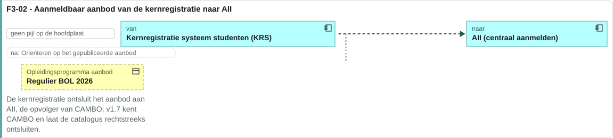
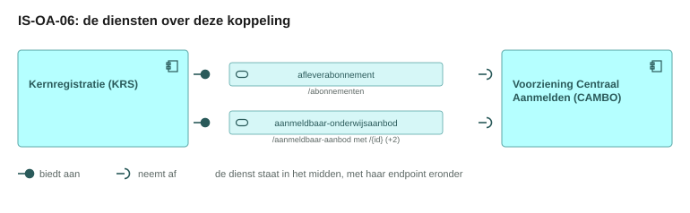
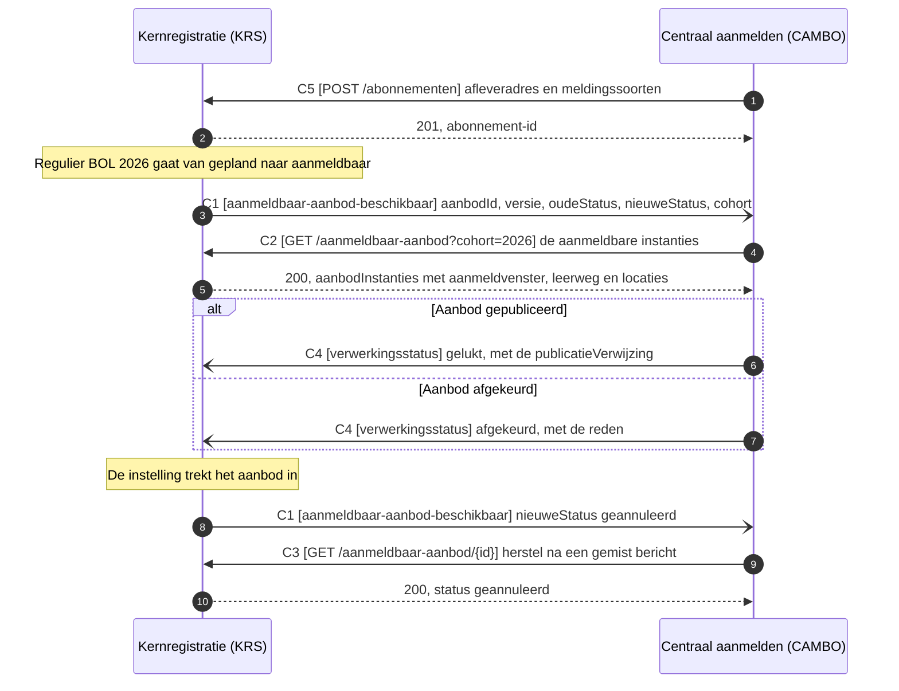
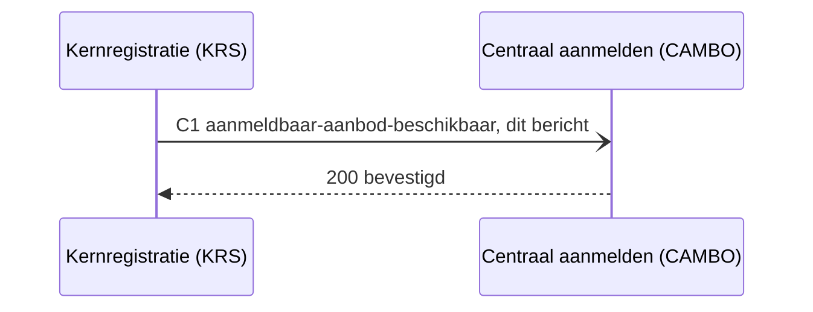
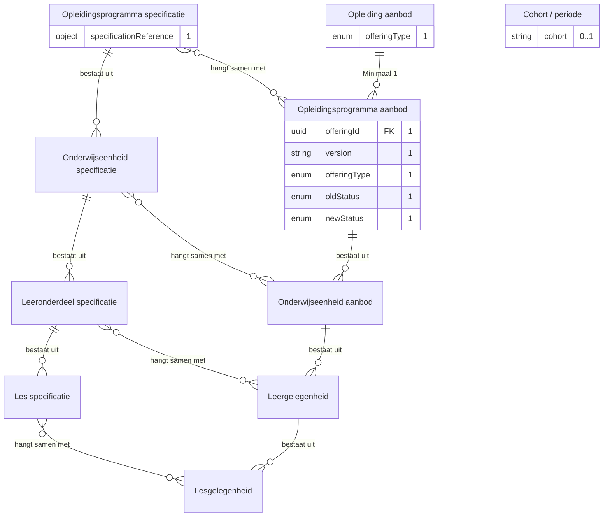
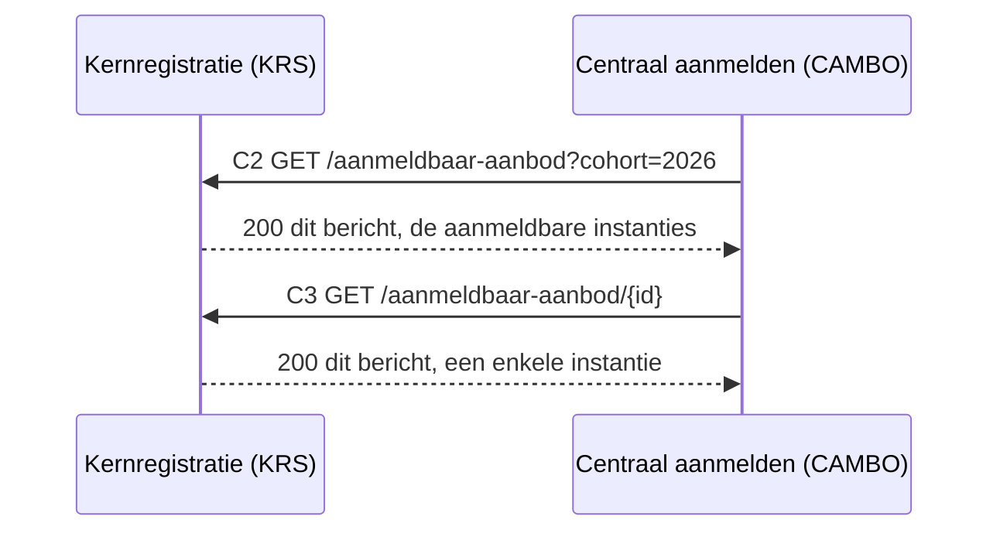
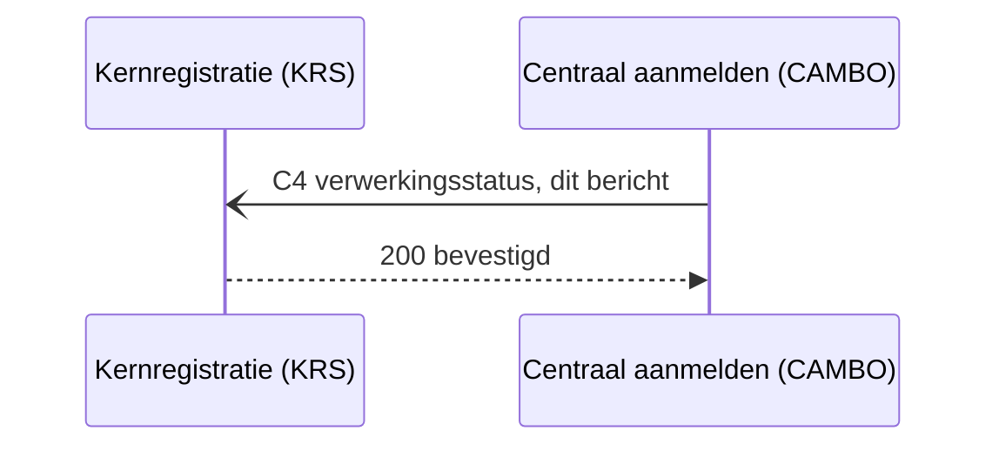
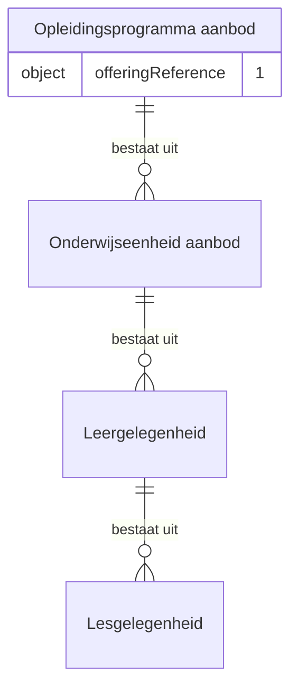

# IS-OA-06 Aanmeldbaar aanbod naar centraal aanmelden

| | |
|---|---|
| **Document doel** | Zet uiteen hoe de kernregistratie het aanmeldbare onderwijsaanbod aan de voorziening voor centraal aanmelden ontsluit, ten behoeve van de bouw of de verificatie van een implementatie volgens deze specificatie |
| **Doelgroep** | De implementatiespecialist en de tester bij een instelling of een leverancier, en wie een profiel of consumer bouwt |
| **Dient als input voor** | De bouw van het koppelvlak, de testgevallen erbij, en de acceptatie van een opgeleverde koppeling |
| **Kaderstelling** | De [interactieketen](README.md) waarin deze specificatie valt, het [informatiemodel OKx](../../../model/informatiemodel/informatiemodel.md), en beeld F3-02 van de [voorbeelduitwerking](../../../model/informatiemodel/voorbeeld-leerroute-1-jochem.md) |
| **Inhoud** | Vijf operaties met hun statuscodes, drie berichten met hun velden, acht aannames met de partij die erover beslist, tien punten voor de afstemming met AII, en drie voorbeeldpayloads die valideren |
| **Status** | Voorstel, in twee soorten. De vorm van het koppelvlak staat hier uitgewerkt met de stand per regel; de inhoud die centraal aanmelden vraagt staat open in de afstemming met AII, [Public#112](https://github.com/Npuls-OKx/Public/issues/112), waarvoor [de lijst voor AII](#de-lijst-voor-aii) een regel per punt geeft |

De lading: het `Opleidingsprogramma aanbod` per startmoment, met het aanmeldvenster, de leerweg, de doelgroep en de locaties erop, onder het `Opleiding aanbod` dat de startmomenten van een opleiding groepeert. De uuid's, de versies en de namen in de voorbeeldpayloads komen uit [casus.md](casus.md), en het aanbod is hetzelfde dat [IS-OA-05](is-oa-05.md) aan de kernregistratie ontsluit.

## 1. Interactie

| Bronsysteem | Doelsysteem | Koppeling | Beeld | Status | Applicatiedienst |
|---|---|---|---|---|---|
| `Kernregistratie systeem studenten (KRS)` | `Voorziening Centraal Aanmelden (CAMBO)`, de component die hoofdplaat v1.7 kent; beeld F3-02 noemt AII als opvolger | Voorstel: KRS-CAMBO. De beeldregel draagt nog geen koppeling-ID en v1.7 tekent in deze richting geen pijl | F3-02, met instantie `Regulier BOL 2026` | Voorstel, in de vorm en in de inhoud | Voorstel: ontsluiten van aanmeldbaar aanbod, op het koppelvlak van de kernregistratie. Het model belegt bij KRS `Inschrijvingen beheer` en bij het aanmeldsysteem `Opleiding aanmelding dienst`; W7 vraagt de dienst die aanbod ontsluit |



Links staat de kernregistratie die het aanbod bezit, rechts de voorziening die het toont. De lading is het `Opleidingsprogramma aanbod` `Regulier BOL 2026`, het startmoment waarop de aspirant-student zich aanmeldt.

De objecten in deze stroom ontstaan in [fase 2](../../../model/informatiemodel/voorbeeld-leerroute-1-jochem.md#fase-2-publiceren-en-planbaar-maken), waar het planningssysteem het aanbod per laag plant en de catalogus het publiceert.

De taak van deze interactie in het proces: het aanbod staat gepland en aanmeldbaar in de kernregistratie, en het moet bij centraal aanmelden in de etalage staan voordat een aspirant-student daar zijn startmoment kiest. Zij staat aan het begin van [fase 3](../../../model/informatiemodel/voorbeeld-leerroute-1-jochem.md#fase-3-instroom-intake-en-plaatsing), voor de stap waarin de `Aanmelding` ontstaat.

| Applicatiecomponent | Functie in deze interactie |
|---|---|
| Kernregistratie systeem studenten (KRS) | Meldt de statuswijziging van het aanbod, ontsluit de aanmeldbare instanties met hun aanmeldvenster, leerweg, doelgroep en locaties, en neemt de terugmelding over de verwerking aan |
| Voorziening Centraal Aanmelden (CAMBO) | Legt haar afleveradres vast, neemt de melding aan, haalt het aanbod op, zet het in de etalage of haalt het eruit, en meldt de verwerking met haar publicatieverwijzing terug |

De stand per regel hieronder zegt waar een artefact staat.

| Stand | Waar het artefact staat |
|---|---|
| `vastgelegd` | [Npuls-OKx/Public](https://github.com/Npuls-OKx/Public/tree/dev/Koppelvlakspecificaties) draagt hem, op het alfa-label dat daar geldt: een pad op een componentpagina, een enumwaarde in een melding of een schema in [Informatie-en-gegevensmodellen](https://github.com/Npuls-OKx/Public/tree/dev/Informatie-en-gegevensmodellen/schemas) |
| `voorstel` | Deze specificatie stelt hem voor, onderbouwd uit [de casus](casus.md) en het [informatiemodel](../../../model/informatiemodel/informatiemodel.md). Een voorgesteld schema staat in [schemas/](schemas/) en draagt een `$id` die eindigt op `/voorstel` |

De aannames waarop dit voorstel rust, met de partij die erover beslist:

| Nr | Aanname | Grond | Beslist |
|---|---|---|---|
| A1 | Het aanbod gaat naar de component `Voorziening Centraal Aanmelden (CAMBO)`, waarvoor beeld F3-02 AII als opvolger noemt | [voorbeeld-lr1-regels.json](../../../model/informatiemodel/voorbeeld-lr1-regels.json), F3-02; hoofdplaat v1.7 | OKx en AII, [Public#112](https://github.com/Npuls-OKx/Public/issues/112) |
| A2 | De kernregistratie is het ontsluitingspunt van de instelling naar de sector. [U3](https://github.com/Npuls-OKx/Public/blob/dev/Koppelvlakspecificaties/uitgangspunten.md#u3-resource-eigenaarschap) belegt het aanbod bij planning en reikt tot de instellingsgrens | keuze van de sectorarchitect in de beeldregel F3-02 | kerngroep techniek |
| A3 | Een startmoment is een eigen `Opleidingsprogramma aanbod`, met zijn startdatum in `period.start` (`periode.start`) | [education-offering.json](https://github.com/Npuls-OKx/Public/blob/dev/Informatie-en-gegevensmodellen/schemas/education-offering.json); het [conceptueel gegevensoverzicht van leerroute 1](../leerroute-uitwerking/doc/leerroute-uitwerking-lr1.md) noemt startmoment op het aanbod | OKx |
| A4 | De `specificationReference` (`specificatieVerwijzing`) blijft op elke instantie staan, zodat de lijn naar de catalogus leesbaar blijft | [U3](https://github.com/Npuls-OKx/Public/blob/dev/Koppelvlakspecificaties/uitgangspunten.md#u3-resource-eigenaarschap), [U7](https://github.com/Npuls-OKx/Public/blob/dev/Koppelvlakspecificaties/uitgangspunten.md#u7-payload-plat-met-verwijzingen-en-de-sleutelconventie) | OKx |
| A5 | Centraal aanmelden meldt terug of het aanbod is opgenomen | spiegelt interactie I3 van de koppeling OC-P&R | AII |
| A6 | Deze eenheid vult het instellings- en opleidingsaanbod aan dat centraal aanmelden uit het Register Instellingen en Opleidingen (RIO) ontvangt, met het programma-aanbod per startmoment | model: de stroom van RIO naar CAMBO draagt de instellings- en opleidingsgegevens | AII |
| A7 | Het aanmeldvenster hangt aan de laag `Opleidingsprogramma aanbod`, want daar kiest de aspirant-student zijn startmoment | model: `Opleidingsprogramma aanbod` `Op basis van` `Aanmelding`; [persona Jochem](../leerroute-uitwerking/doc/persona_jochem.md) kiest in het aanmeldsysteem zijn startmoment en voltooit daar de aanmelding | OKx en AII, [Public#112](https://github.com/Npuls-OKx/Public/issues/112) |
| A8 | De voorziening dient meer instellingen, dus het aanbod draagt zijn aanbieder | [begrippenlijst](../begrippen/begrippenlijst.md): `Opleiding aanbod` is aanbod dat "door een onderwijsaanbieder aangeboden wordt"; model: `Opleidingsaanbod van Instelling` staat boven `Opleiding aanbod` | AII |

Op hoofdplaat v1.7 bereikt de catalogus zowel de kernregistratie als CAMBO langs een knooppunt (junction) achter de pijl van IS-OA-05. Welke route en welke naam gelden staat open als signalering S2 en S3 in de [interactiespecificatie](signaleringen.md).

## 2. Interactiespecificatie



De aanbiedersdienst en de afnemersdienst staan als twee eigen blokken tegenover elkaar, met de bal die in de kom valt. Het sequentiediagram eronder zet dezelfde operaties in de tijd.



Het patroon is melden en dan ophalen (notify-then-pull, [U4](https://github.com/Npuls-OKx/Public/blob/dev/Koppelvlakspecificaties/uitgangspunten.md#u4-notify-then-pull)): C1 draagt de aanleiding, C2 haalt de inhoud. Een intrekking rijdt mee op de statusovergang naar `geannuleerd` uit [education-offering.json](https://github.com/Npuls-OKx/Public/blob/dev/Informatie-en-gegevensmodellen/schemas/education-offering.json), zodat centraal aanmelden het aanbod uit de etalage haalt en C3 die stand ook na een gemist bericht teruggeeft.

## 3. Operaties

`KRS` is de kernregistratie, `CA` de voorziening voor centraal aanmelden. Het koppelvlak van de kernregistratie in Public draagt vandaag de meldpatronen (webhooks) voor specificatie en resultaatstructuur, dus staat elke operatie hieronder op voorstel; de kolom Stand noemt de vastgelegde operatie waarvan zij de vorm overneemt en de werkbrief die haar in Public laat landen.

### 3.1 Het contract per operatie

| Id | Operatie | Richting | Pad of melding | Methode | Stand |
|---|---|---|---|---|---|
| C1 | Aanmeldbaar aanbod melden | KRS meldt CA | `aanmeldbaar-aanbod-beschikbaar` | POST | Voorstel. Vorm van `specificatie-status-gewijzigd` bij het [planningssysteem](https://github.com/Npuls-OKx/Public/blob/dev/Koppelvlakspecificaties/Applicatiecomponenten/planningssysteem.md), W5 |
| C2 | De aanmeldbare instanties ophalen | CA vraagt KRS | `/aanmeldbaar-aanbod` | GET | Voorstel. Vorm van `GET /onderwijsaanbod` bij het [planningssysteem](https://github.com/Npuls-OKx/Public/blob/dev/Koppelvlakspecificaties/Applicatiecomponenten/planningssysteem.md), W4 |
| C3 | Een enkele instantie ophalen | CA vraagt KRS | `/aanmeldbaar-aanbod/{id}` | GET | Voorstel. Vorm van `GET /onderwijsaanbod/{id}` bij het planningssysteem, W4 |
| C4 | De verwerking terugmelden | CA meldt KRS | `verwerkingsstatus` | POST | Voorstel. Vorm van `verwerkingsstatus` bij de [onderwijscatalogus](https://github.com/Npuls-OKx/Public/blob/dev/Koppelvlakspecificaties/Applicatiecomponenten/onderwijscatalogus.md), interactie I3, W6 |
| C5 | Het afleveradres vastleggen | over en weer | `/abonnementen` | POST | Voorstel op deze koppeling. `POST /abonnementen` met [subscription.json](https://github.com/Npuls-OKx/Public/blob/dev/Informatie-en-gegevensmodellen/schemas/subscription.json) staat vastgelegd bij de catalogus en het planningssysteem, met `verwerkingsstatus` in de enum `events`. De meldingssoort `aanmeldbaar-aanbod-beschikbaar` komt erbij, W5 |

Parameters, statuscodes en foutgedrag per operatie.

| Id | Parameters | Statuscodes | Foutgedrag |
|---|---|---|---|
| C1 | geen | 200 | Zonder 200 volgt herhaling met uitstel (backoff) en daarna de wachtrij voor onbestelbare berichten (dead letter channel). Het bericht is herhaalbaar op `offeringId` plus `newStatus` |
| C2 | `cohort` (verplicht), `gewijzigdSinds` (optioneel, tijdstempel) | 200, 400 | 400 bij een cohort dat de kernregistratie niet kent. Alleen-lezen, dus herhalen geeft hetzelfde antwoord |
| C3 | `versie` (optioneel, standaard de laatste) | 200, 400, 404 | 404 bij een onbekend aanbod-id. Een ingetrokken aanbod komt terug met status `geannuleerd` |
| C4 | geen | 200 | Zonder 200 volgt herhaling met uitstel en daarna de wachtrij voor onbestelbare berichten. Het bericht is herhaalbaar op `offeringReference` plus `status` |
| C5 | geen | 201, 400 | Herhaalbaar op `callbackUrl` plus meldingssoort: herregistratie overschrijft |

De voorziening voor centraal aanmelden implementeert C1, de kernregistratie C2, C3 en C4, en beide partijen C5.

### 3.2 Statusafhandeling

De melding op C1 volgt de statusovergang van het aanbod; centraal aanmelden meldt op C4 wat zij ermee deed (A5).

| Verwerkingsstatus | Wat centraal aanmelden meldt | Wat de kernregistratie daarop doet |
|---|---|---|
| `ontvangen` | de terugmelding is aangenomen | de uitkomst afwachten |
| `gestart` | de verwerking loopt | de uitkomst afwachten |
| `gelukt` | de publicatie bij centraal aanmelden staat in `publicationReference` | die verwijzing bewaren bij het aanbod |
| `afgekeurd` | de reden staat in `reason` | het aanbod herstellen, waarna C1 opnieuw volgt |
| `nietGelukt` | de verwerking liep vast, met de reden erbij | de melding opnieuw laten volgen |

Of centraal aanmelden de verwerking terugmeldt en of zij haar publicatie daarin noemt, staat open als V9 in [de lijst voor AII](#de-lijst-voor-aii). Het bericht ligt hier vast en het kanaal blijft een inrichtingskeuze van instelling en leverancier, binnen de eigenschappen die [U5](https://github.com/Npuls-OKx/Public/blob/dev/Koppelvlakspecificaties/uitgangspunten.md#u5-bericht-versus-kanaal) opsomt.

## 4. Berichtspecificatie

De sleutel in de payload is de Engelse `properties`-naam uit het schema; de kolom Nederlands geeft de naam uit [mapping.md](https://github.com/Npuls-OKx/Public/blob/dev/Informatie-en-gegevensmodellen/mapping.md), waarmee wie de modellen kent de weg terugvindt. De kolom Objecttype noemt het objecttype uit het [informatiemodel OKx](../../../model/informatiemodel/informatiemodel.md) waarop het veld terugslaat, en daarmee de aanbodlaag die het veld draagt. De kolom Grond noemt het schema of het document waaruit het veld bestaat.

De kolom Stand zegt waarop een leverancier vandaag kan bouwen. De stand `vastgelegd` geldt voor een sleutel waarvan Public de naam en de waarden draagt; de stand `voorstel` geldt zodra deze specificatie de sleutel of een waarde ervan voorstelt.

### 4.1 Melden statuswijziging van een onderwijsaanbod



<!-- erd -->


| Lijn | Betekenis |
|---|---|
| `\|\|--o{` | het eerste bestaat uit nul of meer van het tweede |
| `}o--o{` | de twee hangen samen, met het opschrift erbij |
| `PK` en `FK` | de sleutel van het object, en een verwijzing naar een ander object |
| tekst achter een attribuut | de multipliciteit in dit bericht, en of het veld verplicht is |

<!-- /erd -->

Een dun bericht met de aanleiding, in de vorm van [specification-status-changed.json](https://github.com/Npuls-OKx/Public/blob/dev/Informatie-en-gegevensmodellen/schemas/specification-status-changed.json) met het aanbod als onderwerp. Schema: [offering-status-changed.json](schemas/offering-status-changed.json).

| Veld | Nederlands | Type | Kardinaliteit | Objecttype | Stand | Grond |
|---|---|---|---|---|---|---|
| `offeringId` | aanbodId | uuid | 1 | `Opleidingsprogramma aanbod` | voorstel | `id` in education-offering.json, met de naam van [offering-reference.json](schemas/offering-reference.json); specification-status-changed.json noemt dezelfde plek `objectId` |
| `version` | versie | string, semver | 1 | `Opleidingsprogramma aanbod` | vastgelegd | `version` in education-offering.json |
| `offeringType` | aanbodType | enum | 1 | `Opleiding aanbod`, `Opleidingsprogramma aanbod` | vastgelegd | `offeringType` in education-offering.json |
| `specificationReference` | specificatieVerwijzing | object | 1 | `Opleidingsprogramma specificatie` | vastgelegd | [specification-reference.json](https://github.com/Npuls-OKx/Public/blob/dev/Informatie-en-gegevensmodellen/schemas/specification-reference.json), zoals A4 vraagt |
| `oldStatus` | oudeStatus | enum | 1 | `Opleidingsprogramma aanbod` | voorstel | sleutel uit specification-status-changed.json, met de statuswaarden van education-offering.json plus `aanmeldbaar` (W1) |
| `newStatus` | nieuweStatus | enum | 1 | `Opleidingsprogramma aanbod` | voorstel | idem. Deze koppeling meldt op de overgang naar `aanmeldbaar` en naar `geannuleerd` |
| `cohort` | cohort | string | 0..1 | `Cohort / periode` | vastgelegd | `cohort` in education-offering.json; de afnemer filtert zijn opvraag erop |
| `eventId` | eventId | uuid | 0..1 | verwerkingsinformatie, geen objecttype | voorstel | [U5](https://github.com/Npuls-OKx/Public/blob/dev/Koppelvlakspecificaties/uitgangspunten.md#u5-bericht-versus-kanaal) vraagt een stabiel event-id voor herhaalbare verwerking (W8) |

### 4.2 Opvragen aanmeldbaar aanbod



<!-- erd -->
```mermaid
erDiagram
    "Kerntaak" ||--o{ "Werkproces" : "bestaat uit"
    "Kwalificatie" ||--o{ "Kerntaak" : "bestaat uit"
    "Kwalificatie dossier" ||--o{ "Kwalificatie" : "bevat"
    "Leergelegenheid" ||--o{ "Lesgelegenheid" : "bestaat uit"
    "Leeronderdeel specificatie" ||--o{ "Les specificatie" : "bestaat uit"
    "Onderwijseenheid aanbod" ||--o{ "Leergelegenheid" : "bestaat uit"
    "Onderwijseenheid specificatie" ||--o{ "Leeronderdeel specificatie" : "bestaat uit"
    "Opleidingsprogramma aanbod" ||--o{ "Onderwijseenheid aanbod" : "bestaat uit"
    "Opleidingsprogramma specificatie" ||--o{ "Onderwijseenheid specificatie" : "bestaat uit"
    "Leergelegenheid" }o--o{ "Onderwijslocatie" : "wordt gegeven op"
    "Leeronderdeel specificatie" }o--o{ "Leergelegenheid" : "hangt samen met"
    "Les specificatie" }o--o{ "Lesgelegenheid" : "hangt samen met"
    "Lesgelegenheid" }o--o{ "Onderwijslocatie" : "wordt gegeven op"
    "Onderwijseenheid aanbod" }o--o{ "Onderwijslocatie" : "wordt gegeven op"
    "Onderwijseenheid specificatie" }o--o{ "Onderwijseenheid aanbod" : "hangt samen met"
    "Opleiding aanbod" }o--o{ "Onderwijslocatie" : "Wordt gegeven op"
    "Opleidingsprogramma aanbod" }o--o{ "Onderwijslocatie" : "wordt gegeven op"
    "Opleidingsprogramma specificatie" }o--o{ "Opleidingsprogramma aanbod" : "hangt samen met"
    "Organisatie-eenheid" }o--o{ "Leeronderdeel specificatie" : "Voert uit"
    "Organisatie-eenheid" }o--o{ "Les specificatie" : "Voert uit"
    "Organisatie-eenheid" }o--o{ "Onderwijseenheid specificatie" : "Voert uit"
    "Organisatie-eenheid" }o--o{ "Opleidingsprogramma specificatie" : "Voert uit"
    "Opleiding aanbod" ||--o{ "Opleidingsprogramma aanbod" : "Minimaal 1"
    "Opleidingsaanbod van Instelling" ||--o{ "Opleiding aanbod" : "Minimaal 1"
    "Opleiding aanbod" {
        uuid offeringInstances_id PK "1"
        enum offeringInstances_offeringType "1"
        uuid offeringInstances_parentOfferingId FK "1"
        string offeringInstances_enrolmentDeadline "0..1"
        integer offeringInstances_maxStudentCount "0..1"
        array bottlenecks "0..n"
        string cohort FK "0..1"
        string executingTeamId FK "0..1"
        array groups FK "0..n"
        string id PK "1..1"
        string locationId FK "0..1"
        integer maxStudentCount "0..1"
        integer minStudentCount "0..1"
        string name "1..1"
        enum offeringType "1..1"
        string parentOfferingId FK "1..1"
        object period "0..1"
        string providerId FK "0..1"
        array source FK "0..n"
        enum status "1..1"
        string version "1..1"
    }
    "Opleidingsprogramma aanbod" {
        uuid offeringInstances_id PK "1"
        enum offeringInstances_offeringType "1"
        string offeringInstances_version "1"
        string offeringInstances_name "1"
        enum offeringInstances_status "1"
        object offeringInstances_period "0..1"
        object offeringInstances_applicationWindow "0..1"
        enum offeringInstances_learningPathway "0..1"
        string offeringInstances_targetGroup "0..1"
        integer offeringInstances_minStudentCount "0..1"
        integer offeringInstances_maxStudentCount "0..1"
        object applicationWindow "0..1"
        date applicationWindow.end "0..1"
        date applicationWindow.start "0..1"
        array bottlenecks "0..n"
        string cohort FK "0..1"
        string executingTeamId FK "0..1"
        array groups FK "0..n"
        string id PK "1..1"
        enum learningPathway "0..1"
        string locationId FK "0..1"
        integer maxStudentCount "0..1"
        integer minStudentCount "0..1"
        string name "1..1"
        enum offeringType "1..1"
        string parentOfferingId FK "1..1"
        object period "0..1"
        date period.start "0..1"
        enum status "1..1"
        string targetGroup "0..1"
        string version "1..1"
    }
    "Opleidingsprogramma specificatie" {
        object offeringInstances_specificationReference "1"
    }
    "Cohort / periode" {
        string offeringInstances_cohort "0..1"
    }
    "Kwalificatie dossier" {
        array offeringInstances_source "0..n"
        string offeringInstances[].source[].code PK "0..n"
        string offeringInstances[].source[].standard "0..n"
        enum offeringInstances[].source[].type "0..n"
    }
    "Kwalificatie" {
        array offeringInstances_source "0..n"
        string offeringInstances[].source[].code PK "0..n"
        string offeringInstances[].source[].standard "0..n"
        enum offeringInstances[].source[].type "0..n"
    }
    "Organisatie-eenheid" {
        uuid offeringInstances_providerId FK "0..1"
        uuid offeringInstances_executingTeamId FK "0..1"
        array organisationUnits "0..n"
    }
    "Opleidingsaanbod van Instelling" {
        uuid offeringInstances_providerId FK "0..1"
    }
    "Onderwijslocatie" {
        uuid offeringInstances_locationId FK "0..1"
        array locations "0..n"
    }
    "Onderwijseenheid aanbod" {
        array bottlenecks "0..n"
        string cohort FK "0..1"
        string executingTeamId FK "0..1"
        array groups FK "0..n"
        string id PK "1..1"
        string locationId FK "0..1"
        integer maxStudentCount "0..1"
        integer minStudentCount "0..1"
        string name "1..1"
        enum offeringType "1..1"
        string parentOfferingId FK "1..1"
        object period "0..1"
        enum status "1..1"
        string version "1..1"
    }
    "Leergelegenheid" {
        array bottlenecks "0..n"
        string cohort FK "0..1"
        string executingTeamId FK "0..1"
        array groups FK "0..n"
        string id PK "1..1"
        string locationId FK "0..1"
        integer maxStudentCount "0..1"
        integer minStudentCount "0..1"
        string name "1..1"
        enum offeringType "1..1"
        string parentOfferingId FK "1..1"
        object period "0..1"
        date period.start "0..1"
        enum status "1..1"
        string version "1..1"
    }
    "Plaatsingsgroep" {
        uuid groups[].id PK "0..n"
    }
    "Onderwijseenheid specificatie" { }
    "Kerntaak" { }
    "Lesgelegenheid" { }
    "Leeronderdeel specificatie" { }
    "Werkproces" { }
    "Les specificatie" { }
```

| Lijn | Betekenis |
|---|---|
| `\|\|--o{` | het eerste bestaat uit nul of meer van het tweede |
| `}o--o{` | de twee hangen samen, met het opschrift erbij |
| `PK` en `FK` | de sleutel van het object, en een verwijzing naar een ander object |
| tekst achter een attribuut | de multipliciteit in dit bericht, en of het veld verplicht is |

<!-- /erd -->

De respons draagt de twee bovenste aanbodlagen uit [education-offering.json](https://github.com/Npuls-OKx/Public/blob/dev/Informatie-en-gegevensmodellen/schemas/education-offering.json), in `offeringInstances` (`aanbodInstanties`), met `locations` (`locaties`) en `organisationUnits` (`organisatieEenheden`) ernaast. Schema: [offering-open-for-application.json](schemas/offering-open-for-application.json), de snede van education-offering.json voor deze afnemer.

| Veld | Nederlands | Type | Kardinaliteit | Objecttype | Stand | Grond |
|---|---|---|---|---|---|---|
| `offeringInstances[].id` | id | uuid | 1 | `Opleiding aanbod`, `Opleidingsprogramma aanbod` | vastgelegd | education-offering.json. Op dit id ontstaat de `Aanmelding`, die het model met `Op basis van` aan beide lagen hangt |
| `offeringInstances[].offeringType` | aanbodType | enum | 1 | `Opleiding aanbod`, `Opleidingsprogramma aanbod` | vastgelegd | idem, met de waarden `opleidingsaanbod` en `opleidingsprogramma-aanbod` |
| `offeringInstances[].version` | versie | string, semver | 1 | `Opleidingsprogramma aanbod` | vastgelegd | idem |
| `offeringInstances[].parentOfferingId` | bovenliggendAanbodId | uuid of null | 1 | `Opleiding aanbod` | vastgelegd | idem. De startmomenten van een opleiding staan hiermee bij elkaar |
| `offeringInstances[].specificationReference` | specificatieVerwijzing | object | 1 | `Opleidingsprogramma specificatie` | vastgelegd | [specification-reference.json](https://github.com/Npuls-OKx/Public/blob/dev/Informatie-en-gegevensmodellen/schemas/specification-reference.json) |
| `offeringInstances[].name` | naam | string | 1 | `Opleidingsprogramma aanbod` | vastgelegd | education-offering.json. De aspirant-student leest deze naam |
| `offeringInstances[].status` | status | enum | 1 | `Opleidingsprogramma aanbod` | voorstel | idem, met de waarde `aanmeldbaar` erbij (W1). Deze snede draagt `aanmeldbaar` en `geannuleerd` |
| `offeringInstances[].cohort` | cohort | string | 0..1 | `Cohort / periode` | vastgelegd | idem |
| `offeringInstances[].period` | periode | object, `start` en `end` | 0..1 | `Opleidingsprogramma aanbod` | vastgelegd | [period.json](https://github.com/Npuls-OKx/Public/blob/dev/Informatie-en-gegevensmodellen/schemas/period.json); `start` draagt het startmoment (A3) |
| `offeringInstances[].applicationWindow` | aanmeldvenster | object, `start` en `end` | 0..1 | `Opleidingsprogramma aanbod` | voorstel | vorm van period.json. W2 van [IS-OA-05](is-oa-05.md) stelt dezelfde sleutel voor; A7 legt haar op het startmoment (W10) |
| `offeringInstances[].enrolmentDeadline` | uitersteInschrijfdatum | string, date | 0..1 | `Opleiding aanbod` | voorstel | het [conceptueel gegevensoverzicht van leerroute 1](../leerroute-uitwerking/doc/leerroute-uitwerking-lr1.md) legt de uiterste inschrijfdatum op de opleidingslaag, naast de opleidingsspecificatie (W3) |
| `offeringInstances[].learningPathway` | leerweg | enum `BOL`, `BBL` | 0..1 | `Opleidingsprogramma aanbod` | voorstel | sleutel, enum en Nederlandse naam van `learningPathway` in [education-specification.json](https://github.com/Npuls-OKx/Public/blob/dev/Informatie-en-gegevensmodellen/schemas/education-specification.json), op de programmalaag `leerweg` (W12) |
| `offeringInstances[].targetGroup` | doelgroep | string, open lijst | 0..1 | `Opleidingsprogramma aanbod` | voorstel | sleutel van `targetGroup` in education-specification.json, op de programmalaag `doelgroep`, met de waarde `regulier` voor deze casus (W12) |
| `offeringInstances[].source` | bron | array van object | 0..n | `Kwalificatie dossier`, `Kwalificatie` | voorstel | vorm van [source.json](https://github.com/Npuls-OKx/Public/blob/dev/Informatie-en-gegevensmodellen/schemas/source.json), die [casus.md](casus.md) voor de leeruitkomst en de aanbodinstantie aanhoudt (W2) |
| `offeringInstances[].providerId` | aanbiederId | uuid | 0..1 | `Organisatie-eenheid`, op de laag `Opleidingsaanbod van Instelling` | voorstel | de onderwijsaanbieder uit de definitie van `Opleiding aanbod` in de [begrippenlijst](../begrippen/begrippenlijst.md), op te lossen in `organisationUnits` (W12) |
| `offeringInstances[].minStudentCount` | minAantalStudenten | integer | 0..1 | `Opleidingsprogramma aanbod` | vastgelegd | education-offering.json |
| `offeringInstances[].maxStudentCount` | maxAantalStudenten | integer | 0..1 | `Opleiding aanbod`, `Opleidingsprogramma aanbod` | vastgelegd | idem. Het conceptueel gegevensoverzicht van leerroute 1 noemt de capaciteit instroom op de opleidingslaag |
| `offeringInstances[].locationId` | locatieId | uuid | 0..1 | `Onderwijslocatie` | vastgelegd | idem, op te lossen in `locations`. Het model hangt `Wordt gegeven op` aan beide lagen |
| `offeringInstances[].executingTeamId` | uitvoerendTeamId | uuid | 0..1 | `Organisatie-eenheid` | vastgelegd | [organisation-unit.json](https://github.com/Npuls-OKx/Public/blob/dev/Informatie-en-gegevensmodellen/schemas/organisation-unit.json), op te lossen in `organisationUnits` |
| `locations[]` | locaties | array van object | 0..n | `Onderwijslocatie` | vastgelegd | [location.json](https://github.com/Npuls-OKx/Public/blob/dev/Informatie-en-gegevensmodellen/schemas/location.json); `codes` draagt de vestigingscode, de sleutel waarop een sectorale partij de locatie terugvindt |
| `organisationUnits[]` | organisatieEenheden | array van object | 0..n | `Organisatie-eenheid` | vastgelegd | organisation-unit.json, met `unitType` `instelling` voor de aanbieder en `onderwijsteam` voor het uitvoerend team |

De groepen, de knelpunten en de aanbodlagen onder het programma blijven binnen de instelling, waar het planningssysteem en de kernregistratie ze dragen. Werkbrief W9 legt die snede vast in [gebruiksprofielen.md](https://github.com/Npuls-OKx/Public/blob/dev/Informatie-en-gegevensmodellen/gebruiksprofielen.md), en het schema drukt haar uit met gesloten objecten (`additionalProperties: false`).

#### De lijst voor AII

Per regel het punt waarop de afstemming met AII een antwoord geeft, met het voorstel van OKx ernaast. De velden die hier ontbreken dragen de stand `vastgelegd`: Public draagt ze al.

| Nr | Punt | Voorstel van OKx |
|---|---|---|
| V1 | Welke aanbodlagen de voorziening bereiken | Twee: `opleidingsaanbod` groepeert, `opleidingsprogramma-aanbod` draagt het startmoment waarop de `Aanmelding` ontstaat |
| V2 | Waar het aanmeldvenster hangt en welke termijn het draagt | `applicationWindow` met `start` en `end`, op het startmoment (A7) |
| V3 | Of de uiterste inschrijfdatum naast het venster meereist | `enrolmentDeadline` op de opleidingslaag, waar het conceptueel gegevensoverzicht van leerroute 1 haar legt |
| V4 | Hoe de leerweg en de doelgroep de voorziening bereiken | `learningPathway` en `targetGroup` op het startmoment, met de sleutels die education-specification.json draagt |
| V5 | Hoe het crebo-dossier en de kwalificatie meekomen | `source` als array van source.json op het aanbod, zodat de voorziening ze naast de opleidingsgegevens uit RIO legt (A6) |
| V6 | Of de aanbieder in de payload staat of uit het kanaal volgt | `providerId` op de opleidingslaag, opgelost in `organisationUnits` (A8) |
| V7 | Of de capaciteit meereist, en of de ondergrens daarbij hoort | `maxStudentCount` als capaciteit instroom, met `minStudentCount` als de ondergrens uit de planning, beide optioneel |
| V8 | Welke statusovergangen de voorziening aangaan | `aanmeldbaar` zet het aanbod in de etalage, `geannuleerd` haalt het eruit |
| V9 | Of de voorziening de verwerking terugmeldt, en of zij haar publicatie daarin noemt | C4 met `offeringReference`, en `publicationReference` bij de waarde `gelukt` (A5) |
| V10 | Op welk niveau de locatie meereist | `locationId` wijst de vestiging aan, `locations` draagt de boom daaronder, met de vestigingscode in `codes` |

### 4.3 Terugmelden verwerkingsstatus van een onderwijsaanbod



<!-- erd -->


| Lijn | Betekenis |
|---|---|
| `\|\|--o{` | het eerste bestaat uit nul of meer van het tweede |
| `PK` en `FK` | de sleutel van het object, en een verwijzing naar een ander object |
| tekst achter een attribuut | de multipliciteit in dit bericht, en of het veld verplicht is |

<!-- /erd -->

De vorm van [processing-status.json](https://github.com/Npuls-OKx/Public/blob/dev/Informatie-en-gegevensmodellen/schemas/processing-status.json) met het aanbod als onderwerp: dat schema sleutelt op een specificatie. Schema: [offering-processing-status.json](schemas/offering-processing-status.json).

| Veld | Nederlands | Type | Kardinaliteit | Objecttype | Stand | Grond |
|---|---|---|---|---|---|---|
| `status` | status | enum: `ontvangen`, `gestart`, `afgekeurd`, `gelukt`, `nietGelukt` | 1 | verwerkingsinformatie, geen objecttype | vastgelegd | de vijf waarden van `status` in processing-status.json (W6) |
| `offeringReference` | aanbodVerwijzing | object, `offeringId` en `version` | 1 | `Opleidingsprogramma aanbod` | voorstel | [offering-reference.json](schemas/offering-reference.json), de vorm van specification-reference.json met het aanbod als onderwerp; processing-status.json draagt `programmeOfferingId` (`opleidingsaanbodId`) als losse sleutel |
| `publicationReference` | publicatieVerwijzing | uuid | 0..1 | de publicatie bij centraal aanmelden, modelgat in W6 | voorstel | spiegelt `programmeOfferingId` in processing-status.json, dat op `Opleiding aanbod` terugslaat. Hoort bij de waarde `gelukt` |
| `reason` | reden | string | 0..1 | verwerkingsinformatie, geen objecttype | voorstel | hoort bij `afgekeurd` en `nietGelukt`, zoals de reden op `inrichtingsstatus` bij de catalogus (W6) |
| `eventId` | eventId | uuid | 0..1 | verwerkingsinformatie, geen objecttype | voorstel | U5 vraagt een stabiel event-id (W8) |

## 5. Voorbeeldpayloads

De casus is Apothekersassistent, crebo-dossier 23450 met kwalificatie 27141, cohort 2026. Elke uuid staat in [casus.md](casus.md) en volgt daar de [voorbeeldpayloads in Public](https://github.com/Npuls-OKx/Public/blob/dev/Informatie-en-gegevensmodellen/voorbeeldpayloads.md) voor dezelfde casus; de sleutels komen uit de `properties` van de schema's. Elke payload hieronder valideert tegen het schema dat erbij staat.

De melding van C1, waarmee `Regulier BOL 2026` van `gepland` naar `aanmeldbaar` gaat. Het melding-id blijft bij het kanaal, dus buiten de identificaties van casus.md.

```json schema=offering-status-changed
{
  "offeringId": "8c494250-b67a-4666-a762-6f9ec1e70aff",
  "version": "0.1.0",
  "offeringType": "opleidingsprogramma-aanbod",
  "specificationReference": { "specificationId": "7ae25c1e-ee27-43a2-a001-761ee39ea5c7", "version": "0.1.0" },
  "oldStatus": "gepland",
  "newStatus": "aanmeldbaar",
  "cohort": "2026"
}
```

De respons op `GET /aanmeldbaar-aanbod?cohort=2026`. Aanmelden staat open van 1 oktober 2025 tot 1 augustus 2026, de uiterste inschrijfdatum die het conceptueel gegevensoverzicht van leerroute 1 voor deze casus noemt, en het onderwijs start op 1 september 2026.

```json schema=offering-open-for-application
{
  "offeringInstances": [
    {
      "id": "7aa6609f-1d1b-471a-a0f8-beae490d31b5",
      "offeringType": "opleidingsaanbod",
      "version": "0.1.0",
      "parentOfferingId": null,
      "specificationReference": { "specificationId": "79736830-1c5c-470f-b2c2-005029c96733", "version": "0.1.0" },
      "name": "Apothekersassistent 2026",
      "status": "aanmeldbaar",
      "cohort": "2026",
      "period": { "start": "2026-09-01", "end": "2029-07-15" },
      "enrolmentDeadline": "2026-08-01",
      "maxStudentCount": 48,
      "providerId": "6132ece6-d75e-4e80-81ce-91ab7448794d",
      "source": [
        { "standard": "sbb-kwalificatiekader", "type": "kwalificatiedossier", "code": "23450" },
        { "standard": "sbb-kwalificatiekader", "type": "kwalificatie", "code": "27141" }
      ]
    },
    {
      "id": "8c494250-b67a-4666-a762-6f9ec1e70aff",
      "offeringType": "opleidingsprogramma-aanbod",
      "version": "0.1.0",
      "parentOfferingId": "7aa6609f-1d1b-471a-a0f8-beae490d31b5",
      "specificationReference": { "specificationId": "7ae25c1e-ee27-43a2-a001-761ee39ea5c7", "version": "0.1.0" },
      "name": "Regulier BOL 2026",
      "status": "aanmeldbaar",
      "cohort": "2026",
      "period": { "start": "2026-09-01", "end": "2029-07-15" },
      "applicationWindow": { "start": "2025-10-01", "end": "2026-08-01" },
      "learningPathway": "BOL",
      "targetGroup": "regulier",
      "minStudentCount": 24,
      "maxStudentCount": 48,
      "locationId": "59807057-a6f1-473b-9084-114644557a68",
      "executingTeamId": "d9561371-5ece-482d-a675-a076e63f980f"
    }
  ],
  "locations": [
    {
      "id": "59807057-a6f1-473b-9084-114644557a68",
      "locationType": "vestiging",
      "name": "Hoofdlocatie Utrecht",
      "partOfLocationId": null,
      "codes": [ { "codeType": "vestigingscode", "code": "UTR-01" } ]
    }
  ],
  "organisationUnits": [
    {
      "id": "6132ece6-d75e-4e80-81ce-91ab7448794d",
      "unitType": "instelling",
      "name": "ROC Leren Zonder Drempels",
      "parentUnitId": null
    },
    {
      "id": "d9561371-5ece-482d-a675-a076e63f980f",
      "unitType": "onderwijsteam",
      "name": "Onderwijsteam Farmacie",
      "parentUnitId": "6132ece6-d75e-4e80-81ce-91ab7448794d"
    }
  ]
}
```

De terugmelding van C4 op een afkeuring. De publicatieverwijzing bij de waarde `gelukt` kent de voorziening zelf toe en staat daarmee buiten de identificaties van casus.md.

```json schema=offering-processing-status
{
  "status": "afgekeurd",
  "offeringReference": { "offeringId": "8c494250-b67a-4666-a762-6f9ec1e70aff", "version": "0.1.0" },
  "reason": "De vestigingscode UTR-01 staat niet bij deze instelling in het Register Instellingen en Opleidingen"
}
```

## 6. Werkbrieven: de issueset die hieruit volgt

Deze regels horen niet in de koppelvlakspecificatie zelf. Elk van hen wordt een issue in Npuls-OKx/Public of in meta, en blijft hier staan tot dat issue er is.

Wat er in Npuls-OKx/Public moet gebeuren om dit voorstel daar te laten landen. Alle schema's dragen daar het label alfa, dus een uitbreiding blijft binnen dezelfde ronde. De nieuwe schema's staan in [schemas/](schemas/) met het label voorstel in hun `$id`; bij landing in Public wisselt dat label naar alfa en worden de verwijzingen naar andere schema's relatieve paden, zoals de schema's daar ze dragen.

| Nr | Wat erbij moet | Waar | Versie-impact |
|---|---|---|---|
| W1 | De waarde `aanmeldbaar` in de enum `status`, naast `inPlanning`, `gepland`, `nietRealiseerbaar` en `geannuleerd` | `education-offering.json`, `offeringInstances[].status` | Een waarde in een gesloten lijst: additief voor de verzender en brekend voor wie op die lijst valideert, dus major. W2 van IS-OA-05 vraagt dezelfde waarde |
| W2 | Het veld `source` (`bron`) op de aanbodinstantie, als array van `source.json`, zodat het aanbod zijn crebo-dossier en kwalificatie draagt. Het alternatief laat centraal aanmelden de code ophalen langs de `specificationReference` | `education-offering.json`, `offeringInstances[].source`, met `source.json` als type | Optioneel veld: minor. `source.json` is nu een enkel object op `learning-outcome.json` en wordt hier een array |
| W3 | Het veld `enrolmentDeadline` (`uitersteInschrijfdatum`) op de instantie van de laag `opleidingsaanbod`: daar legt het conceptueel gegevensoverzicht van leerroute 1 de uiterste inschrijfdatum, naast de opleidingsspecificatie. De werkbrief legt die laag vast | `education-offering.json`, `offeringInstances[].enrolmentDeadline` | Optioneel veld: minor. Een latere verschuiving naar de programmalaag is brekend voor de afnemer die hem al leest |
| W4 | De operaties C2 en C3 met hun parameters en statuscodes, plus een componentpagina voor de voorziening voor centraal aanmelden die C1 draagt | de componentpagina [studentinformatiesysteem.md](https://github.com/Npuls-OKx/Public/blob/dev/Koppelvlakspecificaties/Applicatiecomponenten/studentinformatiesysteem.md), plus een nieuwe componentpagina | Nieuwe regels in de endpointtabel, waar de kernregistratie vandaag meldpatronen draagt. Geen schemawijziging |
| W5 | De meldingssoort `aanmeldbaar-aanbod-beschikbaar` in de enum `events`, met [offering-status-changed.json](schemas/offering-status-changed.json) als payload. W1 van [IS-OA-05](is-oa-05.md) laat datzelfde schema landen voor de melding aan de kernregistratie | `subscription.json`, plus het nieuwe bestand in `schemas/` uit W1 van IS-OA-05 | Nieuw schema, additief: minor. De enumwaarde in `events` is major voor wie op die lijst valideert |
| W6 | Het schema [offering-processing-status.json](schemas/offering-processing-status.json) voor de verwerking terug, dat op [offering-reference.json](schemas/offering-reference.json) uit W8 van IS-OA-05 leunt, plus een objecttype voor de publicatie bij centraal aanmelden | nieuw bestand in `schemas/`, naast `processing-status.json`; het modelgat in het [informatiemodel](../../../model/informatiemodel/informatiemodel.md) | Nieuw schema, additief: minor. Het objecttype voor de publicatie volgt de afstemming met AII, [Public#112](https://github.com/Npuls-OKx/Public/issues/112) |
| W7 | Een applicatiedienst die aanmeldbaar aanbod ontsluit, op het koppelvlak van de kernregistratie, met de pijl naar centraal aanmelden erbij | het ArchiMate-model en de volgende versie van de informatiestromen-hoofdplaat | Nieuwe versie van de plaat. Volgt op het besluit over richting en naam, signalering S2 en S3 |
| W8 | Een stabiel `eventId` in elk bericht, dat [U5](https://github.com/Npuls-OKx/Public/blob/dev/Koppelvlakspecificaties/uitgangspunten.md#u5-bericht-versus-kanaal) vraagt voor herhaalbare verwerking | alle eventschema's in `schemas/`, dus breder dan deze eenheid | Optioneel veld per schema: minor. Verplicht: major |
| W9 | Het gebruiksprofiel van deze koppeling: de twee bovenste aanbodlagen met de statusovergangen naar `aanmeldbaar` en `geannuleerd` | [gebruiksprofielen.md](https://github.com/Npuls-OKx/Public/blob/dev/Informatie-en-gegevensmodellen/gebruiksprofielen.md) | Nieuwe sectie, naast de bestaande profielen. Geen schemawijziging |
| W10 | Het veld `applicationWindow` (`aanmeldvenster`) op de aanbodinstantie, met `start` en `end` in de vorm van `period.json`, naast de `period` die de looptijd draagt | `education-offering.json`, `offeringInstances[].applicationWindow` | Optioneel veld: minor. W2 van IS-OA-05 vraagt dezelfde sleutel, dus een vorm volstaat voor beide koppelingen |
| W11 | Het gebruiksprofiel van [offering-open-for-application.json](schemas/offering-open-for-application.json) voor deze afnemer: de drie velden uit W12 erbij, en de statuswaarden `aanmeldbaar` en `geannuleerd`. W2 van [IS-OA-05](is-oa-05.md) laat datzelfde schema landen voor de kernregistratie | het nieuwe bestand in `schemas/` uit W2 van IS-OA-05, plus een rij in `gebruiksprofielen.md` per afnemer | Een profiel per afnemer op een schema, additief: minor |
| W12 | De drie velden waarmee de voorziening het aanbod toont zonder in de catalogus te kijken: `learningPathway` (`leerweg`) en `targetGroup` (`doelgroep`) met de sleutels en waarden van `education-specification.json`, en `providerId` (`aanbiederId`) voor de onderwijsaanbieder | `education-offering.json`, `offeringInstances[]` | Optioneel veld per stuk: minor. De sleutels bestaan al op de specificatie, dus de vertaling blijft gelijk |
| W13 | Een resourcenaam voor aanmeldbaar aanbod die elke bezitter in de keten draagt: W3 van [IS-OA-05](is-oa-05.md) legt `/aanmeldbaar-aanbod` bij de onderwijscatalogus, W4 hierboven bij de kernregistratie | de componentpagina's van beide bezitters | Geen schemawijziging. Een leverancier bouwt dezelfde resource tweemaal in de keten, met dezelfde parameters en statuscodes |
| W14 | De vertaalrijen van de nieuwe schema's en de nieuwe velden, zodat wie de modellen kent de Nederlandse naam terugvindt | [mapping.md](https://github.com/Npuls-OKx/Public/blob/dev/Informatie-en-gegevensmodellen/mapping.md) | Nieuwe tabellen en rijen. Geen schemawijziging |

De eis die een instelling hieruit uitvraagt: de kernregistratie ontsluit het aanmeldbare `Opleidingsprogramma aanbod` per startmoment aan centraal aanmelden, met de verwijzing naar de specificatie, het aanmeldvenster en de leerweg erop, en neemt de terugmelding over de verwerking aan. De vorm van die eis ligt vast zodra de aannames hierboven en [de lijst voor AII](#de-lijst-voor-aii) een antwoord hebben, in de afstemming die [Public#112](https://github.com/Npuls-OKx/Public/issues/112) draagt.
