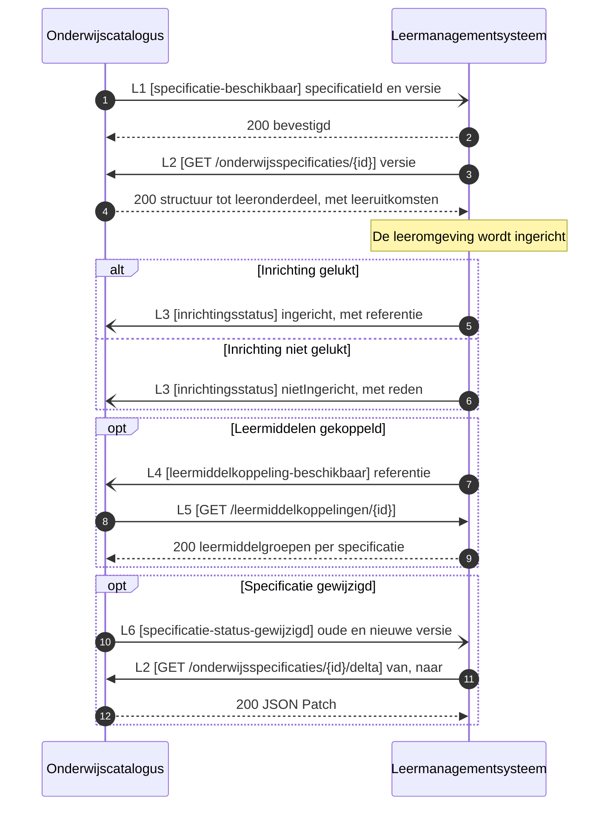

# IS-OA-07 Specificaties naar het leermanagementsysteem

De onderwijscatalogus levert het leermanagementsysteem de specificatiestructuur waarmee dat de leeromgeving inricht, tot op leeronderdeelniveau. Daaronder vult de leeromgeving haar eigen lesniveau in, waar de catalogus buiten staat.

De uuid's, de versies en de namen in de voorbeeldpayloads hieronder komen uit [casus.md](casus.md). De specificatie die hier stroomt is dezelfde die [IS-OA-01](is-oa-01.md) aanleverde en die [IS-OA-03](is-oa-03.md) aan planning ontsluit, op dezelfde uuid en dezelfde versie.

| | |
|---|---|
| Bronsysteem | Onderwijscatalogus, bezitter van de specificaties ([U3](https://github.com/Npuls-OKx/Public/blob/dev/Koppelvlakspecificaties/uitgangspunten.md#u3-resource-eigenaarschap)) |
| Doelsysteem | Leer management systeem (LMS), bezitter van de inrichting van de leeromgeving en van de leermiddelkoppeling |
| Koppeling | OC-LMS, interactie L1 tot en met L6 van het [interactiepatroon onderwijscatalogus naar leermanagementsysteem](https://github.com/Npuls-OKx/Public/blob/dev/Koppelvlakspecificaties/Interactiepatronen/onderwijscatalogus-leermanagementsysteem.md) |
| Beeld | F4-02, met de regels in [voorbeeld-lr1-regels.json](../../../model/informatiemodel/voorbeeld-lr1-regels.json) |
| Stand | Vastgelegd: de componentpagina's in Public dragen elke operatie hieronder, en de schema's staan daar op alfa. Twee payloads staan nog open, en die dragen dat per regel |
| Applicatiedienst | De [onderwijscatalogus](https://github.com/Npuls-OKx/Public/blob/dev/Koppelvlakspecificaties/Applicatiecomponenten/onderwijscatalogus.md) ontsluit de specificatiestructuur en neemt `inrichtingsstatus` en `leermiddelkoppeling-beschikbaar` aan; het [leermanagementsysteem](https://github.com/Npuls-OKx/Public/blob/dev/Koppelvlakspecificaties/Applicatiecomponenten/leermanagementsysteem.md) neemt `specificatie-beschikbaar` aan en ontsluit `/leermiddelkoppelingen/{id}` |
| Functionele eis | [functionele-eis-0010](https://github.com/Npuls-OKx/Public/blob/dev/Koppelvlakspecificaties/Interactiepatronen/onderwijscatalogus-leermanagementsysteem.md#functionele-eis-0010), [functionele-eis-0011](https://github.com/Npuls-OKx/Public/blob/dev/Koppelvlakspecificaties/Interactiepatronen/onderwijscatalogus-leermanagementsysteem.md#functionele-eis-0011), [functionele-eis-0012](https://github.com/Npuls-OKx/Public/blob/dev/Koppelvlakspecificaties/Interactiepatronen/onderwijscatalogus-leermanagementsysteem.md#functionele-eis-0012) |


De leeromgeving krijgt de volledige opleidingsspecificatie-boom plus de formatieve resultaatstructuur, en niet alleen het losse leeronderdeel. De leergelegenheid komt als reeks waarbinnen het LMS de losse lessen zelf invult.

Hoe deze objecten ontstaan: [F1-05 tot en met F1-09](../../../model/informatiemodel/voorbeeld-leerroute-1-jochem.md#fase-1-kwalificatiekader-analyseren-en-grofmazig-ontwerpen) voor de specificatiestructuur en de toetsonderdelen, en [F2-04](../../../model/informatiemodel/voorbeeld-leerroute-1-jochem.md#f2-04---het-aanbod-gepland-opleiding-programma-eenheid-gelegenheid) voor de leergelegenheid.

## De stroom



De catalogus meldt dun en de leeromgeving haalt de inhoud op ([U4](https://github.com/Npuls-OKx/Public/blob/dev/Koppelvlakspecificaties/uitgangspunten.md#u4-notify-then-pull)). De specificatie blijft bij de catalogus staan.

## De operaties

| Id | Operatie | Pad of melding | Implementeert | Methode | Parameters | Statuscodes en foutgedrag | Stand |
|---|---|---|---|---|---|---|---|
| L1 | Melden dat een specificatie beschikbaar is | `specificatie-beschikbaar` | leermanagementsysteem | POST | geen | 200. Blijft de bevestiging uit, dan opnieuw aanbieden met oplopende wachttijd (backoff) en daarna de wachtrij voor onbestelbare berichten (dead letter channel). Een tweede aflevering van dezelfde `specificationId` en `version` wijst hetzelfde bericht aan | `vastgelegd` |
| L2 | De structuur of de wijziging ophalen | `/onderwijsspecificaties/{id}` en `/{id}/delta` | onderwijscatalogus | GET | `versie` optioneel op de structuur; `van` en `naar` beide verplicht op de delta | 200, 400, 404. Alleen-lezen, dus herhalen geeft hetzelfde antwoord. De delta volgt JSON Patch (RFC 6902) | `vastgelegd`, met het antwoordlichaam bij 400 en 404 nog open |
| L3 | De inrichtingsstatus terugmelden | `inrichtingsstatus` | onderwijscatalogus | POST | geen | 200, als L1 | `vastgelegd` als meldpatroon; het payloadschema staat als voorstel in [arrangement-status.json](schemas/arrangement-status.json), hetzelfde dat [IS-OA-05](is-oa-05.md) voorstelt |
| L4 | Melden dat een leermiddelkoppeling beschikbaar is | `leermiddelkoppeling-beschikbaar` | onderwijscatalogus | POST | geen | 200, als L1 | `vastgelegd` als meldpatroon; de payload staat op de componentpagina als nog uit te werken |
| L5 | De leermiddelkoppeling ophalen | `/leermiddelkoppelingen/{id}` | leermanagementsysteem | GET | geen | 200, 400, 404. Alleen-lezen | `vastgelegd` als pad; de payload staat als voorstel in [learning-resource-group.json](schemas/learning-resource-group.json), hetzelfde dat [IS-OA-02](is-oa-02.md) voorstelt |
| L6 | Een wijziging van de specificatie melden | `specificatie-status-gewijzigd` | leermanagementsysteem | POST | geen | 200, als L1 | `vastgelegd` als melding en schema; het endpoint op het LMS staat op de componentpagina |

Het afleveradres van een melding ligt bij instelling en leverancier, binnen de eigenschappen die [ADR 0018](https://github.com/Npuls-OKx/Public/blob/dev/Referentiemateriaal/adr/0018-enterprise-messaging-patronen-voor-betrouwbare-koppelvlakken.md) eist ([U5](https://github.com/Npuls-OKx/Public/blob/dev/Koppelvlakspecificaties/uitgangspunten.md#u5-bericht-versus-kanaal)). Het interactiepatroon merkt op dat deze koppeling nog geen eigen `POST /abonnementen` kent; zolang die er niet is, is het afleveradres een inrichtingskeuze tussen catalogus en leeromgeving.

## De berichten

| Bericht | Schema | Operatie | Stand |
|---|---|---|---|
| De specificatie-referentie | [specification-reference.json](https://github.com/Npuls-OKx/Public/blob/dev/Informatie-en-gegevensmodellen/schemas/specification-reference.json) | L1 | vastgelegd |
| De onderwijsspecificatiestructuur | [education-specification.json](https://github.com/Npuls-OKx/Public/blob/dev/Informatie-en-gegevensmodellen/schemas/education-specification.json), met het [gebruiksprofiel](https://github.com/Npuls-OKx/Public/blob/dev/Informatie-en-gegevensmodellen/gebruiksprofielen.md) voor deze koppeling | L2 | vastgelegd |
| De wijziging | [education-specification-delta.json](https://github.com/Npuls-OKx/Public/blob/dev/Informatie-en-gegevensmodellen/schemas/education-specification-delta.json) | L2 | vastgelegd |
| De inrichtingsstatus | [arrangement-status.json](schemas/arrangement-status.json) | L3 | voorstel |
| De statuswijziging | [specification-status-changed.json](https://github.com/Npuls-OKx/Public/blob/dev/Informatie-en-gegevensmodellen/schemas/specification-status-changed.json) | L6 | vastgelegd |
| De leermiddelkoppeling | [learning-resource-group.json](schemas/learning-resource-group.json) | L5 | voorstel |

Het gebruiksprofiel voor deze koppeling wijkt op twee punten af van wat planning krijgt: de leeruitkomsten komen **met** hun inhoudsvelden mee, want dat is wat de leeromgeving uitwerkt en aan de student toont, en de regelsets komen niet mee, want kiesbaarheid is het domein van het studentkeuzesysteem en het studentinformatiesysteem.

## De voorbeeldpayloads

De melding dat de specificatie beschikbaar is, met de opleidingsspecificatie uit [casus.md](casus.md):

```json schema=specification-reference
{
  "specificationId": "79736830-1c5c-470f-b2c2-005029c96733",
  "version": "0.1.0"
}
```

De structuur die de leeromgeving daarop ophaalt is dezelfde die [IS-OA-03](is-oa-03.md#berichtspecificatie) veld voor veld beschrijft, met het gebruiksprofiel hierboven erop. Die payload staat daar en wordt hier niet herhaald.

De inrichtingsstatus terug, op dezelfde specificatie:

```json schema=arrangement-status
{
  "arrangementReference": "6f3c7a21-0e5b-4a37-9d14-2c8be40f71aa",
  "status": "ingericht",
  "specificationReference": {
    "specificationId": "79736830-1c5c-470f-b2c2-005029c96733",
    "version": "0.1.0"
  }
}
```

## Wat open blijft

| Punt | Stand |
|---|---|
| Het antwoordlichaam bij 400 en 404 op de opvragingen | Dezelfde vraag als bij de andere opvragingen; signalering [S21](signaleringen.md) draagt haar |
| De payload van de leermiddelkoppeling | De componentpagina kondigt hem aan zonder schema. [learning-resource-group.json](schemas/learning-resource-group.json) is het voorstel dat IS-OA-02 al doet |
| Een eigen afleverabonnement op deze koppeling | Het interactiepatroon kent nog geen `POST /abonnementen`, waar de koppeling met planning die wel heeft |
| Het lesniveau onder het leeronderdeel | De catalogus dicteert de lesspecificatie niet. Beeld F4-03 toont dat niveau op de conceptplaat, buiten deze specificatie |
