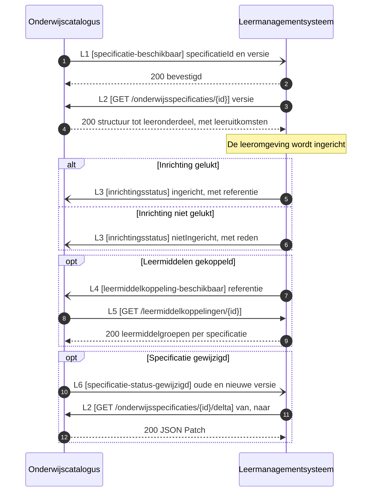
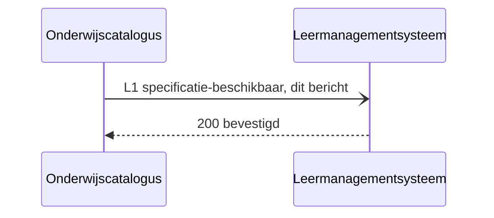
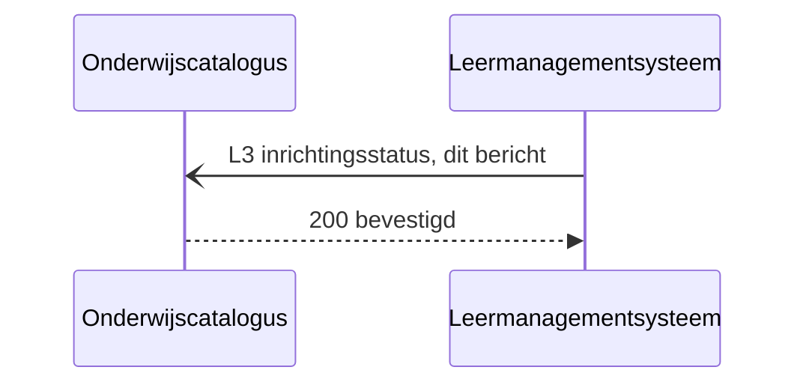
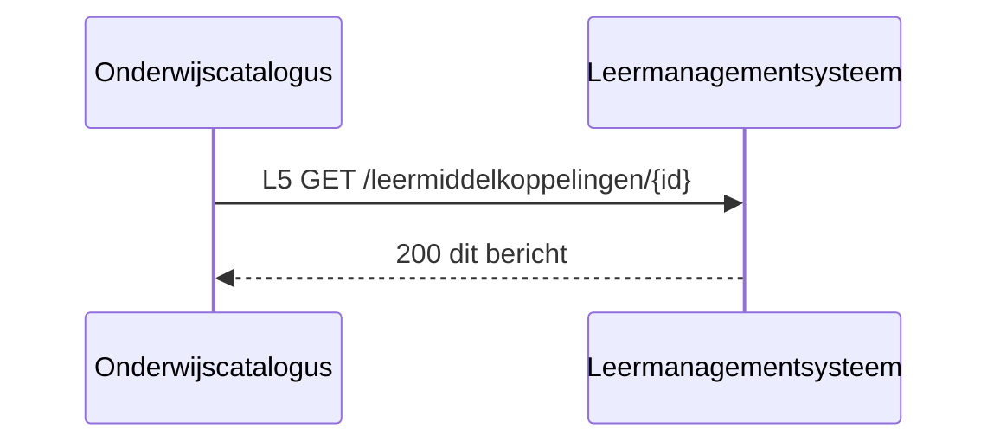

# IS-OA-07 Specificaties naar het leermanagementsysteem

| | |
|---|---|
| **Document doel** | Zet uiteen hoe de onderwijscatalogus het leermanagementsysteem de specificatiestructuur levert waarmee dat de leeromgeving inricht, ten behoeve van de bouw of de verificatie van een implementatie volgens deze specificatie |
| **Doelgroep** | De implementatiespecialist en de tester bij een instelling of een leverancier, en wie een profiel of consumer bouwt |
| **Dient als input voor** | De bouw van het koppelvlak, de testgevallen erbij, en de acceptatie van een opgeleverde koppeling |
| **Kaderstelling** | De [interactieketen](README.md) waarin deze specificatie valt, het [informatiemodel OKx](../../../model/informatiemodel/informatiemodel.md), beeld F4-02 van de [voorbeelduitwerking](../../../model/informatiemodel/voorbeeld-leerroute-1-jochem.md), en [functionele-eis-0010](https://github.com/Npuls-OKx/Public/blob/dev/Koppelvlakspecificaties/Interactiepatronen/onderwijscatalogus-leermanagementsysteem.md#functionele-eis-0010), [functionele-eis-0011](https://github.com/Npuls-OKx/Public/blob/dev/Koppelvlakspecificaties/Interactiepatronen/onderwijscatalogus-leermanagementsysteem.md#functionele-eis-0011) en [functionele-eis-0012](https://github.com/Npuls-OKx/Public/blob/dev/Koppelvlakspecificaties/Interactiepatronen/onderwijscatalogus-leermanagementsysteem.md#functionele-eis-0012) van het interactiepatroon |
| **Inhoud** | Zes operaties met hun statuscodes, zes berichten met hun schema, twee voorbeeldpayloads die valideren, en vier punten die een besluit vragen |
| **Status** | Vastgelegd: de componentpagina's in Public dragen elke operatie hieronder, en de schema's staan daar op alfa. Twee payloads staan nog open, en die dragen dat per regel |

De lading: de opleidingsspecificatie-boom tot op leeronderdeel met de leeruitkomsten en hun inhoudsvelden, plus de formatieve resultaatstructuur; het lesniveau eronder vult de leeromgeving zelf in. De uuid's, de versies en de namen in de voorbeeldpayloads komen uit [casus.md](casus.md), op dezelfde uuid en dezelfde versie waarmee [IS-OA-01](is-oa-01.md) aanleverde en [IS-OA-03](is-oa-03.md) aan planning ontsluit.

## 1. Interactie

| Bronsysteem | Doelsysteem | Koppeling | Beeld | Status | Applicatiedienst |
|---|---|---|---|---|---|
| Onderwijscatalogus, bezitter van de specificaties ([U3](https://github.com/Npuls-OKx/Public/blob/dev/Koppelvlakspecificaties/uitgangspunten.md#u3-resource-eigenaarschap)) | Leer management systeem (LMS), bezitter van de inrichting van de leeromgeving en van de leermiddelkoppeling | OC-LMS, interactie L1 tot en met L6 van het [interactiepatroon onderwijscatalogus naar leermanagementsysteem](https://github.com/Npuls-OKx/Public/blob/dev/Koppelvlakspecificaties/Interactiepatronen/onderwijscatalogus-leermanagementsysteem.md) | F4-02, met de regels in [voorbeeld-lr1-regels.json](../../../model/informatiemodel/voorbeeld-lr1-regels.json) | Vastgelegd: hoofdplaat v1.7 draagt deze stroom als eigen lijn, en het interactiepatroon werkt haar uit als L1 tot en met L6 | De [onderwijscatalogus](https://github.com/Npuls-OKx/Public/blob/dev/Koppelvlakspecificaties/Applicatiecomponenten/onderwijscatalogus.md) ontsluit de specificatiestructuur en neemt `inrichtingsstatus` en `leermiddelkoppeling-beschikbaar` aan; het [leermanagementsysteem](https://github.com/Npuls-OKx/Public/blob/dev/Koppelvlakspecificaties/Applicatiecomponenten/leermanagementsysteem.md) neemt `specificatie-beschikbaar` aan en ontsluit `/leermiddelkoppelingen/{id}` |


De leeromgeving krijgt de volledige opleidingsspecificatie-boom plus de formatieve resultaatstructuur, tot op leeronderdeelniveau. De leergelegenheid komt als reeks waarbinnen de leeromgeving de losse lessen zelf invult.

Waar deze objecten ontstaan: [F1-05 tot en met F1-09](../../../model/informatiemodel/voorbeeld-leerroute-1-jochem.md#fase-1-kwalificatiekader-analyseren-en-grofmazig-ontwerpen) voor de specificatiestructuur en de toetsonderdelen, en [F2-04](../../../model/informatiemodel/voorbeeld-leerroute-1-jochem.md#f2-04---het-aanbod-gepland-opleiding-programma-eenheid-gelegenheid) voor de leergelegenheid.

De taak van deze interactie in het proces: de catalogus draagt de vastgestelde specificatie, en de leeromgeving staat erop ingericht voordat het onderwijs begint. Zij volgt op [fase 2](../../../model/informatiemodel/voorbeeld-leerroute-1-jochem.md#fase-2-publiceren-en-planbaar-maken) en valt in [fase 4](../../../model/informatiemodel/voorbeeld-leerroute-1-jochem.md#fase-4-detailleren-roosteren-en-inschrijven), waar beeld F4-02 haar tekent.

| Applicatiecomponent | Functie in deze interactie |
|---|---|
| Onderwijscatalogus | Meldt dat een specificatie beschikbaar is, ontsluit de structuur en de wijziging erop, neemt de inrichtingsstatus aan, en haalt de leermiddelkoppeling op |
| Leermanagementsysteem (LMS) | Haalt de structuur op, richt de leeromgeving in tot op leeronderdeel, meldt de uitkomst van dat inrichten terug, en ontsluit de leermiddelkoppeling |

De status per regel hieronder zegt waar een artefact staat.

| Status | Waar het artefact staat |
|---|---|
| `vastgelegd` | [Npuls-OKx/Public](https://github.com/Npuls-OKx/Public/tree/dev/Koppelvlakspecificaties) draagt hem: een pad op een componentpagina, een melding in het interactiepatroon of een schema in [Informatie-en-gegevensmodellen](https://github.com/Npuls-OKx/Public/tree/dev/Informatie-en-gegevensmodellen/schemas) |
| `voorstel` | Deze specificatie stelt hem voor, onderbouwd uit [de casus](casus.md) en het [informatiemodel](../../../model/informatiemodel/informatiemodel.md). Een voorgesteld schema staat in [schemas/](schemas/) en draagt een `$id` die eindigt op `/voorstel` |

## 2. Interactiespecificatie


De bal staat bij het component dat de dienst aanbiedt, de kom bij het component dat haar afneemt. Het sequentiediagram eronder zet dezelfde operaties in de tijd.



De catalogus meldt dun en de leeromgeving haalt de inhoud op ([U4](https://github.com/Npuls-OKx/Public/blob/dev/Koppelvlakspecificaties/uitgangspunten.md#u4-notify-then-pull)). De specificatie blijft bij de catalogus staan.

## 3. Operaties

`OC` is de onderwijscatalogus, `LMS` het leermanagementsysteem. De [componentpagina's](https://github.com/Npuls-OKx/Public/tree/dev/Koppelvlakspecificaties/Applicatiecomponenten) in Public dragen elk pad en elke melding hieronder.

### 3.1 Het contract per operatie

| Nr | Operatie | Implementeert | Richting | Pad of melding | Methode | Status |
|---|---|---|---|---|---|---|
| L1 | Melden dat een specificatie beschikbaar is | leermanagementsysteem | OC meldt LMS | `specificatie-beschikbaar` | POST | `vastgelegd` |
| L2 | De structuur of de wijziging ophalen | onderwijscatalogus | LMS vraagt OC | `/onderwijsspecificaties/{id}` en `/{id}/delta` | GET | `vastgelegd`, met het antwoordlichaam bij 400 en 404 nog open |
| L3 | De inrichtingsstatus terugmelden | onderwijscatalogus | LMS meldt OC | `inrichtingsstatus` | POST | `vastgelegd` als meldpatroon; het payloadschema staat als voorstel in [arrangement-status.json](schemas/arrangement-status.json), hetzelfde dat [IS-OA-05](is-oa-05.md) voorstelt |
| L4 | Melden dat een leermiddelkoppeling beschikbaar is | onderwijscatalogus | LMS meldt OC | `leermiddelkoppeling-beschikbaar` | POST | `vastgelegd` als meldpatroon; de payload staat op de componentpagina als nog uit te werken |
| L5 | De leermiddelkoppeling ophalen | leermanagementsysteem | OC vraagt LMS | `/leermiddelkoppelingen/{id}` | GET | `vastgelegd` als pad; de payload staat als voorstel in [learning-resource-group.json](schemas/learning-resource-group.json), hetzelfde dat [IS-OA-02](is-oa-02.md) voorstelt |
| L6 | Een wijziging van de specificatie melden | leermanagementsysteem | OC meldt LMS | `specificatie-status-gewijzigd` | POST | `vastgelegd` als melding en schema; het endpoint op het LMS staat op de componentpagina |

Parameters, statuscodes en foutgedrag. De GET-operaties zijn alleen-lezen: herhaald aanroepen levert hetzelfde resultaat.

| Nr | Parameters | Statuscodes | Foutgedrag |
|---|---|---|---|
| L1 | geen | 200 | Blijft de bevestiging uit, dan opnieuw aanbieden met oplopende wachttijd (backoff) en daarna de wachtrij voor onbestelbare berichten (dead letter channel). Een tweede aflevering van dezelfde `specificationId` en `version` wijst hetzelfde bericht aan |
| L2 | `versie` optioneel op de structuur; `van` en `naar` beide verplicht op de delta | 200, 400, 404 | Alleen-lezen, dus herhalen geeft hetzelfde antwoord. De delta volgt JSON Patch (RFC 6902) |
| L3 | geen | 200 | Als L1 |
| L4 | geen | 200 | Als L1 |
| L5 | geen | 200, 400, 404 | Alleen-lezen, dus herhalen geeft hetzelfde antwoord |
| L6 | geen | 200 | Als L1 |

Het afleveradres van een melding ligt bij instelling en leverancier, binnen de eigenschappen die [ADR 0018](https://github.com/Npuls-OKx/Public/blob/dev/Referentiemateriaal/adr/0018-enterprise-messaging-patronen-voor-betrouwbare-koppelvlakken.md) eist ([U5](https://github.com/Npuls-OKx/Public/blob/dev/Koppelvlakspecificaties/uitgangspunten.md#u5-bericht-versus-kanaal)). Het interactiepatroon merkt op dat deze koppeling nog geen eigen `POST /abonnementen` kent; zolang die er niet is, is het afleveradres een inrichtingskeuze tussen catalogus en leeromgeving.

### 3.2 Statusafhandeling

De inrichtingsstatus op L3 draagt de uitkomst van het inrichten, en die uitkomst bepaalt welk veld meekomt.

| Status | Wat de melding draagt | Grond |
|---|---|---|
| `ingericht` | de referentie naar de inrichting bij de leeromgeving | arrangement-status.json vraagt `arrangementReference` op deze uitkomst |
| `nietIngericht` | de reden, in leesbare tekst voor de beheerder van de catalogus | arrangement-status.json vraagt `reason` op deze uitkomst |

## 4. Berichtspecificatie

Het [gebruiksprofiel](https://github.com/Npuls-OKx/Public/blob/dev/Informatie-en-gegevensmodellen/gebruiksprofielen.md) voor deze koppeling zet twee dingen vast ten opzichte van wat planning krijgt.

| Wat dit profiel vraagt | Grond |
|---|---|
| De leeruitkomsten komen met hun inhoudsvelden mee | Dat is wat de leeromgeving uitwerkt en aan de student toont |
| De regelsets blijven bij het studentkeuzesysteem en het studentinformatiesysteem | Kiesbaarheid hoort in het domein van die twee |

### 4.1 Melden beschikbaarheid van een specificatie



<!-- erd -->
Dit bericht draagt geen objecttype uit het informatiemodel: de velden zijn eigenschappen van het contract.
<!-- /erd -->

Volgt [specification-reference.json](https://github.com/Npuls-OKx/Public/blob/dev/Informatie-en-gegevensmodellen/schemas/specification-reference.json), `vastgelegd`: de melding draagt het `specificationId` met zijn `version`, waarna L2 de structuur levert.

### 4.2 Ophalen onderwijsspecificatiestructuur


<!-- erd -->
```mermaid
erDiagram
    "Leeronderdeel specificatie" ||--o{ "Les specificatie" : "bestaat uit"
    "Onderwijseenheid specificatie" ||--o{ "Leeronderdeel specificatie" : "bestaat uit"
    "Opleidingsprogramma specificatie" ||--o{ "Onderwijseenheid specificatie" : "bestaat uit"
    "Summatieve resultaat structuur" ||--o{ "Examenonderdeel weging" : "bestaat uit"
    "Summatieve resultaat structuur" ||--o{ "Toetsonderdeel specificatie" : "bestaat uit"
    "Cohort / periode" }o--o{ "Summatieve resultaat structuur" : "Groepeert Studenten op toepasbare"
    "Keuzedeel" }o--o{ "Keuzedeelruimte" : "hangt samen met"
    "Leeronderdeel specificatie" }o--o{ "Leeruitkomst" : "hangt samen met"
    "Leeruitkomst" }o--o{ "Student keuze regelset" : "voorwaarde op"
    "Les specificatie" }o--o{ "Leeruitkomst" : "hangt samen met"
    "Onderwijseenheid specificatie" }o--o{ "Leeruitkomst" : "hangt samen met"
    "Opleiding specificatie" }o--o{ "Leeruitkomst" : "hangt samen met"
    "Opleidingsprogramma specificatie" }o--o{ "Leeruitkomst" : "hangt samen met"
    "Organisatie-eenheid" }o--o{ "Leeronderdeel specificatie" : "Voert uit"
    "Organisatie-eenheid" }o--o{ "Les specificatie" : "Voert uit"
    "Organisatie-eenheid" }o--o{ "Onderwijseenheid specificatie" : "Voert uit"
    "Organisatie-eenheid" }o--o{ "Opleiding specificatie" : "Voert uit"
    "Organisatie-eenheid" }o--o{ "Opleidingsprogramma specificatie" : "Voert uit"
    "Organisatie-eenheid" }o--o{ "Toetsonderdeel specificatie" : "Voert uit"
    "Student keuze regelset" }o--o{ "Keuzedeel" : "hangt samen met"
    "Student keuze regelset" }o--o{ "Keuzedeelruimte" : "hangt samen met"
    "Student keuze regelset" }o--o{ "Leeronderdeel specificatie" : "hangt samen met"
    "Student keuze regelset" }o--o{ "Les specificatie" : "hangt samen met"
    "Student keuze regelset" }o--o{ "Onderwijseenheid specificatie" : "hangt samen met"
    "Student keuze regelset" }o--o{ "Opleiding specificatie" : "hangt samen met"
    "Student keuze regelset" }o--o{ "Opleidingsprogramma specificatie" : "hangt samen met"
    "Summatieve resultaat structuur" }o--o{ "Leeruitkomst" : "hangt samen met"
    "Toetsonderdeel specificatie" }o--o{ "Leeruitkomst" : "hangt samen met"
    "Opleiding specificatie" ||--o{ "Opleidingsprogramma specificatie" : "minimaal 1"
    "Keuzedeel" ||--|| "Opleidingsprogramma specificatie" : "is een"
    "Keuzedeelruimte" ||--|| "Opleidingsprogramma specificatie" : "is een"
    "Opleiding specificatie" {
        enum curriculumType "0..1"
        string description "0..1"
        uuid id PK "1..1"
        uuid learningOutcomeId FK "0..1"
        array manifest FK "0..n"
        uuid manifest[].specificationId FK "0..n"
        string manifest[].version "0..n"
        string name "1..1"
        uuid parentSpecificationId FK "1..1"
        array ruleSetReferences FK "0..n"
        enum specificationType "1..1"
        enum status "0..1"
        object, studyLoad "1..1"
        number studyLoad.value "1..1"
        date validFrom "0..1"
        date validUntil "0..1"
        string, version "1..1"
    }
    "Opleidingsprogramma specificatie" {
        string cohort FK "0..1"
        enum curriculumType "0..1"
        string description "0..1"
        uuid id PK "1..1"
        uuid learningOutcomeId FK "0..1"
        enum learningPathway "0..1"
        array manifest FK "0..n"
        uuid manifest[].specificationId FK "0..n"
        string manifest[].version "0..n"
        string name "1..1"
        object, organisation FK "0..1"
        uuid parentSpecificationId FK "1..1"
        enum programmeLayer "0..1"
        string, programmeType "0..1"
        array ruleSetReferences FK "0..n"
        enum specificationType "1..1"
        date startDate "0..1"
        enum status "0..1"
        object, studyLoad "1..1"
        number studyLoad.value "1..1"
        string, targetGroup "0..1"
        date validFrom "0..1"
        date validUntil "0..1"
        string, version "1..1"
    }
    "Keuzedeel" {
        string description "0..1"
        string, electiveUnitClass "0..1"
        uuid id PK "1..1"
        uuid learningOutcomeId FK "0..1"
        string name "1..1"
        string, programmeType "0..1"
        enum specificationType "1..1"
        enum status "0..1"
        object, studyLoad "1..1"
        number studyLoad.value "1..1"
        string, version "1..1"
    }
    "Onderwijseenheid specificatie" {
        string description "0..1"
        string explanation "0..1"
        uuid id PK "1..1"
        uuid learningOutcomeId FK "0..1"
        uuid manifest[].specificationId FK "0..n"
        string manifest[].version "0..n"
        string name "1..1"
        uuid parentSpecificationId FK "1..1"
        enum specificationType "1..1"
        enum status "0..1"
        object, studyLoad "1..1"
        number studyLoad.value "1..1"
        string, version "1..1"
    }
    "Leeronderdeel specificatie" {
        string description "0..1"
        string explanation "0..1"
        uuid id PK "1..1"
        uuid learningOutcomeId FK "0..1"
        string name "1..1"
        uuid parentSpecificationId FK "1..1"
        enum specificationType "1..1"
        enum status "0..1"
        object, studyLoad "1..1"
        number studyLoad.value "1..1"
        string, timeDistribution "0..1"
        string, version "1..1"
    }
    "Keuzedeelruimte" {
        string description "0..1"
        uuid id PK "1..1"
        string name "1..1"
        uuid parentSpecificationId FK "1..1"
        array ruleSetReferences FK "0..n"
        enum specificationType "1..1"
        enum status "0..1"
        object, studyLoad "1..1"
        number studyLoad.value "1..1"
        string, version "1..1"
    }
    "Toetsonderdeel specificatie" { }
    "Summatieve resultaat structuur" { }
    "Leeruitkomst" {
        array learningOutcomes "0..n"
    }
    "Student keuze regelset" {
        array ruleSets "0..n"
    }
    "Cohort / periode" { }
    "Organisatie-eenheid" { }
    "Les specificatie" { }
    "Examenonderdeel weging" { }
```

| Lijn | Betekenis |
|---|---|
| `\|\|--o{` | het eerste bestaat uit nul of meer van het tweede |
| `\|\|--\|\|` | het tweede is een soort van het eerste |
| `}o--o{` | de twee hangen samen, met het opschrift erbij |
| `PK` en `FK` | de sleutel van het object, en een verwijzing naar een ander object |
| tekst achter een attribuut | de multipliciteit in dit bericht, en of het veld verplicht is |

<!-- /erd -->

Volgt [education-specification.json](https://github.com/Npuls-OKx/Public/blob/dev/Informatie-en-gegevensmodellen/schemas/education-specification.json), `vastgelegd`, met het gebruiksprofiel hierboven erop. De velden staan veld voor veld in [IS-OA-03](is-oa-03.md#bericht-2-de-onderwijsspecificatiestructuur), dat dezelfde structuur op dezelfde resource ontsluit.

### 4.3 Ophalen wijziging van een specificatie


<!-- erd -->
Dit bericht draagt geen objecttype uit het informatiemodel: de velden zijn eigenschappen van het contract.
<!-- /erd -->

Volgt [education-specification-delta.json](https://github.com/Npuls-OKx/Public/blob/dev/Informatie-en-gegevensmodellen/schemas/education-specification-delta.json), `vastgelegd`: de wijziging komt als JSON Patch (RFC 6902) tussen de versie in `van` en die in `naar`.

### 4.4 Terugmelden inrichtingsstatus



<!-- erd -->
Dit bericht draagt geen objecttype uit het informatiemodel: de velden zijn eigenschappen van het contract.
<!-- /erd -->

Volgt [arrangement-status.json](schemas/arrangement-status.json), `voorstel`: de status uit paragraaf 3.2 met de specificatieverwijzing waarop zij slaat. [IS-OA-05](is-oa-05.md) stelt hetzelfde schema voor.

### 4.5 Melden statuswijziging van een onderwijsspecificatie


<!-- erd -->
Dit bericht draagt geen objecttype uit het informatiemodel: de velden zijn eigenschappen van het contract.
<!-- /erd -->

Volgt [specification-status-changed.json](https://github.com/Npuls-OKx/Public/blob/dev/Informatie-en-gegevensmodellen/schemas/specification-status-changed.json), `vastgelegd`: de oude en de nieuwe versie van de specificatie, waarna de leeromgeving de delta op L2 ophaalt.

### 4.6 Ophalen leermiddelkoppeling



<!-- erd -->
Dit bericht draagt geen objecttype uit het informatiemodel: de velden zijn eigenschappen van het contract.
<!-- /erd -->

Volgt [learning-resource-group.json](schemas/learning-resource-group.json), `voorstel`: de leermiddelgroepen per specificatie. [IS-OA-02](is-oa-02.md) stelt hetzelfde schema voor, en de componentpagina kondigt de payload aan.

## 5. Voorbeeldpayloads

De melding dat de specificatie beschikbaar is, met de opleidingsspecificatie uit [casus.md](casus.md):

```json schema=specification-reference
{
  "specificationId": "79736830-1c5c-470f-b2c2-005029c96733",
  "version": "0.1.0"
}
```

De structuur die de leeromgeving daarop ophaalt is dezelfde die [IS-OA-03](is-oa-03.md#berichtspecificatie) veld voor veld beschrijft, met het gebruiksprofiel uit paragraaf 4 erop; die payload staat daar.

De inrichtingsstatus terug, op dezelfde specificatie:

```json schema=arrangement-status
{
  "arrangementReference": "6f3c7a21-0e5b-4a37-9d14-2c8be40f71aa",
  "status": "ingericht",
  "specificationReference": {
    "specificationId": "79736830-1c5c-470f-b2c2-005029c96733",
    "version": "0.1.0"
  }
}
```

## 6. Openstaande punten

| Punt | Stand |
|---|---|
| Het antwoordlichaam bij 400 en 404 op de opvragingen | Dezelfde vraag als bij de andere opvragingen; signalering [S21](signaleringen.md) draagt haar |
| De payload van de leermiddelkoppeling | De componentpagina kondigt hem aan zonder schema. [learning-resource-group.json](schemas/learning-resource-group.json) is het voorstel dat IS-OA-02 al doet |
| Een eigen afleverabonnement op deze koppeling | Het interactiepatroon kent nog geen `POST /abonnementen`, waar de koppeling met planning die wel heeft |
| Het lesniveau onder het leeronderdeel | De lesspecificatie blijft bij de leeromgeving. Beeld F4-03 toont dat niveau op de conceptplaat, buiten deze specificatie |
