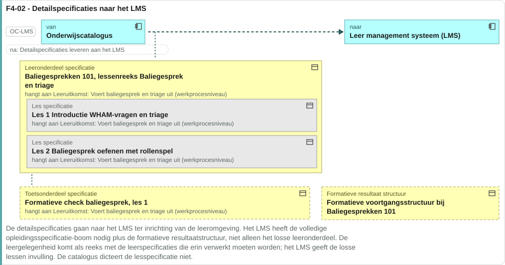
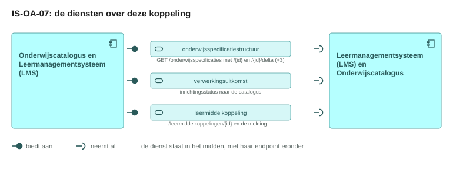
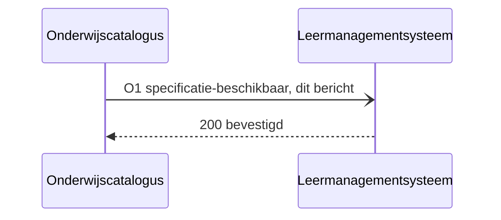
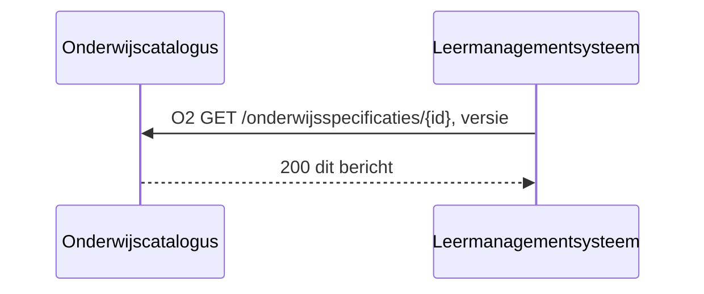
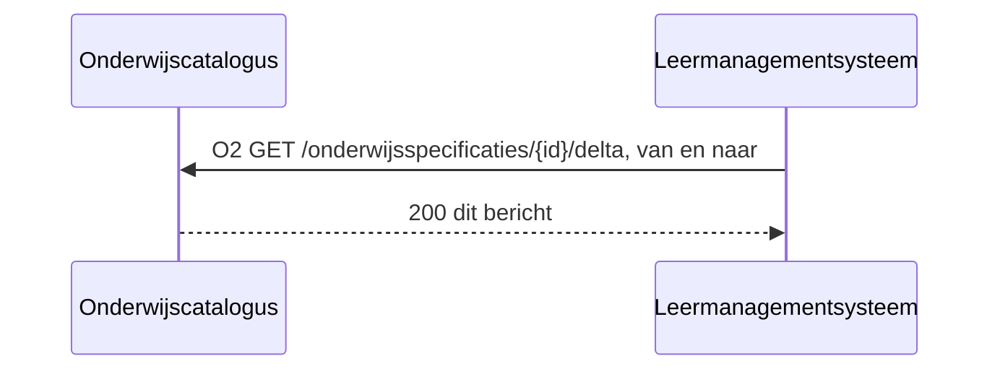
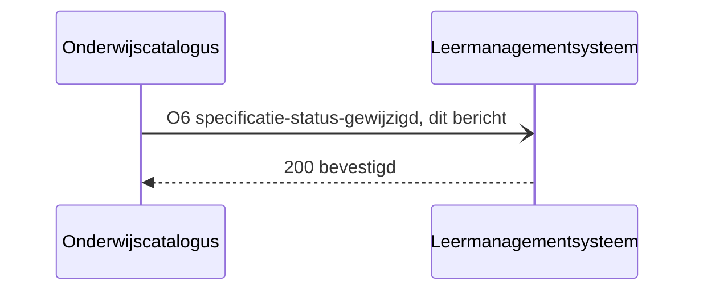
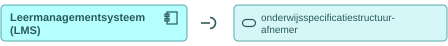
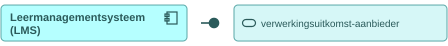
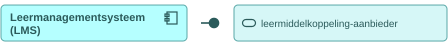

# IS-OA-07 Specificaties naar het leermanagementsysteem

| | |
|---|---|
| **Document doel** | Zet uiteen hoe de onderwijscatalogus het leermanagementsysteem de specificatiestructuur levert waarmee dat de leeromgeving inricht, ten behoeve van de bouw of de verificatie van een implementatie volgens deze specificatie |
| **Doelgroep** | De implementatiespecialist en de tester bij een instelling of een leverancier, en wie een profiel of consumer bouwt |
| **Dient als input voor** | De bouw van het koppelvlak, de testgevallen erbij, en de acceptatie van een opgeleverde koppeling |
| **Kaderstelling** | De [interactieketen](README.md) waarin deze specificatie valt, het [informatiemodel OKx](../../../model/informatiemodel/informatiemodel.md), beeld F4-02 van de [voorbeelduitwerking](../../../model/informatiemodel/voorbeeld-leerroute-1-jochem.md), en het [interactiepatroon onderwijscatalogus naar leermanagementsysteem](https://github.com/Npuls-OKx/Public/blob/dev/Koppelvlakspecificaties/Interactiepatronen/onderwijscatalogus-leermanagementsysteem.md) |
| **Inhoud** | Zes operaties met hun statuscodes, zes berichten met hun schema, twee voorbeeldpayloads die valideren, en vier punten die een besluit vragen |
| **Status** | Vastgelegd: de componentpagina's in Public dragen elke operatie hieronder, en de schema's staan daar op alfa. Twee payloads staan nog open, en die dragen dat per regel |

De lading: de opleidingsspecificatie-boom tot op leeronderdeel met de leeruitkomsten en hun inhoudsvelden, plus de formatieve resultaatstructuur; het lesniveau eronder vult de leeromgeving zelf in. De uuid's, de versies en de namen in de voorbeeldpayloads komen uit [casus.md](casus.md), op dezelfde uuid en dezelfde versie waarmee [IS-OA-01](is-oa-01.md) aanleverde en [IS-OA-03](is-oa-03.md) aan planning ontsluit.

## 1. Interactie

| Bronsysteem | Doelsysteem | Koppeling | Beeld | Status | Applicatiedienst |
|---|---|---|---|---|---|
| Onderwijscatalogus, bezitter van de specificaties ([U3](https://github.com/Npuls-OKx/Public/blob/dev/Koppelvlakspecificaties/uitgangspunten.md#u3-resource-eigenaarschap)) | Leer management systeem (LMS), bezitter van de inrichting van de leeromgeving en van de leermiddelkoppeling | OC-LMS, interactie L1 tot en met L6 van het [interactiepatroon onderwijscatalogus naar leermanagementsysteem](https://github.com/Npuls-OKx/Public/blob/dev/Koppelvlakspecificaties/Interactiepatronen/onderwijscatalogus-leermanagementsysteem.md) | F4-02, met de regels in [voorbeeld-lr1-regels.json](../../../model/informatiemodel/voorbeeld-lr1-regels.json) | Vastgelegd: hoofdplaat v1.7 draagt deze stroom als eigen lijn, en het interactiepatroon werkt haar uit als L1 tot en met L6 | De [onderwijscatalogus](https://github.com/Npuls-OKx/Public/blob/dev/Koppelvlakspecificaties/Applicatiecomponenten/onderwijscatalogus.md) ontsluit de specificatiestructuur en neemt `inrichtingsstatus` en `leermiddelkoppeling-beschikbaar` aan; het [leermanagementsysteem](https://github.com/Npuls-OKx/Public/blob/dev/Koppelvlakspecificaties/Applicatiecomponenten/leermanagementsysteem.md) neemt `specificatie-beschikbaar` aan en ontsluit `/leermiddelkoppelingen/{id}` |



De leeromgeving krijgt de volledige opleidingsspecificatie-boom plus de formatieve resultaatstructuur, tot op leeronderdeelniveau. De leergelegenheid komt als reeks waarbinnen de leeromgeving de losse lessen zelf invult.

Waar deze objecten ontstaan: [F1-05 tot en met F1-09](../../../model/informatiemodel/voorbeeld-leerroute-1-jochem.md#fase-1-kwalificatiekader-analyseren-en-grofmazig-ontwerpen) voor de specificatiestructuur en de toetsonderdelen, en [F2-04](../../../model/informatiemodel/voorbeeld-leerroute-1-jochem.md#f2-04---het-aanbod-gepland-opleiding-programma-eenheid-gelegenheid) voor de leergelegenheid.

De taak van deze interactie in het proces: de catalogus draagt de vastgestelde specificatie, en de leeromgeving staat erop ingericht voordat het onderwijs begint. Zij volgt op [fase 2](../../../model/informatiemodel/voorbeeld-leerroute-1-jochem.md#fase-2-publiceren-en-planbaar-maken) en valt in [fase 4](../../../model/informatiemodel/voorbeeld-leerroute-1-jochem.md#fase-4-detailleren-roosteren-en-inschrijven), waar beeld F4-02 haar tekent.

| Applicatiecomponent | Functie in deze interactie |
|---|---|
| Onderwijscatalogus | Meldt dat een specificatie beschikbaar is, ontsluit de structuur en de wijziging erop, neemt de inrichtingsstatus aan, en haalt de leermiddelkoppeling op |
| Leermanagementsysteem (LMS) | Haalt de structuur op, richt de leeromgeving in tot op leeronderdeel, meldt de uitkomst van dat inrichten terug, en ontsluit de leermiddelkoppeling |

De status per regel hieronder zegt waar een artefact staat.

| Status | Waar het artefact staat |
|---|---|
| `vastgelegd` | [Npuls-OKx/Public](https://github.com/Npuls-OKx/Public/tree/dev/Koppelvlakspecificaties) draagt hem: een pad op een componentpagina, een melding in het interactiepatroon of een schema in [Informatie-en-gegevensmodellen](https://github.com/Npuls-OKx/Public/tree/dev/Informatie-en-gegevensmodellen/schemas) |
| `voorstel` | Deze specificatie stelt hem voor, onderbouwd uit [de casus](casus.md) en het [informatiemodel](../../../model/informatiemodel/informatiemodel.md). Een voorgesteld schema staat in [schemas/](schemas/) en draagt een `$id` die eindigt op `/voorstel` |

## 2. Interactiespecificatie



De aanbiedersdienst en de afnemersdienst staan als twee eigen blokken tegenover elkaar, met de bal die in de kom valt. Het sequentiediagram eronder zet dezelfde operaties in de tijd.


De catalogus meldt dun en de leeromgeving haalt de inhoud op ([U4](https://github.com/Npuls-OKx/Public/blob/dev/Koppelvlakspecificaties/uitgangspunten.md#u4-notify-then-pull)). De specificatie blijft bij de catalogus staan.

## 3. Operaties en berichtspecificatie

Een operatie is een pad met een methode erop, of een melding: `GET /onderwijsspecificaties/{id}` is er een, `specificatie-beschikbaar` een andere. Zij draagt een nummer dat terugkomt in het sequentiediagram hierboven en in de berichten hieronder. `OC` is de onderwijscatalogus, `LMS` het leermanagementsysteem. O1 tot en met O6 lopen gelijk op met L1 tot en met L6 van het [interactiepatroon](https://github.com/Npuls-OKx/Public/blob/dev/Koppelvlakspecificaties/Interactiepatronen/onderwijscatalogus-leermanagementsysteem.md), en de [componentpagina's](https://github.com/Npuls-OKx/Public/tree/dev/Koppelvlakspecificaties/Applicatiecomponenten) in Public dragen elk pad en elke melding hieronder.

Een leverancier claimt een dienst, geen operatietabel. Hier staat per dienst wat die claim kost: welke operaties erbij horen, met hun parameters, hun request body en hun responses.

Wie het endpoint bouwt verschilt per patroon, en bij een melding is dat omgekeerd aan wat de naam suggereert.

| Patroon | Wie levert het gegeven | Wie bouwt het endpoint | Wie roept aan |
|---|---|---|---|
| Ophalen | de aanbieder | de aanbieder | de afnemer |
| Aanleveren | de afnemer | de aanbieder | de afnemer |
| Melden | de aanbieder | de afnemer, op haar `callbackUrl` | de aanbieder |

Een query parameter verandert het endpoint niet: het pad blijft gelijk en de parameters komen in de query string. Het contract staat bij de dienst die het endpoint bouwt; de tegenhanger wijst ernaar. De afspraken die voor elke dienst in deze keten gelden, staan in de [interactieketenspecificatie](README.md#5-afspraken-die-elke-dienst-nakomt).

Het afleveradres van een melding ligt bij instelling en leverancier, binnen de eigenschappen die [ADR 0018](https://github.com/Npuls-OKx/Public/blob/dev/Referentiemateriaal/adr/0018-enterprise-messaging-patronen-voor-betrouwbare-koppelvlakken.md) eist ([U5](https://github.com/Npuls-OKx/Public/blob/dev/Koppelvlakspecificaties/uitgangspunten.md#u5-bericht-versus-kanaal)). Het interactiepatroon merkt op dat deze koppeling nog geen eigen `POST /abonnementen` kent; zolang die er niet is, is het afleveradres een inrichtingskeuze tussen catalogus en leeromgeving.

#### onderwijsspecificatiestructuur-aanbieder, bij de onderwijscatalogus


Deze dienst meldt dat een specificatie beschikbaar is, ontsluit de structuur en de wijziging erop, en meldt een statuswijziging. Zij draagt daarmee twee patronen.

##### O1 · webhook `specificatie-beschikbaar` · melden

| | |
|---|---|
| Transport | HTTP POST naar het afleveradres dat het leermanagementsysteem als ontvanger implementeert |
| Request body | [specification-reference.json](https://github.com/Npuls-OKx/Public/blob/dev/Informatie-en-gegevensmodellen/schemas/specification-reference.json), het `specificationId` met zijn `version` ([het bericht](#o1-webhook-specificatie-beschikbaar-melden)) |
| `200 OK` | geen response body; bevestigt de ontvangst, niet het oordeel |
| Bij uitblijven | retry met exponential backoff, daarna dead letter queue |
| Idempotentie | een tweede aflevering van dezelfde `specificationId` en `version` wijst hetzelfde bericht aan |


**Bericht: de specificatieverwijzing**

Schema [`specification-reference.json`](https://github.com/Npuls-OKx/Public/blob/dev/Informatie-en-gegevensmodellen/schemas/specification-reference.json) · voorbeeldpayload [`is-oa-07-specificatieverwijzing.json`](voorbeeldpayloads/is-oa-07-specificatieverwijzing.json)



<!-- erd -->
Dit bericht draagt geen objecttype uit het informatiemodel: de velden zijn eigenschappen van het contract.
<!-- /erd -->

Volgt [specification-reference.json](https://github.com/Npuls-OKx/Public/blob/dev/Informatie-en-gegevensmodellen/schemas/specification-reference.json), `vastgelegd`: de melding draagt het `specificationId` met zijn `version`, waarna O2 de structuur levert.

De melding dat de specificatie beschikbaar is, met de opleidingsspecificatie uit [casus.md](casus.md):

Voorbeeldpayload: [`is-oa-07-specificatieverwijzing.json`](voorbeeldpayloads/is-oa-07-specificatieverwijzing.json)

##### O2 · `GET /onderwijsspecificaties/{id}` · ophalen

| | |
|---|---|
| Query parameters | `versie` (optioneel, zonder die parameter de laatst gepubliceerde) |
| `200 OK` | `application/json`, de structuur tot leeronderdeel met de leeruitkomsten ([het bericht](#o2-get-onderwijsspecificatiesid-ophalen)) |
| `400 Bad Request` | het response body staat nog open ([S21](signaleringen.md)) |
| `404 Not Found` | onbekend `id`; het response body staat nog open ([S21](signaleringen.md)) |
| Delta | `GET /onderwijsspecificaties/{id}/delta` met `van` en `naar`, beide verplicht; response `application/json-patch+json` (RFC 6902) |
| Idempotentie | alleen-lezen: herhaald aanroepen levert hetzelfde resultaat |
| Voorbehoud | Met het response body bij 400 en 404 nog open |


**Bericht: de onderwijsspecificatiestructuur**

Schema [`education-specification.json`](https://github.com/Npuls-OKx/Public/blob/dev/Informatie-en-gegevensmodellen/schemas/education-specification.json) · voorbeeldpayload bij [IS-OA-03](is-oa-03.md#o2-get-onderwijsspecificatiesid-ophalen)

Volgt [education-specification.json](https://github.com/Npuls-OKx/Public/blob/dev/Informatie-en-gegevensmodellen/schemas/education-specification.json), `vastgelegd`, met het gebruiksprofiel hieronder erop. De velden staan veld voor veld in [IS-OA-03](is-oa-03.md#o2-get-onderwijsspecificatiesid-ophalen), dat dezelfde structuur op dezelfde resource ontsluit.



<!-- erd -->
```mermaid
erDiagram
    "Leeronderdeel specificatie" ||--o{ "Les specificatie" : "bestaat uit"
    "Onderwijseenheid specificatie" ||--o{ "Leeronderdeel specificatie" : "bestaat uit"
    "Opleidingsprogramma specificatie" ||--o{ "Onderwijseenheid specificatie" : "bestaat uit"
    "Summatieve resultaat structuur" ||--o{ "Examenonderdeel weging" : "bestaat uit"
    "Summatieve resultaat structuur" ||--o{ "Toetsonderdeel specificatie" : "bestaat uit"
    "Cohort / periode" }o--o{ "Summatieve resultaat structuur" : "Groepeert Studenten op toepasbare"
    "Keuzedeel" }o--o{ "Keuzedeelruimte" : "hangt samen met"
    "Leeronderdeel specificatie" }o--o{ "Leeruitkomst" : "hangt samen met"
    "Leeruitkomst" }o--o{ "Student keuze regelset" : "voorwaarde op"
    "Les specificatie" }o--o{ "Leeruitkomst" : "hangt samen met"
    "Onderwijseenheid specificatie" }o--o{ "Leeruitkomst" : "hangt samen met"
    "Opleiding specificatie" }o--o{ "Leeruitkomst" : "hangt samen met"
    "Opleidingsprogramma specificatie" }o--o{ "Leeruitkomst" : "hangt samen met"
    "Organisatie-eenheid" }o--o{ "Leeronderdeel specificatie" : "Voert uit"
    "Organisatie-eenheid" }o--o{ "Les specificatie" : "Voert uit"
    "Organisatie-eenheid" }o--o{ "Onderwijseenheid specificatie" : "Voert uit"
    "Organisatie-eenheid" }o--o{ "Opleiding specificatie" : "Voert uit"
    "Organisatie-eenheid" }o--o{ "Opleidingsprogramma specificatie" : "Voert uit"
    "Organisatie-eenheid" }o--o{ "Toetsonderdeel specificatie" : "Voert uit"
    "Student keuze regelset" }o--o{ "Keuzedeel" : "hangt samen met"
    "Student keuze regelset" }o--o{ "Keuzedeelruimte" : "hangt samen met"
    "Student keuze regelset" }o--o{ "Leeronderdeel specificatie" : "hangt samen met"
    "Student keuze regelset" }o--o{ "Les specificatie" : "hangt samen met"
    "Student keuze regelset" }o--o{ "Onderwijseenheid specificatie" : "hangt samen met"
    "Student keuze regelset" }o--o{ "Opleiding specificatie" : "hangt samen met"
    "Student keuze regelset" }o--o{ "Opleidingsprogramma specificatie" : "hangt samen met"
    "Summatieve resultaat structuur" }o--o{ "Leeruitkomst" : "hangt samen met"
    "Toetsonderdeel specificatie" }o--o{ "Leeruitkomst" : "hangt samen met"
    "Opleiding specificatie" ||--o{ "Opleidingsprogramma specificatie" : "minimaal 1"
    "Keuzedeel" ||--|| "Opleidingsprogramma specificatie" : "is een"
    "Keuzedeelruimte" ||--|| "Opleidingsprogramma specificatie" : "is een"
    "Opleiding specificatie" {
        enum curriculumType "0..1"
        string description "0..1"
        uuid id PK "1..1"
        uuid learningOutcomeId FK "0..1"
        array manifest FK "0..n"
        uuid manifest[].specificationId FK "0..n"
        string manifest[].version "0..n"
        string name "1..1"
        uuid parentSpecificationId FK "1..1"
        array ruleSetReferences FK "0..n"
        enum specificationType "1..1"
        enum status "0..1"
        object studyLoad "1..1"
        number studyLoad.value "1..1"
        date validFrom "0..1"
        date validUntil "0..1"
        string version "1..1"
    }
    "Opleidingsprogramma specificatie" {
        string cohort FK "0..1"
        enum curriculumType "0..1"
        string description "0..1"
        uuid id PK "1..1"
        uuid learningOutcomeId FK "0..1"
        enum learningPathway "0..1"
        array manifest FK "0..n"
        uuid manifest[].specificationId FK "0..n"
        string manifest[].version "0..n"
        string name "1..1"
        object organisation FK "0..1"
        uuid parentSpecificationId FK "1..1"
        enum programmeLayer "0..1"
        string programmeType "0..1"
        array ruleSetReferences FK "0..n"
        enum specificationType "1..1"
        date startDate "0..1"
        enum status "0..1"
        object studyLoad "1..1"
        number studyLoad.value "1..1"
        string targetGroup "0..1"
        date validFrom "0..1"
        date validUntil "0..1"
        string version "1..1"
    }
    "Keuzedeel" {
        string description "0..1"
        string electiveUnitClass "0..1"
        uuid id PK "1..1"
        uuid learningOutcomeId FK "0..1"
        string name "1..1"
        string programmeType "0..1"
        enum specificationType "1..1"
        enum status "0..1"
        object studyLoad "1..1"
        number studyLoad.value "1..1"
        string version "1..1"
    }
    "Onderwijseenheid specificatie" {
        string description "0..1"
        string explanation "0..1"
        uuid id PK "1..1"
        uuid learningOutcomeId FK "0..1"
        uuid manifest[].specificationId FK "0..n"
        string manifest[].version "0..n"
        string name "1..1"
        uuid parentSpecificationId FK "1..1"
        enum specificationType "1..1"
        enum status "0..1"
        object studyLoad "1..1"
        number studyLoad.value "1..1"
        string version "1..1"
    }
    "Leeronderdeel specificatie" {
        string description "0..1"
        string explanation "0..1"
        uuid id PK "1..1"
        uuid learningOutcomeId FK "0..1"
        string name "1..1"
        uuid parentSpecificationId FK "1..1"
        enum specificationType "1..1"
        enum status "0..1"
        object studyLoad "1..1"
        number studyLoad.value "1..1"
        string timeDistribution "0..1"
        string version "1..1"
    }
    "Keuzedeelruimte" {
        string description "0..1"
        uuid id PK "1..1"
        string name "1..1"
        uuid parentSpecificationId FK "1..1"
        array ruleSetReferences FK "0..n"
        enum specificationType "1..1"
        enum status "0..1"
        object studyLoad "1..1"
        number studyLoad.value "1..1"
        string version "1..1"
    }
    "Toetsonderdeel specificatie" { }
    "Summatieve resultaat structuur" { }
    "Leeruitkomst" {
        array learningOutcomes "0..n"
    }
    "Student keuze regelset" {
        array ruleSets "0..n"
    }
    "Cohort / periode" { }
    "Organisatie-eenheid" { }
    "Les specificatie" { }
    "Examenonderdeel weging" { }
```

| Lijn | Betekenis |
|---|---|
| `\|\|--o{` | het eerste bestaat uit nul of meer van het tweede |
| `\|\|--\|\|` | het tweede is een soort van het eerste |
| `}o--o{` | de twee hangen samen, met het opschrift erbij |
| `PK` en `FK` | de sleutel van het object, en een verwijzing naar een ander object |
| tekst achter een attribuut | de multipliciteit in dit bericht, en of het veld verplicht is |

<!-- /erd -->

Het [gebruiksprofiel](https://github.com/Npuls-OKx/Public/blob/dev/Informatie-en-gegevensmodellen/gebruiksprofielen.md) voor deze koppeling zet twee dingen vast ten opzichte van wat planning krijgt.

| Wat dit profiel vraagt | Grond |
|---|---|
| De leeruitkomsten komen met hun inhoudsvelden mee | Dat is wat de leeromgeving uitwerkt en aan de student toont |
| De regelsets blijven bij het studentkeuzesysteem en het studentinformatiesysteem | Kiesbaarheid hoort in het domein van die twee |

**Bericht: de wijziging van de specificatie**

Schema [`education-specification-delta.json`](https://github.com/Npuls-OKx/Public/blob/dev/Informatie-en-gegevensmodellen/schemas/education-specification-delta.json)



<!-- erd -->
Dit bericht draagt geen objecttype uit het informatiemodel: de velden zijn eigenschappen van het contract.
<!-- /erd -->

Volgt [education-specification-delta.json](https://github.com/Npuls-OKx/Public/blob/dev/Informatie-en-gegevensmodellen/schemas/education-specification-delta.json), `vastgelegd`: de wijziging komt als JSON Patch (RFC 6902) tussen de versie in `van` en die in `naar`.

##### O6 · webhook `specificatie-status-gewijzigd` · melden

| | |
|---|---|
| Transport | HTTP POST naar het afleveradres dat het leermanagementsysteem als ontvanger implementeert |
| Request body | [specification-status-changed.json](https://github.com/Npuls-OKx/Public/blob/dev/Informatie-en-gegevensmodellen/schemas/specification-status-changed.json), de oude en de nieuwe versie ([het bericht](#o6-webhook-specificatie-status-gewijzigd-melden)) |
| `200 OK` | geen response body |
| Bij uitblijven | als O1 |
| Idempotentie | als O1 |
| Voorbehoud | Het endpoint op het LMS staat op de componentpagina |


**Bericht: de statuswijziging**

Schema [`specification-status-changed.json`](https://github.com/Npuls-OKx/Public/blob/dev/Informatie-en-gegevensmodellen/schemas/specification-status-changed.json)



<!-- erd -->
Dit bericht draagt geen objecttype uit het informatiemodel: de velden zijn eigenschappen van het contract.
<!-- /erd -->

Volgt [specification-status-changed.json](https://github.com/Npuls-OKx/Public/blob/dev/Informatie-en-gegevensmodellen/schemas/specification-status-changed.json), `vastgelegd`: de oude en de nieuwe versie van de specificatie, waarna de leeromgeving de delta op O2 ophaalt.

#### onderwijsspecificatiestructuur-afnemer, bij het leermanagementsysteem



Deze dienst host het afleveradres voor O1 en O6, en roept O2 aan bij de aanbieder hierboven. De parameters en de responses staan daar.

#### verwerkingsuitkomst-aanbieder, bij het leermanagementsysteem



Deze dienst meldt wat het inrichten van de leeromgeving opleverde. Zij verstuurt; het afleveradres staat bij de afnemer.

##### O3 · webhook `inrichtingsstatus` · melden

| | |
|---|---|
| Transport | HTTP POST naar het afleveradres dat de onderwijscatalogus als ontvanger implementeert |
| Request body | [arrangement-status.json](schemas/arrangement-status.json), de uitkomst van het inrichten ([het bericht](#o3-webhook-inrichtingsstatus-melden)) |
| `200 OK` | geen response body |
| Bij uitblijven | als O1 |
| Idempotentie | als O1 |
| Voorbehoud | Het payloadschema staat als voorstel in [arrangement-status.json](schemas/arrangement-status.json), hetzelfde dat [IS-OA-05](is-oa-05.md) voorstelt |


**Bericht: de inrichtingsstatus**

Schema [`arrangement-status.json`](schemas/arrangement-status.json) · voorbeeldpayload [`is-oa-07-inrichtingsstatus.json`](voorbeeldpayloads/is-oa-07-inrichtingsstatus.json)


<!-- erd -->
Dit bericht draagt geen objecttype uit het informatiemodel: de velden zijn eigenschappen van het contract.
<!-- /erd -->

Volgt [arrangement-status.json](schemas/arrangement-status.json), `voorstel`: de status hieronder met de specificatieverwijzing waarop zij slaat. [IS-OA-05](is-oa-05.md) stelt hetzelfde schema voor.

**Statusafhandeling**

De inrichtingsstatus op O3 draagt de uitkomst van het inrichten, en die uitkomst bepaalt welk veld meekomt.

| Status | Wat de melding draagt | Grond |
|---|---|---|
| `ingericht` | de referentie naar de inrichting bij de leeromgeving | arrangement-status.json vraagt `arrangementReference` op deze uitkomst |
| `nietIngericht` | de reden, in leesbare tekst voor de beheerder van de catalogus | arrangement-status.json vraagt `reason` op deze uitkomst |

De inrichtingsstatus terug, op dezelfde specificatie:

Voorbeeldpayload: [`is-oa-07-inrichtingsstatus.json`](voorbeeldpayloads/is-oa-07-inrichtingsstatus.json)

#### verwerkingsuitkomst-afnemer, bij de onderwijscatalogus


Deze dienst host het afleveradres voor O3 en O4 en antwoordt met `200 OK`. Zij bevestigt de ontvangst en niet het oordeel: wat de catalogus met een `nietIngericht` doet valt buiten dit koppelvlak.

#### leermiddelkoppeling-aanbieder, bij het leermanagementsysteem



Deze dienst meldt dat een leermiddelkoppeling beschikbaar is en ontsluit haar daarna op opvraag. Zij draagt daarmee twee patronen.

##### O4 · webhook `leermiddelkoppeling-beschikbaar` · melden

| | |
|---|---|
| Transport | HTTP POST naar het afleveradres dat de onderwijscatalogus als ontvanger implementeert |
| Request body | de referentie naar de leermiddelkoppeling |
| `200 OK` | geen response body |
| Bij uitblijven | als O1 |
| Idempotentie | als O1 |
| Voorbehoud | De payload staat op de componentpagina als nog uit te werken |


De melding draagt een verwijzing en geen structuur; de leermiddelgroepen zelf komen op O5 ([het bericht](#o5-get-leermiddelkoppelingenid-ophalen)).

##### O5 · `GET /leermiddelkoppelingen/{id}` · ophalen

| | |
|---|---|
| Query parameters | geen |
| `200 OK` | `application/json`, de leermiddelgroepen per specificatie ([het bericht](#o5-get-leermiddelkoppelingenid-ophalen)) |
| `400 Bad Request` | het response body staat nog open ([S21](signaleringen.md)) |
| `404 Not Found` | onbekend `id`; het response body staat nog open ([S21](signaleringen.md)) |
| Idempotentie | alleen-lezen: herhaald aanroepen levert hetzelfde resultaat |
| Voorbehoud | De payload staat als voorstel in [learning-resource-group.json](schemas/learning-resource-group.json), hetzelfde dat [IS-OA-02](is-oa-02.md) voorstelt |


**Bericht: de leermiddelkoppeling**

Schema [`learning-resource-group.json`](schemas/learning-resource-group.json)


<!-- erd -->
Dit bericht draagt geen objecttype uit het informatiemodel: de velden zijn eigenschappen van het contract.
<!-- /erd -->

Volgt [learning-resource-group.json](schemas/learning-resource-group.json), `voorstel`: de leermiddelgroepen per specificatie. [IS-OA-02](is-oa-02.md) stelt hetzelfde schema voor, en de componentpagina kondigt de payload aan.

#### leermiddelkoppeling-afnemer, bij de onderwijscatalogus


Deze dienst roept O5 aan bij de aanbieder hierboven. De parameters en de responses staan daar.

## 4. Openstaande punten

| Punt | Stand |
|---|---|
| Het response body bij 400 en 404 op de opvragingen | Dezelfde vraag als bij de andere opvragingen; signalering [S21](signaleringen.md) draagt haar |
| De payload van de leermiddelkoppeling | De componentpagina kondigt hem aan zonder schema. [learning-resource-group.json](schemas/learning-resource-group.json) is het voorstel dat IS-OA-02 al doet |
| Een eigen afleverabonnement op deze koppeling | Het interactiepatroon kent nog geen `POST /abonnementen`, waar de koppeling met planning die wel heeft |
| Het lesniveau onder het leeronderdeel | De lesspecificatie blijft bij de leeromgeving. Beeld F4-03 toont dat niveau op de conceptplaat, buiten deze specificatie |
