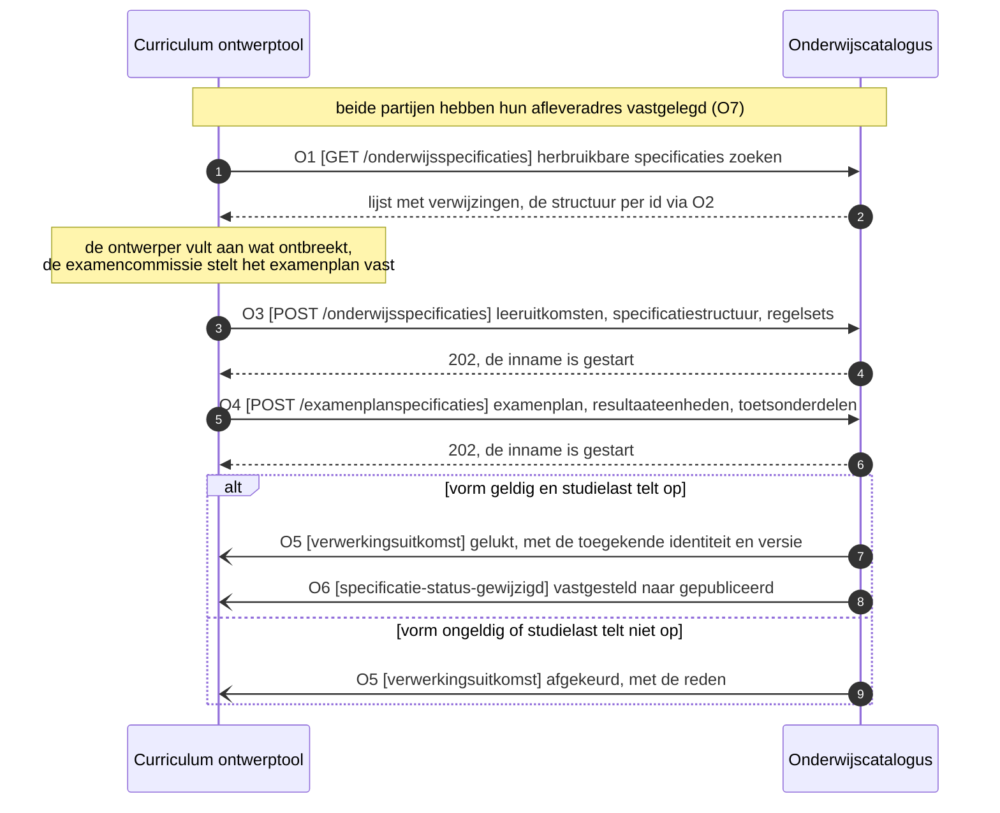

# IS-OA-01: het ontworpen onderwijs naar de onderwijscatalogus

De curriculum ontwerptool levert de onderwijscatalogus het vastgestelde ontwerp van een opleiding: de leeruitkomsten, de specificatiestructuur tot leeronderdeel met de keuzedeelruimte en haar keuzeregels, en de resultaatstructuur met de toets- en examenonderdelen, alles verankerd op de leeruitkomst.

## 1. De eenheid

| Bronsysteem | Doelsysteem | Koppeling | Beeld | Status | Applicatiedienst |
|---|---|---|---|---|---|
| Curriculum ontwerptool | Onderwijscatalogus | volgt, zie [S5](README.md#signaleringen-en-openstaande-punten) | [F1-12](../../../model/informatiemodel/img/regels/f1-12-de-opleiding-zoals-ontworpen-naar-de-catalogus.svg) | Voorstel | [onderwijsspecificatie-inname](https://github.com/Npuls-OKx/Public/blob/d0c20d99b110b29ccf6b0e50109f7d54ffd88d7a/Koppelvlakspecificaties/Applicatiediensten/onderwijsspecificatie-inname-aanbieder.md): de ontwerptool levert, de catalogus neemt in |

De dienst legt de rolverdeling vast: de catalogus valideert de vorm, toetst of de studielast van onderliggende delen optelt naar het bovenliggende niveau, bevestigt de opname of keurt af met een reden, en kent de opgenomen specificatie een eigen identiteit en versie toe. De ontwerptool levert aan, verwerkt de uitkomst en gebruikt de toegekende identiteit en versie voortaan als verwijzing. Het ArchiMate-model draagt dezelfde stap als `Curriculum ontwerp` bij de ontwerptool en `Onderwijsspecificatie uitwerking` bij de catalogus. De stand is voorstel: hoofdplaat v1.7 laat het ontwerpen binnen de catalogus vallen, en een interactiepatroon voor deze lijn volgt.

| Grond | Wat zij voor deze eenheid vastlegt |
|---|---|
| [ADR 0020](https://github.com/Npuls-OKx/Public/blob/dev/Referentiemateriaal/adr/0020-curriculumontwerp-onderwijscatalogus-happy-flow-synchronisatie-en-federatie-adopt-klonen.md) | De ontwerptool zoekt hergebruik op leeruitkomst, de catalogus beslist over publicatie, de ontwerptool krijgt statusterugkoppeling |
| [U3](https://github.com/Npuls-OKx/Public/blob/dev/Koppelvlakspecificaties/uitgangspunten.md#u3-resource-eigenaarschap) | De ontwerptool bezit het ontwerp in bewerking, de catalogus de opgenomen onderwijsspecificatie |
| [U4](https://github.com/Npuls-OKx/Public/blob/dev/Koppelvlakspecificaties/uitgangspunten.md#u4-notify-then-pull) | De uitkomst en de statuswijziging komen als dunne melding met een verwijzing terug |
| [U7](https://github.com/Npuls-OKx/Public/blob/dev/Koppelvlakspecificaties/uitgangspunten.md#u7-payload-plat-met-verwijzingen-en-de-sleutelconventie) | Platte arrays met een ouder-verwijzing, sleutelvelden met een naam die de richting zegt |
| [U11](https://github.com/Npuls-OKx/Public/blob/dev/Koppelvlakspecificaties/uitgangspunten.md#u11-toekomstvaste-endpoints-volledige-structuur-en-delta) | Naast de volledige structuur staat de delta op dezelfde resource |
| [Ontwerpkeuze 1](../../../model/informatiemodel/informatiemodel.md#ontwerpkeuzes) | Elk geleverd objecttype verwijst naar de leeruitkomst |
| [Beeldregels F1-12](../../../model/informatiemodel/voorbeeld-lr1-regels.json) | De objecttypen en instanties die deze stroom draagt |

## 2. De stroom in beeld



Afkeuring is een geldige uitkomst van de inname en geen fout van het kanaal. De ontwerptool stelt haar eigen beeld bij op een terminale uitkomst: gelukt, niet gelukt of afgekeurd.

## 3. De operaties

`CO` is de curriculum ontwerptool, `OC` de onderwijscatalogus. De dienstpagina's staan in [Applicatiediensten](https://github.com/Npuls-OKx/Public/tree/d0c20d99b110b29ccf6b0e50109f7d54ffd88d7a/Koppelvlakspecificaties/Applicatiediensten).

| Nr | Operatie | Dienst | Richting | Pad of melding | Methode | Stand |
|---|---|---|---|---|---|---|
| O1 | Herbruikbare specificaties zoeken | onderwijsspecificatiestructuur-aanbieder | CO vraagt OC | `/onderwijsspecificaties` | GET | In Public, filter op leeruitkomst via W3 |
| O2 | Een herbruikbare structuur ophalen | onderwijsspecificatiestructuur-aanbieder | CO vraagt OC | `/onderwijsspecificaties/{id}` | GET | In Public |
| O3 | Het ontwerp aanleveren | onderwijsspecificatie-inname | CO levert OC | voorstel `/onderwijsspecificaties` | POST | W1 |
| O4 | De resultaatstructuur aanleveren | onderwijsspecificatie-inname | CO levert OC | voorstel `/examenplanspecificaties` | POST | W1 |
| O5 | De uitkomst van de inname melden | verwerkingsuitkomst | OC meldt CO | `verwerkingsuitkomst` | POST | Schema in Public, endpoint op CO via W2 |
| O6 | Een statuswijziging melden | onderwijsspecificatiestructuur-aanbieder | OC meldt CO | `specificatie-status-gewijzigd` | POST | Schema en eventwaarde in Public, endpoint op CO via W2 |
| O7 | Het afleveradres vastleggen | afleverabonnement-aanbieder | over en weer | `/abonnementen` | POST | In Public op OC, op CO via W2 |

Parameters, statuscodes en foutgedrag. De GET-operaties zijn alleen-lezen: herhaald aanroepen levert hetzelfde resultaat.

| Nr | Parameters | Statuscodes | Foutgedrag |
|---|---|---|---|
| O1 | `status` (optioneel, standaard `gepubliceerd`), `gewijzigdSinds` (optioneel, timestamp), `leeruitkomstId` (voorstel, W3) | 200, 400 | HTTP-foutcode, de aanroeper bepaalt de herhaling |
| O2 | `versie` (optioneel, standaard de laatst gepubliceerde) | 200, 400, 404 | 404 bij een onbekend id, 400 bij een onbekende versie. De delta staat op `/onderwijsspecificaties/{id}/delta` met `van` en `naar`, beide verplicht |
| O3 | geen | 202, 400, 409 | 202 bij een aangenomen structuur: het oordeel volgt als uitkomst op O5. 400 bij een vorm die het schema schendt, 409 bij een herhaalde aanlevering van dezelfde ontwerpversie (W1) |
| O4 | geen | 202, 400, 409 | Als O3. De resultaatstructuur verwijst met `geldtVoor` naar een opgenomen opleidingsprogrammaspecificatie, dus O3 gaat voor |
| O5 | geen | 200 | `afgekeurd` draagt de reden, bijvoorbeeld studielast die niet optelt. De ontvanger bevestigt met 200. Zonder bevestiging herhaalt de melder met toenemende wachttijd (backoff) en daarna via het dood-brievenpad (dead letter channel). Een herhaald bericht heeft geen extra effect: de ontvanger herkent het bericht-id |
| O6 | geen | 200 | Als O5 |
| O7 | geen | 201, 400 | Idempotent op afleveradres plus soort melding: een herhaalde registratie overschrijft de vorige |

De ontwerptool abonneert zich op de twee meldingen die zij ontvangt: `verwerkingsstatus` en `specificatie-status-gewijzigd`, de waarden die [subscription.json](https://github.com/Npuls-OKx/Public/blob/dev/Informatie-en-gegevensmodellen/schemas/subscription.json) kent. De dienstpagina stelt `verwerkingsuitkomst` voor als naam van die eerste melding; de keuze tussen beide namen ligt bij de koppelvlakspecificatie. De volgorde per `specificatieId` blijft behouden, en het kanaal is vrij binnen de vier eigenschappen van [U5](https://github.com/Npuls-OKx/Public/blob/dev/Koppelvlakspecificaties/uitgangspunten.md#u5-bericht-versus-kanaal): gegarandeerde aflevering, idempotente verwerking, een dood-brievenpad en volgorde per sleutel.

## 4. De berichten

Kardinaliteit en verplichting gelden voor deze stroom. Een afwijking van het schema staat in de kolom Verplicht met een verwijzing naar de werkbrief.

### 4.1 De uitkomst van de inname (O5)

Volgt [processing-status.json](https://github.com/Npuls-OKx/Public/blob/dev/Informatie-en-gegevensmodellen/schemas/processing-status.json).

| Veld | Type | Kardinaliteit | Verplicht | Objecttype |
|---|---|---|---|---|
| `status` | enum `ontvangen`, `gestart`, `afgekeurd`, `gelukt`, `nietGelukt` | 1 | ja | de toestand van de inname |
| `specificatieVerwijzing` | object: `specificatieId`, `versie` | 1 | ja | `Opleiding specificatie`, met de identiteit en versie die de catalogus toekent (W4) |
| `opleidingsaanbodId` | uuid of null | 0..1 | nee, leeg in deze stroom | `Opleiding aanbod`, gevuld in IS-OA-04 |

De reden bij `afgekeurd` en `nietGelukt` krijgt haar vorm in het innamecontract (W1).

### 4.2 De statusmelding (O6)

Volgt [specification-status-changed.json](https://github.com/Npuls-OKx/Public/blob/dev/Informatie-en-gegevensmodellen/schemas/specification-status-changed.json).

| Veld | Type | Kardinaliteit | Verplicht | Objecttype |
|---|---|---|---|---|
| `objectId` | uuid | 1 | ja | `Opleiding specificatie`, de wortel van de opgenomen structuur |
| `oudeStatus` | enum | 1 | ja | `Opleiding specificatie`, `vastgesteld` bij opname |
| `nieuweStatus` | enum | 1 | ja | `Opleiding specificatie`, `gepubliceerd` zodra de catalogus publiceert |

### 4.3 Het ontwerp (O3), leeruitkomsten

Volgt [learning-outcome.json](https://github.com/Npuls-OKx/Public/blob/dev/Informatie-en-gegevensmodellen/schemas/learning-outcome.json).

| Veld | Type | Kardinaliteit | Verplicht | Objecttype |
|---|---|---|---|---|
| `id` | uuid | 1 | ja | `Leeruitkomst` |
| `versie` | string, semver | 1 | ja | `Leeruitkomst` |
| `naam` | string | 1 | ja | `Leeruitkomst`, in de stem van de instelling |
| `bron` | object: `standaard`, `type`, `code` | 1 | ja | `Kwalificatie dossier`, `Kwalificatie`, `Kerntaak`, `Werkproces`, `Keuzedeel`, via het `type` |
| `bovenliggendLeeruitkomstId` | uuid of null | 1 | ja | `Leeruitkomst`, de aggregatie tussen de niveaus |
| `indicatieveOmvang` | array van `waarde` plus `eenheid` SBU of EC | 1..n | ja | `Leeruitkomst` |
| `nlqfNiveau` | integer 1 tot 8 | 0..1 | nee | `Leeruitkomst`, draagt het mbo-niveau van de keuzedeelruimte |
| `waardedocument` | string | 0..1 | nee | `Waarde document (diploma / certificaat)` |
| `omschrijving`, `resultaat`, `gedrag` | string, string, array string | 0..1, 0..1, 0..n | nee | `Leeruitkomst` |

`Competenties / Skills` met `Vaardigheid`, `Kennis` en `Inzicht` eronder zijn de verdieping die F1-12 meestuurt en krijgen hun veld via [W6](#7-de-werkbrieven).

### 4.4 Het ontwerp (O3), onderwijsspecificaties

Volgt [education-specification.json](https://github.com/Npuls-OKx/Public/blob/dev/Informatie-en-gegevensmodellen/schemas/education-specification.json). Het `specificatieType` bepaalt het objecttype.

| `specificatieType` | Objecttype | Instantie in F1-12 |
|---|---|---|
| `opleidingsspecificatie` | `Opleiding specificatie` | Apothekersassistent |
| `opleidingsprogrammaspecificatie` | `Opleidingsprogramma specificatie`, en `Keuzedeel` bij `programmatype` `keuzedeelprogramma` | BOL voltijd, Regulier BOL 2026 |
| `onderwijseenheidspecificatie` | `Onderwijseenheid specificatie` | Blok B1-K1 |
| `leeronderdeelspecificatie` | `Leeronderdeel specificatie` | Baliegesprekken 101 |
| `keuzedeelruimtespecificatie` | `Keuzedeelruimte` | 720 SBU, mbo-4 |

| Veld | Type | Kardinaliteit | Verplicht | Objecttype |
|---|---|---|---|---|
| `id` | uuid | 1 | ja | het objecttype uit de tabel hierboven |
| `specificatieType` | enum | 1 | ja | idem |
| `versie` | string, semver | 1 | ja | idem, zie W4 en W10 |
| `bovenliggendSpecificatieId` | uuid of null | 1 | ja | de aggregatie tussen de specificatie-objecttypen |
| `leeruitkomstId` | uuid | 0..1 | ja in deze stroom, buiten `keuzedeelruimtespecificatie` om (W5) | `Leeruitkomst` |
| `naam` | string | 1 | ja | het objecttype uit de tabel hierboven |
| `studielast` | object: `waarde` plus `eenheid` | 1 | ja | idem, telt bottom-up op binnen onderdeel-van |
| `status` | enum | 1 | ja in deze stroom: `vastgesteld` bij aanlevering | idem |
| `manifest` | array van `specificatieId`, `versie`, `relatie` | 0..n | ja zodra er onderdelen of varianten zijn | de gepinde versie per onderdeel |
| `regelsetVerwijzingen` | array uuid | 0..n | ja op de keuzedeelruimte | `Student keuze regelset` |
| `omschrijving` | string | 0..1 | nee | het objecttype uit de tabel hierboven |
| `curriculumtype` | enum `nominaal`, `hybride`, `flexibel` | 0..1 | nee | `Opleiding specificatie`, `Opleidingsprogramma specificatie` |
| `programmatype` | string, open lijst | 0..1 | ja op een programma | `Opleidingsprogramma specificatie`, `Keuzedeel` |
| `programmaLaag` | enum `leerweg`, `doelgroep` | 0..1 | ja op een programma | `Opleidingsprogramma specificatie` |
| `leerweg` | enum `BOL`, `BBL` | 0..1 | ja op een programma | `Opleidingsprogramma specificatie` |
| `doelgroep` | string, open lijst | 0..1 | ja op de doelgroeplaag | `Opleidingsprogramma specificatie` |
| `keuzedeelKlasse` | string, open lijst | 0..1 | ja op een keuzedeelprogramma | `Keuzedeel` |
| `cohort` | string | 0..1 | ja op de doelgroeplaag | `Cohort / periode` |
| `startdatum`, `geldigVanaf`, `geldigTot` | date | 0..1 elk | ja op de doelgroeplaag | geldigheid per ontwerpkeuze 16 |
| `tijdsverdeling` | string, open lijst BOT, OOT, BPV | 0..1 | nee | `Leeronderdeel specificatie` |

### 4.5 Het ontwerp (O3), regelsets

Volgt [rule-set.json](https://github.com/Npuls-OKx/Public/blob/dev/Informatie-en-gegevensmodellen/schemas/rule-set.json).

| Veld | Type | Kardinaliteit | Verplicht | Objecttype |
|---|---|---|---|---|
| `id` | uuid | 1 | ja | `Student keuze regelset` |
| `versie` | string | 1 | ja | `Student keuze regelset` |
| `naam` | string | 1 | ja | `Student keuze regelset` |
| `vanToepassingOp` | uuid | 1 | ja | `Keuzedeelruimte` |
| `regels` | array object | 1..n | ja | `Student keuze regelset`, getypeerde vorm via W9 |
| `omschrijving` | string | 0..1 | nee | `Student keuze regelset` |

### 4.6 De resultaatstructuur (O4)

Volgt [result-structure.json](https://github.com/Npuls-OKx/Public/blob/dev/Informatie-en-gegevensmodellen/schemas/result-structure.json).

| `specificatieType` | Objecttype | Instantie in F1-12 |
|---|---|---|
| `examenplanspecificatie` | `Summatieve resultaat structuur`, met `Examenplan` als vastgesteld geheel | Resultaatstructuur Apothekersassistent |
| `resultaateenheidspecificatie` | drager van `Examenonderdeel weging` en `Toetsonderdeel weging`, zonder eigen objecttype (W11) | Resultaat kerntaak B1-K1, Resultaat keuzedelen |
| `toetsonderdeelspecificatie` | `Toetsonderdeel specificatie`, en `Examenonderdeelspecificatie` bij een examen-toetsvorm | Praktijktoets baliegesprek (OSCE), Proeve van bekwaamheid B1-K1 |

| Veld | Type | Kardinaliteit | Verplicht | Objecttype |
|---|---|---|---|---|
| `id` | uuid | 1 | ja | het objecttype uit de tabel hierboven |
| `specificatieType` | enum | 1 | ja | idem |
| `versie` | string, semver | 1 | ja | idem |
| `bovenliggendSpecificatieId` | uuid of null | 1 | ja | de aggregatie binnen de resultaatstructuur |
| `naam` | string | 1 | ja | idem |
| `status` | string | 1 | ja | idem, `concept` bij de formatieve structuur |
| `resultaatmodel` | object: `schaal`, `cesuur`, `decimalen` | 1 | ja | `Summatieve resultaat structuur` |
| `geldtVoor` | uuid | 0..1 | ja op het examenplan | `Opleidingsprogramma specificatie` |
| `beoordeelt` | uuid | 0..1 | ja op een resultaateenheid | `Onderwijseenheid specificatie` of `Keuzedeelruimte` |
| `leeruitkomstId` | uuid | 0..1 | ja buiten de keuzedeel-resultaateenheid om | `Leeruitkomst` |
| `leeruitkomst` | object: `type`, `code` | 0..1 | nee, leesbare aanduiding naast de sleutel | `Kerntaak`, `Werkproces`, `Kwalificatie` |
| `aard` | enum `summatief`, `formatief` | 0..1 | ja op een toetsonderdeel | `Summatieve resultaat structuur`, `Formatieve resultaat structuur` (W7) |
| `toetsvorm` | string, open lijst | 0..1 | ja op een toetsonderdeel | `Toetsonderdeel specificatie`, `Examenonderdeelspecificatie` |
| `aggregatie` | enum | 0..1 | ja op examenplan en resultaateenheid | `Summatief Afrondingscriterium` (W8) |
| `weging` | number | 0..1 | ja op resultaateenheid en toetsonderdeel, 0 bij formatief | `Examenonderdeel weging`, `Toetsonderdeel weging` |
| `verplicht` | boolean | 0..1 | ja op resultaateenheid en toetsonderdeel | `Summatief Afrondingscriterium` |
| `regelsetVerwijzingen` | array uuid | 0..n | ja op de keuzedeel-resultaateenheid | `Student keuze regelset` |
| `manifest` | array van `specificatieId`, `versie`, `relatie` | 0..n | ja zodra er onderdelen zijn | de gepinde versie per onderdeel |
| `geldigVanaf`, `geldigTot` | date | 0..1 elk | ja op het examenplan | geldigheid per ontwerpkeuze 16 |
| `omschrijving` | string | 0..1 | nee | het objecttype uit de tabel hierboven |

De keuzedeelruimte in de summatieve resultaatstructuur loopt via `beoordeelt` op de resultaateenheid, met de meetellende keuzedeelresultaten in de regelset. Dat beantwoordt de open beeldvraag bij F1-12.

## 5. Voorbeeldpayload: het ontwerp (O3)

Casus Apothekersassistent, crebo 23450, met de instantiewaarden uit F1-12. De id's volgen [voorbeeldpayloads.md](https://github.com/Npuls-OKx/Public/blob/dev/Informatie-en-gegevensmodellen/voorbeeldpayloads.md) in Public, zodat dezelfde instantie over de hele keten dezelfde sleutel draagt.

```json
{
  "leeruitkomsten": [
    {
      "id": "c5b64fe5-f7bf-490c-acaf-7af1bd24f980",
      "versie": "1.0.0",
      "naam": "Apothekersassistent (kwalificatiedossier 23450)",
      "bron": { "standaard": "sbb-kwalificatiekader", "type": "kwalificatiedossier", "code": "23450" },
      "bovenliggendLeeruitkomstId": null,
      "indicatieveOmvang": [{ "waarde": 4800, "eenheid": "SBU" }],
      "nlqfNiveau": 4,
      "waardedocument": "diploma"
    },
    {
      "id": "b84dc98b-6c5f-4ee8-bdfb-40b2639ca5a4",
      "versie": "1.0.0",
      "naam": "Apothekersassistent (kwalificatie 27141)",
      "bron": { "standaard": "sbb-kwalificatiekader", "type": "kwalificatie", "code": "27141" },
      "bovenliggendLeeruitkomstId": "c5b64fe5-f7bf-490c-acaf-7af1bd24f980",
      "indicatieveOmvang": [{ "waarde": 4800, "eenheid": "SBU" }]
    },
    {
      "id": "12301838-92d4-4040-aea2-050bb131ceb7",
      "versie": "1.0.0",
      "naam": "Biedt farmaceutische patiëntenzorg in een levensechte apotheekomgeving",
      "bron": { "standaard": "sbb-kwalificatiekader", "type": "kerntaak", "code": "B1-K1" },
      "bovenliggendLeeruitkomstId": "b84dc98b-6c5f-4ee8-bdfb-40b2639ca5a4",
      "indicatieveOmvang": [{ "waarde": 2000, "eenheid": "SBU" }]
    },
    {
      "id": "78f25d62-9fd4-45c4-aa04-3d22f59213f5",
      "versie": "1.0.0",
      "naam": "Voert baliegesprek en triage uit in de simulatieapotheek",
      "bron": { "standaard": "sbb-kwalificatiekader", "type": "werkproces", "code": "B1-K1-W1" },
      "bovenliggendLeeruitkomstId": "12301838-92d4-4040-aea2-050bb131ceb7",
      "indicatieveOmvang": [{ "waarde": 600, "eenheid": "SBU" }]
    }
  ],
  "onderwijsspecificaties": [
    {
      "id": "79736830-1c5c-470f-b2c2-005029c96733",
      "specificatieType": "opleidingsspecificatie",
      "versie": "1.0.0",
      "bovenliggendSpecificatieId": null,
      "leeruitkomstId": "c5b64fe5-f7bf-490c-acaf-7af1bd24f980",
      "naam": "Apothekersassistent",
      "omschrijving": "Opleiding tot apothekersassistent. Domein Zorg en welzijn.",
      "curriculumtype": "nominaal",
      "status": "vastgesteld",
      "geldigVanaf": "2026-08-01",
      "geldigTot": null,
      "studielast": { "waarde": 4800, "eenheid": "SBU" },
      "manifest": [
        { "specificatieId": "5ef37812-ae0f-4232-904f-451b9928e45e", "versie": "1.0.0", "relatie": "variant" }
      ]
    },
    {
      "id": "5ef37812-ae0f-4232-904f-451b9928e45e",
      "specificatieType": "opleidingsprogrammaspecificatie",
      "versie": "1.0.0",
      "bovenliggendSpecificatieId": "79736830-1c5c-470f-b2c2-005029c96733",
      "leeruitkomstId": "b84dc98b-6c5f-4ee8-bdfb-40b2639ca5a4",
      "naam": "BOL voltijd",
      "programmatype": "diplomaprogramma",
      "programmaLaag": "leerweg",
      "leerweg": "BOL",
      "status": "vastgesteld",
      "studielast": { "waarde": 4800, "eenheid": "SBU" },
      "manifest": [
        { "specificatieId": "7ae25c1e-ee27-43a2-a001-761ee39ea5c7", "versie": "1.0.0", "relatie": "variant" }
      ]
    },
    {
      "id": "7ae25c1e-ee27-43a2-a001-761ee39ea5c7",
      "specificatieType": "opleidingsprogrammaspecificatie",
      "versie": "1.0.0",
      "bovenliggendSpecificatieId": "5ef37812-ae0f-4232-904f-451b9928e45e",
      "leeruitkomstId": "b84dc98b-6c5f-4ee8-bdfb-40b2639ca5a4",
      "naam": "Regulier BOL 2026",
      "programmatype": "diplomaprogramma",
      "programmaLaag": "doelgroep",
      "doelgroep": "regulier",
      "leerweg": "BOL",
      "curriculumtype": "nominaal",
      "cohort": "2026",
      "startdatum": "2026-09-01",
      "geldigVanaf": "2026-09-01",
      "geldigTot": null,
      "status": "vastgesteld",
      "studielast": { "waarde": 4800, "eenheid": "SBU" },
      "manifest": [
        { "specificatieId": "402c2342-d897-4df4-a667-7fc5bd930944", "versie": "1.0.0", "relatie": "onderdeel" },
        { "specificatieId": "fb5be5ae-faa0-4b4b-8085-474fce9aae08", "versie": "1.0.0", "relatie": "onderdeel" }
      ]
    },
    {
      "id": "402c2342-d897-4df4-a667-7fc5bd930944",
      "specificatieType": "onderwijseenheidspecificatie",
      "versie": "1.0.0",
      "bovenliggendSpecificatieId": "7ae25c1e-ee27-43a2-a001-761ee39ea5c7",
      "leeruitkomstId": "12301838-92d4-4040-aea2-050bb131ceb7",
      "naam": "Blok B1-K1",
      "status": "vastgesteld",
      "studielast": { "waarde": 2000, "eenheid": "SBU" },
      "manifest": [
        { "specificatieId": "327c8263-3516-4b5a-8d57-c16241ec008d", "versie": "1.0.0", "relatie": "onderdeel" }
      ]
    },
    {
      "id": "327c8263-3516-4b5a-8d57-c16241ec008d",
      "specificatieType": "leeronderdeelspecificatie",
      "versie": "1.0.0",
      "bovenliggendSpecificatieId": "402c2342-d897-4df4-a667-7fc5bd930944",
      "leeruitkomstId": "78f25d62-9fd4-45c4-aa04-3d22f59213f5",
      "naam": "Baliegesprekken 101",
      "tijdsverdeling": "BOT",
      "status": "vastgesteld",
      "studielast": { "waarde": 600, "eenheid": "SBU" }
    },
    {
      "id": "fb5be5ae-faa0-4b4b-8085-474fce9aae08",
      "specificatieType": "keuzedeelruimtespecificatie",
      "versie": "1.0.0",
      "bovenliggendSpecificatieId": "7ae25c1e-ee27-43a2-a001-761ee39ea5c7",
      "naam": "Keuzedeelruimte",
      "omschrijving": "Ruimte binnen de kwalificatie die met keuzedelen wordt ingevuld.",
      "status": "vastgesteld",
      "studielast": { "waarde": 720, "eenheid": "SBU" },
      "regelsetVerwijzingen": ["e4037953-17d6-40a4-9e59-92ec1f9c19a8"]
    }
  ],
  "regelsets": [
    {
      "id": "e4037953-17d6-40a4-9e59-92ec1f9c19a8",
      "versie": "1.0.0",
      "naam": "Kiesbare keuzedelen voor Apothekersassistent",
      "omschrijving": "Bepaalt welke keuzedelen in de keuzedeelruimte kiesbaar zijn.",
      "vanToepassingOp": "fb5be5ae-faa0-4b4b-8085-474fce9aae08",
      "regels": [
        { "type": "kiesbaar", "bereik": "keuzedeel K0037 Farmaceutische patiëntenzorg" },
        { "type": "kiesbaar", "bereik": "keuzedeel K0262 Doorstroom hbo" },
        { "type": "minimaleStudielast", "waarde": 720, "eenheid": "SBU" }
      ]
    }
  ]
}
```

De payload volgt de lijn van F1-12: kerntaak B1-K1 met een leeronderdeel. De optelling van `studielast` sluit over de volledige boom in voorbeeldpayloads.md.

## 6. Voorbeeldpayload: de resultaatstructuur (O4)

```json
{
  "onderwijsspecificaties": [
    {
      "id": "08b4656d-27ec-4175-8c1b-1f1d51780785",
      "specificatieType": "examenplanspecificatie",
      "versie": "1.0.0",
      "bovenliggendSpecificatieId": null,
      "geldtVoor": "7ae25c1e-ee27-43a2-a001-761ee39ea5c7",
      "leeruitkomstId": "b84dc98b-6c5f-4ee8-bdfb-40b2639ca5a4",
      "leeruitkomst": { "type": "kwalificatie", "code": "27141" },
      "naam": "Resultaatstructuur Apothekersassistent",
      "omschrijving": "Alle kerntaken voldoende, de keuzedeelruimte gevuld en afgerond, en het basisdeel behaald.",
      "aggregatie": "allenVoldoende",
      "resultaatmodel": { "schaal": "voldoende-onvoldoende" },
      "status": "vastgesteld",
      "geldigVanaf": "2026-09-01",
      "geldigTot": null,
      "manifest": [
        { "specificatieId": "0512c773-9c1b-42c4-ae0d-9af8554f2462", "versie": "1.0.0", "relatie": "onderdeel" },
        { "specificatieId": "df0d3e50-c7c3-416e-b694-12fe5791eb7c", "versie": "1.0.0", "relatie": "onderdeel" }
      ]
    },
    {
      "id": "0512c773-9c1b-42c4-ae0d-9af8554f2462",
      "specificatieType": "resultaateenheidspecificatie",
      "versie": "1.0.0",
      "bovenliggendSpecificatieId": "08b4656d-27ec-4175-8c1b-1f1d51780785",
      "leeruitkomstId": "12301838-92d4-4040-aea2-050bb131ceb7",
      "leeruitkomst": { "type": "kerntaak", "code": "B1-K1" },
      "beoordeelt": "402c2342-d897-4df4-a667-7fc5bd930944",
      "naam": "Resultaat kerntaak B1-K1",
      "weging": 1,
      "aggregatie": "gewogenGemiddelde",
      "resultaatmodel": { "schaal": "cijfer-1-10", "cesuur": 5.5, "decimalen": 1 },
      "verplicht": true,
      "status": "vastgesteld",
      "manifest": [
        { "specificatieId": "941f180d-b0af-4933-a580-6ab654dfadda", "versie": "1.0.0", "relatie": "onderdeel" },
        { "specificatieId": "6061f30c-e8fd-44b8-a553-e3078c07dc75", "versie": "1.0.0", "relatie": "onderdeel" },
        { "specificatieId": "f004ba43-1e0b-4b8f-a677-0644ce29f4ea", "versie": "1.0.0", "relatie": "onderdeel" }
      ]
    },
    {
      "id": "941f180d-b0af-4933-a580-6ab654dfadda",
      "specificatieType": "toetsonderdeelspecificatie",
      "versie": "1.0.0",
      "bovenliggendSpecificatieId": "0512c773-9c1b-42c4-ae0d-9af8554f2462",
      "leeruitkomstId": "12301838-92d4-4040-aea2-050bb131ceb7",
      "leeruitkomst": { "type": "kerntaak", "code": "B1-K1" },
      "naam": "Proeve van bekwaamheid B1-K1",
      "aard": "summatief",
      "toetsvorm": "proeveVanBekwaamheid",
      "weging": 2,
      "resultaatmodel": { "schaal": "cijfer-1-10", "cesuur": 5.5, "decimalen": 1 },
      "verplicht": true,
      "status": "vastgesteld"
    },
    {
      "id": "6061f30c-e8fd-44b8-a553-e3078c07dc75",
      "specificatieType": "toetsonderdeelspecificatie",
      "versie": "1.0.0",
      "bovenliggendSpecificatieId": "0512c773-9c1b-42c4-ae0d-9af8554f2462",
      "leeruitkomstId": "78f25d62-9fd4-45c4-aa04-3d22f59213f5",
      "leeruitkomst": { "type": "werkproces", "code": "B1-K1-W1" },
      "naam": "Praktijktoets baliegesprek (OSCE)",
      "aard": "summatief",
      "toetsvorm": "praktijkopdracht",
      "weging": 1,
      "resultaatmodel": { "schaal": "cijfer-1-10", "cesuur": 5.5, "decimalen": 1 },
      "verplicht": true,
      "status": "vastgesteld"
    },
    {
      "id": "f004ba43-1e0b-4b8f-a677-0644ce29f4ea",
      "specificatieType": "toetsonderdeelspecificatie",
      "versie": "1.0.0",
      "bovenliggendSpecificatieId": "0512c773-9c1b-42c4-ae0d-9af8554f2462",
      "leeruitkomstId": "78f25d62-9fd4-45c4-aa04-3d22f59213f5",
      "leeruitkomst": { "type": "werkproces", "code": "B1-K1-W1" },
      "naam": "Formatieve voortgang baliegesprek",
      "aard": "formatief",
      "toetsvorm": "criteriumgesprek",
      "weging": 0,
      "resultaatmodel": { "schaal": "voldoende-onvoldoende" },
      "verplicht": false,
      "status": "concept"
    },
    {
      "id": "df0d3e50-c7c3-416e-b694-12fe5791eb7c",
      "specificatieType": "resultaateenheidspecificatie",
      "versie": "1.0.0",
      "bovenliggendSpecificatieId": "08b4656d-27ec-4175-8c1b-1f1d51780785",
      "beoordeelt": "fb5be5ae-faa0-4b4b-8085-474fce9aae08",
      "naam": "Resultaat keuzedelen",
      "omschrijving": "Welke keuzedeelresultaten meetellen staat in de regelset.",
      "weging": 1,
      "aggregatie": "minimaalAantal",
      "resultaatmodel": { "schaal": "voldoende-onvoldoende" },
      "verplicht": true,
      "status": "vastgesteld",
      "regelsetVerwijzingen": ["132f165a-973c-41c2-98df-e58d4ca6d7eb"]
    }
  ],
  "regelsets": [
    {
      "id": "132f165a-973c-41c2-98df-e58d4ca6d7eb",
      "versie": "1.0.0",
      "naam": "Meetellende keuzedeelresultaten Apothekersassistent",
      "vanToepassingOp": "df0d3e50-c7c3-416e-b694-12fe5791eb7c",
      "regels": [
        { "type": "minimaleStudielast", "waarde": 720, "eenheid": "SBU", "bron": "fb5be5ae-faa0-4b4b-8085-474fce9aae08" },
        { "type": "resultaatEis", "bereik": "elk gekozen keuzedeel", "eis": "voldoende" }
      ]
    }
  ]
}
```

De proeve weegt twee keer zo zwaar als de praktijktoets, de formatieve toets weegt 0 en komt als concept mee. Het id `6061f30c` is de instantie die deze snede toevoegt aan de id-reeks uit voorbeeldpayloads.md.


## 7. De werkbrieven

| Nr | Wat erbij moet | Waar | Versie-impact |
|---|---|---|---|
| W1 | Het innamecontract: welke endpoints de dienst dragen, met als voorstel `POST /onderwijsspecificaties` en `POST /examenplanspecificaties`, de respons 202 met de uitkomst via O5, en de vorm van de reden bij afkeuring | [onderwijsspecificatie-inname-aanbieder.md](https://github.com/Npuls-OKx/Public/blob/d0c20d99b110b29ccf6b0e50109f7d54ffd88d7a/Koppelvlakspecificaties/Applicatiediensten/onderwijsspecificatie-inname-aanbieder.md), paragraaf Endpoints, en [onderwijscatalogus.md](https://github.com/Npuls-OKx/Public/blob/dev/Koppelvlakspecificaties/Applicatiecomponenten/onderwijscatalogus.md) | Additief: twee endpoints erbij op de catalogus, de bestaande opvragingen en payloadschema's blijven gelijk |
| W2 | Endpointtabel voor de curriculum ontwerptool met `verwerkingsuitkomst` POST en `POST /abonnementen`, de twee diensten die zij als ontvanger implementeert | [curriculum-ontwerptool.md](https://github.com/Npuls-OKx/Public/blob/dev/Koppelvlakspecificaties/Applicatiecomponenten/curriculum-ontwerptool.md) | Additief: bestaande paden en schema's, nieuw koppelvlak op een component zonder endpoints |
| W3 | Parameter `leeruitkomstId` op het zoeken naar hergebruik, en kopmetadata (`naam`, `studielast`) in de respons, zodat de ontwerper kan kiezen op wat de specificatie belooft | [onderwijscatalogus.md](https://github.com/Npuls-OKx/Public/blob/dev/Koppelvlakspecificaties/Applicatiecomponenten/onderwijscatalogus.md) en [specification-reference.json](https://github.com/Npuls-OKx/Public/blob/dev/Informatie-en-gegevensmodellen/schemas/specification-reference.json) | MINOR: additieve parameter en additieve optionele velden |
| W4 | Regel hoe de toegekende identiteit zich verhoudt tot de id's waarmee de ontwerptool aanlevert, met `specificatieVerwijzing` als terugweg | [regels.md](https://github.com/Npuls-OKx/Public/blob/dev/Informatie-en-gegevensmodellen/regels.md), naast de regel dat de catalogus versienummers uitgeeft | Geen schemawijziging |
| W5 | Gebruiksprofiel voor deze koppeling: `onderwijsspecificaties` volledig met manifest, `leeruitkomsten` volledig met inhoudsvelden, `regelsets` volledig, en `leeruitkomstId` verplicht buiten de `keuzedeelruimtespecificatie` om | [gebruiksprofielen.md](https://github.com/Npuls-OKx/Public/blob/dev/Informatie-en-gegevensmodellen/gebruiksprofielen.md) | Geen schemawijziging |
| W6 | Veld voor `Competenties / Skills` met `Vaardigheid`, `Kennis` en `Inzicht` eronder, elk met standaard en code | [learning-outcome.json](https://github.com/Npuls-OKx/Public/blob/dev/Informatie-en-gegevensmodellen/schemas/learning-outcome.json) | MINOR: optionele array, met een eigen schema voor het competentie-item |
| W7 | Type voor de `Formatieve resultaat structuur` als eigen wortel naast het examenplan | [result-structure.json](https://github.com/Npuls-OKx/Public/blob/dev/Informatie-en-gegevensmodellen/schemas/result-structure.json), enum `specificatieType` | MINOR: additieve enumwaarde. Strikt validerende ontvangers krijgen de waarde vooraf |
| W8 | Drager voor het generieke basisdeel in het `Summatief Afrondingscriterium`: Nederlands en rekenen, Engels, loopbaan en burgerschap | result-structure.json via `regelsetVerwijzingen` op het examenplan, plus een resultaateenheid in de instantie | Geen schemawijziging, wel een uitwerking van de regels en de instantie |
| W9 | Getypeerde regels met `bereiken` en `parameters`, conform de uitwerking in [regelset-payload.md](../student-keuze/regelset-payload.md) | [rule-set.json](https://github.com/Npuls-OKx/Public/blob/dev/Informatie-en-gegevensmodellen/schemas/rule-set.json) | MINOR voor `bereiken`, MAJOR bij overname van `regelsetId` als sleutelnaam |
| W10 | Releaseaanduiding naast `versie` voor de vorm 2026.1 uit de voorbeelduitwerking, die buiten het semver-patroon valt | [education-specification.json](https://github.com/Npuls-OKx/Public/blob/dev/Informatie-en-gegevensmodellen/schemas/education-specification.json), of semver in de [voorbeelduitwerking](../../../model/informatiemodel/voorbeeld-lr1-regels.json) | MINOR voor een additief veld, of geen schemawijziging bij semver in het voorbeeld |
| W11 | Objecttype voor de `resultaateenheidspecificatie`, de laag tussen examenplan en toetsonderdeel | [informatiemodel.md](../../../model/informatiemodel/informatiemodel.md) en [begrippenlijst.md](../begrippen/begrippenlijst.md) | Geen schemawijziging: informatiemodel en begrippenlijst |

Wat deze eenheid verder raakt staat in de [signaleringen](README.md#signaleringen-en-openstaande-punten) van de interactiespecificatie: S5 vraagt een koppeling-ID en een eigen lijn op de hoofdplaat, S6 de grond per objecttype.
