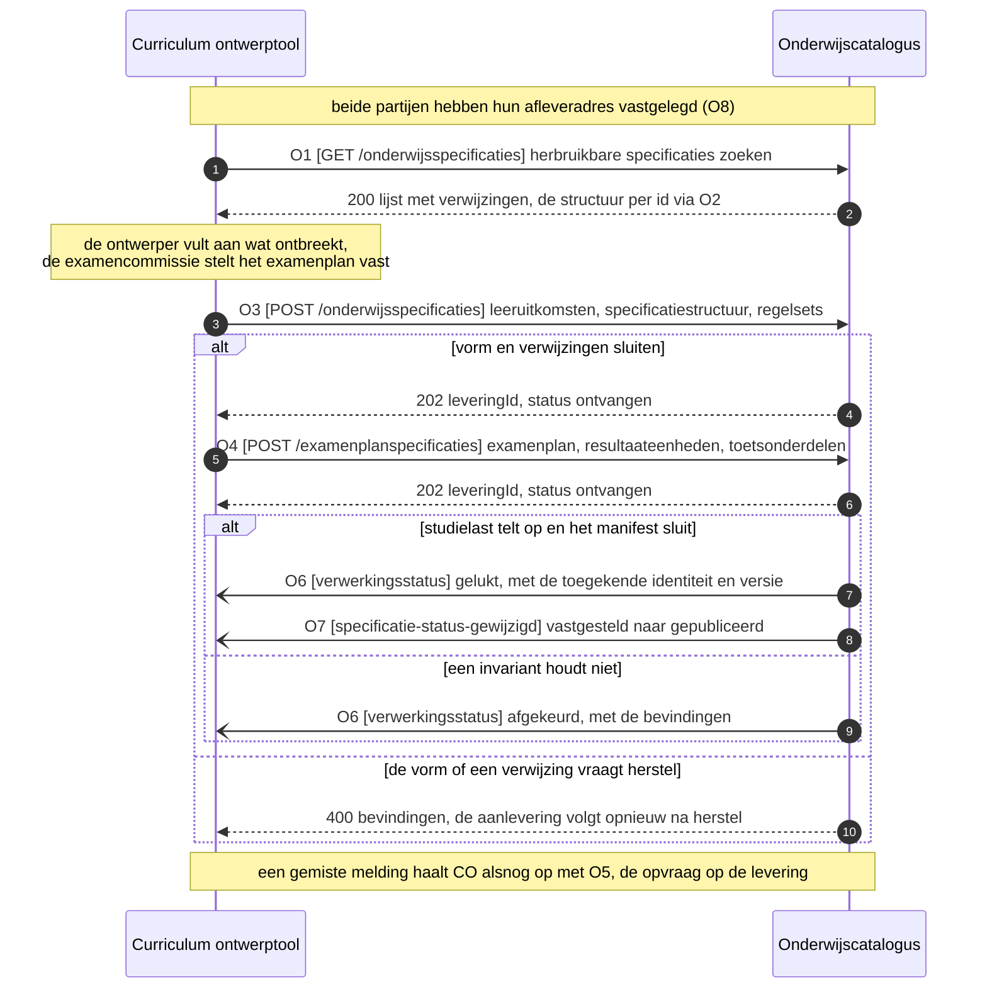

# IS-OA-01: het ontworpen onderwijs naar de onderwijscatalogus

De curriculum ontwerptool levert de onderwijscatalogus het vastgestelde ontwerp van een opleiding: de leeruitkomsten, de specificatiestructuur tot leeronderdeel met de keuzedeelruimte en haar keuzeregels, en de resultaatstructuur met de toets- en examenonderdelen, alles verankerd op de leeruitkomst.

De uuid's, de versies en de namen in de voorbeeldpayloads hieronder komen uit [casus.md](casus.md), de vaste identificaties van deze interactiespecificatie.

## 1. De eenheid

| Bronsysteem | Doelsysteem | Koppeling | Beeld | Status | Applicatiedienst |
|---|---|---|---|---|---|
| Curriculum ontwerptool | Onderwijscatalogus | volgt, [S5](README.md#signaleringen-en-openstaande-punten) | [F1-12](../../../model/informatiemodel/img/regels/f1-12-de-opleiding-zoals-ontworpen-naar-de-catalogus.svg) | Voorstel: hoofdplaat v1.7 laat het ontwerpen binnen de catalogus vallen, en een interactiepatroon voor deze lijn volgt | [onderwijsspecificatie-inname](https://github.com/Npuls-OKx/Public/blob/d0c20d99b110b29ccf6b0e50109f7d54ffd88d7a/Koppelvlakspecificaties/Applicatiediensten/onderwijsspecificatie-inname-aanbieder.md): de ontwerptool levert, de catalogus neemt in |

De dienst legt de rolverdeling vast.

| Component | Wat zij doet | In het ArchiMate-model |
|---|---|---|
| Onderwijscatalogus | De vorm valideren, toetsen of de studielast van onderliggende delen optelt naar het bovenliggende niveau, de opname bevestigen of afkeuren met een reden, en de opgenomen specificatie een eigen identiteit en versie toekennen | `Onderwijsspecificatie uitwerking` |
| Curriculum ontwerptool | Aanleveren, de uitkomst verwerken, en de toegekende identiteit en versie voortaan als verwijzing gebruiken | `Curriculum ontwerp` |

| Grond | Wat zij voor deze eenheid vastlegt |
|---|---|
| [ADR 0020](https://github.com/Npuls-OKx/Public/blob/dev/Referentiemateriaal/adr/0020-curriculumontwerp-onderwijscatalogus-happy-flow-synchronisatie-en-federatie-adopt-klonen.md) | De ontwerptool zoekt hergebruik op leeruitkomst, de catalogus beslist over publicatie, de ontwerptool krijgt statusterugkoppeling |
| [U3](https://github.com/Npuls-OKx/Public/blob/dev/Koppelvlakspecificaties/uitgangspunten.md#u3-resource-eigenaarschap) | De ontwerptool bezit het ontwerp in bewerking, de catalogus de opgenomen onderwijsspecificatie |
| [U4](https://github.com/Npuls-OKx/Public/blob/dev/Koppelvlakspecificaties/uitgangspunten.md#u4-notify-then-pull) | De uitkomst en de statuswijziging komen als dunne melding met een verwijzing terug |
| [U7](https://github.com/Npuls-OKx/Public/blob/dev/Koppelvlakspecificaties/uitgangspunten.md#u7-payload-plat-met-verwijzingen-en-de-sleutelconventie) | Platte arrays met een ouder-verwijzing, sleutelvelden met een naam die de richting zegt |
| [U11](https://github.com/Npuls-OKx/Public/blob/dev/Koppelvlakspecificaties/uitgangspunten.md#u11-toekomstvaste-endpoints-volledige-structuur-en-delta) | Naast de volledige structuur staat de delta op dezelfde resource |
| [Ontwerpkeuze 1](../../../model/informatiemodel/informatiemodel.md#ontwerpkeuzes) | Elk geleverd objecttype verwijst naar de leeruitkomst |
| [Beeldregels F1-12](../../../model/informatiemodel/voorbeeld-lr1-regels.json) | De objecttypen en instanties die deze stroom draagt |

Elke operatie, elk pad en elk schema hieronder draagt zijn status, zodat een lezer per regel ziet op welke grond hij staat.

| Status | Waar het artefact staat |
|---|---|
| `vastgelegd` | [Npuls-OKx/Public](https://github.com/Npuls-OKx/Public/tree/dev/Koppelvlakspecificaties) draagt hem: een pad op een componentpagina, een enumwaarde in een melding of een schema in [Informatie-en-gegevensmodellen](https://github.com/Npuls-OKx/Public/tree/dev/Informatie-en-gegevensmodellen/schemas) |
| `voorstel` | Deze eenheid stelt hem voor, onderbouwd uit [de casus](casus.md) en het [informatiemodel](../../../model/informatiemodel/informatiemodel.md), met een [werkbrief](#7-de-werkbrieven) die hem in Public laat landen. Een voorgesteld schema staat in [schemas/](schemas/) en draagt een `$id` die eindigt op `/voorstel` |

## 2. De stroom in beeld



Afkeuring is een geldige uitkomst van de inname. Bij de poort komt zij synchroon terug als 400 met de bevindingen; na aanname komt zij op O6 als `afgekeurd` met dezelfde bevindingen. Het kanaal blijft in beide gevallen staan, en de ontwerptool stelt haar eigen beeld bij op een terminale uitkomst: gelukt, niet gelukt of afgekeurd.

## 3. De operaties

`CO` is de curriculum ontwerptool, `OC` de onderwijscatalogus. De dienstpagina's staan in [Applicatiediensten](https://github.com/Npuls-OKx/Public/tree/d0c20d99b110b29ccf6b0e50109f7d54ffd88d7a/Koppelvlakspecificaties/Applicatiediensten) op het vastgezette commit `d0c20d9` van de branch `feature/restructure-and-versioning`; die map staat nog niet op `dev`, en signalering [S12](README.md#signaleringen-en-openstaande-punten) belegt welke branch normatief is.

### 3.1 Het contract per operatie

| Nr | Operatie | Dienst | Richting | Pad of melding | Methode | Status |
|---|---|---|---|---|---|---|
| O1 | Herbruikbare specificaties zoeken | onderwijsspecificatiestructuur-aanbieder | CO vraagt OC | `/onderwijsspecificaties` | GET | `vastgelegd`, met de parameter `leeruitkomstId` als `voorstel` (W3) |
| O2 | Een herbruikbare structuur ophalen | onderwijsspecificatiestructuur-aanbieder | CO vraagt OC | `/onderwijsspecificaties/{id}` | GET | `vastgelegd` |
| O3 | Het ontwerp aanleveren | onderwijsspecificatie-inname | CO levert OC | `/onderwijsspecificaties` | POST | `voorstel` (W1) |
| O4 | De resultaatstructuur aanleveren | onderwijsspecificatie-inname | CO levert OC | `/examenplanspecificaties` | POST | `voorstel` (W1) |
| O5 | De uitkomst van een levering opvragen | verwerkingsstatus | CO vraagt OC | `/leveringen/{leveringId}` | GET | `voorstel` (W1) |
| O6 | De uitkomst van de inname melden | verwerkingsstatus | OC meldt CO | `verwerkingsstatus` | POST | melding en schema `vastgelegd`, de sleutels erbij `voorstel` (W14), het endpoint op CO `voorstel` (W2) |
| O7 | Een statuswijziging melden | onderwijsspecificatiestructuur-aanbieder | OC meldt CO | `specificatie-status-gewijzigd` | POST | melding, schema en eventwaarde `vastgelegd`, het endpoint op CO `voorstel` (W2) |
| O8 | Het afleveradres vastleggen | afleverabonnement-aanbieder | over en weer | `/abonnementen` | POST | `vastgelegd` op OC, `voorstel` op CO (W2) |

Parameters, statuscodes en foutgedrag. De GET-operaties zijn alleen-lezen: herhaald aanroepen levert hetzelfde resultaat.

| Nr | Parameters | Statuscodes | Foutgedrag |
|---|---|---|---|
| O1 | `status` (optioneel, standaard `gepubliceerd`), `gewijzigdSinds` (optioneel, tijdstempel), `leeruitkomstId` (voorstel, W3) | 200, 400 | 200 draagt de [lijst met verwijzingen](#41-de-lijst-met-verwijzingen-o1). Bij 400 een HTTP-foutcode zonder lichaam, waarna de aanroeper de herhaling bepaalt |
| O2 | `versie` (optioneel, standaard de laatst gepubliceerde) | 200, 400, 404 | 404 bij een onbekend id, 400 bij een onbekende versie. De delta staat op `/onderwijsspecificaties/{id}/delta` met `van` en `naar`, beide verplicht |
| O3 | geen | 202, 400, 409 | 202 draagt de levering met haar `leveringId`, en het oordeel over de inhoud volgt op O6. 400 draagt de bevindingen zodra de vorm of een verwijzing herstel vraagt, 409 zodra de catalogus de wortel op dezelfde versie al draagt. Een aanlevering die bij de poort blijft, laat de catalogus in de toestand van ervoor |
| O4 | geen | 202, 400, 409 | Als O3. Een `appliesTo` naar een opleidingsprogrammaspecificatie buiten de catalogus geeft 400 met code `verwijzingOnbekend`: O3 gaat voor |
| O5 | geen | 200, 404 | 200 draagt de huidige toestand van de levering, 404 volgt bij een onbekend `leveringId`. De uitkomst blijft opvraagbaar zolang de catalogus de levering bewaart (W17) |
| O6 | geen | 200 | `afgekeurd` en `nietGelukt` dragen hun bevindingen. De ontvanger bevestigt met 200. Zonder bevestiging herhaalt de melder met oplopende wachttijd (backoff) en daarna via de wachtrij voor onbestelbare berichten (dead letter channel). Een herhaald bericht heeft geen extra effect: de ontvanger herkent het `eventId` (W12) |
| O7 | geen | 200 | Als O6 |
| O8 | geen | 201, 400 | Herhaalbaar zonder extra effect (idempotent) op afleveradres plus soort melding: een herhaalde registratie overschrijft de vorige |

De statuscodes blijven binnen de set die de [componentpagina's](https://github.com/Npuls-OKx/Public/tree/dev/Koppelvlakspecificaties/Applicatiecomponenten) in Public aanhouden, met 409 erbij voor een herhaalde aanlevering. Welke grond een afkeuring draagt staat in de code van de bevinding, en daarmee blijft de statuscodeset klein.

### 3.2 Een levering per besluit

De inname gaat per samenhangende levering: de catalogus neemt een levering in haar geheel aan, of houdt haar in haar geheel bij de poort. De eigenschappen van de lading vragen die hele boom in een keer, dus staat de inname per objecttype buiten dit contract.

| Eigenschap | Wat zij vraagt | Grond |
|---|---|---|
| Referentiële geslotenheid | Elke `learningOutcomeId`, `parentSpecificationId` en `ruleSetReferences` wijst naar een object in dezelfde levering of naar een object dat de catalogus al draagt | [ontwerpkeuze 1](../../../model/informatiemodel/informatiemodel.md#ontwerpkeuzes), [ADR 0026](https://github.com/Npuls-OKx/Public/blob/dev/Referentiemateriaal/adr/0026-leeruitkomst-als-verbindende-sleutel.md) |
| De optelling | `studyLoad` telt bottom-up op binnen onderdeel-van, en dat is te toetsen met alle onderdelen in handen | [regels.md](https://github.com/Npuls-OKx/Public/blob/dev/Informatie-en-gegevensmodellen/regels.md), aggregatie-invariant |
| De pin | Het `manifest` pint een versie per onderdeel, en die pin is te controleren zodra het onderdeel er is | regels.md, momentopname en manifest |
| Het besluit | De catalogus beslist over publicatie van het geheel en neemt een vastgestelde wortel aan | [ADR 0020](https://github.com/Npuls-OKx/Public/blob/dev/Referentiemateriaal/adr/0020-curriculumontwerp-onderwijscatalogus-happy-flow-synchronisatie-en-federatie-adopt-klonen.md) |
| De vorm van de lading | [education-specification.json](https://github.com/Npuls-OKx/Public/blob/dev/Informatie-en-gegevensmodellen/schemas/education-specification.json) draagt leeruitkomsten, specificaties en regelsets als drie arrays in een document | het schema in Public |

Een opleidingsspecificatie die aankomt zonder haar leeruitkomsten blijft daarmee bij de poort, met code `leeruitkomstOnbekend` en de plek in de lading erbij.

De tweede knip loopt tussen het ontwerp (O3) en de resultaatstructuur (O4): twee leveringen over dezelfde koppeling.

| Waarom twee | Wat dat zegt |
|---|---|
| Twee wortels | education-specification.json en [result-structure.json](https://github.com/Npuls-OKx/Public/blob/dev/Informatie-en-gegevensmodellen/schemas/result-structure.json) dragen elk hun eigen wortel en hun eigen set `specificationType` |
| Twee vaststellers | de onderwijsontwerper stelt de specificatiestructuur vast, de examencommissie het examenplan met zijn resultaatstructuur (F1-09 en F1-11) |
| Twee wijzigingsregimes | `changeClass` `examenplan` draagt de strengste regels, omdat het examenplan een afspraak met de student is (regels.md) |
| Een volgorde | `appliesTo` op het examenplan wijst naar een opgenomen opleidingsprogrammaspecificatie, dus O3 gaat voor O4 |

### 3.3 Wat de catalogus toetst

De toets kent een moment bij de poort en een moment na aanname. Bij de poort leest de catalogus de vorm en de verwijzingen, en antwoordt synchroon. Na aanname rekent zij de inhoud na en meldt de uitkomst op O6: dat fijnmazige narekenen is haar eigen logica (ADR 0020).

| Code | Wat moet kloppen | Moment | Grond |
|---|---|---|---|
| `vormFout` | De lading valideert tegen education-specification.json of result-structure.json | poort, 400 | het schema in Public |
| `ouderOnbekend` | `parentSpecificationId` wijst naar de levering of naar de catalogus | poort, 400 | regels.md, twee soorten ouder-verwijzing |
| `leeruitkomstOnbekend` | Elke `learningOutcomeId` staat in `learningOutcomes` of bij de catalogus | poort, 400 | ontwerpkeuze 1, ADR 0026 |
| `verwijzingOnbekend` | `ruleSetReferences`, `appliesTo` en `assesses` lossen op | poort, 400 | regels.md, regels staan buiten de specificatie |
| `statusNietVastgesteld` | De wortel draagt `vastgesteld` | poort, 400 | ADR 0020, beeldregel F1-11 |
| `versieConflict` | De versie van de wortel is nieuw voor de catalogus en volgt het patroon `n.n.n` | poort, 409 | regels.md, versionering |
| `studielastTeltNietOp` | De studielast van de onderdelen telt op naar de ouder binnen onderdeel-van | na aanname, O6 `afgekeurd` | regels.md, aggregatie-invariant |
| `manifestMismatch` | Elke pin in het `manifest` wijst naar een geleverde of opgenomen versie | na aanname, O6 `afgekeurd` | regels.md, momentopname en manifest |

Een bevinding draagt de code, een leesbare omschrijving en de plek in de lading als JSON Pointer (RFC 6901), met de verwachte en de aangetroffen waarde erbij waar een maat in het spel is. De vorm staat in [intake-finding.json](schemas/intake-finding.json), de codelijst naast die van [bottleneck.json](https://github.com/Npuls-OKx/Public/blob/dev/Informatie-en-gegevensmodellen/schemas/bottleneck.json) voor de planningskant.

### 3.4 Hoe de uitkomst terugkomt

Elke aangenomen levering draagt een `leveringId` dat de catalogus toekent en stabiel houdt over elke uitkomst van die levering. Daarop komt de uitkomst langs twee wegen terug: als melding op O6, en als opvraag op O5. [U4](https://github.com/Npuls-OKx/Public/blob/dev/Koppelvlakspecificaties/uitgangspunten.md#u4-notify-then-pull) legt die tweede weg vast, zodat een gemiste melding alsnog te halen is.

| Toestand | Wat de catalogus meldt | Wat de ontwerptool daarop doet |
|---|---|---|
| `ontvangen` | de levering is aangenomen, als antwoord op O3 of O4 | het `leveringId` bewaren en de uitkomst afwachten |
| `gestart` | het narekenen loopt | de uitkomst afwachten |
| `gelukt` | de toegekende identiteit en versie staan in `specificationReference` | die verwijzing voortaan als sleutel gebruiken (W4) |
| `afgekeurd` | de bevindingen staan in `findings` | de lading herstellen en opnieuw aanleveren |
| `nietGelukt` | de verwerking liep vast, met de bevinding erbij | opnieuw aanleveren |

Na `gelukt` beslist de catalogus op haar eigen regels over publicatie, en meldt die stap op O7 als `vastgesteld` naar `gepubliceerd` (ADR 0020). Een nieuwe ontwerpversie van dezelfde specificatie loopt opnieuw over O3, met hetzelfde `id` en een hogere `version`; daarmee blijft het aantal paden gelijk.

De ontwerptool abonneert zich op de meldingen die zij ontvangt: `verwerkingsstatus` en `specificatie-status-gewijzigd`, de waarden die [subscription.json](https://github.com/Npuls-OKx/Public/blob/dev/Informatie-en-gegevensmodellen/schemas/subscription.json) kent. De dienstenlijst op het vastgezette commit draagt de eerste als [verwerkingsuitkomst-aanbieder](https://github.com/Npuls-OKx/Public/blob/d0c20d99b110b29ccf6b0e50109f7d54ffd88d7a/Koppelvlakspecificaties/Applicatiediensten/verwerkingsuitkomst-aanbieder.md); signalering [S14](README.md#signaleringen-en-openstaande-punten) belegt een naam per bericht. De volgorde per `specificationId` blijft behouden, en het kanaal is vrij binnen de eigenschappen van [U5](https://github.com/Npuls-OKx/Public/blob/dev/Koppelvlakspecificaties/uitgangspunten.md#u5-bericht-versus-kanaal):

- gegarandeerde aflevering
- herhaalbare verwerking zonder extra effect (idempotent)
- een wachtrij voor onbestelbare berichten (dead letter channel)
- volgorde per sleutel

## 4. De berichten

De kolom Veld draagt de Engelse sleutel uit het schema, de kolom Nederlands de naam waaronder [mapping.md](https://github.com/Npuls-OKx/Public/blob/dev/Informatie-en-gegevensmodellen/mapping.md) hem vastlegt; enumwaarden blijven Nederlands. Kardinaliteit en verplichting gelden voor deze stroom. Een afwijking van het schema staat in de kolom Verplicht met de werkbrief erbij. De kolom Grond zegt waarop het veld bestaat: een schema in Public, een regel uit [regels.md](https://github.com/Npuls-OKx/Public/blob/dev/Informatie-en-gegevensmodellen/regels.md), een objecttype uit het [informatiemodel](../../../model/informatiemodel/informatiemodel.md) of een instantie uit [beeldregel F1-12](../../../model/informatiemodel/voorbeeld-lr1-regels.json).

### 4.1 De lijst met verwijzingen (O1)

Het antwoord op O1 draagt een verwijzing per specificatie, waarna O2 de structuur per id levert. De [componentpagina van de onderwijscatalogus](https://github.com/Npuls-OKx/Public/blob/dev/Koppelvlakspecificaties/Applicatiecomponenten/onderwijscatalogus.md) legt die vorm vast als een lijst van [specification-reference.json](https://github.com/Npuls-OKx/Public/blob/dev/Informatie-en-gegevensmodellen/schemas/specification-reference.json): een array, zonder omhullend object.

| Veld | Nederlands | Type | Kardinaliteit | Verplicht | Objecttype | Grond |
|---|---|---|---|---|---|---|
| `specificationId` | `specificatieId` | uuid | 1 | ja | `Opleiding specificatie`, de wortel van een herbruikbare structuur | specification-reference.json, verplicht |
| `version` | `versie` | string | 1 | ja | `Opleiding specificatie`, de laatste versie binnen de gevraagde status | specification-reference.json, verplicht |
| `name` | `naam` | string | 0..1 | nee, voorgestelde sleutel bij W3 | `Opleiding specificatie` | W3 vraagt kopmetadata, zodat de keuze voor hergebruik op de belofte van de specificatie rust |
| `studyLoad` | `studielast` | object: `value`, `unit` | 0..1 | nee, voorgestelde sleutel bij W3 | `Opleiding specificatie` | W3, dezelfde grond; de vorm volgt [volume.json](https://github.com/Npuls-OKx/Public/blob/dev/Informatie-en-gegevensmodellen/schemas/volume.json) |

Een array zonder omhulling draagt geen plek voor een vervolgverwijzing of een totaal. Paginering, die W14 van [IS-OA-03](stroom-is-oa-03.md#werkbrieven) vraagt op dezelfde opvraag, komt daarmee op een omhullend object uit: MAJOR voor wie op de array van vandaag valideert. Signalering [S21](README.md#signaleringen-en-openstaande-punten) draagt dat punt.

### 4.2 De uitkomst van de inname (O6)

Volgt [processing-status.json](https://github.com/Npuls-OKx/Public/blob/dev/Informatie-en-gegevensmodellen/schemas/processing-status.json), met de sleutels die deze eenheid voorstelt in [intake-outcome.json](schemas/intake-outcome.json).

| Veld | Nederlands | Type | Kardinaliteit | Verplicht | Objecttype | Grond |
|---|---|---|---|---|---|---|
| `deliveryId` | `leveringId` | uuid | 1 | ja, voorgestelde sleutel bij W14 | contracteigenschap, geen objecttype | de correlatie tussen het antwoord op O3 of O4 en de uitkomst op O6, die O5 ook als opvraag teruggeeft |
| `status` | `status` | enum `ontvangen`, `gestart`, `afgekeurd`, `gelukt`, `nietGelukt` | 1 | ja | de toestand van de inname | processing-status.json, verplicht |
| `specificationReference` | `specificatieVerwijzing` | object: `specificationId`, `version` | 0..1 | ja op `gelukt`, met de identiteit en versie die de catalogus toekent (W4 en W14) | `Opleiding specificatie` | processing-status.json verplicht, de vorm in [specification-reference.json](https://github.com/Npuls-OKx/Public/blob/dev/Informatie-en-gegevensmodellen/schemas/specification-reference.json) |
| `findings` | `bevindingen` | array object, de vorm in 4.4 | 0..n | ja op `afgekeurd` en `nietGelukt`, voorgestelde sleutel bij W14 | contracteigenschap, geen objecttype | de invarianten in regels.md, die een grond per afkeuring vragen |
| `programmeOfferingId` | `opleidingsaanbodId` | uuid of null | 0..1 | nee, leeg in deze stroom | `Opleiding aanbod`, gevuld in IS-OA-04 | processing-status.json, optioneel |
| `eventId` | `eventId` | uuid | 0..1 | nee, voorgestelde sleutel bij W12 | kanaaleigenschap, geen objecttype | [U5](https://github.com/Npuls-OKx/Public/blob/dev/Koppelvlakspecificaties/uitgangspunten.md#u5-bericht-versus-kanaal), herhaalbare verwerking |

Het antwoord op O4, zodra de catalogus de resultaatstructuur aanneemt:

```json schema=intake-outcome
{
  "deliveryId": "1743e345-3e08-41e2-9e75-f5c4bed8fccb",
  "status": "ontvangen",
  "specificationReference": {
    "specificationId": "08b4656d-27ec-4175-8c1b-1f1d51780785",
    "version": "0.1.0"
  }
}
```

De uitkomst op O6, zodra de catalogus Apothekersassistent opneemt:

```json schema=intake-outcome
{
  "deliveryId": "d6d15731-fb31-4627-b51f-090a1e01be7b",
  "status": "gelukt",
  "specificationReference": {
    "specificationId": "79736830-1c5c-470f-b2c2-005029c96733",
    "version": "0.1.0"
  },
  "eventId": "e432bfdb-b64f-4f0c-b56c-4b1a87ba2a7d"
}
```

De leveringId's en het eventId staan met de overige identificaties in [casus.md](casus.md#het-innamecontract).

### 4.3 De statusmelding (O7)

Volgt [specification-status-changed.json](https://github.com/Npuls-OKx/Public/blob/dev/Informatie-en-gegevensmodellen/schemas/specification-status-changed.json).

| Veld | Nederlands | Type | Kardinaliteit | Verplicht | Objecttype | Grond |
|---|---|---|---|---|---|---|
| `objectId` | `objectId` | uuid | 1 | ja | `Opleiding specificatie`, de wortel van de opgenomen structuur | specification-status-changed.json, verplicht |
| `oldStatus` | `oudeStatus` | enum | 1 | ja | `Opleiding specificatie`, `vastgesteld` bij opname | specification-status-changed.json, verplicht; F1-11 zet de wortel op `vastgesteld` |
| `newStatus` | `nieuweStatus` | enum | 1 | ja | `Opleiding specificatie`, `gepubliceerd` zodra de catalogus publiceert | specification-status-changed.json, verplicht; ADR 0020 legt het publicatiebesluit bij de catalogus |
| `eventId` | `eventId` | uuid | 0..1 | nee, voorgestelde sleutel bij W12 | kanaaleigenschap, geen objecttype | U5, herhaalbare verwerking |

### 4.4 De afkeuring (O3, O4 en O6)

Een bevinding zegt op welke grond de catalogus een aanlevering afkeurt. Bij de poort staat zij in het antwoordlichaam van O3 en O4, de vorm in [intake-rejection.json](schemas/intake-rejection.json); na aanname staat zij in `findings` op O6. Het item volgt [intake-finding.json](schemas/intake-finding.json).

| Veld | Nederlands | Type | Kardinaliteit | Verplicht | Objecttype | Grond |
|---|---|---|---|---|---|---|
| `code` | `code` | enum, de codes uit 3.3 | 1 | ja | contracteigenschap, geen objecttype | de invarianten in regels.md, de vorm van `code` in [bottleneck.json](https://github.com/Npuls-OKx/Public/blob/dev/Informatie-en-gegevensmodellen/schemas/bottleneck.json) |
| `description` | `omschrijving` | string | 1 | ja | contracteigenschap | bottleneck.json, verplicht |
| `location` | `locatie` | string, JSON Pointer (RFC 6901) | 0..1 | ja zodra de bevinding een element in de lading raakt | contracteigenschap | de lading is een plat document met arrays ([U7](https://github.com/Npuls-OKx/Public/blob/dev/Koppelvlakspecificaties/uitgangspunten.md#u7-payload-plat-met-verwijzingen-en-de-sleutelconventie)), dus wijst een pointer de plek aan |
| `involvedSpecificationIds` | `betrokkenSpecificatieIds` | array uuid | 0..n | ja op een bevinding over de structuur | de specificatie-objecttypen | bottleneck.json draagt dezelfde sleutel |
| `expectedValue`, `foundValue` | `verwachteWaarde`, `aangetroffenWaarde` | string, string | 0..1 elk | ja op `studielastTeltNietOp` en `manifestMismatch` | contracteigenschap | de aggregatie-invariant en de manifestpin in regels.md gaan over twee waarden die gelijk horen te zijn |

De uitkomst zodra de levering de onderwijseenheid aanlevert zonder al haar leeronderdelen:

```json schema=intake-outcome
{
  "deliveryId": "d6d15731-fb31-4627-b51f-090a1e01be7b",
  "status": "afgekeurd",
  "specificationReference": {
    "specificationId": "79736830-1c5c-470f-b2c2-005029c96733",
    "version": "0.1.0"
  },
  "findings": [
    {
      "code": "studielastTeltNietOp",
      "description": "De onderdelen van Blok B1-K1 tellen op naar 600 SBU, terwijl de eenheid 2000 SBU draagt.",
      "location": "/educationSpecifications/3/studyLoad",
      "involvedSpecificationIds": [
        "402c2342-d897-4df4-a667-7fc5bd930944",
        "327c8263-3516-4b5a-8d57-c16241ec008d"
      ],
      "expectedValue": "2000 SBU",
      "foundValue": "600 SBU"
    }
  ],
  "eventId": "e432bfdb-b64f-4f0c-b56c-4b1a87ba2a7d"
}
```

Dit is wat de catalogus zegt over de uitsnede in paragraaf 5: die payload toont de lijn van kerntaak B1-K1 met een leeronderdeel, en een complete levering draagt ook Medicatiebewaking en de overige kerntaken.

Bij de poort staat de afkeuring zonder levering, hier op een ontbrekende leeruitkomst:

```json schema=intake-rejection
{
  "specificationReference": {
    "specificationId": "79736830-1c5c-470f-b2c2-005029c96733",
    "version": "0.1.0"
  },
  "findings": [
    {
      "code": "leeruitkomstOnbekend",
      "description": "De leeruitkomst op kerntaakniveau ontbreekt in learningOutcomes en bij de catalogus.",
      "location": "/educationSpecifications/3/learningOutcomeId",
      "involvedSpecificationIds": ["402c2342-d897-4df4-a667-7fc5bd930944"],
      "foundValue": "12301838-92d4-4040-aea2-050bb131ceb7"
    }
  ]
}
```

### 4.5 Het ontwerp (O3), leeruitkomsten

Volgt [learning-outcome.json](https://github.com/Npuls-OKx/Public/blob/dev/Informatie-en-gegevensmodellen/schemas/learning-outcome.json).

| Veld | Nederlands | Type | Kardinaliteit | Verplicht | Objecttype | Grond |
|---|---|---|---|---|---|---|
| `id` | `id` | uuid | 1 | ja | `Leeruitkomst` | learning-outcome.json, verplicht |
| `version` | `versie` | string, semver | 1 | ja | `Leeruitkomst` | learning-outcome.json verplicht, patroon `n.n.n` |
| `name` | `naam` | string | 1 | ja | `Leeruitkomst`, in de stem van de instelling | learning-outcome.json verplicht; `Kerntaak` en `Werkproces` dragen de relatie `Wordt vertaald naar` richting `Leeruitkomst` |
| `source` | `bron` | object: `standard`, `type`, `code` | 1 | ja | `Kwalificatie dossier`, `Kwalificatie`, `Kerntaak`, `Werkproces`, `Keuzedeel`, via het `type` | learning-outcome.json verplicht, de vorm in [source.json](https://github.com/Npuls-OKx/Public/blob/dev/Informatie-en-gegevensmodellen/schemas/source.json) |
| `parentLearningOutcomeId` | `bovenliggendLeeruitkomstId` | uuid of null | 1 | ja | `Leeruitkomst`, de aggregatie tussen de niveaus | learning-outcome.json verplicht; het informatiemodel aggregeert `Leeruitkomst` op zichzelf |
| `indicativeVolume` | `indicatieveOmvang` | array van `value` plus `unit` SBU of EC | 1..n | ja | `Leeruitkomst` | learning-outcome.json verplicht, de vorm in [volume.json](https://github.com/Npuls-OKx/Public/blob/dev/Informatie-en-gegevensmodellen/schemas/volume.json); [ADR 0004](https://github.com/Npuls-OKx/Public/blob/dev/Referentiemateriaal/adr/0004-leeruitkomsten-sbu-ec-logistieke-containergrootte.md) |
| `nlqfLevel` | `nlqfNiveau` | integer 1 tot 8 | 0..1 | nee | `Leeruitkomst`, draagt het mbo-niveau van de keuzedeelruimte | learning-outcome.json optioneel; F1-12 draagt de keuzedeelruimte als 720 SBU op mbo-4 |
| `credentialDocument` | `waardedocument` | string | 0..1 | nee | `Waarde document (diploma / certificaat)` | learning-outcome.json optioneel; het informatiemodel verbindt het waardedocument aan het `Summatief Afrondingscriterium` |
| `description`, `result`, `behaviour` | `omschrijving`, `resultaat`, `gedrag` | string, string, array string | 0..1, 0..1, 0..n | nee | `Leeruitkomst` | learning-outcome.json optioneel; [gebruiksprofielen.md](https://github.com/Npuls-OKx/Public/blob/dev/Informatie-en-gegevensmodellen/gebruiksprofielen.md) vraagt deze velden voor het leermanagementsysteem |

`Competenties / Skills` met `Vaardigheid`, `Kennis` en `Inzicht` eronder zijn de verdieping die F1-12 meestuurt en krijgen hun veld via [W6](#7-de-werkbrieven).

### 4.6 Het ontwerp (O3), onderwijsspecificaties

Volgt [education-specification.json](https://github.com/Npuls-OKx/Public/blob/dev/Informatie-en-gegevensmodellen/schemas/education-specification.json). Het `specificationType` bepaalt het objecttype.

| `specificationType` | Objecttype | Instantie in F1-12 |
|---|---|---|
| `opleidingsspecificatie` | `Opleiding specificatie` | Apothekersassistent |
| `opleidingsprogrammaspecificatie` | `Opleidingsprogramma specificatie`, en `Keuzedeel` bij `programmeType` `keuzedeelprogramma` | BOL voltijd, Regulier BOL 2026 |
| `onderwijseenheidspecificatie` | `Onderwijseenheid specificatie` | Blok B1-K1 |
| `leeronderdeelspecificatie` | `Leeronderdeel specificatie` | Baliegesprekken 101 |
| `keuzedeelruimtespecificatie` | `Keuzedeelruimte` | 720 SBU, mbo-4 |

| Veld | Nederlands | Type | Kardinaliteit | Verplicht | Objecttype | Grond |
|---|---|---|---|---|---|---|
| `id` | `id` | uuid | 1 | ja | het objecttype uit de tabel hierboven | education-specification.json, verplicht |
| `specificationType` | `specificatieType` | enum | 1 | ja | idem | education-specification.json verplicht; het informatiemodel verbijzondert `Keuzedeelruimte` en `Keuzedeel` uit `Opleidingsprogramma specificatie` |
| `version` | `versie` | string, semver | 1 | ja | idem, W4 en W10 | education-specification.json verplicht; regels.md legt de versie-uitgifte bij de catalogus |
| `parentSpecificationId` | `bovenliggendSpecificatieId` | uuid of null | 1 | ja | de aggregatie tussen de specificatie-objecttypen | education-specification.json verplicht; het informatiemodel aggregeert programma naar eenheid naar leeronderdeel, en `Opleiding specificatie` componeert minimaal een programma |
| `learningOutcomeId` | `leeruitkomstId` | uuid | 0..1 | ja in deze stroom, buiten `keuzedeelruimtespecificatie` om (W5) | `Leeruitkomst` | ontwerpkeuze 1; elke specificatielaag draagt een associatie naar `Leeruitkomst` |
| `name` | `naam` | string | 1 | ja | het objecttype uit de tabel hierboven | education-specification.json, verplicht |
| `studyLoad` | `studielast` | object: `value` plus `unit` | 1 | ja | idem, telt bottom-up op binnen onderdeel-van | education-specification.json verplicht, de vorm in volume.json; regels.md, aggregatie-invariant |
| `status` | `status` | enum | 1 | ja in deze stroom: `vastgesteld` bij aanlevering | idem | education-specification.json optioneel; ADR 0020 en F1-11 laten de wortel vastgesteld aankomen |
| `manifest` | `manifest` | array van `specificationId`, `version`, `relation` | 0..n | ja zodra er onderdelen of varianten zijn | de gepinde versie per onderdeel | de vorm in [manifest-item.json](https://github.com/Npuls-OKx/Public/blob/dev/Informatie-en-gegevensmodellen/schemas/manifest-item.json); regels.md, momentopname en manifest |
| `ruleSetReferences` | `regelsetVerwijzingen` | array uuid | 0..n | ja op de keuzedeelruimte | `Student keuze regelset` | regels.md, keuzedelen staan als wortel en zijn bereikbaar via de regelset; het informatiemodel verbindt `Student keuze regelset` met `Keuzedeelruimte` |
| `description` | `omschrijving` | string | 0..1 | nee | het objecttype uit de tabel hierboven | education-specification.json, optioneel |
| `curriculumType` | `curriculumtype` | enum `nominaal`, `hybride`, `flexibel` | 0..1 | nee | `Opleiding specificatie`, `Opleidingsprogramma specificatie` | education-specification.json optioneel; F1-12 draagt Apothekersassistent als nominaal |
| `programmeType` | `programmatype` | string, open lijst | 0..1 | ja op een programma | `Opleidingsprogramma specificatie`, `Keuzedeel` | education-specification.json optioneel, met `keuzedeelprogramma` in de open lijst |
| `programmeLayer` | `programmaLaag` | enum `leerweg`, `doelgroep` | 0..1 | ja op een programma | `Opleidingsprogramma specificatie` | education-specification.json optioneel; het informatiemodel aggregeert `Opleidingsprogramma specificatie` op zichzelf, wat de twee lagen draagt |
| `learningPathway` | `leerweg` | enum `BOL`, `BBL` | 0..1 | ja op een programma | `Opleidingsprogramma specificatie` | education-specification.json optioneel; F1-12 draagt BOL voltijd |
| `targetGroup` | `doelgroep` | string, open lijst | 0..1 | ja op de doelgroeplaag | `Opleidingsprogramma specificatie` | education-specification.json optioneel; de casus draagt Regulier BOL 2026 |
| `electiveUnitClass` | `keuzedeelKlasse` | string, open lijst | 0..1 | ja op een keuzedeelprogramma | `Keuzedeel` | education-specification.json optioneel; de regelset selecteert op deze klasse |
| `cohort` | `cohort` | string | 0..1 | ja op de doelgroeplaag | `Cohort / periode` | education-specification.json optioneel; het informatiemodel laat `Cohort / periode` studenten groeperen op de toepasbare resultaatstructuur |
| `startDate`, `validFrom`, `validUntil` | `startdatum`, `geldigVanaf`, `geldigTot` | date | 0..1 elk | ja op de doelgroeplaag | geldigheid per ontwerpkeuze 16 | education-specification.json optioneel; regels.md laat temporele geldigheid via deze velden lopen |
| `timeDistribution` | `tijdsverdeling` | string, open lijst BOT, OOT, BPV | 0..1 | nee | `Leeronderdeel specificatie` | education-specification.json, optioneel |

### 4.7 Het ontwerp (O3), regelsets

Volgt [rule-set.json](https://github.com/Npuls-OKx/Public/blob/dev/Informatie-en-gegevensmodellen/schemas/rule-set.json).

| Veld | Nederlands | Type | Kardinaliteit | Verplicht | Objecttype | Grond |
|---|---|---|---|---|---|---|
| `id` | `id` | uuid | 1 | ja | `Student keuze regelset` | rule-set.json, verplicht |
| `version` | `versie` | string | 1 | ja | `Student keuze regelset` | rule-set.json, verplicht |
| `name` | `naam` | string | 1 | ja | `Student keuze regelset` | rule-set.json, verplicht |
| `appliesTo` | `vanToepassingOp` | uuid | 1 | ja | `Keuzedeelruimte` | rule-set.json verplicht; het informatiemodel verbindt `Student keuze regelset` met `Keuzedeelruimte` |
| `rules` | `regels` | array object, de vorm in [student-choice-rule.json](schemas/student-choice-rule.json) | 1..n | ja | `Student keuze regelset`, getypeerde vorm | rule-set.json verplicht, met het regelobject vrij; regels.md laat de voorwaarde vooraf in behaalde leeruitkomsten uitdrukken |
| `description` | `omschrijving` | string | 0..1 | nee | `Student keuze regelset` | rule-set.json, optioneel |

rule-set.json laat het regelobject vrij: elke sleutel binnen een regel staat daar buiten elk schema. Deze eenheid typeert dat object in [student-choice-rule.json](schemas/student-choice-rule.json), een overlay op rule-set.json die de regelset zelf onaangeroerd laat, en belegt de overname bij W9. Dezelfde namen gelden in [IS-OA-03](stroom-is-oa-03.md) en staan bij elkaar in [casus.md](casus.md#de-regelsets); de Nederlandse namen volgen de voorbeeldpayloads in Public.

| Veld | Nederlands | Wat zij draagt | Grond |
|---|---|---|---|
| `type` | `type` | het regeltype uit de gesloten set | [regelset-payload.md](../student-keuze/regelset-payload.md), de gesloten set regeltypen |
| `scope` | `bereik` | waar de regel over gaat | regelset-payload.md, benoemde bereiken met een opsomming of een selectie op een specificatie-attribuut |
| `electiveUnit` | `keuzedeel` | het keuzedeel waarop de regel slaat | het informatiemodel verbindt `Student keuze regelset` met `Keuzedeel` |
| `precondition` | `voorwaardeVooraf` | de deelnamevoorwaarde, met `requiredLearningOutcomeId` en `status` eronder | het informatiemodel draagt `Leeruitkomst` als voorwaarde op `Student keuze regelset`; regels.md drukt de voorwaarde in behaalde leeruitkomsten uit |
| `value` plus `unit` | `waarde` plus `eenheid` | de maat bij een omvangregel | de vorm van volume.json; F1-12 draagt de keuzedeelruimte als 720 SBU |
| `requirement` | `eis` | het resultaat dat de regel verlangt | de schaal `voldoende-onvoldoende` in [result-model.json](https://github.com/Npuls-OKx/Public/blob/dev/Informatie-en-gegevensmodellen/schemas/result-model.json) |
| `sourceSpecificationId` | `bronSpecificatieId` | de specificatie waaruit de maat komt | de `studyLoad` van de keuzedeelruimte in education-specification.json |

De sleutel `source` (`bron`) blijft daarmee de vorm van [source.json](https://github.com/Npuls-OKx/Public/blob/dev/Informatie-en-gegevensmodellen/schemas/source.json) op de leeruitkomst: een object met `standard`, `type` en `code`.

### 4.8 De resultaatstructuur (O4)

Volgt [result-structure.json](https://github.com/Npuls-OKx/Public/blob/dev/Informatie-en-gegevensmodellen/schemas/result-structure.json).

| `specificationType` | Objecttype | Instantie in F1-12 |
|---|---|---|
| `examenplanspecificatie` | `Summatieve resultaat structuur`, met `Examenplan` als vastgesteld geheel | Resultaatstructuur Apothekersassistent |
| `resultaateenheidspecificatie` | drager van `Examenonderdeel weging` en `Toetsonderdeel weging`, zonder eigen objecttype (W11) | Resultaat kerntaak B1-K1, Resultaat keuzedelen |
| `toetsonderdeelspecificatie` | `Toetsonderdeel specificatie`, en `Examenonderdeelspecificatie` bij een examen-toetsvorm | Praktijktoets baliegesprek (OSCE), Proeve van bekwaamheid B1-K1 |

| Veld | Nederlands | Type | Kardinaliteit | Verplicht | Objecttype | Grond |
|---|---|---|---|---|---|---|
| `id` | `id` | uuid | 1 | ja | het objecttype uit de tabel hierboven | result-structure.json, verplicht |
| `specificationType` | `specificatieType` | enum | 1 | ja | idem | result-structure.json, verplicht |
| `version` | `versie` | string, semver | 1 | ja | idem | result-structure.json verplicht, patroon `n.n.n` |
| `parentSpecificationId` | `bovenliggendSpecificatieId` | uuid of null | 1 | ja | de aggregatie binnen de resultaatstructuur | result-structure.json verplicht; het informatiemodel aggregeert `Summatieve resultaat structuur` op zichzelf en naar `Toetsonderdeel specificatie` |
| `name` | `naam` | string | 1 | ja | idem | result-structure.json, verplicht |
| `status` | `status` | string | 1 | ja | idem, `concept` bij de formatieve structuur | result-structure.json verplicht; F1-11 zet examenplan en resultaatstructuur op vastgesteld |
| `resultModel` | `resultaatmodel` | object: `scale`, `passMark`, `decimalPlaces` | 1 | ja | `Summatieve resultaat structuur` | result-structure.json verplicht, de vorm in result-model.json |
| `appliesTo` | `geldtVoor` | uuid | 0..1 | ja op het examenplan | `Opleidingsprogramma specificatie` | result-structure.json optioneel, met de doelgroeplaag als onderwerp in het `$comment` |
| `assesses` | `beoordeelt` | uuid | 0..1 | ja op een resultaateenheid | `Onderwijseenheid specificatie` of `Keuzedeelruimte` | result-structure.json optioneel; het logisch gegevensmodel laat een resultaateenheid een keuzedeelruimte beoordelen (open beeldvraag bij F1-12) |
| `learningOutcomeId` | `leeruitkomstId` | uuid | 0..1 | ja buiten de keuzedeel-resultaateenheid om | `Leeruitkomst` | result-structure.json optioneel; [ADR 0022](https://github.com/Npuls-OKx/Public/blob/dev/Referentiemateriaal/adr/0022-resultaatbegrippen-conform-rosa-koi.md) maakt de leeruitkomst de sleutel waarop het resultaat valt |
| `learningOutcome` | `leeruitkomst` | object: `type`, `code` | 0..1 | nee, leesbare aanduiding naast de sleutel | `Kerntaak`, `Werkproces`, `Kwalificatie` | result-structure.json optioneel, de vorm in [learning-outcome-designation.json](https://github.com/Npuls-OKx/Public/blob/dev/Informatie-en-gegevensmodellen/schemas/learning-outcome-designation.json) |
| `nature` | `aard` | enum `summatief`, `formatief` | 0..1 | ja op een toetsonderdeel | `Summatieve resultaat structuur`, `Formatieve resultaat structuur` (W7) | result-structure.json optioneel; F1-12 stuurt de formatieve structuur als concept mee |
| `assessmentForm` | `toetsvorm` | string, open lijst | 0..1 | ja op een toetsonderdeel | `Toetsonderdeel specificatie`, `Examenonderdeelspecificatie` | result-structure.json optioneel; het informatiemodel maakt `Examenonderdeelspecificatie` een soort van `Toetsonderdeel specificatie` |
| `aggregation` | `aggregatie` | enum | 0..1 | ja op examenplan en resultaateenheid | `Summatief Afrondingscriterium` (W8) | result-structure.json optioneel; regels.md zet de rekenregel op de resultaateenheid |
| `weighting` | `weging` | number | 0..1 | ja op resultaateenheid en toetsonderdeel, 0 bij formatief | `Examenonderdeel weging`, `Toetsonderdeel weging` | result-structure.json optioneel; F1-09 draagt de proeve met weging 2 |
| `mandatory` | `verplicht` | boolean | 0..1 | ja op resultaateenheid en toetsonderdeel | `Summatief Afrondingscriterium` | result-structure.json optioneel; het afrondingscriterium bepaalt het recht op het waardedocument |
| `ruleSetReferences` | `regelsetVerwijzingen` | array uuid | 0..n | ja op de keuzedeel-resultaateenheid | `Student keuze regelset` | result-structure.json optioneel; regels.md laat regelsets op elke specificatie staan |
| `manifest` | `manifest` | array van `specificationId`, `version`, `relation` | 0..n | ja zodra er onderdelen zijn | de gepinde versie per onderdeel | de vorm in manifest-item.json; regels.md, momentopname en manifest |
| `validFrom`, `validUntil` | `geldigVanaf`, `geldigTot` | date | 0..1 elk | ja op het examenplan | geldigheid per ontwerpkeuze 16 | result-structure.json optioneel; regels.md laat temporele geldigheid via deze velden lopen |
| `description` | `omschrijving` | string | 0..1 | nee | het objecttype uit de tabel hierboven | result-structure.json, optioneel |

De keuzedeelruimte in de summatieve resultaatstructuur loopt via `assesses` op de resultaateenheid, met de meetellende keuzedeelresultaten in de regelset. Dat beantwoordt de open beeldvraag bij F1-12.

## 5. Voorbeeldpayload: het ontwerp (O3)

Casus Apothekersassistent, crebo 23450, met de instantiewaarden uit F1-12. De id's en de versies staan in [casus.md](casus.md) en volgen daar [voorbeeldpayloads.md](https://github.com/Npuls-OKx/Public/blob/dev/Informatie-en-gegevensmodellen/voorbeeldpayloads.md) in Public, zodat dezelfde instantie over de hele keten dezelfde identiteit draagt.

```json schema=education-specification,student-choice-rule
{
  "learningOutcomes": [
    {
      "id": "c5b64fe5-f7bf-490c-acaf-7af1bd24f980",
      "version": "0.1.0",
      "name": "Apothekersassistent (kwalificatiedossier 23450)",
      "source": { "standard": "sbb-kwalificatiekader", "type": "kwalificatiedossier", "code": "23450" },
      "parentLearningOutcomeId": null,
      "indicativeVolume": [{ "value": 4800, "unit": "SBU" }],
      "nlqfLevel": 4,
      "credentialDocument": "diploma"
    },
    {
      "id": "b84dc98b-6c5f-4ee8-bdfb-40b2639ca5a4",
      "version": "0.1.0",
      "name": "Apothekersassistent (kwalificatie 27141)",
      "source": { "standard": "sbb-kwalificatiekader", "type": "kwalificatie", "code": "27141" },
      "parentLearningOutcomeId": "c5b64fe5-f7bf-490c-acaf-7af1bd24f980",
      "indicativeVolume": [{ "value": 4800, "unit": "SBU" }]
    },
    {
      "id": "12301838-92d4-4040-aea2-050bb131ceb7",
      "version": "0.1.0",
      "name": "Biedt farmaceutische patiëntenzorg in een levensechte apotheekomgeving",
      "source": { "standard": "sbb-kwalificatiekader", "type": "kerntaak", "code": "B1-K1" },
      "parentLearningOutcomeId": "b84dc98b-6c5f-4ee8-bdfb-40b2639ca5a4",
      "indicativeVolume": [{ "value": 2000, "unit": "SBU" }]
    },
    {
      "id": "78f25d62-9fd4-45c4-aa04-3d22f59213f5",
      "version": "0.1.0",
      "name": "Voert baliegesprek en triage uit in de simulatieapotheek",
      "source": { "standard": "sbb-kwalificatiekader", "type": "werkproces", "code": "B1-K1-W1" },
      "parentLearningOutcomeId": "12301838-92d4-4040-aea2-050bb131ceb7",
      "indicativeVolume": [{ "value": 600, "unit": "SBU" }]
    }
  ],
  "educationSpecifications": [
    {
      "id": "79736830-1c5c-470f-b2c2-005029c96733",
      "specificationType": "opleidingsspecificatie",
      "version": "0.1.0",
      "parentSpecificationId": null,
      "learningOutcomeId": "c5b64fe5-f7bf-490c-acaf-7af1bd24f980",
      "name": "Apothekersassistent",
      "description": "Opleiding tot apothekersassistent. Domein Zorg en welzijn.",
      "curriculumType": "nominaal",
      "status": "vastgesteld",
      "validFrom": "2026-08-01",
      "validUntil": null,
      "studyLoad": { "value": 4800, "unit": "SBU" },
      "manifest": [
        { "specificationId": "5ef37812-ae0f-4232-904f-451b9928e45e", "version": "0.1.0", "relation": "variant" }
      ]
    },
    {
      "id": "5ef37812-ae0f-4232-904f-451b9928e45e",
      "specificationType": "opleidingsprogrammaspecificatie",
      "version": "0.1.0",
      "parentSpecificationId": "79736830-1c5c-470f-b2c2-005029c96733",
      "learningOutcomeId": "b84dc98b-6c5f-4ee8-bdfb-40b2639ca5a4",
      "name": "BOL voltijd",
      "programmeType": "diplomaprogramma",
      "programmeLayer": "leerweg",
      "learningPathway": "BOL",
      "status": "vastgesteld",
      "studyLoad": { "value": 4800, "unit": "SBU" },
      "manifest": [
        { "specificationId": "7ae25c1e-ee27-43a2-a001-761ee39ea5c7", "version": "0.1.0", "relation": "variant" }
      ]
    },
    {
      "id": "7ae25c1e-ee27-43a2-a001-761ee39ea5c7",
      "specificationType": "opleidingsprogrammaspecificatie",
      "version": "0.1.0",
      "parentSpecificationId": "5ef37812-ae0f-4232-904f-451b9928e45e",
      "learningOutcomeId": "b84dc98b-6c5f-4ee8-bdfb-40b2639ca5a4",
      "name": "Regulier BOL 2026",
      "programmeType": "diplomaprogramma",
      "programmeLayer": "doelgroep",
      "targetGroup": "regulier",
      "learningPathway": "BOL",
      "curriculumType": "nominaal",
      "cohort": "2026",
      "startDate": "2026-09-01",
      "validFrom": "2026-09-01",
      "validUntil": null,
      "status": "vastgesteld",
      "studyLoad": { "value": 4800, "unit": "SBU" },
      "manifest": [
        { "specificationId": "402c2342-d897-4df4-a667-7fc5bd930944", "version": "0.1.0", "relation": "onderdeel" },
        { "specificationId": "fb5be5ae-faa0-4b4b-8085-474fce9aae08", "version": "0.1.0", "relation": "onderdeel" }
      ]
    },
    {
      "id": "402c2342-d897-4df4-a667-7fc5bd930944",
      "specificationType": "onderwijseenheidspecificatie",
      "version": "0.1.0",
      "parentSpecificationId": "7ae25c1e-ee27-43a2-a001-761ee39ea5c7",
      "learningOutcomeId": "12301838-92d4-4040-aea2-050bb131ceb7",
      "name": "Blok B1-K1",
      "status": "vastgesteld",
      "studyLoad": { "value": 2000, "unit": "SBU" },
      "manifest": [
        { "specificationId": "327c8263-3516-4b5a-8d57-c16241ec008d", "version": "0.1.0", "relation": "onderdeel" }
      ]
    },
    {
      "id": "327c8263-3516-4b5a-8d57-c16241ec008d",
      "specificationType": "leeronderdeelspecificatie",
      "version": "0.1.0",
      "parentSpecificationId": "402c2342-d897-4df4-a667-7fc5bd930944",
      "learningOutcomeId": "78f25d62-9fd4-45c4-aa04-3d22f59213f5",
      "name": "Baliegesprekken 101",
      "timeDistribution": "BOT",
      "status": "vastgesteld",
      "studyLoad": { "value": 600, "unit": "SBU" }
    },
    {
      "id": "fb5be5ae-faa0-4b4b-8085-474fce9aae08",
      "specificationType": "keuzedeelruimtespecificatie",
      "version": "0.1.0",
      "parentSpecificationId": "7ae25c1e-ee27-43a2-a001-761ee39ea5c7",
      "name": "Keuzedeelruimte",
      "description": "Ruimte binnen de kwalificatie die met keuzedelen wordt ingevuld.",
      "status": "vastgesteld",
      "studyLoad": { "value": 720, "unit": "SBU" },
      "ruleSetReferences": ["e4037953-17d6-40a4-9e59-92ec1f9c19a8"]
    }
  ],
  "ruleSets": [
    {
      "id": "e4037953-17d6-40a4-9e59-92ec1f9c19a8",
      "version": "0.1.0",
      "name": "Kiesbare keuzedelen voor Apothekersassistent",
      "description": "Bepaalt welke keuzedelen in de keuzedeelruimte kiesbaar zijn.",
      "appliesTo": "fb5be5ae-faa0-4b4b-8085-474fce9aae08",
      "rules": [
        { "type": "kiesbaar", "scope": "alle keuzedelen met electiveUnitClass algemeen-verbredend" },
        {
          "type": "kiesbaar",
          "electiveUnit": "beaaaf4c-b267-41f7-9b8d-ac9a19a7dfe1",
          "precondition": [
            { "requiredLearningOutcomeId": "12301838-92d4-4040-aea2-050bb131ceb7", "status": "behaald" }
          ]
        },
        { "type": "minimaleStudielast", "value": 720, "unit": "SBU" }
      ]
    }
  ]
}
```

De payload volgt de lijn van F1-12: kerntaak B1-K1 met een leeronderdeel. De optelling van `studyLoad` sluit over de volledige boom in voorbeeldpayloads.md. De tweede regel in de regelset draagt de volgordebepaling: keuzedeel K0037 is kiesbaar zodra de leeruitkomst op kerntaakniveau behaald is. [IS-OA-03](stroom-is-oa-03.md) levert dezelfde regelset op dezelfde versie door aan planning.

## 6. Voorbeeldpayload: de resultaatstructuur (O4)

```json schema=result-structure,student-choice-rule
{
  "educationSpecifications": [
    {
      "id": "08b4656d-27ec-4175-8c1b-1f1d51780785",
      "specificationType": "examenplanspecificatie",
      "version": "0.1.0",
      "parentSpecificationId": null,
      "appliesTo": "7ae25c1e-ee27-43a2-a001-761ee39ea5c7",
      "learningOutcomeId": "b84dc98b-6c5f-4ee8-bdfb-40b2639ca5a4",
      "learningOutcome": { "type": "kwalificatie", "code": "27141" },
      "name": "Resultaatstructuur Apothekersassistent",
      "description": "Alle kerntaken voldoende, de keuzedeelruimte gevuld en afgerond, en het basisdeel behaald.",
      "aggregation": "allenVoldoende",
      "resultModel": { "scale": "voldoende-onvoldoende" },
      "status": "vastgesteld",
      "validFrom": "2026-09-01",
      "validUntil": null,
      "manifest": [
        { "specificationId": "0512c773-9c1b-42c4-ae0d-9af8554f2462", "version": "0.1.0", "relation": "onderdeel" },
        { "specificationId": "df0d3e50-c7c3-416e-b694-12fe5791eb7c", "version": "0.1.0", "relation": "onderdeel" }
      ]
    },
    {
      "id": "0512c773-9c1b-42c4-ae0d-9af8554f2462",
      "specificationType": "resultaateenheidspecificatie",
      "version": "0.1.0",
      "parentSpecificationId": "08b4656d-27ec-4175-8c1b-1f1d51780785",
      "learningOutcomeId": "12301838-92d4-4040-aea2-050bb131ceb7",
      "learningOutcome": { "type": "kerntaak", "code": "B1-K1" },
      "assesses": "402c2342-d897-4df4-a667-7fc5bd930944",
      "name": "Resultaat kerntaak B1-K1",
      "weighting": 1,
      "aggregation": "gewogenGemiddelde",
      "resultModel": { "scale": "cijfer-1-10", "passMark": 5.5, "decimalPlaces": 1 },
      "mandatory": true,
      "status": "vastgesteld",
      "manifest": [
        { "specificationId": "941f180d-b0af-4933-a580-6ab654dfadda", "version": "0.1.0", "relation": "onderdeel" },
        { "specificationId": "6061f30c-e8fd-44b8-a553-e3078c07dc75", "version": "0.1.0", "relation": "onderdeel" },
        { "specificationId": "f004ba43-1e0b-4b8f-a677-0644ce29f4ea", "version": "0.1.0", "relation": "onderdeel" }
      ]
    },
    {
      "id": "941f180d-b0af-4933-a580-6ab654dfadda",
      "specificationType": "toetsonderdeelspecificatie",
      "version": "0.1.0",
      "parentSpecificationId": "0512c773-9c1b-42c4-ae0d-9af8554f2462",
      "learningOutcomeId": "12301838-92d4-4040-aea2-050bb131ceb7",
      "learningOutcome": { "type": "kerntaak", "code": "B1-K1" },
      "name": "Proeve van bekwaamheid B1-K1",
      "nature": "summatief",
      "assessmentForm": "proeveVanBekwaamheid",
      "weighting": 2,
      "resultModel": { "scale": "cijfer-1-10", "passMark": 5.5, "decimalPlaces": 1 },
      "mandatory": true,
      "status": "vastgesteld"
    },
    {
      "id": "6061f30c-e8fd-44b8-a553-e3078c07dc75",
      "specificationType": "toetsonderdeelspecificatie",
      "version": "0.1.0",
      "parentSpecificationId": "0512c773-9c1b-42c4-ae0d-9af8554f2462",
      "learningOutcomeId": "78f25d62-9fd4-45c4-aa04-3d22f59213f5",
      "learningOutcome": { "type": "werkproces", "code": "B1-K1-W1" },
      "name": "Praktijktoets baliegesprek (OSCE)",
      "nature": "summatief",
      "assessmentForm": "praktijkopdracht",
      "weighting": 1,
      "resultModel": { "scale": "cijfer-1-10", "passMark": 5.5, "decimalPlaces": 1 },
      "mandatory": true,
      "status": "vastgesteld"
    },
    {
      "id": "f004ba43-1e0b-4b8f-a677-0644ce29f4ea",
      "specificationType": "toetsonderdeelspecificatie",
      "version": "0.1.0",
      "parentSpecificationId": "0512c773-9c1b-42c4-ae0d-9af8554f2462",
      "learningOutcomeId": "78f25d62-9fd4-45c4-aa04-3d22f59213f5",
      "learningOutcome": { "type": "werkproces", "code": "B1-K1-W1" },
      "name": "Formatieve voortgang baliegesprek",
      "nature": "formatief",
      "assessmentForm": "criteriumgesprek",
      "weighting": 0,
      "resultModel": { "scale": "voldoende-onvoldoende" },
      "mandatory": false,
      "status": "concept"
    },
    {
      "id": "df0d3e50-c7c3-416e-b694-12fe5791eb7c",
      "specificationType": "resultaateenheidspecificatie",
      "version": "0.1.0",
      "parentSpecificationId": "08b4656d-27ec-4175-8c1b-1f1d51780785",
      "assesses": "fb5be5ae-faa0-4b4b-8085-474fce9aae08",
      "name": "Resultaat keuzedelen",
      "description": "Welke keuzedeelresultaten meetellen staat in de regelset.",
      "weighting": 1,
      "aggregation": "minimaalAantal",
      "resultModel": { "scale": "voldoende-onvoldoende" },
      "mandatory": true,
      "status": "vastgesteld",
      "ruleSetReferences": ["132f165a-973c-41c2-98df-e58d4ca6d7eb"]
    }
  ],
  "ruleSets": [
    {
      "id": "132f165a-973c-41c2-98df-e58d4ca6d7eb",
      "version": "0.1.0",
      "name": "Meetellende keuzedeelresultaten Apothekersassistent",
      "appliesTo": "df0d3e50-c7c3-416e-b694-12fe5791eb7c",
      "rules": [
        { "type": "minimaleStudielast", "value": 720, "unit": "SBU", "sourceSpecificationId": "fb5be5ae-faa0-4b4b-8085-474fce9aae08" },
        { "type": "resultaatEis", "scope": "elk gekozen keuzedeel", "requirement": "voldoende" }
      ]
    }
  ]
}
```

De proeve weegt twee keer zo zwaar als de praktijktoets, de formatieve toets weegt 0 en komt als concept mee. Het id `6061f30c` is de instantie die deze snede toevoegt aan de id-reeks uit voorbeeldpayloads.md.


## 7. De werkbrieven

| Nr | Wat erbij moet | Waar | Versie-impact |
|---|---|---|---|
| W1 | Het innamecontract uit [paragraaf 3](#3-de-operaties) overnemen: de paden `POST /onderwijsspecificaties`, `POST /examenplanspecificaties` en `GET /leveringen/{leveringId}`, met hun statuscodes, de levering als eenheid van aanname en de bevinding als grond bij afkeuring | [onderwijsspecificatie-inname-aanbieder.md](https://github.com/Npuls-OKx/Public/blob/d0c20d99b110b29ccf6b0e50109f7d54ffd88d7a/Koppelvlakspecificaties/Applicatiediensten/onderwijsspecificatie-inname-aanbieder.md), paragraaf Endpoints, en [onderwijscatalogus.md](https://github.com/Npuls-OKx/Public/blob/dev/Koppelvlakspecificaties/Applicatiecomponenten/onderwijscatalogus.md) | Additief: drie paden komen erbij op de catalogus, de bestaande opvragingen en payloadschema's blijven gelijk |
| W2 | Endpointtabel voor de curriculum ontwerptool met `verwerkingsstatus` POST en `POST /abonnementen`, de diensten die zij als ontvanger implementeert | [curriculum-ontwerptool.md](https://github.com/Npuls-OKx/Public/blob/dev/Koppelvlakspecificaties/Applicatiecomponenten/curriculum-ontwerptool.md) | Additief: bestaande paden en schema's, nieuw koppelvlak op een component zonder endpoints |
| W3 | Parameter `leeruitkomstId` op het zoeken naar hergebruik, en kopmetadata (`name`, `studyLoad`) in de respons, zodat de ontwerper kan kiezen op wat de specificatie belooft | [onderwijscatalogus.md](https://github.com/Npuls-OKx/Public/blob/dev/Koppelvlakspecificaties/Applicatiecomponenten/onderwijscatalogus.md) en [specification-reference.json](https://github.com/Npuls-OKx/Public/blob/dev/Informatie-en-gegevensmodellen/schemas/specification-reference.json) | MINOR: additieve parameter en additieve optionele velden |
| W4 | Regel hoe de toegekende identiteit zich verhoudt tot de id's waarmee de ontwerptool aanlevert, met `specificationReference` als terugweg | [regels.md](https://github.com/Npuls-OKx/Public/blob/dev/Informatie-en-gegevensmodellen/regels.md), naast de regel dat de catalogus versienummers uitgeeft | Geen schemawijziging |
| W5 | Gebruiksprofiel voor deze koppeling: `educationSpecifications` volledig met manifest, `learningOutcomes` volledig met inhoudsvelden, `ruleSets` volledig, en `learningOutcomeId` verplicht buiten de `keuzedeelruimtespecificatie` om | [gebruiksprofielen.md](https://github.com/Npuls-OKx/Public/blob/dev/Informatie-en-gegevensmodellen/gebruiksprofielen.md) | Geen schemawijziging |
| W6 | Veld voor `Competenties / Skills` met `Vaardigheid`, `Kennis` en `Inzicht` eronder, elk met standaard en code | [learning-outcome.json](https://github.com/Npuls-OKx/Public/blob/dev/Informatie-en-gegevensmodellen/schemas/learning-outcome.json) | MINOR: optionele array, met een eigen schema voor het competentie-item |
| W7 | Type voor de `Formatieve resultaat structuur` als eigen wortel naast het examenplan | [result-structure.json](https://github.com/Npuls-OKx/Public/blob/dev/Informatie-en-gegevensmodellen/schemas/result-structure.json), enum `specificationType` | MINOR: additieve enumwaarde. Strikt validerende ontvangers krijgen de waarde vooraf |
| W8 | Drager voor het generieke basisdeel in het `Summatief Afrondingscriterium`: Nederlands en rekenen, Engels, loopbaan en burgerschap | result-structure.json via `ruleSetReferences` op het examenplan, plus een resultaateenheid in de instantie | Geen schemawijziging, wel een uitwerking van de regels en de instantie |
| W9 | Het getypeerde regelobject uit [student-choice-rule.json](schemas/student-choice-rule.json) overnemen in `rules`, met de Engelse sleutels uit [4.7](#47-het-ontwerp-o3-regelsets), en het gelijktrekken met de vier Nederlandse regeltypen en de bereiken van [regelset-payload.md](../student-keuze/regelset-payload.md) | [rule-set.json](https://github.com/Npuls-OKx/Public/blob/dev/Informatie-en-gegevensmodellen/schemas/rule-set.json) | MINOR voor het getypeerde regelobject naast de vrije vorm, MAJOR bij dichtzetten en bij overname van `ruleSetId` als sleutelnaam |
| W10 | Releaseaanduiding naast `version` voor de vorm 2026.1 uit de voorbeelduitwerking, die buiten het semver-patroon valt | [education-specification.json](https://github.com/Npuls-OKx/Public/blob/dev/Informatie-en-gegevensmodellen/schemas/education-specification.json), of semver in de [voorbeelduitwerking](../../../model/informatiemodel/voorbeeld-lr1-regels.json) | MINOR voor een additief veld, of geen schemawijziging bij semver in het voorbeeld |
| W11 | Objecttype voor de `resultaateenheidspecificatie`, de laag tussen examenplan en toetsonderdeel | [informatiemodel.md](../../../model/informatiemodel/informatiemodel.md) en [begrippenlijst.md](../begrippen/begrippenlijst.md) | Geen schemawijziging: informatiemodel en begrippenlijst |
| W12 | Een stabiel `eventId` op O6 en O7, waarop de ontvanger een herhaald bericht herkent, zoals [U5](https://github.com/Npuls-OKx/Public/blob/dev/Koppelvlakspecificaties/uitgangspunten.md#u5-bericht-versus-kanaal) voor herhaalbare verwerking vraagt | [processing-status.json](https://github.com/Npuls-OKx/Public/blob/dev/Informatie-en-gegevensmodellen/schemas/processing-status.json) en [specification-status-changed.json](https://github.com/Npuls-OKx/Public/blob/dev/Informatie-en-gegevensmodellen/schemas/specification-status-changed.json), gelijk aan W6 van IS-OA-05 en W8 van IS-OA-06 | Optioneel: MINOR. Verplicht: MAJOR |
| W13 | De Engelse sleuteltaal van de payload vastleggen in de uitgangspunten, zodat [U7](https://github.com/Npuls-OKx/Public/blob/dev/Koppelvlakspecificaties/uitgangspunten.md#u7-payload-plat-met-verwijzingen-en-de-sleutelconventie) en de voorbeeldpayloads dezelfde sleutels dragen als de schema's | [uitgangspunten.md](https://github.com/Npuls-OKx/Public/blob/dev/Koppelvlakspecificaties/uitgangspunten.md), [voorbeeldpayloads.md](https://github.com/Npuls-OKx/Public/blob/dev/Informatie-en-gegevensmodellen/voorbeeldpayloads.md) | Geen schemawijziging: de schema's dragen de Engelse sleutels al, documentatie volgt |
| W14 | De sleutels `deliveryId` en `findings` op de verwerkingsstatus, met [intake-outcome.json](schemas/intake-outcome.json) als vorm. Twee landingen: beide sleutels in processing-status.json, of dit schema ernaast voor de inname. Het voorstel vraagt `specificationReference` op `gelukt` en laat hem vrij op een afkeuring, waar processing-status.json hem altijd verplicht | [processing-status.json](https://github.com/Npuls-OKx/Public/blob/dev/Informatie-en-gegevensmodellen/schemas/processing-status.json) | Twee optionele sleutels erbij: MINOR. De voorwaardelijke `specificationReference` in processing-status.json zelf: MAJOR, omdat een ontvanger die op zijn aanwezigheid rekent dan bijstelt. Een eigen schema voor de inname houdt het additief: MINOR. Dat schema draagt daarnaast het `eventId` uit W12 |
| W15 | [intake-finding.json](schemas/intake-finding.json) als schema voor de bevinding, met de codes uit 3.3 naast de knelpuntcodes van bottleneck.json. [W15 van IS-OA-03](stroom-is-oa-03.md#werkbrieven) vraagt voor het lichaam bij 400 en 404 op de opvragingen een eigen foutschema naar het model van bottleneck.json: de acht codes hier dragen de gronden van een inname en laten een onbekend id of een onbekende versie buiten de lijst. De meldingen van de andere eenheden houden hun leesbare `reason` | de [schemamap](https://github.com/Npuls-OKx/Public/tree/dev/Informatie-en-gegevensmodellen/schemas) in Public, naast bottleneck.json, plus de codelijst in regels.md | Nieuw schema, additief: MINOR |
| W16 | [intake-rejection.json](schemas/intake-rejection.json) als antwoordlichaam bij 400 en 409 op O3 en O4 | de schemamap in Public, en de statuscodekolom op de dienstpagina | Nieuw schema, additief: MINOR. De statuscode 409 komt erbij naast de set die de componentpagina's dragen |
| W17 | Het begrip levering en haar bewaartermijn: hoelang O5 de uitkomst van een afgehandelde levering teruggeeft, en of een lijstopvraag op `/leveringen` daarbij hoort | [begrippenlijst.md](../begrippen/begrippenlijst.md) en de dienstpagina van de inname | Geen schemawijziging: begrip en dienstafspraak |

Wat deze eenheid verder raakt staat in de [signaleringen](README.md#signaleringen-en-openstaande-punten) van de interactiespecificatie: S5 vraagt een koppeling-ID en een eigen lijn op de hoofdplaat, S6 de grond per objecttype. Het aanleverpatroon dat S13 openlaat, staat voor deze eenheid in paragraaf 3: de ontwerptool levert met POST, en de catalogus meldt de uitkomst terug.

De voorgestelde schema's staan in [schemas/](schemas/) en dragen een `$id` die eindigt op `/voorstel`.

| Schema | Wat het draagt | Werkbrief |
|---|---|---|
| [intake-outcome.json](schemas/intake-outcome.json) | de toestand van een levering, op O3, O4, O5 en O6 | W14 |
| [intake-finding.json](schemas/intake-finding.json) | een bevinding met haar code, plek en waarden | W15 |
| [intake-rejection.json](schemas/intake-rejection.json) | het antwoordlichaam bij een afkeuring aan de poort | W16 |
