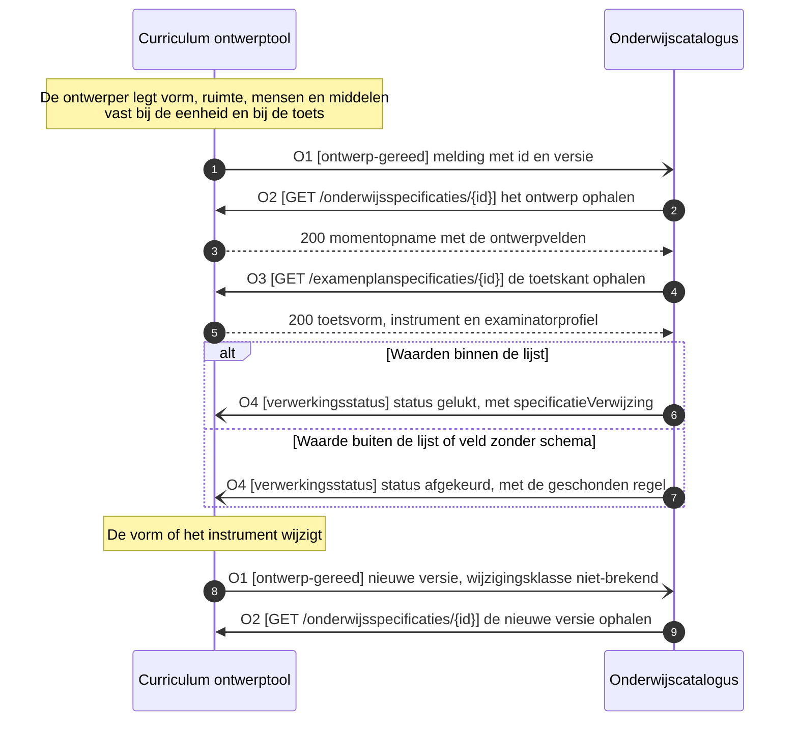

# IS-OA-02: het onderwijs- en examenontwerp naar de onderwijscatalogus

Deze eenheid levert de uitvoeringskenmerken van het ontwerp aan de onderwijscatalogus: de onderwijsvorm, het ruimtetype, de expertiseprofielen van docent en examinator, de verdeling van de studiebelasting, de toetsvorm en het toetsinstrument, elk als veld op de specificatie die [IS-OA-01](README.md#de-kiesbare-eenheden) al draagt.

## De eenheid

| | |
|---|---|
| Bronsysteem | Curriculum ontwerptool, applicatiedienst `Curriculum ontwerp` |
| Doelsysteem | Onderwijscatalogus |
| Koppeling | Curriculum ontwerptool naar onderwijscatalogus. De [dienstpagina van de ontwerptool](https://github.com/Npuls-OKx/Public/blob/dev/Koppelvlakspecificaties/Applicatiecomponenten/curriculum-ontwerptool.md) laat de endpoints aan een volgend pakket, [ADR 0020](https://github.com/Npuls-OKx/Public/blob/dev/Referentiemateriaal/adr/0020-curriculumontwerp-onderwijscatalogus-happy-flow-synchronisatie-en-federatie-adopt-klonen.md) legt de richting vast |
| Beeld | [F1-13, het onderwijs- en examenontwerp mee naar de catalogus](../../../model/informatiemodel/img/regels/f1-13-het-onderwijs-en-examenontwerp-mee-naar-de-catalogus-conceptplaat.svg), van de conceptplaat Onderwijsontwerp |
| Status | Voorstel. Elke regel achter F1-13 draagt een aanname, en de objecttypen komen van de conceptplaat ([voorbeeld-lr1-regels.json](../../../model/informatiemodel/voorbeeld-lr1-regels.json)) |
| Applicatiedienst | `Onderwijs beheer` van de onderwijscatalogus neemt de lading aan, gevoed door `Curriculum ontwerp` van de ontwerptool ([componenten.json](../../../model/informatiemodel/componenten.json)) |
| Toetsbare eis | De ontwerptool levert per onderwijseenheid- en leeronderdeelspecificatie de velden uit [de berichtspecificatie](#de-berichtspecificatie) over de operaties uit [de operaties](#de-operaties), en de catalogus neemt ze onveranderd over met O2 en O3 |


Dezelfde waarden gaan in [F2-03](../../../model/informatiemodel/img/regels/f2-03-verzoek-met-specificatiestructuur-en-planbare-waarden-naar-planning.svg) door naar planning, en de knelpuntcodes `expertiseTekort` en `ruimteTekort` uit de [regels bij de schema's](https://github.com/Npuls-OKx/Public/blob/dev/Informatie-en-gegevensmodellen/regels.md) veronderstellen ze. Daarom landen zij hier als veld op de specificatie.

## De stroom



## De operaties

Deze lading rijdt mee op de operaties van dezelfde koppeling, die [IS-OA-01](README.md#de-kiesbare-eenheden) voluit beschrijft: de ontwerptool houdt het ontwerp in bewerking vast en meldt dat het gereed is, waarna de catalogus het ophaalt ([U3](https://github.com/Npuls-OKx/Public/blob/dev/Koppelvlakspecificaties/uitgangspunten.md#u3-resource-eigenaarschap) en [U4](https://github.com/Npuls-OKx/Public/blob/dev/Koppelvlakspecificaties/uitgangspunten.md#u4-notify-then-pull)). Hieronder staat wat elke operatie voor deze lading draagt. Authenticatie per operatie volgt de [auth-standaard](https://github.com/Npuls-OKx/Public/blob/dev/Koppelvlakspecificaties/auth-standaard.md).

| Nr | Pad of meldpatroon (webhook), en waar het staat | Methode | Parameters | Statuscodes | Foutgedrag | Grond |
|---|---|---|---|---|---|---|
| O1 | `ontwerp-gereed` op OC | POST | geen | 200 | Bevestiging met 200. Zonder bevestiging herhaalt de melder met oplopende wachttijd (backoff) en daarna via het dead-letterpad. Een herhaald event blijft zonder extra effect door het event-id ([ADR 0018](https://github.com/Npuls-OKx/Public/blob/dev/Referentiemateriaal/adr/0018-enterprise-messaging-patronen-voor-betrouwbare-koppelvlakken.md)) | WB-07, ADR 0020 (melden dat het ontwerp gereed is) |
| O2 | `/onderwijsspecificaties/{id}` op CO, pad en schema in Public bij de [onderwijscatalogus](https://github.com/Npuls-OKx/Public/blob/dev/Koppelvlakspecificaties/Applicatiecomponenten/onderwijscatalogus.md) | GET | `versie` (optioneel, standaard de laatst vastgestelde) | 200, 400, 404 | Alleen-lezen en zonder neveneffect. 404 bij een onbekend id, 400 bij een onbekende versie. De wijziging staat als delta op `/onderwijsspecificaties/{id}/delta` ([U11](https://github.com/Npuls-OKx/Public/blob/dev/Koppelvlakspecificaties/uitgangspunten.md#u11-toekomstvaste-endpoints-volledige-structuur-en-delta)) | WB-07 voor het pad op CO en het gebruiksprofiel |
| O3 | `/examenplanspecificaties/{id}` op CO, pad en schema in Public bij de onderwijscatalogus | GET | `versie` (optioneel, standaard de laatst vastgestelde) | 200, 400, 404 | Als O2 | WB-07 voor het pad op CO |
| O4 | `verwerkingsstatus` op CO, payload [processing-status.json](https://github.com/Npuls-OKx/Public/blob/dev/Informatie-en-gegevensmodellen/schemas/processing-status.json) met `opleidingsaanbodId` leeg | POST | geen | 200 | `afgekeurd` draagt de geschonden regel met het veld en de waarde die de controle raakte, waarna de vorige versie blijft staan. Herhaling als O1 | WB-07, ADR 0020 (statusfeedback) |

De vier staan als voorstel: ADR 0020 vraagt operaties voor aanleggen, uitwerken, publiceren en wijzigen met statusfeedback naar de ontwerptool, en legt het publicatiebesluit bij de catalogus.

## De berichtspecificatie

Waar de lading van F1-13 landt, van de conceptplaat naar het [informatiemodel](../../../model/informatiemodel/informatiemodel.md) en het schema:

| Objecttype op de conceptplaat | Objecttype in het informatiemodel | Veld vandaag | Vervolg |
|---|---|---|---|
| `Onderwijsvorm specificatie` | `Onderwijsvorm` (ontwerpkeuze 18, voorstel) | `toelichting` draagt de leesbare vorm | WB-01 voor het gecodeerde veld |
| `Gewenste Onderwijskundige Leeromgeving` | `Onderwijslocatie type` (OEAPI `roomType`) | geen | WB-02 |
| `Gewenst medewerker competentieprofiel` | `Expertise of functieprofiel` | geen | WB-03, WB-04 |
| `Studiebelasting en begeleide onderwijstijd indicatie` | attribuut van de specificatie | `studielast`, `tijdsverdeling` | WB-05 voor de verdeling per deel |
| `Toetsvormspecificatie` | `Toetsonderdeel specificatie` | `toetsvorm` in result-structure.json | aanwezig |
| `Toetsinstrument`, een `Collectie van Leermiddelgroepen` | zonder objecttype | geen | WB-06 |

### Bericht 1: de ontwerpvelden op de onderwijsspecificatie

Per onderwijseenheid- of leeronderdeelspecificatie in [education-specification.json](https://github.com/Npuls-OKx/Public/blob/dev/Informatie-en-gegevensmodellen/schemas/education-specification.json).

| Veld | Type | Kardinaliteit | Verplicht | Objecttype | Grond |
|---|---|---|---|---|---|
| `onderwijsvorm` | string, open lijst | 0..1 | nee | `Onderwijsvorm` | WB-01, F1-13 |
| `onderwijslocatieType` | string, open lijst | 0..1 | nee | `Onderwijslocatie type` | WB-02, F1-13 |
| `expertiseprofielIds` | array van uuid | 0..n | nee | `Expertise of functieprofiel` | WB-04, F1-13 |
| `studielast` | object, [volume.json](https://github.com/Npuls-OKx/Public/blob/dev/Informatie-en-gegevensmodellen/schemas/volume.json) | 1..1 | ja | attribuut van de specificatie | education-specification.json |
| `tijdsverdeling` | string, open lijst BOT, OOT, BPV | 0..1 | nee | attribuut van de specificatie | education-specification.json |
| `tijdsverdelingen` | array van object met `tijdsverdeling` en `omvang` | 0..n | nee | attribuut van de specificatie | WB-05, F1-13 en F2-01 |
| `toelichting` | string | 0..1 | nee | attribuut van de specificatie | education-specification.json |

### Bericht 2: de ontwerpvelden op het toetsonderdeel

Per toetsonderdeelspecificatie in [result-structure.json](https://github.com/Npuls-OKx/Public/blob/dev/Informatie-en-gegevensmodellen/schemas/result-structure.json).

| Veld | Type | Kardinaliteit | Verplicht | Objecttype | Grond |
|---|---|---|---|---|---|
| `toetsvorm` | string, open lijst | 0..1 | nee | `Toetsonderdeel specificatie` | result-structure.json |
| `onderwijslocatieType` | string, open lijst | 0..1 | nee | `Onderwijslocatie type` | WB-02, F1-13 |
| `toetsinstrumentId` | uuid | 0..1 | nee | `Toetsinstrument`, conceptplaat | WB-06, F1-13 |
| `expertiseprofielIds` | array van uuid | 0..n | nee | `Expertise of functieprofiel` | WB-04, F1-13 |

### Bericht 3: het expertiseprofiel en het toetsinstrument

Beide staan als eigen array naast `onderwijsspecificaties`, net als `regelsets` in beide schema's.

| Veld | Type | Kardinaliteit | Verplicht | Objecttype | Grond |
|---|---|---|---|---|---|
| `expertiseprofielen[].id` | uuid | 1..1 | ja | `Expertise of functieprofiel` | WB-03, [U7](https://github.com/Npuls-OKx/Public/blob/dev/Koppelvlakspecificaties/uitgangspunten.md#u7-payload-plat-met-verwijzingen-en-de-sleutelconventie) |
| `expertiseprofielen[].naam` | string | 1..1 | ja | `Expertise of functieprofiel` | WB-03, F1-13 |
| `expertiseprofielen[].rol` | string, open lijst docent, examinator, praktijkbegeleider | 0..1 | nee | `Expertise of functieprofiel` | WB-03, F1-13 |
| `expertiseprofielen[].competenties` | array van string | 0..n | nee | `Competenties / Skills`, scope buiten | WB-03, F1-06 |
| `toetsinstrumenten[].id` | uuid | 1..1 | ja | `Toetsinstrument`, conceptplaat | WB-06, [U7](https://github.com/Npuls-OKx/Public/blob/dev/Koppelvlakspecificaties/uitgangspunten.md#u7-payload-plat-met-verwijzingen-en-de-sleutelconventie) |
| `toetsinstrumenten[].naam` | string | 1..1 | ja | `Toetsinstrument`, conceptplaat | WB-06, F1-13 |

## Voorbeeldpayload

Casus Apothekersassistent, kwalificatiedossier 23450, met de instantiewaarden uit F1-13. De uuid's van de specificaties komen uit de [voorbeeldpayloads](https://github.com/Npuls-OKx/Public/blob/dev/Informatie-en-gegevensmodellen/voorbeeldpayloads.md), de namen uit het beeld, en de profielen en het instrument dragen een voorbeeld-uuid. De ontwerpvelden komen additief bovenop de grofmazige specificatie van IS-OA-01, dus loopt de versie van `0.1.0` naar `0.2.0`.

De specificatiekant, het antwoord op O2:

```json
{
  "onderwijsspecificaties": [
    {
      "id": "402c2342-d897-4df4-a667-7fc5bd930944",
      "specificatieType": "onderwijseenheidspecificatie",
      "versie": "0.2.0",
      "bovenliggendSpecificatieId": "7ae25c1e-ee27-43a2-a001-761ee39ea5c7",
      "leeruitkomstId": "12301838-92d4-4040-aea2-050bb131ceb7",
      "naam": "Blok B1-K1, biedt farmaceutische patientenzorg",
      "studielast": { "waarde": 2000, "eenheid": "SBU" },
      "onderwijsvorm": "simulatie",
      "onderwijslocatieType": "skillslab",
      "expertiseprofielIds": ["8e1dcda7-ef4e-45d0-931a-e47c3c77ddef"],
      "toelichting": "Simulatie in de leerapotheek, theorie ondersteunend"
    },
    {
      "id": "327c8263-3516-4b5a-8d57-c16241ec008d",
      "specificatieType": "leeronderdeelspecificatie",
      "versie": "0.2.0",
      "bovenliggendSpecificatieId": "402c2342-d897-4df4-a667-7fc5bd930944",
      "leeruitkomstId": "78f25d62-9fd4-45c4-aa04-3d22f59213f5",
      "naam": "Baliegesprekken 101",
      "studielast": { "waarde": 600, "eenheid": "SBU" },
      "tijdsverdelingen": [
        { "tijdsverdeling": "BOT", "omvang": { "waarde": 300, "eenheid": "SBU" } },
        { "tijdsverdeling": "OOT", "omvang": { "waarde": 300, "eenheid": "SBU" } }
      ],
      "onderwijsvorm": "simulatie",
      "onderwijslocatieType": "skillslab",
      "expertiseprofielIds": ["8e1dcda7-ef4e-45d0-931a-e47c3c77ddef"],
      "toelichting": "Balie-simulatie in het skillslab, theorie ondersteunend"
    }
  ],
  "expertiseprofielen": [
    {
      "id": "8e1dcda7-ef4e-45d0-931a-e47c3c77ddef",
      "naam": "Apothekersassistent-docent met baliepraktijk",
      "rol": "docent",
      "competenties": [
        "didactische en communicatieve vaardigheden (CompetentNL laag 2)",
        "farmacie (ISCED-F 0916)"
      ]
    }
  ]
}
```

De toetskant, het antwoord op O3:

```json
{
  "onderwijsspecificaties": [
    {
      "id": "941f180d-b0af-4933-a580-6ab654dfadda",
      "specificatieType": "toetsonderdeelspecificatie",
      "versie": "0.2.0",
      "bovenliggendSpecificatieId": "0512c773-9c1b-42c4-ae0d-9af8554f2462",
      "leeruitkomstId": "12301838-92d4-4040-aea2-050bb131ceb7",
      "leeruitkomst": { "type": "kerntaak", "code": "B1-K1" },
      "naam": "Proeve van bekwaamheid farmaceutische patientenzorg",
      "aard": "summatief",
      "toetsvorm": "proeveVanBekwaamheid",
      "weging": 2,
      "resultaatmodel": { "schaal": "cijfer-1-10", "cesuur": 5.5, "decimalen": 1 },
      "verplicht": true,
      "status": "concept",
      "onderwijslocatieType": "skillslab",
      "toetsinstrumentId": "da138f60-ebb1-4853-870f-7e7d642873f2",
      "expertiseprofielIds": ["4037f1a2-c182-4f2d-ae00-bfb06b076337"],
      "omschrijving": "Proeve van bekwaamheid in de simulatieapotheek"
    }
  ],
  "expertiseprofielen": [
    {
      "id": "4037f1a2-c182-4f2d-ae00-bfb06b076337",
      "naam": "Examinator met baliepraktijk en toetsbekwaamheid",
      "rol": "examinator",
      "competenties": ["farmacie (ISCED-F 0916)", "toetsbekwaamheid"]
    }
  ],
  "toetsinstrumenten": [
    {
      "id": "da138f60-ebb1-4853-870f-7e7d642873f2",
      "naam": "Beoordelingsformulier met rubric"
    }
  ]
}
```

## De werkbrieven

De versie-impact volgt de versionering uit de [regels bij de schema's](https://github.com/Npuls-OKx/Public/blob/dev/Informatie-en-gegevensmodellen/regels.md): een additief veld is MINOR, en een wijziging van de uitvoeringsvorm draagt wijzigingsklasse `niet-brekend`.

| Nr | Wat erbij komt | Waar | Versie-impact | Grond |
|---|---|---|---|---|
| WB-01 | Veld `onderwijsvorm`, string uit een open lijst met simulatie, theorie, praktijk, beroepspraktijkvorming en zelfstudie | education-specification.json | Additief optioneel veld, MINOR op het releasepakket | F1-13 en F2-03 dragen `Onderwijsvorm specificatie`, het informatiemodel kent `Onderwijsvorm` als voorstel en de [begrippenlijst](../begrippen/begrippenlijst.md) houdt het zonder definitie |
| WB-02 | Veld `onderwijslocatieType`, string uit een open lijst per ruimtesoort. F1-13 noemt het skillslab, F2-01 de praktijkruimte, dus beide krijgen een eigen waarde | education-specification.json en result-structure.json | Additief optioneel veld, MINOR | Knelpuntcode `ruimteTekort` veronderstelt het ruimtetype, `Onderwijslocatie type` staat zonder definitie |
| WB-03 | Schema voor het expertiseprofiel met `id`, `naam`, `rol` en `competenties`, plus de array `expertiseprofielen` naast `regelsets` in beide payloads | nieuw bestand in [schemas/](https://github.com/Npuls-OKx/Public/tree/dev/Informatie-en-gegevensmodellen/schemas) | Nieuw schema met een additieve array, MINOR | Knelpuntcode `expertiseTekort` veronderstelt het profiel, `Expertise of functieprofiel` aggregeert `Competenties / Skills` en staat zonder definitie |
| WB-04 | Veld `expertiseprofielIds`, array van uuid | education-specification.json en result-structure.json | Additief optioneel veld, MINOR | F1-13 hangt `Gewenst medewerker competentieprofiel` aan de onderwijsvorm en aan de toetsvorm |
| WB-05 | Veld `tijdsverdelingen`, array van `tijdsverdeling` met `omvang` uit volume.json, naast het bestaande enkelvoudige `tijdsverdeling` | education-specification.json | Additief optioneel veld, MINOR. Het enkelvoudige veld blijft geldig zolang de koppeling open staat | F1-13 en F2-01 noemen BOT 50 en OOT 50 SBU, een verdeling over twee delen, waar het schema vandaag een waarde draagt |
| WB-06 | Veld `toetsinstrumentId` plus de plek van het instrument zelf: een eigen schema met de array `toetsinstrumenten`, of de leermiddelkoppeling-payload | result-structure.json, en het besluit over de leermiddelkoppeling-payload | Nieuw schema met een additief veld, MINOR. De route via de leermiddelkoppeling raakt het meldpatroon `leermiddelkoppeling-beschikbaar` op de catalogus | F1-13 draagt `Toetsinstrument` als `Collectie van Leermiddelgroepen`, het informatiemodel kent dat objecttype als voorstel van de conceptplaat en de leermiddelkoppeling-payload staat open |
| WB-07 | De meldpatronen O1 en O4, de paden van O2 en O3 op de ontwerptool, en het gebruiksprofiel van deze koppeling: welk deel van de payload over O2 en O3 meekomt | [curriculum-ontwerptool.md](https://github.com/Npuls-OKx/Public/blob/dev/Koppelvlakspecificaties/Applicatiecomponenten/curriculum-ontwerptool.md) en [onderwijscatalogus.md](https://github.com/Npuls-OKx/Public/blob/dev/Koppelvlakspecificaties/Applicatiecomponenten/onderwijscatalogus.md), plus [gebruiksprofielen.md](https://github.com/Npuls-OKx/Public/blob/dev/Informatie-en-gegevensmodellen/gebruiksprofielen.md) | Nieuwe endpoints en een nieuw profiel, MINOR op het koppelvlakpakket | ADR 0020 vraagt operaties voor aanleggen, uitwerken, publiceren en wijzigen met statusfeedback naar de ontwerptool |
| WB-08 | Toetskenmerken naast de toetsvorm: afnamevorm, toetsduur, hulpmiddelen en aantal pogingen | result-structure.json | Additieve optionele velden, MINOR | Bevinding B04 bij F1-09 van de leverancierslezing, issue 283 |
| WB-09 | Het besluit op welk niveau de onderwijsvorm landt: de leeronderdeelspecificatie, of de gewenste leergelegenheid die de catalogus uit geclusterde leeronderdelen vormt | education-specification.json, samen met WB-01 | Een verschuiving van het niveau raakt WB-01 voordat die vastligt, daarna brekend voor de afnemer | Bevinding B06 bij F2-01 legt het rijpheidskenmerk planbaar op de gewenste leergelegenheid en het inhoudelijk clusteren bij de catalogus, issue 284 |

Alle overige lading van fase 1, van de leeruitkomst tot de resultaatstructuur, draagt [IS-OA-01](README.md#de-kiesbare-eenheden).
