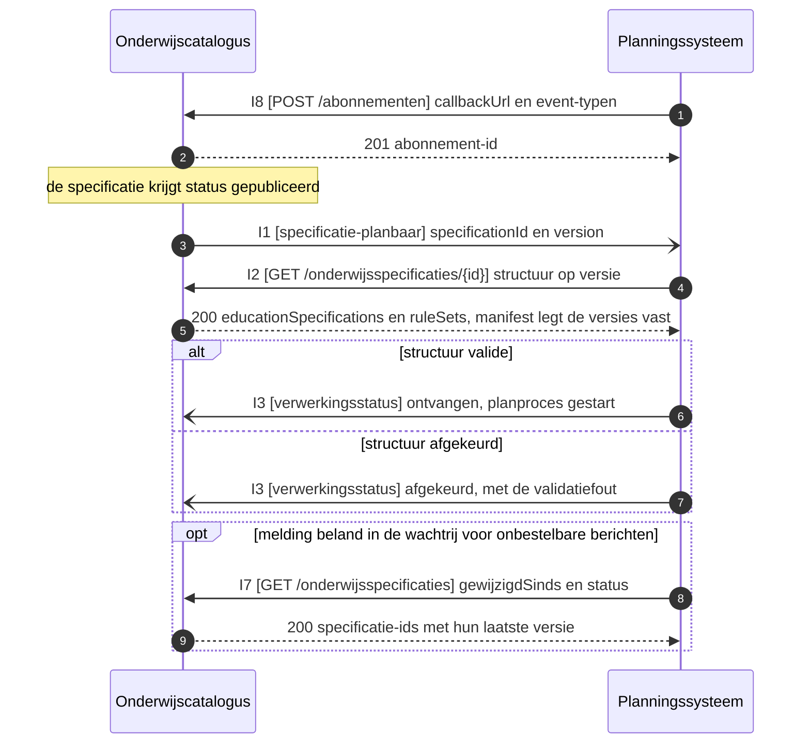

# IS-OA-03, het verzoek tot aanbod naar het planningssysteem

Deze eenheid levert het planningssysteem de planbare specificatiestructuur van een opleiding met haar planbare waarden, als verzoek om daarvan onderwijsaanbod te maken.

De uuid's, de versies en de namen in de voorbeeldpayloads hieronder komen uit [casus.md](casus.md), de vaste identificaties van deze interactiespecificatie. De specificatie die deze eenheid planbaar meldt is dezelfde als die waarop [IS-OA-04](stroom-is-oa-04.md) het aanbod terugmeldt, op dezelfde uuid en dezelfde versie.

## De eenheid

| | |
|---|---|
| Bronsysteem | Onderwijscatalogus, bezitter van de onderwijsspecificaties ([U3](https://github.com/Npuls-OKx/Public/blob/dev/Koppelvlakspecificaties/uitgangspunten.md#u3-resource-eigenaarschap)) |
| Doelsysteem | Planningssysteem, bezitter van het onderwijsaanbod |
| Koppeling | OC-P&R, interactie I1, I2, I3, I7 en I8 van het [interactiepatroon onderwijscatalogus naar planning en roostering](https://github.com/Npuls-OKx/Public/blob/dev/Koppelvlakspecificaties/Interactiepatronen/onderwijscatalogus-planning-en-roostering.md) |
| Beeld | [F2-03](../../../model/informatiemodel/img/regels/f2-03-verzoek-met-specificatiestructuur-en-planbare-waarden-naar-planning.svg), met de regels in [voorbeeld-lr1-regels.json](../../../model/informatiemodel/voorbeeld-lr1-regels.json) |
| Status | Gespecificeerd: het interactiepatroon draagt de endpoints en de meldpatronen (webhooks), elk schema staat op alfa |
| Applicatiedienst | `Onderwijsspecificatie uitwerking` op de onderwijscatalogus ontsluit de structuur, `(meer) jaar capaciteit planning` en `Periode planning` op het planningssysteem nemen haar aan (hoofdplaat v1.7) |

De lading: het verzoek tot aanbod voor cohort 2026, met de opleiding, haar programma, de eenheden en hun leeronderdelen, en per specificatie de leeruitkomst waarnaar zij verwijst. De planbare waarden uit het onderwijsontwerp staan in [werkbrief](#werkbrieven) W2 tot en met W7.

## De stroom



Het planproces loopt daarna los van deze aanroep. De uitkomst, met de verwijzing naar het `Opleiding aanbod`, komt terug in [IS-OA-04](README.md#de-kiesbare-eenheden), op dezelfde `specificationId` en `version` als deze melding.

## Functionele eisen

De eisen komen uit het interactiepatroon OC-P&R. Een instelling citeert het eis-id en toetst op de genoemde operaties.

| Id | Eis | Operaties | Toetsgeval |
|---|---|---|---|
| [functionele-eis-0001](https://github.com/Npuls-OKx/Public/blob/dev/Koppelvlakspecificaties/Interactiepatronen/onderwijscatalogus-planning-en-roostering.md#functionele-eis-0001) | De onderwijscatalogus laat het planningssysteem weten dat een specificatie gereed is om te plannen, waarna het planningssysteem een opleidingsaanbod met referentie teruglevert | O1, O2, O4 | Een specificatie die status `gepubliceerd` krijgt levert een melding op, en de daaropvolgende opvraag geeft dezelfde `specificationId` en `version` terug |
| [functionele-eis-0002](https://github.com/Npuls-OKx/Public/blob/dev/Koppelvlakspecificaties/Interactiepatronen/onderwijscatalogus-planning-en-roostering.md#functionele-eis-0002) | Het planningssysteem werkt de planning bij wanneer een specificatie wijzigt, met de wijziging of de volledige structuur als keuze voor de ontvanger ([U11](https://github.com/Npuls-OKx/Public/blob/dev/Koppelvlakspecificaties/uitgangspunten.md#u11-toekomstvaste-endpoints-volledige-structuur-en-delta)) | O2, O3 | Beide vormen staan op dezelfde resource: de volledige structuur op `{id}` en de wijziging op `{id}/delta` tussen twee versies |
| [functionele-eis-0006](https://github.com/Npuls-OKx/Public/blob/dev/Koppelvlakspecificaties/Interactiepatronen/onderwijscatalogus-planning-en-roostering.md#functionele-eis-0006) | Beide partijen halen de informatie na een gemiste melding alsnog op | O5 | Een opvraag met `gewijzigdSinds` op een tijdstip voor de gemiste melding geeft de betrokken specificatie terug |
| [functionele-eis-0007](https://github.com/Npuls-OKx/Public/blob/dev/Koppelvlakspecificaties/Interactiepatronen/onderwijscatalogus-planning-en-roostering.md#functionele-eis-0007) | Beide partijen leggen een afleveradres vast voordat meldingen worden afgeleverd | O6 | Een tweede registratie op dezelfde `callbackUrl` en hetzelfde event-type overschrijft de eerste, zodat dat adres de melding langs een enkele registratie ontvangt |

Eis 0003 en 0004 landen op IS-OA-04, eis 0005 op de statusmelding die naast deze eenheid loopt.

## Operaties

Authenticatie op elk endpoint volgt de [auth-standaard](https://github.com/Npuls-OKx/Public/blob/dev/Koppelvlakspecificaties/auth-standaard.md). Elke GET is alleen-lezen en geeft bij herhaling hetzelfde resultaat.

| Nr | Operatie | Pad of event, en wie het implementeert | Methode | Parameters | Statuscodes | Foutgedrag |
|---|---|---|---|---|---|---|
| O1 | Melden dat de specificatie planbaar is (I1) | `specificatie-planbaar`, meldpatroon op het planningssysteem | POST | de lading is de [specificatie-referentie](#bericht-1-specificatie-planbaar) | 200 | Blijft de bevestiging uit, dan opnieuw aanbieden met oplopende wachttijd (backoff) en daarna de wachtrij voor onbestelbare berichten (dead letter channel). Een tweede aflevering van dezelfde `specificationId` en `version` wijst hetzelfde verzoek aan, waarop het planningssysteem die aflevering herkent (herhaalbaar zonder extra effect, idempotent); werkbrief W13 belegt een eigen `eventId` |
| O2 | De volledige structuur ophalen (I2) | `/onderwijsspecificaties/{id}`, op de onderwijscatalogus | GET | `versie`, optioneel, standaard de laatst gepubliceerde | 200, 400, 404 | HTTP-foutcode, de aanroeper bepaalt het herhalen |
| O3 | De wijziging ophalen (I2) | `/onderwijsspecificaties/{id}/delta`, op de onderwijscatalogus | GET | `van` en `naar`, beide een versie en beide verplicht | 200, 400, 404 | HTTP-foutcode. Het antwoord volgt JSON Patch (RFC 6902) |
| O4 | De ontvangst en de afkeur terugmelden (I3) | `verwerkingsstatus`, meldpatroon op de onderwijscatalogus | POST | de lading is de [verwerkingsstatus](#bericht-3-verwerkingsstatus) met status `ontvangen`, `gestart` of `afgekeurd` | 200 | Zoals O1. Een afgekeurde structuur komt langs deze weg terug, waarbij O2 beschikbaar blijft voor een nieuwe poging |
| O5 | Herstellen na een gemiste melding (I7) | `/onderwijsspecificaties`, op de onderwijscatalogus | GET | `status`, optioneel, standaard `gepubliceerd`. `gewijzigdSinds`, optioneel, een tijdstempel | 200, 400 | HTTP-foutcode. Bedoeld voor herstel, waarbij de reguliere stroom meldinggedreven blijft |
| O6 | Het afleveradres vastleggen (I8) | `/abonnementen`, op de onderwijscatalogus, die de abonnementen op haar eigen meldingen aanneemt | POST | de lading is het [abonnement](#bericht-4-abonnement) | 201, 400 | HTTP-foutcode. Herhaalbaar zonder extra effect (idempotent) op `callbackUrl` plus event-type: herregistratie overschrijft de vorige |

Werkbrief W8 belegt het veld voor de validatiefout bij `afgekeurd` in processing-status.json.

## Berichtspecificatie

Elk veld komt uit een schema in [Informatie-en-gegevensmodellen/schemas](https://github.com/Npuls-OKx/Public/tree/dev/Informatie-en-gegevensmodellen/schemas). De sleutel in de payload draagt de Engelse naam uit het schema, met de Nederlandse naam uit [mapping.md](https://github.com/Npuls-OKx/Public/blob/dev/Informatie-en-gegevensmodellen/mapping.md) in de kolom ernaast; enumwaarden blijven Nederlands. De objecttypen komen uit het [informatiemodel OKx](../../../model/informatiemodel/informatiemodel.md), met de definities in de [begrippenlijst](../begrippen/begrippenlijst.md).

### Bericht 1, specificatie-planbaar

Schema [specification-reference.json](https://github.com/Npuls-OKx/Public/blob/dev/Informatie-en-gegevensmodellen/schemas/specification-reference.json). Dit bericht draagt het `Verzoek tot Aanbod / Intekening op specificatie`, met de referentie als enige inhoud ([U4](https://github.com/Npuls-OKx/Public/blob/dev/Koppelvlakspecificaties/uitgangspunten.md#u4-notify-then-pull)).

| Veld | Nederlandse naam | Type | Kardinaliteit | Verplicht | Objecttype |
|---|---|---|---|---|---|
| `specificationId` | `specificatieId` | string, uuid | 1 | ja | `Opleiding specificatie` of `Opleidingsprogramma specificatie`, de specificatie die planbaar is |
| `version` | `versie` | string | 1 | ja | idem |

### Bericht 2, de onderwijsspecificatiestructuur

Schema [education-specification.json](https://github.com/Npuls-OKx/Public/blob/dev/Informatie-en-gegevensmodellen/schemas/education-specification.json), met het [gebruiksprofiel](https://github.com/Npuls-OKx/Public/blob/dev/Informatie-en-gegevensmodellen/gebruiksprofielen.md) voor deze koppeling.

| Veld | Nederlandse naam | Type | Kardinaliteit | Verplicht | Objecttype |
|---|---|---|---|---|---|
| `educationSpecifications` | `onderwijsspecificaties` | array | 1..n | ja | de specificatietypen uit de tabel hieronder |
| `ruleSets` | `regelsets` | array | 0..n | nee | `Student keuze regelset` |
| `learningOutcomes` | `leeruitkomsten` | array | 0 | nee | `Leeruitkomst`. Het gebruiksprofiel laat de inhoud bij de koppelingen die haar nodig hebben ([ADR 0026](https://github.com/Npuls-OKx/Public/blob/dev/Referentiemateriaal/adr/0026-leeruitkomst-als-verbindende-sleutel.md)) |

Per element van `educationSpecifications`:

| Veld | Nederlandse naam | Type | Kardinaliteit | Verplicht | Objecttype |
|---|---|---|---|---|---|
| `id` | `id` | string, uuid | 1 | ja | het type dat `specificationType` aanwijst |
| `specificationType` | `specificatieType` | enum, waarden in de tabel hieronder | 1 | ja | idem |
| `version` | `versie` | string, patroon `n.n.n` | 1 | ja | idem |
| `parentSpecificationId` | `bovenliggendSpecificatieId` | string, uuid of null | 1 | ja | de aggregatie tussen twee specificatietypen |
| `name` | `naam` | string | 1 | ja | het type dat `specificationType` aanwijst |
| `studyLoad` | `studielast` | [volume.json](https://github.com/Npuls-OKx/Public/blob/dev/Informatie-en-gegevensmodellen/schemas/volume.json): `value` (waarde) en `unit` (eenheid) SBU of EC | 1 | ja | idem |
| `learningOutcomeId` | `leeruitkomstId` | string, uuid | 0..1 | nee | `Leeruitkomst`, als verbindende sleutel |
| `description`, `explanation` | `omschrijving`, `toelichting` | string | 0..1 | nee | het type dat `specificationType` aanwijst |
| `status` | `status` | enum: concept, vastgesteld, gepubliceerd, gedeactiveerd, vervallen, gearchiveerd | 0..1 | nee | idem |
| `curriculumType` | `curriculumtype` | enum: nominaal, hybride, flexibel | 0..1 | nee | `Opleiding specificatie`, `Opleidingsprogramma specificatie` |
| `programmeType` | `programmatype` | string, open lijst | 0..1 | nee | `Opleidingsprogramma specificatie` |
| `programmeLayer` | `programmaLaag` | enum: leerweg, doelgroep | 0..1 | nee | idem |
| `learningPathway` | `leerweg` | enum: BOL, BBL | 0..1 | nee | idem |
| `targetGroup` | `doelgroep` | string, open lijst | 0..1 | nee | idem |
| `electiveUnitClass` | `keuzedeelKlasse` | string, open lijst | 0..1 | nee | `Keuzedeel` |
| `cohort` | `cohort` | string | 0..1 | nee | `Cohort / periode` |
| `startDate`, `validFrom`, `validUntil` | `startdatum`, `geldigVanaf`, `geldigTot` | string, datum | 0..1 | nee | het type dat `specificationType` aanwijst |
| `timeDistribution` | `tijdsverdeling` | string, open lijst: BOT, OOT, BPV | 0..1 | nee | `Leeronderdeel specificatie` |
| `organisation` | `organisatie` | [organisation-unit.json](https://github.com/Npuls-OKx/Public/blob/dev/Informatie-en-gegevensmodellen/schemas/organisation-unit.json) | 0..1 | nee | `Organisatie-eenheid` |
| `ruleSetReferences` | `regelsetVerwijzingen` | array van uuid | 0..n | nee | `Student keuze regelset` |
| `manifest` | `manifest` | array van [manifest-item.json](https://github.com/Npuls-OKx/Public/blob/dev/Informatie-en-gegevensmodellen/schemas/manifest-item.json): `specificationId`, `version`, `relation` | 0..n | nee | legt per onderdeel de versie vast waarop de planning rust |

De waarden van `specificationType` slaan terug op deze objecttypen:

| Waarde | Objecttype |
|---|---|
| `opleidingsspecificatie` | `Opleiding specificatie` |
| `opleidingsprogrammaspecificatie` | `Opleidingsprogramma specificatie`, en voor een keuzedeelprogramma `Keuzedeel` |
| `onderwijseenheidspecificatie` | `Onderwijseenheid specificatie` |
| `leeronderdeelspecificatie` | `Leeronderdeel specificatie` |
| `keuzedeelruimtespecificatie` | `Keuzedeelruimte` |
| `toetsonderdeelspecificatie` | `Toetsonderdeel specificatie` |
| `examenplanspecificatie` | `Examenplan`, dat buiten de kolommen van het informatiemodel staat |
| `resultaateenheidspecificatie` | werkbrief W11 belegt het objecttype |

Per element van `ruleSets`, schema [rule-set.json](https://github.com/Npuls-OKx/Public/blob/dev/Informatie-en-gegevensmodellen/schemas/rule-set.json):

| Veld | Nederlandse naam | Type | Kardinaliteit | Verplicht | Objecttype |
|---|---|---|---|---|---|
| `id`, `version`, `name` | `id`, `versie`, `naam` | string, `id` als uuid | 1 | ja | `Student keuze regelset` |
| `description` | `omschrijving` | string | 0..1 | nee | idem |
| `appliesTo` | `vanToepassingOp` | string, uuid | 1 | ja | `Keuzedeelruimte`, de specificatie waarop de regelset geldt |
| `rules` | `regels` | array van object | 1..n | ja | `Student keuze regelset`. Werkbrief W9 belegt de regelvorm |

### Bericht 3, verwerkingsstatus

Schema [processing-status.json](https://github.com/Npuls-OKx/Public/blob/dev/Informatie-en-gegevensmodellen/schemas/processing-status.json). Binnen deze eenheid draagt het de waarden `ontvangen`, `gestart` en `afgekeurd`.

| Veld | Nederlandse naam | Type | Kardinaliteit | Verplicht | Objecttype |
|---|---|---|---|---|---|
| `status` | `status` | enum: ontvangen, gestart, afgekeurd, gelukt, nietGelukt | 1 | ja | `Verzoek tot Aanbod / Intekening op specificatie` |
| `specificationReference` | `specificatieVerwijzing` | specification-reference.json | 1 | ja | `Opleiding specificatie` of `Opleidingsprogramma specificatie` |
| `programmeOfferingId` | `opleidingsaanbodId` | string, uuid of null | 0..1 | nee | `Opleiding aanbod`, gevuld bij `gelukt` en daarmee de overgang naar IS-OA-04 |

### Bericht 4, abonnement

Schema [subscription.json](https://github.com/Npuls-OKx/Public/blob/dev/Informatie-en-gegevensmodellen/schemas/subscription.json). Dit bericht richt het kanaal in en vervalt zodra de aflevering over een bus of broker loopt ([U5](https://github.com/Npuls-OKx/Public/blob/dev/Koppelvlakspecificaties/uitgangspunten.md#u5-bericht-versus-kanaal)).

| Veld | Nederlandse naam | Type | Kardinaliteit | Verplicht | Objecttype |
|---|---|---|---|---|---|
| `callbackUrl` | `callbackUrl` | string, uri | 1 | ja | inrichting van de koppeling |
| `events` | `events` | array, enum: specificatie-planbaar, specificatie-gewijzigd, specificatie-status-gewijzigd, verwerkingsstatus | 1..n | ja | inrichting van de koppeling |
| `id` | `id` | string, uuid | 0..1 | toegekend in de respons | inrichting van de koppeling |

## Voorbeeldpayload

Casus Apothekersassistent, kwalificatiedossier crebo 23450, met de instantiewaarden uit beeld F2-03. De melding van O1:

```json schema=specification-reference
{
  "specificationId": "79736830-1c5c-470f-b2c2-005029c96733",
  "version": "0.1.0"
}
```

Het antwoord van O2, met de opleiding, de programmalaag leerweg en de programmalaag doelgroep, de eenheid Blok B1-K1 met haar leeronderdelen, en de keuzedeelruimte uit F1-07 met de regelset waarnaar zij verwijst. De identificaties en versies staan in [casus.md](casus.md) en volgen daar de [voorbeeldpayloads](https://github.com/Npuls-OKx/Public/blob/dev/Informatie-en-gegevensmodellen/voorbeeldpayloads.md) in Public, zodat elke uuid naar hetzelfde object wijst en IS-OA-04 op dezelfde waarden terugmeldt.

```json schema=education-specification,student-choice-rule
{
  "educationSpecifications": [
    {
      "id": "79736830-1c5c-470f-b2c2-005029c96733",
      "specificationType": "opleidingsspecificatie",
      "version": "0.1.0",
      "parentSpecificationId": null,
      "learningOutcomeId": "c5b64fe5-f7bf-490c-acaf-7af1bd24f980",
      "name": "Apothekersassistent",
      "description": "Opleiding tot apothekersassistent, kwalificatiedossier 23450, kwalificatie 27141.",
      "curriculumType": "nominaal",
      "status": "gepubliceerd",
      "validFrom": "2026-08-01",
      "validUntil": null,
      "studyLoad": { "value": 4800, "unit": "SBU" },
      "manifest": [
        { "specificationId": "5ef37812-ae0f-4232-904f-451b9928e45e", "version": "0.1.0", "relation": "variant" }
      ]
    },
    {
      "id": "5ef37812-ae0f-4232-904f-451b9928e45e",
      "specificationType": "opleidingsprogrammaspecificatie",
      "version": "0.1.0",
      "parentSpecificationId": "79736830-1c5c-470f-b2c2-005029c96733",
      "learningOutcomeId": "b84dc98b-6c5f-4ee8-bdfb-40b2639ca5a4",
      "name": "BOL voltijd",
      "programmeType": "diplomaprogramma",
      "programmeLayer": "leerweg",
      "learningPathway": "BOL",
      "status": "gepubliceerd",
      "studyLoad": { "value": 4800, "unit": "SBU" },
      "manifest": [
        { "specificationId": "7ae25c1e-ee27-43a2-a001-761ee39ea5c7", "version": "0.1.0", "relation": "variant" }
      ]
    },
    {
      "id": "7ae25c1e-ee27-43a2-a001-761ee39ea5c7",
      "specificationType": "opleidingsprogrammaspecificatie",
      "version": "0.1.0",
      "parentSpecificationId": "5ef37812-ae0f-4232-904f-451b9928e45e",
      "learningOutcomeId": "b84dc98b-6c5f-4ee8-bdfb-40b2639ca5a4",
      "name": "Regulier BOL 2026",
      "programmeType": "diplomaprogramma",
      "programmeLayer": "doelgroep",
      "targetGroup": "regulier",
      "learningPathway": "BOL",
      "curriculumType": "nominaal",
      "cohort": "2026",
      "startDate": "2026-09-01",
      "status": "gepubliceerd",
      "studyLoad": { "value": 4800, "unit": "SBU" },
      "manifest": [
        { "specificationId": "402c2342-d897-4df4-a667-7fc5bd930944", "version": "0.1.0", "relation": "onderdeel" },
        { "specificationId": "fb5be5ae-faa0-4b4b-8085-474fce9aae08", "version": "0.1.0", "relation": "onderdeel" }
      ]
    },
    {
      "id": "402c2342-d897-4df4-a667-7fc5bd930944",
      "specificationType": "onderwijseenheidspecificatie",
      "version": "0.1.0",
      "parentSpecificationId": "7ae25c1e-ee27-43a2-a001-761ee39ea5c7",
      "learningOutcomeId": "12301838-92d4-4040-aea2-050bb131ceb7",
      "name": "Blok B1-K1",
      "description": "Biedt farmaceutische patiëntenzorg, op kerntaakniveau.",
      "status": "gepubliceerd",
      "studyLoad": { "value": 2000, "unit": "SBU" },
      "manifest": [
        { "specificationId": "327c8263-3516-4b5a-8d57-c16241ec008d", "version": "0.1.0", "relation": "onderdeel" },
        { "specificationId": "29522e42-fb32-46d2-a504-0869831f941f", "version": "0.1.0", "relation": "onderdeel" }
      ]
    },
    {
      "id": "327c8263-3516-4b5a-8d57-c16241ec008d",
      "specificationType": "leeronderdeelspecificatie",
      "version": "0.1.0",
      "parentSpecificationId": "402c2342-d897-4df4-a667-7fc5bd930944",
      "learningOutcomeId": "78f25d62-9fd4-45c4-aa04-3d22f59213f5",
      "name": "Baliegesprekken 101",
      "status": "gepubliceerd",
      "timeDistribution": "BOT",
      "studyLoad": { "value": 600, "unit": "SBU" }
    },
    {
      "id": "29522e42-fb32-46d2-a504-0869831f941f",
      "specificationType": "leeronderdeelspecificatie",
      "version": "0.1.0",
      "parentSpecificationId": "402c2342-d897-4df4-a667-7fc5bd930944",
      "learningOutcomeId": "0ffa279f-c595-49d7-b033-c91f66d18bb1",
      "name": "Medicatiebewaking in de leerapotheek",
      "status": "gepubliceerd",
      "timeDistribution": "BOT",
      "studyLoad": { "value": 500, "unit": "SBU" }
    },
    {
      "id": "fb5be5ae-faa0-4b4b-8085-474fce9aae08",
      "specificationType": "keuzedeelruimtespecificatie",
      "version": "0.1.0",
      "parentSpecificationId": "7ae25c1e-ee27-43a2-a001-761ee39ea5c7",
      "name": "Keuzedeelruimte",
      "status": "gepubliceerd",
      "studyLoad": { "value": 720, "unit": "SBU" },
      "ruleSetReferences": ["e4037953-17d6-40a4-9e59-92ec1f9c19a8"]
    }
  ],
  "ruleSets": [
    {
      "id": "e4037953-17d6-40a4-9e59-92ec1f9c19a8",
      "version": "0.1.0",
      "name": "Kiesbare keuzedelen voor Apothekersassistent",
      "appliesTo": "fb5be5ae-faa0-4b4b-8085-474fce9aae08",
      "rules": [
        {
          "type": "kiesbaar",
          "scope": "alle keuzedelen met electiveUnitClass algemeen-verbredend"
        },
        {
          "type": "kiesbaar",
          "electiveUnit": "beaaaf4c-b267-41f7-9b8d-ac9a19a7dfe1",
          "precondition": [
            { "requiredLearningOutcomeId": "12301838-92d4-4040-aea2-050bb131ceb7", "status": "behaald" }
          ]
        },
        { "type": "minimaleStudielast", "value": 720, "unit": "SBU" }
      ]
    }
  ]
}
```

De tweede regel geeft de volgordebepaling waarop het planningssysteem plant: keuzedeel K0037 is kiesbaar zodra de leeruitkomst op kerntaakniveau behaald is, waarbij de sleutel volstaat en de inhoud bij de catalogus blijft. [IS-OA-01](stroom-is-oa-01.md) levert dezelfde regelset op dezelfde versie aan de catalogus.

De sleutels binnen `rules` staan als voorstel, omdat rule-set.json daar een vrij object toestaat. Hun vorm staat in [student-choice-rule.json](schemas/student-choice-rule.json), de overlay die IS-OA-01 bij werkbrief W9 voorstelt. Dezelfde namen gelden in IS-OA-01 en staan bij elkaar in [casus.md](casus.md#de-regelsets):

| Voorstel | Nederlandse naam |
|---|---|
| `type` | `type` |
| `scope` | `bereik` |
| `electiveUnit` | `keuzedeel` |
| `precondition` | `voorwaardeVooraf` |
| `requiredLearningOutcomeId` | `vereisteLeeruitkomstId` |
| `status` | `status` |
| `value` plus `unit` | `waarde` plus `eenheid` |
| `requirement` | `eis` |
| `sourceSpecificationId` | `bronSpecificatieId` |

## Werkbrieven

Elke werkbrief belegt een veld of schema dat de beelden F2-01 en F2-03 vragen, en noemt wat elk schema in Public ervoor opneemt. Een veld buiten de schema's draagt zijn Engelse naam als voorstel, met de Nederlandse naam erachter.

| Nr | Wat erbij moet | Waar | Versie-impact |
|---|---|---|---|
| W1 | Een eigen bericht voor het verzoek: een `requestId` (verzoekId), het aangevraagde cohort, het aanvraagmoment en de verwachte instroom. Het objecttype `Verzoek tot Aanbod / Intekening op specificatie` reist nu mee als de specificatie-referentie van bericht 1 | nieuw schema `offering-request.json`, waar O1 naar verwijst | Minor: een nieuw schema naast specification-reference.json, dat in I7 en processing-status.json ongewijzigd blijft |
| W2 | De onderwijsvorm per leeronderdeel, in F2-03 "Simulatie in de leerapotheek, theorie ondersteunend". Het objecttype `Onderwijsvorm` staat in het informatiemodel | education-specification.json, veld `educationFormat` (onderwijsvorm) op de leeronderdeelspecificatie | Minor: optioneel veld, bestaande implementaties blijven geldig |
| W3 | Het gevraagde type leeromgeving, in F2-03 "Balie-simulatie in het skillslab". Het objecttype `Onderwijslocatie type` bestaat, en location.json noemt alleen de concrete locatie aan de aanbodkant | education-specification.json, veld `roomType` (onderwijslocatieType) op de leeronderdeelspecificatie, de naam die het informatiemodel bij `Onderwijslocatie type` annoteert | Minor: optioneel veld |
| W4 | Het gevraagde docentprofiel, in F2-03 "Apothekersassistent-docent met baliepraktijk". Het objecttype `Expertise of functieprofiel` bestaat zonder schema | nieuw schema `expertise-profile.json`, plus veld `expertiseProfileIds` (expertiseprofielIds) in education-specification.json | Minor: een nieuw schema en een optioneel veld |
| W5 | De verdeling van begeleide en overige onderwijstijd in uren, in F2-01 "BOT 50 / OOT 50 SBU". `timeDistribution` (tijdsverdeling) draagt nu een enkele waarde uit een open lijst | education-specification.json, een array `timeDistributions` (tijdsverdelingen) met per soort een [volume.json](https://github.com/Npuls-OKx/Public/blob/dev/Informatie-en-gegevensmodellen/schemas/volume.json) | Minor zolang `timeDistribution` blijft staan. Vervangen van dat veld wordt major |
| W6 | De gevraagde capaciteit en de gewenste groepsgrootte, in F2-01 op het programma en op de eenheid. `minStudentCount`, `maxStudentCount` en `groups` liggen in education-offering.json, dat planning bezit | education-specification.json, velden `requestedCapacity` (gevraagdeCapaciteit) en `preferredGroupSize` (gewensteGroepsgrootte) | Minor: optionele velden |
| W7 | Het tijdvenster per eenheid, de plek in de opleidingsduur uit F2-01. De specificatie draagt nu `startDate`, `validFrom` en `validUntil`, die de geldigheid vastleggen | education-specification.json, veld `timeWindow` (tijdvenster) met een verwijzing naar het bestaande [period.json](https://github.com/Npuls-OKx/Public/blob/dev/Informatie-en-gegevensmodellen/schemas/period.json) | Minor: optioneel veld op een bestaand schema |
| W8 | Het foutmodel bij status `afgekeurd`, dat het interactieoverzicht belooft. processing-status.json draagt `status`, `programmeOfferingId` en `specificationReference` | processing-status.json, veld `errors` (fouten) met een `code` en een `description`, naar het model van [bottleneck.json](https://github.com/Npuls-OKx/Public/blob/dev/Informatie-en-gegevensmodellen/schemas/bottleneck.json) | Minor: optioneel veld, met een eigen codelijst voor validatiefouten |
| W9 | De regelvorm, met een vastgelegde naam per sleutel. `rules` is een array van vrije objecten, en de sleutels die de volgordebepaling van eis 0001 dragen (`type`, `scope`, `electiveUnit`, `precondition` met daarin `requiredLearningOutcomeId` en `status`) staan getypeerd in [student-choice-rule.json](schemas/student-choice-rule.json) | rule-set.json, de regelvormen als benoemde varianten in `$defs` | Minor als de varianten naast de vrije vorm komen. Dichtzetten van `rules` wordt major |
| W10 | De container voor inhoudelijk geclusterde leeronderdelen, de gewenste leergelegenheid uit bevinding B06 en B07. `leergelegenheid` bestaat nu als waarde van `offeringType` (aanbodType) in education-offering.json | education-specification.json, een waarde in de enum `specificationType` | Minor voor de verzender. Een ontvanger die de enum streng valideert ziet een brekende wijziging, dus met een conformiteitstoets (conformance test) erbij |
| W11 | Een objecttype of een definitie bij de enumwaarde `resultaateenheidspecificatie`; de overige waarden van de enum slaan terug op een objecttype in de tabel hierboven | informatiemodel OKx, of de waarde uit education-specification.json | Major zodra de waarde vervalt, omdat een bestaande payload dan afkeurt |
| W12 | Een afspraak over het versieformaat. education-specification.json eist het patroon `n.n.n`, beeld F2-03 noteert "versie 2026.1", specification-reference.json laat `version` een vrije tekenreeks en de voorbeeldpayload hierboven volgt de pin `0.1.0` uit Public | beide schema's, met een patroon dat de instellingspraktijk dekt | Minor bij het verruimen van het patroon. Dichtzetten van specification-reference.json wordt major |
| W13 | Een eigen `eventId` (gebeurtenisId) op de melding van O1, waarop de ontvanger een tweede aflevering herkent. Het [interactieoverzicht](https://github.com/Npuls-OKx/Public/blob/dev/Koppelvlakspecificaties/Interactiepatronen/onderwijscatalogus-planning-en-roostering.md#interactieoverzicht) legt die herkenning bij het event-id, en bericht 1 draagt `specificationId` en `version`, waarop deze eenheid haar laat rusten | specification-reference.json, of een omhullend meldingsschema naast processing-status.json en subscription.json | Minor: optioneel veld. Verplicht stellen wordt major |
| W14 | Paginering op de lijstopvraag van O5, die vandaag elke gepubliceerde specificatie in een antwoord teruggeeft. Het interactiepatroon OC-P&R zet paginering onder de mogelijke uitbreidingen (v-next) | interactiepatroon OC-P&R en de componentpagina onderwijscatalogus, met parameters op `/onderwijsspecificaties` en een vaste standaardwaarde | Minor: optionele parameters met een standaardwaarde die het antwoord van vandaag teruggeeft |
| W15 | Het lichaam bij de HTTP-foutcodes 400 en 404 van O2, O3 en O5, waar W8 het foutmodel binnen de melding `verwerkingsstatus` belegt | een foutschema in Public, naar het model van [bottleneck.json](https://github.com/Npuls-OKx/Public/blob/dev/Informatie-en-gegevensmodellen/schemas/bottleneck.json), met een verwijzing erheen op elke opvraag | Minor: een nieuw schema naast de bestaande statuscodes |

Wat deze werkbrieven open laten: de clustering uit bevinding B02, B06 en B07 raakt zowel de specificatiekant als de aanbodkant, en het besluit daarover gaat voor op W10.
