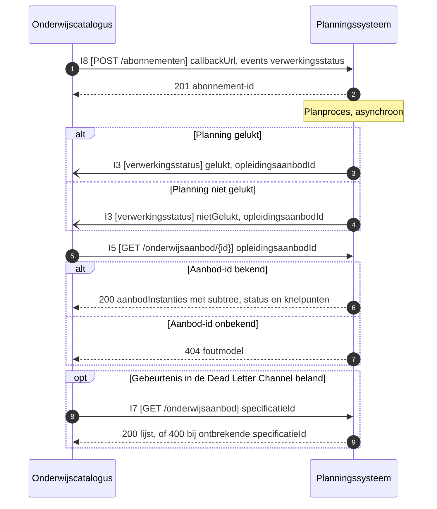

# IS-OA-04: gepland aanbod van het planningssysteem naar de onderwijscatalogus

Deze eenheid levert het geplande onderwijsaanbod in zijn lagen aan de onderwijscatalogus, met per laag een verwijzing naar de specificatie waarvan het is gemaakt.

| | |
|---|---|
| Bronsysteem | Planningssysteem (bezitter van het onderwijsaanbod, [U3](https://github.com/Npuls-OKx/Public/blob/dev/Koppelvlakspecificaties/uitgangspunten.md#u3-resource-eigenaarschap)) |
| Doelsysteem | Onderwijscatalogus |
| Koppeling | OC-P&R, interactie I3, I5, I7 en I8 van het [interactiepatroon](https://github.com/Npuls-OKx/Public/blob/dev/Koppelvlakspecificaties/Interactiepatronen/onderwijscatalogus-planning-en-roostering.md) |
| Beeld | [F2-07](../../../model/informatiemodel/img/regels/f2-07-het-geplande-aanbod-terug-naar-de-catalogus.svg), zeven regels in [voorbeeld-lr1-regels.json](../../../model/informatiemodel/voorbeeld-lr1-regels.json) |
| Status | Gespecificeerd: de operaties staan in Public, de payloadschema's dragen alfa |
| Applicatiedienst | Het [planningssysteem](https://github.com/Npuls-OKx/Public/blob/dev/Koppelvlakspecificaties/Applicatiecomponenten/planningssysteem.md) ontsluit `/onderwijsaanbod` en neemt het abonnement aan; de [onderwijscatalogus](https://github.com/Npuls-OKx/Public/blob/dev/Koppelvlakspecificaties/Applicatiecomponenten/onderwijscatalogus.md) neemt `verwerkingsstatus` aan |
| Functionele eis | functionele-eis-0001, functionele-eis-0003, functionele-eis-0006, functionele-eis-0007 |

De planpoging meldt zich als dunne gebeurtenis, de catalogus haalt de inhoud erna op ([U4](https://github.com/Npuls-OKx/Public/blob/dev/Koppelvlakspecificaties/uitgangspunten.md#u4-notify-then-pull)). Het aanbod blijft bij planning staan.

## De stroom



## De operaties

Vier operaties, alle vier beschreven bij het component dat ze serveert. Verificatie van de aflevering en de dubbele ontvangst staat in het [interactieoverzicht](https://github.com/Npuls-OKx/Public/blob/dev/Koppelvlakspecificaties/Interactiepatronen/onderwijscatalogus-planning-en-roostering.md#interactieoverzicht).

| Operatie | Serveert | Methode | Parameters | Statuscodes | Foutgedrag |
|---|---|---|---|---|---|
| `verwerkingsstatus` | onderwijscatalogus | POST | geen | 200 | De catalogus bevestigt met 200. Blijft die uit, dan herhaalt planning met toenemende wachttijd (backoff) en komt de melding daarna in de Dead Letter Channel; herstel loopt via I7 |
| `/onderwijsaanbod/{id}` | planningssysteem | GET | `status`, optioneel filter op de onderliggende instanties | 200, 400, 404 | 404 bij een onbekend aanbod-id, 400 bij een ongeldige filterwaarde. De operatie is alleen-lezen, herhalen levert hetzelfde resultaat |
| `/onderwijsaanbod` | planningssysteem | GET | `specificatieId` verplicht, `versie` optioneel, standaard alle versies | 200, 400 | 400 zonder `specificatieId`. Bedoeld voor herstel na een gemiste gebeurtenis |
| `/abonnementen` | planningssysteem | POST | geen | 201, 400 | Idempotent op `callbackUrl` plus gebeurtenistype: herregistratie overschrijft de vorige |

Het afleveringsmechanisme van `verwerkingsstatus` ligt bij instelling en leverancier, binnen de vier eigenschappen van [ADR 0018](https://github.com/Npuls-OKx/Public/blob/dev/Referentiemateriaal/adr/0018-enterprise-messaging-patronen-voor-betrouwbare-koppelvlakken.md) ([U5](https://github.com/Npuls-OKx/Public/blob/dev/Koppelvlakspecificaties/uitgangspunten.md#u5-bericht-versus-kanaal)).

## De berichten

Veldnamen Nederlands, plat met verwijzingen ([U7](https://github.com/Npuls-OKx/Public/blob/dev/Koppelvlakspecificaties/uitgangspunten.md#u7-payload-plat-met-verwijzingen-en-de-sleutelconventie)). De Engelse schemanaam staat in [mapping.md](https://github.com/Npuls-OKx/Public/blob/dev/Informatie-en-gegevensmodellen/mapping.md). De objecttypen komen uit het [informatiemodel OKx](../../../model/informatiemodel/informatiemodel.md); de definities staan in de [begrippenlijst](../begrippen/begrippenlijst.md).

### Verwerkingsstatus, de melding

Schema: [processing-status.json](https://github.com/Npuls-OKx/Public/blob/dev/Informatie-en-gegevensmodellen/schemas/processing-status.json).

| Veld | Type | Kardinaliteit | Verplicht | Slaat terug op |
|---|---|---|---|---|
| `status` | enum: `ontvangen`, `gestart`, `afgekeurd`, `gelukt`, `nietGelukt` | 1 | ja | de planpoging op `Opleiding aanbod` |
| `opleidingsaanbodId` | uuid, mag leeg zijn | 0..1 | nee | `Opleiding aanbod` |
| `specificatieVerwijzing.specificatieId` | uuid | 1 | ja | `Opleiding specificatie` of `Opleidingsprogramma specificatie` |
| `specificatieVerwijzing.versie` | string | 1 | ja | de versie van diezelfde specificatie |

### Onderwijsaanbod, de lading

Schema: [education-offering.json](https://github.com/Npuls-OKx/Public/blob/dev/Informatie-en-gegevensmodellen/schemas/education-offering.json). Per item in `aanbodInstanties`:

| Veld | Type | Kardinaliteit | Verplicht | Slaat terug op |
|---|---|---|---|---|
| `id` | uuid | 1 | ja | de aanbodlaag zelf |
| `aanbodType` | enum: `opleidingsaanbod`, `opleidingsprogramma-aanbod`, `onderwijseenheid-aanbod`, `leergelegenheid` | 1 | ja | `Opleiding aanbod`, `Opleidingsprogramma aanbod`, `Onderwijseenheid aanbod`, `Leergelegenheid` |
| `versie` | string, semver | 1 | ja | de lifecycle van de aanbodlaag |
| `bovenliggendAanbodId` | uuid, leeg op een root | 1 | ja | de bovenliggende aanbodlaag (compositie en aggregatie in het model) |
| `specificatieVerwijzing` | object: `specificatieId` plus `versie` | 1 | ja | `Opleiding specificatie`, `Opleidingsprogramma specificatie`, `Onderwijseenheid specificatie`, `Leeronderdeel specificatie` |
| `naam` | string | 1 | ja | de aanbodlaag zelf |
| `status` | enum: `inPlanning`, `gepland`, `nietRealiseerbaar`, `geannuleerd` | 1 | ja | de toestand van de aanbodlaag |
| `knelpunten` | array van `code` plus `omschrijving` plus `betrokkenSpecificatieIds` | 0..n | nee | de geschonden randvoorwaarde, codelijst in [regels.md](https://github.com/Npuls-OKx/Public/blob/dev/Informatie-en-gegevensmodellen/regels.md) |
| `cohort` | string | 0..1 | nee | `Cohort / periode` |
| `periode` | object: `start` plus `eind`, datum | 0..1 | nee | de geldigheid van de aanbodlaag (ontwerpkeuze 16) |
| `minAantalStudenten`, `maxAantalStudenten` | integer | 0..1 | nee | de capaciteit van de aanbodlaag |
| `locatieId` | uuid | 0..1 | nee | `Onderwijslocatie`, relatie `wordt gegeven op` |
| `uitvoerendTeamId` | uuid | 0..1 | nee | `Organisatie-eenheid`; het model legt haar relatie `Voert uit` op de specificatie |
| `groepen` | array van `id`, `naam`, `capaciteit` | 0..n | nee | `Plaatsingsgroep`, zie werkbrief W5 |

Naast `aanbodInstanties` draagt de payload `locaties` (`Onderwijslocatie` met `Onderwijslocatie type` in `locatieType`) en `organisatieEenheden` (`Organisatie-eenheid`, met `Medewerker` als uuid in `professionalIds`).

### Abonnement, de voorwaarde

Schema: [subscription.json](https://github.com/Npuls-OKx/Public/blob/dev/Informatie-en-gegevensmodellen/schemas/subscription.json). `callbackUrl` (uri, 1, verplicht) en `events` (array uit `specificatie-planbaar`, `specificatie-gewijzigd`, `specificatie-status-gewijzigd`, `verwerkingsstatus`; 1..n, verplicht) richten het kanaal in en staan daarmee buiten het informatiemodel (U5).

### Waar planning eindigt en roosteren begint

`aanbodType` loopt tot en met `leergelegenheid` en `status` kent `gepland` als eindtoestand. `Lesgelegenheid`, het leermoment in tijd en ruimte, komt van het roostersysteem; dat meldt het rooster aan planning en catalogus langs hetzelfde patroon, [buiten deze koppeling](https://github.com/Npuls-OKx/Public/blob/dev/Koppelvlakspecificaties/Interactiepatronen/onderwijscatalogus-planning-en-roostering.md#context-doorwerking-naar-het-roostersysteem).

## De voorbeeldpayload

Apothekersassistent, crebo 23450, cohort 2026, met de instanties uit F2-07. De waarden in `specificatieVerwijzing` komen uit de [voorbeeld onderwijsspecificatie](https://github.com/Npuls-OKx/Public/blob/dev/Informatie-en-gegevensmodellen/voorbeeldpayloads.md#voorbeeld-onderwijsspecificatie) en zijn gepind op de versie die dat voorbeeld draagt. De keuzedeelspecificatie K0037 en de toetsonderdeelspecificatie van de praktijktoets dragen een eigen waarde, omdat dat voorbeeld ze nog niet kent.

De melding die de catalogus ophaalt:

```json
{
  "status": "gelukt",
  "opleidingsaanbodId": "ee04f3c1-a43c-486a-a8bc-ab995fe4c640",
  "specificatieVerwijzing": {
    "specificatieId": "79736830-1c5c-470f-b2c2-005029c96733",
    "versie": "0.1.0"
  }
}
```

Het aanbod dat `GET /onderwijsaanbod/{id}` daarna teruggeeft:

```json
{
  "aanbodInstanties": [
    {
      "id": "ee04f3c1-a43c-486a-a8bc-ab995fe4c640",
      "aanbodType": "opleidingsaanbod",
      "versie": "0.1.0",
      "bovenliggendAanbodId": null,
      "specificatieVerwijzing": { "specificatieId": "79736830-1c5c-470f-b2c2-005029c96733", "versie": "0.1.0" },
      "naam": "Apothekersassistent 2026",
      "status": "gepland",
      "knelpunten": [],
      "cohort": "2026",
      "periode": { "start": "2026-09-01", "eind": "2029-07-15" },
      "maxAantalStudenten": 48,
      "uitvoerendTeamId": "83633eab-32da-4775-a976-556b8d9319d6"
    },
    {
      "id": "40f79ead-eb9a-4fbc-b82a-281f2f2fe308",
      "aanbodType": "opleidingsprogramma-aanbod",
      "versie": "0.1.0",
      "bovenliggendAanbodId": "ee04f3c1-a43c-486a-a8bc-ab995fe4c640",
      "specificatieVerwijzing": { "specificatieId": "7ae25c1e-ee27-43a2-a001-761ee39ea5c7", "versie": "0.1.0" },
      "naam": "Regulier BOL 2026",
      "status": "gepland",
      "cohort": "2026",
      "periode": { "start": "2026-09-01", "eind": "2029-07-15" },
      "minAantalStudenten": 24,
      "maxAantalStudenten": 48,
      "uitvoerendTeamId": "83633eab-32da-4775-a976-556b8d9319d6"
    },
    {
      "id": "5e7afba1-ad00-469e-9508-2c82c707d6d0",
      "aanbodType": "onderwijseenheid-aanbod",
      "versie": "0.1.0",
      "bovenliggendAanbodId": "40f79ead-eb9a-4fbc-b82a-281f2f2fe308",
      "specificatieVerwijzing": { "specificatieId": "402c2342-d897-4df4-a667-7fc5bd930944", "versie": "0.1.0" },
      "naam": "B1-K1, leerjaar 1, periode 1 tot 4",
      "status": "gepland",
      "periode": { "start": "2026-09-01", "eind": "2027-07-15" },
      "locatieId": "aca23849-a0fa-461c-a5d5-fcf526b43947"
    },
    {
      "id": "93e27e86-29a3-4c65-b716-0294560bfad6",
      "aanbodType": "leergelegenheid",
      "versie": "0.1.0",
      "bovenliggendAanbodId": "5e7afba1-ad00-469e-9508-2c82c707d6d0",
      "specificatieVerwijzing": { "specificatieId": "327c8263-3516-4b5a-8d57-c16241ec008d", "versie": "0.1.0" },
      "naam": "Baliegesprekken 101, periode 1",
      "status": "gepland",
      "periode": { "start": "2026-09-01", "eind": "2026-11-13" },
      "locatieId": "0204ef82-54a9-4cdc-a075-53d55ab70a22",
      "uitvoerendTeamId": "83633eab-32da-4775-a976-556b8d9319d6",
      "groepen": [
        { "id": "3b424d23-e2d5-4b51-847d-2c18dd878b1a", "naam": "APO26-1A", "capaciteit": 24 },
        { "id": "97507c2a-1c51-4b78-9865-cb5fffc64026", "naam": "APO26-1B", "capaciteit": 24 }
      ]
    },
    {
      "id": "daffa71f-d6dc-470e-9914-4477ea15075f",
      "aanbodType": "opleidingsprogramma-aanbod",
      "versie": "0.1.0",
      "bovenliggendAanbodId": null,
      "specificatieVerwijzing": { "specificatieId": "beaaaf4c-b267-41f7-9b8d-ac9a19a7dfe1", "versie": "0.1.0" },
      "naam": "K0037 Farmaceutische Patientenzorg, periode 7",
      "status": "gepland",
      "periode": { "start": "2028-02-07", "eind": "2028-04-14" },
      "uitvoerendTeamId": "83633eab-32da-4775-a976-556b8d9319d6",
      "groepen": [
        { "id": "55169145-f993-4bfe-8b89-888807820d8d", "naam": "KD-K0037-28-P7", "capaciteit": 24 }
      ]
    }
  ],
  "locaties": [
    {
      "id": "aca23849-a0fa-461c-a5d5-fcf526b43947",
      "locatieType": "vestiging",
      "naam": "Hoofdlocatie Utrecht",
      "valtBinnenLocatieId": null,
      "codes": [ { "codeType": "vestigingscode", "code": "UTR-01" } ]
    },
    {
      "id": "0204ef82-54a9-4cdc-a075-53d55ab70a22",
      "locatieType": "ruimte",
      "naam": "Praktijklokaal farmacie 2.14",
      "valtBinnenLocatieId": "aca23849-a0fa-461c-a5d5-fcf526b43947",
      "verdieping": "2",
      "vleugel": "B"
    }
  ],
  "organisatieEenheden": [
    {
      "id": "6132ece6-d75e-4e80-81ce-91ab7448794d",
      "eenheidType": "instelling",
      "naam": "ROC Leren Zonder Drempels",
      "bovenliggendeEenheidId": null
    },
    {
      "id": "83633eab-32da-4775-a976-556b8d9319d6",
      "eenheidType": "onderwijsteam",
      "naam": "Onderwijsteam Farmacie",
      "bovenliggendeEenheidId": "6132ece6-d75e-4e80-81ce-91ab7448794d"
    }
  ]
}
```

Het keuzedeelaanbod staat als root, los van het opleidingsaanbod, met een eigen groep: een keuzedeel is herbruikbaar over opleidingen heen en de catalogus bereikt het via de regelset op de keuzedeelruimte ([regels.md](https://github.com/Npuls-OKx/Public/blob/dev/Informatie-en-gegevensmodellen/regels.md)). Loopt de planning vast, dan draagt de instantie `status` `nietRealiseerbaar` met `knelpunten`, en blijft de rest van de payload gelijk.

## De werkbrieven

Wat het beeld toont en de schema's nog vragen. De schema's dragen alfa ([U1](https://github.com/Npuls-OKx/Public/blob/dev/Koppelvlakspecificaties/uitgangspunten.md#u1-indicatief-en-onderbouwend-niet-voorschrijvend)); een wijziging hier verzet de versie van het pakket informatie- en gegevensmodellen, en daarmee de pin die de koppelvlakspecificatie eronder noemt.

| Nr | Wat erbij moet | In welk schema | Versie-impact |
|---|---|---|---|
| W1 | Een verwijzing naar het `Verzoek tot Aanbod / Intekening op specificatie` per aanbodlaag, zoals `verzoekId`. F2-07 toont de relatie `Leidt tot` op elke laag; de payload draagt alleen de specificatieverwijzing | `education-offering.json`, veld op `aanbodInstanties` | Optioneel toevoegen is additief (MINOR). Verplicht stellen breekt elke bestaande instantie (MAJOR) |
| W2 | De aanbodwaarde voor `Toetsgelegenheid`, met `Examengelegenheid` als specialisatie ervan | `education-offering.json`, enum `aanbodType` | Additief (MINOR). Een strikt valideerde consument weigert de nieuwe waarde tot hij de nieuwe versie overneemt |
| W3 | Een manier om een keuzedeelaanbod als root te herkennen: een eigen waarde in `aanbodType`, of een verwijzing naar de regelset waaruit het kiesbaar is. Het model maakt `Keuzedeel aanbod` een specialisatie van `Opleidingsprogramma aanbod`, de voorbeeldpayload in Public plaatst een keuzedeel onder een onderwijseenheid-aanbod | `education-offering.json`, enum `aanbodType` of nieuw veld | Additief (MINOR), met een herziening van de voorbeeldpayload in Public |
| W4 | De instellingslaag `Opleidingsaanbod van Instelling` als adresseerbare instantie. Vandaag reist de instelling mee als `organisatieEenheden` met `eenheidType` `instelling` | `education-offering.json`, enum `aanbodType` | Additief (MINOR); de keuze kan ook zijn de laag bij de organisatie-eenheid te laten en dan vervalt de werkbrief |
| W5 | Het objecttype achter `groepen`. Het model verbindt `Plaatsingsgroep` met de verbintenis en niet met het aanbod, terwijl de capaciteit per groep op het aanbod staat | [informatiemodel](../../../model/informatiemodel/informatiemodel.md), relatie bij `Plaatsingsgroep` | Modelwijziging zonder schemagevolg; de veldnaam blijft gelijk |
| W6 | Meerdere bovenliggende lagen per leergelegenheid. B10 noemt een leergelegenheid die vanuit meerdere programma's wordt aangeboden; `bovenliggendAanbodId` draagt er precies een | `education-offering.json`, `bovenliggendAanbodId` naar een array | Brekend voor elke consument die het veld als enkele waarde leest (MAJOR) |
| W7 | Een eigen `id` op de melding, waarop de ontvanger dubbele aflevering herkent. Het interactieoverzicht eist idempotentie op het status-id | `processing-status.json` | Optioneel additief (MINOR), verplicht brekend (MAJOR) |
| W8 | De statuswaarde voor de uitkomst van de acceptatietoets bij een late wijziging, waar het sequentiediagram spreekt van een bijgewerkte versieverwijzing zonder herplanning | `processing-status.json`, enum `status` | Additief (MINOR) |
| W9 | Een gebruiksprofiel voor de terugweg: welke delen van de aanbodpayload meegaan naar de catalogus, zoals `locaties` en `organisatieEenheden` | [gebruiksprofielen.md](https://github.com/Npuls-OKx/Public/blob/dev/Informatie-en-gegevensmodellen/gebruiksprofielen.md) | Documentwijziging zonder schemagevolg |

## Wat open blijft

| Punt | Stand |
|---|---|
| Exacte geplande capaciteit vrijgeven is een toezegging en vraagt organisatorische volwassenheid, terwijl een aantal logistieke scenario's erop leunt | B10 bij F2-07, [issue 284](https://github.com/Npuls-OKx/meta/issues/284) |
| Capaciteit op een bovenliggende laag verliest waarde naarmate de keuzes fijnmaziger worden | B10, raakt W6 |
| Clustering van leeronderdelen tot een leergelegenheid is zelden een op een | B02 en B06, [issue 283](https://github.com/Npuls-OKx/meta/issues/283) |
| `Opleiding aanbod` in het model naast `Opleidingaanbod` in de [voorbeelduitwerking](../../../model/informatiemodel/voorbeeld-lr1-regels.json) en in [README.md](README.md) | een schrijfwijze per objecttype |
| De voorbeelduitwerking geeft de opleidingsspecificatie versie 2026.1, de voorbeeldpayload in Public pint 0.1.0 | een versieaanduiding per specificatie |
| `Keuzedeel aanbod`, `Leergelegenheid`, `Onderwijseenheid aanbod` en `Opleidingsprogramma aanbod` missen een definitie in de [begrippenlijst](../begrippen/begrippenlijst.md) | vier definities, gelegd naast MORA en het Kernmodel Onderwijsinformatie |
