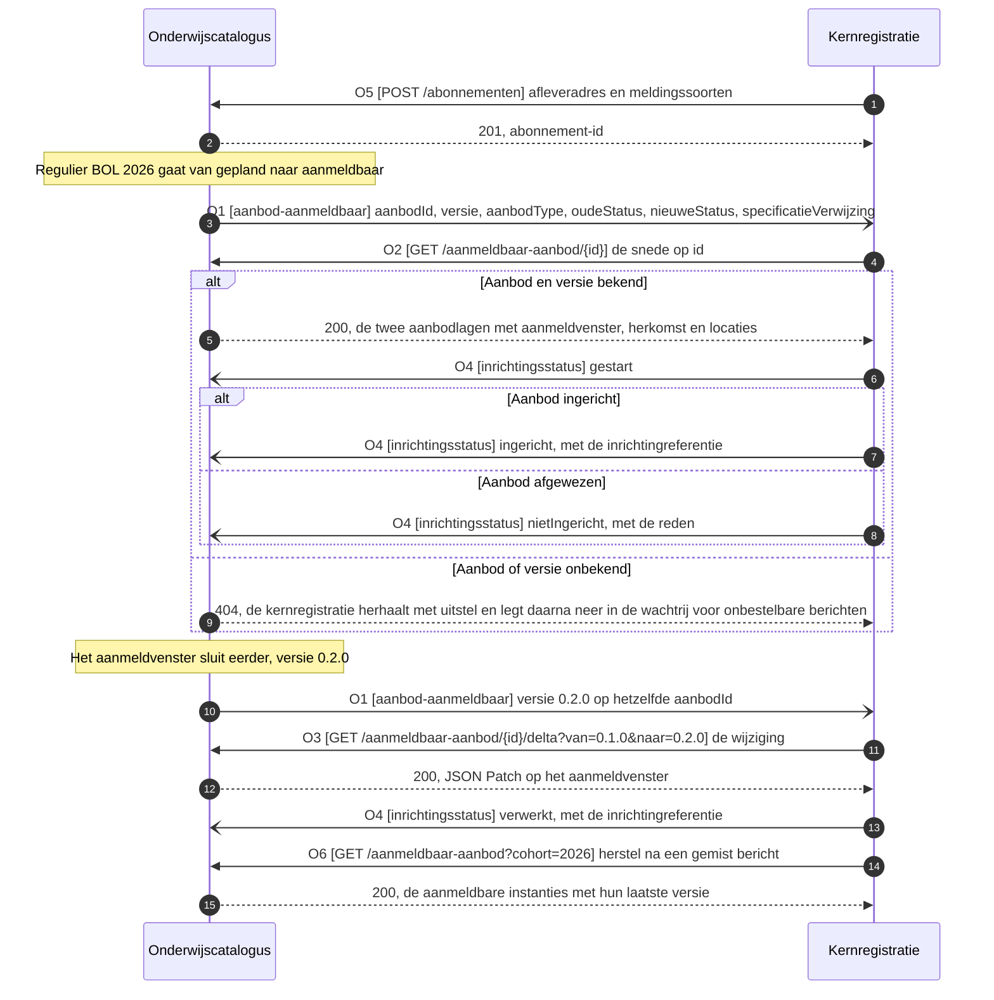

# IS-OA-05: aanmeldbaar opleidingsprogramma-aanbod naar de kernregistratie

De onderwijscatalogus ontsluit het aanmeld- en inschrijfbare `Opleidingsprogramma aanbod` aan de kernregistratie, waar de `Aanmelding` en de `Opleidingsprogramma aanbod verbintenis` van een aspirant-student erop ontstaan.

De uuid's, de versies en de namen in de voorbeeldpayload hieronder komen uit [casus.md](casus.md), de vaste identificaties van deze interactiespecificatie. Het aanbod is hetzelfde dat [IS-OA-04](stroom-is-oa-04.md) terugmeldt.

Elke operatie, elk pad en elk schema draagt hieronder zijn stand. `vastgelegd` staat bij wat [Npuls-OKx/Public](https://github.com/Npuls-OKx/Public/tree/dev/Koppelvlakspecificaties) vandaag draagt, `voorstel` bij wat deze eenheid voorstelt. Een voorgesteld schema draagt het label `voorstel` in zijn `$id`, zodat de stand aan het artefact zelf te lezen is.

## De eenheid

| Kenmerk | Waarde |
|---|---|
| Bronsysteem | Onderwijscatalogus |
| Doelsysteem | Kernregistratie systeem studenten (KRS) |
| Koppeling | OC-KRS volgens de beeldregels, OC-SIS volgens hoofdplaat v1.7 ([S-A](#signaleringen)) |
| Beeld | [F3-01, aanmeldbaar aanbod naar de kernregistratie](../../../model/informatiemodel/img/regels/f3-01-aanmeldbaar-aanbod-naar-de-kernregistratie.svg) |
| Lading | `Opleidingsprogramma aanbod`, instantie `Regulier BOL 2026`, met zijn `Opleiding aanbod` erboven |
| Snede | [de aanmeldbare snede](#de-snede): de twee aanbodlagen waarop bij de aanmelding een verbintenis ontstaat, met het aanmeldvenster erbij |
| Contract | De operaties met hun paden staan onder [de operaties](#de-operaties), de berichten onder [de berichtspecificatie](#de-berichtspecificatie), de schema's onder [de schema's](#de-schemas) |
| Status | De pijl en de koppeling staan op v1.7. Het [interactiepatroon OC-SIS](https://github.com/Npuls-OKx/Public/blob/dev/Koppelvlakspecificaties/Interactiepatronen/onderwijscatalogus-studentinformatiesysteem.md) dekt specificatie en resultaatstructuur en draagt het meldpatroon `inrichtingsstatus`; het aanbod komt met deze eenheid erbij |
| Applicatiedienst | [planbaar-onderwijsaanbod-aanbieder](https://github.com/Npuls-OKx/Public/blob/d0c20d99b110b29ccf6b0e50109f7d54ffd88d7a/Koppelvlakspecificaties/Applicatiediensten/planbaar-onderwijsaanbod-aanbieder.md) bij de catalogus, [planbaar-onderwijsaanbod-afnemer](https://github.com/Npuls-OKx/Public/blob/d0c20d99b110b29ccf6b0e50109f7d54ffd88d7a/Koppelvlakspecificaties/Applicatiediensten/planbaar-onderwijsaanbod-afnemer.md) bij de kernregistratie, gepind op commit d0c20d99; die map staat nog niet op `dev` ([S-B](#signaleringen)). Werkbrief W9 belegt de dienst voor aanmeldbaar aanbod |

Grond per regel: [voorbeeld-lr1-regels.json](../../../model/informatiemodel/voorbeeld-lr1-regels.json), beeld F3-01. Objecttypen: [informatiemodel OKx](../../../model/informatiemodel/informatiemodel.md). Definities: [begrippenlijst](../begrippen/begrippenlijst.md). De eenheid in haar keten: [de interactiespecificatie](README.md).

## De snede

De kernregistratie richt op dit aanbod de `Aanmelding` en de verbintenis in. Beeld F3-03 laat zien waarop die verbintenis ontstaat zodra Jochem zich aanmeldt: op het `Opleiding aanbod` en op het `Opleidingsprogramma aanbod`. De snede draagt die twee lagen.

| Wat de snede draagt | Waarom de kernregistratie dat nodig heeft |
|---|---|
| De lagen `opleidingsaanbod` en `opleidingsprogramma-aanbod` | Op beide ontstaat bij de aanmelding een verbintenis (F3-03) |
| `specificationReference` per laag | De lijn naar de specificatie waarop de resultaatstructuur al is ingericht (interactie S2 en S3 van OC-SIS) |
| Het aanmeldvenster en de uiterste inschrijfdatum | Zij bepalen wanneer de kernregistratie een aanmelding aanneemt en wanneer de inschrijving rond is |
| De instroomcapaciteit | De bovengrens waarop de kernregistratie de instroom begrenst |
| De herkomst in het kwalificatiekader | Crebo en kwalificatie komen mee zonder de leeruitkomstboom op te halen ([ADR 0023](https://github.com/Npuls-OKx/Public/blob/dev/Referentiemateriaal/adr/0023-leeruitkomsten-als-opaque-sleutels-in-koppeling-oc-p-en-r.md)) |
| De locatie en het uitvoerend team | De vestiging waar de opleiding start, en het team dat haar uitvoert |

De fijnmazige lagen blijven bij hun bezitter: het planningssysteem bezit het aanbod en de catalogus ontsluit het aan wie het nodig heeft ([U3](https://github.com/Npuls-OKx/Public/blob/dev/Koppelvlakspecificaties/uitgangspunten.md#u3-resource-eigenaarschap)). De onderwijseenheid en de leergelegenheid bereiken de kernregistratie langs het nominale template dat zij uit de specificatie inricht.

Waarom de snede een eigen schema draagt: [education-offering.json](https://github.com/Npuls-OKx/Public/blob/dev/Informatie-en-gegevensmodellen/schemas/education-offering.json) draagt de aanbodlagen tot en met de leergelegenheid, met de planningsvelden `bottlenecks` (knelpunten) en `groups` (groepen), en een gesloten `status`-lijst waarin het plannen de waarden bepaalt. De snede vraagt twee lagen, een aanmeldvenster, de herkomst en de statuswaarde `aanmeldbaar`. Die waarde aan de gesloten lijst toevoegen raakt elke afnemer die erop valideert; een eigen gebruiksprofiel ernaast is additief. Daarom staat de snede als [offering-open-for-application.json](schemas/offering-open-for-application.json) naast education-offering.json, met dezelfde bouwstenen eronder: [specification-reference.json](https://github.com/Npuls-OKx/Public/blob/dev/Informatie-en-gegevensmodellen/schemas/specification-reference.json), [period.json](https://github.com/Npuls-OKx/Public/blob/dev/Informatie-en-gegevensmodellen/schemas/period.json), [source.json](https://github.com/Npuls-OKx/Public/blob/dev/Informatie-en-gegevensmodellen/schemas/source.json), [location.json](https://github.com/Npuls-OKx/Public/blob/dev/Informatie-en-gegevensmodellen/schemas/location.json) en [organisation-unit.json](https://github.com/Npuls-OKx/Public/blob/dev/Informatie-en-gegevensmodellen/schemas/organisation-unit.json).

[IS-OA-06](stroom-is-oa-06.md) draagt dezelfde snede een schakel verder, naar centraal aanmelden, en voegt daar de velden toe die een sectorale partij aangaan: de leerweg, de doelgroep en de aanbieder. Eenheid en sector lezen zo hetzelfde profiel, met per koppeling een eigen uitsnede eruit.

## De stroom



De catalogus meldt dun en de kernregistratie haalt op ([U4](https://github.com/Npuls-OKx/Public/blob/dev/Koppelvlakspecificaties/uitgangspunten.md#u4-notify-then-pull)). Over de koppeling gaat een verwijzing, met de inhoud op opvraag ([U3](https://github.com/Npuls-OKx/Public/blob/dev/Koppelvlakspecificaties/uitgangspunten.md#u3-resource-eigenaarschap)). Een intrekking rijdt mee op de statuswaarde `geannuleerd`, zodat de kernregistratie de aanmelding op dat aanbod sluit.

## De operaties

| Id | Pad of melding | Implementeert | Methode | Parameters | Statuscodes | Foutgedrag | Status |
|---|---|---|---|---|---|---|---|
| O1 | `aanbod-aanmeldbaar` | Kernregistratie | POST | geen | 200 | Zonder 200 volgt herhaling met uitstel (backoff) en daarna de wachtrij voor onbestelbare berichten (dead letter channel). Herhaalde aflevering blijft zonder effect op het `eventId` | voorstel |
| O2 | `/aanmeldbaar-aanbod/{id}` | Onderwijscatalogus | GET | `versie` (optioneel, standaard de laatst gepubliceerde) | 200, 400, 404 | 404 bij een onbekend aanbod-id of een onbekende versie. Alleen-lezen, dus herhalen geeft hetzelfde antwoord | voorstel |
| O3 | `/aanmeldbaar-aanbod/{id}/delta` | Onderwijscatalogus | GET | `van` (versie, verplicht), `naar` (versie, verplicht) | 200, 400, 404 | 400 bij een versiebereik dat de catalogus niet kan samenstellen, 404 bij een onbekend aanbod-id | voorstel |
| O4 | `inrichtingsstatus` | Onderwijscatalogus | POST | geen | 200 | Zonder 200 volgt herhaling met uitstel en daarna de wachtrij voor onbestelbare berichten. Herhaalde aflevering blijft zonder effect op het `eventId` | vastgelegd als meldpatroon, payloadschema voorstel |
| O5 | `/abonnementen` | Onderwijscatalogus | POST | geen | 201, 400 | HTTP-foutcodes. Herregistratie overschrijft op de combinatie afleveradres plus meldingssoort | vastgelegd als pad, de meldingssoorten voorstel |
| O6 | `/aanmeldbaar-aanbod` | Onderwijscatalogus | GET | `cohort` (optioneel), `status` (optioneel, standaard `aanmeldbaar`), `gewijzigdSinds` (optioneel, tijdstempel) | 200, 400 | 400 bij een onbekende parameterwaarde. Alleen-lezen | voorstel |

De grond per operatie:

| Id | Grond |
|---|---|
| O1 | Interactie S1 van het [interactiepatroon OC-SIS](https://github.com/Npuls-OKx/Public/blob/dev/Koppelvlakspecificaties/Interactiepatronen/onderwijscatalogus-studentinformatiesysteem.md) meldt op dezelfde manier dat een specificatie beschikbaar is. W1 belegt het meldpatroon op de [dienstpagina van het studentinformatiesysteem](https://github.com/Npuls-OKx/Public/blob/dev/Koppelvlakspecificaties/Applicatiecomponenten/studentinformatiesysteem.md) |
| O2 | De vorm van `GET /onderwijsspecificaties/{id}` op de [dienstpagina van de onderwijscatalogus](https://github.com/Npuls-OKx/Public/blob/dev/Koppelvlakspecificaties/Applicatiecomponenten/onderwijscatalogus.md). Een eigen resource houdt `/onderwijsaanbod` bij het planningssysteem ([S-B](#signaleringen)); W3 belegt het pad |
| O3 | [U11](https://github.com/Npuls-OKx/Public/blob/dev/Koppelvlakspecificaties/uitgangspunten.md#u11-toekomstvaste-endpoints-volledige-structuur-en-delta) vraagt de volledige structuur en de delta op dezelfde resource, zoals `GET /onderwijsspecificaties/{id}/delta`. W7 belegt het pad en het schema |
| O4 | De dienstpagina van de onderwijscatalogus draagt `inrichtingsstatus` op interactie S4 en L3 en kondigt het payloadschema aan. W4 levert dat schema |
| O5 | Dezelfde dienstpagina draagt `/abonnementen` op interactie I8. W5 voegt de meldingssoorten toe |
| O6 | De vorm van `GET /onderwijsspecificaties` op dezelfde dienstpagina, dat een lijst referenties met hun laatste versie teruggeeft. W3 belegt het pad |

Het bericht ligt hier vast, het kanaal blijft een inrichtingskeuze van instelling en leverancier binnen de eigenschappen die [U5](https://github.com/Npuls-OKx/Public/blob/dev/Koppelvlakspecificaties/uitgangspunten.md#u5-bericht-versus-kanaal) opsomt.

## De eisen

Deze eisen zijn de uitvraagbare kern van IS-OA-05.

| Id | Eis | Toetsgeval |
|---|---|---|
| E1 | De onderwijscatalogus meldt de kernregistratie dat een `Opleidingsprogramma aanbod` aanmeldbaar is, met id, versie en de verwijzing naar de specificatie | O1 op `Regulier BOL 2026`: de melding draagt aanbod-id, versie, de statusovergang en de specificatieverwijzing, en laat de aanbodinhoud bij de bezitter |
| E2 | De onderwijscatalogus levert dat aanbod op id, als de aanmeldbare snede | O2 op `8c494250-b67a-4666-a762-6f9ec1e70aff`: statuscode 200 met het aanbod en zijn `Opleiding aanbod`, valideerbaar tegen [offering-open-for-application.json](schemas/offering-open-for-application.json) |
| E3 | Een tweede aflevering van dezelfde melding heeft geen aanvullend effect | O1 tweemaal afleveren met hetzelfde `eventId`: de kernregistratie richt het aanbod eenmaal in en meldt eenmaal `ingericht` |
| E4 | De kernregistratie meldt de uitkomst terug, met een referentie bij opname en een reden bij afkeuring | O4 na opname: status `ingericht` met `arrangementReference`; na een validatiefout: status `nietIngericht` met `reason` |
| E5 | Een onbekend aanbod of een onbekende versie levert een verwerkbaar antwoord | O2 op een onbekend id: statuscode 404, waarna de kernregistratie herhaalt met uitstel en daarna neerlegt in de wachtrij voor onbestelbare berichten |
| E6 | De snede draagt de aanbodlagen waarop bij de aanmelding een verbintenis ontstaat | O2 op het programma-aanbod: de respons draagt `opleidingsaanbod` en `opleidingsprogramma-aanbod`, en een instantie met `offeringType` `leergelegenheid` valideert niet tegen het profiel |
| E7 | Een nieuwe versie van het aanbod bereikt de kernregistratie als melding, waarna de wijziging op te vragen is | O1 met `version` `0.2.0` op hetzelfde aanbod-id, daarna O3 met `van=0.1.0` en `naar=0.2.0`: statuscode 200 met de JSON Patch op `applicationWindow` |
| E8 | Aanmeldbaar aanbod draagt het venster waarin aanmelden openstaat | O2 op een instantie met status `aanmeldbaar`: `applicationWindow` draagt `start` en `end` |
| E9 | De waarden van de inrichtingsstatus staan in een schema | O4 met status `ingericht` zonder `arrangementReference`: de payload valideert niet tegen [arrangement-status.json](schemas/arrangement-status.json) |
| E10 | De kernregistratie haalt na een gemist bericht zelf bij | O6 met `cohort=2026`: statuscode 200 met de aanmeldbare instanties en hun laatste versie |

## De berichtspecificatie

Elk veld slaat terug op een objecttype uit het [informatiemodel OKx](../../../model/informatiemodel/informatiemodel.md). De kolom Grond noemt het veld of het schema waaruit het bestaat.

De kolom Veld draagt de Engelse sleutel die over de koppeling gaat, de kolom Nederlands de naam uit [mapping.md](https://github.com/Npuls-OKx/Public/blob/dev/Informatie-en-gegevensmodellen/mapping.md) en uit `DutchName` in het schema. Enumwaarden blijven Nederlands. Kardinaliteit `1` betekent verplicht. De sleuteltaal staat als [S-G](#signaleringen) open.

### M1, melding `aanbod-aanmeldbaar`

Dun, conform U4: de statusovergang met een verwijzing. Het payloadschema is [offering-status-changed.json](schemas/offering-status-changed.json), dat deze eenheid met IS-OA-06 deelt en dat als geheel op voorstel staat.

| Veld | Nederlands | Type | Kardinaliteit | Objecttype | Grond |
|---|---|---|---|---|---|
| `offeringId` | `aanbodId` | uuid | 1 | `Opleidingsprogramma aanbod` | `id` uit [education-offering.json](https://github.com/Npuls-OKx/Public/blob/dev/Informatie-en-gegevensmodellen/schemas/education-offering.json), met de naam die [U7](https://github.com/Npuls-OKx/Public/blob/dev/Koppelvlakspecificaties/uitgangspunten.md#u7-payload-plat-met-verwijzingen-en-de-sleutelconventie) vraagt |
| `version` | `versie` | string, semver | 1 | `Opleidingsprogramma aanbod` | `version` uit education-offering.json |
| `offeringType` | `aanbodType` | enum | 1 | `Opleiding aanbod`, `Opleidingsprogramma aanbod` | `offeringType` uit education-offering.json, hier op de waarde `opleidingsprogramma-aanbod` |
| `oldStatus` | `oudeStatus` | enum | 1 | `Opleidingsprogramma aanbod` | de vorm van [specification-status-changed.json](https://github.com/Npuls-OKx/Public/blob/dev/Informatie-en-gegevensmodellen/schemas/specification-status-changed.json), met de waarden van `status` uit education-offering.json |
| `newStatus` | `nieuweStatus` | enum | 1 | `Opleidingsprogramma aanbod` | idem, hier op de waarde `aanmeldbaar`; een intrekking draagt `geannuleerd` |
| `specificationReference` | `specificatieVerwijzing` | object | 1 | `Opleidingsprogramma specificatie` | [specification-reference.json](https://github.com/Npuls-OKx/Public/blob/dev/Informatie-en-gegevensmodellen/schemas/specification-reference.json) |
| `cohort` | `cohort` | string | 0..1 | `Cohort / periode` | `cohort` uit education-offering.json, de parameter waarop O6 filtert |
| `eventId` | `eventId` | uuid | 0..1 | kanaaleigenschap, geen objecttype | [U5](https://github.com/Npuls-OKx/Public/blob/dev/Koppelvlakspecificaties/uitgangspunten.md#u5-bericht-versus-kanaal) vraagt een stabiel meldings-id; W6 |

De melding draagt de vorige versie zelf niet mee: de kernregistratie kent de versie waarop zij staat en geeft die aan O3 mee als `van`.

### M2, respons van `GET /aanmeldbaar-aanbod/{id}`

De aanmeldbare snede uit [offering-open-for-application.json](schemas/offering-open-for-application.json), met de instanties in `offeringInstances` (aanbodInstanties), naast `locations` (locaties) en `organisationUnits` (organisatieEenheden).

| Veld | Nederlands | Type | Kardinaliteit | Objecttype | Grond | Status |
|---|---|---|---|---|---|---|
| `id` | `id` | uuid | 1 | `Opleidingsprogramma aanbod` | education-offering.json | vastgelegd |
| `offeringType` | `aanbodType` | enum | 1 | `Opleiding aanbod`, `Opleidingsprogramma aanbod` | `offeringType` uit education-offering.json, in dit profiel beperkt tot de lagen van beeld F3-03 | voorstel |
| `version` | `versie` | string, semver | 1 | `Opleidingsprogramma aanbod` | education-offering.json | vastgelegd |
| `parentOfferingId` | `bovenliggendAanbodId` | uuid of null | 1 | `Opleiding aanbod` | education-offering.json, [S-C](#signaleringen) | vastgelegd |
| `specificationReference` | `specificatieVerwijzing` | object | 1 | `Opleidingsprogramma specificatie` | [specification-reference.json](https://github.com/Npuls-OKx/Public/blob/dev/Informatie-en-gegevensmodellen/schemas/specification-reference.json) | vastgelegd |
| `name` | `naam` | string | 1 | `Opleidingsprogramma aanbod` | education-offering.json | vastgelegd |
| `status` | `status` | enum: `aanmeldbaar`, `geannuleerd` | 1 | `Opleidingsprogramma aanbod` | `status` uit education-offering.json; de waarde `aanmeldbaar` komt uit W2 | voorstel |
| `cohort` | `cohort` | string | 0..1 | `Cohort / periode` | education-offering.json | vastgelegd |
| `period` | `periode` | object, `start` en `end` | 0..1 | `Cohort / periode` | [period.json](https://github.com/Npuls-OKx/Public/blob/dev/Informatie-en-gegevensmodellen/schemas/period.json); `start` draagt het startmoment | vastgelegd |
| `applicationWindow` | `aanmeldvenster` | object, vorm van period.json | 0..1, bij status `aanmeldbaar` gevuld | `Aanmelding`, als eigenschap van het aanbod | het model verbindt `Aanmelding` met `Opleidingsprogramma aanbod` op basis van dat aanbod; het tijdvenster staat in het [conceptueel gegevensoverzicht van leerroute 1](../leerroute-uitwerking/doc/leerroute-uitwerking-lr1.md) | voorstel |
| `enrolmentDeadline` | `uitersteInschrijfdatum` | string, date | 0..1 | `Opleiding aanbod` | hetzelfde conceptueel gegevensoverzicht legt de uiterste inschrijfdatum op de opleidingslaag, met 1 augustus als waarde | voorstel |
| `minStudentCount` | `minAantalStudenten` | integer | 0..1 | `Opleidingsprogramma aanbod` | education-offering.json; de ondergrens waaronder het aanbod vervalt | vastgelegd |
| `maxStudentCount` | `maxAantalStudenten` | integer | 0..1 | `Opleidingsprogramma aanbod` | education-offering.json; de capaciteit instroom uit het conceptueel gegevensoverzicht | vastgelegd |
| `source` | `bron` | array van object | 0..n | `Kwalificatie dossier`, `Kwalificatie` | de vorm van [source.json](https://github.com/Npuls-OKx/Public/blob/dev/Informatie-en-gegevensmodellen/schemas/source.json), dat vandaag als enkel object op de leeruitkomst staat; W2 | voorstel |
| `locationId` | `locatieId` | uuid | 0..1 | `Onderwijslocatie` | education-offering.json, uitgewerkt in `locations` | vastgelegd |
| `executingTeamId` | `uitvoerendTeamId` | uuid | 0..1 | `Organisatie-eenheid` | education-offering.json, uitgewerkt in `organisationUnits` | vastgelegd |
| `locations[]` | `locaties` | array van object | 0..n | `Onderwijslocatie` | [location.json](https://github.com/Npuls-OKx/Public/blob/dev/Informatie-en-gegevensmodellen/schemas/location.json); `codes` draagt de vestigingscode | vastgelegd |
| `organisationUnits[]` | `organisatieEenheden` | array van object | 0..n | `Organisatie-eenheid` | [organisation-unit.json](https://github.com/Npuls-OKx/Public/blob/dev/Informatie-en-gegevensmodellen/schemas/organisation-unit.json) | vastgelegd |

De planningsvelden `bottlenecks` (knelpunten) en `groups` (groepen) blijven bij het planningssysteem en de catalogus; de capaciteit per groep hoort bij de plaatsing, die op de verbintenis volgt ([S-F](#signaleringen)).

De respons van O6 draagt per aanmeldbaar aanbod een referentie uit [offering-reference.json](schemas/offering-reference.json): `offeringId` (aanbodId) met `version` (versie), naar het model van de lijst die `GET /onderwijsspecificaties` teruggeeft.

### M3, melding `inrichtingsstatus`

De dienstpagina van de onderwijscatalogus kent `inrichtingsstatus` als eigen melding naast `verwerkingsstatus`, elk met haar eigen interactie: `inrichtingsstatus` op S4 en L3, `verwerkingsstatus` op I3. Deze eenheid houdt die naam aan en vult het payloadschema dat de dienstpagina aankondigt, als [arrangement-status.json](schemas/arrangement-status.json) op voorstel.

| Veld | Nederlands | Type | Kardinaliteit | Objecttype | Grond |
|---|---|---|---|---|---|
| `status` | `status` | enum | 1 | verwerkingsinformatie, geen objecttype | interactie S4 van het [interactiepatroon OC-SIS](https://github.com/Npuls-OKx/Public/blob/dev/Koppelvlakspecificaties/Interactiepatronen/onderwijscatalogus-studentinformatiesysteem.md) noemt `ontvangen`, `gestart`, `afgekeurd`, `ingericht` en `nietIngericht`; de acceptatietoets bij een wijziging voegt `verwerkt` en `nietVerwerkt` toe. [processing-status.json](https://github.com/Npuls-OKx/Public/blob/dev/Informatie-en-gegevensmodellen/schemas/processing-status.json) draagt de eerste drie |
| `offeringReference` | `aanbodVerwijzing` | object, `offeringId` en `version` | 1 | `Opleidingsprogramma aanbod` | [offering-reference.json](schemas/offering-reference.json), de vorm van specification-reference.json met het aanbod als onderwerp |
| `specificationReference` | `specificatieVerwijzing` | object | 1 | `Opleidingsprogramma specificatie` | de [dienstpagina onderwijscatalogus](https://github.com/Npuls-OKx/Public/blob/dev/Koppelvlakspecificaties/Applicatiecomponenten/onderwijscatalogus.md) legt specificatie-id en versie in deze payload; processing-status.json verplicht hem |
| `arrangementReference` | `inrichtingReferentie` | uuid | 0..1, bij `ingericht` en `verwerkt` gevuld | de inrichting bij de kernregistratie, geen objecttype | dezelfde dienstpagina vraagt de referentie naar de inrichting; W4 |
| `reason` | `reden` | string | 0..1, bij `afgekeurd`, `nietIngericht` en `nietVerwerkt` gevuld | verwerkingsinformatie, geen objecttype | de acceptatietoets in het interactiepatroon OC-SIS vraagt de reden achter een afwijzing; W4 |
| `eventId` | `eventId` | uuid | 0..1 | kanaaleigenschap, geen objecttype | U5; W6 |

## De voorbeeldpayload

De uuid's staan in [casus.md](casus.md) en volgen daar de [voorbeeldpayloads](https://github.com/Npuls-OKx/Public/blob/dev/Informatie-en-gegevensmodellen/voorbeeldpayloads.md) in Public, de naam en de aantallen uit beeld F3-01 en F2-07. Elke payload hieronder valideert tegen het schema dat erbij staat.

De melding O1 op `Regulier BOL 2026`, tegen [offering-status-changed.json](schemas/offering-status-changed.json):

```json schema=offering-status-changed
{
  "offeringId": "8c494250-b67a-4666-a762-6f9ec1e70aff",
  "version": "0.1.0",
  "offeringType": "opleidingsprogramma-aanbod",
  "specificationReference": { "specificationId": "7ae25c1e-ee27-43a2-a001-761ee39ea5c7", "version": "0.1.0" },
  "oldStatus": "gepland",
  "newStatus": "aanmeldbaar",
  "cohort": "2026"
}
```

De respons van O2 op datzelfde aanbod, tegen [offering-open-for-application.json](schemas/offering-open-for-application.json):

```json schema=offering-open-for-application
{
  "offeringInstances": [
    {
      "id": "7aa6609f-1d1b-471a-a0f8-beae490d31b5",
      "offeringType": "opleidingsaanbod",
      "version": "0.1.0",
      "parentOfferingId": null,
      "specificationReference": { "specificationId": "79736830-1c5c-470f-b2c2-005029c96733", "version": "0.1.0" },
      "name": "Apothekersassistent 2026",
      "status": "aanmeldbaar",
      "cohort": "2026",
      "period": { "start": "2026-09-01", "end": "2029-07-15" },
      "enrolmentDeadline": "2026-08-01",
      "maxStudentCount": 48,
      "source": [
        { "standard": "sbb-kwalificatiekader", "type": "kwalificatiedossier", "code": "23450" },
        { "standard": "sbb-kwalificatiekader", "type": "kwalificatie", "code": "27141" }
      ]
    },
    {
      "id": "8c494250-b67a-4666-a762-6f9ec1e70aff",
      "offeringType": "opleidingsprogramma-aanbod",
      "version": "0.1.0",
      "parentOfferingId": "7aa6609f-1d1b-471a-a0f8-beae490d31b5",
      "specificationReference": { "specificationId": "7ae25c1e-ee27-43a2-a001-761ee39ea5c7", "version": "0.1.0" },
      "name": "Regulier BOL 2026",
      "status": "aanmeldbaar",
      "cohort": "2026",
      "period": { "start": "2026-09-01", "end": "2029-07-15" },
      "applicationWindow": { "start": "2025-10-01", "end": "2026-08-01" },
      "minStudentCount": 24,
      "maxStudentCount": 48,
      "locationId": "59807057-a6f1-473b-9084-114644557a68",
      "executingTeamId": "d9561371-5ece-482d-a675-a076e63f980f"
    }
  ],
  "locations": [
    {
      "id": "59807057-a6f1-473b-9084-114644557a68",
      "locationType": "vestiging",
      "name": "Hoofdlocatie Utrecht",
      "partOfLocationId": null,
      "codes": [ { "codeType": "vestigingscode", "code": "UTR-01" } ]
    }
  ],
  "organisationUnits": [
    {
      "id": "6132ece6-d75e-4e80-81ce-91ab7448794d",
      "unitType": "instelling",
      "name": "ROC Leren Zonder Drempels",
      "parentUnitId": null
    },
    {
      "id": "d9561371-5ece-482d-a675-a076e63f980f",
      "unitType": "onderwijsteam",
      "name": "Onderwijsteam Farmacie",
      "parentUnitId": "6132ece6-d75e-4e80-81ce-91ab7448794d"
    }
  ]
}
```

De crebo 23450 en de kwalificatie 27141 staan in `source` op de opleidingslaag, waar het kwalificatiekader de opleiding identificeert. De programmalaag vindt ze via `parentOfferingId`.

Twee meldingen van O4 terug, tegen [arrangement-status.json](schemas/arrangement-status.json). Eerst de aanname:

```json schema=arrangement-status
{
  "status": "gestart",
  "offeringReference": { "offeringId": "8c494250-b67a-4666-a762-6f9ec1e70aff", "version": "0.1.0" },
  "specificationReference": { "specificationId": "7ae25c1e-ee27-43a2-a001-761ee39ea5c7", "version": "0.1.0" }
}
```

Daarna een afwijzing met haar reden. De uitkomst `ingericht` draagt op dezelfde plaats `arrangementReference`, de uuid die de kernregistratie bij het inrichten toekent:

```json schema=arrangement-status
{
  "status": "nietIngericht",
  "offeringReference": { "offeringId": "8c494250-b67a-4666-a762-6f9ec1e70aff", "version": "0.1.0" },
  "specificationReference": { "specificationId": "7ae25c1e-ee27-43a2-a001-761ee39ea5c7", "version": "0.1.0" },
  "reason": "De resultaatstructuur achter specificatie 7ae25c1e staat bij de kernregistratie nog niet ingericht"
}
```

De respons van O3 tussen versie `0.1.0` en `0.2.0`, tegen [education-offering-delta.json](schemas/education-offering-delta.json), waarin het aanmeldvenster eerder sluit:

```json schema=education-offering-delta
[
  { "op": "replace", "path": "/offeringInstances/1/applicationWindow/end", "value": "2026-06-01" },
  { "op": "replace", "path": "/offeringInstances/1/version", "value": "0.2.0" }
]
```

## De schema's

De schema's van deze eenheid staan in [schemas/](schemas/), want meta is waar gemaakt wordt en [Npuls-OKx/Public](https://github.com/Npuls-OKx/Public/tree/dev/Informatie-en-gegevensmodellen/schemas) is waar zij landen. Elk draagt het label `voorstel` in zijn `$id`, Engelse veldnamen met `DutchName` erbij, en Nederlandse enumwaarden. Verwijzingen naar andere schema's gaan via hun `$id`.

| Schema | Wat het vastlegt | Herkomst | Werkbrief |
|---|---|---|---|
| [offering-status-changed.json](schemas/offering-status-changed.json) | De melding O1: de statusovergang van een aanbodinstantie | de vorm van specification-status-changed.json; gedeeld met IS-OA-06 | W1 |
| [offering-open-for-application.json](schemas/offering-open-for-application.json) | De aanmeldbare snede die O2 en O6 leveren | het gebruiksprofiel van education-offering.json; gedeeld met IS-OA-06 | W2 |
| [arrangement-status.json](schemas/arrangement-status.json) | De melding O4 met haar statuswaarden | de vorm van processing-status.json, met het aanbod als onderwerp | W4 |
| [offering-reference.json](schemas/offering-reference.json) | De verwijzing naar een aanbod op id en versie, in O4 en O6 | de vorm van specification-reference.json | W8 |
| [education-offering-delta.json](schemas/education-offering-delta.json) | De respons van O3 als JSON Patch (RFC 6902) | de vorm van education-specification-delta.json | W7 |

## De werkbrieven

Wat er in Public gebeurt om dit voorstel daar te laten landen, met de versie-impact per schema.

| Id | Wat erbij komt | Waar | Versie-impact |
|---|---|---|---|
| W1 | `offering-status-changed.json` opnemen, met de meldingssoort `aanbod-aanmeldbaar` als rij op de [dienstpagina van het studentinformatiesysteem](https://github.com/Npuls-OKx/Public/blob/dev/Koppelvlakspecificaties/Applicatiecomponenten/studentinformatiesysteem.md) en als interactie in het [interactiepatroon OC-SIS](https://github.com/Npuls-OKx/Public/blob/dev/Koppelvlakspecificaties/Interactiepatronen/onderwijscatalogus-studentinformatiesysteem.md) | nieuw schema, plus een endpointrij en een interactierij | Nieuw schema en nieuw meldpatroon, additief: MINOR |
| W2 | `offering-open-for-application.json` opnemen als gebruiksprofiel van education-offering.json, met de statuswaarde `aanmeldbaar`, het veld `applicationWindow` (aanmeldvenster), het veld `enrolmentDeadline` (uitersteInschrijfdatum) en `source` (bron) als array op de aanbodinstantie | nieuw schema naast [education-offering.json](https://github.com/Npuls-OKx/Public/blob/dev/Informatie-en-gegevensmodellen/schemas/education-offering.json), plus een rij in [gebruiksprofielen.md](https://github.com/Npuls-OKx/Public/blob/dev/Informatie-en-gegevensmodellen/gebruiksprofielen.md) | Een eigen profiel is additief: MINOR. Diezelfde waarde aan de gesloten `status`-lijst van education-offering.json toevoegen raakt wie erop valideert: MAJOR |
| W3 | De paden `/aanmeldbaar-aanbod`, `/aanmeldbaar-aanbod/{id}` en `/aanmeldbaar-aanbod/{id}/delta` op de [dienstpagina van de onderwijscatalogus](https://github.com/Npuls-OKx/Public/blob/dev/Koppelvlakspecificaties/Applicatiecomponenten/onderwijscatalogus.md), naast de specificatiepaden die zij al draagt | drie endpointrijen | Nieuwe endpoints op een bestaande dienstpagina, additief: MINOR |
| W4 | `arrangement-status.json` opnemen als het payloadschema dat de rij `inrichtingsstatus` aankondigt, met de statuswaarden uit interactie S4 en met `offeringReference` naast de `specificationReference` die de dienstpagina al vraagt | nieuw schema, plus de verwijzing in de bestaande rij `inrichtingsstatus` | Het schema vult een aangekondigde leegte: MINOR. De waarden `ingericht`, `nietIngericht`, `verwerkt` en `nietVerwerkt` staan daarmee vast, waar [processing-status.json](https://github.com/Npuls-OKx/Public/blob/dev/Informatie-en-gegevensmodellen/schemas/processing-status.json) zijn eigen vijf houdt |
| W5 | De meldingssoorten `aanbod-aanmeldbaar` en `inrichtingsstatus` in de lijst waarop een partij zich abonneert | [subscription.json](https://github.com/Npuls-OKx/Public/blob/dev/Informatie-en-gegevensmodellen/schemas/subscription.json), eigenschap `events` | Waarden aan een gesloten lijst toevoegen is additief voor de abonnee en raakt wie erop valideert: MAJOR |
| W6 | Een stabiel `eventId` op elke melding, dat U5 voor herhaalde aflevering vraagt. M1 en M3 houden het veld op 0..1 zolang deze werkbrief openstaat, gelijk aan IS-OA-06 | [specification-changed.json](https://github.com/Npuls-OKx/Public/blob/dev/Informatie-en-gegevensmodellen/schemas/specification-changed.json), [specification-status-changed.json](https://github.com/Npuls-OKx/Public/blob/dev/Informatie-en-gegevensmodellen/schemas/specification-status-changed.json) en de nieuwe schema's uit W1 en W4 | Optioneel: MINOR. Verplicht: MAJOR |
| W7 | `education-offering-delta.json` opnemen als de deltavorm die U11 naast de volledige structuur vraagt, met het pad uit W3 | nieuw schema naar het model van [education-specification-delta.json](https://github.com/Npuls-OKx/Public/blob/dev/Informatie-en-gegevensmodellen/schemas/education-specification-delta.json) | Nieuw schema en nieuw endpoint, additief: MINOR |
| W8 | `offering-reference.json` opnemen, waarnaar `offering-processing-status.json` van IS-OA-06 vandaag uit zijn eigen `$defs` wijst | nieuw schema naast [specification-reference.json](https://github.com/Npuls-OKx/Public/blob/dev/Informatie-en-gegevensmodellen/schemas/specification-reference.json) | Nieuw schema, additief: MINOR. Het vervangt de inline vorm in offering-processing-status.json: MAJOR voor wie daarop valideert |
| W9 | De diensten `aanmeldbaar-onderwijsaanbod-aanbieder` bij de onderwijscatalogus en `-afnemer` bij de kernregistratie, met het gebruiksprofiel uit W2 eronder | de [dienstenlijst](https://github.com/Npuls-OKx/Public/blob/d0c20d99b110b29ccf6b0e50109f7d54ffd88d7a/Koppelvlakspecificaties/Applicatiediensten/README.md) op commit d0c20d99 en gebruiksprofielen.md | Nieuwe dienstpagina's, geen schemawijziging |
| W10 | Een objecttype voor de inrichting waarnaar `arrangementReference` wijst, en voor `Plaatsingsgroep` op de aanbodlaag | [informatiemodel OKx](../../../model/informatiemodel/informatiemodel.md) en de [begrippenlijst](../begrippen/begrippenlijst.md) | Modelwijziging, geen schemagevolg |

## Signaleringen

| Id | Signalering | Besluit |
|---|---|---|
| S-A | De beeldregels noemen deze koppeling OC-KRS, hoofdplaat v1.7 noemt haar OC-SIS, en het [interactiepatroon OC-SIS](https://github.com/Npuls-OKx/Public/blob/dev/Koppelvlakspecificaties/Interactiepatronen/onderwijscatalogus-studentinformatiesysteem.md) vat kernregistratie en studentvolgsysteem samen in hetzelfde component. Hetzelfde pijl-id draagt ook de stroom naar centraal aanmelden | Een naam en een pijl per koppeling, en of de kernregistratie hier als eigen component telt |
| S-B | De dienst `planbaar-onderwijsaanbod-aanbieder` legt haar endpoints bij het planningssysteem en [U3](https://github.com/Npuls-OKx/Public/blob/dev/Koppelvlakspecificaties/uitgangspunten.md#u3-resource-eigenaarschap) legt het aanbod daar, terwijl Public `/onderwijsaanbod/{id}` op de [dienstpagina van het planningssysteem](https://github.com/Npuls-OKx/Public/blob/dev/Koppelvlakspecificaties/Applicatiecomponenten/planningssysteem.md) belegt en de [dienstpagina van de onderwijscatalogus](https://github.com/Npuls-OKx/Public/blob/dev/Koppelvlakspecificaties/Applicatiecomponenten/onderwijscatalogus.md) de specificatiepaden draagt. De dienstenlijst staat op commit d0c20d99 van de branch `feature/restructure-and-versioning` en staat nog niet op `dev` | Deze eenheid geeft de catalogus de eigen resource `/aanmeldbaar-aanbod` met haar eigen gebruiksprofiel (W2, W3), zodat `/onderwijsaanbod` bij het planningssysteem blijft en elke bezitter zijn eigen pad houdt. De dienstnaam erboven staat in W9. Dit is signalering S4 van de [interactiespecificatie](README.md) |
| S-C | Het informatiemodel noemt de laag boven het programma `Opleiding aanbod`, de voorbeelduitwerking schrijft `Opleidingaanbod` | Een naam, in het model en in de voorbeelduitwerking gelijk |
| S-D | De voorbeelduitwerking geeft `Regulier BOL 2026` 24 tot 48 studenten, de voorbeeldpayload in Public geeft 18 tot 120 | Welke waarden de casus draagt |
| S-E | Het interactiepatroon OC-SIS kent voor deze koppeling nog geen interactie voor het registreren van een afleveradres, terwijl de melding O1 daarop leunt | Het afleveradres per koppeling, aansluitend op [U5](https://github.com/Npuls-OKx/Public/blob/dev/Koppelvlakspecificaties/uitgangspunten.md#u5-bericht-versus-kanaal) |
| S-F | `groups` (groepen) slaat terug op `Plaatsingsgroep`. [informatiemodel.json](../../../model/informatiemodel/informatiemodel.json) hangt dat objecttype aan de verbintenislagen en aan `Persoon`, terwijl [group.json](https://github.com/Npuls-OKx/Public/blob/dev/Informatie-en-gegevensmodellen/schemas/group.json) de capaciteit per groep op het aanbod zet. Werkbrief W5 van [IS-OA-04](stroom-is-oa-04.md) belegt dezelfde relatie | Een relatie van `Plaatsingsgroep` naar de aanbodlaag in het model, of de capaciteit per groep op de verbintenis. De aanmeldbare snede laat het veld buiten beeld, dus deze eenheid wacht op het besluit; W10 draagt het |
| S-G | De sleutels in deze eenheid volgen de schema's en [mapping.md](https://github.com/Npuls-OKx/Public/blob/dev/Informatie-en-gegevensmodellen/mapping.md), die Engelse `properties` dragen met de Nederlandse naam als annotatie `DutchName`. Uitgangspunt [U7](https://github.com/Npuls-OKx/Public/blob/dev/Koppelvlakspecificaties/uitgangspunten.md#u7-payload-plat-met-verwijzingen-en-de-sleutelconventie) legt de sleutelconventie in het Nederlands vast, en de voorbeeldpayloads in Public volgen die | Welke sleuteltaal over de koppeling gaat, vastgelegd op een plek: de schema's of U7. Zolang die keuze openstaat valideert een payload tegen het schema, en dat is de vorm die hier staat |
| S-H | De `status` in de snede draagt `aanmeldbaar` en `geannuleerd`; `inPlanning`, `gepland` en `nietRealiseerbaar` uit education-offering.json horen bij het plannen. De melding O1 draagt de volledige lijst, omdat zij de overgang beschrijft | Of de aanmeldbare snede dezelfde `status`-lijst houdt als het volledige aanbod, of de twee waarden die een afnemer van aanmeldbaar aanbod aangaan |
| S-I | `arrangementReference` wijst naar de inrichting bij de kernregistratie, waarvoor het informatiemodel nog een objecttype krijgt. [casus.md](casus.md) pint daarom geen uuid voor die inrichting: de kernregistratie kent hem bij het inrichten toe | Het objecttype achter de inrichting, zodat de referentie een onderwerp in het model heeft. W10 draagt het |

Fase 3 begint hier; de aanmelding, de intake en de inschrijving beginnen bij beeld F3-03 en vallen buiten deze eenheid.
