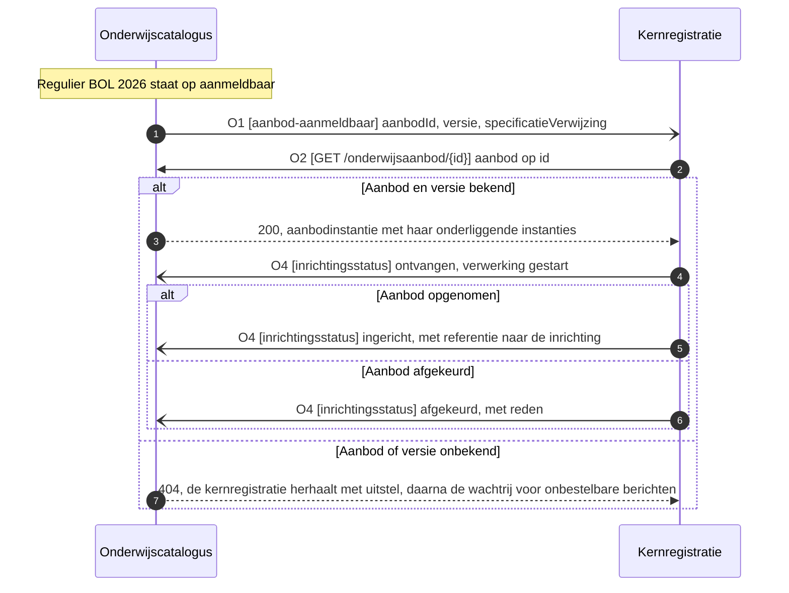

# IS-OA-05: aanmeldbaar opleidingsprogramma-aanbod naar de kernregistratie

De onderwijscatalogus ontsluit het aanmeld- en inschrijfbare `Opleidingsprogramma aanbod` aan de kernregistratie, waar de `Aanmelding` en de `Opleidingsprogramma aanbod verbintenis` van een aspirant-student erop ontstaan.

De uuid's, de versies en de namen in de voorbeeldpayload hieronder komen uit [casus.md](casus.md), de vaste identificaties van deze interactiespecificatie. Het aanbod is hetzelfde dat [IS-OA-04](stroom-is-oa-04.md) terugmeldt.

## De eenheid

| Kenmerk | Waarde |
|---|---|
| Bronsysteem | Onderwijscatalogus |
| Doelsysteem | Kernregistratie systeem studenten (KRS) |
| Koppeling | OC-KRS volgens de beeldregels, OC-SIS volgens hoofdplaat v1.7 ([S-A](#signaleringen)) |
| Beeld | [F3-01, aanmeldbaar aanbod naar de kernregistratie](../../../model/informatiemodel/img/regels/f3-01-aanmeldbaar-aanbod-naar-de-kernregistratie.svg) |
| Lading | `Opleidingsprogramma aanbod`, instantie `Regulier BOL 2026` |
| Status | De pijl en de koppeling staan op v1.7; het [interactiepatroon OC-SIS](https://github.com/Npuls-OKx/Public/blob/dev/Koppelvlakspecificaties/Interactiepatronen/onderwijscatalogus-studentinformatiesysteem.md) dekt specificatie en resultaatstructuur, en de operaties voor aanbod staan hier als werkbrief |
| Applicatiedienst | [planbaar-onderwijsaanbod-aanbieder](https://github.com/Npuls-OKx/Public/blob/d0c20d99b110b29ccf6b0e50109f7d54ffd88d7a/Koppelvlakspecificaties/Applicatiediensten/planbaar-onderwijsaanbod-aanbieder.md) bij de catalogus, [planbaar-onderwijsaanbod-afnemer](https://github.com/Npuls-OKx/Public/blob/d0c20d99b110b29ccf6b0e50109f7d54ffd88d7a/Koppelvlakspecificaties/Applicatiediensten/planbaar-onderwijsaanbod-afnemer.md) bij de kernregistratie, gepind op commit d0c20d99; die map staat nog niet op `dev` ([S-B](#signaleringen)) |

Grond per regel: [voorbeeld-lr1-regels.json](../../../model/informatiemodel/voorbeeld-lr1-regels.json), beeld F3-01. Objecttypen: [informatiemodel OKx](../../../model/informatiemodel/informatiemodel.md). Definities: [begrippenlijst](../begrippen/begrippenlijst.md). De eenheid in haar keten: [de interactiespecificatie](README.md).

## De stroom



De catalogus meldt dun en de kernregistratie haalt op ([U4](https://github.com/Npuls-OKx/Public/blob/dev/Koppelvlakspecificaties/uitgangspunten.md#u4-notify-then-pull)). Over de koppeling gaat een verwijzing, met de inhoud op opvraag ([U3](https://github.com/Npuls-OKx/Public/blob/dev/Koppelvlakspecificaties/uitgangspunten.md#u3-resource-eigenaarschap)).

## De operaties

| Id | Operatie | Implementeert | Methode | Parameters | Statuscodes | Foutgedrag | Grond |
|---|---|---|---|---|---|---|---|
| O1 | `aanbod-aanmeldbaar` | Kernregistratie | POST | geen | 200 | Herhalen met uitstel, daarna de wachtrij voor onbestelbare berichten (dead letter channel); herhaalde aflevering blijft zonder effect op het event-id | W1 |
| O2 | `/onderwijsaanbod/{id}` | Onderwijscatalogus | GET | `status`, optioneel filter op de onderliggende instanties | 200, 400, 404 | HTTP-foutcodes, de afnemer bepaalt de herhaling | [planbaar-onderwijsaanbod-aanbieder](https://github.com/Npuls-OKx/Public/blob/d0c20d99b110b29ccf6b0e50109f7d54ffd88d7a/Koppelvlakspecificaties/Applicatiediensten/planbaar-onderwijsaanbod-aanbieder.md) op commit d0c20d99, nog niet op `dev`; S-B belegt het pad |
| O3 | `/onderwijsaanbod/{id}/delta` | Onderwijscatalogus | GET | `van`, versie, verplicht; `naar`, versie, verplicht | 200, 400, 404 | HTTP-foutcodes | [U11](https://github.com/Npuls-OKx/Public/blob/dev/Koppelvlakspecificaties/uitgangspunten.md#u11-toekomstvaste-endpoints-volledige-structuur-en-delta), W7 |
| O4 | `inrichtingsstatus` | Onderwijscatalogus | POST | geen | 200 | Herhalen met uitstel, daarna de wachtrij voor onbestelbare berichten; herhaalde aflevering blijft zonder effect op het status-id | [dienstpagina onderwijscatalogus](https://github.com/Npuls-OKx/Public/blob/dev/Koppelvlakspecificaties/Applicatiecomponenten/onderwijscatalogus.md), interactie S4; W4 voor het payloadschema |
| O5 | `/abonnementen` | Onderwijscatalogus en kernregistratie | POST | geen | 201, 400 | HTTP-foutcodes; herregistratie overschrijft op de combinatie afleveradres plus meldingssoort | [dienstpagina onderwijscatalogus](https://github.com/Npuls-OKx/Public/blob/dev/Koppelvlakspecificaties/Applicatiecomponenten/onderwijscatalogus.md), interactie I8; W5 voor de meldingssoort |

Het bericht ligt hier vast, het kanaal blijft een inrichtingskeuze van instelling en leverancier binnen de eigenschappen die [U5](https://github.com/Npuls-OKx/Public/blob/dev/Koppelvlakspecificaties/uitgangspunten.md#u5-bericht-versus-kanaal) opsomt.

## De eisen

Deze eisen zijn de uitvraagbare kern van IS-OA-05.

| Id | Eis | Toetsgeval |
|---|---|---|
| E1 | De onderwijscatalogus meldt de kernregistratie dat een `Opleidingsprogramma aanbod` aanmeldbaar is, met id, versie en de verwijzing naar de specificatie | O1 op `Regulier BOL 2026`: de melding draagt aanbod-id, versie en specificatieverwijzing, en laat de aanbodinhoud bij de bezitter |
| E2 | De onderwijscatalogus levert dat aanbod op id, met de onderliggende instanties | O2 op `8c494250-b67a-4666-a762-6f9ec1e70aff`: statuscode 200, met de instanties die via `parentOfferingId` eronder hangen |
| E3 | Een tweede aflevering van dezelfde melding heeft geen aanvullend effect | O1 tweemaal afleveren met hetzelfde event-id: de kernregistratie richt het aanbod eenmaal in en meldt eenmaal `ingericht` |
| E4 | De kernregistratie meldt de uitkomst terug, met een referentie bij opname en een reden bij afkeuring | O4 na opname: status `ingericht` met de referentie naar de inrichting; na een validatiefout: status `afgekeurd` met reden |
| E5 | Een onbekend aanbod of een onbekende versie levert een verwerkbaar antwoord | O2 op een onbekend id: statuscode 404, waarna de kernregistratie herhaalt met uitstel en daarna neerlegt in de wachtrij voor onbestelbare berichten |

## De berichtspecificatie

Elk veld slaat terug op een objecttype uit het [informatiemodel OKx](../../../model/informatiemodel/informatiemodel.md). De kolom Grond noemt het schema in [Npuls-OKx/Public](https://github.com/Npuls-OKx/Public/tree/dev/Informatie-en-gegevensmodellen/schemas) of de werkbrief die het veld nog moet vastleggen.

De kolom Veld draagt de Engelse sleutel die over de koppeling gaat, de kolom Nederlands de naam uit [mapping.md](https://github.com/Npuls-OKx/Public/blob/dev/Informatie-en-gegevensmodellen/mapping.md). Enumwaarden blijven Nederlands. Een sleutel die vandaag in geen schema staat, draagt in de kolom Grond haar werkbrief met de aantekening voorgestelde naam ([S-G](#signaleringen)).

### M1, melding `aanbod-aanmeldbaar`

Dun, conform U4: de aanleiding met een verwijzing.

| Veld | Nederlands | Type | Kardinaliteit | Verplicht | Objecttype | Grond |
|---|---|---|---|---|---|---|
| `eventId` | `eventId` | uuid | 0..1 | nee | kanaaleigenschap, geen objecttype | W6, voorgestelde naam |
| `offeringId` | `aanbodId` | uuid | 1 | ja | `Opleidingsprogramma aanbod` | `id` uit [education-offering.json](https://github.com/Npuls-OKx/Public/blob/dev/Informatie-en-gegevensmodellen/schemas/education-offering.json), W1, voorgestelde naam |
| `version` | `versie` | string, semver | 1 | ja | `Opleidingsprogramma aanbod` | `version` uit education-offering.json, W1 |
| `offeringType` | `aanbodType` | enum | 1 | ja | `Opleidingsprogramma aanbod` | waarde `opleidingsprogramma-aanbod`, W1 |
| `specificationReference` | `specificatieVerwijzing` | object | 1 | ja | `Opleidingsprogramma specificatie` | [specification-reference.json](https://github.com/Npuls-OKx/Public/blob/dev/Informatie-en-gegevensmodellen/schemas/specification-reference.json), W1 |

### M2, respons van `GET /onderwijsaanbod/{id}`

De aanbodinstantie uit [education-offering.json](https://github.com/Npuls-OKx/Public/blob/dev/Informatie-en-gegevensmodellen/schemas/education-offering.json), op de laag `opleidingsprogramma-aanbod`. Zij staat in de array `offeringInstances` (aanbodInstanties), naast `locations` (locaties) en `organisationUnits` (organisatieEenheden).

| Veld | Nederlands | Type | Kardinaliteit | Verplicht | Objecttype | Grond |
|---|---|---|---|---|---|---|
| `id` | `id` | uuid | 1 | ja | `Opleidingsprogramma aanbod` | education-offering.json |
| `offeringType` | `aanbodType` | enum | 1 | ja | `Opleidingsprogramma aanbod` | waarde `opleidingsprogramma-aanbod` |
| `version` | `versie` | string, semver | 1 | ja | `Opleidingsprogramma aanbod` | education-offering.json |
| `parentOfferingId` | `bovenliggendAanbodId` | uuid of null | 1 | ja | `Opleiding aanbod` | education-offering.json, S-C |
| `specificationReference` | `specificatieVerwijzing` | object | 1 | ja | `Opleidingsprogramma specificatie` | [specification-reference.json](https://github.com/Npuls-OKx/Public/blob/dev/Informatie-en-gegevensmodellen/schemas/specification-reference.json) |
| `name` | `naam` | string | 1 | ja | `Opleidingsprogramma aanbod` | education-offering.json |
| `status` | `status` | enum | 1 | ja | `Opleidingsprogramma aanbod` | waarden `inPlanning`, `gepland`, `nietRealiseerbaar`, `geannuleerd`; W2 |
| `cohort` | `cohort` | string | 0..1 | nee | `Cohort / periode` | education-offering.json |
| `period` | `periode` | object | 0..1 | nee | `Cohort / periode` | [period.json](https://github.com/Npuls-OKx/Public/blob/dev/Informatie-en-gegevensmodellen/schemas/period.json), `start` en `end` |
| `minStudentCount` | `minAantalStudenten` | integer | 0..1 | nee | `Opleidingsprogramma aanbod` | education-offering.json |
| `maxStudentCount` | `maxAantalStudenten` | integer | 0..1 | nee | `Opleidingsprogramma aanbod` | education-offering.json |
| `locationId` | `locatieId` | uuid | 0..1 | nee | `Onderwijslocatie` | [location.json](https://github.com/Npuls-OKx/Public/blob/dev/Informatie-en-gegevensmodellen/schemas/location.json), uitgewerkt in `locations` |
| `executingTeamId` | `uitvoerendTeamId` | uuid | 0..1 | nee | `Organisatie-eenheid` | [organisation-unit.json](https://github.com/Npuls-OKx/Public/blob/dev/Informatie-en-gegevensmodellen/schemas/organisation-unit.json), uitgewerkt in `organisationUnits` |
| `groups` | `groepen` | array | 0..n | nee | `Plaatsingsgroep`, modelgat [S-F](#signaleringen) | [group.json](https://github.com/Npuls-OKx/Public/blob/dev/Informatie-en-gegevensmodellen/schemas/group.json), instantie `APO26-1A` |
| `bottlenecks` | `knelpunten` | array | 0..n | nee | `Opleidingsprogramma aanbod`, als eigenschap | [bottleneck.json](https://github.com/Npuls-OKx/Public/blob/dev/Informatie-en-gegevensmodellen/schemas/bottleneck.json) |

### M3, melding `inrichtingsstatus`

De dienstpagina van de onderwijscatalogus kent `inrichtingsstatus` als eigen melding naast `verwerkingsstatus`, elk met haar eigen interactie: `inrichtingsstatus` op S4 en L3, `verwerkingsstatus` op I3. Deze eenheid houdt die naam aan.

| Veld | Nederlands | Type | Kardinaliteit | Verplicht | Objecttype | Grond |
|---|---|---|---|---|---|---|
| `status` | `status` | enum | 1 | ja | verwerkingsinformatie, geen objecttype | `ontvangen`, `gestart` en `afgekeurd` staan in [processing-status.json](https://github.com/Npuls-OKx/Public/blob/dev/Informatie-en-gegevensmodellen/schemas/processing-status.json); `ingericht` en `nietIngericht` komen uit interactie S4 en liggen bij W4 |
| `offeringId` | `aanbodId` | uuid | 1 | ja | `Opleidingsprogramma aanbod` | W4, voorgestelde naam |
| `specificationReference` | `specificatieVerwijzing` | object | 1 | ja | `Opleidingsprogramma specificatie` | [specification-reference.json](https://github.com/Npuls-OKx/Public/blob/dev/Informatie-en-gegevensmodellen/schemas/specification-reference.json), verplicht in [processing-status.json](https://github.com/Npuls-OKx/Public/blob/dev/Informatie-en-gegevensmodellen/schemas/processing-status.json); de [dienstpagina onderwijscatalogus](https://github.com/Npuls-OKx/Public/blob/dev/Koppelvlakspecificaties/Applicatiecomponenten/onderwijscatalogus.md) legt specificatie-id en versie in deze payload |
| `arrangementReference` | `inrichtingReferentie` | uuid | 0..1 | nee | de inrichting bij de kernregistratie, geen objecttype | [dienstpagina onderwijscatalogus](https://github.com/Npuls-OKx/Public/blob/dev/Koppelvlakspecificaties/Applicatiecomponenten/onderwijscatalogus.md); W4, voorgestelde naam |
| `reason` | `reden` | string | 0..1 | nee | verwerkingsinformatie, geen objecttype | W4, voorgestelde naam |

## De voorbeeldpayload

Respons van O2 op `Regulier BOL 2026`, met alleen velden die [education-offering.json](https://github.com/Npuls-OKx/Public/blob/dev/Informatie-en-gegevensmodellen/schemas/education-offering.json) vandaag draagt. De uuid's staan in [casus.md](casus.md) en volgen daar de [voorbeeldpayloads](https://github.com/Npuls-OKx/Public/blob/dev/Informatie-en-gegevensmodellen/voorbeeldpayloads.md) in Public, de naam en de aantallen uit beeld F3-01 en F2-07.

```json
{
  "offeringInstances": [
    {
      "id": "7aa6609f-1d1b-471a-a0f8-beae490d31b5",
      "offeringType": "opleidingsaanbod",
      "version": "0.1.0",
      "parentOfferingId": null,
      "specificationReference": { "specificationId": "79736830-1c5c-470f-b2c2-005029c96733", "version": "0.1.0" },
      "name": "Apothekersassistent 2026",
      "status": "gepland",
      "cohort": "2026",
      "period": { "start": "2026-09-01", "end": "2029-07-15" }
    },
    {
      "id": "8c494250-b67a-4666-a762-6f9ec1e70aff",
      "offeringType": "opleidingsprogramma-aanbod",
      "version": "0.1.0",
      "parentOfferingId": "7aa6609f-1d1b-471a-a0f8-beae490d31b5",
      "specificationReference": { "specificationId": "7ae25c1e-ee27-43a2-a001-761ee39ea5c7", "version": "0.1.0" },
      "name": "Regulier BOL 2026",
      "status": "gepland",
      "bottlenecks": [],
      "cohort": "2026",
      "period": { "start": "2026-09-01", "end": "2029-07-15" },
      "minStudentCount": 24,
      "maxStudentCount": 48,
      "locationId": "59807057-a6f1-473b-9084-114644557a68",
      "executingTeamId": "d9561371-5ece-482d-a675-a076e63f980f"
    }
  ]
}
```

De crebo 23450 van het kwalificatiedossier staat in `learningOutcomes[].source.code` (leeruitkomsten[].bron.code) van de onderwijsspecificatie en is vanuit het aanbod via `specificationReference` en de leeruitkomst bereikbaar. Werkbrief W2 en W3 leggen de velden vast die het aanbod aanmeldbaar maken voor de kernregistratie en voor centraal aanmelden. Dit fragment toont de vorm die zij voorstellen.

```json
{
  "id": "8c494250-b67a-4666-a762-6f9ec1e70aff",
  "status": "aanmeldbaar",
  "applicationWindow": { "start": "2025-10-01", "end": "2026-08-01" },
  "codes": [
    { "codeType": "crebo", "code": "23450" },
    { "codeType": "kwalificatie", "code": "27141" }
  ]
}
```

## De werkbrieven

| Id | Wat erbij moet | In welk schema | Versie-impact |
|---|---|---|---|
| W1 | De melding `aanbod-aanmeldbaar` met `offeringId` (aanbodId), `version` (versie), `offeringType` (aanbodType) en `specificationReference` (specificatieVerwijzing), naar het model van `specificatie-planbaar` | Nieuw schema `offering-available.json`, plus een rij op de [dienstpagina van de kernregistratie](https://github.com/Npuls-OKx/Public/blob/dev/Koppelvlakspecificaties/Applicatiecomponenten/studentinformatiesysteem.md) | Nieuw schema en nieuw endpoint, additief: minor |
| W2 | Een uitdrukking van aanmeldbaarheid: de waarde `aanmeldbaar` in `status`, plus `applicationWindow` (aanmeldvenster, voorgestelde naam) met `start` en `end` voor de termijn waarin aanmelden openstaat, naast `period` (periode) die de looptijd draagt | [education-offering.json](https://github.com/Npuls-OKx/Public/blob/dev/Informatie-en-gegevensmodellen/schemas/education-offering.json), eigenschap `status` en een nieuwe eigenschap `applicationWindow` naar het model van [period.json](https://github.com/Npuls-OKx/Public/blob/dev/Informatie-en-gegevensmodellen/schemas/period.json) | Nieuw optioneel veld: minor. Een waarde toevoegen aan de gesloten `status`-lijst is additief voor de verzender en brekend voor wie op die lijst valideert: major |
| W3 | Een identificerende code op de aanbodinstantie, zodat crebo en kwalificatie meekomen zonder de leeruitkomstboom; [ADR 0023](https://github.com/Npuls-OKx/Public/blob/dev/Referentiemateriaal/adr/0023-leeruitkomsten-als-opaque-sleutels-in-koppeling-oc-p-en-r.md) houdt leeruitkomsten uit de koppeling met planning | [education-offering.json](https://github.com/Npuls-OKx/Public/blob/dev/Informatie-en-gegevensmodellen/schemas/education-offering.json), nieuwe eigenschap `codes` als array van [code.json](https://github.com/Npuls-OKx/Public/blob/dev/Informatie-en-gegevensmodellen/schemas/code.json), zoals `locations` (locaties) die al draagt | Nieuw optioneel veld: minor |
| W4 | Het payloadschema van `inrichtingsstatus`, met `offeringId` (aanbodId, voorgestelde naam) naast de `specificationReference` die de dienstpagina al vraagt, plus `arrangementReference` en `reason`. Daarbij horen de statuswaarden `ingericht` en `nietIngericht` die interactie S4 noemt, naast de waarden uit processing-status.json; [processing-status.json](https://github.com/Npuls-OKx/Public/blob/dev/Informatie-en-gegevensmodellen/schemas/processing-status.json) draagt `programmeOfferingId` (opleidingsaanbodId) voor de wortellaag, dus de naam zegt om welke laag het gaat | Nieuw schema `arrangement-status.json`, aangekondigd op de [dienstpagina van de onderwijscatalogus](https://github.com/Npuls-OKx/Public/blob/dev/Koppelvlakspecificaties/Applicatiecomponenten/onderwijscatalogus.md) als nog uit te werken | Nieuw schema, additief: minor |
| W5 | De meldingssoorten `aanbod-aanmeldbaar` en `inrichtingsstatus` in de lijst waarop een partij zich abonneert | [subscription.json](https://github.com/Npuls-OKx/Public/blob/dev/Informatie-en-gegevensmodellen/schemas/subscription.json), eigenschap `events` | Waarden toevoegen aan een gesloten lijst: additief voor de abonnee en brekend voor wie erop valideert, major |
| W6 | Een stabiel `eventId` op elke melding, dat U5 voor herhaalde aflevering eist. M1 houdt het veld op 0..1 zolang deze werkbrief openstaat, gelijk aan IS-OA-06 | [specification-changed.json](https://github.com/Npuls-OKx/Public/blob/dev/Informatie-en-gegevensmodellen/schemas/specification-changed.json), [specification-status-changed.json](https://github.com/Npuls-OKx/Public/blob/dev/Informatie-en-gegevensmodellen/schemas/specification-status-changed.json) en het nieuwe schema uit W1 | Optioneel: minor. Verplicht: major |
| W7 | De deltavorm op het aanbod, die U11 naast de volledige structuur vraagt | Nieuw schema `education-offering-delta.json` naar het model van [education-specification-delta.json](https://github.com/Npuls-OKx/Public/blob/dev/Informatie-en-gegevensmodellen/schemas/education-specification-delta.json), plus endpoint O3 op de dienstpagina | Nieuw schema en nieuw endpoint, additief: minor |

## Signaleringen

| Id | Signalering | Besluit |
|---|---|---|
| S-A | De beeldregels noemen deze koppeling OC-KRS, hoofdplaat v1.7 noemt haar OC-SIS, en het [interactiepatroon OC-SIS](https://github.com/Npuls-OKx/Public/blob/dev/Koppelvlakspecificaties/Interactiepatronen/onderwijscatalogus-studentinformatiesysteem.md) vat kernregistratie en studentvolgsysteem samen in hetzelfde component. Hetzelfde pijl-id draagt ook de stroom naar centraal aanmelden | Een naam en een pijl per koppeling, en of de kernregistratie hier als eigen component telt |
| S-B | De dienst `planbaar-onderwijsaanbod-aanbieder` legt haar endpoints bij het planningssysteem en [U3](https://github.com/Npuls-OKx/Public/blob/dev/Koppelvlakspecificaties/uitgangspunten.md#u3-resource-eigenaarschap) legt het aanbod daar. Deze eenheid laat de catalogus aanbod ontsluiten op O2, terwijl Public `/onderwijsaanbod/{id}` op de [dienstpagina van het planningssysteem](https://github.com/Npuls-OKx/Public/blob/dev/Koppelvlakspecificaties/Applicatiecomponenten/planningssysteem.md) belegt en de [dienstpagina van de onderwijscatalogus](https://github.com/Npuls-OKx/Public/blob/dev/Koppelvlakspecificaties/Applicatiecomponenten/onderwijscatalogus.md) de specificatiepaden draagt. De dienstenlijst staat op commit d0c20d99 van de branch `feature/restructure-and-versioning` en staat nog niet op `dev` | Claimt de catalogus dezelfde dienst, of komt er een dienst voor aanmeldbaar aanbod, en welk pad of voorvoegsel houdt een bezitter apart. Een eigen dienstpagina voor O2 naast W7 is de weg. Dit is signalering S4 van de [interactiespecificatie](README.md) |
| S-C | Het informatiemodel noemt de laag boven het programma `Opleiding aanbod`, de voorbeelduitwerking schrijft `Opleidingaanbod` | Een naam, in het model en in de voorbeelduitwerking gelijk |
| S-D | De voorbeelduitwerking geeft `Regulier BOL 2026` 24 tot 48 studenten, de voorbeeldpayload in Public geeft 18 tot 120 | Welke waarden de casus draagt |
| S-E | Het interactiepatroon OC-SIS kent voor deze koppeling nog geen interactie voor het registreren van een afleveradres, terwijl de melding O1 daarop leunt | Het afleveradres per koppeling, aansluitend op [U5](https://github.com/Npuls-OKx/Public/blob/dev/Koppelvlakspecificaties/uitgangspunten.md#u5-bericht-versus-kanaal) |
| S-F | `groups` (groepen) slaat terug op `Plaatsingsgroep`. [informatiemodel.json](../../../model/informatiemodel/informatiemodel.json) hangt dat objecttype aan de verbintenislagen en aan `Persoon`, terwijl [group.json](https://github.com/Npuls-OKx/Public/blob/dev/Informatie-en-gegevensmodellen/schemas/group.json) de capaciteit per groep op het aanbod zet. Werkbrief W5 van [IS-OA-04](stroom-is-oa-04.md) belegt dezelfde relatie | Een relatie van `Plaatsingsgroep` naar de aanbodlaag in het model, of de capaciteit per groep op de verbintenis. Modelwijziging zonder schemagevolg; de sleutel blijft `groups` |
| S-G | De sleutels in deze eenheid volgen de schema's en [mapping.md](https://github.com/Npuls-OKx/Public/blob/dev/Informatie-en-gegevensmodellen/mapping.md), die Engelse `properties` dragen met de Nederlandse naam als annotatie `DutchName`. Uitgangspunt [U7](https://github.com/Npuls-OKx/Public/blob/dev/Koppelvlakspecificaties/uitgangspunten.md#u7-payload-plat-met-verwijzingen-en-de-sleutelconventie) legt de sleutelconventie in het Nederlands vast, en de voorbeeldpayloads in Public volgen die | Welke sleuteltaal over de koppeling gaat, vastgelegd op een plek: de schema's of U7. Zolang die keuze openstaat valideert een payload tegen het schema, en dat is de vorm die hier staat |

Fase 3 begint hier; de aanmelding, de intake en de inschrijving beginnen bij beeld F3-03 en vallen buiten deze eenheid.
