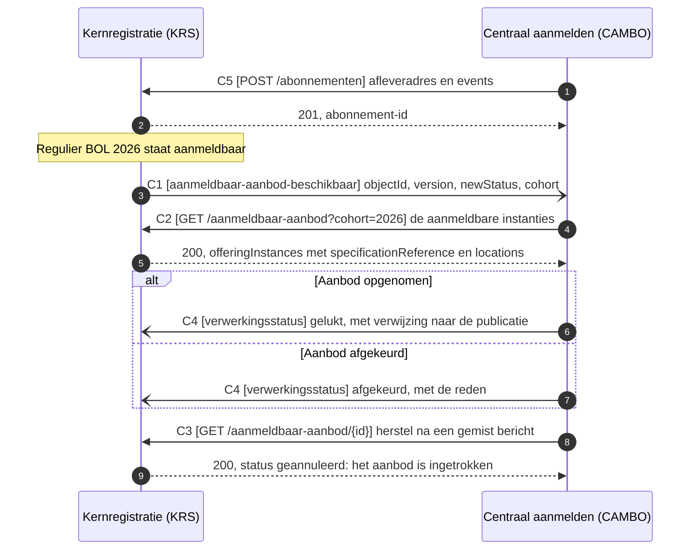

# IS-OA-06: het aanmeldbare aanbod naar centraal aanmelden

Deze eenheid ontsluit het `Opleidingsprogramma aanbod` van de kernregistratie aan de voorziening voor centraal aanmelden, zodat een aspirant-student daar het startmoment van een opleiding kiest.

## De eenheid

| | |
|---|---|
| Bronsysteem | `Kernregistratie systeem studenten (KRS)` |
| Doelsysteem | `Voorziening Centraal Aanmelden (CAMBO)`, de component die hoofdplaat v1.7 kent. Beeld F3-02 noemt AII als opvolger |
| Koppeling | Voorstel: KRS-CAMBO. De beeldregel draagt nog geen koppeling-ID en v1.7 tekent in deze richting geen pijl |
| Beeld | [F3-02](../../../model/informatiemodel/img/regels/f3-02-aanmeldbaar-aanbod-van-de-kernregistratie-naar-aii.svg), met instantie `Regulier BOL 2026` |
| Status | Voorstel. De afstemming met AII over aanmelden, inschrijven en intekenen staat open als [Public#112](https://github.com/Npuls-OKx/Public/issues/112) |
| Applicatiedienst | Voorstel: ontsluiten van aanmeldbaar aanbod, op het koppelvlak van de kernregistratie. Het model belegt bij KRS `Inschrijvingen beheer` en bij het aanmeldsysteem `Opleiding aanmelding dienst`; W7 vraagt de dienst die aanbod ontsluit |

De aannames waarop dit voorstel rust, met de partij die erover beslist:

| Nr | Aanname | Grond | Beslist |
|---|---|---|---|
| A1 | Het aanbod gaat naar de component `Voorziening Centraal Aanmelden (CAMBO)`, waarvoor beeld F3-02 AII als opvolger noemt | [voorbeeld-lr1-regels.json](../../../model/informatiemodel/voorbeeld-lr1-regels.json), F3-02; hoofdplaat v1.7 | OKx en AII, [Public#112](https://github.com/Npuls-OKx/Public/issues/112) |
| A2 | De kernregistratie is het ontsluitingspunt van de instelling naar de sector. [U3](https://github.com/Npuls-OKx/Public/blob/dev/Koppelvlakspecificaties/uitgangspunten.md#u3-resource-eigenaarschap) belegt het aanbod bij planning en reikt tot de instellingsgrens | keuze van de sectorarchitect in de beeldregel F3-02 | kerngroep techniek |
| A3 | Een startmoment is een eigen `Opleidingsprogramma aanbod`, met zijn startdatum in `period.start` (`periode.start`) | [education-offering.json](https://github.com/Npuls-OKx/Public/blob/dev/Informatie-en-gegevensmodellen/schemas/education-offering.json); het [conceptueel gegevensoverzicht van leerroute 1](../leerroute-uitwerking/doc/leerroute-uitwerking-lr1.md) noemt startmoment op het aanbod | OKx |
| A4 | De `specificationReference` (`specificatieVerwijzing`) blijft op elke instantie staan, zodat de lijn naar de catalogus leesbaar blijft | [U3](https://github.com/Npuls-OKx/Public/blob/dev/Koppelvlakspecificaties/uitgangspunten.md#u3-resource-eigenaarschap), [U7](https://github.com/Npuls-OKx/Public/blob/dev/Koppelvlakspecificaties/uitgangspunten.md#u7-payload-plat-met-verwijzingen-en-de-sleutelconventie) | OKx |
| A5 | Centraal aanmelden meldt terug of het aanbod is opgenomen | spiegelt interactie I3 van de koppeling OC-P&R | AII |
| A6 | Deze eenheid vult het instellings- en opleidingsaanbod aan dat centraal aanmelden uit het Register Instellingen en Opleidingen (RIO) ontvangt, met het programma-aanbod per startmoment | model: de stroom van RIO naar CAMBO draagt de instellings- en opleidingsgegevens | AII |

Op hoofdplaat v1.7 bereikt de catalogus zowel de kernregistratie als CAMBO langs een knooppunt (junction) achter de pijl van IS-OA-05. Welke route en welke naam gelden staat open als signalering S2 en S3 in de [interactiespecificatie](README.md#signaleringen-en-openstaande-punten).

## De stroom



Het patroon is melden en dan ophalen (notify-then-pull, [U4](https://github.com/Npuls-OKx/Public/blob/dev/Koppelvlakspecificaties/uitgangspunten.md#u4-notify-then-pull)): C1 draagt de aanleiding, C2 haalt de inhoud. Een intrekking rijdt mee op de status `geannuleerd` uit [education-offering.json](https://github.com/Npuls-OKx/Public/blob/dev/Informatie-en-gegevensmodellen/schemas/education-offering.json), zodat centraal aanmelden de reden van de intrekking leest.

## De operaties

Het koppelvlak van de kernregistratie in Public draagt vandaag uitsluitend meldpatronen (webhooks). Elke operatie hieronder is daarmee een werkbrief; de kolom Vorm noemt de bestaande operatie waarvan zij de vorm overneemt.

| Id | Operatie | Pad of event | Methode | Parameters | Statuscodes | Foutgedrag | Vorm |
|---|---|---|---|---|---|---|---|
| C1 | Aanmeldbaar aanbod melden, bij centraal aanmelden | `aanmeldbaar-aanbod-beschikbaar` | POST | geen | 200 | Zonder 200 volgt herhaling met uitstel (backoff) en daarna de wachtrij voor onbestelbare berichten (dead letter channel). Het bericht is herhaalbaar op `objectId`, het aanbod-id | `specificatie-planbaar` bij het planningssysteem (W5) |
| C2 | De aanmeldbare instanties ophalen, bij de kernregistratie | `/aanmeldbaar-aanbod` | GET | `cohort` (verplicht), `gewijzigdSinds` (optioneel, tijdstempel) | 200, 400 | 400 bij een cohort dat de kernregistratie niet kent. Alleen-lezen, dus herhalen geeft hetzelfde antwoord | `GET /onderwijsaanbod` bij het planningssysteem (W4) |
| C3 | Een enkele instantie ophalen, bij de kernregistratie | `/aanmeldbaar-aanbod/{id}` | GET | `versie` (optioneel, standaard de laatste) | 200, 400, 404 | 404 bij een onbekend aanbod-id. Een ingetrokken aanbod komt terug met status `geannuleerd` | `GET /onderwijsaanbod/{id}` bij het planningssysteem (W4) |
| C4 | De verwerking terugmelden, bij de kernregistratie | `verwerkingsstatus` | POST | geen | 200 | Zonder 200 volgt herhaling met uitstel en daarna de wachtrij voor onbestelbare berichten. Het bericht is herhaalbaar op `offeringReference` plus `status` | `verwerkingsstatus` bij de onderwijscatalogus (W6) |
| C5 | Het afleveradres vastleggen, over en weer | `/abonnementen` | POST | geen | 201, 400 | Herhaalbaar op `callbackUrl` plus eventtype: herregistratie overschrijft | `POST /abonnementen` bij de onderwijscatalogus (W5) |

## De berichten

De sleutel in de payload is de Engelse `properties`-naam uit het schema; de kolom Nederlands geeft de naam uit [mapping.md](https://github.com/Npuls-OKx/Public/blob/dev/Informatie-en-gegevensmodellen/mapping.md), waarmee wie de modellen kent de weg terugvindt. Een veld dat in geen schema staat draagt een werkbrief en een voorgestelde Engelse naam.

### C1, aanmeldbaar aanbod beschikbaar

Een dun bericht met de aanleiding.

| Veld | Nederlands | Type | Kardinaliteit | Verplicht | Objecttype | Grond |
|---|---|---|---|---|---|---|
| `objectId` | objectId | uuid | 1 | ja | `Opleidingsprogramma aanbod` | vorm van [specification-status-changed.json](https://github.com/Npuls-OKx/Public/blob/dev/Informatie-en-gegevensmodellen/schemas/specification-status-changed.json) (W5) |
| `version` | versie | string, semver | 1 | ja | `Opleidingsprogramma aanbod` | `version` in education-offering.json |
| `newStatus` | nieuweStatus | enum | 1 | ja | `Opleidingsprogramma aanbod` | naam uit specification-status-changed.json; `status` in education-offering.json, waarde `aanmeldbaar` (W1) |
| `cohort` | cohort | string | 0..1 | nee | `Cohort / periode` | `cohort` in education-offering.json |
| `eventId` | eventId | uuid | 0..1 | nee | verwerkingsinformatie, geen objecttype | [U5](https://github.com/Npuls-OKx/Public/blob/dev/Koppelvlakspecificaties/uitgangspunten.md#u5-bericht-versus-kanaal) vraagt een stabiel event-id; voorgestelde naam (W8) |

### C2 en C3, het aanmeldbare aanbod

De respons volgt education-offering.json, met `offeringInstances` (`aanbodInstanties`) en `locations` (`locaties`).

| Veld | Nederlands | Type | Kardinaliteit | Verplicht | Objecttype | Grond |
|---|---|---|---|---|---|---|
| `offeringInstances[].id` | id | uuid | 1 | ja | `Opleidingsprogramma aanbod` | education-offering.json |
| `offeringInstances[].offeringType` | aanbodType | enum | 1 | ja | `Opleiding aanbod`, `Opleidingsprogramma aanbod` | idem, met de waarden `opleidingsaanbod` en `opleidingsprogramma-aanbod` die deze koppeling meeneemt (W9) |
| `offeringInstances[].version` | versie | string, semver | 1 | ja | `Opleidingsprogramma aanbod` | idem |
| `offeringInstances[].parentOfferingId` | bovenliggendAanbodId | uuid of null | 1 | ja | `Opleiding aanbod` | idem |
| `offeringInstances[].specificationReference` | specificatieVerwijzing | object | 1 | ja | `Opleidingsprogramma specificatie` | [specification-reference.json](https://github.com/Npuls-OKx/Public/blob/dev/Informatie-en-gegevensmodellen/schemas/specification-reference.json) |
| `offeringInstances[].name` | naam | string | 1 | ja | `Opleidingsprogramma aanbod` | education-offering.json |
| `offeringInstances[].status` | status | enum | 1 | ja | `Opleidingsprogramma aanbod` | idem, waarde `aanmeldbaar` (W1) |
| `offeringInstances[].cohort` | cohort | string | 0..1 | nee | `Cohort / periode` | idem |
| `offeringInstances[].period` | periode | object, `start` en `end` | 0..1 | nee | `Opleidingsprogramma aanbod` | [period.json](https://github.com/Npuls-OKx/Public/blob/dev/Informatie-en-gegevensmodellen/schemas/period.json); `start` draagt het startmoment (A3) |
| `offeringInstances[].minStudentCount` | minAantalStudenten | integer | 0..1 | nee | `Opleidingsprogramma aanbod` | education-offering.json |
| `offeringInstances[].maxStudentCount` | maxAantalStudenten | integer | 0..1 | nee | `Opleidingsprogramma aanbod` | idem, draagt de instroomcapaciteit |
| `offeringInstances[].locationId` | locatieId | uuid | 0..1 | nee | `Onderwijslocatie` | idem, op te lossen in `locations` |
| `offeringInstances[].executingTeamId` | uitvoerendTeamId | uuid | 0..1 | nee | `Organisatie-eenheid` | [organisation-unit.json](https://github.com/Npuls-OKx/Public/blob/dev/Informatie-en-gegevensmodellen/schemas/organisation-unit.json) |
| `offeringInstances[].source` | bron | array van object | 0..n | nee | `Kwalificatie dossier`, `Kwalificatie` | vorm van [source.json](https://github.com/Npuls-OKx/Public/blob/dev/Informatie-en-gegevensmodellen/schemas/source.json), nu alleen op de leeruitkomst (W2) |
| `offeringInstances[].enrolmentDeadline` | uitersteInschrijfdatum | string, date | 0..1 | nee | `Opleiding aanbod` | het [conceptueel gegevensoverzicht van leerroute 1](../leerroute-uitwerking/doc/leerroute-uitwerking-lr1.md) legt haar op de opleidingslaag, die het model `Opleiding aanbod` noemt; voorgestelde naam (W3) |
| `locations[]` | locaties | array van object | 0..n | nee | `Onderwijslocatie` | [location.json](https://github.com/Npuls-OKx/Public/blob/dev/Informatie-en-gegevensmodellen/schemas/location.json); `codes` draagt de vestigingscode |

### C4, de verwerking terug

De vorm van [processing-status.json](https://github.com/Npuls-OKx/Public/blob/dev/Informatie-en-gegevensmodellen/schemas/processing-status.json), met het aanbod als onderwerp.

| Veld | Nederlands | Type | Kardinaliteit | Verplicht | Objecttype | Grond |
|---|---|---|---|---|---|---|
| `status` | status | enum: `ontvangen`, `gestart`, `afgekeurd`, `gelukt`, `nietGelukt` | 1 | ja | verwerkingsinformatie, geen objecttype | processing-status.json (W6) |
| `offeringReference` | aanbodVerwijzing | object, `offeringId` en `version` | 1 | ja | `Opleidingsprogramma aanbod` | vorm van specification-reference.json; voorgestelde naam (W6) |
| `publicationReference` | publicatieVerwijzing | uuid | 0..1 | nee | de publicatie bij centraal aanmelden, modelgat in W6 | spiegelt `programmeOfferingId` (`opleidingsaanbodId`) in processing-status.json, dat op `Opleiding aanbod` terugslaat; voorgestelde naam (W6) |
| `reason` | reden | string | 0..1 | nee | verwerkingsinformatie, geen objecttype | hoort bij `afgekeurd` en `nietGelukt`; voorgestelde naam (W6) |

Welk deel van education-offering.json over deze koppeling reist hoort in [gebruiksprofielen.md](https://github.com/Npuls-OKx/Public/blob/dev/Informatie-en-gegevensmodellen/gebruiksprofielen.md) (W9). Het voorstel: de lagen `opleidingsaanbod` en `opleidingsprogramma-aanbod` met hun locaties reizen mee, `groups` (`groepen`) en `bottlenecks` (`knelpunten`) blijven binnen de instelling.

## De voorbeeldpayload

De respons op `GET /aanmeldbaar-aanbod?cohort=2026` voor Apothekersassistent, crebo-dossier 23450 met kwalificatie 27141. De uuid's komen uit de [voorbeeldpayload in Public](https://github.com/Npuls-OKx/Public/blob/dev/Informatie-en-gegevensmodellen/voorbeeldpayloads.md) voor dezelfde casus, de sleutels uit de `properties` van de schema's. De waarde `aanmeldbaar` in `status`, het veld `source` en het veld `enrolmentDeadline` rusten op een werkbrief.

```json
{
  "offeringInstances": [
    {
      "id": "7aa6609f-1d1b-471a-a0f8-beae490d31b5",
      "offeringType": "opleidingsaanbod",
      "version": "0.1.0",
      "parentOfferingId": null,
      "specificationReference": { "specificationId": "79736830-1c5c-470f-b2c2-005029c96733", "version": "0.1.0" },
      "name": "Apothekersassistent 2026",
      "status": "aanmeldbaar",
      "cohort": "2026",
      "period": { "start": "2026-09-01", "end": "2029-07-15" },
      "maxStudentCount": 48,
      "enrolmentDeadline": "2026-08-15",
      "source": [
        { "standard": "sbb-kwalificatiekader", "type": "kwalificatiedossier", "code": "23450" },
        { "standard": "sbb-kwalificatiekader", "type": "kwalificatie", "code": "27141" }
      ]
    },
    {
      "id": "8c494250-b67a-4666-a762-6f9ec1e70aff",
      "offeringType": "opleidingsprogramma-aanbod",
      "version": "0.1.0",
      "parentOfferingId": "7aa6609f-1d1b-471a-a0f8-beae490d31b5",
      "specificationReference": { "specificationId": "7ae25c1e-ee27-43a2-a001-761ee39ea5c7", "version": "0.1.0" },
      "name": "Regulier BOL 2026",
      "status": "aanmeldbaar",
      "cohort": "2026",
      "period": { "start": "2026-09-01", "end": "2029-07-15" },
      "minStudentCount": 24,
      "maxStudentCount": 48,
      "locationId": "59807057-a6f1-473b-9084-114644557a68",
      "executingTeamId": "d9561371-5ece-482d-a675-a076e63f980f"
    }
  ],
  "locations": [
    {
      "id": "59807057-a6f1-473b-9084-114644557a68",
      "locationType": "vestiging",
      "name": "Hoofdlocatie Utrecht",
      "partOfLocationId": null,
      "codes": [ { "codeType": "vestigingscode", "code": "UTR-01" } ]
    }
  ]
}
```

## De werkbrieven

Alle schema's dragen het label alfa in hun `$id`, dus een uitbreiding blijft binnen dezelfde ronde.

| Nr | Wat erbij moet | Waar | Versie-impact |
|---|---|---|---|
| W1 | De waarde `aanmeldbaar` in de enum `status`, naast `inPlanning`, `gepland`, `nietRealiseerbaar` en `geannuleerd` | `education-offering.json`, `offeringInstances[].status` | Uitbreiding van de enum. Een afnemer die strikt valideert loopt mee in dezelfde alfa-ronde |
| W2 | Het veld `source` (`bron`) op de aanbodinstantie, als array van `source.json`, zodat het aanbod zijn crebo-dossier en kwalificatie draagt. Het alternatief laat centraal aanmelden de code ophalen langs de `specificationReference` | `education-offering.json`, `offeringInstances[].source`, met `source.json` als type | Optioneel veld, verenigbaar met de huidige alfa. `source.json` is nu een enkel object op `learning-outcome.json` en wordt hier een array |
| W3 | Het veld `enrolmentDeadline` (`uitersteInschrijfdatum`), voorgestelde naam, op de instantie van de laag `opleidingsaanbod`: daar legt het conceptueel gegevensoverzicht van leerroute 1 de uiterste inschrijfdatum, naast de opleidingsspecificatie. De werkbrief legt die laag vast | `education-offering.json`, `offeringInstances[].enrolmentDeadline` | Optioneel veld, verenigbaar met de huidige alfa. Een latere verschuiving naar de programmalaag is brekend voor de afnemer die hem al leest |
| W4 | De operaties `GET /aanmeldbaar-aanbod` en `GET /aanmeldbaar-aanbod/{id}`, met de parameters en statuscodes uit de operatietabel | de componentpagina [studentinformatiesysteem.md](https://github.com/Npuls-OKx/Public/blob/dev/Koppelvlakspecificaties/Applicatiecomponenten/studentinformatiesysteem.md) | Nieuwe regels in de endpointtabel, waar de kernregistratie vandaag uitsluitend meldpatronen draagt |
| W5 | Een eventschema `aanmeldbaar-aanbod-beschikbaar` met de velden uit de C1-tabel, en de bijbehorende waarde in de enum `events` | nieuw bestand in `schemas/`, plus `subscription.json` | Nieuw schema met eigen `$id`; de releasebijlage leest de map in. Voor `subscription.json` een enum-uitbreiding |
| W6 | Een statusschema voor het aanbod, met `offeringReference`, `publicationReference` en `reason` als voorgestelde namen, naast het bestaande schema dat op een specificatie sleutelt. `publicationReference` wijst naar de publicatie bij centraal aanmelden, een modelgat in het informatiemodel OKx | nieuw bestand in `schemas/`, naast `processing-status.json`; het modelgat in het [informatiemodel](../../../model/informatiemodel/informatiemodel.md) | Nieuw schema met eigen `$id`. Het objecttype voor de publicatie volgt de afstemming met AII, [Public#112](https://github.com/Npuls-OKx/Public/issues/112) |
| W7 | Een applicatiedienst die aanmeldbaar aanbod ontsluit, op het koppelvlak van de kernregistratie, met de pijl naar centraal aanmelden erbij | het ArchiMate-model en de volgende versie van de informatiestromen-hoofdplaat | Nieuwe versie van de plaat. Volgt op het besluit over richting en naam, signalering S2 en S3 |
| W8 | Een stabiel `eventId`, voorgestelde naam, in elk bericht, dat [U5](https://github.com/Npuls-OKx/Public/blob/dev/Koppelvlakspecificaties/uitgangspunten.md#u5-bericht-versus-kanaal) vraagt voor herhaalbare verwerking | alle eventschema's in `schemas/`, dus breder dan deze eenheid | Optioneel veld per schema, verenigbaar met de huidige alfa |
| W9 | Het gebruiksprofiel van deze koppeling: welke lagen van het aanbod meereizen | [gebruiksprofielen.md](https://github.com/Npuls-OKx/Public/blob/dev/Informatie-en-gegevensmodellen/gebruiksprofielen.md) | Nieuwe sectie, naast de bestaande profielen |

De eis die een instelling hieruit uitvraagt: de kernregistratie ontsluit het aanmeldbare `Opleidingsprogramma aanbod` per startmoment aan centraal aanmelden, met de verwijzing naar de specificatie erop, en neemt de terugmelding over de verwerking aan. De vorm van die eis ligt vast zodra de aannames hierboven zijn beantwoord, in de afstemming met AII die [Public#112](https://github.com/Npuls-OKx/Public/issues/112) draagt.
