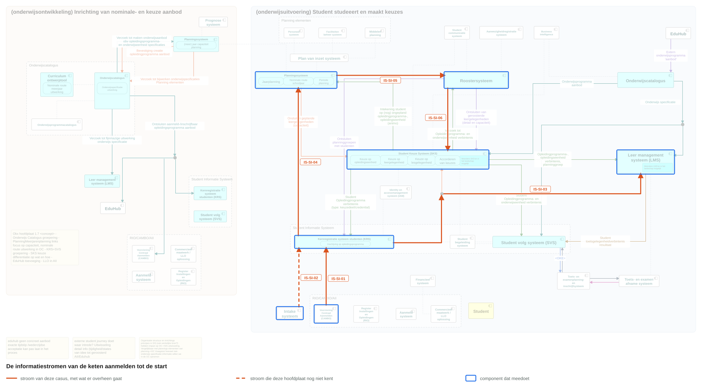
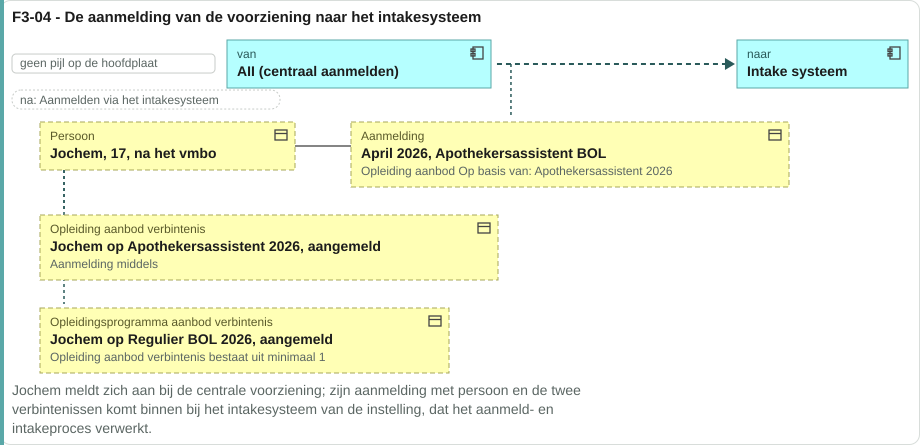
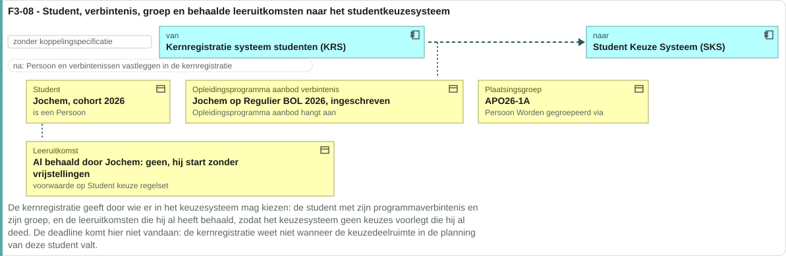
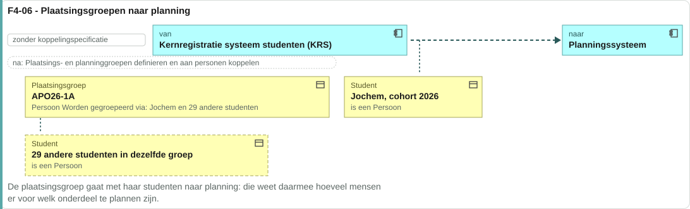
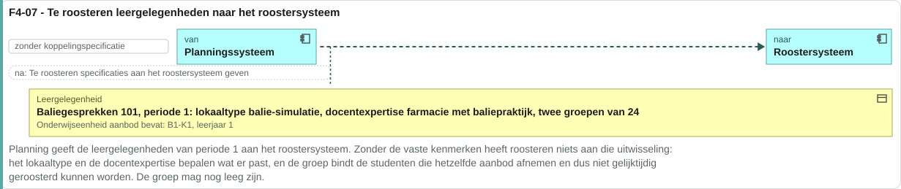
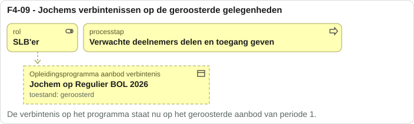
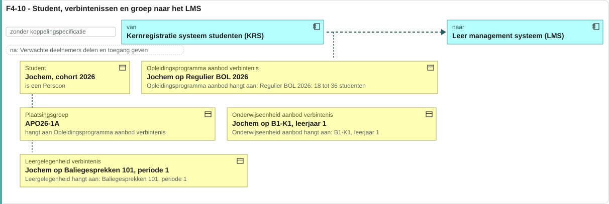
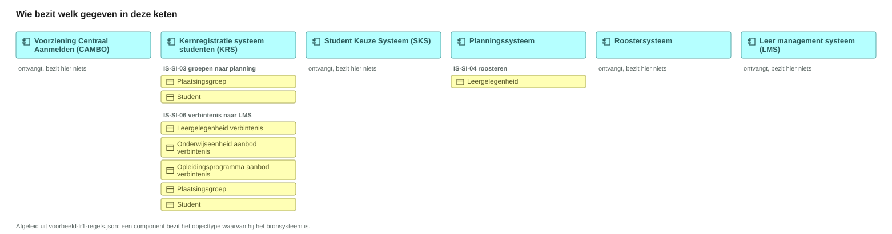
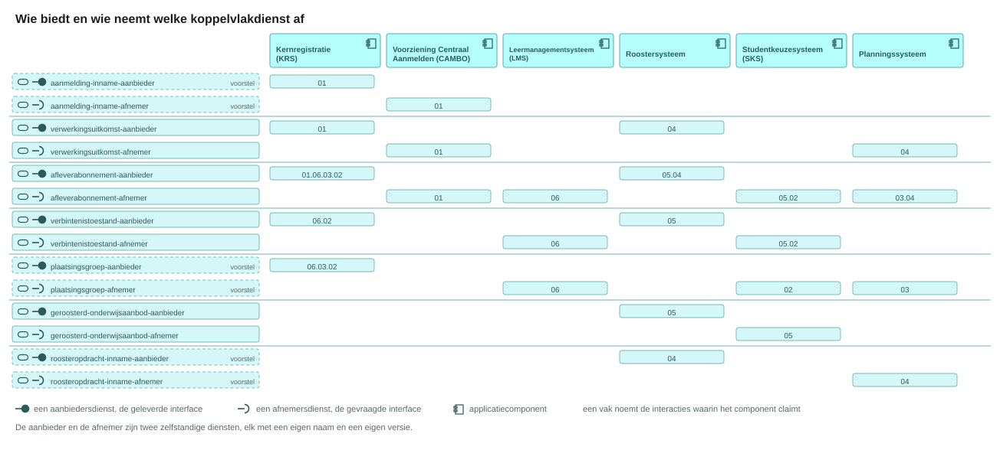
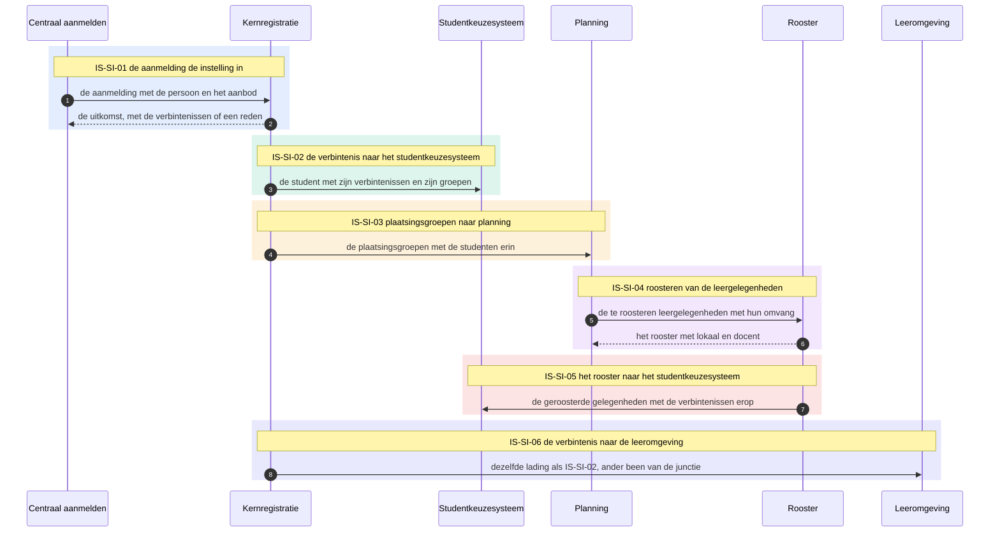

# Interactieketenspecificatie: aanmelden, intake, inschrijven en roosteren tot de start

| | |
|---|---|
| **Document doel** | Legt vast welke koppelingen een instelling nodig heeft om een student van aanmelding naar een geroosterde verbintenis te brengen, en wat een leverancier daarvoor bouwt |
| **Doelgroep** | De implementatiespecialist en de tester bij een instelling of een leverancier, en wie een profiel of consumer bouwt |
| **Dient als input voor** | De bouw van de koppelvlakken, de testgevallen erbij, en de acceptatie van een opgeleverde koppeling |
| **Kaderstelling** | Het [informatiemodel OKx](../../../model/informatiemodel/informatiemodel.md), de [uitgangspunten](https://github.com/Npuls-OKx/Public/blob/dev/Koppelvlakspecificaties/uitgangspunten.md) en hoofdplaat v1.7, en de keten [onderwijsaanbod ontsluiten](../interactie-onderwijsaanbod/README.md) waarop zij voortbouwt |
| **Inhoud** | Zes interactiespecificaties met hun operaties en berichten, twee signaleringen, en de koppelvlakdiensten per applicatiecomponent |
| **Status** | Voorstel. Vijf van de zes stromen die deze keten draagt, staan op v1.7 zonder koppelingspecificatie |

## Leeswijzer

| Bestand | Wat erin staat |
|---|---|
| [signaleringen.md](signaleringen.md) | Een punt dat een besluit vraagt |
| De zes interactiespecificaties | Het contract per koppelvlakdienst, met het bericht onder zijn operatie |

## 1. De informatiestromen

Deze keten bouwt voort op [onderwijsaanbod ontsluiten](../interactie-onderwijsaanbod/README.md): daar staat het aanbod aanmeldbaar, hier meldt een student zich erop aan. Zij begint waar de aanmelding de instelling binnenkomt, eindigt bij een student die geroosterd en ingericht staat, en alle zes haar stromen staan op hoofdplaat v1.7 zonder koppelingspecificatie.

| Eenheid | Beelden | Van | Naar | Stroom op hoofdplaat v1.7 |
|---|---|---|---|---|
| IS-SI-01 | F3-04 | Voorziening Centraal Aanmelden (CAMBO) | Kernregistratie (KRS) | `Persoon(Student) Opleidingprogramma verbintenis` |
| IS-SI-02 | F3-07, F3-08 | Kernregistratie (KRS) | Studentkeuzesysteem (SKS) | `Student, opleidingprogramma verbintenis, relevante groepen` |
| IS-SI-03 | F4-06 | Kernregistratie (KRS) | Planningssysteem | `Ontsluiten plaatsingsgroepen met studenten` |
| IS-SI-04 | F4-07, F4-08 | Planningssysteem | Roostersysteem | `Verzoek tot roosteren leergelegenheid` |
| IS-SI-05 | F4-09 | Roostersysteem | Studentkeuzesysteem (SKS) | `Student Opleidingprogramma- en onderwijseenheid verbintenis` ([S1](signaleringen.md)) |
| IS-SI-06 | F4-10 | Kernregistratie (KRS) | Leermanagementsysteem (LMS) | Hetzelfde been van de junctie als IS-SI-02 |

Een instelling wijst hier aan welke interactiespecificatie zij uitvraagt; de aanduiding blijft staan ook als de naam verandert. De eenheden volgen de beeldnummers van de voorbeelduitwerking, en dat is ook de volgorde waarin een instelling ze doorloopt. IS-SI-02 en IS-SI-06 delen hun lading: de kernregistratie bedient het studentkeuzesysteem en de leeromgeving langs dezelfde junctie. Het zijn twee eenheden, want een koppeling verbindt twee componenten en de afnemers verschillen; IS-SI-06 wijst voor de lading naar IS-SI-02.

Wat voor, naast en na deze keten valt, staat in [signaleringen.md](signaleringen.md). Drie draden lopen door vanuit de vorige keten:

| Wat | Waar het vandaan komt |
|---|---|
| Het opleidingsprogramma-aanbod waarop Jochem zich meldt | IS-OA-05 en IS-OA-06, met dezelfde identificatie in [casus.md](casus.md) |
| De specificatie waarop de leeromgeving haar onderdelen inricht | IS-OA-07 |
| De leergelegenheid die hier geroosterd wordt | het geplande aanbod van IS-OA-04 |

### IS-SI-01 De aanmelding de instelling in

Links de voorziening die de aanmelding aanlevert, rechts de instelling die haar aanneemt. De twee verbintenissen staan in de toestand `aangemeld`; wat de instelling ermee doet komt terug op de melding.

Het beeld noemt het intakesysteem als ontvanger. Deze keten legt de aanmelding bij de kernregistratie, want het intakesysteem valt buiten scope.

### IS-SI-02 De verbintenis naar het studentkeuzesysteem

De kernregistratie levert wat zij over de student weet. Het studentkeuzesysteem kan die verbintenis pas plaatsen als het het aanbod kent; die inrichting hoort bij de keuzedeelketen.

Voorafgegaan door [F3-07](../../../model/informatiemodel/voorbeeld-leerroute-1-jochem.md), waar de inschrijving en de verbintenissen bij de kernregistratie ontstaan.

### IS-SI-03 Plaatsingsgroepen naar planning

Planning heeft de aantallen nodig voordat zij leergelegenheden kan beleggen. De groep is de eenheid, niet de student.

De plaatsingsgroep ontstaat bij de intake, die buiten deze keten valt.

### IS-SI-04 Roosteren van de leergelegenheden

Planning geeft door wat geroosterd moet worden; het roostersysteem bepaalt wanneer en waar. Beeld F4-08 laat zien wat daaruit komt: lesgelegenheid, lokaal en docent.

De leergelegenheid komt uit het geplande aanbod van de keten [onderwijsaanbod ontsluiten](../interactie-onderwijsaanbod/README.md).

### IS-SI-05 Het rooster naar het studentkeuzesysteem

De verbintenis op een gelegenheid ontstaat pas als die gelegenheid een plaats en een tijd heeft. Het beeld laat haar in de kernregistratie landen; deze keten legt haar in het studentkeuzesysteem ([S1](signaleringen.md)).

Volgt op F4-08, waar het roosteren zelf gebeurt.

### IS-SI-06 De verbintenis naar de leeromgeving

Dezelfde lading als IS-SI-02, langs het andere been van dezelfde junctie. De leeromgeving richt hiermee de deelnemers op haar onderdelen in.

De specificatie waarop die onderdelen staan, komt uit IS-OA-07 van de keten onderwijsaanbod.

## 2. Wat deze keten oplevert

| Partij | Wat zij eruit haalt |
|---|---|
| Instelling | De koppelingen die zij uitvraagt om een student van aanmelding naar rooster te brengen, met de aanduiding per eenheid |
| Leverancier | Het contract per koppelvlakdienst: welke endpoints zij bouwt en welke zij aanroept |
| Tester | De operaties met hun statuscodes en voorbeeldpayloads |

## 3. Gegevensoorsprong en bronsysteem

Deze keten maakt weinig en verplaatst veel: van de dertig regels in de voorbeelduitwerking die haar beelden dragen, zegt er vijf `ontstaat` en drieentwintig `stroomt`. Wat hier beweegt is elders gemaakt, in de keten [onderwijsaanbod ontsluiten](../interactie-onderwijsaanbod/README.md) en bij de intake die buiten scope valt. Alleen de kernregistratie en het planningssysteem dragen hier een eigen bron.

Dat is ook waarom de vraag wie de bron is in deze keten minder bijt dan de vraag wie een dienst claimt: er valt weinig te bezitten en veel te leveren.

## 4. Koppelvlakdiensten

Een dienst zegt wat er over een koppeling moet kunnen, en elk component kan hem claimen; de aanbieder en de afnemer zijn twee losse diensten. Een leverancier die meer dan een component in een product draagt, legt dat product daarom op deze laag.

| Component | Dienst | Endpoints en meldingen | Eenheid | Stand |
|---|---|---|---|---|
| Kernregistratie (KRS) | aanmelding-inname-aanbieder | `POST /aanmeldingen`, `GET /aanmeldingen/{id}` | IS-SI-01 | Voorstel (W1) |
| Kernregistratie (KRS) | verwerkingsuitkomst-aanbieder | de melding `aanmelding-verwerkt` | IS-SI-01 | Voorstel (W3) |
| Kernregistratie (KRS) | afleverabonnement-aanbieder | `POST /abonnementen` | IS-SI-01 | Voorstel |
| Voorziening Centraal Aanmelden (CAMBO) | aanmelding-inname-afnemer | `POST /aanmeldingen`, `GET /aanmeldingen/{id}` bij de kernregistratie | IS-SI-01 | Voorstel |
| Voorziening Centraal Aanmelden (CAMBO) | verwerkingsuitkomst-afnemer | de melding `aanmelding-verwerkt` | IS-SI-01 | Voorstel |
| Voorziening Centraal Aanmelden (CAMBO) | afleverabonnement-afnemer | `POST /abonnementen` bij de kernregistratie | IS-SI-01 | Voorstel |
| Kernregistratie (KRS) | verbintenistoestand-aanbieder | `GET /verbintenissen`, de melding `verbintenistoestand-gewijzigd` | IS-SI-06 | Voorstel (W1) |
| Kernregistratie (KRS) | plaatsingsgroep-aanbieder | `GET /plaatsingsgroepen`, de melding `plaatsingsgroep-gewijzigd` | IS-SI-06 | Voorstel (W2) |
| Kernregistratie (KRS) | afleverabonnement-aanbieder | `POST /abonnementen` | IS-SI-06 | Voorstel (W3) |
| Leermanagementsysteem (LMS) | verbintenistoestand-afnemer | `GET /verbintenissen` bij de kernregistratie, de melding `verbintenistoestand-gewijzigd` | IS-SI-06 | Voorstel |
| Leermanagementsysteem (LMS) | plaatsingsgroep-afnemer | `GET /plaatsingsgroepen` bij de kernregistratie, de melding `plaatsingsgroep-gewijzigd` | IS-SI-06 | Voorstel |
| Leermanagementsysteem (LMS) | afleverabonnement-afnemer | `POST /abonnementen` bij de kernregistratie | IS-SI-06 | Voorstel |
| Roostersysteem | geroosterd-onderwijsaanbod-aanbieder | `GET /geroosterd-aanbod` met `/{id}`, en de melding `rooster-vastgesteld` | IS-SI-05 | Voorstel (W1) |
| Roostersysteem | verbintenistoestand-aanbieder | `GET /verbintenissen`, en de melding `verbintenis-geroosterd` | IS-SI-05 | Voorstel (W1) |
| Roostersysteem | afleverabonnement-aanbieder | `POST /abonnementen` | IS-SI-05 | Voorstel (W4) |
| Studentkeuzesysteem (SKS) | geroosterd-onderwijsaanbod-afnemer | `GET /geroosterd-aanbod` met `/{id}` bij het roostersysteem, en de melding `rooster-vastgesteld` | IS-SI-05 | Voorstel |
| Studentkeuzesysteem (SKS) | verbintenistoestand-afnemer | `GET /verbintenissen` bij het roostersysteem, en de melding `verbintenis-geroosterd` | IS-SI-05 | Voorstel |
| Studentkeuzesysteem (SKS) | afleverabonnement-afnemer | `POST /abonnementen` bij het roostersysteem | IS-SI-05 | Voorstel |
| Kernregistratie (KRS) | plaatsingsgroep-aanbieder | `GET /plaatsingsgroepen`, de melding `plaatsingsgroep-gewijzigd` | IS-SI-03 | Voorstel (W1) |
| Kernregistratie (KRS) | afleverabonnement-aanbieder | `POST /abonnementen` | IS-SI-03 | Voorstel (W4) |
| Planningssysteem | plaatsingsgroep-afnemer | `GET /plaatsingsgroepen` bij de kernregistratie, de melding `plaatsingsgroep-gewijzigd` | IS-SI-03 | Voorstel |
| Planningssysteem | afleverabonnement-afnemer | `POST /abonnementen` bij de kernregistratie | IS-SI-03 | Voorstel |
| Kernregistratie (KRS) | verbintenistoestand-aanbieder | `GET /verbintenissen`, de melding `verbintenistoestand-gewijzigd` | IS-SI-02 | Voorstel (W1) |
| Kernregistratie (KRS) | plaatsingsgroep-aanbieder | `GET /plaatsingsgroepen`, de melding `plaatsingsgroep-gewijzigd` | IS-SI-02 | Voorstel (W2) |
| Kernregistratie (KRS) | afleverabonnement-aanbieder | `POST /abonnementen` | IS-SI-02 | Voorstel (W5) |
| Studentkeuzesysteem (SKS) | verbintenistoestand-afnemer | `GET /verbintenissen` bij de kernregistratie, de melding `verbintenistoestand-gewijzigd` | IS-SI-02 | Voorstel |
| Studentkeuzesysteem (SKS) | plaatsingsgroep-afnemer | `GET /plaatsingsgroepen` bij de kernregistratie, de melding `plaatsingsgroep-gewijzigd` | IS-SI-02 | Voorstel |
| Studentkeuzesysteem (SKS) | afleverabonnement-afnemer | `POST /abonnementen` bij de kernregistratie | IS-SI-02 | Voorstel |
| Roostersysteem | roosteropdracht-inname-aanbieder | `POST /roosteropdrachten`, `GET /roosteropdrachten/{id}` | IS-SI-04 | Voorstel (W2) |
| Roostersysteem | verwerkingsuitkomst-aanbieder | de melding `roosteropdracht-verwerkt` | IS-SI-04 | Voorstel (W2) |
| Roostersysteem | afleverabonnement-aanbieder | `POST /abonnementen` | IS-SI-04 | Voorstel op deze koppeling |
| Planningssysteem | roosteropdracht-inname-afnemer | `POST /roosteropdrachten`, `GET /roosteropdrachten/{id}` bij het roostersysteem | IS-SI-04 | Voorstel |
| Planningssysteem | verwerkingsuitkomst-afnemer | de melding `roosteropdracht-verwerkt` | IS-SI-04 | Voorstel |
| Planningssysteem | afleverabonnement-afnemer | `POST /abonnementen` bij het roostersysteem | IS-SI-04 | Voorstel |

De dienstnamen volgen de [dienstenlijst](https://github.com/Npuls-OKx/Public/blob/d0c20d99b110b29ccf6b0e50109f7d54ffd88d7a/Koppelvlakspecificaties/Applicatiediensten/README.md) van Npuls-OKx/Public. `aanmelding-inname`, `plaatsingsgroep` en `roosteropdracht-inname` staan daar nog niet en worden hier voorgesteld.

## 5. Afspraken die elke dienst nakomt

Deze afspraken komen uit Npuls-OKx/Public en gelden voor elke interactie. Een interactiespecificatie noemt alleen waar zij afwijkt.

| Afspraak | Wat zij de implementator oplegt | Waar zij staat | Stand in deze keten |
|---|---|---|---|
| Volledige structuur en delta | Wie een structuurresource bezit, ontsluit haar in beide vormen: de hele structuur en het verschil als JSON Patch (RFC 6902). De afnemer kiest | [U11](https://github.com/Npuls-OKx/Public/blob/dev/Koppelvlakspecificaties/uitgangspunten.md#u11-toekomstvaste-endpoints-volledige-structuur-en-delta) | Niet nagekomen: geen van de resources hier draagt een `/delta` |
| Idempotentie | Een GET levert bij herhaling hetzelfde. Een webhook delivery is idempotent op `eventId`. Een subscription is idempotent op `callbackUrl` plus event | de componentpagina's | Nagekomen |
| Dunne melding, daarna ophalen | Een event draagt een verwijzing en geen structuur; de afnemer haalt daarna op | [U4](https://github.com/Npuls-OKx/Public/blob/dev/Koppelvlakspecificaties/uitgangspunten.md) | Nagekomen in IS-SI-02, IS-SI-03 en IS-SI-05 |
| Begrensd ophalen van een collectie | Een collectie-endpoint laat de afnemer in brokken ophalen | nergens | Niet belegd, zoals in de keten onderwijsaanbod |

Een enum leeft in het schema dat het veld draagt. De interactiespecificatie zegt per waarde wat zij de ontvanger oplegt.

## 6. De interactieketen

Elk gekleurd kader is een interactiespecificatie, met haar aanduiding erboven. Jochem is aan het eind van deze keten ingeschreven, geplaatst, geroosterd en bekend in de leeromgeving.

## 7. De interactiespecificaties

| Eenheid | Document | Wat erin staat |
|---|---|---|
| IS-SI-01 | [is-si-01.md](is-si-01.md) | De aanmelding de instelling in |
| IS-SI-02 | [is-si-02.md](is-si-02.md) | De verbintenis naar het studentkeuzesysteem |
| IS-SI-03 | [is-si-03.md](is-si-03.md) | Plaatsingsgroepen naar planning |
| IS-SI-04 | [is-si-04.md](is-si-04.md) | Roosteren van de leergelegenheden |
| IS-SI-05 | [is-si-05.md](is-si-05.md) | Het rooster naar het studentkeuzesysteem |
| IS-SI-06 | [is-si-06.md](is-si-06.md) | De verbintenis naar de leeromgeving |

Elke interactiespecificatie draagt hetzelfde: het contract per koppelvlakdienst, de volgorde als sequentiediagram, de berichten veld voor veld met hun ERD, en een voorbeeldpayload die valideert. De voorbeeldpayloads gebruiken de vaste identificaties uit [casus.md](casus.md).

## 8. Deze keten stelt voor waar de vorige beschreef

| | De keten onderwijsaanbod | Deze keten |
|---|---|---|
| Interactiepatroon in Public | OC-P&R, OC-SIS en OC-LMS, met endpoints en schema's | Geen |
| Stromen met een koppelingspecificatie | 7 van 7 | 0 van 6 |
| De bronvraag | Rustig genoeg voor een plaat gegevensoorsprong | Betwist op vier punten |

Elke eenheid draagt die stand. De vier bevindingen uit de tegenlezing raken precies de componenten hier: of de intake een bron is, of de kernregistratie bron is van de keuzedeelvoorkeur en van de opleidingsverbintenis, en of de kernregistratie en het studentvolgsysteem los te zien zijn.

Die worden een signalering en geen besluit. De koppelvlakdienst draagt dat beter dan het applicatiecomponent: een dienst zegt wat er moet kunnen, en welk component hem claimt is een tweede vraag.
