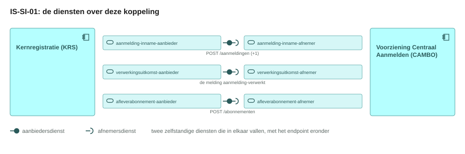
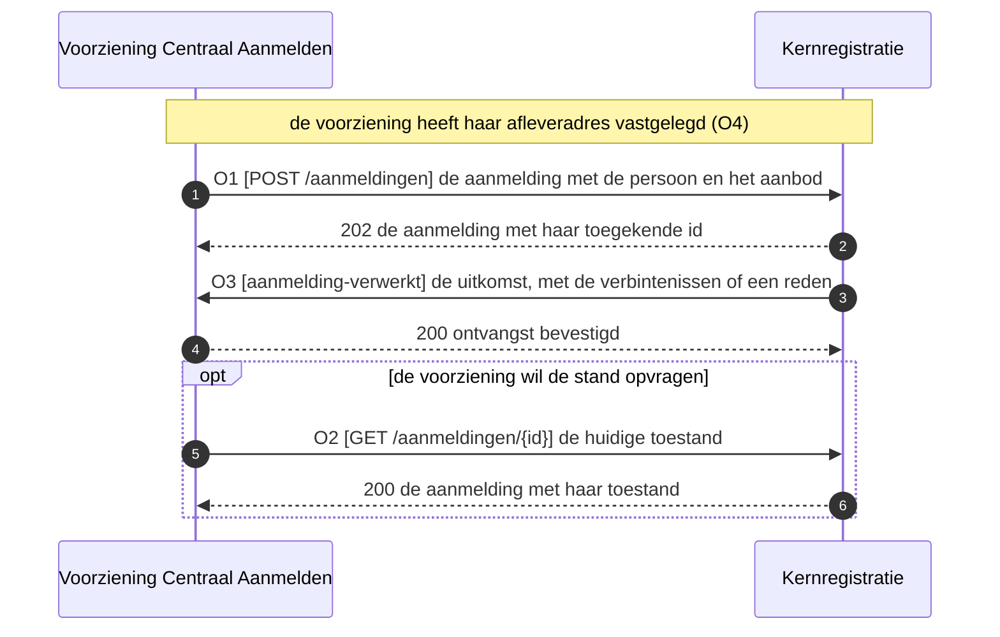
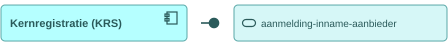
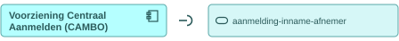
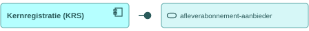
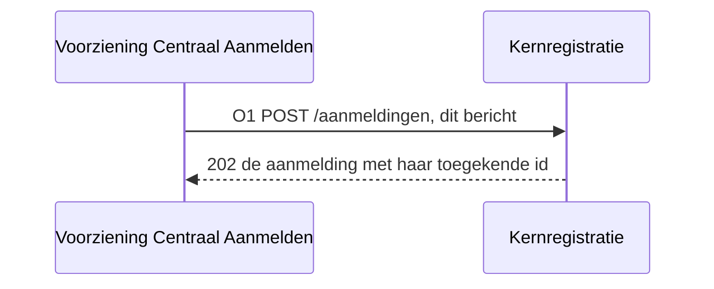

# IS-SI-01 De aanmelding de instelling in

| | |
|---|---|
| **Document doel** | Zet uiteen hoe de voorziening voor centraal aanmelden een aanmelding bij de kernregistratie aflevert, en hoe de instelling de uitkomst daarvan terugmeldt |
| **Doelgroep** | De implementatiespecialist en de tester bij een instelling of een leverancier, en wie een profiel of consumer bouwt |
| **Dient als input voor** | De bouw van het koppelvlak, de testgevallen erbij, en de acceptatie van een opgeleverde koppeling |
| **Kaderstelling** | De [interactieketenspecificatie](README.md) waarin deze specificatie valt, het [informatiemodel OKx](../../../model/informatiemodel/informatiemodel.md), en hoofdplaat v1.7 |
| **Inhoud** | Vier operaties met hun statuscodes, een bericht met zijn velden, en vier werkbrieven |
| **Status** | Voorstel in zijn geheel. Hoofdplaat v1.7 draagt deze stroom zonder koppelingspecificatie, en Npuls-OKx/Public kent geen interactiepatroon tussen de voorziening voor centraal aanmelden en de kernregistratie |

De lading: Jochem als persoon, zijn aanmelding, en de verbintenissen die daaruit ontstaan op de opleiding en op het opleidingsprogramma, beide in de toestand `aangemeld`.

## 1. Interactie

| Bronsysteem | Doelsysteem | Koppeling | Beeld | Status |
|---|---|---|---|---|
| `Voorziening Centraal Aanmelden (CAMBO)` | `Kernregistratie systeem studenten (KRS)` | Geen koppelingspecificatie in Public; hoofdplaat v1.7 draagt de stroom `Persoon(Student) Opleidingprogramma verbintenis` | F3-04 | Voorstel |

| Applicatiecomponent | Functie in deze interactie |
|---|---|
| Voorziening Centraal Aanmelden (CAMBO) | Levert de aanmelding aan, legt haar afleveradres vast, en neemt de uitkomst aan |
| Kernregistratie systeem studenten (KRS) | Neemt de aanmelding aan, kent haar een eigen identiteit toe, en meldt de uitkomst terug |

Hoe een student zich bij de voorziening meldt (beeld F3-03) valt buiten deze keten: AII beschrijft dat deel.

## 2. Interactiespecificatie



De aanbiedersdienst en de afnemersdienst staan als twee eigen blokken tegenover elkaar, met de bal die in de kom valt. Het sequentiediagram eronder zet dezelfde operaties in de tijd.



De voorziening levert aan en de kernregistratie neemt aan. Het oordeel over de inhoud volgt asynchroon op O3, zodat de voorziening niet hoeft te wachten op een intake die dagen kan duren.

## 3. Operaties en berichtspecificatie

Een operatie is een pad met een methode erop. Zij draagt een nummer dat terugkomt in het sequentiediagram hierboven. `CA` is de voorziening voor centraal aanmelden, `KRS` de kernregistratie.

Wie het endpoint bouwt verschilt per patroon, en bij een melding is dat omgekeerd aan wat de naam suggereert.

| Patroon | Wie levert het gegeven | Wie bouwt het endpoint | Wie roept aan |
|---|---|---|---|
| Ophalen | de aanbieder | de aanbieder | de afnemer |
| Aanleveren | de afnemer | de aanbieder | de afnemer |
| Melden | de aanbieder | de afnemer, op haar `callbackUrl` | de aanbieder |

Een query parameter verandert het endpoint niet: het pad blijft gelijk en de parameters komen in de query string. De afspraken die voor elke dienst in deze keten gelden, staan in de [interactieketenspecificatie](README.md).

#### aanmelding-inname-aanbieder, bij de kernregistratie



Deze dienst neemt een elders gedane aanmelding aan, kent haar een eigen identiteit toe en houdt haar toestand opvraagbaar. Het gegeven stroomt naar de aanbieder toe, en zij bouwt de endpoints (W1).

##### O1 · `POST /aanmeldingen` · aanleveren

| | |
|---|---|
| Request body | `application/json`, de aanmelding, zie het bericht hieronder |
| `202 Accepted` | de aanmelding met haar toegekende `id`; het oordeel volgt asynchroon op O3 |
| `400 Bad Request` | de bevindingen, zodra de vorm of een verwijzing herstel vraagt |
| `409 Conflict` | dezelfde persoon draagt al een aanmelding op ditzelfde aanbod (W2) |
| Atomiciteit | de aanmelding wordt in haar geheel aangenomen of afgewezen |

##### O2 · `GET /aanmeldingen/{id}` · ophalen

| | |
|---|---|
| Query parameters | geen |
| `200 OK` | `application/json`, de aanmelding met haar huidige toestand |
| `404 Not Found` | onbekend `id`, of de bewaartermijn is verstreken (W4) |

#### aanmelding-inname-afnemer, bij de voorziening voor centraal aanmelden



Deze dienst roept O1 en O2 aan bij de aanbieder hierboven. De request body en de responses staan daar.

#### verwerkingsuitkomst-aanbieder, bij de kernregistratie


Deze dienst meldt wat de instelling met de aanmelding deed. Zij verstuurt; de `callbackUrl` staat bij de afnemer.

##### O3 · webhook `aanmelding-verwerkt` · melden

| | |
|---|---|
| Transport | HTTP POST naar de `callbackUrl` die de voorziening met O4 registreerde |
| Request body | `application/json`, de toestand van de aanmelding met de verbintenissen die zijn ontstaan, of de reden van afwijzing (W3) |
| `200 OK` | geen response body; bevestigt de ontvangst, niet het oordeel |
| Bij uitblijven | retry met exponential backoff, daarna dead letter queue |
| Idempotentie | op `eventId`: een herhaalde delivery heeft geen extra effect |

#### verwerkingsuitkomst-afnemer, bij de voorziening voor centraal aanmelden


Deze dienst host de `callbackUrl` voor O3 en antwoordt met `200 OK`. Wat zij met de uitkomst doet valt buiten dit koppelvlak.

#### afleverabonnement-aanbieder, bij de kernregistratie



Deze dienst neemt de subscriptions aan op de events die de kernregistratie zelf publiceert, en levert daarna af op de geregistreerde `callbackUrl`.

##### O4 · `POST /abonnementen` · aanleveren

| | |
|---|---|
| Request body | [subscription.json](https://github.com/Npuls-OKx/Public/blob/dev/Koppelvlakspecificaties/Datamodelschema's/subscription.json): `callbackUrl` en de `events` waarop de afnemer zich abonneert |
| `201 Created` | de subscription met haar `id` |
| `400 Bad Request` | onbekend event of een onbruikbare `callbackUrl` |
| Idempotentie | op `callbackUrl` plus event: een herhaalde registratie overschrijft de vorige |

#### afleverabonnement-afnemer, bij de voorziening voor centraal aanmelden


Deze dienst registreert haar `callbackUrl` bij de aanbieder met O4, en ontvangt daarna O3.

**Bericht: de aanmelding**

Schema [`application.json`](schemas/application.json) · voorbeeldpayload [`is-si-01-aanmelding.json`](voorbeeldpayloads/is-si-01-aanmelding.json)



De kolom Veld draagt de Engelse sleutel die over de koppeling gaat, de kolom Nederlands de naam uit het informatiemodel. Kardinaliteit `1` betekent verplicht.

| Veld | Nederlands | Datatype | Kardinaliteit | Objecttype | Bron |
|---|---|---|---|---|---|
| `id` | aanmeldingId | uuid | 0..1 | `Aanmelding` | toegekend door de kernregistratie, afwezig bij aanlevering |
| `externalId` | externeAanmeldingId | string | 1 | `Aanmelding` | de identificatie die de voorziening zelf voert |
| `submittedAt` | aangemeldOp | datum-tijd (RFC 3339) | 1 | `Aanmelding` | voorstel |
| `person` | persoon | object | 1 | `Persoon` | voorstel |
| `person.identifier` | persoonsidentificatie | string | 1 | `Persoon` | voorstel, W2 |
| `person.givenName` | voornaam | string | 1 | `Persoon` | voorstel |
| `person.familyName` | achternaam | string | 1 | `Persoon` | voorstel |
| `person.dateOfBirth` | geboortedatum | datum | 1 | `Persoon` | voorstel |
| `offeringId` | opleidingsprogrammaAanbodId | uuid | 1 | `Opleidingsprogramma aanbod` | [casus.md](casus.md), komt uit IS-OA-06 |
| `offeringVersion` | opleidingsprogrammaAanbodVersie | string | 1 | `Opleidingsprogramma aanbod` | voorstel |
| `state` | toestand | enum | 0..1 | `Opleidingsprogramma aanbod verbintenis` | toegekend door de kernregistratie, `aangemeld` bij aanname |

<!-- erd -->
```mermaid
erDiagram
    "Persoon" }o--o{ "Aanmelding" : "hangt samen met"
    "Leergelegenheid" ||--o{ "Lesgelegenheid" : "bestaat uit"
    "Leergelegenheid verbintenis" ||--o{ "Lesgelegenheid verbintenis" : "bestaat uit"
    "Onderwijseenheid aanbod" ||--o{ "Leergelegenheid" : "bestaat uit"
    "Onderwijseenheid aanbod verbintenis" ||--o{ "Leergelegenheid verbintenis" : "bestaat uit"
    "Opleidingsprogramma aanbod" ||--o{ "Onderwijseenheid aanbod" : "bestaat uit"
    "Opleidingsprogramma aanbod verbintenis" ||--o{ "Onderwijseenheid aanbod verbintenis" : "bestaat uit"
    "Aanmelding" }o--o{ "Leergelegenheid verbintenis" : "middels"
    "Aanmelding" }o--o{ "Lesgelegenheid verbintenis" : "middels"
    "Aanmelding" }o--o{ "Onderwijseenheid aanbod verbintenis" : "middels"
    "Aanmelding" }o--o{ "Opleidingsprogramma aanbod verbintenis" : "middels"
    "Leergelegenheid" }o--o{ "Aanmelding" : "Op basis van"
    "Leergelegenheid" }o--o{ "Leergelegenheid verbintenis" : "hangt samen met"
    "Lesgelegenheid" }o--o{ "Aanmelding" : "Op basis van"
    "Lesgelegenheid" }o--o{ "Lesgelegenheid verbintenis" : "hangt samen met"
    "Onderwijseenheid aanbod" }o--o{ "Aanmelding" : "Op basis van"
    "Onderwijseenheid aanbod" }o--o{ "Onderwijseenheid aanbod verbintenis" : "hangt samen met"
    "Opleidingsprogramma aanbod" }o--o{ "Aanmelding" : "Op basis van"
    "Opleidingsprogramma aanbod" }o--o{ "Opleidingsprogramma aanbod verbintenis" : "hangt samen met"
    "Aanmelding" {
        string id PK "0..1"
        string externalId FK "1"
        string submittedAt "1"
    }
    "Persoon" {
        string person "1"
        string person_identifier "1"
        string person_givenName "1"
        string person_familyName "1"
        string person_dateOfBirth "1"
    }
    "Opleidingsprogramma aanbod" {
        string offeringId FK "1"
        string offeringVersion "1"
        object applicationWindow "0..1"
        date applicationWindow.end "0..1"
        date applicationWindow.start "0..1"
        enum learningPathway "0..1"
        enum status "1..1"
        string targetGroup "0..1"
    }
    "Opleidingsprogramma aanbod verbintenis" {
        string state "0..1"
    }
    "Onderwijseenheid aanbod" { }
    "Onderwijseenheid aanbod verbintenis" { }
    "Leergelegenheid" { }
    "Leergelegenheid verbintenis" { }
    "Lesgelegenheid" { }
    "Lesgelegenheid verbintenis" { }
```

| Lijn | Betekenis |
|---|---|
| `\|\|--o{` | het eerste bestaat uit nul of meer van het tweede |
| `}o--o{` | de twee hangen samen, met het opschrift erbij |
| `PK` en `FK` | de sleutel van het object, en een verwijzing naar een ander object |
| tekst achter een attribuut | de multipliciteit in dit bericht, en of het veld verplicht is |

<!-- /erd -->

De verbintenissen op de opleiding en op het opleidingsprogramma ontstaan bij de kernregistratie en gaan niet over deze koppeling mee: de voorziening levert de aanmelding, de instelling maakt er verbintenissen van. Die komen terug op O3.

## 4. Werkbrieven: de issueset die hieruit volgt

Deze regels horen niet in de koppelvlakspecificatie zelf. Elk van hen wordt een issue in Npuls-OKx/Public of in meta, en blijft hier staan tot dat issue er is.

| Nr | Wat erbij moet | Waar |
|---|---|---|
| W1 | Een interactiepatroon tussen de voorziening voor centraal aanmelden en de kernregistratie, met de paden `POST /aanmeldingen`, `GET /aanmeldingen/{id}` en het meldpatroon `aanmelding-verwerkt` | Npuls-OKx/Public, map Interactiepatronen |
| W2 | De persoonsidentificatie waarmee de voorziening en de instelling dezelfde persoon herkennen, en wat een herhaalde aanmelding op hetzelfde aanbod betekent | De afstemming met AII |
| W3 | Het payloadschema van de melding `aanmelding-verwerkt`: welke toestanden zij kent en welke verbintenissen zij meestuurt | Npuls-OKx/Public, map Datamodelschema's |
| W4 | De bewaartermijn van een afgehandelde aanmelding: hoelang O2 haar toestand teruggeeft | De afstemming met AII |
