# IS-SI-02 De verbintenis naar het studentkeuzesysteem

| | |
|---|---|
| **Document doel** | Zet uiteen hoe het studentkeuzesysteem de verbintenis en de plaatsingsgroep bij de kernregistratie afneemt, zodat het weet wie er mag kiezen voordat het een keuze voorlegt |
| **Doelgroep** | De implementatiespecialist en de tester bij een instelling of een leverancier, en wie een profiel of consumer bouwt |
| **Dient als input voor** | De bouw van het koppelvlak, de testgevallen erbij, en de acceptatie van een opgeleverde koppeling |
| **Kaderstelling** | De [interactieketenspecificatie](README.md) waarin deze specificatie valt, het [informatiemodel OKx](../../../model/informatiemodel/informatiemodel.md), en hoofdplaat v1.7 |
| **Inhoud** | Vijf operaties met hun statuscodes, vier berichten met hun velden, en zeven werkbrieven |
| **Status** | Voorstel in zijn geheel. Hoofdplaat v1.7 draagt deze stroom zonder koppelingspecificatie, en Npuls-OKx/Public kent geen interactiepatroon tussen de kernregistratie en het studentkeuzesysteem |

De lading: Jochem als student, zijn verbintenissen op de opleiding, het opleidingsprogramma en de onderwijseenheid in de toestand `ingeschreven`, en de plaatsingsgroep waarin de intake hem zette.

## 1. Interactie

| Bronsysteem | Doelsysteem | Koppeling | Beeld | Status |
|---|---|---|---|---|
| `Kernregistratie systeem studenten (KRS)` | `Student Keuze Systeem (SKS)` | Geen koppelingspecificatie in Public; hoofdplaat v1.7 draagt de junctie `Student, opleidingprogramma verbintenis, relevante groepen`, met [IS-SI-06](is-si-06.md) op het andere been | F3-07, F3-08 | Voorstel |

| Applicatiecomponent | Functie in deze interactie |
|---|---|
| Kernregistratie systeem studenten (KRS) | Bezit de verbintenis en de plaatsingsgroep, ontsluit beide per aanbod, en meldt elke toestandsovergang |
| Student Keuze Systeem (SKS) | Haalt de verbintenis en de groep op, legt zijn afleveradres vast, en houdt dat beeld bij op de melding |

Beeld F3-07 legt de aanmelding om in een inschrijving en zet de verbintenissen op `ingeschreven`. Dat gebeurt binnen de kernregistratie en is geen koppeling: het intakesysteem valt buiten deze keten, en deze eenheid begint bij wat de kernregistratie daarna ontsluit (beeld F3-08).

## 2. Interactiespecificatie

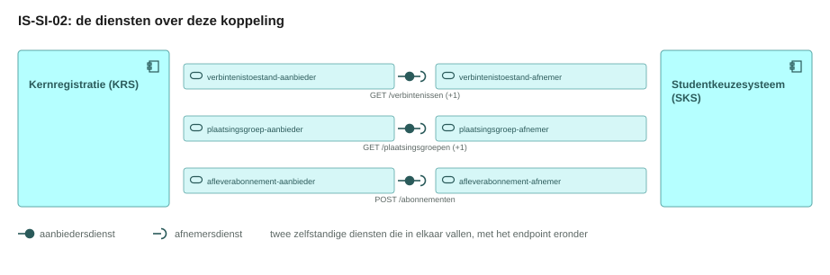

De aanbiedersdienst en de afnemersdienst staan als twee eigen blokken tegenover elkaar, met de bal die in de kom valt. Het sequentiediagram eronder zet dezelfde operaties in de tijd.

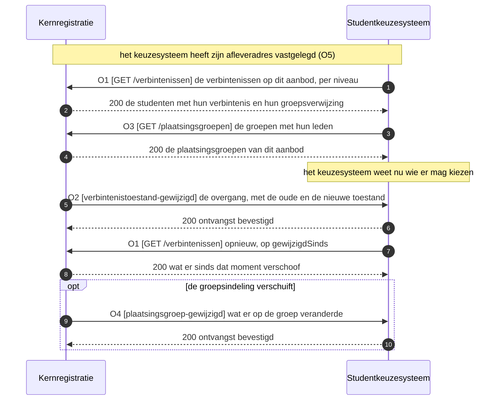

Het keuzesysteem haalt op, de kernregistratie levert en meldt. Het ophalen staat voorop, zodat het keuzesysteem een beeld heeft voordat er een overgang te melden valt.

## 3. Operaties en berichtspecificatie

Een operatie is een pad met een methode erop. Zij draagt een nummer dat terugkomt in het sequentiediagram hierboven. `KRS` is de kernregistratie, `SKS` het studentkeuzesysteem.

Wie het endpoint bouwt verschilt per patroon, en bij een melding is dat omgekeerd aan wat de naam suggereert.

| Patroon | Wie levert het gegeven | Wie bouwt het endpoint | Wie roept aan |
|---|---|---|---|
| Ophalen | de aanbieder | de aanbieder | de afnemer |
| Aanleveren | de afnemer | de aanbieder | de afnemer |
| Melden | de aanbieder | de afnemer, op haar `callbackUrl` | de aanbieder |

Een query parameter verandert het endpoint niet: het pad blijft gelijk en de parameters komen in de query string. De afspraken die voor elke dienst in deze keten gelden, staan in de [interactieketenspecificatie](README.md).

De kernregistratie bedient het keuzesysteem en de leeromgeving langs dezelfde junctie, met dezelfde diensten en dezelfde endpoints. De berichtspecificatie van die junctie staat daarom hier, en [IS-SI-06](is-si-06.md) wijst ernaar (W6).

#### verbintenistoestand-aanbieder, bij de kernregistratie

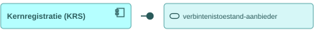

Deze dienst houdt de toestand van de verbintenis per niveau bij en meldt elke overgang met haar oude en haar nieuwe waarde. De dienstenlijst van Public draagt die verplichtingen; de endpoints eronder zijn voorstel (W1).

##### O1 · `GET /verbintenissen` · ophalen

| | |
|---|---|
| Query parameters | `aanbodId` (verplicht, het opleidingsprogramma-aanbod), `niveau` (optioneel, een waarde uit `associationType`), `toestand` (optioneel), `gewijzigdSinds` (optioneel, RFC 3339) |
| `200 OK` | `application/json`, de studenten met hun verbintenis per niveau, zie het bericht hieronder |
| `400 Bad Request` | een onbruikbare parameterwaarde; de client corrigeert de parameter en bepaalt de retry |
| `404 Not Found` | onbekend `aanbodId` |
| Voorbeeld | `GET /verbintenissen?aanbodId=8c494250-b67a-4666-a762-6f9ec1e70aff&niveau=opleidingsprogramma-aanbod-verbintenis&toestand=ingeschreven` |

**Bericht: de verbintenis met haar toestand**

Schema [`offering-association.json`](schemas/offering-association.json) · voorbeeldpayload [`is-si-02-verbintenis.json`](voorbeeldpayloads/is-si-02-verbintenis.json)

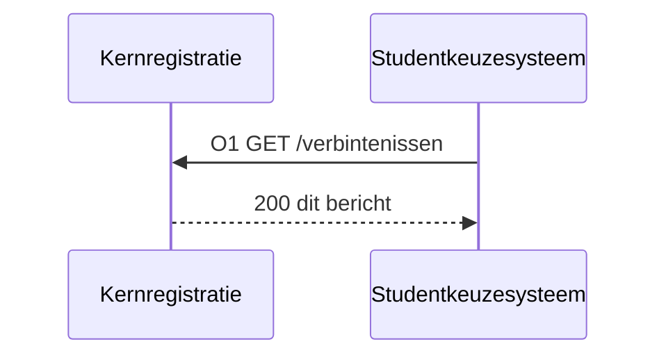

De kolom Veld draagt de Engelse sleutel die over de koppeling gaat, de kolom Nederlands de naam uit het informatiemodel. Kardinaliteit `1` betekent verplicht.

| Veld | Nederlands | Datatype | Kardinaliteit | Objecttype | Bron |
|---|---|---|---|---|---|
| `programmeOfferingId` | opleidingsprogrammaAanbodId | uuid | 1 | `Opleidingsprogramma aanbod` | [casus.md](casus.md), komt uit IS-OA-06 |
| `programmeOfferingVersion` | opleidingsprogrammaAanbodVersie | string | 1 | `Opleidingsprogramma aanbod` | voorstel |
| `students[]` | studenten | array | 1..n | `Student` | voorstel; een student met drie verbintenissen staat een keer in het bericht |
| `students[].id` | studentId | uuid | 1 | `Student` | [casus.md](casus.md) |
| `students[].personIdentifier` | persoonsidentificatie | string | 1 | `Persoon` | voorstel, W2 van [IS-SI-01](is-si-01.md) |
| `students[].givenName` | voornaam | string | 0..1 | `Persoon` | voorstel |
| `students[].familyName` | achternaam | string | 0..1 | `Persoon` | voorstel |
| `associations[]` | verbintenissen | array | 1..n | `Opleidingsprogramma aanbod verbintenis`, en de andere soorten uit de tabel hieronder | voorstel |
| `associations[].id` | verbintenisId | uuid | 1 | `Opleidingsprogramma aanbod verbintenis` | [casus.md](casus.md) |
| `associations[].associationType` | verbintenisType | enum | 1 | `Opleidingsprogramma aanbod verbintenis` | voorstel, W6 |
| `associations[].parentAssociationId` | bovenliggendVerbintenisId | uuid | 0..1 | `Opleidingsprogramma aanbod verbintenis` | voorstel, U7; leeg op het niveau van de opleiding |
| `associations[].studentId` | studentId | uuid | 1 | `Student` | voorstel, U7 |
| `associations[].offeringId` | aanbodId | uuid | 1 | `Opleidingsprogramma aanbod` | voorstel; het aanbod op het niveau dat `associationType` noemt |
| `associations[].state` | toestand | enum | 1 | `Opleidingsprogramma aanbod verbintenis` | voorstel, dezelfde reeks als IS-SI-01, W4 |
| `associations[].stateChangedAt` | toestandGewijzigdOp | datum-tijd (RFC 3339) | 1 | `Opleidingsprogramma aanbod verbintenis` | voorstel; `gewijzigdSinds` filtert hierop |
| `associations[].placementGroupIds` | plaatsingsgroepIds | array | 0..n | `Plaatsingsgroep` | voorstel; de groep zelf komt met O3 |

Het niveau staat in een veld en niet in een schema per niveau, want de velden zijn over de niveaus gelijk en de dienst `verbintenistoestand` draagt de toestand per niveau. Welk objecttype een verbintenis is, leest een afnemer af aan haar soort.

| Waarde van `associations[].associationType` | Objecttype | Aanbod waarnaar `offeringId` wijst |
|---|---|---|
| `opleiding-aanbod-verbintenis` | `Opleiding aanbod verbintenis` | `Opleiding aanbod` |
| `opleidingsprogramma-aanbod-verbintenis` | `Opleidingsprogramma aanbod verbintenis` | `Opleidingsprogramma aanbod` |
| `onderwijseenheid-aanbod-verbintenis` | `Onderwijseenheid aanbod verbintenis` | `Onderwijseenheid aanbod` |
| `leergelegenheid-verbintenis` | `Leergelegenheid verbintenis` | `Leergelegenheid` |
| `lesgelegenheid-verbintenis` | `Lesgelegenheid verbintenis` | `Lesgelegenheid` |

De toestand loopt van de aanmelding naar de inschrijving, met twee uitgangen. Het keuzesysteem legt alleen een keuze voor aan een student wiens verbintenis op `ingeschreven` staat.

| Waarde van `associations[].state` | Wat zij zegt |
|---|---|
| `aangemeld` | De aanmelding is aangenomen en de intake loopt nog (IS-SI-01) |
| `ingeschreven` | De inschrijving is een feit en de student mag kiezen |
| `afgewezen` | De instelling heeft de aanmelding afgewezen |
| `ingetrokken` | De student heeft zijn aanmelding of inschrijving teruggenomen |

<!-- erd -->
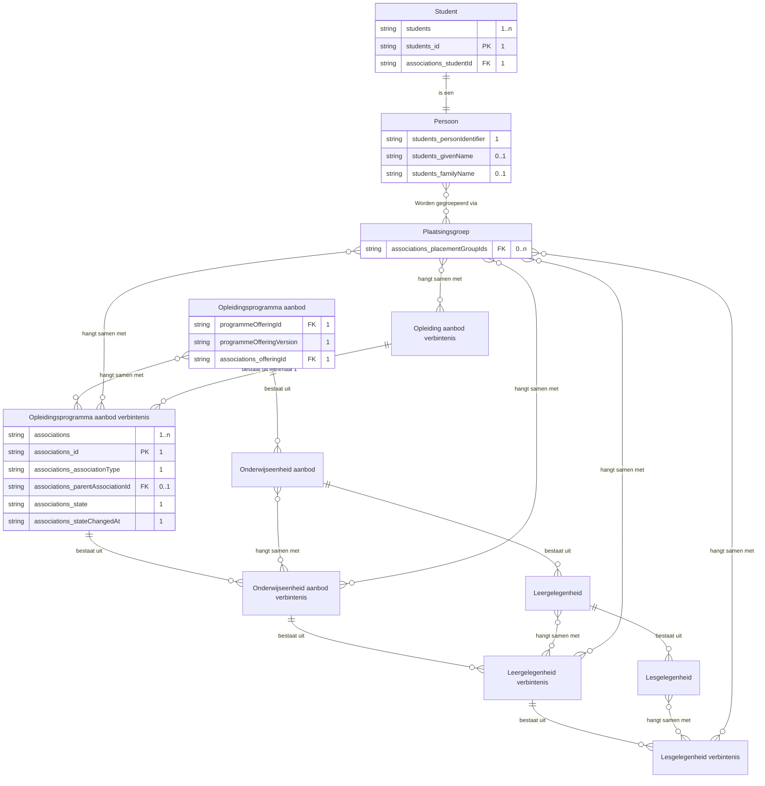

| Lijn | Betekenis |
|---|---|
| `\|\|--o{` | het eerste bestaat uit nul of meer van het tweede |
| `\|\|--\|\|` | het tweede is een soort van het eerste |
| `}o--o{` | de twee hangen samen, met het opschrift erbij |
| `PK` en `FK` | de sleutel van het object, en een verwijzing naar een ander object |
| tekst achter een attribuut | de multipliciteit in dit bericht, en of het veld verplicht is |

<!-- /erd -->

Wat de uitvoering na `ingeschreven` van de toestand maakt, ligt niet vast: deze keten draagt de vier waarden die IS-SI-01 voorstelt en belegt de rest bij W4. De verbintenissen op de leergelegenheid en de lesgelegenheid ontstaan pas bij het roosteren en komen langs [IS-SI-05](is-si-05.md) terug.

##### O2 · webhook `verbintenistoestand-gewijzigd` · melden

| | |
|---|---|
| Transport | HTTP POST naar de `callbackUrl` die het keuzesysteem met O5 registreerde |
| Request body | `application/json`, de verbintenis met haar oude en haar nieuwe toestand, zie het bericht hieronder |
| `200 OK` | geen response body; bevestigt de ontvangst, niet het oordeel |
| Bij uitblijven | retry met exponential backoff, daarna dead letter queue |
| Idempotentie | op `eventId`: een herhaalde delivery heeft geen extra effect |
| Opvolging | de afnemer haalt met O1 op wat er sinds `occurredAt` verschoof |

**Bericht: de toestandswijziging**

Schema [`offering-association-changed.json`](schemas/offering-association-changed.json) · voorbeeldpayload [`is-si-02-toestandswijziging.json`](voorbeeldpayloads/is-si-02-toestandswijziging.json)

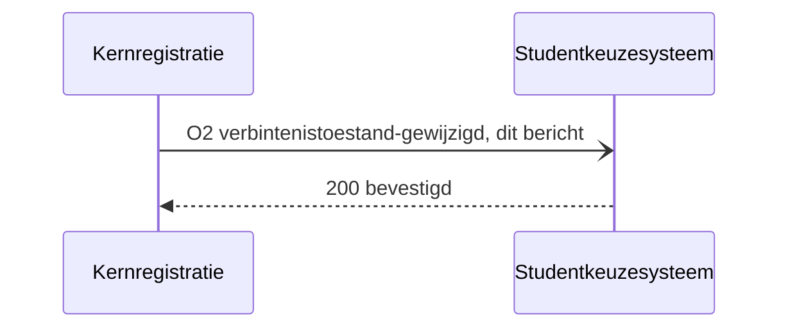

De melding draagt de overgang en niet de hele verbintenis, zodat de geldende toestand bij de bron blijft liggen.

| Veld | Nederlands | Datatype | Kardinaliteit | Objecttype | Bron |
|---|---|---|---|---|---|
| `eventId` | eventId | uuid | 1 | kanaaleigenschap, geen objecttype | U5, herhaalbare verwerking |
| `associationId` | verbintenisId | uuid | 1 | `Opleidingsprogramma aanbod verbintenis` | voorstel; het veld `id` uit het bericht bij O1 |
| `associationType` | verbintenisType | enum | 1 | `Opleidingsprogramma aanbod verbintenis` | voorstel, W6; dezelfde reeks als bij O1 |
| `studentId` | studentId | uuid | 1 | `Student` | [casus.md](casus.md) |
| `programmeOfferingId` | opleidingsprogrammaAanbodId | uuid | 0..1 | `Opleidingsprogramma aanbod` | voorstel; hiermee stelt de afnemer de opvolgende O1 zonder te zoeken |
| `oldState` | oudeToestand | enum | 0..1 | `Opleidingsprogramma aanbod verbintenis` | voorstel; leeg bij de eerste toestand |
| `newState` | nieuweToestand | enum | 1 | `Opleidingsprogramma aanbod verbintenis` | voorstel, W4 |
| `occurredAt` | gewijzigdOp | datum-tijd (RFC 3339) | 1 | `Opleidingsprogramma aanbod verbintenis` | voorstel |

<!-- erd -->
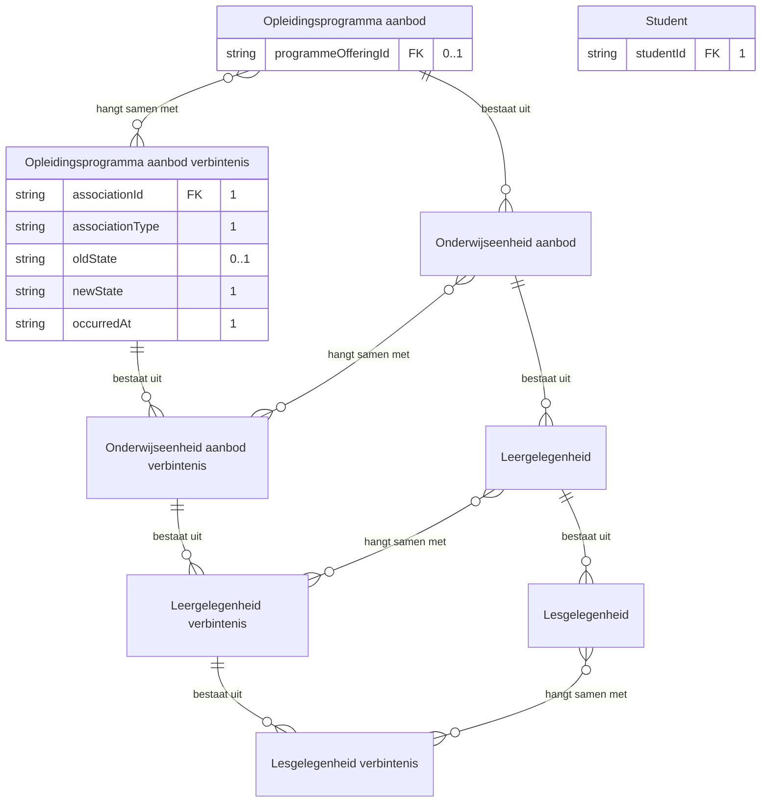

| Lijn | Betekenis |
|---|---|
| `\|\|--o{` | het eerste bestaat uit nul of meer van het tweede |
| `}o--o{` | de twee hangen samen, met het opschrift erbij |
| `PK` en `FK` | de sleutel van het object, en een verwijzing naar een ander object |
| tekst achter een attribuut | de multipliciteit in dit bericht, en of het veld verplicht is |

<!-- /erd -->

De melding heet op beide benen van de junctie `verbintenistoestand-gewijzigd`, zodat een afnemer zich met dezelfde eventnaam abonneert welk component zij ook is (W6).

#### verbintenistoestand-afnemer, bij het studentkeuzesysteem

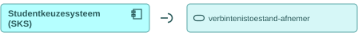

Deze dienst roept O1 aan bij de aanbieder hierboven en host de `callbackUrl` voor O2. De parameters en de responses staan daar.

#### plaatsingsgroep-aanbieder, bij de kernregistratie

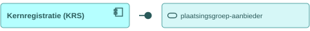

Deze dienst ontsluit de plaatsingsgroepen met de studenten erin en meldt een verschuiving in de indeling. Het onderwerp `plaatsingsgroep` staat nog niet in de dienstenlijst van Public en wordt hier voorgesteld (W2).

##### O3 · `GET /plaatsingsgroepen` · ophalen

| | |
|---|---|
| Query parameters | `aanbodId` (verplicht), `gewijzigdSinds` (optioneel, RFC 3339) |
| `200 OK` | `application/json`, de plaatsingsgroepen met de studenten erin, met de velden in [IS-SI-03](is-si-03.md) |
| `400 Bad Request` | een onbruikbare parameterwaarde; de client corrigeert de parameter en bepaalt de retry |
| `404 Not Found` | onbekend `aanbodId` |

##### O4 · webhook `plaatsingsgroep-gewijzigd` · melden

| | |
|---|---|
| Transport | HTTP POST naar de `callbackUrl` die het keuzesysteem met O5 registreerde |
| Request body | `application/json`, de groep met de aard van de wijziging en haar nieuwe omvang, met de velden in [IS-SI-03](is-si-03.md) |
| `200 OK` | geen response body; bevestigt de ontvangst, niet het oordeel |
| Bij uitblijven | retry met exponential backoff, daarna dead letter queue |
| Idempotentie | op `eventId`: een herhaalde delivery heeft geen extra effect |
| Opvolging | de afnemer haalt de groep met O3 op wanneer zij de leden nodig heeft |

#### plaatsingsgroep-afnemer, bij het studentkeuzesysteem

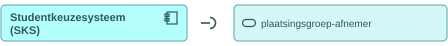

Deze dienst roept O3 aan bij de aanbieder hierboven en host de `callbackUrl` voor O4. De parameters en de responses staan daar.

#### afleverabonnement-aanbieder, bij de kernregistratie

Deze dienst neemt de subscriptions aan op de events die de kernregistratie zelf publiceert, en levert daarna af op de geregistreerde `callbackUrl`.

##### O5 · `POST /abonnementen` · aanleveren

| | |
|---|---|
| Request body | [subscription.json](https://github.com/Npuls-OKx/Public/blob/dev/Koppelvlakspecificaties/Datamodelschema's/subscription.json): `callbackUrl` en de `events` waarop de afnemer zich abonneert; de enum draagt `verbintenistoestand-gewijzigd` en `plaatsingsgroep-gewijzigd` nog niet (W5) |
| `201 Created` | de subscription met haar `id` |
| `400 Bad Request` | onbekend event of een onbruikbare `callbackUrl` |
| Idempotentie | op `callbackUrl` plus event: een herhaalde registratie overschrijft de vorige |

#### afleverabonnement-afnemer, bij het studentkeuzesysteem

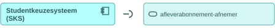

Deze dienst registreert haar `callbackUrl` bij de aanbieder met O5, en ontvangt daarna O2 en O4.

## 4. Werkbrieven: de issueset die hieruit volgt

Deze regels horen niet in de koppelvlakspecificatie zelf. Elk van hen wordt een issue in Npuls-OKx/Public of in meta, en blijft hier staan tot dat issue er is.

| Nr | Wat erbij moet | Waar |
|---|---|---|
| W1 | Een interactiepatroon tussen de kernregistratie en het studentkeuzesysteem, met de paden `GET /verbintenissen` en `GET /plaatsingsgroepen` en de meldpatronen `verbintenistoestand-gewijzigd` en `plaatsingsgroep-gewijzigd`; de dienst `verbintenistoestand` draagt vandaag de verplichtingen en laat de endpoints open | Npuls-OKx/Public, map Interactiepatronen |
| W2 | Het onderwerp `plaatsingsgroep` als aanbiedersdienst en afnemersdienst in de dienstenlijst, met de leden van de groep in het schema; group.json draagt vandaag `id`, `name` en `capacity` en geen leden | Npuls-OKx/Public, mappen Applicatiediensten en Datamodelschema's |
| W3 | De payloadschema's `offering-association.json` en `offering-association-changed.json`, met de plaatsingsgroepschema's die [IS-SI-03](is-si-03.md) voorstelt ernaast | Npuls-OKx/Public, map Datamodelschema's |
| W4 | De reeks toestanden van een verbintenis na `ingeschreven`: deze keten draagt de vier waarden die IS-SI-01 voorstelt, en wat de uitvoering ervan maakt ligt niet vast | Npuls-OKx/Public, map Datamodelschema's |
| W5 | De events `verbintenistoestand-gewijzigd` en `plaatsingsgroep-gewijzigd` in de enum `events` van subscription.json, zodat een afnemer zich erop abonneert | Npuls-OKx/Public, map Datamodelschema's |
| W6 | Een vocabulaire voor het niveau op de twee benen van deze junctie: de parameter `niveau` van O1 verwijst naar de reeks `associationType` met `opleidingsprogramma-aanbod-verbintenis`, en dezelfde parameter draagt bij [IS-SI-06](is-si-06.md) `opleiding`, `opleidingsprogramma` of `onderwijseenheid`. Daar hoort de aanbodlaag van `placementGroups[].offeringId` bij, die het informatiemodel niet aan `Plaatsingsgroep` hangt | Npuls-OKx/meta, bij deze keten |
| W7 | De behaalde leeruitkomsten: beeld F3-08 beweegt `Leeruitkomst` mee naar het keuzesysteem zodat het geen keuze voorlegt die de student al deed, en vraagt of die kennis uit de kernregistratie komt of dat hoofdplaat v1.7 een stroom mist. Het veld `wat` van deze stroom noemt die lading niet, en deze eenheid draagt haar daarom niet | De kerngroep techniek |
