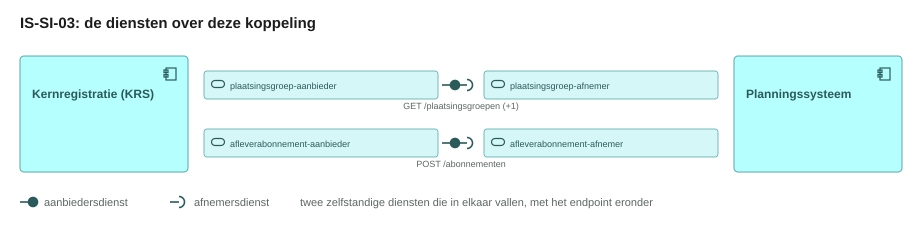
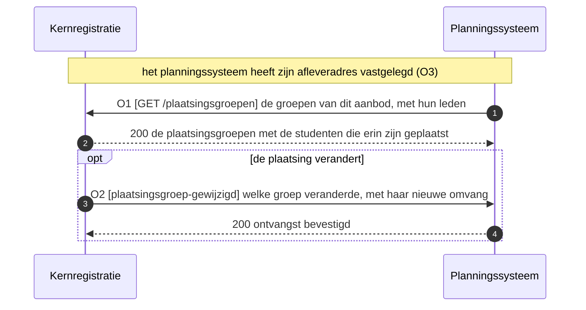
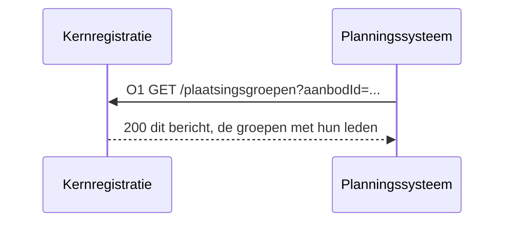
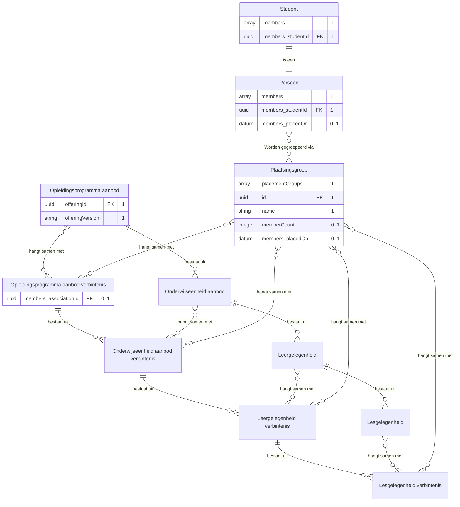
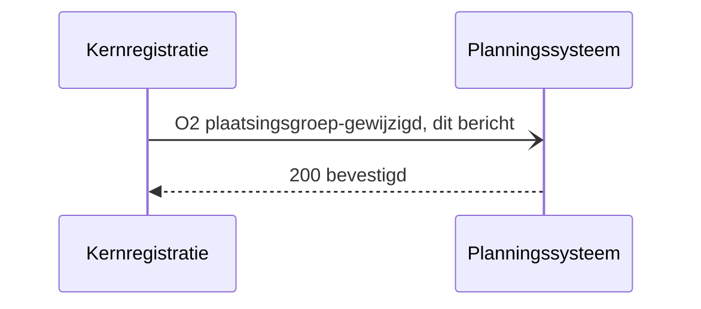
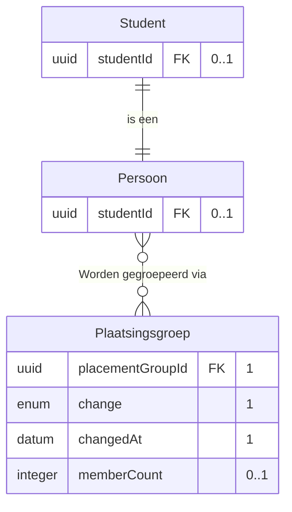
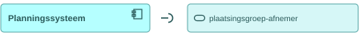
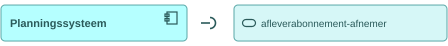

# IS-SI-03 Plaatsingsgroepen naar planning

| | |
|---|---|
| **Document doel** | Zet uiteen hoe de kernregistratie de plaatsingsgroepen met hun studenten aan het planningssysteem ontsluit, en hoe zij een wijziging in die plaatsing meldt |
| **Doelgroep** | De implementatiespecialist en de tester bij een instelling of een leverancier, en wie een profiel of consumer bouwt |
| **Dient als input voor** | De bouw van het koppelvlak, de testgevallen erbij, en de acceptatie van een opgeleverde koppeling |
| **Kaderstelling** | De [interactieketen](README.md) waarin deze specificatie valt, het [informatiemodel OKx](../../../model/informatiemodel/informatiemodel.md), en hoofdplaat v1.7 |
| **Inhoud** | Drie operaties met hun statuscodes, twee berichten met hun velden, en zes werkbrieven |
| **Status** | Voorstel in zijn geheel. Hoofdplaat v1.7 draagt deze stroom zonder koppelingspecificatie, en Npuls-OKx/Public kent geen interactiepatroon tussen de kernregistratie en het planningssysteem |

De lading: de plaatsingsgroep APO26-1A met de studenten die erin zijn geplaatst, elk met de verbintenis waarop hij staat, zodat planning weet hoeveel mensen er voor welk onderdeel te plannen zijn.

## 1. Interactie

| Bronsysteem | Doelsysteem | Koppeling | Beeld | Status |
|---|---|---|---|---|
| `Kernregistratie systeem studenten (KRS)` | `Planningssysteem` | Geen koppelingspecificatie in Public; hoofdplaat v1.7 draagt de stroom `Ontsluiten plaatsingsgroepen met studenten` | F4-06 | Voorstel |

| Applicatiecomponent | Functie in deze interactie |
|---|---|
| Kernregistratie systeem studenten (KRS) | Houdt de plaatsing van de student bij, ontsluit de groepen met hun leden, en meldt een wijziging daarin |
| Planningssysteem | Legt zijn afleveradres vast, haalt de groepen op, en schaalt zijn eigen groepen en lokalen op die aantallen |

Het vormen van een groep bij een leergelegenheid gebeurt aan de planningszijde en gaat met IS-OA-04 naar de catalogus. Deze koppeling draagt de plaatsing: de kernregistratie zegt wie er in welke groep zit.

## 2. Interactiespecificatie

De aanbiedersdienst en de afnemersdienst staan als twee eigen blokken tegenover elkaar, met de bal die in de kom valt. Het sequentiediagram eronder zet dezelfde operaties in de tijd.

De kernregistratie levert en het planningssysteem haalt op. De melding houdt de aantallen tussen twee opvragen bij, zodat het planningssysteem een verschuiving op tijd ziet zonder te blijven opvragen.

## 3. Operaties en berichtspecificatie

Een operatie is een pad met een methode erop. Zij draagt een nummer dat terugkomt in het sequentiediagram hierboven. `KRS` is de kernregistratie, `PL` het planningssysteem.

Wie het endpoint bouwt verschilt per patroon, en bij een melding is dat omgekeerd aan wat de naam suggereert.

| Patroon | Wie levert het gegeven | Wie bouwt het endpoint | Wie roept aan |
|---|---|---|---|
| Ophalen | de aanbieder | de aanbieder | de afnemer |
| Aanleveren | de afnemer | de aanbieder | de afnemer |
| Melden | de aanbieder | de afnemer, op haar `callbackUrl` | de aanbieder |

Een query parameter verandert het endpoint niet: het pad blijft gelijk en de parameters komen in de query string. De afspraken die voor elke dienst in deze keten gelden, staan in de [interactieketenspecificatie](README.md).

#### plaatsingsgroep-aanbieder, bij de kernregistratie

Deze dienst ontsluit de plaatsingsgroepen met de studenten die erin zijn geplaatst, en meldt een wijziging in die plaatsing. IS-SI-02 en IS-SI-06 claimen dezelfde dienst bij hetzelfde component, voor het studentkeuzesysteem en de leeromgeving, met hetzelfde pad en dezelfde melding (W2).

##### O1 · `GET /plaatsingsgroepen` · ophalen

| | |
|---|---|
| Query parameters | `aanbodId` (verplicht, uuid), `gewijzigdSinds` (optioneel, tijdstempel) |
| `200 OK` | `application/json`, de plaatsingsgroepen van dit aanbod met hun leden, zie het bericht hieronder |
| `400 Bad Request` | een onbruikbare parameterwaarde; de client corrigeert de parameter en bepaalt de retry |
| `404 Not Found` | onbekend `aanbodId` |
| Idempotentie | alleen-lezen: herhalen geeft hetzelfde antwoord |
| Voorbeeld | `GET /plaatsingsgroepen?aanbodId=8c494250-b67a-4666-a762-6f9ec1e70aff` |

**Bericht: de plaatsingsgroepen met hun studenten**

Schema [`placement-group-collection.json`](schemas/placement-group-collection.json) met [`placement-group.json`](schemas/placement-group.json) · voorbeeldpayload [`is-si-03-plaatsingsgroepen.json`](voorbeeldpayloads/is-si-03-plaatsingsgroepen.json)

De kolom Veld draagt de Engelse sleutel die over de koppeling gaat, de kolom Nederlands de naam uit het informatiemodel. Kardinaliteit `1` betekent verplicht, en de sleutels onder `placementGroups` staan zonder die omhulling ervoor.

| Veld | Nederlands | Datatype | Kardinaliteit | Objecttype | Bron |
|---|---|---|---|---|---|
| `placementGroups` | plaatsingsgroepen | array | 1 | `Plaatsingsgroep` | voorstel, de omhulling van de opvraag |
| `id` | plaatsingsgroepId | uuid | 1 | `Plaatsingsgroep` | `id` in [group.json](https://github.com/Npuls-OKx/Public/blob/dev/Informatie-en-gegevensmodellen/schemas/group.json) |
| `name` | naam | string | 1 | `Plaatsingsgroep` | `name` in group.json; casus.md pint geen naam op deze groep, de voorbeeldpayload draagt APO26-1A (W6) |
| `offeringId` | aanbodId | uuid | 1 | `Opleidingsprogramma aanbod` | [casus.md](casus.md), komt uit IS-OA-04 |
| `offeringVersion` | aanbodVersie | string, semver | 1 | `Opleidingsprogramma aanbod` | idem |
| `memberCount` | aantalLeden | integer | 0..1 | `Plaatsingsgroep` | voorstel, de maat waarop het planningssysteem schaalt |
| `members` | leden | array | 1 | `Student`, `Persoon` | voorstel, W3 |
| `members[].studentId` | studentId | uuid | 1 | `Student`, `Persoon` | [casus.md](casus.md) |
| `members[].associationId` | verbintenisId | uuid | 0..1 | `Opleidingsprogramma aanbod verbintenis` | [casus.md](casus.md), ontstaat in IS-SI-01 |
| `members[].placedOn` | geplaatstOp | datum | 0..1 | `Plaatsingsgroep`, `Persoon` | voorstel, W5 |

<!-- erd -->

| Lijn | Betekenis |
|---|---|
| `\|\|--o{` | het eerste bestaat uit nul of meer van het tweede |
| `\|\|--\|\|` | het tweede is een soort van het eerste |
| `}o--o{` | de twee hangen samen, met het opschrift erbij |
| `PK` en `FK` | de sleutel van het object, en een verwijzing naar een ander object |
| tekst achter een attribuut | de multipliciteit in dit bericht, en of het veld verplicht is |

<!-- /erd -->

De groep draagt de werkelijke plaatsing en de capaciteit blijft erbuiten: die komt van de planningszijde zelf (IS-OA-04), die APO26-1A daar op 24 zet en de leergelegenheid in twee groepen uitvoert. De voorbeeldpayload meldt dertig geplaatste studenten en noemt daarvan Jochem: de overige negenentwintig zijn in beeld F4-06 een aanname zonder eigen identificatie, en casus.md pint ze niet (W6).

##### O2 · webhook `plaatsingsgroep-gewijzigd` · melden

| | |
|---|---|
| Transport | HTTP POST naar de `callbackUrl` die het planningssysteem met O3 registreerde |
| Request body | `application/json`, de groep die veranderde met haar nieuwe omvang, zie het bericht hieronder |
| `200 OK` | geen response body; bevestigt de ontvangst, niet de verwerking |
| Bij uitblijven | retry met exponential backoff, daarna dead letter queue |
| Idempotentie | op `eventId`: een herhaalde delivery heeft geen extra effect |

**Bericht: de wijziging in de plaatsing**

Schema [`placement-group-changed.json`](schemas/placement-group-changed.json) · voorbeeldpayload [`is-si-03-plaatsingsgroep-gewijzigd.json`](voorbeeldpayloads/is-si-03-plaatsingsgroep-gewijzigd.json)

Een dun bericht met de aanleiding, in de vorm van [specification-status-changed.json](https://github.com/Npuls-OKx/Public/blob/dev/Informatie-en-gegevensmodellen/schemas/specification-status-changed.json) met de plaatsingsgroep als onderwerp.

| Veld | Nederlands | Datatype | Kardinaliteit | Objecttype | Bron |
|---|---|---|---|---|---|
| `eventId` | eventId | uuid | 1 | verwerkingsinformatie, zonder objecttype | [U5](https://github.com/Npuls-OKx/Public/blob/dev/Koppelvlakspecificaties/uitgangspunten.md) vraagt een stabiel event-id |
| `placementGroupId` | plaatsingsgroepId | uuid | 1 | `Plaatsingsgroep` | het veld `id` uit het bericht bij O1 |
| `change` | wijziging | enum | 1 | `Plaatsingsgroep` | voorstel, met de waarden `studentToegevoegd`, `studentVerwijderd` en `groepOpgeheven` |
| `studentId` | studentId | uuid | 0..1 | `Student`, `Persoon` | [casus.md](casus.md); leeg bij `groepOpgeheven` |
| `changedAt` | gewijzigdOp | datum-tijd (RFC 3339) | 1 | `Plaatsingsgroep` | voorstel |
| `memberCount` | aantalLeden | integer | 0..1 | `Plaatsingsgroep` | voorstel, de omvang na deze wijziging |

<!-- erd -->

| Lijn | Betekenis |
|---|---|
| `\|\|--\|\|` | het tweede is een soort van het eerste |
| `}o--o{` | de twee hangen samen, met het opschrift erbij |
| `PK` en `FK` | de sleutel van het object, en een verwijzing naar een ander object |
| tekst achter een attribuut | de multipliciteit in dit bericht, en of het veld verplicht is |

<!-- /erd -->

De melding draagt de omvang en niet de hele groep, zodat het planningssysteem op de aantallen besluit en alleen opvraagt wanneer het de leden nodig heeft.

#### plaatsingsgroep-afnemer, bij het planningssysteem

Deze dienst roept O1 aan bij de aanbieder hierboven en host de `callbackUrl` voor O2. De query parameters en de responses staan daar.

#### afleverabonnement-aanbieder, bij de kernregistratie

Deze dienst neemt de subscriptions aan op de events die de kernregistratie zelf publiceert, en levert daarna af op de geregistreerde `callbackUrl`.

##### O3 · `POST /abonnementen` · aanleveren

| | |
|---|---|
| Request body | [subscription.json](https://github.com/Npuls-OKx/Public/blob/dev/Koppelvlakspecificaties/Datamodelschema's/subscription.json): `callbackUrl` en de `events` waarop de afnemer zich abonneert |
| `201 Created` | de subscription met haar `id` |
| `400 Bad Request` | onbekend event of een onbruikbare `callbackUrl` |
| Idempotentie | op `callbackUrl` plus event: een herhaalde registratie overschrijft de vorige |
| Voorbehoud | de meldingssoort `plaatsingsgroep-gewijzigd` staat nog niet in de enum `events` (W4) |

#### afleverabonnement-afnemer, bij het planningssysteem

Deze dienst registreert haar `callbackUrl` bij de aanbieder met O3, en ontvangt daarna O2.

## 4. Werkbrieven: de issueset die hieruit volgt

Deze regels horen niet in de koppelvlakspecificatie zelf. Elk van hen wordt een issue in Npuls-OKx/Public of in meta, en blijft hier staan tot dat issue er is.

| Nr | Wat erbij moet | Waar |
|---|---|---|
| W1 | Een interactiepatroon tussen de kernregistratie en het planningssysteem, met het pad `GET /plaatsingsgroepen` en het meldpatroon `plaatsingsgroep-gewijzigd` | Npuls-OKx/Public, map Interactiepatronen |
| W2 | Het dienstonderwerp `plaatsingsgroep` als aanbieder en als afnemer, met de melding erin naast de opvraag | Npuls-OKx/Public, map Applicatiediensten |
| W3 | Het payloadschema van de plaatsingsgroep met haar leden: group.json draagt vandaag id, naam en capaciteit binnen een aanbodinstantie, en geen leden | Npuls-OKx/Public, map Datamodelschema's |
| W4 | De meldingssoort `plaatsingsgroep-gewijzigd` in de enum `events` van subscription.json | Npuls-OKx/Public, map Datamodelschema's |
| W5 | Waar de plaatsing zelf landt: het informatiemodel legt haar vast als de relatie van `Persoon` naar `Plaatsingsgroep` en draagt geen eigenschap op een relatie, terwijl deze koppeling het moment van plaatsing en de verbintenis per lid meestuurt | Het informatiemodel, naast signalering S-F van IS-OA-05 |
| W6 | Op welke laag de groep `a3d9e6c5` hangt, en welke naam en omvang zij draagt. [casus.md](casus.md) pint haar zonder naam en zonder laag (`Ontstaat bij de intake`) en zet de tweede groep `ca26d662` op de leergelegenheid; de [casus van de keten onderwijsaanbod](../interactie-onderwijsaanbod/casus.md) pint APO26-1A als `13cc9125` bij de leergelegenheid met capaciteit 24; [IS-SI-04](is-si-04.md) draagt `a3d9e6c5` als de groep van 24 op een les van die leergelegenheid. Deze eenheid zet haar op het opleidingsprogramma-aanbod met dertig leden, en dat vraagt een besluit | casus.md van beide ketens |
