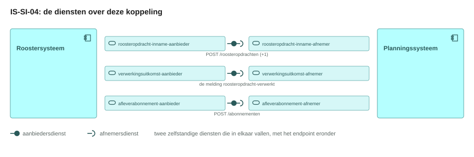
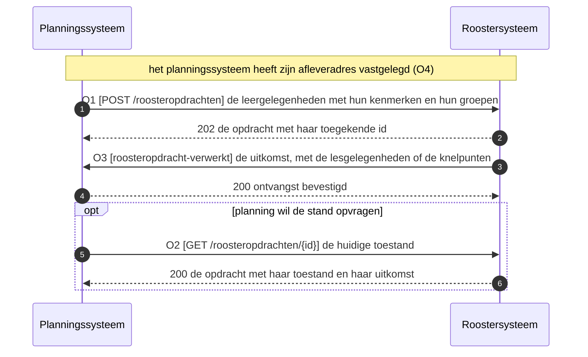
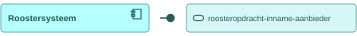
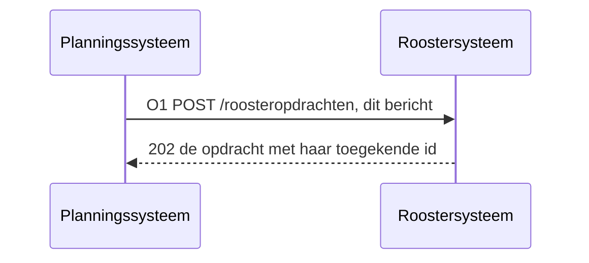
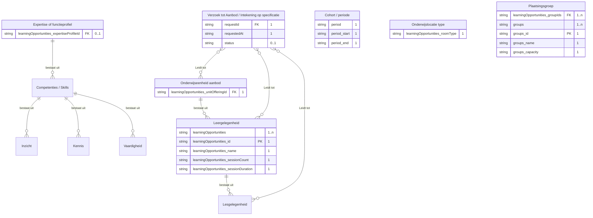
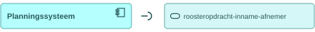
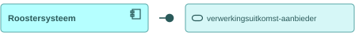
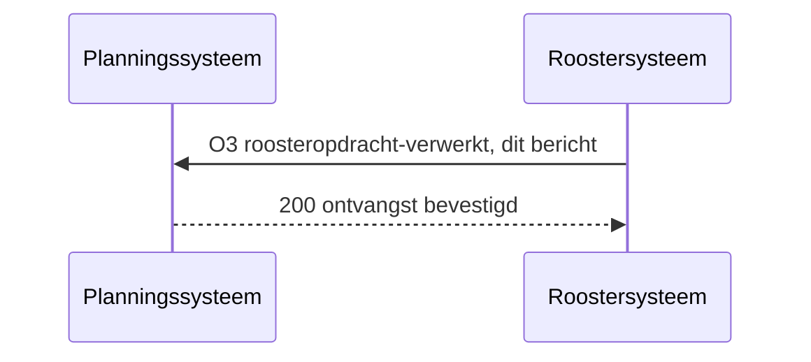
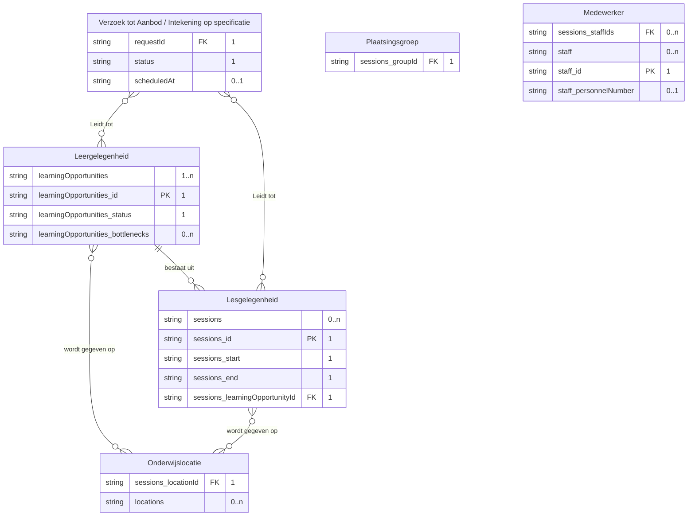
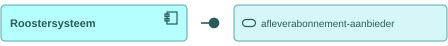

# IS-SI-04 Roosteren van de leergelegenheden

| | |
|---|---|
| **Document doel** | Zet uiteen hoe het planningssysteem de te roosteren leergelegenheden bij het roostersysteem aflevert, en hoe het rooster dat daaruit volgt terugkomt |
| **Doelgroep** | De implementatiespecialist en de tester bij een instelling of een leverancier, en wie een profiel of consumer bouwt |
| **Dient als input voor** | De bouw van het koppelvlak, de testgevallen erbij, en de acceptatie van een opgeleverde koppeling |
| **Kaderstelling** | De [interactieketen](README.md) waarin deze specificatie valt, het [informatiemodel OKx](../../../model/informatiemodel/informatiemodel.md), en hoofdplaat v1.7 |
| **Inhoud** | Vier operaties met hun statuscodes, twee berichten met hun velden, en acht werkbrieven |
| **Status** | Voorstel in zijn geheel. Hoofdplaat v1.7 draagt deze stroom zonder koppelingspecificatie, en Npuls-OKx/Public kent geen interactiepatroon tussen het planningssysteem en het roostersysteem |

De lading: de leergelegenheden van periode 1 met hun lokaaltype, hun docentexpertise en hun plaatsingsgroepen, en het rooster dat daaruit volgt met de lesgelegenheid, het lokaal en de docent.

## 1. Interactie

| Bronsysteem | Doelsysteem | Koppeling | Beeld | Status |
|---|---|---|---|---|
| `Planningssysteem` | `Roostersysteem` | Geen koppelingspecificatie in Public; hoofdplaat v1.7 draagt de stroom `Verzoek tot roosteren leergelegenheid` | F4-07, F4-08 | Voorstel |

| Applicatiecomponent | Functie in deze interactie |
|---|---|
| Planningssysteem | Levert de te roosteren leergelegenheden aan, legt zijn afleveradres vast, en neemt de uitkomst aan |
| Roostersysteem | Neemt de opdracht aan, zet de lesgelegenheid op tijd, lokaal en docent, en meldt de uitkomst terug |

Hoe de plaatsingsgroepen bij planning komen staat in IS-SI-03; wat de student van dit rooster ziet gaat in IS-SI-05 naar het studentkeuzesysteem.

## 2. Interactiespecificatie

De aanbiedersdienst en de afnemersdienst staan als twee eigen blokken tegenover elkaar, met de bal die in de kom valt. Het sequentiediagram eronder zet dezelfde operaties in de tijd.

Planning levert aan en het roostersysteem neemt aan. Het roosteren zelf is mensenwerk dat dagen duurt, dus volgt de uitkomst asynchroon op O3.

## 3. Operaties en berichtspecificatie

Een operatie is een pad met een methode erop. Zij draagt een nummer dat terugkomt in het sequentiediagram hierboven. `PL` is het planningssysteem, `RS` het roostersysteem.

Wie het endpoint bouwt verschilt per patroon, en bij een melding is dat omgekeerd aan wat de naam suggereert.

| Patroon | Wie levert het gegeven | Wie bouwt het endpoint | Wie roept aan |
|---|---|---|---|
| Ophalen | de aanbieder | de aanbieder | de afnemer |
| Aanleveren | de afnemer | de aanbieder | de afnemer |
| Melden | de aanbieder | de afnemer, op haar `callbackUrl` | de aanbieder |

Een query parameter verandert het endpoint niet: het pad blijft gelijk en de parameters komen in de query string. De afspraken die voor elke dienst in deze keten gelden, staan in de [interactieketenspecificatie](README.md).

#### roosteropdracht-inname-aanbieder, bij het roostersysteem

Deze dienst neemt een elders samengestelde roosteropdracht aan, kent haar een eigen identiteit toe en houdt haar toestand opvraagbaar. Het gegeven stroomt naar de aanbieder toe, en zij bouwt de endpoints (W1).

##### O1 · `POST /roosteropdrachten` · aanleveren

| | |
|---|---|
| Request body | `application/json`, de roosteropdracht, zie het bericht hieronder |
| `202 Accepted` | de opdracht met haar toegekende `id`; de uitkomst volgt asynchroon op O3 |
| `400 Bad Request` | de bevindingen, zodra de vorm of een verwijzing herstel vraagt |
| `409 Conflict` | dezelfde leergelegenheid staat al in een openstaande opdracht voor deze periode (W1) |
| Atomiciteit | de opdracht wordt in haar geheel aangenomen of afgewezen |

**Bericht: de roosteropdracht**

Schema [`scheduling-request.json`](schemas/scheduling-request.json) · voorbeeldpayload [`is-si-04-roosteropdracht.json`](voorbeeldpayloads/is-si-04-roosteropdracht.json)

De kolom Veld draagt de Engelse sleutel die over de koppeling gaat, de kolom Nederlands de naam uit het informatiemodel. Kardinaliteit `1` betekent verplicht.

| Veld | Nederlands | Datatype | Kardinaliteit | Objecttype | Bron |
|---|---|---|---|---|---|
| `requestId` | verzoekId | uuid | 1 | `Verzoek tot Aanbod / Intekening op specificatie` | voorstel, dezelfde sleutel als het verzoek tot aanbod van IS-OA-03 (W7) |
| `requestedAt` | aanvraagmoment | datum-tijd (RFC 3339) | 1 | `Verzoek tot Aanbod / Intekening op specificatie` | voorstel |
| `status` | toestand | enum | 0..1 | `Verzoek tot Aanbod / Intekening op specificatie` | toegekend door het roostersysteem, `aangenomen` bij aanname |
| `period` | periode | object | 1 | `Cohort / periode` | de vorm van [period.json](https://github.com/Npuls-OKx/Public/blob/dev/Informatie-en-gegevensmodellen/schemas/period.json) |
| `period.start` | start | datum | 1 | `Cohort / periode` | F4-08: alleen periode 1 wordt geroosterd |
| `period.end` | eind | datum | 1 | `Cohort / periode` | idem |
| `learningOpportunities` | leergelegenheden | array | 1..n | `Leergelegenheid` | voorstel |
| `learningOpportunities[].id` | leergelegenheidId | uuid | 1 | `Leergelegenheid` | [casus.md](casus.md), komt uit de keten onderwijsaanbod |
| `learningOpportunities[].name` | naam | string | 1 | `Leergelegenheid` | F4-07: Baliegesprekken 101, periode 1 |
| `learningOpportunities[].sessionCount` | aantalLesgelegenheden | integer | 1 | `Leergelegenheid` | voorstel, W3 |
| `learningOpportunities[].sessionDuration` | lesduur | integer | 1 | `Leergelegenheid` | voorstel in minuten, W3 |
| `learningOpportunities[].unitOfferingId` | onderwijseenheidAanbodId | uuid | 1 | `Onderwijseenheid aanbod` | F4-07: B1-K1, leerjaar 1 |
| `learningOpportunities[].roomType` | onderwijslocatieTypeCode | string | 1 | `Onderwijslocatie type` | de code uit [room-type.json](../interactie-onderwijsaanbod/schemas/room-type.json) van IS-OA-02; het model legt geen lijn van de leergelegenheid hierheen (W5) |
| `learningOpportunities[].expertiseProfileId` | expertiseOfFunctieprofielId | uuid | 0..1 | `Expertise of functieprofiel` | [expertise-profile.json](../interactie-onderwijsaanbod/schemas/expertise-profile.json) van IS-OA-02; zelfde ontbrekende lijn (W5) |
| `learningOpportunities[].groupIds` | plaatsingsgroepIds | array uuid | 1..n | `Plaatsingsgroep` | F4-07: twee groepen van 24, zelfde ontbrekende lijn (W5) |
| `groups` | plaatsingsgroepen | array | 1..n | `Plaatsingsgroep` | de vorm van [group.json](https://github.com/Npuls-OKx/Public/blob/dev/Informatie-en-gegevensmodellen/schemas/group.json) |
| `groups[].id` | plaatsingsgroepId | uuid | 1 | `Plaatsingsgroep` | [casus.md](casus.md), komt uit IS-SI-03 |
| `groups[].name` | naam | string | 1 | `Plaatsingsgroep` | F4-06: APO26-1A |
| `groups[].capacity` | capaciteit | integer | 1 | `Plaatsingsgroep` | F4-07: 24 per groep |

<!-- erd -->

| Lijn | Betekenis |
|---|---|
| `\|\|--o{` | het eerste bestaat uit nul of meer van het tweede |
| `}o--o{` | de twee hangen samen, met het opschrift erbij |
| `PK` en `FK` | de sleutel van het object, en een verwijzing naar een ander object |
| tekst achter een attribuut | de multipliciteit in dit bericht, en of het veld verplicht is |

<!-- /erd -->

Vier objecttypen hangen in dit beeld los van de keten: de periode, het lokaaltype, het expertiseprofiel met zijn competenties, en de plaatsingsgroep. Het model legt van de leergelegenheid naar die drie laatste geen lijn, terwijl de opdracht ze alle drie draagt (W5).

De groepen staan naast de leergelegenheden en niet erin genest, omdat dezelfde groep meer dan een leergelegenheid afneemt. Zij mogen nog leeg zijn: de opdracht bindt de groep aan de gelegenheid, de verbintenis per student ontstaat later (F4-09).

##### O2 · `GET /roosteropdrachten/{id}` · ophalen

| | |
|---|---|
| Query parameters | geen |
| `200 OK` | `application/json`, de opdracht met haar huidige toestand, en zodra zij geroosterd is met de uitkomst uit het bericht onder O3 |
| `404 Not Found` | onbekend `id`, of de bewaartermijn is verstreken (W1) |

#### roosteropdracht-inname-afnemer, bij het planningssysteem

Deze dienst roept O1 en O2 aan bij de aanbieder hierboven. De request body en de responses staan daar.

#### verwerkingsuitkomst-aanbieder, bij het roostersysteem

Deze dienst meldt wat het roostersysteem met de opdracht deed. Zij verstuurt; de `callbackUrl` staat bij de afnemer.

##### O3 · webhook `roosteropdracht-verwerkt` · melden

| | |
|---|---|
| Transport | HTTP POST naar de `callbackUrl` die planning met O4 registreerde |
| Request body | `application/json`, de roosteruitkomst, zie het bericht hieronder |
| `200 OK` | geen response body; bevestigt de ontvangst, niet het oordeel |
| Bij uitblijven | retry met exponential backoff, daarna dead letter queue |
| Idempotentie | op `eventId`: een herhaalde delivery heeft geen extra effect |

**Bericht: de roosteruitkomst**

Schema [`scheduling-result.json`](schemas/scheduling-result.json) · voorbeeldpayload [`is-si-04-roosteruitkomst.json`](voorbeeldpayloads/is-si-04-roosteruitkomst.json)

| Veld | Nederlands | Datatype | Kardinaliteit | Objecttype | Bron |
|---|---|---|---|---|---|
| `requestId` | verzoekId | uuid | 1 | `Verzoek tot Aanbod / Intekening op specificatie` | de opdracht uit O1 |
| `status` | toestand | enum | 1 | `Verzoek tot Aanbod / Intekening op specificatie` | voorstel: `geroosterd`, `deelsGeroosterd` of `nietRealiseerbaar` |
| `scheduledAt` | geroosterdOp | datum-tijd (RFC 3339) | 0..1 | `Verzoek tot Aanbod / Intekening op specificatie` | voorstel |
| `learningOpportunities` | leergelegenheden | array | 1..n | `Leergelegenheid` | voorstel |
| `learningOpportunities[].id` | leergelegenheidId | uuid | 1 | `Leergelegenheid` | dezelfde uuid als in de opdracht |
| `learningOpportunities[].status` | status | enum | 1 | `Leergelegenheid` | F4-08 zet haar op `geroosterd`; education-offering.json kent die waarde niet (W4) |
| `learningOpportunities[].bottlenecks` | knelpunten | array | 0..n | `Leergelegenheid` | de vorm van [bottleneck.json](https://github.com/Npuls-OKx/Public/blob/dev/Informatie-en-gegevensmodellen/schemas/bottleneck.json), met `ruimteTekort` en `expertiseTekort` erin |
| `sessions` | lesgelegenheden | array | 0..n | `Lesgelegenheid` | F4-08: de lesgelegenheid ontstaat bij het roosteren |
| `sessions[].id` | lesgelegenheidId | uuid | 1 | `Lesgelegenheid` | [casus.md](casus.md) |
| `sessions[].start` | aanvangstijdstip | datum-tijd (RFC 3339) | 1 | `Lesgelegenheid` | F4-08: 1 september 09:00 |
| `sessions[].end` | eindtijdstip | datum-tijd (RFC 3339) | 1 | `Lesgelegenheid` | F4-08: twee lesuren van de instelling |
| `sessions[].learningOpportunityId` | leergelegenheidId | uuid | 1 | `Lesgelegenheid` | het model laat `Leergelegenheid` de `Lesgelegenheid` aggregeren |
| `sessions[].locationId` | onderwijslocatieId | uuid | 1 | `Onderwijslocatie` | F4-08: het lokaaltype is lokaal 2.14 geworden |
| `sessions[].groupId` | plaatsingsgroepId | uuid | 1 | `Plaatsingsgroep` | de groep die deze les afneemt (W6) |
| `sessions[].staffIds` | medewerkerIds | array uuid | 0..n | `Medewerker` | F4-08: de docent, vooraf bepaald of op expertise gekozen |
| `locations` | locaties | array | 0..n | `Onderwijslocatie` | de vorm van [location.json](https://github.com/Npuls-OKx/Public/blob/dev/Informatie-en-gegevensmodellen/schemas/location.json), met `locationType` `ruimte` |
| `staff` | medewerkers | array | 0..n | `Medewerker` | voorstel |
| `staff[].id` | medewerkerId | uuid | 1 | `Medewerker` | [casus.md](casus.md) |
| `staff[].personnelNumber` | personeelsnummer | string | 0..1 | `Medewerker` | F4-08: personeelsnummer 4711 |

<!-- erd -->

| Lijn | Betekenis |
|---|---|
| `\|\|--o{` | het eerste bestaat uit nul of meer van het tweede |
| `}o--o{` | de twee hangen samen, met het opschrift erbij |
| `PK` en `FK` | de sleutel van het object, en een verwijzing naar een ander object |
| tekst achter een attribuut | de multipliciteit in dit bericht, en of het veld verplicht is |

<!-- /erd -->

De verbintenissen van de student op deze gelegenheden ontstaan in F4-09 en gaan niet over deze koppeling mee: IS-SI-05 brengt het rooster met die verbintenissen naar het studentkeuzesysteem. Welke expertise de docent meebrengt staat bij de medewerker zelf en blijft buiten dit bericht. De voorbeeldpayload draagt de eerste les van de reeks die de opdracht vroeg.

#### verwerkingsuitkomst-afnemer, bij het planningssysteem

Deze dienst host de `callbackUrl` voor O3 en antwoordt met `200 OK`. Wat planning met de uitkomst doet valt buiten dit koppelvlak.

#### afleverabonnement-aanbieder, bij het roostersysteem

Deze dienst neemt de subscriptions aan op de events die het roostersysteem zelf publiceert, en levert daarna af op de geregistreerde `callbackUrl`.

##### O4 · `POST /abonnementen` · aanleveren

| | |
|---|---|
| Request body | [subscription.json](https://github.com/Npuls-OKx/Public/blob/dev/Koppelvlakspecificaties/Datamodelschema's/subscription.json): `callbackUrl` en de `events` waarop de afnemer zich abonneert |
| `201 Created` | de subscription met haar `id` |
| `400 Bad Request` | onbekend event of een onbruikbare `callbackUrl` |
| Idempotentie | op `callbackUrl` plus event: een herhaalde registratie overschrijft de vorige |

#### afleverabonnement-afnemer, bij het planningssysteem

Deze dienst registreert haar `callbackUrl` bij de aanbieder met O4, en ontvangt daarna O3.

## 4. Werkbrieven: de issueset die hieruit volgt

Deze regels horen niet in de koppelvlakspecificatie zelf. Elk van hen wordt een issue in Npuls-OKx/Public of in meta, en blijft hier staan tot dat issue er is.

| Nr | Wat erbij moet | Waar |
|---|---|---|
| W1 | Een interactiepatroon tussen het planningssysteem en het roostersysteem, met de paden `POST /roosteropdrachten` en `GET /roosteropdrachten/{id}`, het meldpatroon `roosteropdracht-verwerkt`, de plek van het `eventId` en de bewaartermijn van een afgehandelde opdracht | Npuls-OKx/Public, map Interactiepatronen |
| W2 | De dienst `roosteropdracht-inname` staat niet in de dienstenlijst, en de meldingssoort `roosteropdracht-verwerkt` staat niet onder `verwerkingsuitkomst` | Npuls-OKx/Public, map Applicatiediensten |
| W3 | De twee payloadschema's van deze eenheid als voorstel, met de vraag of de lesduur en het aantal lesgelegenheden in de opdracht horen naast de drie kenmerken die F4-07 noemt | Npuls-OKx/Public, map Datamodelschema's |
| W4 | `status` van education-offering.json kent de waarde `geroosterd` niet, terwijl de leergelegenheid daarop uitkomt; dezelfde map draagt de uitbreiding van `offeringType` met de lesgelegenheid vanuit IS-SI-05 | Npuls-OKx/Public, map Datamodelschema's |
| W5 | Het informatiemodel legt geen lijn van `Leergelegenheid` naar `Onderwijslocatie type`, naar `Expertise of functieprofiel` en naar `Plaatsingsgroep`, terwijl de roosteropdracht die drie wel draagt | Npuls-OKx/meta, het informatiemodel |
| W6 | Of de groep op de lesgelegenheid de plaatsingsgroep uit de kernregistratie is of een lesgroep die de planner zelf vormt, en welk objecttype die laatste draagt (F4-09) | Npuls-OKx/meta, het informatiemodel |
| W7 | Of `Verzoek tot Aanbod / Intekening op specificatie` zowel de planopgave van IS-OA-03 als deze roosteropdracht draagt, of dat het twee objecttypen zijn | Npuls-OKx/meta, het informatiemodel |
| W8 | Of een schema zowel deze roosteruitkomst als het rooster per periode van IS-SI-05 draagt: dezelfde lesgelegenheden gaan naar twee afnemers met een ander doel | Npuls-OKx/meta, deze interactieketen |
