# IS-SI-05 Het rooster naar het studentkeuzesysteem

| | |
|---|---|
| **Document doel** | Zet uiteen hoe het roostersysteem het vastgestelde rooster van een periode en de verbintenissen daarop aan het studentkeuzesysteem levert |
| **Doelgroep** | De implementatiespecialist en de tester bij een instelling of een leverancier, en wie een profiel of consumer bouwt |
| **Dient als input voor** | De bouw van het koppelvlak, de testgevallen erbij, en de acceptatie van een opgeleverde koppeling |
| **Kaderstelling** | De [interactieketen](README.md) waarin deze specificatie valt, het [informatiemodel OKx](../../../model/informatiemodel/informatiemodel.md), en hoofdplaat v1.7 |
| **Inhoud** | Zes operaties met hun statuscodes, drie berichten met hun velden, en zeven werkbrieven |
| **Status** | Voorstel in zijn geheel. Hoofdplaat v1.7 draagt deze stroom zonder koppelingspecificatie, en Npuls-OKx/Public kent geen interactiepatroon tussen het roostersysteem en het studentkeuzesysteem. Diezelfde plaat laat de geroosterde verbintenis ook naar de kernregistratie gaan, en de sectorarchitect zegt dat de kernregistratie niets van het rooster hoeft te weten; dat punt staat als [S1](signaleringen.md) open en wordt hier niet beslist |

De lading: de geroosterde leergelegenheden van periode 1 met hun lesgelegenheden, hun lokaal en hun docent, en Jochems verbintenissen daarop, met de verbintenis op het programma in de toestand `geroosterd`.

## 1. Interactie

| Bronsysteem | Doelsysteem | Koppeling | Beeld | Status |
|---|---|---|---|---|
| `Roostersysteem` | `Student Keuze Systeem (SKS)` | Geen koppelingspecificatie in Public; hoofdplaat v1.7 draagt de stroom `Student Opleidingprogramma- en onderwijseenheid verbintenis` | F4-09 | Voorstel |

| Applicatiecomponent | Functie in deze interactie |
|---|---|
| Roostersysteem | Ontsluit het vastgestelde rooster met lokaal en docent, en de verbintenissen die daarop zijn ontstaan |
| Student Keuze Systeem (SKS) | Neemt beide af, en laat de student zien waar hij wanneer wordt verwacht |

Hoe het rooster tot stand komt (beeld F4-08) valt binnen IS-SI-04: daar neemt het roostersysteem de opdracht van planning aan en levert het resultaat terug.

## 2. Interactiespecificatie

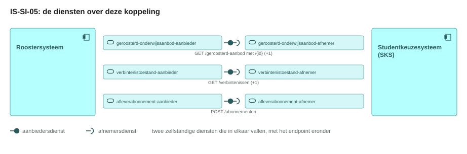

De aanbiedersdienst en de afnemersdienst staan als twee eigen blokken tegenover elkaar, met de bal die in de kom valt. Het sequentiediagram eronder zet dezelfde operaties in de tijd.

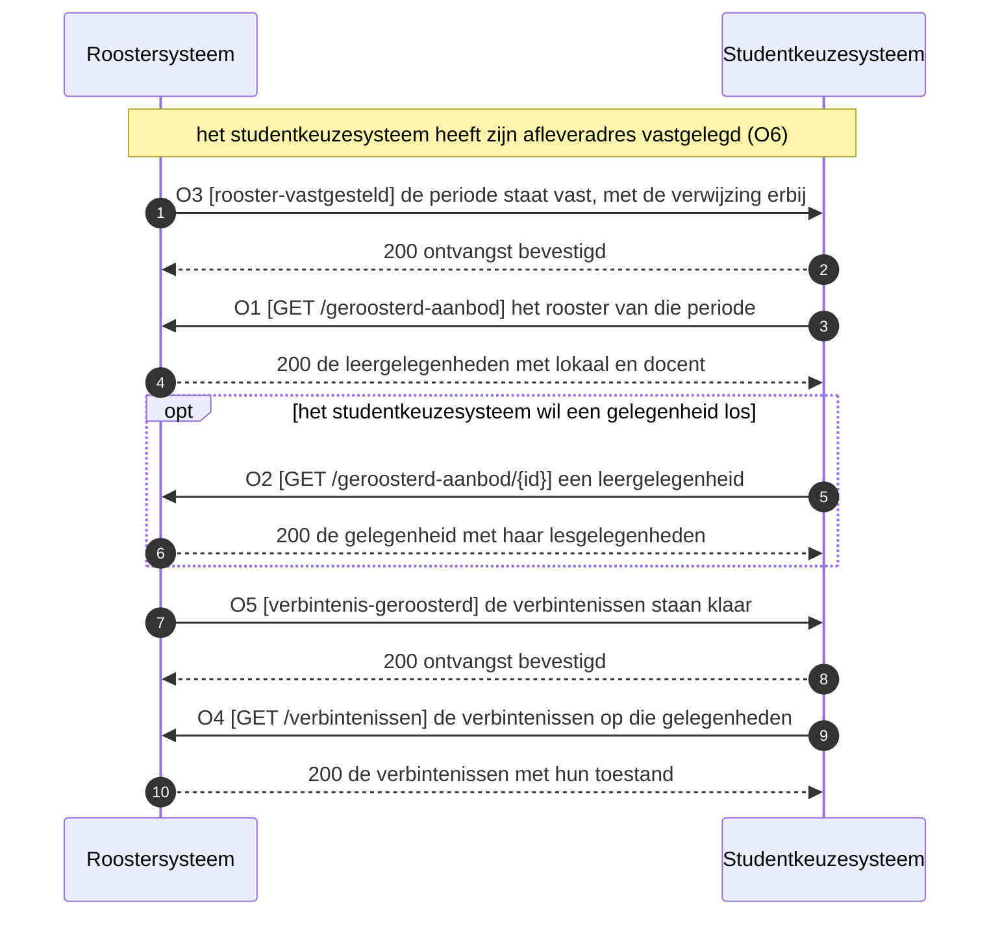

Het roostersysteem meldt en het studentkeuzesysteem haalt op. De melding draagt een verwijzing en geen structuur, zodat een rooster dat een hele periode beslaat over het opvraagkanaal gaat.

## 3. Operaties en berichtspecificatie

Een operatie is een pad met een methode erop. Zij draagt een nummer dat terugkomt in het sequentiediagram hierboven. `RS` is het roostersysteem, `SKS` het studentkeuzesysteem.

Wie het endpoint bouwt verschilt per patroon, en bij een melding is dat omgekeerd aan wat de naam suggereert.

| Patroon | Wie levert het gegeven | Wie bouwt het endpoint | Wie roept aan |
|---|---|---|---|
| Ophalen | de aanbieder | de aanbieder | de afnemer |
| Aanleveren | de afnemer | de aanbieder | de afnemer |
| Melden | de aanbieder | de afnemer, op haar `callbackUrl` | de aanbieder |

Een query parameter verandert het endpoint niet: het pad blijft gelijk en de parameters komen in de query string. De afspraken die voor elke dienst in deze keten gelden, staan in de [interactieketenspecificatie](README.md).

#### geroosterd-onderwijsaanbod-aanbieder, bij het roostersysteem

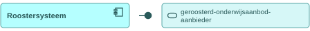

Deze dienst ontsluit het vastgestelde rooster: de leergelegenheid, haar lesgelegenheden met hun tijdstip, het lokaal en de docent. Zij meldt ook dat een periode vaststaat, en draagt daarmee twee patronen.

##### O1 · `GET /geroosterd-aanbod` · ophalen

| | |
|---|---|
| Query parameters | `programmaAanbodId` (verplicht), `periode` (optioneel, default de eerstvolgende), `gewijzigdSinds` (optioneel, RFC 3339) |
| `200 OK` | `application/json`, het rooster van die periode, zie het bericht hieronder |
| `400 Bad Request` | geen response body; de client corrigeert de parameter en bepaalt de retry |
| Omvang | een periode van een opleidingsprogramma-aanbod in een antwoord; W5 belegt het begrensd ophalen |
| Voorbeeld | `GET /geroosterd-aanbod?programmaAanbodId=8c494250-b67a-4666-a762-6f9ec1e70aff&periode=2026-09-01` |

**Bericht: het rooster van een periode**

Schema [`timetable.json`](schemas/timetable.json) · voorbeeldpayload [`is-si-05-rooster.json`](voorbeeldpayloads/is-si-05-rooster.json)

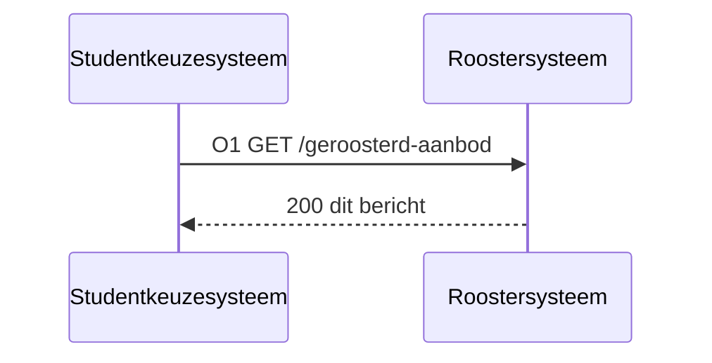

De kolom Veld draagt de Engelse sleutel die over de koppeling gaat, de kolom Nederlands de naam uit het informatiemodel. Kardinaliteit `1` betekent verplicht.

| Veld | Nederlands | Type | Kardinaliteit | Objecttype | Bron |
|---|---|---|---|---|---|
| `programmeOfferingId` | opleidingsprogrammaAanbodId | uuid | 1 | `Opleidingsprogramma aanbod` | [casus.md](casus.md), komt uit IS-OA-06 |
| `programmeOfferingVersion` | opleidingsprogrammaAanbodVersie | string | 0..1 | `Opleidingsprogramma aanbod` | voorstel |
| `period` | periode | object | 1 | `Opleidingsprogramma aanbod` | F4-08, de roosteraar roostert alleen periode 1 |
| `determinedAt` | vastgesteldOp | datum-tijd (RFC 3339) | 0..1 | `Opleidingsprogramma aanbod` | voorstel, draagt `gewijzigdSinds` van O1 |
| `learningOpportunities[].id` | leergelegenheidId | uuid | 1 | `Leergelegenheid` | casus.md, komt uit de keten onderwijsaanbod |
| `learningOpportunities[].courseOfferingId` | onderwijseenheidAanbodId | uuid | 1 | `Onderwijseenheid aanbod` | casus.md, het aanbod waaronder de gelegenheid hangt |
| `learningOpportunities[].name` | naam | string | 1 | `Leergelegenheid` | F4-08, Baliegesprekken 101 |
| `learningOpportunities[].status` | status | enum | 1 | `Leergelegenheid` | F4-08 zet `geroosterd`, W2 |
| `sessions[].id` | lesgelegenheidId | uuid | 1 | `Lesgelegenheid` | casus.md, ontstaat bij het roosteren |
| `sessions[].learningOpportunityId` | leergelegenheidId | uuid | 1 | `Lesgelegenheid` | het informatiemodel laat de leergelegenheid de lesgelegenheid aggregeren |
| `sessions[].groupId` | plaatsingsgroepId | uuid | 0..1 | `Plaatsingsgroep` | casus.md; F4-09 laat de planner een eigen lesgroep vormen |
| `sessions[].start` | aanvangstijdstip | datum-tijd (RFC 3339) | 1 | `Lesgelegenheid` | F4-08, maandag 1 september 09:00 |
| `sessions[].end` | eindtijdstip | datum-tijd (RFC 3339) | 1 | `Lesgelegenheid` | F4-08, tot 11:00 |
| `sessions[].locationId` | onderwijslocatieId | uuid | 0..1 | `Onderwijslocatie` | F4-08, het lokaaltype is een lokaalnummer geworden |
| `sessions[].staffIds` | medewerkerIds | uuid | 0..n | `Medewerker` | F4-08, docent 4711 |
| `locations[].id` | id | uuid | 1 | `Onderwijslocatie` | location.json van Public, verplicht |
| `locations[].locationType` | locatieType | enum | 1 | `Onderwijslocatie` | location.json, `ruimte` voor een lokaal |
| `locations[].name` | naam | string | 1 | `Onderwijslocatie` | location.json, Simulatieruimte 2.14 |
| `staff[].id` | medewerkerId | uuid | 1 | `Medewerker` | casus.md |
| `staff[].personnelNumber` | personeelsnummer | string | 0..1 | `Medewerker` | F4-08, personeelsnummer 4711; W2 |

<!-- erd -->
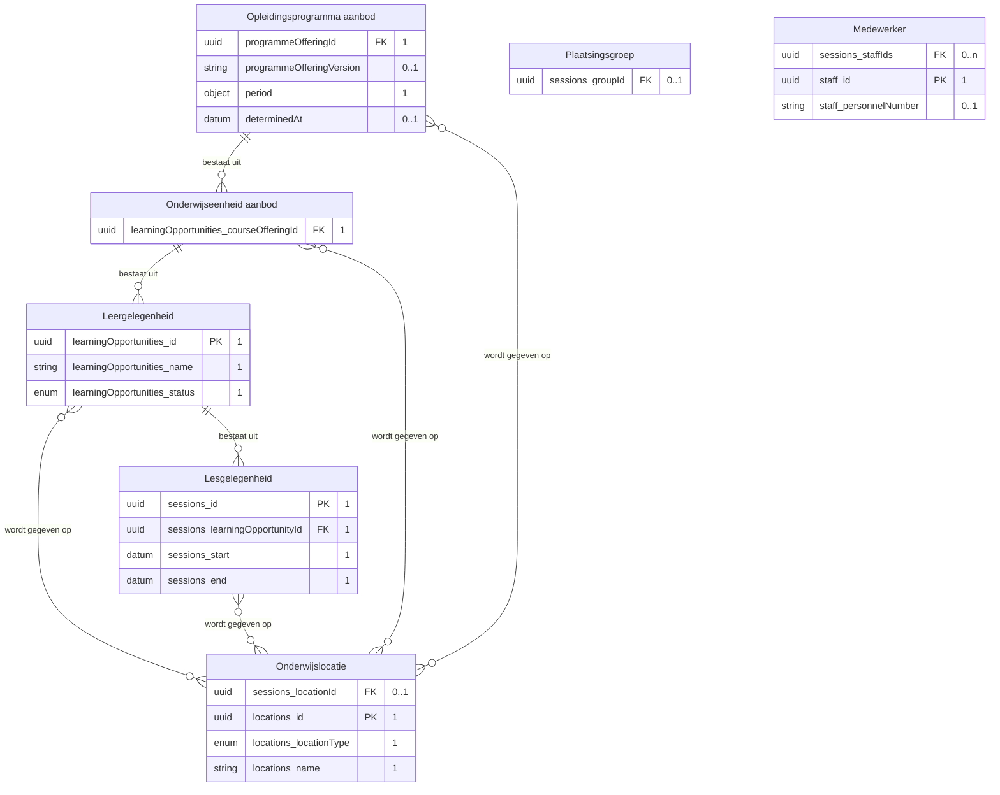

| Lijn | Betekenis |
|---|---|
| `\|\|--o{` | het eerste bestaat uit nul of meer van het tweede |
| `}o--o{` | de twee hangen samen, met het opschrift erbij |
| `PK` en `FK` | de sleutel van het object, en een verwijzing naar een ander object |
| tekst achter een attribuut | de multipliciteit in dit bericht, en of het veld verplicht is |

<!-- /erd -->

De verbintenissen van de student staan hier niet in: dit bericht draagt het aanbod en O4 draagt wie erop zit. De docent gaat mee als sleutel met zijn personeelsnummer; welke verdere persoonsgegevens over deze koppeling horen te gaan, belegt W2.

##### O2 · `GET /geroosterd-aanbod/{id}` · ophalen

| | |
|---|---|
| Query parameters | geen |
| `200 OK` | `application/json`, een leergelegenheid met haar lesgelegenheden, in de vorm van het bericht bij O1 |
| `404 Not Found` | onbekend `id`, of de gelegenheid is nog niet geroosterd |

##### O3 · webhook `rooster-vastgesteld` · melden

| | |
|---|---|
| Transport | HTTP POST naar de `callbackUrl` die het studentkeuzesysteem met O6 registreerde |
| Request body | `application/json`, de melding met haar verwijzing, zie het bericht hieronder |
| `200 OK` | geen response body; bevestigt de ontvangst, niet de verwerking |
| Bij uitblijven | retry met exponential backoff, daarna dead letter queue |
| Idempotentie | op `eventId`: een herhaalde delivery heeft geen extra effect |

**Bericht: de melding met haar verwijzing**

Schema [`schedule-notification.json`](schemas/schedule-notification.json) · voorbeeldpayload [`is-si-05-rooster-vastgesteld.json`](voorbeeldpayloads/is-si-05-rooster-vastgesteld.json)

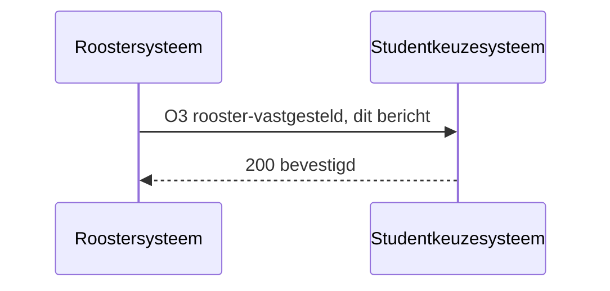

Dezelfde vorm dient O3 en O5; `eventType` zegt welke van de twee meldingen voorligt.

| Veld | Nederlands | Type | Kardinaliteit | Objecttype | Bron |
|---|---|---|---|---|---|
| `eventId` | eventId | uuid | 1 | kanaaleigenschap, geen objecttype | U5, herhaalbare verwerking |
| `eventType` | eventType | enum | 1 | kanaaleigenschap, geen objecttype | voorstel, W4 |
| `occurredAt` | opgetredenOp | datum-tijd (RFC 3339) | 1 | kanaaleigenschap, geen objecttype | voorstel |
| `programmeOfferingId` | opleidingsprogrammaAanbodId | uuid | 1 | `Opleidingsprogramma aanbod` | casus.md, waarop het studentkeuzesysteem filtert |
| `period` | periode | object | 0..1 | `Opleidingsprogramma aanbod` | voorstel, zodat de afnemer alleen die periode ophaalt |
| `resourceUrl` | bronUrl | uri | 0..1 | kanaaleigenschap, geen objecttype | U4, melden en dan ophalen |

<!-- erd -->
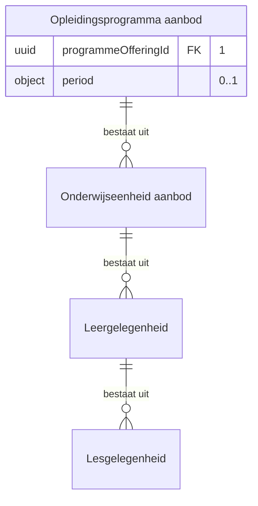

| Lijn | Betekenis |
|---|---|
| `\|\|--o{` | het eerste bestaat uit nul of meer van het tweede |
| `PK` en `FK` | de sleutel van het object, en een verwijzing naar een ander object |
| tekst achter een attribuut | de multipliciteit in dit bericht, en of het veld verplicht is |

<!-- /erd -->

#### geroosterd-onderwijsaanbod-afnemer, bij het studentkeuzesysteem

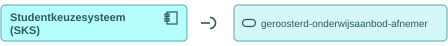

Deze dienst roept O1 en O2 aan bij de aanbieder hierboven, en host de `callbackUrl` voor O3. De parameters en de responses staan daar.

#### verbintenistoestand-aanbieder, bij het roostersysteem

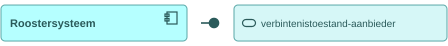

Deze dienst ontsluit de verbintenissen die op de geroosterde gelegenheden zijn ontstaan, met hun toestand per niveau. Zij meldt ook dat die verbintenissen klaarstaan.

##### O4 · `GET /verbintenissen` · ophalen

| | |
|---|---|
| Query parameters | `programmaAanbodId` (verplicht), `periode` (optioneel), `plaatsingsgroepId` (optioneel), `studentId` (optioneel), `gewijzigdSinds` (optioneel, RFC 3339) |
| `200 OK` | `application/json`, een array van het bericht hieronder, een element per verbintenis |
| `400 Bad Request` | geen response body; de client corrigeert de parameter en bepaalt de retry |
| Omvang | F4-07 voert deze leergelegenheid in twee plaatsingsgroepen van vierentwintig studenten uit, en elke student draagt een verbintenis per gelegenheid; de omhulling en de paginering staan open (W5) |
| Ditzelfde pad elders | de kernregistratie bouwt `GET /verbintenissen` in IS-SI-02 en IS-SI-06, met dezelfde dienst en een andere payload (W6, W7) |

**Bericht: de geroosterde verbintenis**

Schema [`scheduled-enrolment.json`](schemas/scheduled-enrolment.json) · voorbeeldpayload [`is-si-05-verbintenis.json`](voorbeeldpayloads/is-si-05-verbintenis.json)

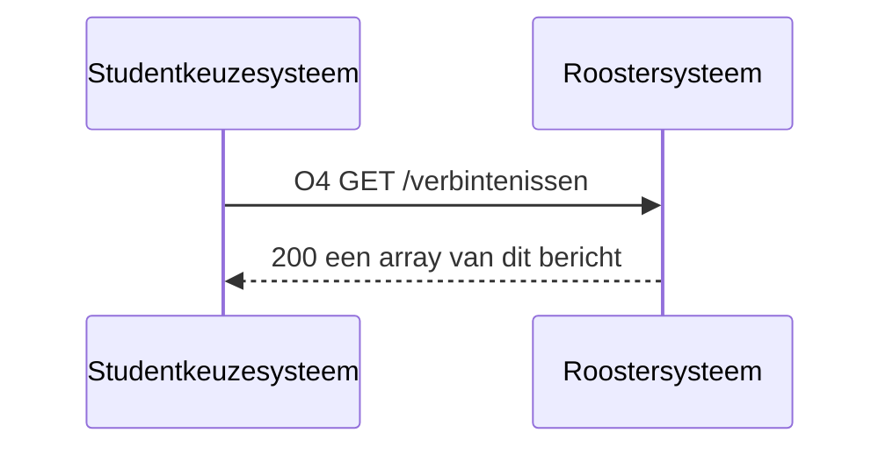

Het veld `level` zegt op welk van de vier niveaus de verbintenis hangt; de velden zijn over de niveaus gelijk, en de tabel zet ze daarom op het hoogste niveau.

| Veld | Nederlands | Type | Kardinaliteit | Objecttype | Bron |
|---|---|---|---|---|---|
| `id` | verbintenisId | uuid | 1 | `Opleidingsprogramma aanbod verbintenis` | casus.md |
| `level` | niveau | enum | 1 | `Opleidingsprogramma aanbod verbintenis` | F4-09 wijst vier soorten aan, W3 |
| `parentAssociationId` | bovenliggendVerbintenisId | uuid | 0..1 | `Opleidingsprogramma aanbod verbintenis` | voorstel, afwezig op het hoogste niveau |
| `state` | toestand | enum | 1 | `Opleidingsprogramma aanbod verbintenis` | F4-09 zet `geroosterd`, W3 |
| `stateChangedAt` | toestandGewijzigdOp | datum-tijd (RFC 3339) | 1 | `Opleidingsprogramma aanbod verbintenis` | voorstel, draagt `gewijzigdSinds` van O4 |
| `studentId` | studentId | uuid | 1 | `Student` | casus.md, ontstaat bij de inschrijving |
| `offeringId` | aanbodId | uuid | 1 | `Leergelegenheid`, `Lesgelegenheid` | de sleutel uit het bericht bij O1 |
| `placementGroupIds` | plaatsingsgroepIds | uuid | 0..n | `Plaatsingsgroep` | casus.md, ontstaat bij de intake |
| `temporary` | tijdelijk | boolean | 0..1 | `Leergelegenheid verbintenis`, `Lesgelegenheid verbintenis` | F4-09, de planner vormt een eigen lesgroep |

<!-- erd -->
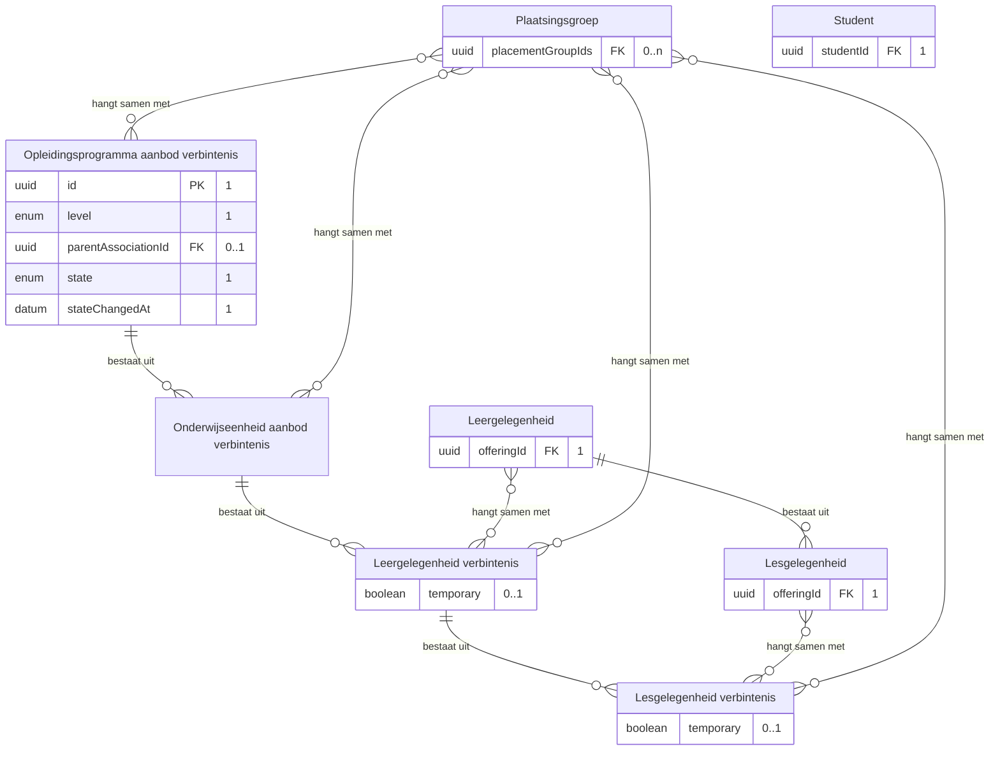

| Lijn | Betekenis |
|---|---|
| `\|\|--o{` | het eerste bestaat uit nul of meer van het tweede |
| `}o--o{` | de twee hangen samen, met het opschrift erbij |
| `PK` en `FK` | de sleutel van het object, en een verwijzing naar een ander object |
| tekst achter een attribuut | de multipliciteit in dit bericht, en of het veld verplicht is |

<!-- /erd -->

Dit bericht draagt geen persoonsgegevens: het roostersysteem kent de student als sleutel, en het studentkeuzesysteem haalt zijn naam elders. Welke van de vier niveaus het roostersysteem zelf bezit, raakt [S1](signaleringen.md) en blijft daarmee open.

##### O5 · webhook `verbintenis-geroosterd` · melden

| | |
|---|---|
| Transport | HTTP POST naar de `callbackUrl` die het studentkeuzesysteem met O6 registreerde |
| Request body | `application/json`, dezelfde vorm als bij O3, met `eventType` op `verbintenis-geroosterd` |
| Afwijking | de dienstenlijst laat deze dienst een overgang met haar oude en haar nieuwe waarde melden, zoals IS-SI-02 die bij de kernregistratie draagt; deze melding draagt een verwijzing en de afnemer haalt de toestand met O4 op (U4), en W4 belegt welke van de twee vormen de dienst draagt |
| `200 OK` | geen response body; bevestigt de ontvangst, niet de verwerking |
| Bij uitblijven | retry met exponential backoff, daarna dead letter queue |
| Idempotentie | op `eventId`: een herhaalde delivery heeft geen extra effect |

#### verbintenistoestand-afnemer, bij het studentkeuzesysteem

Deze dienst roept O4 aan bij de aanbieder hierboven, en host de `callbackUrl` voor O5. De parameters en de responses staan daar.

#### afleverabonnement-aanbieder, bij het roostersysteem

Deze dienst neemt de subscriptions aan op de meldingen die het roostersysteem zelf publiceert, en levert daarna af op de geregistreerde `callbackUrl`.

##### O6 · `POST /abonnementen` · aanleveren

| | |
|---|---|
| Request body | [subscription.json](https://github.com/Npuls-OKx/Public/blob/dev/Koppelvlakspecificaties/Datamodelschema's/subscription.json): `callbackUrl` en de `events` waarop de afnemer zich abonneert |
| `201 Created` | de subscription met haar `id` |
| `400 Bad Request` | onbekend event of een onbruikbare `callbackUrl`; de lijst events draagt `rooster-vastgesteld` en `verbintenis-geroosterd` nog niet (W4) |
| Idempotentie | op `callbackUrl` plus event: een herhaalde registratie overschrijft de vorige |

#### afleverabonnement-afnemer, bij het studentkeuzesysteem

Deze dienst registreert zijn `callbackUrl` bij de aanbieder met O6, en ontvangt daarna O3 en O5.

## 4. Werkbrieven: de issueset die hieruit volgt

Deze regels horen niet in de koppelvlakspecificatie zelf. Elk van hen wordt een issue in Npuls-OKx/Public of in meta, en blijft hier staan tot dat issue er is.

| Nr | Wat erbij moet | Waar |
|---|---|---|
| W1 | Een interactiepatroon tussen het roostersysteem en het studentkeuzesysteem, met de paden `GET /geroosterd-aanbod` met `/{id}` en `GET /verbintenissen`, en de meldpatronen `rooster-vastgesteld` en `verbintenis-geroosterd` | Npuls-OKx/Public, map Interactiepatronen |
| W2 | Het payloadschema van het rooster: de laag `lesgelegenheid` en de waarde `geroosterd` die education-offering.json nog niet kent, en welke medewerkergegevens over deze koppeling gaan naast wat de identiteitsvoorziening levert | Npuls-OKx/Public, map Datamodelschema's |
| W3 | Het payloadschema van de geroosterde verbintenis: de niveaus `leergelegenheid` en `lesgelegenheid`, en de toestand `geroosterd` in de reeks die IS-SI-01 voorstelt | Npuls-OKx/Public, map Datamodelschema's |
| W4 | De meldingssoorten `rooster-vastgesteld` en `verbintenis-geroosterd` in de lijst events van subscription.json, met schedule-notification.json als hun payload, en of een melding op de dienst verbintenistoestand-aanbieder de overgang met haar oude en haar nieuwe waarde draagt of een verwijzing waarna de afnemer ophaalt | Npuls-OKx/Public, map Datamodelschema's |
| W5 | Begrensd ophalen en de omhulling van een collectie op `GET /geroosterd-aanbod` en `GET /verbintenissen` | Npuls-OKx/Public; ligt open als W18 van IS-OA-01 |
| W6 | Een dienst die eenmaal centraal een payload draagt: het geroosterde aanbod reist als scheduling-result.json naar planning (IS-SI-04) en als timetable.json naar het studentkeuzesysteem, en de verbintenis als offering-association.json vanuit de kernregistratie (IS-SI-02, IS-SI-06) en als scheduled-enrolment.json vanuit het roostersysteem; W8 van IS-SI-04 weegt de eerste van de twee | Npuls-OKx/meta, label `gevondenDoorAI` |
| W7 | Het pad `GET /verbintenissen` dat het roostersysteem en de kernregistratie beide bouwen: dezelfde parameters en statuscodes, per bezitter gebouwd, zoals `/aanmeldbaar-aanbod` in de keten onderwijsaanbod | Npuls-OKx/Public, map Interactiepatronen |
