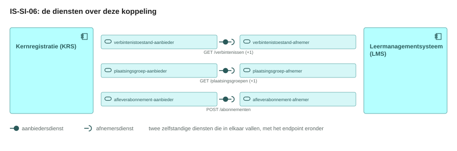
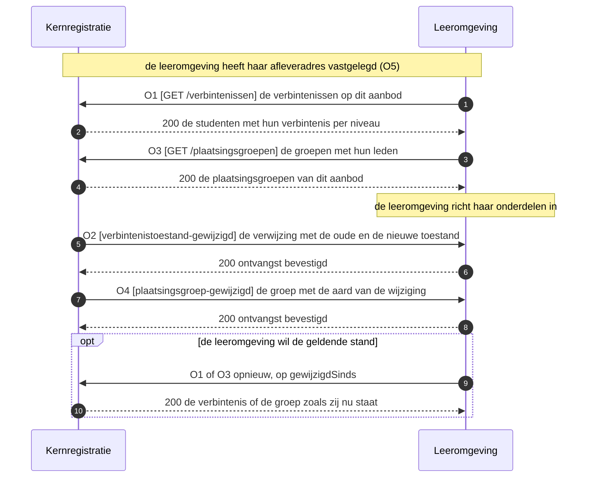
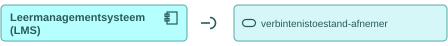
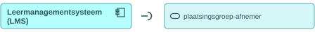
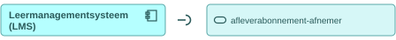

# IS-SI-06 De verbintenis naar de leeromgeving

| | |
|---|---|
| **Document doel** | Zet uiteen hoe de leeromgeving de verbintenissen en de plaatsingsgroepen bij de kernregistratie afneemt, zodat zij haar onderdelen inricht voordat het onderwijs begint |
| **Doelgroep** | De implementatiespecialist en de tester bij een instelling of een leverancier, en wie een profiel of consumer bouwt |
| **Dient als input voor** | De bouw van het koppelvlak, de testgevallen erbij, en de acceptatie van een opgeleverde koppeling |
| **Kaderstelling** | De [interactieketen](README.md) waarin deze specificatie valt, het [informatiemodel OKx](../../../model/informatiemodel/informatiemodel.md), en hoofdplaat v1.7 |
| **Inhoud** | Vijf operaties met hun statuscodes, de berichtspecificatie bij IS-SI-02, en zes werkbrieven |
| **Status** | Voorstel in zijn geheel. Hoofdplaat v1.7 draagt deze stroom zonder koppelingspecificatie, en Npuls-OKx/Public kent geen interactiepatroon tussen de kernregistratie en de leeromgeving |

De lading: Jochem als student, zijn verbintenissen op het opleidingsprogramma en de onderwijseenheid, en de plaatsingsgroep waarin hij valt. Dat is dezelfde lading als IS-SI-02, langs hetzelfde been van de junctie, en de berichtspecificatie staat daar. Beeld F4-10 beweegt ook een `Leergelegenheid verbintenis` naar de leeromgeving; dat niveau staat open (W5).

## 1. Interactie

| Bronsysteem | Doelsysteem | Koppeling | Beeld | Status |
|---|---|---|---|---|
| `Kernregistratie systeem studenten (KRS)` | `Leer management systeem (LMS)` | Geen koppelingspecificatie in Public; hoofdplaat v1.7 draagt de junctie `Student, opleidingprogramma verbintenis, relevante groepen`, met IS-SI-02 op het andere been | F4-10 | Voorstel |

| Applicatiecomponent | Functie in deze interactie |
|---|---|
| Kernregistratie systeem studenten (KRS) | Bezit de verbintenis en de plaatsingsgroep, ontsluit beide per aanbod, en meldt elke wijziging erop |
| Leer management systeem (LMS) | Haalt de verwachte deelnemers op, richt daarmee haar onderdelen in, en houdt dat beeld bij op de meldingen |

Beeld F4-10 legt de persoonsgegevens bij het identiteitsbeheer (identity and access management of IAM). Deze koppeling draagt de verbintenis en de groep.

## 2. Interactiespecificatie

De aanbiedersdienst en de afnemersdienst staan als twee eigen blokken tegenover elkaar, met de bal die in de kom valt. Het sequentiediagram eronder zet dezelfde operaties in de tijd.

De leeromgeving haalt op, de kernregistratie levert en meldt. Een melding draagt de verwijzing en de wijziging, zodat de leeromgeving de geldende stand bij de bron ophaalt.

## 3. Operaties en berichtspecificatie

Een operatie is een pad met een methode erop. Zij draagt een nummer dat terugkomt in het sequentiediagram hierboven. `KRS` is de kernregistratie, `LMS` de leeromgeving.

Wie het endpoint bouwt verschilt per patroon, en bij een melding is dat omgekeerd aan wat de naam suggereert.

| Patroon | Wie levert het gegeven | Wie bouwt het endpoint | Wie roept aan |
|---|---|---|---|
| Ophalen | de aanbieder | de aanbieder | de afnemer |
| Aanleveren | de afnemer | de aanbieder | de afnemer |
| Melden | de aanbieder | de afnemer, op haar `callbackUrl` | de aanbieder |

Een query parameter verandert het endpoint niet: het pad blijft gelijk en de parameters komen in de query string. De afspraken die voor elke dienst in deze keten gelden, staan in de [interactieketenspecificatie](README.md).

De berichtspecificatie van deze eenheid staat bij IS-SI-02, in [is-si-02.md](is-si-02.md). De kernregistratie bedient de leeromgeving en het studentkeuzesysteem langs dezelfde junctie, met dezelfde diensten, dezelfde endpoints en dezelfde schema's, zodat de velden op een plek liggen en de twee benen gelijk blijven (W6). De schema's en de voorbeeldpayloads van die eenheid staan in [schemas/](schemas/) en [voorbeeldpayloads/](voorbeeldpayloads/); de operaties hieronder noemen per response welk schema de vorm draagt.

#### verbintenistoestand-aanbieder, bij de kernregistratie

Deze dienst houdt de toestand van de verbintenis per niveau bij en meldt elke overgang met haar oude en haar nieuwe waarde. De dienstenlijst van Public draagt die verplichtingen en laat de endpoints open; de endpoints hieronder zijn voorstel (W1).

##### O1 · `GET /verbintenissen` · ophalen

| | |
|---|---|
| Query parameters | `aanbodId` (verplicht), `niveau` (optioneel, `opleiding`, `opleidingsprogramma` of `onderwijseenheid`), `toestand` (optioneel), `gewijzigdSinds` (optioneel, RFC 3339) |
| `200 OK` | `application/json`, de verbintenissen volgens `offering-association.json`, met de veldtabel bij IS-SI-02 |
| `400 Bad Request` | een onbruikbare parameterwaarde; de client corrigeert de parameter en bepaalt de retry |
| `404 Not Found` | onbekend `aanbodId` |
| Omvang | de leeromgeving richt per aanbod in, dus `aanbodId` begrenst de opvraag en `gewijzigdSinds` houdt haar daarna klein |

##### O2 · webhook `verbintenistoestand-gewijzigd` · melden

| | |
|---|---|
| Transport | HTTP POST naar de `callbackUrl` die de leeromgeving met O5 registreerde |
| Request body | `application/json` volgens `offering-association-changed.json`: de verwijzing naar de verbintenis, met haar oude en haar nieuwe toestand |
| `200 OK` | geen response body; bevestigt de ontvangst, niet het oordeel |
| Bij uitblijven | retry met exponential backoff, daarna dead letter queue |
| Idempotentie | op `eventId`: een herhaalde delivery heeft geen extra effect |
| Daarna | de leeromgeving haalt de geldende verbintenis op met O1 |

#### verbintenistoestand-afnemer, bij de leeromgeving

Deze dienst roept O1 aan bij de aanbieder hierboven en host de `callbackUrl` voor O2. De parameters en de responses staan daar.

#### plaatsingsgroep-aanbieder, bij de kernregistratie

Deze dienst ontsluit de plaatsingsgroepen met de studenten erin, zodat de leeromgeving haar eigen groepen daarop zet, en meldt een wijziging in de samenstelling. Het onderwerp `plaatsingsgroep` staat nog niet in de dienstenlijst van Public en wordt hier voorgesteld (W2).

##### O3 · `GET /plaatsingsgroepen` · ophalen

| | |
|---|---|
| Query parameters | `aanbodId` (verplicht), `gewijzigdSinds` (optioneel, RFC 3339) |
| `200 OK` | `application/json`, de plaatsingsgroepen met hun leden volgens `placement-group-collection.json` met `placement-group.json` erin, met de veldtabel bij IS-SI-02 |
| `400 Bad Request` | een onbruikbare parameterwaarde; de client corrigeert de parameter en bepaalt de retry |
| `404 Not Found` | onbekend `aanbodId` |

##### O4 · webhook `plaatsingsgroep-gewijzigd` · melden

| | |
|---|---|
| Transport | HTTP POST naar de `callbackUrl` die de leeromgeving met O5 registreerde |
| Request body | `application/json` volgens `placement-group-changed.json`: de groep, de aard van de wijziging en het lid dat het betreft |
| `200 OK` | geen response body; bevestigt de ontvangst, niet het oordeel |
| Bij uitblijven | retry met exponential backoff, daarna dead letter queue |
| Idempotentie | op `eventId`: een herhaalde delivery heeft geen extra effect |
| Daarna | de leeromgeving haalt de geldende samenstelling op met O3 |

#### plaatsingsgroep-afnemer, bij de leeromgeving

Deze dienst roept O3 aan bij de aanbieder hierboven en host de `callbackUrl` voor O4. De parameters en de responses staan daar.

#### afleverabonnement-aanbieder, bij de kernregistratie

Deze dienst neemt de subscriptions aan op de events die de kernregistratie zelf publiceert, en levert daarna af op de geregistreerde `callbackUrl`.

##### O5 · `POST /abonnementen` · aanleveren

| | |
|---|---|
| Request body | [subscription.json](https://github.com/Npuls-OKx/Public/blob/dev/Koppelvlakspecificaties/Datamodelschema's/subscription.json): `callbackUrl` en de `events` waarop de afnemer zich abonneert; de reeks draagt `verbintenistoestand-gewijzigd` en `plaatsingsgroep-gewijzigd` nog niet (W3) |
| `201 Created` | de subscription met haar `id` |
| `400 Bad Request` | onbekend event of een onbruikbare `callbackUrl` |
| Idempotentie | op `callbackUrl` plus event: een herhaalde registratie overschrijft de vorige |

#### afleverabonnement-afnemer, bij de leeromgeving

Deze dienst registreert haar `callbackUrl` bij de aanbieder met O5, en ontvangt daarna O2 en O4.

## 4. Werkbrieven: de issueset die hieruit volgt

Deze regels horen niet in de koppelvlakspecificatie zelf. Elk van hen wordt een issue in Npuls-OKx/Public of in meta, en blijft hier staan tot dat issue er is.

| Nr | Wat erbij moet | Waar |
|---|---|---|
| W1 | Een interactiepatroon tussen de kernregistratie en de leeromgeving, met de paden `GET /verbintenissen` en `GET /plaatsingsgroepen` en de meldpatronen `verbintenistoestand-gewijzigd` en `plaatsingsgroep-gewijzigd`; de dienst verbintenistoestand-aanbieder draagt vandaag de verplichtingen en laat de endpoints open | Npuls-OKx/Public, map Interactiepatronen |
| W2 | Het onderwerp `plaatsingsgroep` als aanbiedersdienst en afnemersdienst in de dienstenlijst, en de leden van de groep in het schema; group.json draagt vandaag `id`, `name` en `capacity`, en placement-group/voorstel van IS-SI-02 vult dat aan | Npuls-OKx/Public, mappen Applicatiediensten en Datamodelschema's |
| W3 | De events `verbintenistoestand-gewijzigd` en `plaatsingsgroep-gewijzigd` in de reeks `events` van subscription.json, zodat de leeromgeving zich erop abonneert | Npuls-OKx/Public, map Datamodelschema's |
| W4 | De claims op de componentpagina's: de kernregistratie als aanbieder en de leeromgeving als afnemer van verbintenistoestand, plaatsingsgroep en afleverabonnement | Npuls-OKx/Public, mappen Applicatiecomponenten en Applicatiediensten |
| W5 | Het niveau `leergelegenheid` over deze koppeling: offering-association.json draagt `leergelegenheid-verbintenis` in de reeks `associationType`, en beeld F4-10 beweegt een `Leergelegenheid verbintenis` naar de leeromgeving; of deze koppeling dat niveau meeneemt en wie het levert ligt niet vast | Npuls-OKx/meta, bij IS-SI-02 en bij de voorbeelduitwerking |
| W6 | De twee benen van deze junctie op dezelfde endpoints, eventnamen en schema's houden: wat IS-SI-02 bij de kernregistratie ophaalt en wat deze eenheid ophaalt is dezelfde dienst bij hetzelfde component | Npuls-OKx/meta, bij IS-SI-02 |
