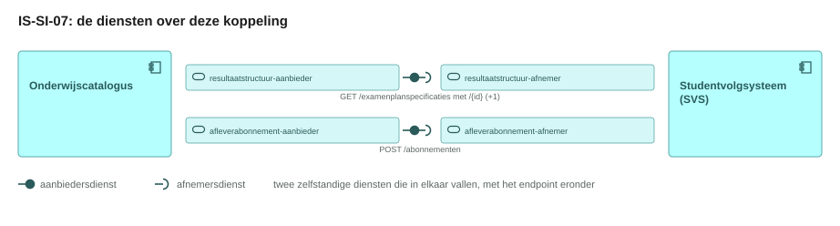
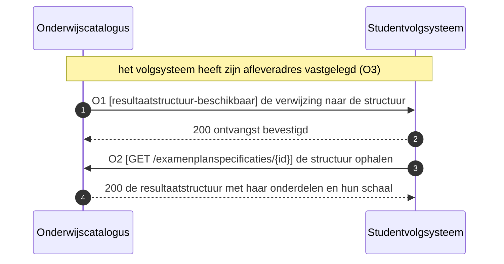
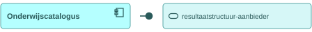
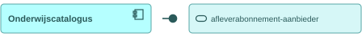
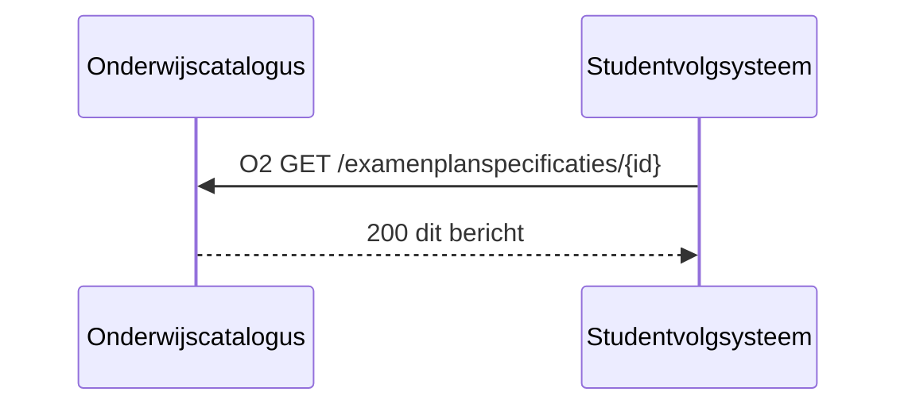

# IS-SI-07 De resultaatstructuur naar het studentvolgsysteem

| | |
|---|---|
| **Document doel** | Zet uiteen hoe de onderwijscatalogus de summatieve resultaatstructuur als nominaal template aan het studentvolgsysteem levert, zodat dat er per student een individueel examenplan van maakt |
| **Doelgroep** | De implementatiespecialist en de tester bij een instelling of een leverancier, en wie een profiel of consumer bouwt |
| **Dient als input voor** | De bouw van het koppelvlak, de testgevallen erbij, en de acceptatie van een opgeleverde koppeling |
| **Kaderstelling** | De [interactieketenspecificatie](README.md) waarin deze specificatie valt, het [informatiemodel OKx](../../../model/informatiemodel/informatiemodel.md), en hoofdplaat v1.7 |
| **Inhoud** | Drie operaties met hun statuscodes, een bericht met zijn velden, en drie werkbrieven |
| **Status** | Voorstel. Hoofdplaat v1.7 draagt de stroom `Onderwijs specificatie` met koppeling OC-SIS, maar het [interactiepatroon OC-SIS](https://github.com/Npuls-OKx/Public/blob/dev/Koppelvlakspecificaties/Interactiepatronen/onderwijscatalogus-studentinformatiesysteem.md) kent nog geen operatie voor de resultaatstructuur |

De lading: de summatieve resultaatstructuur met haar examenonderdelen, hun weging en de afrondingscriteria, en per onderdeel de schaal en de afnamevorm.

## 1. Interactie

| Bronsysteem | Doelsysteem | Koppeling | Beeld | Status |
|---|---|---|---|---|
| `Onderwijscatalogus` | `Student volg systeem (SVS)` | OC-SIS; hoofdplaat v1.7 draagt de stroom `Onderwijs specificatie` als junctie met een been naar het leermanagementsysteem | F4-04 | Voorstel |

| Applicatiecomponent | Functie in deze interactie |
|---|---|
| Onderwijscatalogus | Ontsluit de vastgestelde resultaatstructuur en meldt dat zij beschikbaar is |
| Student volg systeem (SVS) | Haalt haar op en maakt er per student een individueel examenplan van |

Zonder schaal en afnamevorm kan het volgsysteem een resultaat niet lezen. Daarom staat deze eenheid in deze keten en niet bij de uitvoering: zij moet klaar zijn voordat de student begint.

## 2. Interactiespecificatie



De aanbiedersdienst en de afnemersdienst staan als twee eigen blokken tegenover elkaar, met de bal die in de kom valt. Het sequentiediagram eronder zet dezelfde operaties in de tijd.



De melding is dun en draagt een verwijzing, waarna het volgsysteem ophaalt. Dat volgt [U4](https://github.com/Npuls-OKx/Public/blob/dev/Koppelvlakspecificaties/uitgangspunten.md).

## 3. Operaties en berichtspecificatie

Een operatie is een pad met een methode erop. Zij draagt een nummer dat terugkomt in het sequentiediagram hierboven. `OC` is de onderwijscatalogus, `SVS` het studentvolgsysteem.

Wie het endpoint bouwt verschilt per patroon, en bij een melding is dat omgekeerd aan wat de naam suggereert.

| Patroon | Wie levert het gegeven | Wie bouwt het endpoint | Wie roept aan |
|---|---|---|---|
| Ophalen | de aanbieder | de aanbieder | de afnemer |
| Aanleveren | de afnemer | de aanbieder | de afnemer |
| Melden | de aanbieder | de afnemer, op haar `callbackUrl` | de aanbieder |

Een query parameter verandert het endpoint niet: het pad blijft gelijk en de parameters komen in de query string. De afspraken die voor elke dienst in deze keten gelden, staan in de [interactieketenspecificatie](README.md).

#### resultaatstructuur-aanbieder, bij de onderwijscatalogus



Deze dienst ontsluit de vastgestelde summatieve resultaatstructuur en meldt dat zij beschikbaar is. Zij draagt daarmee twee patronen.

##### O1 · webhook `resultaatstructuur-beschikbaar` · melden

| | |
|---|---|
| Transport | HTTP POST naar de `callbackUrl` die het volgsysteem met O3 registreerde |
| Request body | `application/json`, de verwijzing naar de resultaatstructuur met haar `id` en `version` |
| `200 OK` | geen response body; bevestigt de ontvangst, niet het oordeel |
| Bij uitblijven | retry met exponential backoff, daarna dead letter queue |
| Idempotentie | op `eventId` |

##### O2 · `GET /examenplanspecificaties/{id}` · ophalen

| | |
|---|---|
| Query parameters | `versie` (optioneel, default de laatst gepubliceerde) |
| `200 OK` | `application/json`, de resultaatstructuur, zie het bericht hieronder |
| `400 Bad Request` | onbekende versie |
| `404 Not Found` | onbekend `id` |
| Delta | niet belegd; [U11](https://github.com/Npuls-OKx/Public/blob/dev/Koppelvlakspecificaties/uitgangspunten.md) vraagt haar wel (W2) |

#### resultaatstructuur-afnemer, bij het studentvolgsysteem


Deze dienst host de `callbackUrl` voor O1 (W3), roept O2 aan bij de aanbieder hierboven, en maakt uit het nominale template per student een individueel examenplan. Dat laatste valt buiten dit koppelvlak.

#### afleverabonnement-aanbieder, bij de onderwijscatalogus



Deze dienst neemt de subscriptions aan op de events die de catalogus zelf publiceert.

##### O3 · `POST /abonnementen` · aanleveren

| | |
|---|---|
| Request body | [subscription.json](https://github.com/Npuls-OKx/Public/blob/dev/Koppelvlakspecificaties/Datamodelschema's/subscription.json): `callbackUrl` en de `events` waarop de afnemer zich abonneert |
| `201 Created` | de subscription met haar `id` |
| `400 Bad Request` | onbekend event of een onbruikbare `callbackUrl` |
| Idempotentie | op `callbackUrl` plus event |

#### afleverabonnement-afnemer, bij het studentvolgsysteem


Deze dienst registreert haar `callbackUrl` bij de aanbieder met O3, en ontvangt daarna O1.

**Bericht: de resultaatstructuur als nominaal template**

Schema [`result-structure.json`](https://github.com/Npuls-OKx/Public/blob/dev/Koppelvlakspecificaties/Datamodelschema's/result-structure.json), met de schaal uit [`assessment-scale.json`](schemas/assessment-scale.json) · voorbeeldpayload [`is-si-07-resultaatstructuur.json`](voorbeeldpayloads/is-si-07-resultaatstructuur.json)



De kolom Veld draagt de Engelse sleutel die over de koppeling gaat, de kolom Nederlands de naam uit het informatiemodel. Kardinaliteit `1` betekent verplicht.

| Veld | Nederlands | Datatype | Kardinaliteit | Objecttype | Bron |
|---|---|---|---|---|---|
| `educationSpecifications[].id` | id | uuid | 1 | `Summatieve resultaat structuur` | result-structure.json |
| `educationSpecifications[].specificationType` | specificatieType | enum | 1 | `Summatieve resultaat structuur` | result-structure.json; `examenplanspecificatie`, `resultaateenheidspecificatie` of `toetsonderdeelspecificatie` |
| `educationSpecifications[].version` | versie | string | 1 | `Summatieve resultaat structuur` | result-structure.json |
| `educationSpecifications[].parentSpecificationId` | bovenliggendSpecificatieId | uuid of null | 1 | `Summatieve resultaat structuur` | result-structure.json |
| `educationSpecifications[].name` | naam | string | 1 | `Examenonderdeelspecificatie` | result-structure.json |
| `educationSpecifications[].appliesTo` | geldtVoor | uuid | 0..1 | `Opleidingsprogramma specificatie` | result-structure.json |
| `educationSpecifications[].assesses` | beoordeelt | uuid | 0..1 | `Onderwijseenheid specificatie` | result-structure.json |
| `educationSpecifications[].learningOutcomeId` | leeruitkomstId | uuid | 0..1 | `Leeruitkomst` | result-structure.json |
| `educationSpecifications[].weighting` | weging | getal | 0..1 | `Examenonderdeel weging` | result-structure.json |
| `educationSpecifications[].mandatory` | verplicht | boolean | 0..1 | `Examenonderdeel weging` | result-structure.json |
| `educationSpecifications[].assessmentForm` | toetsvorm | string | 0..1 | `Examenonderdeelspecificatie` | result-structure.json |
| `educationSpecifications[].description` | omschrijving | string | 0..1 | `Summatief Afrondingscriterium` | result-structure.json; draagt het afrondingscriterium als tekst |
| `educationSpecifications[].scale` | schaal | object | 0..1 | `Examenonderdeelspecificatie` | voorstel, W1 |
| `educationSpecifications[].scale.type` | schaalsoort | enum | 1 | `Examenonderdeelspecificatie` | voorstel, W1 |
| `educationSpecifications[].scale.passingValue` | voldoendegrens | string | 0..1 | `Examenonderdeelspecificatie` | voorstel, W1 |

<!-- erd -->
```mermaid
erDiagram
    "Formatieve resultaat structuur" ||--o{ "Toetsonderdeel specificatie" : "bestaat uit"
    "Formatieve resultaat structuur" ||--o{ "Toetsonderdeel weging" : "bestaat uit"
    "Leeronderdeel specificatie" ||--o{ "Les specificatie" : "bestaat uit"
    "Onderwijseenheid specificatie" ||--o{ "Leeronderdeel specificatie" : "bestaat uit"
    "Opleidingsprogramma specificatie" ||--o{ "Onderwijseenheid specificatie" : "bestaat uit"
    "Summatieve resultaat structuur" ||--o{ "Examenonderdeel weging" : "bestaat uit"
    "Summatieve resultaat structuur" ||--o{ "Toetsonderdeel specificatie" : "bestaat uit"
    "Examenonderdeel weging" }o--o{ "Examenonderdeelspecificatie" : "hangt samen met"
    "Examenonderdeelspecificatie" }o--o{ "Leeruitkomst" : "hangt samen met"
    "Leeronderdeel specificatie" }o--o{ "Leeruitkomst" : "hangt samen met"
    "Les specificatie" }o--o{ "Leeruitkomst" : "hangt samen met"
    "Onderwijseenheid specificatie" }o--o{ "Leeruitkomst" : "hangt samen met"
    "Opleidingsprogramma specificatie" }o--o{ "Leeruitkomst" : "hangt samen met"
    "Summatieve resultaat structuur" }o--o{ "Leeruitkomst" : "hangt samen met"
    "Summatieve resultaat structuur" }o--o{ "Summatief Afrondingscriterium" : "hangt samen met"
    "Toetsonderdeel specificatie" }o--o{ "Leeruitkomst" : "hangt samen met"
    "Toetsonderdeel weging" }o--o{ "Toetsonderdeel specificatie" : "hangt samen met"
    "Examenonderdeelspecificatie" ||--|| "Toetsonderdeel specificatie" : "is van het soort"
    "Summatieve resultaat structuur" {
        string educationSpecifications_id PK "1"
        string educationSpecifications_specificationType "1"
        string educationSpecifications_version "1"
        string educationSpecifications_parentSpecificationId FK "1"
        uuid appliesTo FK "0..1, verplicht op het examenplan"
        uuid assesses FK "0..1, verplicht op een resultaateenheid"
        string description "0..1"
        uuid id PK "1..1"
        object learningOutcome FK "0..1"
        uuid learningOutcomeId FK "0..1, verplicht buiten de keuzedeel-resultaateenheid om"
        array manifest FK "0..n, verplicht zodra er onderdelen zijn"
        uuid manifest[].specificationId FK "0..n"
        string manifest[].version "0..n"
        string name "1..1"
        uuid parentSpecificationId FK "1..1"
        object resultModel "1..1"
        array ruleSetReferences FK "0..n, verplicht op de keuzedeel-resultaateenheid"
        enum specificationType "1..1"
        string status "1..1"
        date validFrom "0..1, verplicht op het examenplan"
        date validUntil "0..1, verplicht op het examenplan"
        string version "1..1"
    }
    "Examenonderdeelspecificatie" {
        string educationSpecifications_name "1"
        string educationSpecifications_assessmentForm "0..1"
        string educationSpecifications_scale "0..1"
        string educationSpecifications_scale_type "1"
        string educationSpecifications_scale_passingValue "0..1"
        string establishedBy "0..1"
    }
    "Opleidingsprogramma specificatie" {
        string educationSpecifications_appliesTo "0..1"
    }
    "Onderwijseenheid specificatie" {
        string educationSpecifications_assesses "0..1"
    }
    "Leeruitkomst" {
        string educationSpecifications_learningOutcomeId FK "0..1"
    }
    "Examenonderdeel weging" {
        string educationSpecifications_weighting "0..1"
        string educationSpecifications_mandatory "0..1"
    }
    "Summatief Afrondingscriterium" {
        string educationSpecifications_description "0..1"
        array ruleSetReferences FK "0..n"
    }
    "Formatieve resultaat structuur" {
        integer decimalPlaces "0..1"
        number passMark "0..1"
        object resultModel "1..1"
        string scale "0..1"
    }
    "Toetsonderdeel specificatie" {
        string description "0..1"
        uuid id PK "1..1"
        object learningOutcome FK "0..1"
        uuid learningOutcomeId FK "0..1, verplicht op een toetsonderdeel"
        string name "1..1"
        enum nature "0..1, verplicht op een toetsonderdeel"
        uuid parentSpecificationId FK "1..1"
        object resultModel "1..1"
        enum specificationType "1..1"
        string status "1..1"
        string version "1..1"
    }
    "Toetsonderdeel weging" { }
    "Leeronderdeel specificatie" { }
    "Les specificatie" { }
```

| Lijn | Betekenis |
|---|---|
| `\|\|--o{` | het eerste bestaat uit nul of meer van het tweede |
| `\|\|--\|\|` | het tweede is een soort van het eerste |
| `}o--o{` | de twee hangen samen, met het opschrift erbij |
| `PK` en `FK` | de sleutel van het object, en een verwijzing naar een ander object |
| tekst achter een attribuut | de multipliciteit in dit bericht, en of het veld verplicht is |

<!-- /erd -->

De afnamevorm draagt `result-structure.json` al als `assessmentForm`. De schaal staat er niet in en wordt hier voorgesteld: zonder haar kan het volgsysteem een cijfer niet wegen tegen een grens. Werkbrief W1 laat haar in Npuls-OKx/Public landen. De keuzeregels gaan niet mee: het volgsysteem krijgt het nominale template, de keuzeruimte hoort bij de keuzedeelketen.

## 4. Werkbrieven: de issueset die hieruit volgt

Deze regels horen niet in de koppelvlakspecificatie zelf. Elk van hen wordt een issue in Npuls-OKx/Public of in meta, en blijft hier staan tot dat issue er is.

| Nr | Wat erbij moet | Waar |
|---|---|---|
| W1 | De schaal per examenonderdeel in `result-structure.json`, met de reeks waarden die een volgsysteem kan lezen. Equivalentie hoort erbij: een resultaat dat in meer dan een structuur meetelt | Npuls-OKx/Public, map Datamodelschema's |
| W2 | `GET /examenplanspecificaties/{id}/delta` met `van` en `naar`, zodat de resultaatstructuur dezelfde twee vormen draagt als de onderwijsspecificatie, conform U11 | De componentpagina van de onderwijscatalogus in Public |
| W3 | Het meldpatroon `resultaatstructuur-beschikbaar` en het endpoint op het studentvolgsysteem, in het interactiepatroon OC-SIS | Npuls-OKx/Public, map Interactiepatronen |
