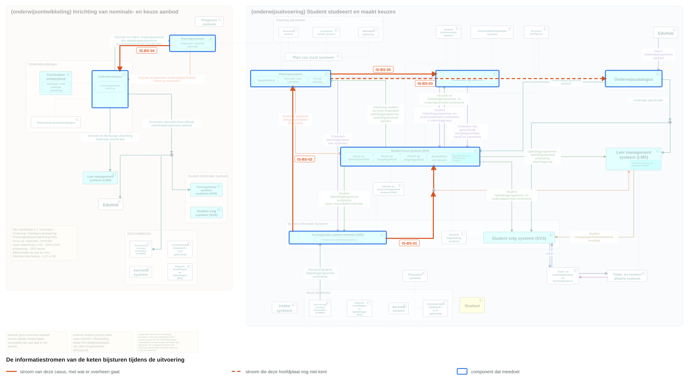

# Interactieketenspecificatie: bijsturen van planning, aanbod en rooster tijdens de uitvoering

| | |
|---|---|
| **Document doel** | Legt vast welke koppelingen een instelling nodig heeft om tijdens het jaar haar planning, aanbod en rooster bij te sturen, en wat een leverancier daarvoor bouwt |
| **Doelgroep** | De implementatiespecialist en de tester bij een instelling of een leverancier, en wie een profiel of consumer bouwt |
| **Dient als input voor** | De bouw van de koppelvlakken, de testgevallen erbij, en de acceptatie van een opgeleverde koppeling |
| **Kaderstelling** | Het [informatiemodel OKx](../../../model/informatiemodel/informatiemodel.md), de [uitgangspunten](https://github.com/Npuls-OKx/Public/blob/dev/Koppelvlakspecificaties/uitgangspunten.md), hoofdplaat v1.7, en de ketens [onderwijsaanbod ontsluiten](../interactieketen-onderwijsaanbod/README.md) en [student instroom](../interactieketen-student-instroom/README.md) waarvan zij de koppelingen hergebruikt |
| **Inhoud** | Vijf interactiespecificaties met hun operaties en berichten, twee signaleringen, en de koppelvlakdiensten per applicatiecomponent |
| **Status** | Voorstel. Vier van de vijf koppelingen zijn elders gespecificeerd; wat hier bijkomt is de lading van een wijziging |

## Leeswijzer

| Bestand | Wat erin staat |
|---|---|
| [signaleringen.md](signaleringen.md) | Twee punten die een besluit vragen, en wat buiten deze keten valt |
| De vijf interactiespecificaties | Wat een wijziging anders maakt dan een eerste levering |

## 1. De informatiestromen

Jochem heeft een groot deel van periode 4 niet kunnen bijwonen. De planner verzamelt de achterlopers in een groep, de oude verbintenis vervalt, er komt nieuw aanbod op dezelfde specificatie, en het rooster volgt.

| Eenheid | Beelden | Van | Naar | Koppeling |
|---|---|---|---|---|
| IS-BS-01 | F7-02 | Kernregistratie (KRS) | Studentkeuzesysteem (SKS) en leeromgeving | Dezelfde als IS-SI-02 en IS-SI-06 |
| IS-BS-02 | F7-01, F7-03 | Kernregistratie (KRS) | Planningssysteem | Dezelfde als IS-SI-03 |
| IS-BS-03 | F7-04 | Planningssysteem | Onderwijscatalogus | `Verzoek tot bijwerken onderwijspecificaties`, nieuw |
| IS-BS-04 | F7-05 | Planningssysteem | Onderwijscatalogus | Dezelfde als IS-OA-04 |
| IS-BS-05 | F7-06 | Planningssysteem | Roostersysteem | Dezelfde als IS-SI-04 |

Vier van de vijf koppelingen bestaan al. Deze keten beschrijft niet het contract opnieuw maar wat een wijziging anders maakt dan een eerste levering, en wijst voor de vorm naar de eenheid die haar droeg.

## 2. Wat deze keten oplevert

| Partij | Wat zij eruit haalt |
|---|---|
| Instelling | De koppelingen die zij uitvraagt om tijdens het jaar te kunnen bijsturen, met de aanduiding per eenheid |
| Leverancier | Welke toestanden en berichten erbij komen op koppelingen die zij al bouwt |
| Tester | De operaties met hun statuscodes en voorbeeldpayloads voor een wijziging |

## 3. Wat een wijziging anders maakt

| | Een eerste levering | Een wijziging |
|---|---|---|
| De verbintenis | ontstaat met toestand `aangemeld` of `ingeschreven` | gaat naar `geannuleerd`, en wat dat meeneemt verschilt per niveau ([S1](signaleringen.md)) |
| De groep | de plaatsingsgroep ontstaat bij de intake | de samenstelling wijzigt tijdens het jaar |
| Het aanbod | de catalogus neemt het aan als nieuw | de catalogus neemt een bijstelling aan op bestaand aanbod |
| Het rooster | de leergelegenheden worden voor het eerst geroosterd | er komen gelegenheden bij op een rooster dat al loopt |

De endpoints blijven dezelfde. Wat erbij komt is een toestand, een reden en een verwijzing naar wat vervalt.
