# Keuzedelen kiesbaar maken: koppelvlakspecificatie onderwijscatalogus naar studentkeuzesysteem

| In een oogopslag | |
|---|---|
| Wat deze specificatie dekt | De leeskant van een keuzemoment: de onderwijscatalogus levert de onderwijsspecificaties van de keuzedeelruimte met haar keuzedelen, het geplande keuzedeelaanbod met locatie en periode, en de keuzeregelset die de ruimte begrenst. Het studentkeuzesysteem berekent daaruit wat voor deze student kiesbaar is, met de reden bij een niet-kiesbare uitkomst |
| Voor wie | De leverancier die een onderwijscatalogus of een studentkeuzesysteem bouwt, de instelling die beide laat samenwerken, en de kerngroep techniek die de openstaande keuzes vaststelt |
| Wat een leverancier ermee bouwt | Elf applicatiediensten met hun verplichtingen, zeven berichtstromen, twaalf operaties met parameters, statuscodes en foutgedrag, veertien entiteiten op logisch niveau, en zestien werkbrieven die per schema zeggen welk veld erbij komt en wat de versie-impact is. Elke voorbeeldpayload rekent met dezelfde casus |
| Waarom zij in meta staat | De structuur waarop zij aansluit, met de dienstnamen en de vaste koppenstructuur, leeft in een openstaande pull request op `Npuls-OKx/Public` (branch `feature/restructure-and-versioning`). Zolang die niet gemerged is, staat het resultaat hier, met absolute verwijzingen naar Public, zodat verhuizen naar het releasepakket geen vertaalslag vraagt |
| Status | Concept, als proefopzet van de werkwijze. Alle besluiten waarop zij leunt dragen status Voorstel, en een modelleerkeuze hierin sluit geen discussie en vervangt geen afstemming met een ander traject |
| Scope | Keuzedelen binnen leerroute 1 met [persona Jochem](../leerroute-uitwerking/doc/persona_jochem.md), binnen een instelling ([ADR 0008](https://github.com/Npuls-OKx/Public/blob/dev/Referentiemateriaal/adr/0008-scope-planning-eerst-intra-instelling.md), status Voorstel). Het vastleggen van de keuze, de animo-uitvraag vooraf en de doorwerking na de keuze volgen als eigen snede; wat verder buiten deze snede valt staat achteraan met de reden |

Aanleiding: de zes stories die deze snede dekt dragen in de requirementsboom nog geen functionele eis, en de dienstpagina's voor keuzeregelset en kiesbaarheidsbepaling dragen verplichtingen zonder contract. Zolang dat contract ontbreekt vult elke partij de kiesbaarheid met eigen aannames in, en die worden de feitelijke standaard ([keuze-requirements](../student-keuze/keuze-requirements.md), paragraaf 1). Deze specificatie is geslaagd wanneer twee partijen die haar bouwen op dezelfde vraag dezelfde kiesbaarheid berekenen.

De werkcasus staat als eigen document in [casus.md](casus.md): kwalificatiedossier Apothekersassistent met een keuzedeelruimte van 720 studiebelastingsuren (SBU) en drie keuzedelen van 480, 240 en 240 SBU, waarvan twee combinaties de ruimte precies vullen en de derde 240 SBU tekortkomt. Elke voorbeeldpayload in deze specificatie rekent met die casus.

## Leeswijzer

| Hoofdstuk | Wat er staat |
|---|---|
| [Motivatie](#motivatie) | Het keuzemoment van Jochem, wat de vier gebruikers eraan hebben, de verankering in de requirementsboom, en de businesscase met de cijfers die de repositories dragen |
| [Informatiestromen](#informatiestromen) | De plek in de keten, de uitgelichte stromen op de hoofdplaat, en wie wat bezit |
| [Koppelvlakdiensten](#koppelvlakdiensten) | Per dienst wat hij levert, welk component hem vervult, welke objecttypen en schema's hij draagt en welke verplichting erbij komt |
| [Interactie](#interactie) | De diensten onderling, de interactiepatronen, de zeven berichtstromen met hun sequentiediagrammen, en de casus dienst voor dienst |
| [Datamodel](#datamodel) | De veertien entiteiten met hun velden, de getypeerde regelvorm met de regeltypen, de kiesbaarheidsuitkomst met haar redencodes, en de canonieke casus met haar sleutels |
| [Berichtspecificatie](#berichtspecificatie) | De twaalf operaties met parameters, antwoord, koptekstvelden, statuscodes en foutgedrag, en de werkbrieven richting het releasepakket |
| [Versie en status](#versie-en-status) | Het versiebeleid, de besluiten waarop deze specificatie leunt, en de dekking van de eisen en de requirements |
| [Signaleringen](#signaleringen) | De keuzes bij tegenspraak, de openstaande punten, de uitvraag aan instellingen, de verhouding tot OEAPI, en wat buiten deze snede blijft |

## Motivatie

### Het keuzemoment van Jochem

Jochem volgt Apothekersassistent in leerroute 1 en houdt het nominale schema aan. Voor een opleiding op niveau 4 zijn 720 SBU aan af te nemen keuzedelen verplicht, en ten minste 1 keuzedeel sluit hij af met een examen ([kaderscenario leerroute 1](https://github.com/Npuls-OKx/Public/blob/dev/Referentiemateriaal/kaderscenario%27s/leerroute-1-regulier.md), paragraaf Keuzedelen). Die 720 SBU is een ondergrens in de wet en tegelijk de begrote omvang van de keuzedeelruimte; de regel die dat uitdrukt draagt daarom een minimum naast een maximum (zie de [canonieke casus](#de-canonieke-casus-in-de-voorbeelden)). Zijn keuzedeelruimte ligt vooraf vast: "Bij een regulier traject als Jochem zijn is de keuzedeelruimte voorgeprogrammeerd en kan hij elke 3e periode van het schooljaar een keuzedeel volgen" ([persona Jochem](../leerroute-uitwerking/doc/persona_jochem.md), instellingsjourney, Kiezen keuzedelen). Daarmee is het keuzemoment voorspelbaar en planbaar.

De spil van dit koppelvlak is de voorsortering. De instelling ontsluit haar keuzedelenaanbod in de onderwijscatalogus en toont daaruit eerst de logische keuzes, afgestemd op leerroute en keuzedeelruimte, aard van het keuzedeel, domein en locatie.

> "Het is niet haalbaar Jochem zomaar uit alle mogelijk keuzedelen te laten kiezen. De onderwijscatalogus(of keuzesysteem) toont in eerste instantie alleen de keuzedelen, die vanuit de instelling voorgesorteerd zijn. [...] Door deze voorsortering kan de onderwijsinstelling het haalbaar en betaalbaar organiseren. Echter, mocht Jochem op basis van een goede onderbouwing toch een ander keuzedeel willen kiezen dat beter past bij zijn ambitie, interesse en talent, moet hier ook maatwerk mogelijk zijn."
>
> Persona Jochem, instellingsjourney, Kiezen keuzedelen. Dezelfde passage verwijst zelf door naar story-0013.

De [leerroute-uitwerking](../leerroute-uitwerking/doc/leerroute-uitwerking-lr1.md) noemt het motief van die voorsortering organiseerbaarheid, en benoemt de twee klassen als beroepsspecifiek en generiek: "Hierbij zal de onderwijsinstelling vanuit organiseerbaarheid in het individuele aanbod voorsorteren op geschikte beroepsspecifieke keuzedelen in het assortiment en het bredere aanbod van generieke keuzedelen."

| Moment in de reis | Wat er gebeurt | Snede | Vindplaats |
|---|---|---|---|
| Aanbod plannen en voorsorteren | De keuzedelen worden als gepland aanbod ontsloten en de instelling sorteert voor op leerroute en keuzedeelruimte, aard van het keuzedeel, domein en locatie | Leeskant | Persona Jochem, instellingsjourney; leerroute-uitwerking leerroute 1, Keuzedelen |
| Opties tijdig onder de aandacht brengen | "De opties dienen door de SLB-er al ruimschoots voor het keuzemoment onder de aandacht gebracht te worden" | Leeskant levert ruim voor het keuzemoment | Persona Jochem, instellingsjourney |
| Animo-uitvraag voor de planning | "is het van belang om ook een animo check te doen voor planning", zodat de organisatorische impact eerder bekend is | Eigen snede | Persona Jochem, instellingsjourney; [kaderscenario](https://github.com/Npuls-OKx/Public/blob/dev/Referentiemateriaal/kaderscenario%27s/leerroute-1-regulier.md), uitgangspunten bij Keuzedelen |
| Oriënteren en kiezen | "Hij bekijkt inhoud, studielast en examenvereisten en maakt keuzes die passen binnen zijn traject. Hij zorgt dat hij minimaal het benodigde aantal SBU behaalt" | Leeskant levert de criteria | Persona Jochem, studentjourney, Kiezen keuzedelen |
| Haalbaarheid op locatie en periode | De voorkeurtabel geeft per voorkeur een onderwijsperiode en een onderwijslocatie, en de locatie kan ook een praktijklocatie, hub of andere instelling zijn | Leeskant | Leerroute-uitwerking leerroute 1, Keuzedelen |
| Signaleren bij ontbrekend passend aanbod | De geplande keuzedeelruimte blijft dan mogelijk oningevuld, met actieve signalering en een nieuwe keuze, en ook op het SBU-minimum wordt gesignaleerd | Leeskant levert de grond voor het signaal | Leerroute-uitwerking leerroute 1, Keuzedelen |
| Keuze vastleggen | De keuzestelling gaat naar planning en het studentinformatiesysteem | Eigen snede | Leerroute-uitwerking leerroute 1, informatiestromen fase 6 |
| Doorwerking na de keuze | Vastlegging in het kernregistratiesysteem (KRS), formatieve en summatieve structuren in het studentvolgsysteem (SVS), plaatsing in de juiste lesgroep, de leeromgeving in het leermanagementsysteem (LMS), de leermiddelenlijst en de examenplanning | Eigen snede | Persona Jochem, instellingsjourney |

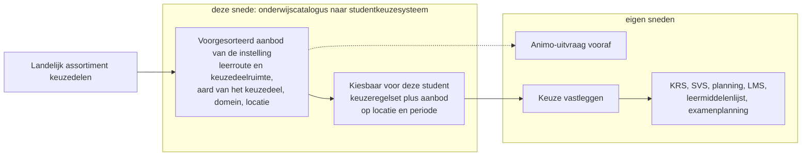

De stroom die deze specificatie beschrijft staat in de leerroute-uitwerking al benoemd: "OC -> SKS levert gepubliceerd `opleidingsprogramma-aanbod` (keuzedeel) en referentie naar `opleidingsprogramma-specificatie`". Over wie de voorsortering uitvoert lopen de bronnen uiteen: de persona schrijft "De onderwijscatalogus(of keuzesysteem)", terwijl de informatiestromenplaat de levering bij de onderwijscatalogus legt en het bepalen bij het studentkeuzesysteem. De plaat is hier leidend, en de catalogus levert daarmee de voorgesorteerde set plus de regelset waarmee het keuzesysteem het oordeel berekent.

Het wettelijke kader komt uit de wet VABA en staat in het Public-kaderscenario: de keuzedelen raken formeel los van de kwalificaties, de instelling maakt het keuzedelenaanbod per beroepsopleiding openbaar, onderbouwt de keuzes op verzoek, en biedt meerdere momenten aan waarop een student kiest of een eerdere keuze herziet. Daarbij hoort een tweezijdig herzieningsrecht: de student mag tot kort voor de aanvang herzien en de instelling mag het aanbod herzien op animo, actualiteit en haalbaarheid. Wat dat voor een keuzemoment betekent dat al open staat, staat onder [Gedrag bij een wijziging tijdens een open keuzemoment](#gedrag-bij-een-wijziging-tijdens-een-open-keuzemoment).

### Wat de partijen eraan hebben

| Partij | Waarde uit deze snede | Grond | Vindplaats |
|---|---|---|---|
| Student | Kiezen op inhoud, studielast en examenvereisten, met het SBU-minimum voor de kwalificatie gehaald | De voorgesorteerde set maakt gericht kiezen binnen leerroute en keuzedeelruimte mogelijk, en een keuzedeel komt in beeld wanneer locatie en periode passen | Persona Jochem, studentjourney en instellingsjourney; story-0013 en story-0014 |
| Student | Een plan B voordat het keuzemoment opengaat | "Door het vooraf opstellen van een prioriteitslijst, heeft Jochem vooraf al nagedacht over alternatieve opties en heeft hij al een 'plan B'" | Kaderscenario leerroute 1 |
| Student | Een signaal zodra de keuzedeelruimte oningevuld dreigt te blijven | Actieve signalering houdt studievertraging in beeld, en de lege uitkomst van de zoekvraag levert de grond ervoor | Leerroute-uitwerking leerroute 1 |
| Instelling | Een planbaar, terugkerend keuzemoment, elke derde periode | De keuzedeelruimte is voorgeprogrammeerd, en de voorsortering maakt het aanbod haalbaar en betaalbaar te organiseren | Persona Jochem, instellingsjourney; leerroute-uitwerking leerroute 1 |
| Instelling | Tijdigheid die even zwaar telt als de keuze zelf | De opties komen ruim voor het keuzemoment onder de aandacht, en de animo-uitvraag dient de planning | Persona Jochem, instellingsjourney |
| Beheerder | Een keuzedeelprogramma dat over opleidingen heen herbruikbaar is | "Dat programma is N:M-gekoppeld aan de diplomaprogramma's: een keuzedeel is herbruikbaar over BOL/BBL/Havisten (en potentieel over opleidingen/instellingen heen)" | Kaderscenario leerroute 1; story-0017 |
| Planner | Definitieve keuzes periodiek verwerken naar groepen en capaciteit, op dezelfde regel als het keuzemoment | Het persoonlijke programma is het nominale programma plus het gekozen keuzedeel, en studenten met hetzelfde keuzedeel komen in een groep | Leerroute-uitwerking leerroute 1, informatiestromen fase 6; story-0015 |
| Leverancier | Eenmaal bouwen op een gedeeld contract | OKx is "een afspraakstelsel, leunend op een gegevensstandaard om onderwijs op de lange termijn flexibeler te maken, zonder dat iedere instelling en leverancier opnieuw dezelfde vertaalslag hoeft te doen" | Leerroute-uitwerking, inleiding |

De keten bestaat uit meerdere componenten omdat "ontwerp, logistiek, registratie en uitvoering verschillende bronnen van waarheid hebben", en de informatiestromenplaat legt vast wie leest, schrijft en dupliceert. De implementatiewijze blijft aan instelling en leverancier, met OKx in een adviserende rol: "Hoe scholen en leveranciers koppelvlakken inzetten (met of zonder integratielaag) wordt niet voorgeschreven."

### Verankering in de requirementsboom

| Id | Story | Feature |
|---|---|---|
| [story-0013](https://github.com/Npuls-OKx/Public/blob/dev/Referentiemateriaal/requirementsboom/stories.md#story-0013) | Als student wil ik eerst de door mijn instelling voorgesorteerde keuzedelen zien, zodat ik gericht kan kiezen binnen mijn leerroute en keuzedeelruimte. | feature-0024 Kiesbaarheid bepalen |
| [story-0014](https://github.com/Npuls-OKx/Public/blob/dev/Referentiemateriaal/requirementsboom/stories.md#story-0014) | Als student wil ik alleen keuzedelen als kiesbaar zien wanneer ze op mijn locatie en in mijn periode beschikbaar zijn, zodat ik geen onhaalbare keuze maak. | feature-0024 Kiesbaarheid bepalen |
| [story-0015](https://github.com/Npuls-OKx/Public/blob/dev/Referentiemateriaal/requirementsboom/stories.md#story-0015) | Als planner wil ik dezelfde voorwaarde-regel gebruiken die het keuzemoment stuurde, zodat keuze en rooster niet uiteenlopen. | feature-0026 Regelsets los van items, met min/max-keuzeregels |
| [story-0016](https://github.com/Npuls-OKx/Public/blob/dev/Referentiemateriaal/requirementsboom/stories.md#story-0016) | Als instelling wil ik naast algemene en beroepsspecifieke keuzedelen eigen kiesbaarheidsklassen kunnen toevoegen, zodat de indeling niet vastligt. | feature-0026 Regelsets los van items, met min/max-keuzeregels |
| [story-0017](https://github.com/Npuls-OKx/Public/blob/dev/Referentiemateriaal/requirementsboom/stories.md#story-0017) | Als beheerder wil ik een keuzedeelprogramma via een regelset over opleidingen heen kunnen hergebruiken, zodat ik hetzelfde keuzedeel niet per opleiding opnieuw definieer. | feature-0026 Regelsets los van items, met min/max-keuzeregels |
| [story-0018](https://github.com/Npuls-OKx/Public/blob/dev/Referentiemateriaal/requirementsboom/stories.md#story-0018) | Als instelling wil ik dezelfde regelvorm op elk specificatieniveau en op leeruitkomsten van elke orde kunnen toepassen, zodat keuzedelen nu en losse leeronderdelen straks dezelfde regels volgen. | feature-0026 Regelsets los van items, met min/max-keuzeregels |

De zes stories dekken vier gebruikers: de student, de instelling, de beheerder en de planner. De leverancier staat in de tabel hierboven als vijfde partij, zonder eigen story. Daaruit volgen zes ontwerpeisen, met de requirementseis uit de [keuze-requirements](../student-keuze/keuze-requirements.md) erbij die hen draagt.

| Ontwerpeis | Volgt uit | Draagt |
|---|---|---|
| 0013 de catalogus drukt uit dat iets voorgesorteerd is voor deze leerroute, als eigenschap van de relatie | story-0013 | Geen eigen eis in R1 tot R17. Grond: de voorsorteringspassage in de persona |
| 0014 locatie en periode zitten op het aanbod en zijn filterbaar | story-0014 | R3 |
| 0015 de regelset is leesbaar buiten het keuzesysteem, de planner gebruikt dezelfde regel | story-0015 | R8 en R9 |
| 0016 de kiesbaarheidsklasse is een uitbreidbare opsomming | story-0016 | R10 |
| 0017 de regelset heeft een eigen identiteit en id, los van het catalogusitem | story-0017 | R2 en R17 |
| 0018 de regel wijst generiek naar specificatie-ids en naar leeruitkomsten van elke orde | story-0018 | R13 en R16 |

Welk onderdeel van de specificatie elke eis waarmaakt, met de stand erbij, staat in de [dekkingstabel](#dekking-van-de-ontwerpeisen). De uitgangspunten en de besluiten waarop deze uitwerking leunt staan eenmaal, in [Versie en status](#versie-en-status).

### Businesscase

#### Drie sporen

| Spoor | Wat het zegt | Vindplaats |
|---|---|---|
| 1. De standaard drukt de voorwaarde vandaag als vrije tekst uit | OEAPI legt toelatingsvoorwaarden vast in `admissionRequirements` als vrije tekst, en OKx vraagt eenduidig evalueerbare regels (R6) los van de items (R2), zodat elk systeem dezelfde uitkomst berekent | [Keuze-requirements](../student-keuze/keuze-requirements.md), verhouding tot OEAPI; de volledige lijst botsingen staat in [Verhouding tot OEAPI](#verhouding-tot-oeapi) |
| 1. Het enige actuele gat met een datum | Het concept vraag-om-ongepland-aanbod is nog op geen OEAPI-model af te beelden, benoemd als tekortkoming in de beoogde standaard ten opzichte van de eigen kaderstelling | [Verslag 14 juli 2026](../../../meetings/20260714_SI_afstemming_PR_specificatie_uitwerking_P_en_R/summary.md); de eerdere lijst staat in [archiefmateriaal](../leerroute-uitwerking/doc/archief-conceptmodellen.md) van april en mei 2026 zonder normatieve status |
| 2. De eigen keten draagt voor deze snede nog geen contract | Alle zes stories dragen in de kolom functionele eisen de waarde "geen", de dienstpagina's keuzeregelset en kiesbaarheidsbepaling dragen verplichtingen met de regel dat het contract nog niet is uitgewerkt, en het studentkeuzesysteem belegt vandaag geen dienst | [stories.md](https://github.com/Npuls-OKx/Public/blob/dev/Referentiemateriaal/requirementsboom/stories.md) en de [dienstpagina's](https://github.com/Npuls-OKx/Public/tree/d0c20d99b110b29ccf6b0e50109f7d54ffd88d7a/Koppelvlakspecificaties/Applicatiediensten) |
| 3. Zonder afspraak vult elke partij de kiesbaarheid zelf in | "Zonder afspraak vult elke leverancier dit in met eigen aannames. Die worden de-facto standaard en zijn later niet meer te wijzigen. Daarom eerst de eisen, voordat we attributen en endpoints kiezen" | Keuze-requirements, paragraaf 1 |
| 3. Hetzelfde mechanisme op instellingsniveau | Zonder gestandaardiseerde contracten lopen instellingen op bilaterale, leverancier-specifieke integraties, en vraagt elke leverancierswissel herontwerp van alle koppelingen | [OKx-AP04](https://github.com/Npuls-OKx/Public/blob/dev/Referentiemateriaal/principes/principes.md) |
| 3. Het nulalternatief | De bestaande koppelingen van punt naar punt (point-to-point) in een API-jasje gieten kost veel publiek geld terwijl de functionaliteit gelijk blijft. Dit staat in de repositories als gesproken opmerking van 24 maart 2026 | Werksessie 24 maart 2026 |
| 3. Een gemeten geval uit het eigen werk | Een handmatige samenvoeging van een gedeelde bron kostte 276 elementdefinities en leverde 295 dode verwijzingen op over 9 views, met een view die voor 97 procent dood stond. Dit is een analogie uit het eigen werk en geen sectorcijfer | [ADR 0010](https://github.com/Npuls-OKx/Public/blob/dev/Referentiemateriaal/adr/0010-archimatemodel-werkafspraken.md) |

#### Wat de investering voor deze snede klein houdt

| Gegeven | Waarde | Aard | Vindplaats |
|---|---|---|---|
| Deel van de opleiding dat in een omgeving ligt, in het Jochem-scenario | 95 procent, waarbij alleen het keuzedeel afstemming tussen omgevingen vraagt | Schatting | [Verslag 26 juni 2026](../../../meetings/20260626_OKx_kerngroep_inhoud_complexiteitsreductie_aanpak_flexibel_onderwijs/summary.md) |
| Datapunten voor een eerste keuze of belangstelling | 5 of 6 | Schatting | Verslag 26 juni 2026 |
| Deel van het onderwijs dat in die fase definitief is | Minder dan 10 procent | Schatting | Verslag 26 juni 2026 |
| Keren dat de student zijn keuze daarna herbevestigt | 3 tot 4 | Schatting | Verslag 26 juni 2026 |
| Ruimte om te kiezen binnen leerroute 1 tot 3 | Nog klein, terwijl de richting naar bijna elk onderdeel als keuzedeel gaat | Observatie | Keuze-requirements, paragraaf 1 |
| Tijdvenster | Specificaties eind 2026 gereed, bouwstart Q1 2027 | Besluit | [Verslag 13 juli 2026](../../../meetings/20260713_OKx_SI_afstemming_specificaties_en_planning_project_OKx/summary.md) |

Het beperken en relateren van keuzes houdt die keten beheersbaar (keuze-requirements, paragraaf 1). Over het percentage volwaardige specificaties waarbij een leverancier start lopen de standpunten in het verslag van 13 juli 2026 uiteen, met de waarschuwing dat een percentage onzekerheid communiceert.

#### De gegevens die de repositories dragen

| Gegeven | Waarde | Aard | Vindplaats |
|---|---|---|---|
| Keuzedeelverplichting niveau 4 | 720 SBU als ondergrens, ten minste 1 keuzedeel met examen | Wettelijke norm | Kaderscenario leerroute 1 |
| [K0037 Farmaceutische Patientenzorg](../../kwalificatiedossier/K0037-farmaceutische-patientenzorg.md) | 480 SBU, aard verdiepend, gevalideerd 26-11-2015 | Hard | Landelijk keuzedeelblad |
| [K0262 ARBO, kwaliteitszorg en hulpverlening geschikt voor niveau 3](../../kwalificatiedossier/K0262-arbo-kwaliteitszorg-en-hulpverlening-niveau-3.md) | 240 SBU, aard generiek, gevalideerd 10-11-2015 | Hard | Landelijk keuzedeelblad |
| De twee samen in de keuzedeelruimte | 480 plus 240 is 720 SBU, de ruimte precies vol | Hard | Keuzedeelblad K0037 |
| Regeltypen in de getypeerde vorm | 4, met 8 kandidaten zonder vorm | Hard | [Regelsetvorm](../student-keuze/regelset-payload.md) en [de kandidatentabel](#de-regeltypen-die-uit-de-eisen-volgen-en-nog-geen-vorm-hebben) |
| Canonieke regelset | 2 benoemde bereiken, 7 regels | Hard | Regelsetvorm, paragraaf 8 |
| Omvang van de twee bereiken in de regelsetvorm | Zo'n 20 keuzedelen in het verbredende bereik, 5 in het opgesomde bereik | Schatting, indicatief | Regelsetvorm, paragraaf 8 |
| Schema's die deze snede vraagt | 16 werkbrieven, waarvan 7 nieuwe schema's | Hard | [Werkbrieven richting het releasepakket](#werkbrieven-richting-het-releasepakket) |
| Stories van deze snede met een functionele eis | 0 van 6, kolomwaarde "geen" | Hard | [stories.md](https://github.com/Npuls-OKx/Public/blob/dev/Referentiemateriaal/requirementsboom/stories.md) |
| Requirementsboom | 3 doelen, 8 epics, 36 features, 28 stories | Hard | [Requirementsboom](https://github.com/Npuls-OKx/Public/blob/dev/Referentiemateriaal/requirementsboom/README.md) |
| Dienstpagina's in het pakket | 14 applicatiediensten op 28 pagina's, waarvan keuzeregelset en kiesbaarheidsbepaling zonder endpoints | Hard | [Applicatiediensten](https://github.com/Npuls-OKx/Public/tree/d0c20d99b110b29ccf6b0e50109f7d54ffd88d7a/Koppelvlakspecificaties/Applicatiediensten) |
| Koppelingspecificaties in het pakket | 3, alle vanuit de onderwijscatalogus | Hard | [Koppelingspecificaties](https://github.com/Npuls-OKx/Public/tree/d0c20d99b110b29ccf6b0e50109f7d54ffd88d7a/Koppelvlakspecificaties/Koppelingspecificaties) |
| Informatiestromen op de hoofdplaat | 17 beschreven stromen op circa 20 lijnen | Hard, met marge | [Projectoverzicht](../../../../project/projectoverzicht.md) |
| ADR's in Public | 26, waarvan 25 status Voorstel | Hard | [ADR-map](https://github.com/Npuls-OKx/Public/tree/dev/Referentiemateriaal/adr) |
| Draagvlaknorm OKx-AP09 | Meer dan 1 instelling en meer dan 1 leverancier, minimaal 2 plus 2 | Norm | Principes |
| Feitelijke betrokkenheid | 4 koploper-leveranciers, 6 tot 8 koploper-instellingen | Schatting van de deelnemers | Verslag 13 juli 2026 |
| Leveranciersinzet kerngroep techniek | 8 tot 12 uur per twee weken | Verwachting bij aanvang | Verslag 13 juli 2026 |
| Tijdlijn | Specificaties gereed eind 2026, bouwstart Q1 2027 | Besluit | Verslag 13 juli 2026 |
| Afstemming buiten de eigen omgeving in het Jochem-scenario | 5 procent van de opleiding | Schatting | Verslag 26 juni 2026 |
| Herstelwerk na een handmatige samenvoeging | 276 elementdefinities, 295 dode verwijzingen, 9 views, 1 view 97 procent dood | Gemeten | ADR 0010 |

De betrokkenheid ligt met 4 leveranciers en 6 tot 8 instellingen boven de eigen norm van OKx-AP09, en dat is het sterkste draagvlakcijfer dat de repositories dragen.

#### Wat voor een bedrag nog nodig is

De repositories dragen normcijfers, tellingen en schattingen. Bedragen volgen uit een begroting per koppeling bij programmamanagement; deze businesscase benoemt per cijfer wat daarvoor nodig is.

| Wat ontbreekt | Wat er nodig is om het te krijgen |
|---|---|
| Elk bedrag voor OKx: begroting, kostenpost, investering per koppeling. De enige bedragen in de repositories zijn illustraties bij een keuzecriterium uit een werksessie | Een begroting per koppeling bij programmamanagement, vastgelegd als eigen document |
| Een capaciteitsopgave in voltijdsequivalenten (FTE). Op 10 juli 2026 is het op papier zetten en formeel indienen als actiepunt belegd, een getal volgt daarna niet in de repositories | De ingediende opgave opnemen zodra zij vastligt ([verslag 10 juli 2026](../../../meetings/20260710_okx_kernteam_inhoud_specificatie_uitwerken_OC_P/summary.md)) |
| Sectornoemers: aantal instellingen, studenten, keuzedelen in de kwalificatiestructuur, keuzedeelinschrijvingen per jaar, opleidingen per instelling | Uitvraag bij de landelijke bronnen en bij de koploperinstellingen, zodat de omvang van het probleem een noemer krijgt |
| Gemeten kosten van de huidige werkwijze: doorlooptijd, aantal handelingen, correcties, foutpercentage, en een nulmeting van keuzes die onrealiseerbaar blijken | Een nulmeting bij twee koploperinstellingen op het keuzedeelproces |
| Het aantal bilaterale koppelingen per instelling en de kosten van een leverancierswissel, terwijl OKx-AP04 juist op dat mechanisme leunt | Uitvraag bij instellingen en leveranciers, met een herontwerpkost per wissel |
| Bouwomvang en daarmee de kostenkant van deze snede | De endpointcontracten en de 16 werkbrieven uit deze specificatie, met een bouwschatting van de koploper-leveranciers erbij |
| Aantallen rond het keuzedelenaanbod per instelling: keuzedelen per klasse, aantal kiesbaarheidsklassen, aantal regelsets in beheer. De casus noemt zo'n 20 en 5 en merkt die aan als indicatief | Uitvraag aan instellingen, conform het besluit over de canonieke casus |
| Een vastgestelde lijst van deelnemende instellingen en leveranciers met hun toezegging. De bandbreedte 6 tot 8 is tot geen ledenlijst te herleiden | Een deelnemerslijst van de kerngroep techniek, met per partij de toezegging |
| Een uitgewerkt nulalternatief. Het bestaat als gesproken opmerking en als rationale onder OKx-AP04 | Een scenariovergelijking van doorgaan op bilaterale koppelingen tegenover gestandaardiseerde contracten |
| Een actuele, vastgestelde lijst van wat OEAPI vandaag voor deze snede uitdrukt. De bestaande lijst staat in archiefmateriaal zonder normatieve status, en de submodule op een vastgezet versielabel is nog niet gezet | Vaststelling in de kerngroep techniek, en inbreng in de technische werkgroep van OEAPI |
| Verslaglegging over de besluitvorming: 12 van de 30 meetingmappen zijn leeg en het laatste bruikbare verslag dateert van 14 juli 2026, terwijl de vijf bindende besluiten van 13 oktober 2026 zijn | Een besluitenregister bij de opdrachtgever, met de onderbouwing per besluit |

## Informatiestromen

Dit hoofdstuk zet het beeld neer; de diensten eronder staan in [Koppelvlakdiensten](#koppelvlakdiensten) en het verloop in [Interactie](#interactie).

### Plek in de keten

De Curriculum-ontwerptool levert het ontwerp aan de onderwijscatalogus, het planningssysteem maakt het aanbod planbaar en de catalogus ontsluit het. Het studentkeuzesysteem leest die ontsluiting en levert de keuzestelling daarna door aan het studentinformatiesysteem en aan planning; die lijn ligt voorbij deze koppeling.

De koppelvlakview van het studentkeuzesysteem op de informatiestromen-hoofdplaat v1.7 staat in het releasepakket als [koppelvlak_sks_view_ihp_v1_7.png](https://github.com/Npuls-OKx/Public/blob/d0c20d99b110b29ccf6b0e50109f7d54ffd88d7a/Koppelvlakspecificaties/src/koppelvlak_sks_view_ihp_v1_7.png). De plaat hieronder licht op diezelfde hoofdplaat de stromen uit die het kiesbaar maken van een keuzedeel raken: de componenten die meedoen zijn omlijnd, bij elke stroom staat wat er overheen gaat, en een stroom die de plaat nog niet kent staat gestippeld.

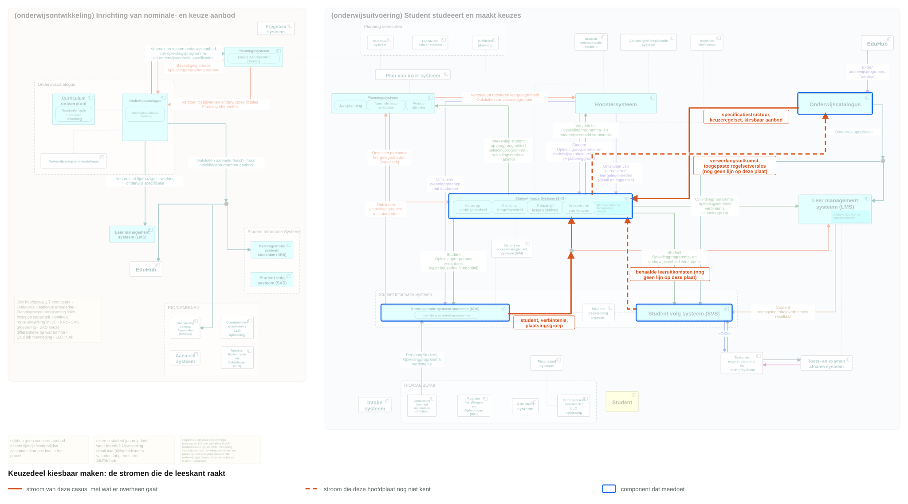

De vier stromen staan als gegeven in [stromen-kiesbaar.json](stromen-kiesbaar.json). De plaat komt uit het model met de volgende aanroep.

```text
python3 tools/scripts/teken-hoofdplaat-ruim.py \
  --uit architecture/docs/specificatie/koppelvlak-keuzedeel-kiesbaar/img/hoofdplaat-keuzedeel-kiesbaar.svg \
  --markeer architecture/docs/specificatie/koppelvlak-keuzedeel-kiesbaar/stromen-kiesbaar.json
```

Twee van de vier stromen staan gestippeld: hoofdplaat v1.7 kent de lijn van het studentvolgsysteem naar het studentkeuzesysteem niet, en de terugmelding van het studentkeuzesysteem naar de onderwijscatalogus evenmin. Dat is een signalering richting een volgende versie van de plaat, en geen aanname in deze specificatie.

### Procesbeeld

Resource-eigenaarschap (U3) en meldingsgedreven levering (event notification, U4) bepalen het verkeer over deze koppeling; de motivering staat in de [uitgangspunten](https://github.com/Npuls-OKx/Public/blob/d0c20d99b110b29ccf6b0e50109f7d54ffd88d7a/Koppelvlakspecificaties/uitgangspunten.md). De onderwijscatalogus bezit de onderwijsspecificaties en de regelsets en ontsluit het keuzedeelaanbod dat zij van planning heeft ingenomen; het studentkeuzesysteem bezit het keuzemoment en het kiesbaarheidsoordeel. Over de koppeling gaan referenties, en de inhoud volgt op een opvraag. Dat het studentkeuzesysteem ophaalt wanneer het hem uitkomt telt hier dubbel, omdat de opties ruim voor het keuzemoment bekend moeten zijn.

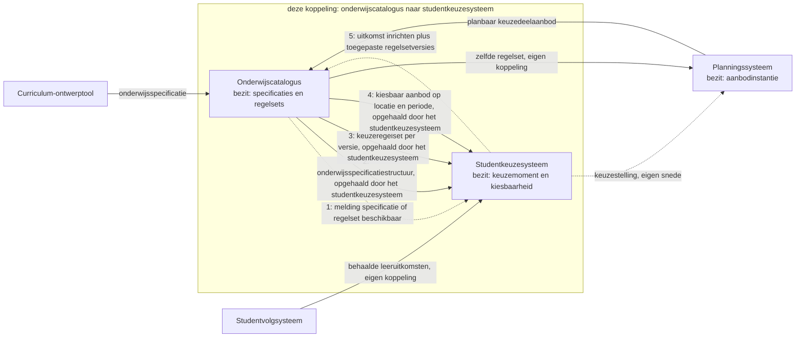

Het studentkeuzesysteem richt het keuzemoment asynchroon in, waarbij de regelset het kader bepaalt. Het oordeel per student volgt per opvraag, met de behaalde leeruitkomsten als invoer van buiten deze koppeling. Dezelfde regelset gaat ook naar het planningssysteem, dat haar volledig meekrijgt in het gebruiksprofiel van de koppeling naar planning en roostering; daarmee rusten het keuzemoment en de roostering op dezelfde regel (story-0015).

## Koppelvlakdiensten

De operaties met hun parameters staan in de [berichtspecificatie](#berichtspecificatie), het verloop erover in [Interactie](#interactie).

### Diensten in deze snede

De dienstnamen komen uit de [dienstenlijst](https://github.com/Npuls-OKx/Public/blob/d0c20d99b110b29ccf6b0e50109f7d54ffd88d7a/Koppelvlakspecificaties/Applicatiediensten/README.md) van het koppelvlakspecificatiepakket. Een dienst zegt wat er moet kunnen; welk component hem vervult volgt uit resource-eigenaarschap (U3). De kolom Objecttypen noemt objecttypen van de informatiemodelplaat, de kolom Schema's de entiteiten die de payload draagt.

| Dienst | Levert | Vervuld door | Objecttypen | Schema's | Stories | Contract |
|---|---|---|---|---|---|---|
| [onderwijsspecificatiestructuur-aanbieder](https://github.com/Npuls-OKx/Public/blob/d0c20d99b110b29ccf6b0e50109f7d54ffd88d7a/Koppelvlakspecificaties/Applicatiediensten/onderwijsspecificatiestructuur-aanbieder.md) | De vastgestelde specificatiestructuur met haar versies, met de kiesbaarheidsklasse en de regelsetverwijzingen erin | Onderwijscatalogus | `Opleidingsprogramma specificatie`, `Keuzedeelruimte`, `Keuzedeel`, `Leeruitkomst` | `education-specification.json`, `manifest-item.json`, `specification-reference.json`, `volume.json` | story-0013, story-0016, story-0017 | Aanwezig: drie opvragingen |
| [onderwijsspecificatiestructuur-afnemer](https://github.com/Npuls-OKx/Public/blob/d0c20d99b110b29ccf6b0e50109f7d54ffd88d7a/Koppelvlakspecificaties/Applicatiediensten/onderwijsspecificatiestructuur-afnemer.md) | De structuur afnemen en actueel houden | Studentkeuzesysteem | Dezelfde | `specification-changed.json`, `specification-status-changed.json` | story-0013, story-0016 | Aanwezig: drie meldpatronen (webhooks). Claim bij het studentkeuzesysteem toevoegen |
| [keuzeregelset-aanbieder](https://github.com/Npuls-OKx/Public/blob/d0c20d99b110b29ccf6b0e50109f7d54ffd88d7a/Koppelvlakspecificaties/Applicatiediensten/keuzeregelset-aanbieder.md) | De regelsets die de keuzecontext begrenzen, los opvraagbaar van de items waarop zij slaan | Onderwijscatalogus | `Student keuze regelset`, met verwijzingen naar `Leeruitkomst` en `Onderwijslocatie` | `rule-set.json` na werkbrief 1, die de getypeerde vorm erin brengt, plus `rule-set-reference.json` (werkbrief 2) | story-0015, story-0017, story-0018 | Toevoegen: twee opvragingen |
| [keuzeregelset-afnemer](https://github.com/Npuls-OKx/Public/blob/d0c20d99b110b29ccf6b0e50109f7d54ffd88d7a/Koppelvlakspecificaties/Applicatiediensten/keuzeregelset-afnemer.md) | De regelset ophalen in de versie die gold, en toepassen | Studentkeuzesysteem en planningssysteem | Dezelfde | `rule-set-changed.json` (werkbrief 10) | story-0015, story-0018 | Toevoegen: meldpatroon bij wijziging |
| [onderwijsaanbod-zoekvraag-aanbieder](https://github.com/Npuls-OKx/Public/blob/d0c20d99b110b29ccf6b0e50109f7d54ffd88d7a/Koppelvlakspecificaties/Applicatiediensten/onderwijsaanbod-zoekvraag-aanbieder.md) | Het geplande keuzedeelaanbod, doorzoekbaar op locatie en periode | Onderwijscatalogus | `Keuzedeel aanbod`, `Onderwijslocatie`, `Cohort / periode`, `Plaatsingsgroep` | `offering-reference.json` (werkbrief 3), `education-offering.json`, `period.json`, `group.json`, `location.json` | story-0014 | Toevoegen: opvraag met criteria, plus een opvraag op een los aanbod |
| [onderwijsaanbod-zoekvraag-afnemer](https://github.com/Npuls-OKx/Public/blob/d0c20d99b110b29ccf6b0e50109f7d54ffd88d7a/Koppelvlakspecificaties/Applicatiediensten/onderwijsaanbod-zoekvraag-afnemer.md) | De leervraag in criteria uitdrukken en de uitkomst gebruiken | Studentkeuzesysteem | Dezelfde | Dezelfde | story-0014 | Contract nog niet uitgewerkt in het pakket: deze dienst vraagt geen eigen endpoints en leunt op de opvraag bij de aanbieder |
| [kiesbaarheidsbepaling-aanbieder](https://github.com/Npuls-OKx/Public/blob/d0c20d99b110b29ccf6b0e50109f7d54ffd88d7a/Koppelvlakspecificaties/Applicatiediensten/kiesbaarheidsbepaling-aanbieder.md) | Het oordeel wat deze student mag kiezen, met de reden bij een niet-kiesbare uitkomst | Studentkeuzesysteem | Geen eigen objecttype: het keuzemoment en de uitkomst hebben nog geen drager op de plaat | `eligibility-outcome.json` met `eligibility-reason.json` (werkbrief 4) | story-0013, story-0014, story-0018 | Toevoegen: opvraag plus uitkomstschema |
| [verwerkingsuitkomst-aanbieder](https://github.com/Npuls-OKx/Public/blob/d0c20d99b110b29ccf6b0e50109f7d54ffd88d7a/Koppelvlakspecificaties/Applicatiediensten/verwerkingsuitkomst-aanbieder.md) | Wat het inrichten van het keuzemoment opleverde, met een referentie naar het ingerichte | Studentkeuzesysteem | Geen onderwijsobjecttype: referenties en reden | `processing-status.json` (werkbrief 9) | Volgt uit [ADR 0018](https://github.com/Npuls-OKx/Public/blob/dev/Referentiemateriaal/adr/0018-enterprise-messaging-patronen-voor-betrouwbare-koppelvlakken.md) (status Voorstel) | Aanwezig: de uitkomst wordt gemeld, zonder eigen endpoint |
| [verwerkingsuitkomst-afnemer](https://github.com/Npuls-OKx/Public/blob/d0c20d99b110b29ccf6b0e50109f7d54ffd88d7a/Koppelvlakspecificaties/Applicatiediensten/verwerkingsuitkomst-afnemer.md) | De uitkomst aannemen en het eigen beeld bijstellen | Onderwijscatalogus | Dezelfde | Dezelfde | Volgt uit ADR 0018 | Aanwezig: een meldpatroon |
| [afleverabonnement-aanbieder](https://github.com/Npuls-OKx/Public/blob/d0c20d99b110b29ccf6b0e50109f7d54ffd88d7a/Koppelvlakspecificaties/Applicatiediensten/afleverabonnement-aanbieder.md) | Vastleggen waar en waarvoor de ander meldingen ontvangt | Onderwijscatalogus en studentkeuzesysteem | Geen onderwijsobjecttype | `subscription.json` (werkbrief 8) | Volgt uit ADR 0018 | Aanwezig: `POST /abonnementen` met 201 en 400 |
| [afleverabonnement-afnemer](https://github.com/Npuls-OKx/Public/blob/d0c20d99b110b29ccf6b0e50109f7d54ffd88d7a/Koppelvlakspecificaties/Applicatiediensten/afleverabonnement-afnemer.md) | Het eigen afleveradres vastleggen bij de ander | Studentkeuzesysteem en onderwijscatalogus | Geen onderwijsobjecttype | Dezelfde | Volgt uit ADR 0018 | Aanwezig: deze dienst vraagt geen eigen endpoints |

De kiesbaarheidsbepaling staat in deze lijst omdat zij de drie leveringen afdwingt: zonder specificatie, aanbod en regelset valt er geen oordeel te berekenen. Haar afnemer is de partij die de student het aanbod toont, en die ligt buiten deze koppeling.

Twee namen in de kolom Objecttypen vragen een opmerking. `Plaatsingsgroep` en de entiteit `GROEP` hebben dezelfde rol en niet dezelfde inhoud; dat punt staat open in het [informatiemodel](../../../model/informatiemodel/informatiemodel.md) en raakt R4. `Onderwijslocatie` staat in de gegenereerde informatiemodelplaat en in de mapping naar OEAPI als objecttype zonder definitie, terwijl de prozatekst van het informatiemodel locatie nog een kenmerk van het aanbod noemt. De stand van beide punten staat onder [Openstaande punten en signaleringen](#openstaande-punten-en-signaleringen).

### Verplichtingen die per dienst bijkomen

De verplichtingen op de dienstpagina's gelden onverkort. Deze snede voegt er de volgende aan toe.

| Dienst | Verplichting die erbij komt |
|---|---|
| keuzeregelset-aanbieder | Levert de regelset in de getypeerde vorm: benoemde bereiken als opsomming of als selectie met termen, en regels met een type uit de vastgestelde opsomming met de parameters die bij dat type horen |
| keuzeregelset-aanbieder | Laat de geldigheid van een regelset blijken uit `ruleSetReferences` op de specificaties die hem gebruiken, met de versie bij de verwijzing, zodat dezelfde regelset door meerdere opleidingen gebruikt kan worden (story-0017) |
| keuzeregelset-aanbieder | De bestaande verplichting "drukt keuzeregels uit als minimum en maximum per benoemd bereik" verruimt naar de volledige opsomming van regeltypen, zodat ook kiesbaarheid, deelnamevoorwaarde en beschikbaarheid eronder vallen |
| keuzeregelset-afnemer | Behandelt een regel met een onbekend type als een regelset die niet te evalueren is, meldt dat met reden `onbekendRegeltype` en levert geen kiesbare set |
| onderwijsaanbod-zoekvraag-aanbieder | Accepteert locatie en periode als queryparameter, met omvatting als vergelijking, en levert aanbodreferenties met locatie, periode en groepen ([ADR 0007](https://github.com/Npuls-OKx/Public/blob/dev/Referentiemateriaal/adr/0007-student-keuze-criteria-als-query-parameters-onderwijs-aanbod.md), status Voorstel) |
| onderwijsaanbod-zoekvraag-aanbieder | Stelt een los aanbod op id beschikbaar, zodat de afnemer meer kan ophalen dan de verwijzing |
| kiesbaarheidsbepaling-aanbieder | Draagt in de uitkomst de toegepaste regelsetversies, de opgeloste bereikleden en het peilmoment, zodat hetzelfde oordeel uit elke implementatie komt (R6, R15) |
| kiesbaarheidsbepaling-aanbieder | Draagt de restopgave in omvang, zodat een signaal op het SBU-minimum te produceren is |
| kiesbaarheidsbepaling-aanbieder | Merkt een specificatie aan als niet-kiesbaar met reden `keuzeomvangOnhaalbaar` wanneer een ondergrens in omvang of aantal met die keuze erbij buiten bereik blijft, met de regels die dat bepalen erbij. De [doorloop van de casus](#waar-k0262-samen-met-k0023-afvalt) rekent dat geval voor |
| afleverabonnement-afnemer | Legt het eigen afleveradres vast bij de ander, voor de meldingen over specificaties, over regelsets en over de verwerkingsuitkomst |

Het pad `/onderwijsaanbod` bestaat ook bij planbaar-onderwijsaanbod-aanbieder, met `specificatieId` en `versie` als parameters. Dat is hetzelfde pad op een ander component en daarmee een ander koppelvlak: het planningssysteem bezit de aanbodinstantie, en de onderwijscatalogus ontsluit het planbare aanbod dat zij als planbaar-onderwijsaanbod-afnemer heeft ingenomen.

### Grenzend aan deze snede

| Dienst | Waarvoor | Stand |
|---|---|---|
| behaalde-leeruitkomst-aanbieder en -afnemer | Het regeltype `deelnamevoorwaarde` wordt beoordeeld op behaalde leeruitkomsten. Het studentkeuzesysteem neemt die af | Welk component ze levert ligt open en raakt [ADR 0009](https://github.com/Npuls-OKx/Public/blob/dev/Referentiemateriaal/adr/0009-sks-svs-rollenverdeling-keuze-vs-resultaat-voortgang.md) (status Voorstel). De status is een afleiding via de `Summatieve resultaat structuur`. Binnen deze snede telt het eigen-instellingdeel; een leeruitkomst die elders is behaald volgt met de federatiefase |
| verbintenistoestand-aanbieder en -afnemer | De locatie en de periode van deze student volgen uit zijn onderwijsverbintenis | Contract nog niet uitgewerkt. Binnen deze snede komen beide als parameter van de opvraag mee |
| onderwijsaanbod-haalbaarheidstoets | Een voorstel beoordelen voordat het wordt vastgelegd | Hoort bij het vastleggen van de keuze en volgt daar. [ADR 0015](https://github.com/Npuls-OKx/Public/blob/dev/Referentiemateriaal/adr/0015-request-for-offering-haalbaarheidstoets-tussen-sks-en-planning.md) (status Voorstel) draagt de vraag om nog ongepland aanbod |
| planbaar-onderwijsaanbod-aanbieder en -afnemer | De bron van het keuzedeelaanbod: het planningssysteem maakt het planbaar, de onderwijscatalogus neemt het in | Aanwezig, met een uitgewerkt contract in de koppeling naar planning en roostering |

### Diensten, componenten en producten

Een applicatiedienst is gedrag dat geleverd kan worden. Een applicatiecomponent bundelt dat gedrag in de referentiearchitectuur, en een product van een leverancier is een applicatie die een of meer componenten vervult. In deze snede vervult de onderwijscatalogus zes diensten en het studentkeuzesysteem zeven: dertien claims op elf diensten, omdat afleverabonnement-aanbieder en afleverabonnement-afnemer bij beide componenten liggen. Een product mag die anders bundelen: het regelsetbeheer als eigen dienstverlener, of de catalogus en het keuzesysteem in hetzelfde pakket. Voor de specificatie verandert dat niets, om vier redenen.

- Een dienst is zelfstandig te claimen en zelfstandig te versioneren, en elke dienstpagina spreekt alleen het implementerende component aan. Een product dat vier van deze diensten vervult, claimt ze vier keer en levert vier contracten.
- De verplichting hangt aan het gedrag en niet aan de plaats. Landen twee diensten in hetzelfde product, dan verliest het bericht ertussen zijn netwerkverkeer en houdt de verplichting stand: de regelsetversie die gold wordt vastgelegd, en het oordeel blijft herleidbaar en herhaalbaar (R6, R17).
- Het oordeel blijft daarmee per dienst toetsbaar. Een conformiteitstoets (conformance test) stelt haar vraag aan de dienst die haar beantwoordt, en laat open welk product erachter staat.
- De koppeling bepaalt welk component een dienst in een scenario vervult, en de som van de koppelingen levert het koppelvlak per component op (U1). Een andere verdeling is daarmee een andere koppeling en geen ander contract.

Hoe diensten over producten worden verdeeld blijft de keuze van instelling en leverancier, met OKx in een adviserende rol (U1).

## Interactie

De functionele eisen die het proces stelt staan als vertrekpunt in de eerste tabel; de operaties zelf staan in de [berichtspecificatie](#berichtspecificatie).

### Stories

De stories uit de [requirementsboom](https://github.com/Npuls-OKx/Public/blob/dev/Referentiemateriaal/requirementsboom/README.md) die deze koppeling invult, met de berichtstroom die dat doet.

| Story | Ingevuld door |
|---|---|
| [story-0013](https://github.com/Npuls-OKx/Public/blob/dev/Referentiemateriaal/requirementsboom/stories.md#story-0013) | [Keuzemoment inrichten](#keuzemoment-inrichten) en [Kiesbaarheid bepalen voor een student](#kiesbaarheid-bepalen-voor-een-student) |
| [story-0014](https://github.com/Npuls-OKx/Public/blob/dev/Referentiemateriaal/requirementsboom/stories.md#story-0014) | [Keuzemoment inrichten](#keuzemoment-inrichten) en [Kiesbaarheid bepalen voor een student](#kiesbaarheid-bepalen-voor-een-student) |
| [story-0015](https://github.com/Npuls-OKx/Public/blob/dev/Referentiemateriaal/requirementsboom/stories.md#story-0015) | [Regelset niet te evalueren melden](#regelset-niet-te-evalueren-melden) |
| [story-0016](https://github.com/Npuls-OKx/Public/blob/dev/Referentiemateriaal/requirementsboom/stories.md#story-0016) | [Keuzemoment inrichten](#keuzemoment-inrichten) |
| [story-0017](https://github.com/Npuls-OKx/Public/blob/dev/Referentiemateriaal/requirementsboom/stories.md#story-0017) | [Keuzemoment inrichten](#keuzemoment-inrichten) |
| [story-0018](https://github.com/Npuls-OKx/Public/blob/dev/Referentiemateriaal/requirementsboom/stories.md#story-0018) | [Kiesbaarheid bepalen voor een student](#kiesbaarheid-bepalen-voor-een-student) en [Gewijzigde regelset doorwerken](#gewijzigde-regelset-doorwerken) |

### De diensten onderling

Deze koppeling zet de elf [applicatiediensten](#koppelvlakdiensten) van deze snede in. De tabel legt vast welk component welke dienst implementeert; welke stromen daarover lopen en in welke volgorde bepaalt deze koppeling. De laatste rij is behaalde-leeruitkomst-afnemer: die dienst grenst aan deze snede en doet hier mee omdat haar invoer het regeltype `deelnamevoorwaarde` voedt.

| Applicatiedienst | Geïmplementeerd door |
|---|---|
| onderwijsspecificatiestructuur-aanbieder | Onderwijscatalogus |
| onderwijsspecificatiestructuur-afnemer | Studentkeuzesysteem |
| keuzeregelset-aanbieder | Onderwijscatalogus |
| keuzeregelset-afnemer | Studentkeuzesysteem en planningssysteem |
| onderwijsaanbod-zoekvraag-aanbieder | Onderwijscatalogus |
| onderwijsaanbod-zoekvraag-afnemer | Studentkeuzesysteem |
| kiesbaarheidsbepaling-aanbieder | Studentkeuzesysteem |
| verwerkingsuitkomst-aanbieder | Studentkeuzesysteem |
| verwerkingsuitkomst-afnemer | Onderwijscatalogus |
| afleverabonnement-aanbieder | Onderwijscatalogus en studentkeuzesysteem |
| afleverabonnement-afnemer | Studentkeuzesysteem en onderwijscatalogus |
| behaalde-leeruitkomst-afnemer, grenzend aan deze snede | Studentkeuzesysteem, met de aanbieder in een eigen koppeling |

De behaalde-leeruitkomst-aanbieder tegenover de afnemer ligt bij een ander component en in een eigen koppeling; welk component dat is raakt [ADR 0009](https://github.com/Npuls-OKx/Public/blob/dev/Referentiemateriaal/adr/0009-sks-svs-rollenverdeling-keuze-vs-resultaat-voortgang.md) (status Voorstel).

De diensten onderling, met de vier paden die deze koppeling dekt: het nominale pad, het lege resultaat, het foutpad en de terugweg. De deelnemers zijn de diensten, en de band eromheen noemt het component dat de dienst hier vervult. Elke pijl is daarmee een dienstaanroep: landen twee diensten in hetzelfde product, dan verliest de pijl ertussen zijn netwerkverkeer en houdt de verplichting stand ([diensten, componenten en producten](#diensten-componenten-en-producten)).

Twee diensten uit de tabel staan erbuiten: het afleverabonnement gaat aan de meldingen vooraf en staat onder [Abonnement registreren](#abonnement-registreren). De kiesbaarheidsbepaling-afnemer staat als deelnemer erbij, omdat hij de vraag stelt waarop deze koppeling antwoord geeft.

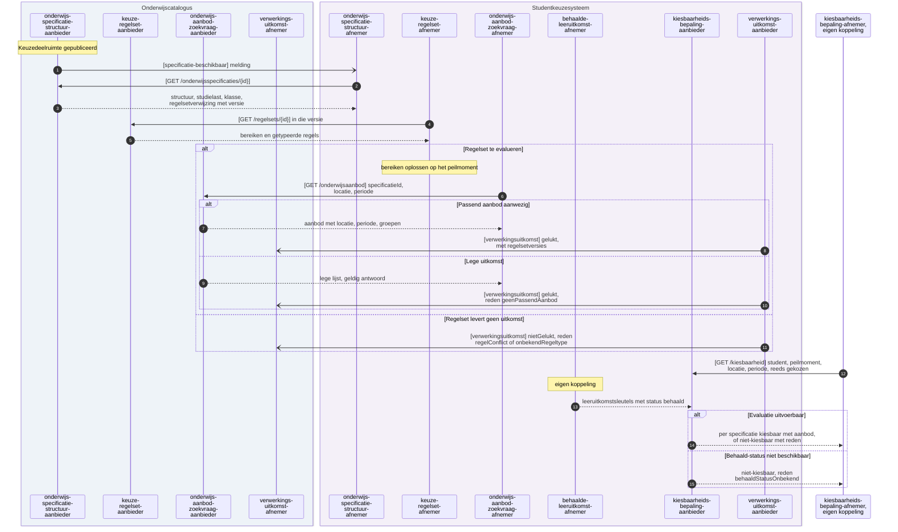

Het verloop per interactie staat onder [Berichtstromen](#berichtstromen), met de componenten als deelnemers en de endpoints per bericht erbij. De casus van Jochem loopt dienst voor dienst door deze volgorde in [de doorloop van de casus](#de-casus-van-jochem-door-de-diensten).

### Interactiepatronen

Deze koppeling zet de volgende [interactiepatronen](https://github.com/Npuls-OKx/Public/blob/d0c20d99b110b29ccf6b0e50109f7d54ffd88d7a/Koppelvlakspecificaties/Interactiepatronen/README.md) in.

| Interactiepatroon | Waarvoor in deze koppeling |
|---|---|
| [Event Notification](https://github.com/Npuls-OKx/Public/blob/d0c20d99b110b29ccf6b0e50109f7d54ffd88d7a/Koppelvlakspecificaties/Interactiepatronen/event-notification.md) | Melden dat een specificatie of een regelset beschikbaar of gewijzigd is, en het ophalen dat daarop volgt |
| [Request-Reply](https://github.com/Npuls-OKx/Public/blob/d0c20d99b110b29ccf6b0e50109f7d54ffd88d7a/Koppelvlakspecificaties/Interactiepatronen/request-reply.md) | De kiesbaarheid opvragen, het aanbod doorzoeken op criteria, en herstel na een gemiste melding |
| [Asynchronous Request-Reply](https://github.com/Npuls-OKx/Public/blob/d0c20d99b110b29ccf6b0e50109f7d54ffd88d7a/Koppelvlakspecificaties/Interactiepatronen/asynchronous-request-reply.md) | De uitkomst van het inrichten terugmelden, met een referentie naar het ingerichte keuzemoment |
| [Subscription registration](https://github.com/Npuls-OKx/Public/blob/d0c20d99b110b29ccf6b0e50109f7d54ffd88d7a/Koppelvlakspecificaties/Interactiepatronen/subscription-registration.md) | Het afleveradres vastleggen waarop de meldingen landen |

### Berichtstromen

| Berichtstroom | Bericht | Patroon | Diensten | Foutafhandeling |
|---|---|---|---|---|
| [Keuzemoment inrichten](#keuzemoment-inrichten) | `specificatie-beschikbaar`, drie opvragingen, `verwerkingsuitkomst` | Event Notification, Request-Reply, Asynchronous Request-Reply | onderwijsspecificatiestructuur, keuzeregelset, onderwijsaanbod-zoekvraag, verwerkingsuitkomst | Status `afgekeurd` bij een validatiefout. Een lege aanbodlijst is een geldige uitkomst, met reden `geenPassendAanbod` |
| [Kiesbaarheid bepalen voor een student](#kiesbaarheid-bepalen-voor-een-student) | `GET /kiesbaarheid` | Request-Reply | kiesbaarheidsbepaling, keuzeregelset, behaalde-leeruitkomst, onderwijsaanbod-zoekvraag | Niet-kiesbaar met reden per specificatie. Een ontbrekende behaald-status geeft reden `behaaldStatusOnbekend` |
| [Gewijzigde regelset doorwerken](#gewijzigde-regelset-doorwerken) | `regelset-gewijzigd`, `GET /regelsets/{id}` | Event Notification | keuzeregelset | Een lopend keuzemoment houdt de gepinde versie |
| [Wijziging tijdens een open keuzemoment](#wijziging-tijdens-een-open-keuzemoment) | `specificatie-gewijzigd`, `specificatie-status-gewijzigd` | Event Notification, Request-Reply | onderwijsspecificatiestructuur, onderwijsaanbod-zoekvraag, kiesbaarheidsbepaling | De specificatie valt uit de kiesbare set met reden `specificatieNietMeerKiesbaar` |
| [Regelset niet te evalueren melden](#regelset-niet-te-evalueren-melden) | `verwerkingsuitkomst` | Asynchronous Request-Reply | verwerkingsuitkomst, keuzeregelset | De evaluatie krijgt `nietUitvoerbaar` en de reden gaat mee |
| [Reconciliatie na een gemiste melding](#reconciliatie-na-een-gemiste-melding) | `GET /onderwijsspecificaties`, `GET /regelsets` | Request-Reply | onderwijsspecificatiestructuur, keuzeregelset | Herstel via de lijst met `gewijzigdSinds` |
| [Abonnement registreren](#abonnement-registreren) | `POST /abonnementen` | Subscription registration | afleverabonnement | Herregistratie overschrijft, zonder dubbele aflevering |

#### Keuzemoment inrichten

| Kenmerk | Waarde |
|---|---|
| Doel | Het studentkeuzesysteem inrichten voor een keuzemoment, met de keuzedeelruimte en haar keuzedelen, de regelsets die de ruimte begrenzen, en het kiesbare aanbod per locatie en periode |
| Trigger | De `Keuzedeelruimte` krijgt status `gepubliceerd` |
| Initiator | Onderwijscatalogus |
| Voorbeeldgeval | De keuzedeelruimte van Apothekersassistent van 720 SBU, met het verbredende bereik als selectie op `keuzedeelKlasse` en het opgesomde bereik met de verdiepende keuzedelen. De payloads staan bij [operatie 1](#1-get-onderwijsspecificatiesid) en [operatie 5](#5-get-regelsetsid) |

| Versie | Interactiepatronen | Applicatiediensten |
|---|---|---|
| 1.0 | Event Notification, Request-Reply, Asynchronous Request-Reply | onderwijsspecificatiestructuur-aanbieder en -afnemer, keuzeregelset-aanbieder en -afnemer, onderwijsaanbod-zoekvraag-aanbieder en -afnemer, verwerkingsuitkomst-aanbieder en -afnemer |

Endpoints:

- meldpatroon `specificatie-beschikbaar`
- `GET /onderwijsspecificaties/{id}`
- `GET /regelsets` en `GET /regelsets/{id}`
- `GET /onderwijsaanbod`
- meldpatroon `verwerkingsuitkomst`

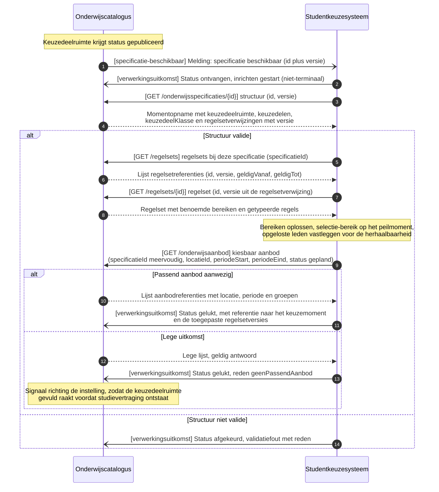

Een regelset die door meerdere opleidingen wordt gebruikt komt hier als dezelfde regelset terug: de opvraag loopt via de verwijzing op de specificatie, en de regelset draagt een eigen sleutel (uuid) en een eigen versie (story-0017).

#### Kiesbaarheid bepalen voor een student

| Kenmerk | Waarde |
|---|---|
| Doel | Voor deze student het oordeel berekenen wat kiesbaar is binnen de keuzedeelruimte, met de reden bij een niet-kiesbare uitkomst |
| Trigger | Een opvraag op de kiesbaarheid, bijvoorbeeld bij het openen van het keuzemoment |
| Initiator | Het component dat de student het aanbod toont, buiten deze koppeling |
| Voorbeeldgeval | Hoogstens 2 uit het verbredende bereik met de keuze samen op 720 SBU, plus precies 1 uit het opgesomde bereik, waarbij een lid daarvan een behaalde leeruitkomst vraagt en op een locatie in een periode wordt aangeboden. De uitkomst met een kiesbaar en een niet-kiesbaar geval staat bij [operatie 8](#8-get-kiesbaarheid) |

| Versie | Interactiepatronen | Applicatiediensten |
|---|---|---|
| 1.0 | Request-Reply | kiesbaarheidsbepaling-aanbieder, keuzeregelset-afnemer, behaalde-leeruitkomst-afnemer, onderwijsaanbod-zoekvraag-afnemer |

Endpoints:

- `GET /kiesbaarheid`
- `GET /regelsets/{id}` en `GET /onderwijsaanbod`, in de versie en op het peilmoment die bij de vraag horen

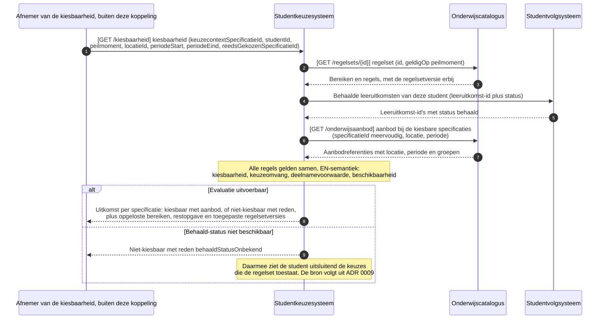

De regels verwijzen met specificatie-id's en leeruitkomst-id's, waardoor het oordeel met uitsluitend sleutels, omvang en datums te berekenen is (R15). De uitkomst draagt de opgeloste bereikleden en het peilmoment, zodat hetzelfde oordeel uit elke implementatie komt die dezelfde regelsetversie op hetzelfde peilmoment toepast (R6).

#### Gewijzigde regelset doorwerken

| Kenmerk | Waarde |
|---|---|
| Doel | Een nieuwe regelsetversie laten landen zonder lopende keuzemomenten te verschuiven |
| Trigger | Een nieuwe versie van een regelset waarnaar een specificatie verwijst |
| Initiator | Onderwijscatalogus |

| Versie | Interactiepatronen | Applicatiediensten |
|---|---|---|
| 1.0 | Event Notification | keuzeregelset-aanbieder en -afnemer |

Endpoints:

- meldpatroon `regelset-gewijzigd`
- `GET /regelsets/{id}`

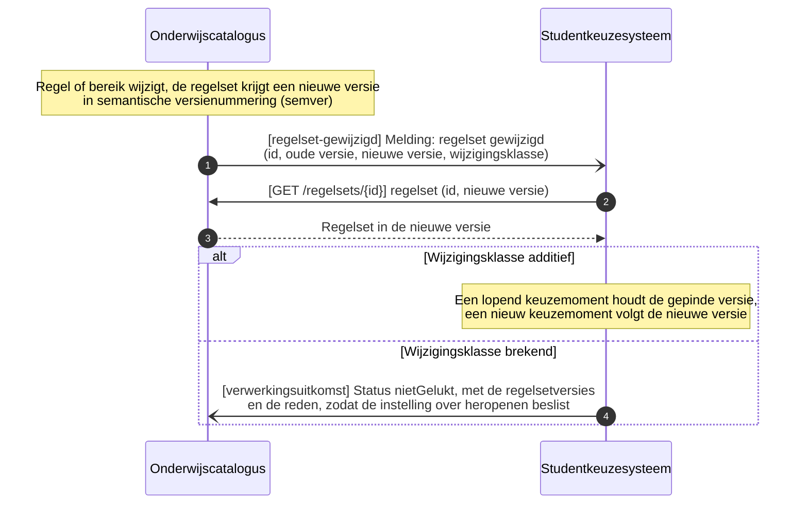

De eerder gebruikte versie blijft opvraagbaar, zodat achteraf vaststelbaar is welke regels golden toen een student koos (R17). Het vastleggen van de regelsetversie bij de keuze ligt in de snede van het vastleggen van de keuze.

#### Wijziging tijdens een open keuzemoment

| Kenmerk | Waarde |
|---|---|
| Doel | Een keuzemoment dat al open staat laten volgen op een gewijzigde of ingetrokken specificatie, zodat een student geen keuze maakt die de instelling heeft herzien |
| Trigger | Een specificatie wijzigt of krijgt status `gedeactiveerd` of `vervallen` |
| Initiator | Onderwijscatalogus |

Het volledige gedrag per gebeurtenis staat onder [Gedrag bij een wijziging tijdens een open keuzemoment](#gedrag-bij-een-wijziging-tijdens-een-open-keuzemoment).

| Versie | Interactiepatronen | Applicatiediensten |
|---|---|---|
| 1.0 | Event Notification, Request-Reply | onderwijsspecificatiestructuur-aanbieder en -afnemer, onderwijsaanbod-zoekvraag-afnemer, kiesbaarheidsbepaling-aanbieder |

Endpoints:

- meldpatroon `specificatie-gewijzigd` en `specificatie-status-gewijzigd`
- `GET /onderwijsspecificaties/{id}` of `GET /onderwijsspecificaties/{id}/delta`
- `GET /onderwijsaanbod`

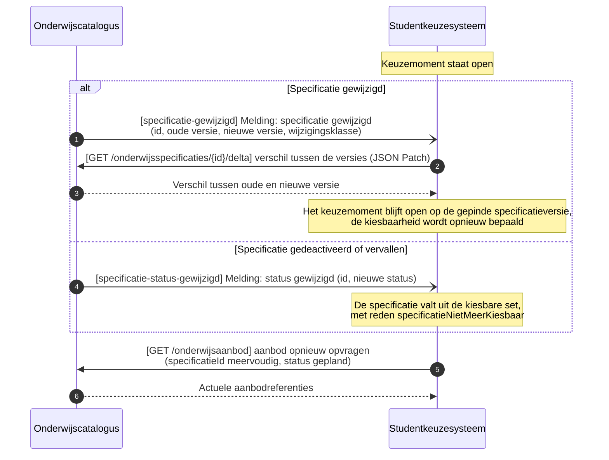

Een aanbodinstantie die naar `nietRealiseerbaar` of `geannuleerd` gaat kent nog geen eigen melding. Tot die er is stelt het studentkeuzesysteem de zoekvraag opnieuw voordat het keuzemoment opengaat; werkbrief 12 belegt de melding.

#### Regelset niet te evalueren melden

| Kenmerk | Waarde |
|---|---|
| Doel | De onderwijscatalogus in kennis stellen dat de regelset geen uitkomst oplevert, met de reden, zodat de instelling kan ingrijpen voordat het keuzemoment opengaat |
| Trigger | De regels in de regelset sluiten elkaar uit, of een regel draagt een type dat de afnemer nog moet leren kennen |
| Initiator | Studentkeuzesysteem |

Dezelfde melding ontstaat bij het planningssysteem, dat dezelfde regelset leest: daarmee lopen keuze en rooster op dezelfde regel (story-0015).

| Versie | Interactiepatronen | Applicatiediensten |
|---|---|---|
| 1.0 | Asynchronous Request-Reply | verwerkingsuitkomst-aanbieder en -afnemer, keuzeregelset-afnemer |

Endpoints:

- meldpatroon `verwerkingsuitkomst`

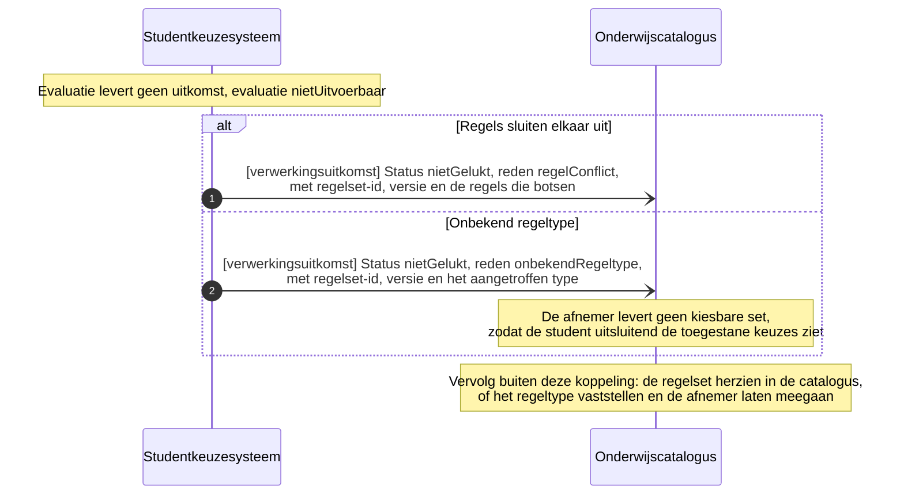

De redencodes staan onder [Redencodes](#redencodes). Zolang het schema ervoor ontbreekt draagt de melding de reden in de vorm die de afnemer kan verwerken; werkbrief 9 belegt het veld.

#### Reconciliatie na een gemiste melding

| Kenmerk | Waarde |
|---|---|
| Doel | De gemiste informatie via een gewone opvraag herstellen na een melding die in de wachtrij voor onbestelbare meldingen (Dead Letter Channel) is beland |
| Trigger | Een melding is niet aangekomen |
| Initiator | Studentkeuzesysteem |

| Versie | Interactiepatronen | Applicatiediensten |
|---|---|---|
| 1.0 | Request-Reply | onderwijsspecificatiestructuur-aanbieder en -afnemer, keuzeregelset-aanbieder en -afnemer |

Endpoints:

- `GET /onderwijsspecificaties`
- `GET /regelsets`

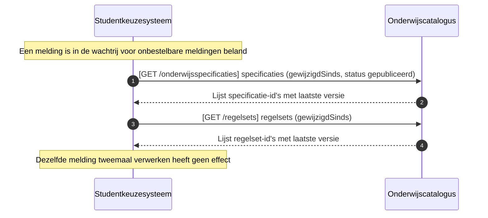

#### Abonnement registreren

| Kenmerk | Waarde |
|---|---|
| Doel | Elke partij haar eigen afleveradres laten vastleggen bij de ander, als voorwaarde voor de meldingsgedreven stromen |
| Trigger | De inrichting van de koppeling, of een wijziging van het afleveradres |
| Initiator | De partij die meldingen gaat ontvangen, als afleverabonnement-afnemer |

| Versie | Interactiepatronen | Applicatiediensten |
|---|---|---|
| 1.0 | Subscription registration | afleverabonnement-afnemer, afleverabonnement-aanbieder |

Endpoints:

- `POST /abonnementen`, bij de onderwijscatalogus en bij het studentkeuzesysteem

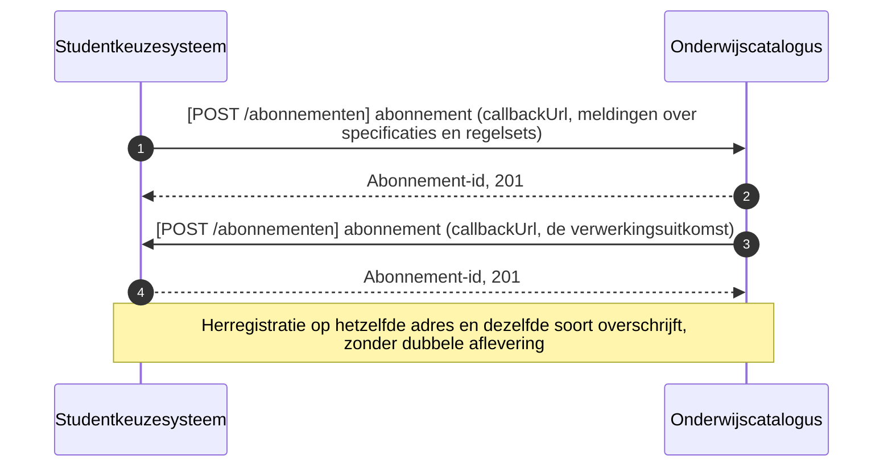

Deze koppeling kent een abonnement, omdat de opties ruim voor het keuzemoment bekend moeten zijn en een wijziging in regelset of aanbod het keuzemoment raakt. De soorten `specificatie-beschikbaar`, `regelset-gewijzigd` en `verwerkingsuitkomst` komen daarmee in de opsomming van `subscription.json` erbij; werkbrief 8 belegt dat.

### Invoer van de kiesbaarheidsbepaling

| Invoer | Waarvoor | Herkomst |
|---|---|---|
| Keuzecontext | De bereiken oplossen | Parameter `keuzecontextSpecificatieId` |
| Regelset in de versie die gold | Alle regeltypen | keuzeregelset-aanbieder bij de onderwijscatalogus |
| Behaalde leeruitkomsten | `deelnamevoorwaarde` | behaalde-leeruitkomst-aanbieder. De status is een afleiding via de `Summatieve resultaat structuur`, die zegt welke resultaten op de verbintenis het bewijs voor een leeruitkomst vormen (ontwerpkeuze 7, status Voorstel; [ADR 0022](https://github.com/Npuls-OKx/Public/blob/dev/Referentiemateriaal/adr/0022-resultaatbegrippen-conform-rosa-koi.md) en [ADR 0026](https://github.com/Npuls-OKx/Public/blob/dev/Referentiemateriaal/adr/0026-leeruitkomst-als-verbindende-sleutel.md)). Welk component levert raakt ADR 0009 en staat open |
| Locatie en periode van deze student | `beschikbaarheid` | Parameters `locatieId`, `periodeStart` en `periodeEind`, of `cohort`. De bron is de onderwijsverbintenis, ontsloten door verbintenistoestand-aanbieder, waarvan het contract nog niet is uitgewerkt |
| Reeds gemaakte en voorgenomen keuzes | `keuzeomvang` | Parameter `reedsGekozenSpecificatieId`, meervoudig. Het vastleggen van de keuzestelling volgt als eigen snede |
| Gepland keuzedeelaanbod | `beschikbaarheid` en de aanbodverwijzingen in de uitkomst | onderwijsaanbod-zoekvraag-aanbieder bij de onderwijscatalogus |

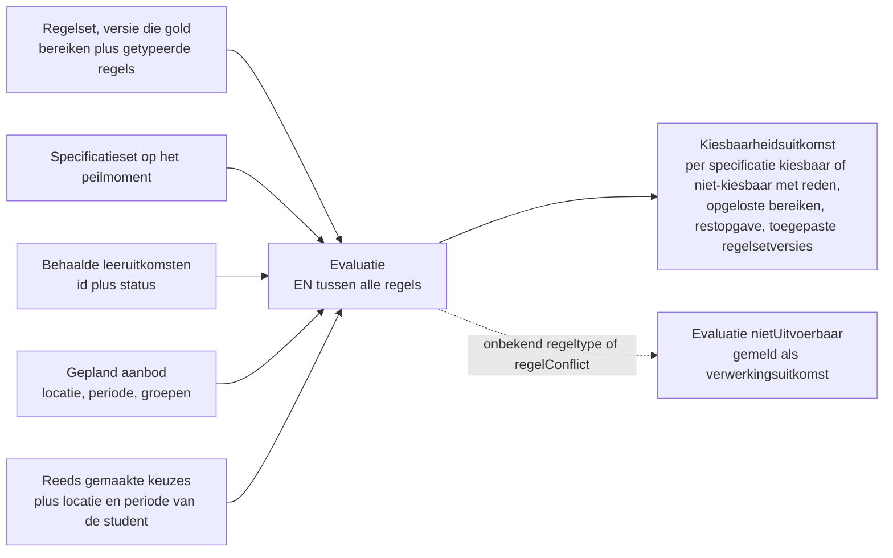

### Gedrag bij een wijziging tijdens een open keuzemoment

De instelling herziet haar aanbod op animo, actualiteit en haalbaarheid, en de student herziet zijn keuze tot kort voor de aanvang. Daarom raakt een wijziging een keuzemoment dat al open staat.

| Gebeurtenis | Melding | Gedrag voor een lopend keuzemoment |
|---|---|---|
| Nieuwe regelsetversie, wijzigingsklasse additief | `regelset-gewijzigd` | Het lopende keuzemoment houdt de gepinde versie, een nieuw keuzemoment volgt de nieuwe versie (R17) |
| Nieuwe regelsetversie, wijzigingsklasse brekend | `regelset-gewijzigd` | Het studentkeuzesysteem meldt een verwerkingsuitkomst met de reden, en de instelling beslist over heropenen |
| Specificatie gewijzigd | `specificatie-gewijzigd` met `changeClass` | De kiesbaarheid wordt opnieuw bepaald op de gepinde specificatieversie, het keuzemoment blijft open |
| Specificatie naar `gedeactiveerd` of `vervallen` | `specificatie-status-gewijzigd` | De specificatie valt uit de kiesbare set, met reden `specificatieNietMeerKiesbaar` |
| Aanbodinstantie naar `nietRealiseerbaar` of `geannuleerd` | Nog geen melding aanwezig | De afnemer stelt de zoekvraag opnieuw voordat het keuzemoment opengaat. Werkbrief 12 belegt de melding |

### De casus van Jochem door de diensten

De casus van [casus.md](casus.md) op de diensten hierboven: welke dienst wat levert, in welke volgorde, en wat de kiesbaarheidsbepaling daaruit berekent. Het rekenpunt is de combinatie van twee verbredende keuzedelen, die 240 SBU tekortkomt op de keuzedeelruimte van 720 SBU. Daarmee is te zien of de onderdelen samen tot een oordeel komen dat een lezer kan navolgen en een tweede implementatie kan herhalen.

#### Wat voor deze doorloop vastligt

De keuzecontext en de regelset zijn die van [de canonieke casus](#de-canonieke-casus-in-de-voorbeelden). De drie keuzedelen komen uit de keuzedeelbladen in deze repository.

| Onderdeel | Waarde | Sleutel (uuid) |
|---|---|---|
| Keuzecontext | De `Keuzedeelruimte` van Apothekersassistent, 720 SBU | `c1664aa8-af81-4ac1-ad37-4f3e2184fe38` |
| Regelset | Keuzeregels keuzedeelruimte Apothekersassistent (leerroute 1), versie 1.0.0 | `bd7902da-1a14-4ddb-ba36-308d9af27f74` |
| K0037 Farmaceutische Patientenzorg, 480 SBU, klasse `beroepsspecifiek-verdiepend` | Lid van het opgesomde bereik, als opsomming | `9a3146ab-62ab-4bf3-a7cf-43cd02c5380c` |
| K0262 ARBO, kwaliteitszorg en hulpverlening geschikt voor niveau 3, 240 SBU, klasse `algemeen-verbredend` | Lid van het verbredende bereik, opgelost uit de selectie op die klasse | `afcf61eb-4dd4-4451-adec-2fb741ab2984` |
| K0023 Digitale vaardigheden gevorderd, 240 SBU, klasse `algemeen-verbredend` | Lid van het verbredende bereik, opgelost uit de selectie op die klasse | `8a65a727-c407-45eb-ae7e-5c022d427a5f` |
| Tweede lid van het opgesomde bereik, zonder gegeven in de casus | De regels 6 en 7 werken hierop. Sleutel uit de normatieve regelsetvorm, inhoud als uitvraag | `7dfef831-5552-459b-b00e-a59541d0eb03` |
| Leeruitkomst die regel 6 vraagt, zonder gegeven in de casus | Sleutel uit de normatieve regelsetvorm, inhoud als uitvraag | `f46bc824-8ff5-4a3d-bb21-47ebbba0942b` |
| Peilmoment | 2 november 2026, een periode voor de keuzedeelruimte | |
| Jochem | Cohort 2026. Bij de vraag in stap 8 staat K0262 als gemaakte keuze | `e9c2dc36-0d2a-4c79-9a2a-0b1f3f6e7d41` |

De sleutels van de drie keuzedelen zijn illustratief: het keuzedeelblad draagt de landelijke code, en welke sleutel een instelling eraan geeft is een uitvraag. De instelling heeft K0037 in haar catalogus de klasse `beroepsspecifiek-verdiepend` gegeven en K0262 en K0023 de klasse `algemeen-verbredend`. Dat de landelijke aard van een keuzedeel en de instellingseigen kiesbaarheidsklasse twee verschillende attributen zijn staat onder [Openstaande punten en signaleringen](#openstaande-punten-en-signaleringen); het lidmaatschap van een bereik volgt hier uit de klasse.

De regels 6 en 7 van de regelset, een `deelnamevoorwaarde` en een `beschikbaarheid`, werken op het tweede lid van het opgesomde bereik. Zij wijzen dat lid af in [operatie 8](#8-get-kiesbaarheid) en raken de drie keuzedelen van deze doorloop niet.

#### De doorloop, dienst voor dienst

| Stap | Dienst | Wat erover gaat | Uitkomst in deze casus |
|---|---|---|---|
| 1 | onderwijsspecificatiestructuur-aanbieder | De melding dat de keuzedeelruimte is gepubliceerd | De keuzedeelruimte met haar sleutel en versie |
| 2 | onderwijsspecificatiestructuur-afnemer | De opvraag op de structuur | De keuzedeelruimte van 720 SBU, de drie keuzedelen met hun studielast en hun kiesbaarheidsklasse, en de regelsetverwijzing met versie 1.0.0 |
| 3 | keuzeregelset-aanbieder | De regelset in de versie uit de verwijzing | Twee bereiken en zeven regels in de getypeerde vorm |
| 4 | keuzeregelset-afnemer | Het oplossen van de bereiken op het peilmoment | Het verbredende bereik levert K0262 en K0023 op klasse `algemeen-verbredend`, het opgesomde bereik levert K0037 plus het tweede lid zonder gegeven in de casus |
| 5 | onderwijsaanbod-zoekvraag-aanbieder | De opvraag op het geplande aanbod bij die sleutels, binnen de locatie en de periode van Jochem | Aanbod per keuzedeel, met periode, locatie en groepen. Periode en locatie per keuzedeelaanbod staan in de casus als uitvraag |
| 6 | behaalde-leeruitkomst-afnemer | De behaalde leeruitkomsten van Jochem | Nog geen behaalde leeruitkomst in deze ruimte, waarmee de `deelnamevoorwaarde` het tweede lid van het opgesomde bereik afwijst met reden `vereisteLeeruitkomstOpen` |
| 7 | verwerkingsuitkomst-aanbieder | De terugmelding dat het keuzemoment is ingericht | Status `gelukt`, met de referentie naar het keuzemoment `8145f9f4-f6d1-473b-90c5-77e258e94b26` en regelset 1.0.0 als toegepaste versie |
| 8 | kiesbaarheidsbepaling-aanbieder | De vraag wat Jochem mag kiezen, op het peilmoment | Per keuzedeel kiesbaar met aanbod, of niet-kiesbaar met reden |

De interactie met de vier paden erin staat in [de diensten onderling](#de-diensten-onderling).

#### Waar K0262 samen met K0023 afvalt

Jochem heeft K0262 gekozen en vraagt wat er verder kiesbaar is. De regelset kent vijf regels die op dit geval werken.

| Regel | Type | Wat zij eist | Stand na K0262, met K0023 erbij |
|---|---|---|---|
| `7f972c76` | `kiesbaarheid` | De leden van het verbredende bereik zijn kiesbaar | Gehaald: K0262 en K0023 zijn beide lid |
| `4e09f11f` | `keuzeomvang` | Hoogstens 2 uit het verbredende bereik | Gehaald, en daarmee is de ruimte voor een derde verbredend keuzedeel vergeven |
| `af41e88a` | `keuzeomvang` | De keuze samen op 720 SBU, als ondergrens en als bovengrens | Openstaand: 480 SBU gekozen, 240 SBU te gaan |
| `839e49c8` | `kiesbaarheid` | De leden van het opgesomde bereik zijn kiesbaar | Gehaald |
| `2fdd9b2e` | `keuzeomvang` | Precies 1 uit het opgesomde bereik | Openstaand: er moet er nog 1 bij, en het enige lid met een studielast in deze casus is K0037 van 480 SBU |

De twee openstaande regels sluiten elkaar met K0023 erbij uit.

```
keuzedeelruimte 720 SBU, precies 1 uit het opgesomde bereik, hoogstens 2 verbredend

  K0037 480  +  K0262 240                 =  720   geldig
  K0037 480  +  K0023 240                 =  720   geldig
  K0262 240  +  K0023 240                 =  480   240 SBU te gaan
  K0262 240  +  K0023 240  +  K0037 480   =  960   240 SBU boven de bovengrens
```

De 240 SBU die na twee verbredende keuzedelen opengaat is binnen de regels uitsluitend met een lid van het opgesomde bereik te vullen, en dat kost in deze casus 480 SBU. Daarmee is K0023 niet kiesbaar zolang K0262 gekozen staat, en omgekeerd. De kiesbaarheidsbepaling geeft dat terug met reden `keuzeomvangOnhaalbaar` en de drie regels die het bepalen.

De volledige uitkomst-payload van dit geval staat bij [operatie 8](#8-get-kiesbaarheid), met de drie betrokken regelsleutels erin. De aanbod-, groeps- en locatiesleutels en de periode daarin zijn illustratief, in afwachting van werkbrief 3 en van de uitvraag naar periode en locatie per keuzedeelaanbod.

Het oordeel vraagt drie soorten gegeven: sleutels, omvangen en datums. Dat houdt de evaluatie herhaalbaar bij elke partij die dezelfde regelsetversie op hetzelfde peilmoment toepast (R6, R15). De studielast per keuzedeel is daarvoor nodig: zonder de 480 SBU van K0037 valt de bovengrens niet te toetsen. Draagt de instelling meer leden in het opgesomde bereik, dan hangt het oordeel af van hun studielast: bij een lid van 240 SBU sluit de combinatie van twee verbredende keuzedelen de ruimte. Het volledige assortiment is een uitvraag.

#### De vooruitblik bij een ondergrens

De vooruitblik geldt: een ondergrens in omvang of aantal wordt getoetst op het moment dat de student kiest, en niet pas bij het sluiten van de ruimte. Daarmee krijgt de student het actieve signaal dat de leerroute-uitwerking vraagt voordat hij een keuze maakt die de ruimte niet meer vult. Dat is een voorstel ter bekrachtiging door de kerngroep techniek. De strikte lezing toetst de ondergrens pas bij het sluiten van de ruimte: K0023 is dan kiesbaar, de restopgave van 240 SBU blijft open en in deze casus valt niets af.

De evaluatie verloopt in vijf stappen, zodat twee implementaties op dezelfde vraag dezelfde uitkomst geven.

| Stap | Wat de afnemer doet |
|---|---|
| 1 | De bereiken oplossen op het peilmoment: de leden met status `gepubliceerd`, vastgelegd in `opgelosteBereiken` |
| 2 | Per lid de regels toetsen die niet over omvang gaan: `kiesbaarheid`, `deelnamevoorwaarde` en `beschikbaarheid`. Een lid dat daarop afvalt draagt zijn reden en blijft in de stappen 3 tot 5 buiten beschouwing |
| 3 | De keuzes uit `reedsGekozenSpecificatieId` optellen bij de kandidaat en elke bovengrens toetsen. Een overschrijding geeft reden `keuzeomvangBereikt` |
| 4 | Per ondergrens nagaan of er een deelverzameling bestaat uit de leden die stap 2 haalden, zonder de kandidaat en zonder de reeds gekozen leden, die samen met de kandidaat elke ondergrens haalt zonder een bovengrens te overschrijden. Bestaat die niet, dan geeft de kandidaat reden `keuzeomvangOnhaalbaar`, met de regels die de grenzen stellen in `betrokkenRegelIds` |
| 5 | Een lid waarvan de studielast ontbreekt vult een ondergrens in omvang niet en blijft in stap 4 buiten de deelverzamelingen. Dat die studielast ontbreekt is een uitvraag aan instellingen en geen eigenschap van het contract |

In deze casus haalt K0023 stap 3 en valt hij in stap 4: de enige deelverzameling uit het opgesomde bereik met een studielast is K0037 van 480 SBU, en 240 plus 240 plus 480 komt 240 SBU boven de bovengrens.

#### De vier paden in deze casus

| Pad | Wanneer in deze casus | Wat de uitkomst zegt |
|---|---|---|
| Nominaal | K0037 staat gepland binnen de locatie en de periode van Jochem | Kiesbaar, met de aanbodverwijzing erbij, en de restopgave op 480 SBU |
| Afwijzing binnen het nominale pad | K0023 komt bij K0262 | Niet kiesbaar, reden `keuzeomvangOnhaalbaar`, met de drie regels die het bepalen |
| Leeg resultaat | De zoekvraag levert geen aanbod binnen de locatie en de periode van Jochem | Kiesbaar aanbod ontbreekt, reden `geenPassendAanbod`, en de instelling krijgt het signaal voordat het keuzemoment opengaat |
| Foutpad | De regelset draagt een regeltype dat de afnemer nog moet leren kennen, of de regels sluiten elkaar uit | Evaluatie `nietUitvoerbaar`, reden `onbekendRegeltype` of `regelConflict`, en de kiesbare set blijft leeg zodat de student uitsluitend de toegestane keuzes ziet |
| Terugweg | Het keuzemoment is ingericht, of de evaluatie levert geen uitkomst | Verwerkingsuitkomst `gelukt` met de referentie naar het keuzemoment en de toegepaste regelsetversies, of `nietGelukt` met de reden en de regelsetversie |

### Context: doorwerking naar het vastleggen van de keuze

Buiten deze koppeling, en zonder vastgelegde interactie: de student stelt een geprioriteerde voorkeurslijst op, het studentkeuzesysteem legt de keuzestelling vast en levert haar door. De planner verwerkt definitieve keuzes periodiek naar groepen en capaciteit, en daarna volgen de registratie, de resultaatstructuur, de leeromgeving, de leermiddelenlijst en de examenplanning. Het animo-beeld dat de planning vooraf helpt, hoort bij dezelfde lijn. Die drie sneden volgen als eigen uitwerking, en de componenten erin dragen hier geen endpoints.

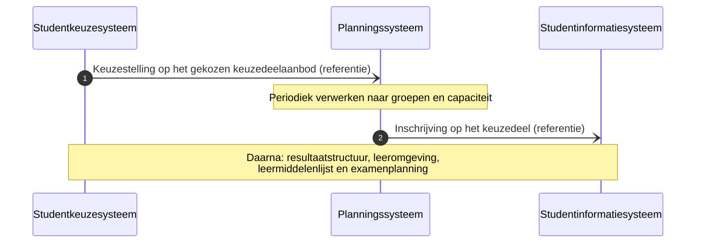

## Datamodel

Dit hoofdstuk legt de leeskant vast op [MIM-beschouwingsniveau 3](https://docs.geostandaarden.nl/mim/mim/#beschouwingsniveau-3-logisch-informatie-of-gegevensmodel). Het [informatiemodel OKx](../../../model/informatiemodel/informatiemodel.md) staat op niveau 2 en draagt bewust geen attribuutsoorten, dus dit hoofdstuk loopt daarop vooruit. Per entiteit staat daarom het objecttype erbij dat haar op de plaat draagt, en per nieuw begrip wat er richting het informatiemodel en de [begrippenlijst](../begrippen/begrippenlijst.md) gaat.

| Afspraak | Vorm |
|---|---|
| Veldnamen | Engels, met de Nederlandse naam in `DutchName` naast het veld (U7) |
| Opsommingswaarden | Nederlands, en vastgelegd in het schema zelf (U8) |
| Voorbeeldpayloads | Nederlandse veldnamen, plat met verwijzingen (U7) |
| Sleutelconventie | Het eigen sleutelveld heet `id`, een verwijzend veld zegt waarheen: `scopeId`, `targetSpecificationId`, `learningOutcomeId` (U7) |
| Schemavorm | JSON Schema draft 2020-12, met `alfa` in de `$id` |

### Datatypes

| Type | Vorm | Gebruik |
|---|---|---|
| `uuid` | Tekst, formaat uuid | Elke sleutel en elke verwijzing |
| `semver` | Tekst, patroon `MAJOR.MINOR.PATCH` | De versie van een object met eigen levensloop |
| `datum` | Tekst, formaat date | Begin en eind van een periode, geldigheid |
| `tijdstip` | Tekst, formaat date-time | Het peilmoment |
| `tekst` | Tekst | Naam, omschrijving, en de open waardelijsten |
| `geheel getal` | Integer | Een aantal en een capaciteit |
| `getal` | Number | Een omvang in SBU of studiepunten (EC) |
| `opsomming` | Enum met Nederlandse waarden | Een gesloten waardelijst |
| `uuid of null` | Tekst met formaat uuid, of `null` | Een bovenliggende verwijzing die bij een root leeg is: het veld is verplicht aanwezig en zijn waarde mag `null` zijn |
| `open lijst` | Tekst met de vastgestelde waarden in `$comment` | Een uitbreidbare waardelijst, zoals het regeltype en de kiesbaarheidsklasse |

De scheiding tussen `opsomming` en `open lijst` volgt de bestaande schema's: `status` en `specificationType` zijn gesloten, `programmeType` en `electiveUnitClass` open. Zij bepaalt wat een nieuwe waarde vraagt. Bij een gesloten opsomming komt de waarde in het schema, additief en daarmee een MINOR, zoals werkbrief 6, 8 en 11 doen. Bij een open lijst komt zij in `$comment` en voegt een instelling haar zelf toe.

### De entiteiten in deze snede

| Entiteit | `DutchName` | Schema | Objecttype op de plaat | Bezitter (U3) |
|---|---|---|---|---|
| Education specification | Onderwijsspecificatie | [`education-specification.json`](https://github.com/Npuls-OKx/Public/blob/d0c20d99b110b29ccf6b0e50109f7d54ffd88d7a/Informatie-en-gegevensmodellen/schemas/education-specification.json) | `Opleidingsprogramma specificatie`, `Keuzedeelruimte`, `Keuzedeel` | Onderwijscatalogus |
| Manifest item | Manifest-item | [`manifest-item.json`](https://github.com/Npuls-OKx/Public/blob/d0c20d99b110b29ccf6b0e50109f7d54ffd88d7a/Informatie-en-gegevensmodellen/schemas/manifest-item.json), uit te breiden (werkbrief 6) | Geen: de entiteit is de relatie tussen twee specificaties | Onderwijscatalogus |
| Learning outcome | Leeruitkomst | [`learning-outcome.json`](https://github.com/Npuls-OKx/Public/blob/d0c20d99b110b29ccf6b0e50109f7d54ffd88d7a/Informatie-en-gegevensmodellen/schemas/learning-outcome.json) | `Leeruitkomst` | Onderwijscatalogus |
| Rule set | Regelset | [`rule-set.json`](https://github.com/Npuls-OKx/Public/blob/d0c20d99b110b29ccf6b0e50109f7d54ffd88d7a/Informatie-en-gegevensmodellen/schemas/rule-set.json), te herzien (werkbrief 1) | `Student keuze regelset` | Onderwijscatalogus |
| Scope | Bereik | Onderdeel van `rule-set.json` (werkbrief 1) | Geen | Onderwijscatalogus |
| Rule | Regel | Onderdeel van `rule-set.json` (werkbrief 1) | Geen | Onderwijscatalogus |
| Rule set reference | Regelsetverwijzing | Nieuw `rule-set-reference.json` (werkbrief 2) | Geen | Onderwijscatalogus |
| Offering instance | Aanbodinstantie | [`education-offering.json`](https://github.com/Npuls-OKx/Public/blob/d0c20d99b110b29ccf6b0e50109f7d54ffd88d7a/Informatie-en-gegevensmodellen/schemas/education-offering.json), waarde toe te voegen (werkbrief 7) | `Keuzedeel aanbod` | Onderwijscatalogus, met het planningssysteem als bron |
| Offering reference | Aanbodreferentie | Nieuw `offering-reference.json` (werkbrief 3) | Geen | Onderwijscatalogus |
| Location | Locatie | [`location.json`](https://github.com/Npuls-OKx/Public/blob/d0c20d99b110b29ccf6b0e50109f7d54ffd88d7a/Informatie-en-gegevensmodellen/schemas/location.json) | `Onderwijslocatie` | Onderwijscatalogus |
| Group | Groep | [`group.json`](https://github.com/Npuls-OKx/Public/blob/d0c20d99b110b29ccf6b0e50109f7d54ffd88d7a/Informatie-en-gegevensmodellen/schemas/group.json) | `Plaatsingsgroep`, met het open punt over de inhoud | Onderwijscatalogus |
| Eligibility outcome | Kiesbaarheidsuitkomst | Nieuw `eligibility-outcome.json` (werkbrief 4) | Geen: het keuzemoment en de uitkomst hebben nog geen drager | Studentkeuzesysteem |
| Specification outcome | Specificatie-uitkomst | Onderdeel van `eligibility-outcome.json` (werkbrief 4) | Geen | Studentkeuzesysteem |
| Eligibility reason | Reden | Nieuw `eligibility-reason.json` (werkbrief 4) | Geen | Studentkeuzesysteem |

Zeven van de veertien entiteiten dragen al een schema in het releasepakket. Vier schema's komen erbij; Bereik en Regel leven binnen `rule-set.json` en Specificatie-uitkomst binnen `eligibility-outcome.json`. De stand per operatie staat in het [contractoverzicht](#contractoverzicht-en-werkbrieven), met de werkbrieven eronder.

### Het geheel

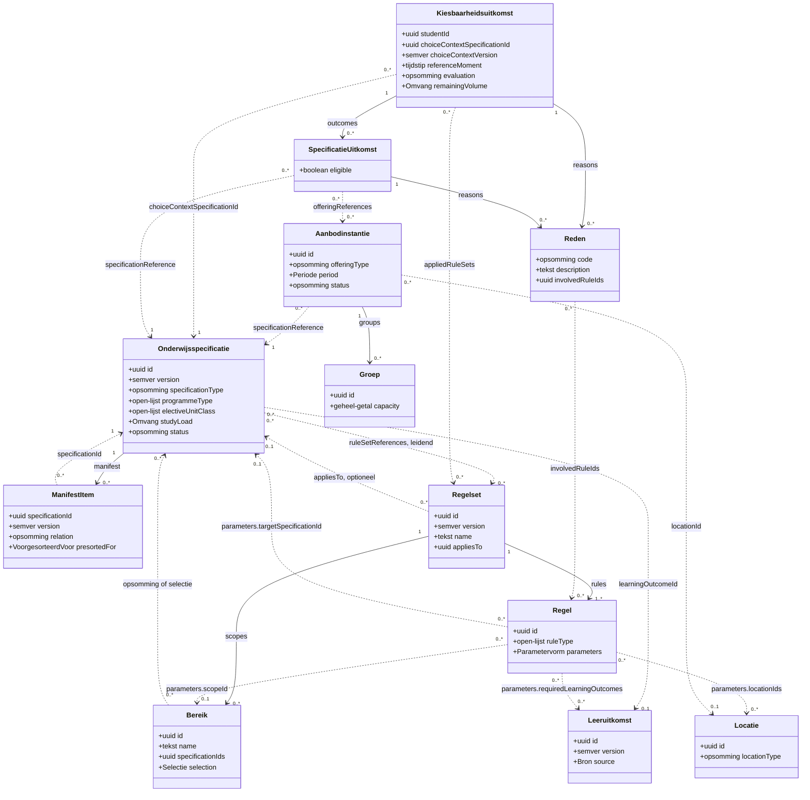

De doorlopende lijn is bezit en de gestippelde lijn een verwijzing met een sleutel. Daarmee staat de dragende keuze van B4 in het beeld: de onderwijsspecificatie wijst met een sleutel naar de regelset, en de regelset wijst met sleutels terug naar de items waarop zij werkt. Beide kanten wijzigen zonder de ander te raken (R2). De vier regeltypen staan niet als eigen klasse in het beeld: zij zijn vier parametervormen van `Regel`, en welke parameters bij welk type horen staat in [De regeltypen die er nu zijn](#de-regeltypen-die-er-nu-zijn). De vier gestippelde lijnen vanaf `Regel` dragen daarom de parameternaam.

### Onderwijsspecificatie

Definitie, voor de drie specialisaties die deze snede gebruikt.

| Objecttype | Definitie | Vindplaats |
|---|---|---|
| `Opleidingsprogramma specificatie` | Een samenhangende verzameling van een of meer (deel)programma's, onderwijseenheden, of leeruitkomsten die kunnen leiden tot een kwalificatie | [Begrippenlijst](../begrippen/begrippenlijst.md), herkomst klus 53 (alignment MORA en HORA) |
| `Keuzedeelruimte` | Een keuzedeelruimte is een oningevuld keuzedeel: onderwijskundig vrijgemaakte ruimte van een bepaalde omvang waarin een student een keuzedeel kiest | [Begrippenlijst](../begrippen/begrippenlijst.md), nieuw voor OKx, ontwerpkeuze 12 (status Voorstel) |
| `Keuzedeel` | Draagt geen definitie. De begrippenlijst zet het keuzedeel als specialisatie van de opleidingsprogrammaspecificatie naast het MORA-begrip met dezelfde naam, dat in de kwalificatiestructuur hangt | [Begrippenlijst](../begrippen/begrippenlijst.md), objecttype zonder definitie |

De velden die deze snede gebruikt. De overige velden van de entiteit staan in het schema.

| Veld | `DutchName` | Type | Multipliciteit | Wat het draagt |
|---|---|---|---|---|
| `id` | `id` | uuid | 1 | De sleutel, los van de versie |
| `specificationType` | `specificatieType` | opsomming | 1 | `keuzedeelruimtespecificatie` voor de ruimte, `opleidingsprogrammaspecificatie` voor een keuzedeel |
| `version` | `versie` | semver | 1 | De versie van deze specificatie |
| `parentSpecificationId` | `bovenliggendSpecificatieId` | uuid of null | 1 | De ouder, met waarde `null` voor een keuzedeel: een keuzedeel staat als root en is bereikbaar via de regelset |
| `learningOutcomeId` | `leeruitkomstId` | uuid | 0..1 | De leeruitkomst waarop deze specificatie verankert (R14) |
| `name` | `naam` | tekst | 1 | De leesbare aanduiding |
| `status` | `status` | opsomming | 0..1 | `gepubliceerd` maakt kiesbaar, `gedeactiveerd` en `vervallen` geven reden `specificatieNietMeerKiesbaar` |
| `studyLoad` | `studielast` | Omvang | 1 | 720 SBU voor de ruimte, 480 of 240 SBU per keuzedeel: de invoer van het regeltype `keuzeomvang` |
| `programmeType` | `programmatype` | open lijst | 0..1 | `keuzedeelprogramma` onderscheidt een keuzedeel van een diplomaprogramma |
| `electiveUnitClass` | `keuzedeelKlasse` | open lijst | 0..1 | De instellingseigen kiesbaarheidsklasse waarop een selectieterm matcht (ontwerpeis 0016) |
| `ruleSetReferences` | `regelsetVerwijzingen` | Regelsetverwijzing | 0..* | De regelsets die de keuzes binnen deze specificatie begrenzen. Leidend (B4), en met werkbrief 5 draagt de verwijzing de versie |
| `manifest` | `manifest` | Manifest-item | 0..* | De gepinde verwijzingen naar andere specificaties |

Relaties: de specificatie aggregeert zichzelf via `parentSpecificationId`, verankert op een `Leeruitkomst`, wijst naar haar regelsets, en is het doel van een `Aanbodinstantie`, van een bereik, van een regel en van de keuzecontext in de uitkomst.

### Manifest-item

Definitie (voorstel): een manifest-item is een gepinde verwijzing van de ene onderwijsspecificatie naar de andere, met de versie erin, zodat per specificatieversie vastligt waaruit zij was opgebouwd. Vindplaats: het schema in het releasepakket. De begrippenlijst kent de term nog niet.

| Veld | `DutchName` | Type | Multipliciteit | Wat het draagt |
|---|---|---|---|---|
| `specificationId` | `specificatieId` | uuid | 1 | De specificatie waarnaar het item wijst |
| `version` | `versie` | semver | 1 | De gepinde versie |
| `relation` | `relatie` | opsomming | 1 | `onderdeel`, `variant`, `referentie`, met `keuzeoptie` erbij uit werkbrief 6 |
| `presortedFor` | `voorgesorteerdVoor` | VoorgesorteerdVoor | 0..1 | De voorsortering als eigenschap van de relatie, werkbrief 6 |

De voorsortering hoort op deze relatie, om de reden die ontwerpeis 0013 benoemt: dezelfde keuzedelen zijn voor de ene leerroute voorgesorteerd en staan voor de andere in het bredere aanbod. De relatie verschilt per leerroute en draagt het onderscheid daarmee op de plek waar het ontstaat.

### Leeruitkomst

Definitie: een leeruitkomst is de invulling door de instelling van wat het kwalificatiekader beoogt: wat een student moet kennen en kunnen, zo geformuleerd dat specificaties ernaar kunnen verwijzen en dat behaalde toets- en examenresultaten er het bewijs voor leveren. Vindplaats: [begrippenlijst](../begrippen/begrippenlijst.md), afgeleid uit het vlakkenmodel en afgestemd op klus 53.

Deze snede gebruikt de leeruitkomst als sleutel: het regeltype `deelnamevoorwaarde` draagt uitsluitend `learningOutcomeId` plus een status, zodat een afnemer de regel met sleutels evalueert (R15). De velden die deze snede gebruikt staan hieronder. De overige velden van de entiteit staan in het schema.

| Veld | `DutchName` | Type | Multipliciteit | Wat het draagt |
|---|---|---|---|---|
| `id` | `id` | uuid | 1 | De verbindende sleutel ([ADR 0026](https://github.com/Npuls-OKx/Public/blob/dev/Referentiemateriaal/adr/0026-leeruitkomst-als-verbindende-sleutel.md), status Voorstel) |
| `version` | `versie` | semver | 1 | De eigen levensloop van de leeruitkomst |
| `parentLearningOutcomeId` | `bovenliggendLeeruitkomstId` | uuid of null | 1 | De ordening van grof naar fijn, die R16 vraagt, met waarde `null` bij een leeruitkomst van de grofste orde |
| `name` | `naam` | tekst | 1 | De leesbare aanduiding, waarmee een afnemer de reden `vereisteLeeruitkomstOpen` aan de student kan uitleggen |
| `indicativeVolume` | `indicatieveOmvang` | Omvang | 1 | De omvang waarmee een keuze op leeruitkomstniveau rekent, wat werkbrief 1 voorbereidt |
| `source` | `bron` | Bron | 1 | Het kader waaruit de leeruitkomst komt, met type `keuzedeel` voor een leeruitkomst uit een keuzedeelblad |

### Regelset

Definitie (voorstel voor de begrippenlijst): een student keuze regelset is een zelfstandig vastgestelde verzameling regels die begrenst wat een student binnen een keuzecontext kiest, met een eigen identiteit en een eigen versie, los van de specificaties waarop zij werkt. Vindplaats: [regelset-payload.md](../student-keuze/regelset-payload.md), ontwerpkeuze 6 van het [informatiemodel](../../../model/informatiemodel/informatiemodel.md) (status Voorstel). Het objecttype staat in de begrippenlijst onder de objecttypen zonder definitie, en dit voorstel gaat daarheen als signalering.

| Veld | `DutchName` | Type | Multipliciteit | Wat het draagt |
|---|---|---|---|---|
| `id` | `id` | uuid | 1 | De identiteit van de regelset, los van haar versie (ontwerpeis 0017) |
| `version` | `versie` | semver | 1 | De regelset is de eenheid van versionering: een regel en een bereik versioneren niet zelfstandig |
| `name` | `naam` | tekst | 1 | De leesbare aanduiding, waarmee de planner de regelset buiten het keuzesysteem leest (ontwerpeis 0015) |
| `description` | `omschrijving` | tekst | 0..1 | Wat de regelset afkadert, in gewone woorden |
| `appliesTo` | `vanToepassingOp` | uuid | 0..1 | De keuzecontext. Optioneel met B4, en uit de lijst verplichte velden met werkbrief 1 |
| `scopes` | `bereiken` | Bereik | 0..* | De keuzegroepen, eenmaal gedefinieerd |
| `rules` | `regels` | Regel | 1..* | De regels, die samen gelden |

Alle regels in een regelset gelden samen (EN-semantiek). Een vorm waarin twee regels alternatieven van elkaar zijn staat als kandidaat in de tabel verderop.

### Bereik

Definitie (voorstel): een bereik is een binnen een regelset benoemde verzameling onderwijsspecificaties, vastgelegd als opsomming of als selectie, waarnaar regels met een sleutel verwijzen.

| Veld | `DutchName` | Type | Multipliciteit | Wat het draagt |
|---|---|---|---|---|
| `id` | `id` | uuid | 1 | De sleutel waarmee een regel naar dit bereik wijst |
| `name` | `naam` | tekst | 1 | De leesbare aanduiding, zoals "Keuzedelen met klasse algemeen-verbredend" |
| `specificationIds` | `specificatieIds` | uuid | 0..* | De opsomming: de set ligt vast |
| `selection` | `selectie` | Selectie | 0..1 | De selectie: het criterium ligt vast en de set volgt op het peilmoment |
| `learningOutcomeIds` | `leeruitkomstIds` | uuid | 0..* | Kiezen tussen leeruitkomsten in plaats van tussen specificaties (R13, R16). Werkbrief 1 brengt dit veld later in |

Een bereik draagt precies 1 van de twee vormen, de opsomming of de selectie. In het schema is dat een `oneOf` over die twee velden. Een selectie draagt een lijst termen met per term een attribuut en een of meer waarden: tussen de termen geldt EN, binnen een term geldt OF. Zij wordt opgelost tegen de specificaties die de onderwijscatalogus van de eigen instelling ontsluit, op het peilmoment van de vraag, en de opgeloste leden gaan mee in de uitkomst zodat het oordeel herhaalbaar blijft (R6). Daarmee begrenst een selectie zich tot het eigen voorgesorteerde aanbod, ook wanneer de catalogus het landelijke assortiment ontsluit; een selectie over een landelijk register vraagt een eigen term voor de bron en staat als uitvraag.

### Regel

Definitie (voorstel): een regel is een getypeerde uitspraak binnen een regelset, met een vaste set parameters per type en een eenduidige evaluatie-uitkomst.

| Veld | `DutchName` | Type | Multipliciteit | Wat het draagt |
|---|---|---|---|---|
| `id` | `id` | uuid | 1 | De sleutel waarmee een reden naar deze regel wijst |
| `ruleType` | `regelType` | open lijst | 1 | Het type, dat bepaalt welke parameters gelden |
| `parameters` | `parameters` | Parameterobject per type | 1 | De parameters, getypeerd per `ruleType` |

In het schema is `parameters` een `oneOf` met `ruleType` als onderscheidend veld (discriminator): per type hoort precies 1 parametervorm. Daarmee is een regel valideerbaar zonder expressietaal, wat R6 vraagt.

### De regeltypen die er nu zijn

De vier typen uit de normatieve [regelsetvorm](../student-keuze/regelset-payload.md) (B2), met hun parameters op veldniveau.

| Type | Parameter | `DutchName` | Type | Multipliciteit |
|---|---|---|---|---|
| `kiesbaarheid` | `scopeId` | `bereikId` | uuid | 1 |
| `deelnamevoorwaarde` | `targetSpecificationId` | `doelSpecificatieId` | uuid | 1 |
| | `requiredLearningOutcomes` | `vereisteLeeruitkomsten` | VereisteLeeruitkomst | 1..* |
| `keuzeomvang` | `scopeId` | `bereikId` | uuid | 0..1 |
| | `volume` | `omvang` | Omvanggrenzen | 0..1 |
| | `count` | `aantal` | Aantal | 0..1 |
| `beschikbaarheid` | `targetSpecificationId` | `doelSpecificatieId` | uuid | 1 |
| | `locationIds` | `locatieIds` | uuid | 0..* |
| | `period` | `periode` | Periode | 0..1 |

De semantiek per type, de eisen die elk type dekt en de redencode die het bij een afwijzing oplevert.

| Type | Semantiek | Dekt | Redencode bij afwijzing |
|---|---|---|---|
| `kiesbaarheid` | Welke onderwijsspecificaties kiesbaar zijn binnen de keuzecontext | R1, R10 | Geen eigen code: de kiesbare set bestaat uit de leden van de bereiken waarnaar deze regels wijzen |
| `deelnamevoorwaarde` | Deelname vereist behaalde leeruitkomsten | R7, R8, R9, R14, R15 | `vereisteLeeruitkomstOpen`, of `behaaldStatusOnbekend` zonder gegevens |
| `keuzeomvang` | Hoeveel er gekozen wordt, binnen de keuzecontext of binnen een bereik | R5, R12, R16 | `keuzeomvangBereikt` bij een bovengrens, `keuzeomvangOnhaalbaar` bij een ondergrens |
| `beschikbaarheid` | Beperking tot locatie en periode | R3 | `buitenLocatieOfPeriode` |

Twee beperkingen horen bij de regels naast het schema, waar het releasepakket ze verzamelt. Een `keuzeomvang` draagt ten minste 1 van `volume` en `count`, en een `beschikbaarheid` ten minste 1 van `locationIds` en `period`. Zonder die beperking is een regel vormelijk geldig en inhoudelijk leeg.

De parameter van `beschikbaarheid` heet in deze specificatie `locatieIds`, meervoudig, omdat een keuzedeel op meer dan 1 locatie toegestaan kan zijn. De normatieve regelsetvorm schrijft `locatieId` met een lijst als waarde; werkbrief 1 trekt de naam gelijk. Als queryparameter blijft `locatieId` staan, meervoudig herhaald, zoals een queryparameter dat doet.

### De regeltypen die uit de eisen volgen en nog geen vorm hebben

Besluit B2 maakt het regeltype een uitbreidbare opsomming, en deze acht kandidaten zijn de eerste vulling. Per kandidaat de parameters die eruit volgen en de entiteit die het gegeven vandaag draagt.

| Kandidaat | Parameters die eruit volgen | Drager van het gegeven | Vindplaats |
|---|---|---|---|
| `minimaleStudielast` | `volume` met een ondergrens, plus `sourceSpecificationId` naar de ruimte die zij vult | `studyLoad` op de ruimte. De ondergrens is met `keuzeomvang` al uitdrukbaar, de bronverwijzing nog niet | De regelset bij de resultaatstructuur in de [voorbeeldpayloads](https://github.com/Npuls-OKx/Public/blob/d0c20d99b110b29ccf6b0e50109f7d54ffd88d7a/Informatie-en-gegevensmodellen/voorbeeldpayloads.md) van het releasepakket, met 720 SBU |
| `resultaateis` | `scopeId` plus de vereiste resultaatwaarde | De resultaatstructuur, die buiten deze snede valt | Dezelfde regelset, met de eis "voldoende" op elk gekozen keuzedeel |
| `examenEis` | `scopeId` plus `count` met een ondergrens over de specificaties die met een examen afsluiten | Geen: dat een keuzedeel met een examen afsluit heeft geen veld. Het keuzedeelblad draagt het als `certificateFrom`, wat de brug naar de specificatie nog mist | [Kaderscenario leerroute 1](https://github.com/Npuls-OKx/Public/blob/dev/Referentiemateriaal/kaderscenario%27s/leerroute-1-regulier.md), paragraaf Keuzedelen |
| `volgorde` | `precedingSpecificationId` en `followingSpecificationId` | De specificatiestructuur. Vandaag drukt `deelnamevoorwaarde` dit alleen uit door behaald te eisen | [Keuze-requirements](../student-keuze/keuze-requirements.md) R9 |
| `plaatscapaciteit` | `scopeId`, waarbij het getal uit `capacity` op de groep komt en de regel haar bindend verklaart | `capacity` op de groep en `maxStudentCount` op de aanbodinstantie | R4, en het aantal plaatsen staat in [de casus](casus.md) als uitvraag |
| `verplichtingNaKeuze` | `triggerSpecificationId` en de specificaties die daarna verplicht worden | Geen | [regelset-payload.md](../student-keuze/regelset-payload.md), paragraaf 9 |
| Alternatieven tussen regels (OF-semantiek) | Een groepering boven de regels, met een veld dat zegt of alle regels gelden of een ervan | Geen: de regelset kent vandaag een platte lijst met EN-semantiek. Dit is een structuurwijziging en daarmee een MAJOR | [regelset-payload.md](../student-keuze/regelset-payload.md), paragraaf 9 |
| `voorsorteringPerLeerroute` | `scopeId` plus de leerroute | Geen attribuut. Werkbrief 6 legt de drager op het manifest-item, wat beter bij ontwerpeis 0013 past | Ontwerpeis 0013 |

De laatste twee rijen zijn van een andere orde dan de andere zes. Alternatieven tussen regels raken de structuur van de regelset, en de voorsortering hoort op een relatie, waar werkbrief 6 haar legt. Zij staan hier omdat de eisen ze vragen, met de aantekening dat zij een ander soort wijziging zijn.

### Een regeltype toevoegen

1. Een geval dat de bestaande typen niet kunnen uitdrukken, met de instelling of het scenario erbij dat het inbrengt.
2. Een voorstel met de semantiek, de vaste parameters met hun type en multipliciteit, de evaluatie-uitkomst, de redencode die het type bij een afwijzing oplevert, en de eis die het dekt.
3. Vaststelling door de kerngroep techniek, met opname in de waardelijst van het schema en in de tabel hierboven.
4. Versie-impact: een extra type is additief en geeft een MINOR op het schema. Een regelset krijgt een nieuwe versie zodra zij het type gebruikt.
5. Gedrag bij een onbekend type: de afnemer merkt de regelset aan als niet te evalueren, geeft `evaluatie` de waarde `nietUitvoerbaar` met reden `onbekendRegeltype`, en levert geen kiesbare set. Daarmee ziet de student uitsluitend de keuzes die de regelset toestaat.

`ruleType` volgt daarbij de open-lijstvorm van `programmeType` en `electiveUnitClass`: een tekstveld met de vastgestelde waarden in `$comment`. De grond staat in stap 5: een open lijst laat de payload door de validatie, zodat de afnemer het onbekende type aantreft en reden `onbekendRegeltype` kan geven. Een gesloten opsomming wijst de payload al bij de validatie af, waarmee die reden buiten bereik blijft.

Een instelling breidt daarmee twee waardelijsten op twee manieren uit, en het verschil zit in wie de waarde moet begrijpen.

| Waardelijst | Bereik van de waarde | Route |
|---|---|---|
| `electiveUnitClass`, de kiesbaarheidsklasse | Instellingseigen: uitsluitend de selectie van die instelling matcht erop, en een andere partij hoeft de waarde niet te kennen om de regel te evalueren | De instelling voegt de waarde zelf toe (ontwerpeis 0016, story-0016). De naamkeuze en de beheerroute staan als uitvraag |
| `ruleType`, het regeltype | Gedeeld: elke afnemer moet de evaluatie kennen, want R6 vraagt dezelfde uitkomst bij elk systeem | De instelling brengt het geval in, de kerngroep techniek stelt de semantiek vast, en de waarde komt in de open lijst. Een eigen waarde zonder die vaststelling levert bij elke andere afnemer reden `onbekendRegeltype` |

### Waar de regelset aangrijpt

Besluit B3 zegt dat een regelset in principe op alle specificaties aangrijpt, en in het bijzonder op de `Keuzedeelruimte` en de `Minor ruimte`. Op datamodelniveau rust dat op een eigenschap van de vorm: de regelset verwijst uitsluitend met sleutels. Een bereik draagt `specificationIds`, een regel draagt `targetSpecificationId`, en de keuzecontext is een `specificationId`. De evaluatie werkt op die sleutels, ongeacht welk specificatietype erachter zit (ontwerpeis 0018).

| Aangrijpingspunt | Waarde in `specificationType` | Stand |
|---|---|---|
| `Keuzedeelruimte` | `keuzedeelruimtespecificatie` | Aanwezig, en de keuzecontext van de casus |
| `Keuzedeel` | `opleidingsprogrammaspecificatie` met `programmeType` `keuzedeelprogramma` | Aanwezig |
| `Opleiding specificatie` | `opleidingsspecificatie` | Aanwezig |
| `Opleidingsprogramma specificatie` | `opleidingsprogrammaspecificatie` | Aanwezig |
| `Onderwijseenheid specificatie` | `onderwijseenheidspecificatie` | Aanwezig |
| `Leeronderdeel specificatie` | `leeronderdeelspecificatie` | Aanwezig |
| `Minor ruimte`, `Minor` | Geen waarde | Werkbrief 11 voegt de waarde voor de `Minor ruimte` toe. Het informatiemodel kent beide objecttypen, zonder definitie en zonder vermelding in de begrippenlijst |
| `Toetsonderdeel specificatie` | `toetsonderdeelspecificatie` | De waarde bestaat, het informatiemodel kent geen relatie met de regelset. Open punt richting het informatiemodel |
| `Examenonderdeelspecificatie` | Geen waarde | Het objecttype heeft nog geen waarde in `specificationType` (ontwerpkeuze 9). `examenplanspecificatie` hoort bij `Examenplan`, dat buiten scope staat (ontwerpkeuze 10) |
| `Les specificatie` | Geen waarde | De leslaag regelt de instelling zelf (ontwerpkeuze 8, status Voorstel) |

### Verwijzingsrichting

`ruleSetReferences` op de onderwijsspecificatie is leidend (B4). De specificatie wijst naar de regelsets die de keuzes binnen haar begrenzen, en de regelset wijst met sleutels naar de items waarop zij werkt. Beide kanten wijzigen zonder de ander te raken (R2). `appliesTo` wordt daarmee optioneel: het veld is enkelwaardig, en een verplichte waarde bindt een regelset aan een enkele keuzecontext, waardoor hergebruik over opleidingen heen buiten bereik blijft (story-0017).

Het informatiemodel legt de relatie in de andere richting: ontwerpkeuze 6 laat de regelset naar de specificatietypen wijzen, en de relaties in [`informatiemodel.json`](../../../model/informatiemodel/informatiemodel.json) lopen van `Student keuze regelset` naar de specificatietypen. Dat verschil gaat als signalering richting het informatiemodel, samen met de vraag of de regelset in de familie `Onderwijsspecificatie` thuishoort.

### Aanbodinstantie en locatie

Ontwerpeis 0014 rust op deze twee entiteiten: locatie en periode zitten op het aanbod en zijn daar filterbaar.

| Objecttype | Definitie | Vindplaats |
|---|---|---|
| `Keuzedeel aanbod` | Draagt geen definitie en ontbreekt in de begrippenlijst. Het model plaatst het in de familie `Onderwijsaanbod` als specialisatie van `Opleidingsprogramma aanbod`, met `ProgrammeOffering` als tegenhanger in OEAPI | [informatiemodel.json](../../../model/informatiemodel/informatiemodel.json) |
| `Onderwijslocatie` | Draagt geen definitie en ontbreekt in de begrippenlijst. ROSA-KOI draagt `onderwijslocatie` met een definitie, wat als signalering richting het informatiemodel staat | [informatiemodel.json](../../../model/informatiemodel/informatiemodel.json), met het punt in [de signaleringen](#openstaande-punten-en-signaleringen) |

Aanbodinstantie, met de velden die deze snede gebruikt.

| Veld | `DutchName` | Type | Multipliciteit | Wat het draagt |
|---|---|---|---|---|
| `id` | `id` | uuid | 1 | De sleutel van de aanbodinstantie |
| `offeringType` | `aanbodType` | opsomming | 1 | Vandaag valt het keuzedeelaanbod onder `onderwijseenheid-aanbod`. Een eigen waarde staat in werkbrief 7 |
| `version` | `versie` | semver | 1 | De versie van deze instantie |
| `parentOfferingId` | `bovenliggendAanbodId` | uuid of null | 1 | Het bovenliggende aanbod, met waarde `null` voor een zelfstandig aanbod |
| `specificationReference` | `specificatieVerwijzing` | Specificatieverwijzing | 1 | Het keuzedeel dat hier gepland staat, met de versie erbij |
| `name` | `naam` | tekst | 1 | De leesbare aanduiding |
| `status` | `status` | opsomming | 1 | `gepland` maakt kiesbaar. `nietRealiseerbaar` en `geannuleerd` tijdens een open keuzemoment staan in werkbrief 12 |
| `period` | `periode` | Periode | 0..1 | Wanneer het keuzedeel draait: de parameters `periodeStart` en `periodeEind` vergelijken hiermee |
| `locationId` | `locatieId` | uuid | 0..1 | Waar het keuzedeel draait: de parameter `locatieId` vergelijkt hiermee |
| `groups` | `groepen` | Groep | 0..* | De groepen met hun capaciteit, waarop het kandidaat-regeltype `plaatscapaciteit` zou aangrijpen |
| `minStudentCount` | `minAantalStudenten` | geheel getal | 0..1 | De ondergrens waaronder het aanbod onhaalbaar wordt, wat de animo-uitvraag voedt |
| `maxStudentCount` | `maxAantalStudenten` | geheel getal | 0..1 | De bovengrens over de groepen samen |
| `cohort` | `cohort` | tekst | 0..1 | Het cohort waarvoor dit aanbod geldt |
| `bottlenecks` | `knelpunten` | Knelpunt | 0..* | De knelpunten uit de planning, met `regelConflict` als overlap met de redencodes van deze snede |

Locatie.

| Veld | `DutchName` | Type | Multipliciteit | Wat het draagt |
|---|---|---|---|---|
| `id` | `id` | uuid | 1 | De sleutel waarmee het aanbod en het regeltype `beschikbaarheid` naar de locatie wijzen |
| `locationType` | `locatieType` | opsomming | 1 | Van `campus` tot `virtueel`, waarmee de locatie ook een praktijklocatie of een digitale plek kan zijn |
| `name` | `naam` | tekst | 1 | De leesbare aanduiding |
| `partOfLocationId` | `valtBinnenLocatieId` | uuid | 0..1 | De ordening van campus naar ruimte, zodat een filter op een vestiging haar gebouwen meeneemt |

Twee punten bij deze twee entiteiten. `locationId` is optioneel, en het moment waarop de locatie vaststaat ligt open: de ruimte komt vaak pas bij het roosteren, terwijl de keuze eerder valt. Een keuzedeel kan op meer dan 1 locatie draaien, waardoor de regel `beschikbaarheid` een lijst locaties draagt. Daarnaast staan locatie en periode op twee plekken, als veld op het aanbod en als parameter van het regeltype `beschikbaarheid`. Het aanbod is de feitelijke bron en de regel kadert wat is toegestaan; lopen zij uiteen, dan levert de opvraag geen kiesbaar aanbod en gaat reden `buitenLocatieOfPeriode` mee. Die voorrang is een voorstel ter bekrachtiging door de kerngroep techniek.

### De kiesbaarheidsuitkomst

Definitie (voorstel): een kiesbaarheidsuitkomst is het op een peilmoment berekende oordeel welke onderwijsspecificaties een student binnen een keuzecontext mag kiezen, met per specificatie de reden bij een niet-kiesbare uitkomst en met de invoer waarop het oordeel rust. Vindplaats: deze specificatie. Het keuzemoment, de keuzecontext en het peilmoment ontbreken alle drie in de begrippenlijst, en dat staat als signalering in [de signaleringen](#openstaande-punten-en-signaleringen). De uitkomst is het product van deze snede en heeft nog geen schema; de velden hieronder vormen het voorstel (werkbrief 4).

| Veld | `DutchName` | Type | Multipliciteit | Wat het draagt |
|---|---|---|---|---|
| `studentId` | `studentId` | uuid | 1 | De student, als pseudonym per koppeling. Het sleuteltype raakt [ADR 0009](https://github.com/Npuls-OKx/Public/blob/dev/Referentiemateriaal/adr/0009-sks-svs-rollenverdeling-keuze-vs-resultaat-voortgang.md) (status Voorstel) |
| `choiceContextSpecificationId` | `keuzecontextSpecificatieId` | uuid | 1 | De keuzecontext waarbinnen gekozen wordt, in deze snede een `Keuzedeelruimte` of een `Minor ruimte` |
| `choiceContextVersion` | `keuzecontextVersie` | semver | 1 | De versie van de keuzecontext waarop het oordeel rust, zodat de structuur achter het oordeel herleidbaar blijft |
| `referenceMoment` | `peilmoment` | tijdstip | 1 | Het moment waarop regelsetversie, specificatieset en aanbod zijn gelezen |
| `evaluation` | `evaluatie` | opsomming | 1 | `uitgevoerd` of `nietUitvoerbaar` |
| `appliedRuleSets` | `toegepasteRegelsets` | Regelsetverwijzing | 0..* | Per regelset de sleutel en de toegepaste versie (R17). De lijst blijft leeg wanneer `evaluatie` op `nietUitvoerbaar` staat omdat de gepinde versie niet opvraagbaar is |
| `resolvedScopes` | `opgelosteBereiken` | OpgelostBereik | 0..* | Per bereik de leden op het peilmoment (R6) |
| `alreadyChosen` | `reedsGekozen` | Specificatieverwijzing | 0..* | De gemaakte en voorgenomen keuzes die in de vraag meekwamen (R6) |
| `remainingVolume` | `restopgave` | Omvang | 0..1 | De omvang die nog gekozen moet worden om het minimum te halen |
| `outcomes` | `uitkomsten` | Specificatie-uitkomst | 0..* | Het oordeel per specificatie: elk lid van elk opgelost bereik dat niet in `reedsGekozen` staat |
| `reasons` | `redenen` | Reden | 0..* | De redenen op het niveau van de keuzecontext: bij een leeg `uitkomsten` en bij `evaluatie` op `nietUitvoerbaar` |

Specificatie-uitkomst, het oordeel per specificatie binnen de uitkomst. Definitie (voorstel): een specificatie-uitkomst is het oordeel over een enkele onderwijsspecificatie binnen een kiesbaarheidsuitkomst, met het aanbod waarmee de keuze haalbaar is en met de redenen bij een niet-kiesbare uitkomst.

| Veld | `DutchName` | Type | Multipliciteit | Wat het draagt |
|---|---|---|---|---|
| `specificationReference` | `specificatieVerwijzing` | Specificatieverwijzing | 1 | De specificatie met de versie waarop het oordeel geldt |
| `eligible` | `kiesbaar` | Boolean | 1 | Het oordeel |
| `offeringReferences` | `aanbodVerwijzingen` | Aanbodreferentie | 0..* | Het aanbod waarmee de keuze haalbaar is |
| `reasons` | `redenen` | Reden | 0..* | De redenen bij een niet-kiesbare uitkomst. Leeg bij een kiesbare |

Reden.

| Veld | `DutchName` | Type | Multipliciteit | Wat het draagt |
|---|---|---|---|---|
| `code` | `code` | opsomming | 1 | De genormeerde reden |
| `description` | `omschrijving` | tekst | 1 | De reden in woorden, die de afnemer aan de student toont |
| `involvedRuleIds` | `betrokkenRegelIds` | uuid | 0..* | De regels waaruit deze reden volgt. Een reden kan uit meer dan 1 regel volgen |

Het meervoud in `involvedRuleIds` is wat [de doorloop](#waar-k0262-samen-met-k0023-afvalt) nodig heeft: de afwijzing van K0023 volgt uit drie regels samen, en met een enkelvoudig veld blijft twee derde van de onderbouwing weg.

Een regelset die geen uitkomst oplevert geeft `evaluatie` de waarde `nietUitvoerbaar`, en het studentkeuzesysteem meldt dat als verwerkingsuitkomst richting de onderwijscatalogus. Een oordeel per specificatie heet niet-kiesbaar met reden, conform de verplichting bij kiesbaarheidsbepaling-aanbieder.

#### Redencodes

Een eigen opsomming naast de knelpuntcodes in [`bottleneck.json`](https://github.com/Npuls-OKx/Public/blob/d0c20d99b110b29ccf6b0e50109f7d54ffd88d7a/Informatie-en-gegevensmodellen/schemas/bottleneck.json), die een eigenschap van een aanbodinstantie zijn en de planning dekken. `regelConflict` komt in beide lijsten voor, met dezelfde betekenis.

| Code | Wanneer |
|---|---|
| `vereisteLeeruitkomstOpen` | Een regel `deelnamevoorwaarde` vraagt een leeruitkomst die nog geen status `behaald` draagt |
| `buitenLocatieOfPeriode` | Een regel `beschikbaarheid` sluit de locatie of de periode van deze student uit |
| `keuzeomvangBereikt` | Een regel `keuzeomvang` is met de reeds gemaakte keuzes bereikt |
| `keuzeomvangOnhaalbaar` | Een ondergrens in omvang of aantal blijft met deze keuze erbij buiten bereik, gezien de kiesbare set op het peilmoment |
| `geenPassendAanbod` | De zoekvraag levert geen aanbod binnen locatie en periode |
| `specificatieNietMeerKiesbaar` | De specificatie draagt status `gedeactiveerd` of `vervallen` |
| `behaaldStatusOnbekend` | De behaalde leeruitkomsten van deze student zijn niet beschikbaar |
| `onbekendRegeltype` | De regelset draagt een regeltype dat de afnemer nog moet leren kennen |
| `regelConflict` | De regels in de regelset sluiten elkaar uit |
| `regelsetversieOnbeschikbaar` | De gepinde regelsetversie is bij de aanbieder niet meer opvraagbaar |

`keuzeomvangOnhaalbaar` is in deze specificatie nieuw en dekt de ondergrens die met deze keuze erbij buiten bereik blijft; `keuzeomvangBereikt` dekt de bovengrens. De vooruitblik waarop die code rust staat in stappen onder [De vooruitblik bij een ondergrens](#de-vooruitblik-bij-een-ondergrens). `regelsetversieOnbeschikbaar` volgt uit [operatie 5](#5-get-regelsetsid): een gepinde versie die is opgeruimd laat de evaluatie niet door, en de uitkomst draagt die reden op het niveau van de keuzecontext.

### De gegevensgroeptypen

De samengestelde typen die de entiteiten hierboven gebruiken. Zes ervan staan al als schema in het releasepakket.

| Type | `DutchName` | Velden | Stand |
|---|---|---|---|
| Volume | Omvang | `value` (`waarde`, getal, 1), `unit` (`eenheid`, opsomming `SBU` of `EC`, 1) | [`volume.json`](https://github.com/Npuls-OKx/Public/blob/d0c20d99b110b29ccf6b0e50109f7d54ffd88d7a/Informatie-en-gegevensmodellen/schemas/volume.json) |
| Period | Periode | `start` (`start`, datum, 0..1), `end` (`eind`, datum, 0..1) | [`period.json`](https://github.com/Npuls-OKx/Public/blob/d0c20d99b110b29ccf6b0e50109f7d54ffd88d7a/Informatie-en-gegevensmodellen/schemas/period.json) |
| Specification reference | Specificatieverwijzing | `specificationId` (`specificatieId`, uuid, 1), `version` (`versie`, semver, 1) | [`specification-reference.json`](https://github.com/Npuls-OKx/Public/blob/d0c20d99b110b29ccf6b0e50109f7d54ffd88d7a/Informatie-en-gegevensmodellen/schemas/specification-reference.json) |
| Group | Groep | `id` (uuid, 1), `name` (`naam`, tekst, 1), `capacity` (`capaciteit`, geheel getal, 0..1) | [`group.json`](https://github.com/Npuls-OKx/Public/blob/d0c20d99b110b29ccf6b0e50109f7d54ffd88d7a/Informatie-en-gegevensmodellen/schemas/group.json) |
| Source | Bron | `standard` (`standaard`, open lijst, 1), `type` (opsomming met `keuzedeel`, 1), `code` (tekst, 1) | [`source.json`](https://github.com/Npuls-OKx/Public/blob/d0c20d99b110b29ccf6b0e50109f7d54ffd88d7a/Informatie-en-gegevensmodellen/schemas/source.json) |
| Bottleneck | Knelpunt | `code` (opsomming, 1), `description` (`omschrijving`, tekst, 1), `involvedSpecificationIds` (`betrokkenSpecificatieIds`, uuid, 0..*) | [`bottleneck.json`](https://github.com/Npuls-OKx/Public/blob/d0c20d99b110b29ccf6b0e50109f7d54ffd88d7a/Informatie-en-gegevensmodellen/schemas/bottleneck.json) |
| Volume bounds | Omvanggrenzen | `min` (Omvang, 0..1), `max` (Omvang, 0..1) | Werkbrief 1 |
| Count | Aantal | `min` (geheel getal, 0..1), `max` (geheel getal, 0..1) | Werkbrief 1 |
| Selection | Selectie | `terms` (`termen`, Term, 1..*) | Werkbrief 1 |
| Term | Term | `attribute` (`attribuut`, tekst, 1), `values` (`waarden`, tekst, 1..*) | Werkbrief 1 |
| Required learning outcome | VereisteLeeruitkomst | `learningOutcomeId` (`leeruitkomstId`, uuid, 1), `status` (opsomming `behaald`, 1) | Werkbrief 1 |
| Rule set reference | Regelsetverwijzing | `ruleSetId` (`regelsetId`, uuid, 1), `version` (`versie`, semver, 1), `validFrom` (`geldigVanaf`, datum, 0..1), `validUntil` (`geldigTot`, datum, 0..1) | Werkbrief 2 |
| Offering reference | Aanbodreferentie | `offeringId` (`aanbodId`, uuid, 1), `version` (`versie`, semver, 1), `specificationReference` (0..1), `status` (opsomming, 1), `locationId` (`locatieId`, uuid, 0..1), `period` (`periode`, Periode, 0..1), `groups` (`groepen`, Groep, 0..*) | Werkbrief 3 |
| Resolved scope | OpgelostBereik | `scopeId` (`bereikId`, uuid, 1), `specificationReferences` (`specificatieVerwijzingen`, Specificatieverwijzing, 0..*) | Werkbrief 4 |
| Presorted for | VoorgesorteerdVoor | `learningRoute` (`leerroute`, open lijst, 0..1), `targetGroup` (`doelgroep`, open lijst, 0..1) | Werkbrief 6 |

Het woord bereik is in deze snede de keuzegroep, dus de min- en maxvorm van een omvang heet Omvanggrenzen. In de uitkomst is `specificationReference` op de aanbodreferentie optioneel, omdat de specificatie-uitkomst eromheen de specificatie al draagt. In de respons van de zoekvraag draagt de aanbodreferentie haar wel, omdat daar geen uitkomst omheen staat.

### De canonieke casus in de voorbeelden

De getypeerde regelset uit [regelset-payload.md](../student-keuze/regelset-payload.md) paragraaf 8 is normatief voor de vorm (B2) en staat voluit bij [operatie 5](#5-get-regelsetsid): twee benoemde bereiken en zeven regels. De inhoud is die van [casus.md](casus.md) (B5). Op elf punten wijkt deze specificatie van de vorm of de vulling in paragraaf 8 af, en die verschillen staan per punt in [Keuzes waar twee lezingen naast elkaar stonden](#keuzes-waar-twee-lezingen-naast-elkaar-stonden). De keuzedeelruimte is begroot op 720 SBU, wat voor een opleiding op niveau 4 ook de wettelijke ondergrens is: de regel `keuzeomvang` draagt daarom een minimum en een maximum van 720 SBU.

| Onderdeel van de casus | Waarde |
|---|---|
| Keuzecontext | De `Keuzedeelruimte` van Apothekersassistent, 720 SBU |
| Bereik 1, selectie | Keuzedelen met klasse algemeen-verbredend, hieronder het verbredende bereik. Momenteel zo'n 20 keuzedelen, waarvan de casus K0262 en K0023 draagt |
| Bereik 2, opsomming | Opgesomde verdiepende keuzedelen, hieronder het opgesomde bereik. Twee leden: K0037 uit de casus, en de sleutel waarop de regels 6 en 7 werken |
| Regel 1 en 4 | `kiesbaarheid` per bereik |
| Regel 2 | `keuzeomvang`, hoogstens 2 uit bereik 1 |
| Regel 3 | `keuzeomvang`, de keuze samen op 720 SBU, als ondergrens en als bovengrens |
| Regel 5 | `keuzeomvang`, precies 1 uit bereik 2 |
| Regel 6 | `deelnamevoorwaarde`, sleutel `7dfef831` vereist leeruitkomst `f46bc824` met status `behaald` |
| Regel 7 | `beschikbaarheid`, sleutel `7dfef831` op locatie `59807057` in de periode 1 februari tot 16 april 2027 |

De twee korte sleutels in regel 6 en 7 dragen in de casus geen gegeven. Zij komen uit de normatieve regelsetvorm, waar zij een illustratief keuzedeel met een illustratieve leeruitkomst aanduiden. Deze specificatie houdt de sleutels aan, zodat de regeltypen `deelnamevoorwaarde` en `beschikbaarheid` een voorbeeld dragen, en laat de namen eruit: welk keuzedeel en welke leeruitkomst een instelling hier plaatst is een uitvraag (B5). De drie overige leden die paragraaf 8 in het opgesomde bereik noemt blijven om dezelfde reden weg: zonder studielast is hun oordeel op de omvanggrens niet te berekenen.

Dezelfde 720 SBU wordt in de [voorbeelduitwerking van Jochem](../../../model/informatiemodel/voorbeeld-leerroute-1-jochem.md) gevuld door [K0037 Farmaceutische Patientenzorg](../../kwalificatiedossier/K0037-farmaceutische-patientenzorg.md) (480 SBU, aard Verdiepend) en [K0262 ARBO, kwaliteitszorg en hulpverlening](../../kwalificatiedossier/K0262-arbo-kwaliteitszorg-en-hulpverlening-niveau-3.md) (240 SBU, aard Generiek). Als derde draagt de casus [K0023 Digitale vaardigheden gevorderd](../../kwalificatiedossier/K0023-digitale-vaardigheden-gevorderd.md) (240 SBU, aard Generiek), waarmee er iets te kiezen valt. De aard van een keuzedeel is een landelijke eigenschap van het keuzedeelblad; de kiesbaarheidsklasse is de instellingseigen indeling waarop een selectie matcht, en het lidmaatschap van bereik 1 volgt uit die klasse. Welk attribuut de aard draagt, en welke sleutels de drie keuzedelen bij een instelling krijgen, is een uitvraag.

De vijf eisen uit de casus landen op vijf plekken. Drie ervan in de regelset, de vierde op het manifest-item, en de vijfde heeft nog geen drager.

| Eis uit de casus | Entiteit | Veld dat hem draagt | Stand |
|---|---|---|---|
| De ruimte van 720 SBU vullen | Regel `keuzeomvang` | `volume.min` en `volume.max`, elk een Omvang van 720 SBU | Vorm aanwezig, schema in werkbrief 1 |
| Precies 1 uit het opgesomde bereik | Regel `keuzeomvang` met `scopeId` | `count.min` en `count.max` met waarde 1, op het opgesomde bereik | Vorm aanwezig, schema in werkbrief 1 |
| Voorgesorteerd op leerroute | Manifest-item op de keuzedeelruimte | `presortedFor.learningRoute` | Voorstel, werkbrief 6. Geen bestaand veld draagt de Npuls-leerroute |
| Beschikbaar op locatie en periode | Regel `beschikbaarheid`, plus de aanbodinstantie | `locatieIds` en `periode` in de regel, `locatieId` en `periode` op het aanbod | Vorm aanwezig. De waarden per keuzedeelaanbod staan als uitvraag |
| Een regel kan op de aard van een keuzedeel selecteren | Term van een selectie-bereik | Geen drager: de selectie matcht op `keuzedeelKlasse`, de instellingseigen klasse | Signalering, met het attribuut voor de aard in de [uitvraag aan instellingen](#uitvraag-aan-instellingen) |

De canonieke regelset is op een punt strenger dan de casus vraagt: zij draagt `aantal` met een minimum en een maximum van 1 op het opgesomde bereik, waarmee precies 1 lid daarvan geldt. Die ondergrens is wat de combinatie van twee verbredende keuzedelen in [de doorloop](#waar-k0262-samen-met-k0023-afvalt) laat afvallen. Hoogstens 1 lid, zonder ondergrens, is dezelfde regel met uitsluitend `aantal.max`.

De voorsortering landt op de relatie tussen de keuzedeelruimte en haar keuzeopties, als `voorgesorteerdVoor` op het manifest-item (werkbrief 6). De payload met die vorm staat bij [operatie 1](#1-get-onderwijsspecificatiesid); de waarde `leerroute-1` daarin is een voorstel, omdat de codering van de Npuls-leerroute in een payload een uitvraag is en het bestaande veld `learningPathway` de leerweg (BOL of BBL) draagt en daarmee iets anders. De regelsetverwijzing draagt in dezelfde payload de versie, wat werkbrief 5 in het schema brengt; vandaag is `ruleSetReferences` een lijst sleutels zonder versie, waarmee R17 nog geen drager heeft.

## Berichtspecificatie

Dit is de berichtspecificatie van de leeskant (AMIGO-stap 5) en volgt op de [koppelvlakdiensten](#koppelvlakdiensten) en de [interactie](#interactie). Elke voorbeeldpayload rekent met [de casus van Jochem](casus.md) en met de sleutels uit [de doorloop](#de-casus-van-jochem-door-de-diensten), zodat de twaalf berichten samen een geval vormen dat een lezer kan navolgen. De paden en parameters staan in het Nederlands, de voorbeeldpayloads dragen Nederlandse veldnamen en de schema's Engelse met `DutchName` ernaast (U7).

### De twaalf operaties

| Nr | Operatie | Dienst | Bezitter | Patroon | Respons | Stand van het schema |
|---|---|---|---|---|---|---|
| 1 | `GET /onderwijsspecificaties/{id}` | onderwijsspecificatiestructuur-aanbieder | Onderwijscatalogus | Request-Reply | `education-specification.json` | Aanwezig, met werkbrief 5, 6 en 15 op drie plekken |
| 2 | `GET /onderwijsspecificaties/{id}/delta` | onderwijsspecificatiestructuur-aanbieder | Onderwijscatalogus | Request-Reply | `education-specification-delta.json` (JSON Patch, RFC 6902) | Aanwezig |
| 3 | `GET /onderwijsspecificaties` | onderwijsspecificatiestructuur-aanbieder | Onderwijscatalogus | Request-Reply | Lijst `specification-reference.json` | Aanwezig, uit te breiden: werkbrief 14 |
| 4 | `GET /regelsets` | keuzeregelset-aanbieder | Onderwijscatalogus | Request-Reply | Lijst regelsetverwijzingen | Schema te maken: werkbrief 2 |
| 5 | `GET /regelsets/{id}` | keuzeregelset-aanbieder | Onderwijscatalogus | Request-Reply | Regelset in de getypeerde vorm | Schema te maken: werkbrief 1 |
| 6 | `GET /onderwijsaanbod` | onderwijsaanbod-zoekvraag-aanbieder | Onderwijscatalogus | Request-Reply | Lijst aanbodverwijzingen | Schema te maken: werkbrief 3 |
| 7 | `GET /onderwijsaanbod/{id}` | onderwijsaanbod-zoekvraag-aanbieder | Onderwijscatalogus | Request-Reply | `education-offering.json` | Aanwezig, pad toe te voegen |
| 8 | `GET /kiesbaarheid` | kiesbaarheidsbepaling-aanbieder | Studentkeuzesysteem | Request-Reply | Kiesbaarheidsuitkomst | Schema te maken: werkbrief 4 |
| 9 | `POST {callbackUrl}`, soort `specificatie-beschikbaar`, `specificatie-gewijzigd` of `specificatie-status-gewijzigd` | onderwijsspecificatiestructuur-afnemer | Studentkeuzesysteem | Event Notification | Geen lichaam | Aanwezig |
| 10 | `POST {callbackUrl}`, soort `regelset-gewijzigd` | keuzeregelset-afnemer | Studentkeuzesysteem en planningssysteem | Event Notification | Geen lichaam | Schema te maken: werkbrief 10 |
| 11 | `POST {callbackUrl}`, soort `verwerkingsuitkomst` | verwerkingsuitkomst-afnemer | Onderwijscatalogus | Asynchronous Request-Reply | Geen lichaam | Aanwezig, uit te breiden: werkbrief 9 |
| 12 | `POST /abonnementen` | afleverabonnement-aanbieder | Onderwijscatalogus en studentkeuzesysteem | Subscription registration | Abonnement-id | Aanwezig, opsomming uit te breiden: werkbrief 8 |

De operaties 1 tot 7 leveren de invoer waarmee operatie 8 het oordeel berekent. De operaties 9 tot 12 houden die invoer actueel.

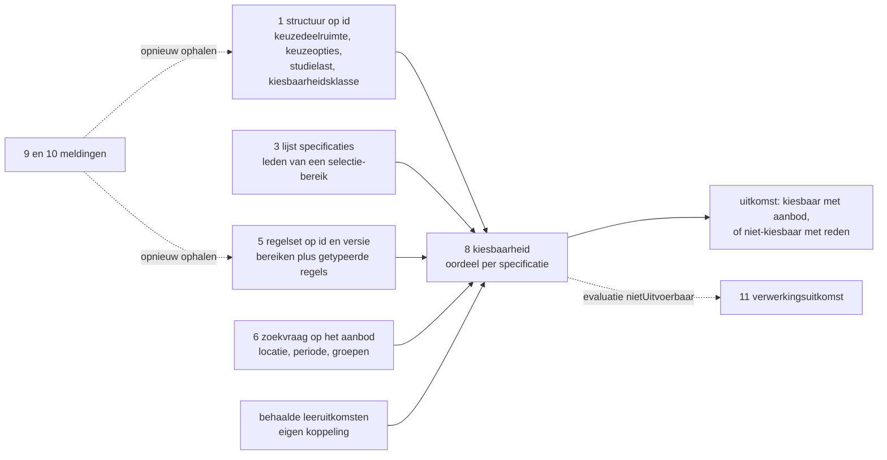

### Contractoverzicht en werkbrieven

De twaalf operaties hierboven vormen samen het contract van deze snede. De paden en parameters zijn een voorstel, op dezelfde voet als de voorgestelde namen die het pakket vandaag draagt voor `specificatie-beschikbaar` en `verwerkingsuitkomst`. Zeven schema's komen erbij en negen bestaande schema's of waardelijsten worden uitgebreid of herzien; de zestien werkbrieven hieronder noemen per schema wat erbij komt en wat de versie-impact is.

Hoe de vergelijking op `periodeStart` en `periodeEind` uitpakt staat bij [operatie 6](#6-get-onderwijsaanbod); een lege lijst is daar een geldig antwoord. De voorrang van het aanbod boven de regel bij locatie en periode staat onder [Aanbodinstantie en locatie](#aanbodinstantie-en-locatie).

#### Werkbrieven richting het releasepakket

| Nr | Schema | Wat erbij komt | Versie-impact |
|---|---|---|---|
| 1 | [`rule-set.json`](https://github.com/Npuls-OKx/Public/blob/d0c20d99b110b29ccf6b0e50109f7d54ffd88d7a/Informatie-en-gegevensmodellen/schemas/rule-set.json) | `scopes[]` (`bereiken`) met `id`, `name` en `specificationIds` of `selection.terms[] {attribute, values[]}`; later `learningOutcomeIds` voor R13 en R16. `rules[]` met `id`, `ruleType` als tekstveld met de vastgestelde waarden in `$comment`, naar het model van `programmeType` en `electiveUnitClass`, en een getypeerd `parameters`-object per type: `scopeId`, `targetSpecificationId`, `requiredLearningOutcomes[] {learningOutcomeId, status}`, `volume` als bereik, `count {min, max}`, `locationIds[]`, `period`. `appliesTo` uit `required` | MAJOR: de alfa-vorm met `rules` als ongetypeerde objecten vervalt |
| 2 | Nieuw `rule-set-reference.json` | `ruleSetId`, `version`, `validFrom`, `validUntil` | Nieuw schema |
| 3 | Nieuw `offering-reference.json` | `offeringId`, `version`, `specificationReference`, `status`, `locationId`, `period`, `groups[]`. `status` komt mee omdat de zoekvraag erop filtert en de afnemer de toestand van het aanbod nodig heeft | Nieuw schema |
| 4 | Nieuw `eligibility-outcome.json` met `eligibility-reason.json` | De velden en de redencodes uit [De kiesbaarheidsuitkomst](#de-kiesbaarheidsuitkomst) | Nieuw schema |
| 5 | [`education-specification.json`](https://github.com/Npuls-OKx/Public/blob/d0c20d99b110b29ccf6b0e50109f7d54ffd88d7a/Informatie-en-gegevensmodellen/schemas/education-specification.json) | `ruleSetReferences` van een lijst sleutels naar een lijst `rule-set-reference.json`, zodat de versie bij de verwijzing staat (R17) | MAJOR op dat veld |
| 6 | [`manifest-item.json`](https://github.com/Npuls-OKx/Public/blob/d0c20d99b110b29ccf6b0e50109f7d54ffd88d7a/Informatie-en-gegevensmodellen/schemas/manifest-item.json) | Het schema draagt `specificationId`, `version` en `relation` met de waarden `onderdeel`, `variant` en `referentie`. Erbij komt de waarde `keuzeoptie` en een optionele `presortedFor` (`voorgesorteerdVoor`) met leerroute en doelgroep, als drager van ontwerpeis 0013 | MINOR |
| 7 | [`education-offering.json`](https://github.com/Npuls-OKx/Public/blob/d0c20d99b110b29ccf6b0e50109f7d54ffd88d7a/Informatie-en-gegevensmodellen/schemas/education-offering.json) | `offeringType` krijgt een waarde voor keuzedeelaanbod. Vandaag hangt het keuzedeelaanbod in de voorbeeldpayloads onder `onderwijseenheid-aanbod` | MINOR |
| 8 | [`subscription.json`](https://github.com/Npuls-OKx/Public/blob/d0c20d99b110b29ccf6b0e50109f7d54ffd88d7a/Informatie-en-gegevensmodellen/schemas/subscription.json) | `events` kent `specificatie-planbaar`, `specificatie-gewijzigd`, `specificatie-status-gewijzigd` en `verwerkingsstatus`. Erbij komen `specificatie-beschikbaar`, `regelset-gewijzigd` en `verwerkingsuitkomst`. Dezelfde lijst draagt daarmee twee woorden voor hetzelfde: `specificatie-planbaar` naast `specificatie-beschikbaar`, en `verwerkingsstatus` naast `verwerkingsuitkomst` | MINOR voor de drie toevoegingen. Het vervallen van `specificatie-planbaar` en `verwerkingsstatus` is MAJOR, omdat operatie 12 op een onbekende soort een 400 geeft en elke partij die de oude waarde verstuurt daarmee breekt. Daarom een overgangsperiode waarin beide waarden gelden |
| 9 | [`processing-status.json`](https://github.com/Npuls-OKx/Public/blob/d0c20d99b110b29ccf6b0e50109f7d54ffd88d7a/Informatie-en-gegevensmodellen/schemas/processing-status.json) | `reason {code, description, involvedRuleIds}`, `ruleSetReference` en een generieke `createdReference` naast `programmeOfferingId` | MINOR |
| 10 | Nieuw `rule-set-changed.json` | `ruleSetId`, `oldVersion` (`oudeVersie`), `newVersion` (`nieuweVersie`) en `changeClass` (`wijzigingsklasse`), met dezelfde veldnamen als `specification-changed.json` | Nieuw schema |
| 11 | `education-specification.json`, veld `specificationType` | Een waarde voor de `Minor ruimte`, met de vraag of `Toetsonderdeel specificatie` en `Examenonderdeelspecificatie` een regelset dragen | MINOR |
| 12 | Nieuw `offering-changed.json` | Melding dat een aanbodinstantie naar `nietRealiseerbaar` of `geannuleerd` gaat tijdens een open keuzemoment | Nieuw schema |
| 13 | Nieuw `error.json` | `code`, `description` (`omschrijving`) en `involvedParameters` (`betrokkenParameters`), plus de zes foutcodes uit [Het foutbericht](#het-foutbericht) | Nieuw schema |
| 14 | `specification-reference.json`, of een nieuw schema ernaast | De selectietermen als parameter op `GET /onderwijsspecificaties`, en een samenvattende verwijzing met de velden die een regel raken: `specificatieType`, `programmatype`, `keuzedeelKlasse`, `status` en `studielast` | MINOR, of een nieuw schema |
| 15 | `education-specification.json`, veld `codes` | `codes[]` met `code.json` op de onderwijsspecificatie, voor de crebocode en de keuzedeelcode, naar het model van `location.json` | MINOR |
| 16 | Nieuw meldingsschema, een envelop om de vier meldingen | Een verplicht `soort` (`soort`) met de waardelijst van `events` in `subscription.json`, plus een eigen sleutel en een tijdstempel per melding. Daarmee houdt een ontvanger op een afleveradres de vier soorten uit elkaar en rust idempotente verwerking op de melding in plaats van op haar natuurlijke sleutel | Nieuw schema, en de vier meldingen gaan erop over |

Daarnaast raken drie toevoegingen uit dit hoofdstuk de endpointtabellen van de vier dienstpagina's: de statuscodes 401, 403 en 503 met `Retry-After`, de koptekstvelden `ETag` en `If-None-Match` op de operaties 1, 5 en 7, en de redencode `regelsetversieOnbeschikbaar` bij werkbrief 4.

#### De eigen woorden op de verwerkingsstatus

`processing-status.json` draagt vijf statuswaarden. De meldingen van deze snede vallen daar als volgt op.

| Melding | `status` | Terminaal |
|---|---|---|
| Keuzemoment in behandeling genomen | `ontvangen` | Nee |
| Inrichten gestart | `gestart` | Nee |
| Keuzemoment ingericht | `gelukt` | Ja |
| Keuzemoment ingericht zonder kiesbaar aanbod | `gelukt` met reden `geenPassendAanbod` | Ja |
| Structuur afgekeurd op een validatiefout | `afgekeurd` | Ja |
| Regelset niet te evalueren | `nietGelukt` met reden `onbekendRegeltype` of `regelConflict` | Ja |

### Wat op elk bericht drukt

#### Vorm en taal

| Onderwerp | Afspraak |
|---|---|
| Vorm | JSON, met een JSON Schema draft 2020-12 per payload (U8) |
| Veldnamen | Engels in het schema met `DutchName` ernaast, Nederlands in de voorbeelden (U7) |
| Structuur | Platte arrays per objecttype, met een expliciet benoemde verwijzing (`bovenliggendSpecificatieId`, `leeruitkomstId`, `specificatieVerwijzing.specificatieId`). Een kale `bovenliggendId` blijft weg (U7) |
| Sleutels | Sleutel (uuid) per object, met de leesbare naam ernaast. Verankering gebeurt op de sleutel (U6) |
| Taal van de inhoud | Eentalig Nederlands. Een meertalige vorm komt bij de overlay op OEAPI terug (signalering S7) |
| Datum en tijd | Een datum als `jjjj-mm-dd`, een moment als tijdstempel met tijdzone (RFC 3339), zoals `2026-11-02T09:00:00+01:00` |
| Omvang | `{ "waarde": 720, "eenheid": "SBU" }` uit `volume.json`, met `SBU` en `EC` als eenheid |

#### Koptekstvelden

| Koptekstveld | Richting | Waarde | Grond |
|---|---|---|---|
| `Authorization` | Elk verzoek, en elke aflevering van een melding | `Bearer <token>`, opgehaald bij de token-endpoint van de ontvangende partij | [auth-standaard](https://github.com/Npuls-OKx/Public/blob/d0c20d99b110b29ccf6b0e50109f7d54ffd88d7a/Koppelvlakspecificaties/auth-standaard.md) |
| `Content-Type` | Elk bericht met een lichaam | `application/json`, en `application/json-patch+json` op de respons van operatie 2 | RFC 6902 |
| `Accept` | Elk verzoek | `application/json`, en op operatie 2 `application/json-patch+json` | U11 geeft de afnemer de keuze tussen de volledige structuur en de delta |
| `ETag` en `If-None-Match` | Respons en vervolgverzoek op de operaties 1, 5 en 7 | De sterke validator van de opgevraagde versie | Voorstel. De versie in het pad of de parameter pint de inhoud al, en het koptekstveld spaart de overdracht uit bij een ongewijzigde structuur |
| `Retry-After` | Respons bij 503 | Wachttijd in seconden | Voorstel. [ADR 0018](https://github.com/Npuls-OKx/Public/blob/dev/Referentiemateriaal/adr/0018-enterprise-messaging-patronen-voor-betrouwbare-koppelvlakken.md) (status Voorstel) vraagt betrouwbare aflevering, en het hernieuwregime zelf staat in geen document |

De payload is eentalig Nederlands, dus de taal staat vast zonder `Accept-Language`. De identiteit en de soort van een melding horen in het bericht, zoals het pakket dat ook voor de inhoud van een melding doet; werkbrief 16 belegt die envelop.

#### Statuscodes

| Code | Wanneer | Lichaam |
|---|---|---|
| 200 | De opvraag is uitgevoerd, en een melding is aangenomen | De respons, of leeg bij een melding |
| 201 | Een abonnement is vastgelegd | Het abonnement met zijn sleutel |
| 304 | De opgevraagde versie is ongewijzigd ten opzichte van `If-None-Match` | Geen |
| 400 | Een verplichte parameter ontbreekt, of een waarde is niet te lezen, of twee parameters sluiten elkaar uit | Foutbericht |
| 401 | Het token ontbreekt of is verlopen | Foutbericht |
| 403 | Het token mist de claim voor deze operatie | Foutbericht |
| 404 | De sleutel in het pad bestaat niet, of de gevraagde versie bestaat niet | Foutbericht |
| 503 | De aanbieder neemt tijdelijk geen verzoeken aan | Foutbericht, met `Retry-After` |

Een oordeel dat afwijst blijft een 200: de kiesbaarheidsuitkomst draagt de afwijzing als inhoud met haar reden, en een lege lijst is een geldig antwoord. Een foutcode is er voor het verzoek dat de aanbieder niet kan uitvoeren.

#### Het foutbericht

Het pakket draagt geen genormeerd foutobject (signalering S8). Deze snede stelt dezelfde redenvorm voor die de uitkomst en de verwerkingsuitkomst al dragen, zodat een afnemer een code op een plek leest. Werkbrief 13 belegt het schema.

```json
{
  "fout": {
    "code": "parameterOntbreekt",
    "omschrijving": "De parameter specificatieId is verplicht en ontbreekt.",
    "betrokkenParameters": ["specificatieId"]
  }
}
```

| Foutcode | Wanneer |
|---|---|
| `parameterOntbreekt` | Een verplichte parameter ontbreekt |
| `parameterNietTeLezen` | Een waarde past niet bij het type, bijvoorbeeld een sleutel die geen uuid is |
| `parametersSluitenUit` | Twee parameters zijn samen niet te honoreren: `versie` naast `geldigOp`, `cohort` naast `periodeStart` of `periodeEind`, of een `periodeStart` die na `periodeEind` ligt |
| `onbekendeSleutel` | De sleutel in het pad bestaat niet bij deze aanbieder |
| `onbekendeVersie` | De gevraagde versie bestaat niet voor deze sleutel |
| `geenToegang` | Het token mist de claim voor deze operatie |

#### Leeg resultaat

| Operatie | Leeg resultaat | Code |
|---|---|---|
| 1, 5, 7 | Een opvraag op een sleutel levert een object of een fout | 200 of 404 |
| 2 | Twee versies zonder verschil leveren een lege lijst operaties | 200 |
| 3, 4, 6 | Een lijstoperatie levert een lege lijst, ook wanneer de sleutel in de parameter bestaat | 200 |
| 8 | Een uitkomst zonder kiesbare specificatie draagt `uitkomsten` met `kiesbaar` op onwaar en de reden per specificatie. Is er geen enkel lid in de opgeloste bereiken, dan blijft `uitkomsten` leeg en draagt `redenen` op de uitkomst zelf reden `geenPassendAanbod` | 200 |

Een lege lijst is daarmee informatie en geen fout. Bij het inrichten van het keuzemoment leidt zij tot een verwerkingsuitkomst met reden `geenPassendAanbod`, zodat de instelling het signaal krijgt voordat de keuzedeelruimte oningevuld blijft.

#### Idempotentie en de identiteit van een melding

[ADR 0018](https://github.com/Npuls-OKx/Public/blob/dev/Referentiemateriaal/adr/0018-enterprise-messaging-patronen-voor-betrouwbare-koppelvlakken.md) vraagt idempotente verwerking: dezelfde melding tweemaal verwerken heeft geen effect. De melding draagt vandaag geen eigen sleutel, dus de ontvanger ontdubbelt op de natuurlijke sleutel van het bericht.

| Melding | Natuurlijke sleutel | Houdt die stand |
|---|---|---|
| `specificatie-beschikbaar` | `specificatieId` plus `versie` | Ja |
| `specificatie-gewijzigd` | `objectId` plus `nieuweVersie` | Ja |
| `specificatie-status-gewijzigd` | `objectId` plus `nieuweStatus` | Zolang een specificatie een status eenmaal aanneemt |
| `regelset-gewijzigd` | `regelsetId` plus `nieuweVersie` | Ja |
| `verwerkingsuitkomst` | `specificatieVerwijzing` plus `status` | De niet-terminale statussen `ontvangen` en `gestart` kunnen zich herhalen voor hetzelfde keuzemoment |

De laatste rij is de reden voor werkbrief 16: een melding-envelop met een eigen sleutel en een tijdstempel, naar het model van de abonnementspatronen waarop het pakket zich beroept. Tot die er is, ontdubbelt de ontvanger van de verwerkingsuitkomst op de verwijzing naar het keuzemoment die de melding meedraagt.

#### Autorisatie en studentgegevens

Voor elk endpoint in deze snede geldt de [auth-standaard](https://github.com/Npuls-OKx/Public/blob/d0c20d99b110b29ccf6b0e50109f7d54ffd88d7a/Koppelvlakspecificaties/auth-standaard.md) van het pakket: OAuth 2.0 Client Credentials, machine naar machine (machine-to-machine), met een eigen token-endpoint per bezitter.

`GET /kiesbaarheid` is het eerste endpoint in het pakket dat een studentsleutel draagt. Drie punten horen daarbij.

| Punt | Stand |
|---|---|
| Scopes en autorisatieclaims | De auth-standaard laat ze uitdrukkelijk open. Welke claim het opvragen van de kiesbaarheid van een individuele student toestaat is een signalering richting dat document |
| Sleuteltype | Een pseudonym per koppeling houdt de sleutel beperkt tot deze uitwisseling. Welke sleutel de student identificeert raakt ADR 0009 en staat open |
| Plaats van de sleutel | Een sleutel in een pad of een querystring belandt in logbestanden. De keuze tussen een queryparameter en een verzoeklichaam, met de bewaartermijn erbij, is een uitvraag |

#### Wat elk bericht buiten zich laat

| Wat | Waar het blijft | Grond |
|---|---|---|
| De inhoud van een leeruitkomst | Bij het component dat haar bezit. Over de koppeling gaat `leeruitkomstId`, met de status waar een regel die vraagt | U6, [ADR 0026](https://github.com/Npuls-OKx/Public/blob/dev/Referentiemateriaal/adr/0026-leeruitkomst-als-verbindende-sleutel.md) (status Voorstel), R15 |
| De resource van een ander component | Bij de bezitter. De koppeling draagt verwijzingen, en de inhoud volgt op een opvraag | U3 |
| De uitkomst waar de regel volstaat | De catalogus levert de regel, het studentkeuzesysteem leidt de lijst af en kan dezelfde regel aan de planner geven | [De casus](casus.md), story-0015 |
| Persoonsgegevens | Buiten de studentsleutel draagt geen bericht een naam, een onderwijsnummer of een geboortedatum. De studentsleutel komt uitsluitend in operatie 8 voor | [Autorisatie en studentgegevens](#autorisatie-en-studentgegevens) |
| Kerntaken en werkprocessen uit het kwalificatiedossier | Bij de landelijke bron. De specificatie verankert op leeruitkomst-sleutels, en de keuzedeelbladen staan in deze repository | U6 |
| De leslaag | Bij de instelling. Het aanbod draagt periode, locatie en groepen, en het rooster regelt de instelling zelf (ontwerpkeuze 8, status Voorstel) | [Informatiemodel](../../../model/informatiemodel/informatiemodel.md) |
| De keuzestelling en de inschrijving | In de snede die het vastleggen van de keuze beschrijft | [Wat buiten deze snede blijft](#wat-buiten-deze-snede-blijft-met-de-reden) |
| Een begrip dat geen definitie draagt | Buiten het bericht, met de signalering erbij. Keuzemoment, keuzecontext en peilmoment krijgen in deze snede een rol en missen een definitie in de begrippenlijst | U6, [openstaande punten](#openstaande-punten-en-signaleringen) |

### De casus in sleutels

De payloads hieronder rekenen met deze sleutels. De bovenliggende specificaties komen uit de [voorbeeldpayloads](https://github.com/Npuls-OKx/Public/blob/d0c20d99b110b29ccf6b0e50109f7d54ffd88d7a/Informatie-en-gegevensmodellen/voorbeeldpayloads.md) van het releasepakket, die dezelfde opleiding dragen.

| Onderdeel | Sleutel | Herkomst |
|---|---|---|
| Opleidingsspecificatie Apothekersassistent, 4800 SBU | `5ef37812-ae0f-4232-904f-451b9928e45e` | Voorbeeldpayloads releasepakket |
| Opleidingsprogrammaspecificatie Regulier BOL | `7ae25c1e-ee27-43a2-a001-761ee39ea5c7` | Voorbeeldpayloads releasepakket |
| Keuzedeelruimte, 720 SBU | `c1664aa8-af81-4ac1-ad37-4f3e2184fe38` | [De doorloop](#de-casus-van-jochem-door-de-diensten) |
| Regelset, versie 1.0.0 | `bd7902da-1a14-4ddb-ba36-308d9af27f74` | [Operatie 5](#5-get-regelsetsid) |
| K0037 Farmaceutische Patientenzorg, 480 SBU, Verdiepend | `9a3146ab-62ab-4bf3-a7cf-43cd02c5380c` | Doorloop, sleutel illustratief |
| K0262 ARBO, kwaliteitszorg en hulpverlening geschikt voor niveau 3, 240 SBU, Generiek | `afcf61eb-4dd4-4451-adec-2fb741ab2984` | Doorloop, sleutel illustratief |
| K0023 Digitale vaardigheden gevorderd, 240 SBU, Generiek | `8a65a727-c407-45eb-ae7e-5c022d427a5f` | Doorloop, sleutel illustratief |
| Jochem, cohort 2026 | `e9c2dc36-0d2a-4c79-9a2a-0b1f3f6e7d41` | Doorloop |
| Keuzemoment bij het studentkeuzesysteem | `8145f9f4-f6d1-473b-90c5-77e258e94b26` | Doorloop |
| Vestiging van Jochem | `4221d212-fa98-41f0-b792-07551515272e` | Doorloop, illustratief |
| Tweede lid van het opgesomde bereik, zonder gegeven in de casus | `7dfef831-5552-459b-b00e-a59541d0eb03` | Normatieve regelsetvorm, inhoud als uitvraag |
| Leeruitkomst die regel 6 vraagt, zonder gegeven in de casus | `f46bc824-8ff5-4a3d-bb21-47ebbba0942b` | Normatieve regelsetvorm, inhoud als uitvraag |
| Locatie uit regel 7 van de regelset | `59807057-a6f1-473b-9084-114644557a68` | Normatieve regelsetvorm, naam als uitvraag |
| Peilmoment | `2026-11-02T09:00:00+01:00` | Doorloop, een periode voor de keuzedeelruimte |

De landelijke keuzedeelcodes staan in de payloads in een `codes`-blok. Dat veld bestaat vandaag op `location.json` en nog niet op de onderwijsspecificatie; werkbrief 15 belegt het, en zolang dat open staat dragen de payloads het als voorstel. De crebocode van de opleiding en van de kwalificatie staat in [casus.md](casus.md) en komt met werkbrief 15 in hetzelfde blok terecht, op de opleidingsspecificatie.

### 1 `GET /onderwijsspecificaties/{id}`

| Kenmerk | Waarde |
|---|---|
| Dienst | onderwijsspecificatiestructuur-aanbieder bij de onderwijscatalogus |
| Trigger | De melding dat de keuzedeelruimte beschikbaar is, of herstel na een gemiste melding |

Dit is het bericht waarmee het studentkeuzesysteem de keuzedeelruimte, haar keuzeopties en de verwijzing naar de regelsets binnenhaalt.

| Parameter | Type | Verplicht | Standaard | Semantiek |
|---|---|---|---|---|
| `{id}` | uuid in het pad | Ja | | De specificatie die wordt opgevraagd. In deze snede de `Keuzedeelruimte` |
| `versie` | semver | Nee | De laatst gepubliceerde versie | Pint de momentopname, zodat een lopend keuzemoment op dezelfde structuur blijft rekenen |

Het antwoord draagt per specificatie de velden hieronder. De volledige vorm staat in [`education-specification.json`](https://github.com/Npuls-OKx/Public/blob/d0c20d99b110b29ccf6b0e50109f7d54ffd88d7a/Informatie-en-gegevensmodellen/schemas/education-specification.json).

| Veld | Draagt | Waarvoor in deze snede |
|---|---|---|
| `id`, `versie`, `status` | Identiteit en toestand | Pinnen en uitsluiten van een specificatie die naar `gedeactiveerd` of `vervallen` gaat |
| `specificatieType` | `keuzedeelruimtespecificatie` of `opleidingsprogrammaspecificatie` | Het aangrijpingspunt van de regelset (B3) |
| `programmatype` | `keuzedeelprogramma` | Een term van een selectie-bereik |
| `keuzedeelKlasse` | De instellingseigen kiesbaarheidsklasse, open lijst | Een term van een selectie-bereik (ontwerpeis 0016) |
| `studielast` | Omvang in SBU | Het regeltype `keuzeomvang`, en de restopgave |
| `bovenliggendSpecificatieId` | De plek in de structuur, `null` bij een root | Een keuzedeel staat als root en is bereikbaar via de regelset |
| `manifest[]` | Verwijzingen naar andere specificaties met hun relatie | De keuzeopties van deze ruimte |
| `regelsetVerwijzingen[]` | De regelsets die de keuzes binnen deze keuzecontext begrenzen | De opvraag in operatie 4 en 5 (B4) |
| `leeruitkomstId` | De leeruitkomst waarop de specificatie verankert | Het regeltype `deelnamevoorwaarde` |
| `geldigVanaf`, `geldigTot`, `cohort` | Geldigheid | Het peilmoment van de vraag |

Drie plekken in deze payload wijken af van het schema van vandaag.

| Plek | Afwijking | Werkbrief |
|---|---|---|
| `regelsetVerwijzingen` | Een sleutel met een versie, waar het schema vandaag een lijst kale sleutels draagt. Zonder die versie kan een lopend keuzemoment de regelsetversie niet uit de verwijzing pinnen (R17) | 5 |
| `manifest[].relatie` en `voorgesorteerdVoor` | De waarde `keuzeoptie` met de voorsortering per leerroute, waar het schema vandaag `onderdeel`, `variant` en `referentie` kent zonder eigenschap op de relatie (ontwerpeis 0013) | 6 |
| `codes` | De landelijke keuzedeelcode op de onderwijsspecificatie, waar dat veld vandaag uitsluitend op `location.json` bestaat | 15 |

```json
{
  "onderwijsspecificaties": [
    {
      "id": "c1664aa8-af81-4ac1-ad37-4f3e2184fe38",
      "specificatieType": "keuzedeelruimtespecificatie",
      "versie": "0.1.0",
      "bovenliggendSpecificatieId": "7ae25c1e-ee27-43a2-a001-761ee39ea5c7",
      "naam": "Keuzedeelruimte Apothekersassistent",
      "omschrijving": "Ruimte binnen de kwalificatie die met keuzedelen wordt ingevuld.",
      "status": "gepubliceerd",
      "studielast": { "waarde": 720, "eenheid": "SBU" },
      "cohort": "2026",
      "geldigVanaf": "2026-08-01",
      "geldigTot": null,
      "regelsetVerwijzingen": [
        { "regelsetId": "bd7902da-1a14-4ddb-ba36-308d9af27f74", "versie": "1.0.0" }
      ],
      "manifest": [
        {
          "specificatieId": "9a3146ab-62ab-4bf3-a7cf-43cd02c5380c",
          "versie": "0.1.0",
          "relatie": "keuzeoptie",
          "voorgesorteerdVoor": { "leerroute": "leerroute-1", "doelgroep": "regulier" }
        },
        {
          "specificatieId": "afcf61eb-4dd4-4451-adec-2fb741ab2984",
          "versie": "0.1.0",
          "relatie": "keuzeoptie",
          "voorgesorteerdVoor": { "leerroute": "leerroute-1", "doelgroep": "regulier" }
        },
        {
          "specificatieId": "8a65a727-c407-45eb-ae7e-5c022d427a5f",
          "versie": "0.1.0",
          "relatie": "keuzeoptie",
          "voorgesorteerdVoor": { "leerroute": "leerroute-1", "doelgroep": "regulier" }
        }
      ]
    },
    {
      "id": "9a3146ab-62ab-4bf3-a7cf-43cd02c5380c",
      "specificatieType": "opleidingsprogrammaspecificatie",
      "versie": "0.1.0",
      "bovenliggendSpecificatieId": null,
      "naam": "Farmaceutische Patientenzorg",
      "status": "gepubliceerd",
      "programmatype": "keuzedeelprogramma",
      "keuzedeelKlasse": "beroepsspecifiek-verdiepend",
      "studielast": { "waarde": 480, "eenheid": "SBU" },
      "geldigVanaf": "2026-08-01",
      "codes": [{ "codeType": "keuzedeelcode", "code": "K0037" }]
    },
    {
      "id": "afcf61eb-4dd4-4451-adec-2fb741ab2984",
      "specificatieType": "opleidingsprogrammaspecificatie",
      "versie": "0.1.0",
      "bovenliggendSpecificatieId": null,
      "naam": "ARBO, kwaliteitszorg en hulpverlening geschikt voor niveau 3",
      "status": "gepubliceerd",
      "programmatype": "keuzedeelprogramma",
      "keuzedeelKlasse": "algemeen-verbredend",
      "studielast": { "waarde": 240, "eenheid": "SBU" },
      "geldigVanaf": "2026-08-01",
      "codes": [{ "codeType": "keuzedeelcode", "code": "K0262" }]
    },
    {
      "id": "8a65a727-c407-45eb-ae7e-5c022d427a5f",
      "specificatieType": "opleidingsprogrammaspecificatie",
      "versie": "0.1.0",
      "bovenliggendSpecificatieId": null,
      "naam": "Digitale vaardigheden gevorderd",
      "status": "gepubliceerd",
      "programmatype": "keuzedeelprogramma",
      "keuzedeelKlasse": "algemeen-verbredend",
      "studielast": { "waarde": 240, "eenheid": "SBU" },
      "geldigVanaf": "2026-08-01",
      "codes": [{ "codeType": "keuzedeelcode", "code": "K0023" }]
    }
  ]
}
```

De drie keuzedelen staan als root in dezelfde payload, zoals het releasepakket ze ook plaatst: een keuzedeel is herbruikbaar over opleidingen heen en hangt daarom niet onder een opleiding. De aanbieder neemt de keuzeopties van deze ruimte mee, zodat de afnemer een selectie-bereik tegen die set kan oplossen. Het volledige assortiment is een uitvraag aan instellingen, en de casus draagt drie keuzedelen.

| Situatie | Code | Antwoord |
|---|---|---|
| `{id}` bestaat niet | 404 | Foutbericht `onbekendeSleutel` |
| `versie` bestaat niet voor deze sleutel | 404 | Foutbericht `onbekendeVersie` |
| `versie` is niet te lezen als semver | 400 | Foutbericht `parameterNietTeLezen` |
| De ruimte draagt geen keuzeoptie | 200 | De keuzedeelruimte met een leeg `manifest`. Het inrichten meldt reden `geenPassendAanbod` |
| De regelset wijzigt terwijl het keuzemoment open staat | 200 | De structuur blijft op de gepinde versie. De regelsetversie volgt uit `regelsetVerwijzingen` van die versie, en operatie 5 haalt haar op met `versie` |

| Wat blijft buiten dit bericht | Waar het blijft |
|---|---|
| Het aanbod met zijn periode, locatie en groepen | Op de aanbodinstantie, opvraagbaar met operatie 6 en 7 |
| De inhoud van de regelset | Bij de keuzeregelset-aanbieder, opvraagbaar met operatie 5 |
| De inhoud van een leeruitkomst | Bij het component dat haar bezit |

Signaleringen: de relatie `keuzeoptie` met `voorgesorteerdVoor` is het voorstel van werkbrief 6, en het schema van vandaag kent die waarde en die eigenschap nog niet; zonder beide zegt het manifest niet dat een specificatie een keuzeoptie is en voor welke leerroute zij is voorgesorteerd (ontwerpeis 0013). De landelijke aard van een keuzedeel, Verdiepend of Generiek, heeft in dit schema geen veld: het keuzedeelblad draagt haar als `natureOfElective`, en de payload draagt de instellingseigen kiesbaarheidsklasse. Richting OEAPI gelden S1 voor de klasse en de voorsortering, en S11 voor de landelijke code.

### 2 `GET /onderwijsspecificaties/{id}/delta`

| Kenmerk | Waarde |
|---|---|
| Dienst | onderwijsspecificatiestructuur-aanbieder bij de onderwijscatalogus |
| Trigger | De melding dat een specificatie is gewijzigd, bij een afnemer die het verschil tussen twee versies ophaalt (U11) |

| Parameter | Type | Verplicht | Standaard | Semantiek |
|---|---|---|---|---|
| `{id}` | uuid in het pad | Ja | | De specificatie |
| `van` | semver | Ja | | De versie die de afnemer heeft |
| `naar` | semver | Ja | | De versie die de melding noemt |

Het antwoord is een JSON Patch (RFC 6902): een lijst operaties met `op`, `path` en waar nodig `value`. In de casus scherpt de instelling de regel op het verbredende bereik aan, waarmee de regelset naar 1.1.0 gaat en de keuzedeelruimte een nieuwe versie krijgt.

```json
[
  { "op": "test", "path": "/onderwijsspecificaties/0/versie", "value": "0.1.0" },
  { "op": "replace", "path": "/onderwijsspecificaties/0/versie", "value": "0.2.0" },
  { "op": "replace", "path": "/onderwijsspecificaties/0/regelsetVerwijzingen/0/versie", "value": "1.1.0" }
]
```

| Situatie | Code | Antwoord |
|---|---|---|
| `van` of `naar` ontbreekt | 400 | Foutbericht `parameterOntbreekt` |
| Een van de twee versies bestaat niet | 404 | Foutbericht `onbekendeVersie` |
| Beide versies zijn gelijk, of het verschil is leeg | 200 | Een lege lijst operaties |
| De afnemer kan de delta niet toepassen | | De afnemer haalt de volledige structuur op met operatie 1. De melding legt geen termijn op |

| Wat blijft buiten dit bericht | Waar het blijft |
|---|---|
| De regelsetinhoud | Bij operatie 5. Een afnemer die de kiesbaarheid opnieuw bepaalt leest na de delta de regelset op de nieuwe versie |
| Het aanbod en het oordeel | Bij operatie 6 en 8: de delta zegt wat er in de structuur wijzigde |

Openstaand punt: een aanwijzer (pointer) in JSON Patch adresseert een element van een platte array op zijn index, en de platte arrays uit U7 dragen geen vastgelegde ordening. Een delta over een structuur met meerdere specificaties vraagt daarom een ordening die de aanbieder garandeert, of een adressering op sleutel. Dat punt gaat als signalering naar het releasepakket, bij werkbrief 5. Richting OEAPI geldt S6: een delta-operatie naast de volledige structuur is in de mapping niet aangetroffen.

### 3 `GET /onderwijsspecificaties`

| Kenmerk | Waarde |
|---|---|
| Dienst | onderwijsspecificatiestructuur-aanbieder bij de onderwijscatalogus |
| Trigger | Herstel na een gemiste melding, en het oplossen van een selectie-bereik |

| Parameter | Type | Verplicht | Standaard | Semantiek |
|---|---|---|---|---|
| `status` | opsomming | Nee | `gepubliceerd` | De toestand van de specificatie |
| `gewijzigdSinds` | tijdstempel | Nee | Geen beperking | Wat er sinds dat moment is gewijzigd |
| `specificatieType` | opsomming | Nee | Geen beperking | Een term van een selectie-bereik, voorstel bij werkbrief 14 |
| `programmatype` | tekst, meervoudig | Nee | Geen beperking | Idem |
| `keuzedeelKlasse` | tekst, meervoudig | Nee | Geen beperking | Idem |

De drie onderste parameters zijn een voorstel. Zij komen voort uit de vorm van een selectie-bereik, dat een lijst termen draagt met per term een attribuut en een of meer waarden: elke term legt zich op een parameter. Het antwoord van vandaag draagt per specificatie een sleutel met een versie.

```json
{
  "specificatieVerwijzingen": [
    { "specificatieId": "9a3146ab-62ab-4bf3-a7cf-43cd02c5380c", "versie": "0.1.0" },
    { "specificatieId": "afcf61eb-4dd4-4451-adec-2fb741ab2984", "versie": "0.1.0" },
    { "specificatieId": "8a65a727-c407-45eb-ae7e-5c022d427a5f", "versie": "0.1.0" }
  ]
}
```

Een afnemer die een selectie-bereik oplost heeft naast de sleutel ook de attributen nodig waarop de termen matchen, en de studielast waarmee `keuzeomvang` rekent. Werkbrief 14 legt daarvoor een samenvattende verwijzing voor, met de velden uit operatie 1 die een regel raken.

```json
{
  "specificatieVerwijzingen": [
    {
      "specificatieId": "afcf61eb-4dd4-4451-adec-2fb741ab2984",
      "versie": "0.1.0",
      "naam": "ARBO, kwaliteitszorg en hulpverlening geschikt voor niveau 3",
      "specificatieType": "opleidingsprogrammaspecificatie",
      "programmatype": "keuzedeelprogramma",
      "keuzedeelKlasse": "algemeen-verbredend",
      "status": "gepubliceerd",
      "studielast": { "waarde": 240, "eenheid": "SBU" }
    },
    {
      "specificatieId": "8a65a727-c407-45eb-ae7e-5c022d427a5f",
      "versie": "0.1.0",
      "naam": "Digitale vaardigheden gevorderd",
      "specificatieType": "opleidingsprogrammaspecificatie",
      "programmatype": "keuzedeelprogramma",
      "keuzedeelKlasse": "algemeen-verbredend",
      "status": "gepubliceerd",
      "studielast": { "waarde": 240, "eenheid": "SBU" }
    }
  ]
}
```

Daarmee staan er twee routes naar de leden van een selectie-bereik, en de keuze ertussen hoort bij de kerngroep techniek.

| Route | Wat zij vraagt | Wat zij oplevert |
|---|---|---|
| De keuzeopties komen mee in operatie 1 | De aanbieder leest zijn eigen regelsets om te bepalen welke roots hij meeneemt | Een bericht voor het inrichten, en de afnemer lost het bereik op tegen die set |
| De afnemer zoekt met de termen als parameter | Een lijstoperatie met de attributen als parameter en in de verwijzing | Een bereik dat zich op elk moment opnieuw laat oplossen, ook buiten een keuzecontext |

| Situatie | Code | Antwoord |
|---|---|---|
| Een parameterwaarde is niet te lezen | 400 | Foutbericht `parameterNietTeLezen` |
| Geen specificatie past bij de parameters | 200 | Een lege lijst |
| De selectie levert meer leden dan de afnemer in een bericht verwacht | 200 | Een platte lijst. Paginering komt bij de overlay op OEAPI terug (S7), en bij een landelijk assortiment is zij nodig |

| Wat blijft buiten dit bericht | Waar het blijft |
|---|---|
| Het manifest van een specificatie | Bij operatie 1, voor de afnemer die meer nodig heeft dan de verwijzing |
| De regelsetinhoud | Bij operatie 5 |
| Het aanbod | Bij operatie 6 |

### 4 `GET /regelsets`

| Kenmerk | Waarde |
|---|---|
| Dienst | keuzeregelset-aanbieder bij de onderwijscatalogus |
| Trigger | Het inrichten van een keuzemoment, en herstel na een gemiste melding |

Deze operatie zegt welke regelsets bij een specificatie horen en in welke periode elke versie gold.

| Parameter | Type | Verplicht | Standaard | Semantiek |
|---|---|---|---|---|
| `specificatieId` | uuid | Nee | Geen beperking | De specificatie waarvan de regelsets worden opgevraagd. Elke specificatiesleutel is toegestaan (B3) |
| `gewijzigdSinds` | tijdstempel | Nee | Geen beperking | Wat sinds dat moment een nieuwe versie kreeg |
| `geldigOp` | tijdstempel | Nee | Nu | De versie die op dat moment gold |

```json
{
  "regelsetVerwijzingen": [
    {
      "regelsetId": "bd7902da-1a14-4ddb-ba36-308d9af27f74",
      "versie": "1.0.0",
      "geldigVanaf": "2026-09-01",
      "geldigTot": null
    }
  ]
}
```

| Situatie | Code | Antwoord |
|---|---|---|
| `specificatieId` is geen uuid | 400 | Foutbericht `parameterNietTeLezen` |
| De specificatie draagt geen regelset | 200 | Een lege lijst. De keuzecontext is dan onbegrensd, en het inrichten meldt dat als verwerkingsuitkomst met reden |
| Een nieuwe versie landt tijdens een open keuzemoment | 200 | De lijst draagt beide versies met hun geldigheid, zodat de gepinde versie opvraagbaar blijft (R17) |

| Wat blijft buiten dit bericht | Waar het blijft |
|---|---|
| De regels en de bereiken | Bij operatie 5 |
| De vraag welke specificaties een regelset gebruiken | Bij `regelsetVerwijzingen` op de specificatie (B4), zodat een regelset over opleidingen heen herbruikbaar blijft (story-0017) |

Signalering: deze operatie bestaat in het pakket nog niet, en `appliesTo` op de regelset is daar verplicht en enkelwaardig. Werkbrief 1 haalt dat veld uit `required` en werkbrief 2 legt de verwijzingsvorm vast. Richting OEAPI geldt S2: een object voor de regelset is daar niet aangetroffen.

### 5 `GET /regelsets/{id}`

| Kenmerk | Waarde |
|---|---|
| Dienst | keuzeregelset-aanbieder bij de onderwijscatalogus |
| Trigger | De regelsetverwijzing uit operatie 1, of de melding dat de regelset is gewijzigd |

Dit is het bericht dat story-0015 draagt: het studentkeuzesysteem en het planningssysteem lezen dezelfde regelset met hetzelfde contract.

| Parameter | Type | Verplicht | Standaard | Semantiek |
|---|---|---|---|---|
| `{id}` | uuid in het pad | Ja | | De regelset |
| `versie` | semver | Nee | De laatst gepubliceerde versie | Pint de regelset voor een lopend keuzemoment |
| `geldigOp` | tijdstempel | Nee | | Levert de versie die op dat moment gold. Samen met `versie` levert dit een 400 |

Het antwoord draagt de getypeerde vorm (B2). Per onderdeel:

| Veld | Draagt |
|---|---|
| `id`, `versie`, `naam`, `omschrijving` | De regelset als eigen resource met eigen identiteit en eigen versie (ontwerpeis 0017) |
| `bereiken[]` | Per bereik `id`, `naam`, en daarna `specificatieIds` als opsomming of `selectie.termen[]` met `attribuut` en `waarden[]` |
| `regels[]` | Per regel `id`, `regelType` uit de opsomming en `parameters` die bij dat type horen |
| `vanToepassingOp` | Optioneel, en in dit bericht weggelaten: `regelsetVerwijzingen` op de keuzedeelruimte zegt al waar de regelset aangrijpt (B4) |

```json
{
  "id": "bd7902da-1a14-4ddb-ba36-308d9af27f74",
  "versie": "1.0.0",
  "naam": "Keuzeregels keuzedeelruimte Apothekersassistent (leerroute 1)",
  "omschrijving": "Kadert af wat de student kiest in de keuzedeelruimte van 720 SBU: hoogstens 2 uit het verbredende bereik, precies 1 uit het opgesomde bereik, en de keuze samen op 720 SBU.",
  "bereiken": [
    {
      "id": "7ebd6409-6d9b-43a8-a7da-bf8b0344d542",
      "naam": "Keuzedelen met klasse algemeen-verbredend",
      "selectie": {
        "termen": [
          { "attribuut": "programmatype", "waarden": ["keuzedeelprogramma"] },
          { "attribuut": "keuzedeelKlasse", "waarden": ["algemeen-verbredend"] },
          { "attribuut": "status", "waarden": ["gepubliceerd"] }
        ]
      }
    },
    {
      "id": "9aef757f-a035-45cc-a05f-fcce6f944919",
      "naam": "Opgesomde verdiepende keuzedelen",
      "specificatieIds": [
        "9a3146ab-62ab-4bf3-a7cf-43cd02c5380c",
        "7dfef831-5552-459b-b00e-a59541d0eb03"
      ]
    }
  ],
  "regels": [
    {
      "id": "7f972c76-b001-41d8-a7b8-938564aaaf7f",
      "regelType": "kiesbaarheid",
      "parameters": { "bereikId": "7ebd6409-6d9b-43a8-a7da-bf8b0344d542" }
    },
    {
      "id": "4e09f11f-cf7c-4843-9d18-41defa0c5b44",
      "regelType": "keuzeomvang",
      "parameters": {
        "bereikId": "7ebd6409-6d9b-43a8-a7da-bf8b0344d542",
        "aantal": { "max": 2 }
      }
    },
    {
      "id": "af41e88a-2dc6-4122-81d7-cce89c330732",
      "regelType": "keuzeomvang",
      "parameters": {
        "omvang": {
          "min": { "waarde": 720, "eenheid": "SBU" },
          "max": { "waarde": 720, "eenheid": "SBU" }
        }
      }
    },
    {
      "id": "839e49c8-b49d-4fa5-b8c8-44b6cb57043e",
      "regelType": "kiesbaarheid",
      "parameters": { "bereikId": "9aef757f-a035-45cc-a05f-fcce6f944919" }
    },
    {
      "id": "2fdd9b2e-a6af-40f1-8bfc-a6b51aa74e83",
      "regelType": "keuzeomvang",
      "parameters": {
        "bereikId": "9aef757f-a035-45cc-a05f-fcce6f944919",
        "aantal": { "min": 1, "max": 1 }
      }
    },
    {
      "id": "2839cce6-8c64-4ee6-9dc2-30300c9e11f5",
      "regelType": "deelnamevoorwaarde",
      "parameters": {
        "doelSpecificatieId": "7dfef831-5552-459b-b00e-a59541d0eb03",
        "vereisteLeeruitkomsten": [
          { "leeruitkomstId": "f46bc824-8ff5-4a3d-bb21-47ebbba0942b", "status": "behaald" }
        ]
      }
    },
    {
      "id": "43764a77-8148-4173-832a-6ccf6c8bcb8f",
      "regelType": "beschikbaarheid",
      "parameters": {
        "doelSpecificatieId": "7dfef831-5552-459b-b00e-a59541d0eb03",
        "locatieIds": ["59807057-a6f1-473b-9084-114644557a68"],
        "periode": { "start": "2027-02-01", "eind": "2027-04-16" }
      }
    }
  ]
}
```

De zeven regels gelden samen (EN-semantiek). Regel 3 draagt een minimum en een maximum van 720 SBU, waarmee de rekensom uit de casus beslist: 480 plus 240 vult de ruimte, en 240 plus 240 laat 240 SBU open die binnen deze regels uitsluitend met een lid van het opgesomde bereik van 480 SBU te vullen is. Het opgesomde bereik draagt twee leden: K0037 uit de casus, en de sleutel waarop de regels 6 en 7 werken. Welk keuzedeel en welke leeruitkomst die laatste sleutels dragen is een uitvraag, zoals [de canonieke casus](#de-canonieke-casus-in-de-voorbeelden) zegt.

| Situatie | Code | Antwoord |
|---|---|---|
| `{id}` bestaat niet | 404 | Foutbericht `onbekendeSleutel` |
| `versie` bestaat niet | 404 | Foutbericht `onbekendeVersie` |
| `versie` en `geldigOp` komen samen mee | 400 | Foutbericht `parametersSluitenUit` |
| De regelset draagt geen enkele regel | 200 | Een regelset met een lege `regels`. De keuzecontext is onbegrensd, en de afnemer meldt dat als verwerkingsuitkomst |
| De regelset wijzigt tijdens een open keuzemoment | 200 | De gepinde versie blijft opvraagbaar, want een eerder afgegeven verwijzing blijft geldig. Het lopende keuzemoment leest `versie`, een nieuw keuzemoment leest de laatst gepubliceerde |
| De gepinde versie is bij de aanbieder opgeruimd | 404 | Foutbericht `onbekendeVersie`. Het oordeel krijgt dan `evaluatie` op `nietUitvoerbaar` met de nieuwe reden `regelsetversieOnbeschikbaar`, zodat de student uitsluitend de keuzes ziet die een geldende regelset toestaat |

| Wat blijft buiten dit bericht | Waar het blijft |
|---|---|
| Studentgegevens en het oordeel | Bij het studentkeuzesysteem, in operatie 8 |
| De namen van de specificaties waarop de regelset werkt | Bij operatie 1 en 3. De regelset wijst met sleutels, waardoor het oordeel met sleutels, omvangen en datums te berekenen is (R15) en de kiesbare lijst wijzigt zonder dat de regel wijzigt (R2) |
| De inhoud van de vereiste leeruitkomst | Bij haar bezitter. De regel draagt haar sleutel met de status die zij vraagt |

Signaleringen: `rule-set.json` draagt `rules` vandaag als lijst ongetypeerde objecten, en de getypeerde vorm met het regeltype als uitbreidbare opsomming komt met werkbrief 1. Een regeltype dat de afnemer nog moet leren kennen levert reden `onbekendRegeltype` en een lege kiesbare set. Richting OEAPI geldt S2 voor de regelset als resource en S3 voor de voorwaarde vooraf, die daar als vrije tekst in `admissionRequirements` staat.

### 6 `GET /onderwijsaanbod`

| Kenmerk | Waarde |
|---|---|
| Dienst | onderwijsaanbod-zoekvraag-aanbieder bij de onderwijscatalogus |
| Trigger | Het inrichten van het keuzemoment, en het bepalen van de kiesbaarheid |

Dit bericht draagt ontwerpeis 0014: locatie en periode zitten op het aanbod en zijn filterbaar ([ADR 0007](https://github.com/Npuls-OKx/Public/blob/dev/Referentiemateriaal/adr/0007-student-keuze-criteria-als-query-parameters-onderwijs-aanbod.md), status Voorstel).

| Parameter | Type | Verplicht | Standaard | Semantiek |
|---|---|---|---|---|
| `specificatieId` | uuid, meervoudig | Ja | | De specificaties waarvan het aanbod wordt opgevraagd, in deze snede de leden van de opgeloste bereiken |
| `locatieId` | uuid, meervoudig | Nee | Geen beperking | De locaties die voor deze student passen |
| `periodeStart` | datum | Nee | Geen beperking | Begin van het venster |
| `periodeEind` | datum | Nee | Geen beperking | Einde van het venster |
| `status` | opsomming | Nee | `gepland` | De toestand van de aanbodinstantie |

De vergelijking op de periode is omvatting: het antwoord draagt het aanbod waarvan de periode binnen het opgegeven venster valt, zodat de student het keuzedeel binnen zijn eigen periode afrondt. Een filter op overlap vraagt een eigen parameter en staat als uitvraag.

```json
{
  "aanbodVerwijzingen": [
    {
      "aanbodId": "f8603077-9598-45bd-b38e-9ce676aebc9a",
      "versie": "0.1.0",
      "specificatieVerwijzing": { "specificatieId": "9a3146ab-62ab-4bf3-a7cf-43cd02c5380c", "versie": "0.1.0" },
      "status": "gepland",
      "locatieId": "4221d212-fa98-41f0-b792-07551515272e",
      "periode": { "start": "2027-02-01", "eind": "2027-04-16" },
      "groepen": [
        { "id": "4b4a14cf-74a0-4641-9e46-d5637734fc7f", "naam": "KD-FPZ-27-P3", "capaciteit": 24 }
      ]
    },
    {
      "aanbodId": "2e8c6b95-0a4f-4de6-9c1b-7f0a5d3e1b62",
      "versie": "0.1.0",
      "specificatieVerwijzing": { "specificatieId": "afcf61eb-4dd4-4451-adec-2fb741ab2984", "versie": "0.1.0" },
      "status": "gepland",
      "locatieId": "4221d212-fa98-41f0-b792-07551515272e",
      "periode": { "start": "2027-02-01", "eind": "2027-04-16" },
      "groepen": [
        { "id": "c3f71a28-9d64-4b17-8e05-2a6f4c9b7d31", "naam": "KD-ARB-27-P3", "capaciteit": 30 }
      ]
    },
    {
      "aanbodId": "9b1d4f73-6c28-4a90-bf15-3e7c8a2d5094",
      "versie": "0.1.0",
      "specificatieVerwijzing": { "specificatieId": "8a65a727-c407-45eb-ae7e-5c022d427a5f", "versie": "0.1.0" },
      "status": "gepland",
      "locatieId": "4221d212-fa98-41f0-b792-07551515272e",
      "periode": { "start": "2027-02-01", "eind": "2027-04-16" },
      "groepen": [
        { "id": "7a0e5c81-4b39-42fd-9c76-1d8b3f6a2e54", "naam": "KD-DVG-27-P3", "capaciteit": 28 }
      ]
    }
  ]
}
```

De aanbodsleutels, de groepen, de periode en de locatie zijn illustratief: periode en locatie per keuzedeelaanbod en het aantal plaatsen per aanbod staan in de casus als uitvraag bij een instelling. Daarmee is deze operatie te specificeren en nog niet met instellingsgegevens te demonstreren.

| Situatie | Code | Antwoord |
|---|---|---|
| `specificatieId` ontbreekt | 400 | Foutbericht `parameterOntbreekt` |
| `periodeStart` ligt na `periodeEind` | 400 | Foutbericht `parametersSluitenUit` |
| Geen aanbod binnen locatie en periode | 200 | `{ "aanbodVerwijzingen": [] }`. Het inrichten meldt reden `geenPassendAanbod`, en de uitkomst draagt diezelfde reden per specificatie |
| Een aanbodinstantie gaat naar `nietRealiseerbaar` of `geannuleerd` tijdens een open keuzemoment | 200 | De afnemer stelt de zoekvraag opnieuw voordat het keuzemoment opengaat. Werkbrief 12 belegt de melding die dat aankondigt |
| De regelset wijzigt tijdens een open keuzemoment | 200 | Het aanbod volgt de regelset niet: de regel kadert welke locatie en periode zijn toegestaan, en het aanbod is de feitelijke bron. Lopen zij uiteen, dan levert de opvraag geen kiesbaar aanbod en gaat reden `buitenLocatieOfPeriode` mee |

| Wat blijft buiten dit bericht | Waar het blijft |
|---|---|
| Docent en rooster | Bij het planningssysteem, dat de aanbodinstantie bezit (U3) |
| Inschrijvingen | Bij de snede die de keuze vastlegt |
| Het animo-beeld | Bij de animo-uitvraag vooraf, als eigen snede |
| De vrije plaatsen | Als `capaciteit` op de groep. Een regel die de kiesbaarheid daaraan bindt blijft kandidaat-regeltype `plaatscapaciteit` |

Signaleringen: het aanbodtype kent geen waarde voor keuzedeelaanbod, waardoor het keuzedeelaanbod vandaag onder `onderwijseenheid-aanbod` hangt (werkbrief 7). Richting OEAPI gelden S4 voor het aanbodtype en S5 voor het filteren op locatie en periode.

### 7 `GET /onderwijsaanbod/{id}`

| Kenmerk | Waarde |
|---|---|
| Dienst | onderwijsaanbod-zoekvraag-aanbieder bij de onderwijscatalogus |
| Trigger | Een afnemer die meer nodig heeft dan de verwijzing uit operatie 6, bijvoorbeeld de naam van de locatie om aan de student te tonen |

| Parameter | Type | Verplicht | Standaard | Semantiek |
|---|---|---|---|---|
| `{id}` | uuid in het pad | Ja | | De aanbodinstantie |
| `versie` | semver | Nee | De laatste versie | Pint de instantie |

```json
{
  "aanbodInstanties": [
    {
      "id": "f8603077-9598-45bd-b38e-9ce676aebc9a",
      "aanbodType": "onderwijseenheid-aanbod",
      "versie": "0.1.0",
      "bovenliggendAanbodId": null,
      "specificatieVerwijzing": { "specificatieId": "9a3146ab-62ab-4bf3-a7cf-43cd02c5380c", "versie": "0.1.0" },
      "naam": "Keuzedeel Farmaceutische Patientenzorg, periode 3",
      "status": "gepland",
      "cohort": "2026",
      "periode": { "start": "2027-02-01", "eind": "2027-04-16" },
      "minAantalStudenten": 12,
      "maxAantalStudenten": 24,
      "locatieId": "4221d212-fa98-41f0-b792-07551515272e",
      "groepen": [
        { "id": "4b4a14cf-74a0-4641-9e46-d5637734fc7f", "naam": "KD-FPZ-27-P3", "capaciteit": 24 }
      ]
    }
  ],
  "locaties": [
    {
      "id": "4221d212-fa98-41f0-b792-07551515272e",
      "locatieType": "vestiging",
      "naam": "Vestiging Zorg en Welzijn (illustratief)",
      "valtBinnenLocatieId": null
    }
  ]
}
```

| Situatie | Code | Antwoord |
|---|---|---|
| `{id}` bestaat niet | 404 | Foutbericht `onbekendeSleutel` |
| De instantie draagt geen groep | 200 | De instantie zonder `groepen`. De capaciteit volgt dan uit `maxAantalStudenten` |
| De instantie draagt een knelpunt | 200 | `knelpunten` met een code uit `bottleneck.json`. Een knelpunt is een eigenschap van de aanbodinstantie en dekt de planning |

| Wat blijft buiten dit bericht | Waar het blijft |
|---|---|
| De student en de keuzestelling | Bij de snede die de keuze vastlegt |
| Het oordeel | Bij operatie 8, bij het studentkeuzesysteem |
| Het bezit van de instantie | Bij het planningssysteem. De onderwijscatalogus ontsluit het planbare aanbod dat zij heeft ingenomen (U3) |

### 8 `GET /kiesbaarheid`

| Kenmerk | Waarde |
|---|---|
| Dienst | kiesbaarheidsbepaling-aanbieder bij het studentkeuzesysteem |
| Trigger | Een opvraag door het component dat de student het aanbod toont, buiten deze koppeling |

Dit is de operatie die het product van deze snede levert: wat deze student mag kiezen, met de reden bij een niet-kiesbare uitkomst.

| Parameter | Type | Verplicht | Standaard | Semantiek |
|---|---|---|---|---|
| `keuzecontextSpecificatieId` | uuid | Ja | | De keuzecontext waarbinnen gekozen wordt, in deze casus de `Keuzedeelruimte`. Elke specificatiesleutel is toegestaan (B3) |
| `keuzecontextVersie` | semver | Nee | De versie die op het peilmoment gold | Pint de structuur van de keuzecontext |
| `studentId` | sleutel | Ja | | De student, als pseudonym per koppeling |
| `peilmoment` | tijdstempel | Nee | Nu | Bepaalt de regelsetversie, de specificatieset en het aanbod waarop het oordeel rust |
| `locatieId` | uuid, meervoudig | Nee | Geen beperking | De locaties die voor deze student passen. Zonder deze parameter wijst het regeltype `beschikbaarheid` niets op locatie af |
| `periodeStart` | datum | Nee | Geen beperking | Begin van het venster van deze student |
| `periodeEind` | datum | Nee | Geen beperking | Einde van dat venster |
| `cohort` | tekst | Nee | | Alternatief voor het venster, wanneer de instelling met cohortperiodes werkt. Samen met `periodeStart` of `periodeEind` levert dit een 400 |
| `reedsGekozenSpecificatieId` | uuid, meervoudig | Nee | Geen | De gemaakte en voorgenomen keuzes, waarop `keuzeomvang` rekent |

```http
GET /kiesbaarheid?keuzecontextSpecificatieId=c1664aa8-af81-4ac1-ad37-4f3e2184fe38
  &studentId=e9c2dc36-0d2a-4c79-9a2a-0b1f3f6e7d41
  &peilmoment=2026-11-02T09:00:00%2B01:00
  &locatieId=4221d212-fa98-41f0-b792-07551515272e
  &periodeStart=2027-02-01&periodeEind=2027-04-16
  &reedsGekozenSpecificatieId=afcf61eb-4dd4-4451-adec-2fb741ab2984
Accept: application/json
Authorization: Bearer <token>
```

Het antwoord draagt de velden uit [De kiesbaarheidsuitkomst](#de-kiesbaarheidsuitkomst). In dit geval heeft Jochem K0262 gekozen en vraagt hij wat er verder kiesbaar is. De restopgave staat daarmee op 480 SBU, en de combinatie met K0023 laat 240 SBU open die binnen deze regelset uitsluitend met een lid van het opgesomde bereik van 480 SBU te vullen is.

```json
{
  "kiesbaarheidsuitkomst": {
    "studentId": "e9c2dc36-0d2a-4c79-9a2a-0b1f3f6e7d41",
    "keuzecontextSpecificatieId": "c1664aa8-af81-4ac1-ad37-4f3e2184fe38",
    "keuzecontextVersie": "0.1.0",
    "peilmoment": "2026-11-02T09:00:00+01:00",
    "evaluatie": "uitgevoerd",
    "toegepasteRegelsets": [
      { "regelsetId": "bd7902da-1a14-4ddb-ba36-308d9af27f74", "versie": "1.0.0" }
    ],
    "opgelosteBereiken": [
      {
        "bereikId": "7ebd6409-6d9b-43a8-a7da-bf8b0344d542",
        "specificatieVerwijzingen": [
          { "specificatieId": "afcf61eb-4dd4-4451-adec-2fb741ab2984", "versie": "0.1.0" },
          { "specificatieId": "8a65a727-c407-45eb-ae7e-5c022d427a5f", "versie": "0.1.0" }
        ]
      },
      {
        "bereikId": "9aef757f-a035-45cc-a05f-fcce6f944919",
        "specificatieVerwijzingen": [
          { "specificatieId": "9a3146ab-62ab-4bf3-a7cf-43cd02c5380c", "versie": "0.1.0" },
          { "specificatieId": "7dfef831-5552-459b-b00e-a59541d0eb03", "versie": "0.1.0" }
        ]
      }
    ],
    "reedsGekozen": [
      { "specificatieId": "afcf61eb-4dd4-4451-adec-2fb741ab2984", "versie": "0.1.0" }
    ],
    "restopgave": { "waarde": 480, "eenheid": "SBU" },
    "uitkomsten": [
      {
        "specificatieVerwijzing": { "specificatieId": "9a3146ab-62ab-4bf3-a7cf-43cd02c5380c", "versie": "0.1.0" },
        "kiesbaar": true,
        "aanbodVerwijzingen": [
          {
            "aanbodId": "f8603077-9598-45bd-b38e-9ce676aebc9a",
            "versie": "0.1.0",
            "status": "gepland",
            "locatieId": "4221d212-fa98-41f0-b792-07551515272e",
            "periode": { "start": "2027-02-01", "eind": "2027-04-16" },
            "groepen": [
              { "id": "4b4a14cf-74a0-4641-9e46-d5637734fc7f", "naam": "KD-FPZ-27-P3", "capaciteit": 24 }
            ]
          }
        ],
        "redenen": []
      },
      {
        "specificatieVerwijzing": { "specificatieId": "8a65a727-c407-45eb-ae7e-5c022d427a5f", "versie": "0.1.0" },
        "kiesbaar": false,
        "aanbodVerwijzingen": [],
        "redenen": [
          {
            "code": "keuzeomvangOnhaalbaar",
            "omschrijving": "Met dit keuzedeel erbij staat de keuze op 480 SBU en blijft 240 SBU open, die binnen deze regelset uitsluitend met een keuzedeel van 480 SBU uit de verdiepende keuzegroep te vullen is.",
            "betrokkenRegelIds": [
              "af41e88a-2dc6-4122-81d7-cce89c330732",
              "4e09f11f-cf7c-4843-9d18-41defa0c5b44",
              "2fdd9b2e-a6af-40f1-8bfc-a6b51aa74e83"
            ]
          }
        ]
      },
      {
        "specificatieVerwijzing": { "specificatieId": "7dfef831-5552-459b-b00e-a59541d0eb03", "versie": "0.1.0" },
        "kiesbaar": false,
        "aanbodVerwijzingen": [],
        "redenen": [
          {
            "code": "vereisteLeeruitkomstOpen",
            "omschrijving": "De vereiste leeruitkomst draagt nog geen status behaald.",
            "betrokkenRegelIds": ["2839cce6-8c64-4ee6-9dc2-30300c9e11f5"]
          },
          {
            "code": "buitenLocatieOfPeriode",
            "omschrijving": "Dit keuzedeel wordt op een andere locatie aangeboden dan de locatie in de vraag.",
            "betrokkenRegelIds": ["43764a77-8148-4173-832a-6ccf6c8bcb8f"]
          }
        ]
      }
    ]
  }
}
```

Vier punten in deze uitkomst.

| Specificatie | Wat de uitkomst zegt | Waarom |
|---|---|---|
| K0262 | Staat in `reedsGekozen` en draagt geen eigen uitkomst | Het oordeel gaat over wat er nog te kiezen valt. Per geplande keuzedeelruimte geldt hoogstens 1 actieve inschrijving, en het vastleggen van de keuze volgt als eigen snede |
| K0037 | Kiesbaar, met de aanbodverwijzing erbij | Het lid van het opgesomde bereik dat de restopgave van 480 SBU precies vult |
| K0023 | Niet kiesbaar, met `betrokkenRegelIds` in het meervoud | Het valt af op drie regels samen. Een afnemer die de student wil vertellen waarom iets afvalt heeft de omschrijving en de regelsleutels, en kan de regels opvragen met operatie 5 |
| Het tweede lid van het opgesomde bereik, sleutel `7dfef831` | Niet kiesbaar op twee redenen | De vereiste leeruitkomst draagt nog geen status `behaald`, en de locatie in de vraag past niet bij de locatie in regel 7. Zonder `locatieId` in de vraag blijft de tweede reden weg. Welk keuzedeel deze sleutel draagt is een uitvraag |

`uitkomsten` draagt daarmee elk lid van elk opgelost bereik dat niet in `reedsGekozen` staat.

| Situatie | Code | Antwoord |
|---|---|---|
| `keuzecontextSpecificatieId` of `studentId` ontbreekt | 400 | Foutbericht `parameterOntbreekt` |
| `cohort` komt samen met `periodeStart` of `periodeEind` | 400 | Foutbericht `parametersSluitenUit` |
| De keuzecontext bestaat niet | 404 | Foutbericht `onbekendeSleutel` |
| Het token mist de claim voor een individuele student | 403 | Foutbericht `geenToegang` |
| Geen enkel lid in de opgeloste bereiken | 200 | `uitkomsten` blijft leeg, en `redenen` op het niveau van de keuzecontext draagt reden `geenPassendAanbod` |
| Geen aanbod binnen locatie en periode | 200 | Elke uitkomst draagt `kiesbaar` op onwaar met reden `geenPassendAanbod` |
| De behaalde leeruitkomsten zijn niet beschikbaar | 200 | De specificaties met een `deelnamevoorwaarde` krijgen `kiesbaar` op onwaar met reden `behaaldStatusOnbekend`, zodat de student uitsluitend de keuzes ziet die de regelset toestaat |
| Een regeltype is bij de afnemer onbekend, of de regels sluiten elkaar uit | 200 | `evaluatie` op `nietUitvoerbaar`, `uitkomsten` leeg, en `redenen` op het niveau van de keuzecontext met `onbekendRegeltype` of `regelConflict`. Daarnaast gaat een verwerkingsuitkomst richting de onderwijscatalogus |
| De regelset krijgt een nieuwe versie tijdens een open keuzemoment | 200 | Dezelfde vraag met hetzelfde peilmoment levert dezelfde uitkomst, want `peilmoment` bepaalt de versie en `toegepasteRegelsets` legt vast welke is toegepast (R6, R17). Een additieve versie laat het lopende keuzemoment op de gepinde versie staan; een brekende versie leidt tot een verwerkingsuitkomst, waarna de instelling over heropenen beslist |
| De gepinde regelsetversie is opgeruimd | 200 | `evaluatie` op `nietUitvoerbaar`, `redenen` met `regelsetversieOnbeschikbaar`, en `toegepasteRegelsets` leeg omdat die versie niet opvraagbaar is |

| Wat blijft buiten dit bericht | Waar het blijft |
|---|---|
| De regels zelf | Bij operatie 5. De uitkomst draagt per reden een code met de regelsleutels |
| De inhoud van een leeruitkomst | Bij haar bezitter. De uitkomst draagt haar sleutel waar een reden haar noemt |
| De volledige aanbodinstantie | Bij operatie 7. De uitkomst draagt de verwijzing met locatie, periode en groepen |
| Een rangorde of advies | Bij de student: de voorsortering is een eigenschap van de set, en hij ordent zijn voorkeurslijst zelf |

Signaleringen: deze operatie is de eerste in het pakket die een studentsleutel draagt, en drie punten staan daarbij open: de claim die het opvragen toestaat, het sleuteltype, en de plaats van de sleutel. Een sleutel in een querystring belandt in logbestanden, dus de keuze tussen deze vorm en een opvraag met een verzoeklichaam is een uitvraag, met de bewaartermijn erbij. Richting OEAPI gelden S2 voor het ontbreken van een keuze- of plaatsingsobject en S8 voor het ontbreken van een genormeerd redenmodel.

### 9 De drie meldingen over een specificatie

| Kenmerk | Waarde |
|---|---|
| Dienst | onderwijsspecificatiestructuur-afnemer bij het studentkeuzesysteem |
| Initiator | De onderwijscatalogus, op het afleveradres uit operatie 12 |

Elke melding draagt haar soort, haar sleutel en haar versie, en legt geen termijn op: de afnemer haalt op wanneer het hem uitkomt (U4).

| Soort in de envelop | Lichaam | Statuscode |
|---|---|---|
| `specificatie-beschikbaar` | `specification-reference.json` | 200 |
| `specificatie-gewijzigd` | `specification-changed.json` | 200 |
| `specificatie-status-gewijzigd` | `specification-status-changed.json` | 200 |

De drie meldingen landen op hetzelfde afleveradres, en ook de meldingen uit operatie 10 en 11 kunnen daar landen. Daarom draagt elke melding een verplicht veld `soort` met de waardelijst van `events` in `subscription.json`: zonder dat veld verschillen `specificatie-gewijzigd` en `regelset-gewijzigd` uitsluitend in de naam van hun id-veld. Werkbrief 16 legt die envelop vast, en tot die er is draagt de melding het veld als voorstel.

```json
{
  "soort": "specificatie-beschikbaar",
  "specificatieId": "c1664aa8-af81-4ac1-ad37-4f3e2184fe38",
  "versie": "0.1.0"
}
```

```json
{
  "soort": "specificatie-gewijzigd",
  "objectId": "c1664aa8-af81-4ac1-ad37-4f3e2184fe38",
  "oudeVersie": "0.1.0",
  "nieuweVersie": "0.2.0",
  "wijzigingsklasse": "niet-brekend"
}
```

```json
{
  "soort": "specificatie-status-gewijzigd",
  "objectId": "8a65a727-c407-45eb-ae7e-5c022d427a5f",
  "oudeStatus": "gepubliceerd",
  "nieuweStatus": "gedeactiveerd"
}
```

De wijzigingsklasse komt uit de levensloop-uitwerking en is op de planning geijkt. Wat zij voor een open keuzemoment betekent:

| Wijzigingsklasse | Gedrag voor een lopend keuzemoment |
|---|---|
| `niet-brekend` | Het keuzemoment blijft open op de gepinde versie, en de kiesbaarheid wordt opnieuw bepaald |
| `onderdeel` | Idem, en de afnemer haalt de delta op om te zien of een keuzeoptie is verdwenen |
| `fundamenteel` | De keuzecontext zelf verschuift. Het studentkeuzesysteem meldt een verwerkingsuitkomst, waarna de instelling over heropenen beslist |
| `examenplan` | Buiten deze snede: het raakt de resultaatstructuur en het examenplan |
| `na-planning-of-roostering` | Het aanbod verschuift. De afnemer stelt de zoekvraag uit operatie 6 opnieuw |

Die toewijzing is een voorstel ter bekrachtiging door de kerngroep techniek: de opsomming zelf legt geen gevolg voor de kiesbaarheid vast.

| Situatie | Code | Gedrag |
|---|---|---|
| Dezelfde melding komt tweemaal aan | 200 | De tweede verwerking heeft geen effect, op de natuurlijke sleutel van de melding |
| Het lichaam is niet te lezen | 400 | Foutbericht. De afzender hernieuwt, en na de laatste poging belandt de melding in de wachtrij voor onbestelbare meldingen (Dead Letter Channel) |
| De melding komt niet aan | | De afnemer stelt met operatie 3 en 4 vast wat hij mist en haalt dat op |
| De status gaat naar `gedeactiveerd` of `vervallen` | 200 | De specificatie valt uit de kiesbare set, met reden `specificatieNietMeerKiesbaar` |

| Wat blijft buiten dit bericht | Waar het blijft |
|---|---|
| De inhoud van de specificatie | Bij operatie 1, of als verschil bij operatie 2 |
| De regelset | Bij operatie 5 |
| Studentgegevens | Bij operatie 8, als enige operatie met een studentsleutel |

De naam van de eerste melding staat in het pakket als voorstel, omdat drie systemen haar vandaag verschillend noemen. Richting OEAPI geldt S9: een meldmechanisme is in de mapping niet aangetroffen.

### 10 Melding: regelset gewijzigd

| Kenmerk | Waarde |
|---|---|
| Dienst | keuzeregelset-afnemer bij het studentkeuzesysteem en bij het planningssysteem |
| Initiator | De onderwijscatalogus, op het afleveradres uit operatie 12 |

Beide afnemers lezen dezelfde regelset, waardoor het keuzemoment en de roostering op dezelfde regel rusten (story-0015).

```json
{
  "soort": "regelset-gewijzigd",
  "regelsetId": "bd7902da-1a14-4ddb-ba36-308d9af27f74",
  "oudeVersie": "1.0.0",
  "nieuweVersie": "1.1.0",
  "wijzigingsklasse": "additief"
}
```

| Wijzigingsklasse | Wanneer | Gedrag voor een lopend keuzemoment |
|---|---|---|
| `additief` | Een regel of een bereik komt erbij, zonder een bestaande uitkomst te verschuiven | Het lopende keuzemoment houdt de gepinde versie, een nieuw keuzemoment volgt de nieuwe versie |
| `brekend` | Een regel verandert van betekenis, of een bereik verliest een lid | Het studentkeuzesysteem meldt een verwerkingsuitkomst met de beide versies en de reden, en de instelling beslist over heropenen |

| Situatie | Code | Gedrag |
|---|---|---|
| Dezelfde melding komt tweemaal aan | 200 | De tweede verwerking heeft geen effect, op `regelsetId` plus `nieuweVersie` |
| De nieuwe versie draagt een onbekend regeltype | 200 | De afnemer neemt de melding aan, merkt de regelset als niet te evalueren aan en meldt dat met reden `onbekendRegeltype` |

| Wat blijft buiten dit bericht | Waar het blijft |
|---|---|
| De regels en de bereiken | Bij operatie 5, in de versie die de melding noemt |

Signalering: de woorden voor een wijzigingsklasse lopen uiteen. De melding over een specificatie draagt vijf waarden uit de levensloop-uitwerking, en deze melding draagt er twee. Werkbrief 10 legt de vorm vast, met de vraag of beide meldingen dezelfde opsomming dragen.

### 11 Melding: verwerkingsuitkomst

| Kenmerk | Waarde |
|---|---|
| Dienst | verwerkingsuitkomst-afnemer bij de onderwijscatalogus |
| Initiator | Het studentkeuzesysteem, op het afleveradres uit operatie 12 |

Dit is de terugweg: wat het inrichten van het keuzemoment opleverde, met een verwijzing naar het ingerichte en de toegepaste regelsetversies.

| Veld | Draagt | Stand |
|---|---|---|
| `status` | `ontvangen`, `gestart`, `afgekeurd`, `gelukt` of `nietGelukt` | Aanwezig |
| `specificatieVerwijzing` | De specificatie waarop de melding slaat | Aanwezig |
| `gemaakteVerwijzing` | Wat er is ingericht, met `type` en `id`, in deze snede het keuzemoment | Werkbrief 9. Vandaag draagt het schema uitsluitend `opleidingsaanbodId` |
| `regelsetVerwijzing` | De toegepaste regelset met haar versie | Werkbrief 9 |
| `reden` | `code`, `omschrijving` en `betrokkenRegelIds` | Werkbrief 9 |

Het keuzemoment is ingericht:

```json
{
  "soort": "verwerkingsuitkomst",
  "status": "gelukt",
  "specificatieVerwijzing": { "specificatieId": "c1664aa8-af81-4ac1-ad37-4f3e2184fe38", "versie": "0.1.0" },
  "gemaakteVerwijzing": { "type": "keuzemoment", "id": "8145f9f4-f6d1-473b-90c5-77e258e94b26" },
  "regelsetVerwijzing": { "regelsetId": "bd7902da-1a14-4ddb-ba36-308d9af27f74", "versie": "1.0.0" }
}
```

Het keuzemoment is ingericht en de zoekvraag leverde geen aanbod:

```json
{
  "soort": "verwerkingsuitkomst",
  "status": "gelukt",
  "specificatieVerwijzing": { "specificatieId": "c1664aa8-af81-4ac1-ad37-4f3e2184fe38", "versie": "0.1.0" },
  "gemaakteVerwijzing": { "type": "keuzemoment", "id": "8145f9f4-f6d1-473b-90c5-77e258e94b26" },
  "regelsetVerwijzing": { "regelsetId": "bd7902da-1a14-4ddb-ba36-308d9af27f74", "versie": "1.0.0" },
  "reden": {
    "code": "geenPassendAanbod",
    "omschrijving": "Binnen de locatie en de periode van dit keuzemoment staat geen keuzedeelaanbod gepland.",
    "betrokkenRegelIds": []
  }
}
```

De regelset levert geen uitkomst:

```json
{
  "soort": "verwerkingsuitkomst",
  "status": "nietGelukt",
  "specificatieVerwijzing": { "specificatieId": "c1664aa8-af81-4ac1-ad37-4f3e2184fe38", "versie": "0.1.0" },
  "regelsetVerwijzing": { "regelsetId": "bd7902da-1a14-4ddb-ba36-308d9af27f74", "versie": "1.0.0" },
  "reden": {
    "code": "onbekendRegeltype",
    "omschrijving": "Regeltype plaatscapaciteit is bij de afnemer niet bekend.",
    "betrokkenRegelIds": ["c0a21d58-4f1e-4a2c-9f16-2f9f5c6d7b80"]
  }
}
```

| Situatie | Code | Gedrag |
|---|---|---|
| De catalogus neemt de melding aan | 200 | Geen lichaam |
| De melding komt tweemaal aan met een niet-terminale status | 200 | De tweede verwerking heeft geen effect, op de verwijzing naar het keuzemoment. Werkbrief 16 maakt dat sluitend met een eigen meldingssleutel |
| De structuur was niet valide | 200 | Status `afgekeurd` met de validatiefout als reden. Dit is een terminale status |
| De regelset wijzigt tijdens een open keuzemoment | 200 | Bij een brekende wijzigingsklasse draagt de melding status `nietGelukt` met beide regelsetversies, zodat de instelling over heropenen beslist |

| Wat blijft buiten dit bericht | Waar het blijft |
|---|---|
| Studentgegevens en het oordeel per student | Bij operatie 8. Deze melding zegt wat er met het keuzemoment gebeurde |

### 12 `POST /abonnementen`

| Kenmerk | Waarde |
|---|---|
| Dienst | afleverabonnement-aanbieder, bij de onderwijscatalogus en bij het studentkeuzesysteem |
| Initiator | De partij die meldingen gaat ontvangen |

Dit bericht is de voorwaarde voor de operaties 9, 10 en 11: het bericht ligt vast en het afleverkanaal is een inrichtingskeuze (U5).

| Veld in het verzoek | Type | Verplicht | Semantiek |
|---|---|---|---|
| `callbackUrl` | uri | Ja | Het afleveradres van de ontvanger |
| `events` | opsomming, meervoudig | Ja | De soorten meldingen waarvoor dit adres geldt |

```json
{
  "callbackUrl": "https://sks.instelling.nl/okx/meldingen",
  "events": [
    "specificatie-beschikbaar",
    "specificatie-gewijzigd",
    "specificatie-status-gewijzigd",
    "regelset-gewijzigd"
  ]
}
```

```json
{
  "id": "0d5f6a71-8c42-4e90-b3a7-1f5c8d2e6b04",
  "callbackUrl": "https://sks.instelling.nl/okx/meldingen",
  "events": [
    "specificatie-beschikbaar",
    "specificatie-gewijzigd",
    "specificatie-status-gewijzigd",
    "regelset-gewijzigd"
  ]
}
```

De onderwijscatalogus registreert haar eigen adres op dezelfde manier bij het studentkeuzesysteem, voor de verwerkingsuitkomst.

| Situatie | Code | Antwoord |
|---|---|---|
| Het abonnement is vastgelegd | 201 | Het abonnement met zijn sleutel |
| Dezelfde combinatie van adres en soort komt opnieuw | 201 | De vorige registratie wordt overschreven, zonder dubbele aflevering |
| `callbackUrl` ontbreekt of is geen uri | 400 | Foutbericht |
| Een soort staat niet in de opsomming | 400 | Foutbericht. Werkbrief 8 brengt `specificatie-beschikbaar`, `regelset-gewijzigd` en `verwerkingsuitkomst` in de opsomming |

| Wat blijft buiten dit bericht | Waar het blijft |
|---|---|
| Inloggegevens | Bilateraal uitgewisseld. De afzender van een melding haalt een token bij de token-endpoint van de ontvanger |

Signaleringen: het opruimen van een abonnement is niet belegd, dus een gewijzigd afleveradres levert een tweede registratie naast de eerste en daarmee dubbele aflevering. Een filter per specificatie ontbreekt eveneens: het abonnement geldt per soort melding, waardoor een afnemer elke melding uit de catalogus ontvangt. Beide punten gaan als signalering naar het releasepakket. Richting OEAPI geldt S9.

### Wat een gewijzigde regelset per operatie betekent

Een nieuwe regelsetversie raakt een keuzemoment dat al open staat, om de reden onder [Gedrag bij een wijziging tijdens een open keuzemoment](#gedrag-bij-een-wijziging-tijdens-een-open-keuzemoment). Per operatie wat er dan gebeurt.

| Operatie | Wat de wijziging ermee doet |
|---|---|
| 1 structuur | De gepinde specificatieversie draagt de regelsetverwijzing met de versie die bij dat keuzemoment hoort |
| 2 delta | De delta tussen twee specificatieversies laat zien dat de regelsetverwijzing naar een andere versie wijst |
| 4 lijst regelsets | De lijst draagt beide versies met `geldigVanaf` en `geldigTot`, zodat achteraf vaststelbaar is welke gold |
| 5 regelset | `versie` levert de gepinde versie, `geldigOp` levert de versie die op een moment gold. Een eerder afgegeven verwijzing blijft geldig |
| 6 zoekvraag | De zoekvraag volgt de regelset niet. Verschuift het toegestane venster, dan levert de opvraag ander aanbod en gaat reden `buitenLocatieOfPeriode` mee |
| 8 kiesbaarheid | `peilmoment` bepaalt de versie, en `toegepasteRegelsets` legt vast welke is toegepast. Dezelfde vraag op hetzelfde peilmoment levert dezelfde uitkomst |
| 10 melding | `wijzigingsklasse` scheidt de additieve wijziging van de brekende |
| 11 verwerkingsuitkomst | Bij een brekende wijziging gaat status `nietGelukt` met beide versies naar de catalogus, en de instelling beslist over heropenen |

Het vastleggen van de regelsetversie bij de keuze van de student hoort bij de snede die het vastleggen van de keuze beschrijft.

## Versie en status

### Versiebeleid

| Onderwerp | Afspraak |
|---|---|
| Object | Semantische versienummering (semver) per object: MAJOR brekend, MINOR additief, PATCH correctie. De onderwijsspecificatie, de aanbodinstantie, de leeruitkomst en de regelset versioneren elk zelfstandig |
| Regelset | De regelset is de eenheid van versionering. Een regel en een bereik versioneren niet zelfstandig, en een nieuw regeltype geeft een MINOR op het schema |
| Berichtstroom | Elke berichtstroom in deze uitwerking draagt versie 1.0, de eerste vorm van die stroom |
| Endpoint | Hoogstens twee gelijktijdig actieve major versies per endpoint |
| Pinnen | Een opvraging neemt `versie` als optionele parameter en levert zonder die parameter de laatst gepubliceerde versie. Een eerder gebruikte versie blijft opvraagbaar (R17), en `geldigOp` vertaalt een peilmoment naar de versie die toen gold |
| Deze uitwerking | Status concept, zonder eigen versienummer: de repository versioneert als geheel en blijft in de alfa-fase binnen 0.0.x tot de eerste beta |
| Schema's | De schema's in het releasepakket dragen `alfa` in hun `$id` en zijn indicatief |

### Status van deze uitwerking

Deze specificatie is een proefopzet. Zij loopt de werkwijze eenmaal volledig door: story, acceptatie in de vorm van zes ontwerpeisen, motivatie met businesscase, diensten, interactie, datamodel, bericht en signalering. Wat die ronde oplevert aan vorm en aan openstaande besluiten maakt een volgende snede korter.

De uitwerking staat in meta en niet in het releasepakket, omdat de structuur waarop zij aansluit in een openstaande pull request leeft. De dienstnamen, de verplichtingen en de koppenstructuur komen van de branch `feature/restructure-and-versioning`, met absolute verwijzingen naar Public, zodat verhuizen naar het pakket geen vertaalslag vraagt zodra die branch landt.

### Uitgangspunten van het koppelvlakspecificatiepakket

De [uitgangspunten](https://github.com/Npuls-OKx/Public/blob/d0c20d99b110b29ccf6b0e50109f7d54ffd88d7a/Koppelvlakspecificaties/uitgangspunten.md) gelden onverkort, en de motivering staat daar. Acht ervan raken deze snede rechtstreeks.

| Uitgangspunt | Wat het hier betekent |
|---|---|
| U1 Indicatief en onderbouwend | De realisatie blijft aan instelling en leverancier, met OKx in een adviserende rol |
| U3 Resource-eigenaarschap | De onderwijscatalogus bezit de specificaties en de regelsets, het studentkeuzesysteem bezit het keuzemoment en het oordeel |
| U4 Event notification | De catalogus meldt en het studentkeuzesysteem haalt op, wat de levering ruim voor het keuzemoment mogelijk maakt |
| U5 Bericht versus kanaal | De vier meldingen plus de registratie liggen vast, het afleverkanaal is een inrichtingskeuze |
| U6 Semantiek uit de ankertabel | De begrippen komen uit het informatiemodel en de begrippenlijst, en de leeruitkomst is de sleutel |
| U7 Payload plat met verwijzingen | De voorbeeldpayloads dragen Nederlandse veldnamen, de schema's Engelse met `DutchName` ernaast |
| U9 Scenario's en persona's | Leerroute 1 met persona Jochem, Apothekersassistent, dossier 23450, kwalificatie 27141 |
| U10 Scope- en documentdiscipline | Scope intra-instelling eerst, een zelfdragende inleiding, verwijzingen als link, geen metadatakop |

De uitgangspunten zeggen zelf over hun herkomst: "Alle aangehaalde besluiten hebben op dit moment de status voorstel."

### Besluiten waarop deze specificatie leunt

| Besluit | Status |
|---|---|
| [ADR 0007 studentkeuzecriteria als queryparameters](https://github.com/Npuls-OKx/Public/blob/dev/Referentiemateriaal/adr/0007-student-keuze-criteria-als-query-parameters-onderwijs-aanbod.md) | Voorstel |
| [ADR 0008 scope: eerst planning en keten binnen een instelling](https://github.com/Npuls-OKx/Public/blob/dev/Referentiemateriaal/adr/0008-scope-planning-eerst-intra-instelling.md) | Voorstel |
| [ADR 0009 rollenverdeling SKS en SVS: keuze-interactie versus resultaatstructuren en LMS-voortgang](https://github.com/Npuls-OKx/Public/blob/dev/Referentiemateriaal/adr/0009-sks-svs-rollenverdeling-keuze-vs-resultaat-voortgang.md) | Voorstel. De herkomst van de behaald-status en het studentsleuteltype raken dit besluit en staan open |
| [ADR 0015 Request for Offering: haalbaarheidstoets tussen studentkeuze en planning](https://github.com/Npuls-OKx/Public/blob/dev/Referentiemateriaal/adr/0015-request-for-offering-haalbaarheidstoets-tussen-sks-en-planning.md) | Voorstel. Draagt de vraag om nog ongepland aanbod, die buiten deze snede valt |
| [ADR 0018 enterprise messaging patronen voor betrouwbare koppelvlakken](https://github.com/Npuls-OKx/Public/blob/dev/Referentiemateriaal/adr/0018-enterprise-messaging-patronen-voor-betrouwbare-koppelvlakken.md) | Voorstel |
| [ADR 0020 curriculumontwerp en onderwijscatalogus: happy flow, synchronisatie en federatie](https://github.com/Npuls-OKx/Public/blob/dev/Referentiemateriaal/adr/0020-curriculumontwerp-onderwijscatalogus-happy-flow-synchronisatie-en-federatie-adopt-klonen.md) | Voorstel. Draagt de meldvorm waarop de abonnementen en de uitkomstmelding rusten |
| [ADR 0021 koppeling versus koppelvlak: terminologie en documentindeling](https://github.com/Npuls-OKx/Public/blob/dev/Referentiemateriaal/adr/0021-koppeling-versus-koppelvlak-terminologie.md) | Voorstel |
| [ADR 0022 resultaatbegrippen conform ROSA Kernmodel Onderwijsinformatie](https://github.com/Npuls-OKx/Public/blob/dev/Referentiemateriaal/adr/0022-resultaatbegrippen-conform-rosa-koi.md) | Voorstel |
| [ADR 0026 leeruitkomst als verbindende sleutel](https://github.com/Npuls-OKx/Public/blob/dev/Referentiemateriaal/adr/0026-leeruitkomst-als-verbindende-sleutel.md) | Voorstel |
| [ADR 0003 domeinprincipes: student kiest, leeruitkomsten en onderwijskundige laag](https://github.com/Npuls-OKx/Public/blob/dev/Referentiemateriaal/adr/0003-student-kiest-leeruitkomsten-domeinprincipes.md) | Voorstel. Legt tastbare communicatie naast de technische specificatie en onderbouwt waarom de motivatie bestaat |
| [ADR 0023 leeruitkomsten als opaque sleutels in de koppeling naar planning en roostering](https://github.com/Npuls-OKx/Public/blob/dev/Referentiemateriaal/adr/0023-leeruitkomsten-als-opaque-sleutels-in-koppeling-oc-p-en-r.md) | Vervangen door ADR 0026. Verwijzingen gaan daarom naar ADR 0026 |
| OKx-AP04 gestandaardiseerde contracten en OKx-AP09 draagvlak | Onderdeel van de vastgestelde principeset, met de ADR's als onderbouwing |
| [Keuze-requirements R1 tot R17](../student-keuze/keuze-requirements.md) | Concept. Paragraaf 10 agendeert vaststelling na review |
| [Getypeerde regelsetvorm](../student-keuze/regelset-payload.md) | Concept. Normatief voor deze specificatie op grond van besluit B2 |
| [Informatiemodel OKx](../../../model/informatiemodel/informatiemodel.md) | Concept ter bekrachtiging door de kerngroep techniek, met de ontwerpkeuzes als voorstel |

Waar deze specificatie op een besluit met status Voorstel leunt, staat die status bij de verwijzing. Verschuift een besluit, dan verschuift het onderdeel dat erop rust.

### De vijf besluiten van de opdrachtgever

De opdrachtgever nam deze besluiten op 13 oktober 2026. Zij zijn bindend voor deze uitwerking.

| Besluit | Wat het zegt | Waargemaakt in |
|---|---|---|
| B1 Waarop bouwen | De concepten van de openstaande pull request op Public zijn de leidraad, het resultaat staat in meta | De dienstnamen met hun verplichtingen in [Koppelvlakdiensten](#koppelvlakdiensten), de vaste koppenstructuur van de koppelingspecificatie in [Interactie](#interactie), en het [contractoverzicht](#contractoverzicht-en-werkbrieven) dat per schema de stand noemt |
| B2 De regelvorm | De getypeerde vorm is normatief, de regeltypen vormen een uitbreidbare opsomming | [De regeltypen die er nu zijn](#de-regeltypen-die-er-nu-zijn), [de kandidaten zonder vorm](#de-regeltypen-die-uit-de-eisen-volgen-en-nog-geen-vorm-hebben), [een regeltype toevoegen](#een-regeltype-toevoegen) met versie-impact, en werkbrief 1 die de getypeerde vorm in het schema brengt |
| B3 Waar de regelset aangrijpt | Op alle specificaties, in het bijzonder de `Keuzedeelruimte` en de `Minor ruimte` | [Waar de regelset aangrijpt](#waar-de-regelset-aangrijpt), met werkbrief 11 voor de `Minor ruimte` |
| B4 De verwijzingsrichting | `ruleSetReferences` is leidend, `appliesTo` wordt optioneel | [Verwijzingsrichting](#verwijzingsrichting), met werkbrief 1 en 5 |
| B5 De canonieke casus | De regelset met twee bereiken en zeven regels, op de drie keuzedelen van de casus | [De canonieke casus in de voorbeelden](#de-canonieke-casus-in-de-voorbeelden), [de doorloop](#de-casus-van-jochem-door-de-diensten) en elke voorbeeldpayload in de [berichtspecificatie](#berichtspecificatie). Elk gegeven komt uit de casus of staat als uitvraag benoemd |

### Dekking van de ontwerpeisen

Per ontwerpeis het veld of het onderdeel dat hem draagt, de plek in deze specificatie, en wat er openstaat.

| Eis | Veld of onderdeel dat hem draagt | Plek in deze specificatie | Stand en openstaand |
|---|---|---|---|
| 0013 voorsortering als eigenschap van de relatie | `presortedFor.learningRoute` (`voorgesorteerdVoor.leerroute`) op het manifest-item, met `relation` op `keuzeoptie`. Vandaag begrenst een selectie met drie termen tot het eigen aanbod, zonder de leerroute uit te drukken | [Manifest-item](#manifest-item), het verbredende bereik in [de doorloop](#de-doorloop-dienst-voor-dienst) stap 4, en [operatie 1](#1-get-onderwijsspecificatiesid) | Signalering. Operatie 1 draagt de vorm als voorstel bij werkbrief 6; het schema van vandaag draagt hem niet, en de keuze tussen manifest-item, regelsetverwijzing en bereik is een uitvraag |
| 0014 locatie en periode filterbaar op het aanbod | `locationId` en `period` op de aanbodinstantie, als `locatieId`, `periodeStart` en `periodeEind` op de zoekvraag, en terug in `offeringReferences` | [Aanbodinstantie en locatie](#aanbodinstantie-en-locatie), [operatie 6](#6-get-onderwijsaanbod) en [operatie 8](#8-get-kiesbaarheid) | Waargemaakt. De aanbodtypewaarde voor keuzedeelaanbod staat in werkbrief 7, de waarden per aanbod als uitvraag |
| 0015 regelset leesbaar buiten het keuzesysteem | `name`, `description` en de getypeerde `rules` zonder verwijzing naar een implementatie, met keuzeregelset-afnemer bij studentkeuzesysteem en planningssysteem op hetzelfde contract | [Regelset](#regelset), [Koppelvlakdiensten](#koppelvlakdiensten) en [operatie 5](#5-get-regelsetsid) | Deels: het getypeerde schema dat beide lezen staat in werkbrief 1 |
| 0016 kiesbaarheidsklasse als uitbreidbare opsomming | `electiveUnitClass` als open lijst, waarop `term.attribute` met `term.values` matcht | [Onderwijsspecificatie](#onderwijsspecificatie), [Bereik](#bereik) en [een regeltype toevoegen](#een-regeltype-toevoegen) | Waargemaakt. De naamkeuze en de beheerroute van een waarde staan als uitvraag |
| 0017 regelset met eigen identiteit en id | `id` en `version` op de regelset, en `ruleSetId` plus `version` in de verwijzing. `appliesTo` optioneel, zodat een regelset over opleidingen heen te gebruiken is | [Regelset](#regelset), [Verwijzingsrichting](#verwijzingsrichting), [operatie 4](#4-get-regelsets) en [operatie 5](#5-get-regelsetsid) | Deels: de versie bij de verwijzing staat in werkbrief 5 |
| 0018 de regel wijst generiek naar specificatie-ids | `specificationIds`, `targetSpecificationId` en `scopeId`: sleutels zonder notie van specificatietype of keuzedeel | [Bereik](#bereik), [Regel](#regel) en [Waar de regelset aangrijpt](#waar-de-regelset-aangrijpt) | Deels: kiezen tussen leeruitkomsten vraagt `learningOutcomeIds` op het bereik, in werkbrief 1 |

### Dekking van de keuze-requirements

De [keuze-requirements](../student-keuze/keuze-requirements.md) R1 tot R17 dragen status concept. Per eis wat deze snede ermee doet.

| Eis | Stand in deze snede |
|---|---|
| R1 kiesbaarheid bepalen | Waargemaakt: regeltype `kiesbaarheid` en `GET /kiesbaarheid` |
| R2 regels los van items | Waargemaakt: de regelset is een eigen resource met eigen endpoints |
| R3 locatie en periode | Waargemaakt: regeltype `beschikbaarheid` plus de twee queryparameters |
| R4 herkenbare groep | Deels: de aanbodinstantie draagt specificatieverwijzing, locatie, periode en groepen samen. Het groepslidmaatschap volgt bij het vastleggen van de keuze |
| R5 vrijere keuzevormen | Waargemaakt: `aantal` met minimum en maximum per bereik |
| R6 zelfde uitkomst bij elk systeem | Deels: de uitkomst draagt de opgeloste bereikleden en het peilmoment. De conformiteitstoets volgt bij vaststelling |
| R7 voorwaarde in behaalde leeruitkomsten | Waargemaakt in de vorm. De herkomst van de behaald-status staat open |
| R8 zelfde regel, twee gebruikers | Waargemaakt: keuzeregelset-afnemer bij beide componenten |
| R9 voorwaarde bepaalt tijdige plaatsing | Buiten deze snede: de volgorde leidt planning af uit dezelfde regel |
| R10 open set kiesbaarheidsklassen | Waargemaakt: open lijst plus selectieterm |
| R11 aanbod is afleidbaar | Buiten deze snede: hoort bij de koppeling naar planning en roostering |
| R12 ontworpen voor flexibilisering | Waargemaakt in de vorm: het bereik kent geen keuzedeelbegrip |
| R13 bottom-up en top-down samenstellen | Signalering: een bereik met leeruitkomsten ontbreekt, zie werkbrief 1 |
| R14 leeruitkomst als sleutel | Waargemaakt: de voorwaarde verwijst naar `leeruitkomstId` |
| R15 evalueerbaar met sleutel en status | Waargemaakt: alle regelparameters zijn sleutels, omvang of datums |
| R16 regels op elk niveau | Deels: elk specificatieniveau ja, leeruitkomsten van elke orde via werkbrief 1 |
| R17 herleidbare regelversie | Deels: eigen versie ja, pinnen van die versie via werkbrief 1 en 5 |

## Signaleringen

De werkbrieven richting het releasepakket staan hierboven, bij het [contractoverzicht](#contractoverzicht-en-werkbrieven). Dit hoofdstuk draagt de overige signaleringen, te beginnen bij de plekken waar het samenvoegen van de hoofdstukken en de reviewronde erna een keuze afdwongen.

### Keuzes waar twee lezingen naast elkaar stonden

Deze specificatie is uit acht losse hoofdstukken samengevoegd: de leeswijzer, de motivatie, de businesscase, de koppelvlakdiensten, de interactie, de doorloop van de casus, het datamodel en de berichtspecificatie. Drie soorten keuzes horen daarbij: de punten waarop die hoofdstukken elkaar tegenspraken, de punten waarop deze specificatie van de normatieve regelsetvorm afwijkt, en de keuzes uit de reviewronde erna.

#### Waar twee hoofdstukken elkaar tegenspraken

| Punt | De twee lezingen | Keuze in deze specificatie |
|---|---|---|
| De locatieparameter van `beschikbaarheid` | De normatieve regelsetvorm schrijft `locatieId`, enkelvoud, met een lijst als waarde. Werkbrief 1 en het datamodel schrijven `locationIds`, meervoud | Meervoud: in de regel heet het veld `locationIds` (`locatieIds`). Als queryparameter blijft `locatieId` staan, meervoudig herhaald. Werkbrief 1 trekt de naam gelijk |
| De vorm van `ruleType` | Werkbrief 1 noemt het veld een opsomming. Het gedrag bij een onbekend type vraagt dat de payload eerst door de validatie komt | Een open lijst, met de vastgestelde waarden in `$comment`, zoals `programmeType` en `electiveUnitClass`. Een gesloten opsomming wijst de payload bij de validatie af, waarmee reden `onbekendRegeltype` buiten bereik blijft. Precisering op werkbrief 1 |
| Enkelvoud of meervoud in de reden | De eerdere uitkomstvorm droeg `betrokkenRegelId`, de verwerkingsuitkomst droeg al `betrokkenRegelIds` | Meervoud in beide: de afwijzing van K0023 volgt uit drie regels samen, en met een enkelvoudig veld blijft twee derde van de onderbouwing weg |
| Het aantal redencodes | De acht codes van de eerste opzet, de negende (`keuzeomvangOnhaalbaar`) uit de doorloop van de casus, en de tiende (`regelsetversieOnbeschikbaar`) uit de berichtspecificatie | Tien codes, in een lijst: [Redencodes](#redencodes). De twee nieuwe staan als voorstel ter bekrachtiging door de kerngroep techniek, met werkbrief 4 als plek in het schema |
| Twee endpointoverzichten | Een contractoverzicht met de parameters per endpoint, en een operatietabel met dienst, bezitter, patroon en respons | Een overzicht: [De twaalf operaties](#de-twaalf-operaties), met de parameters per operatie en de werkbrieven eronder |
| Twee uitkomstvoorbeelden voor Jochem | Een uitkomst zonder gemaakte keuze met de restopgave op 720 SBU, en een uitkomst met K0262 gekozen en de restopgave op 480 SBU | De tweede, bij [operatie 8](#8-get-kiesbaarheid): zij draagt een kiesbaar geval, een afwijzing op de omvang en een afwijzing op twee redenen in hetzelfde bericht |
| De veldnaam in een wijzigingsmelding | Werkbrief 10 noemde `previousVersion`, terwijl `specification-changed.json` `oldVersion` draagt | `oldVersion` (`oudeVersie`) in beide meldingen. Of beide ook dezelfde opsomming voor de wijzigingsklasse dragen blijft een openstaand punt |

#### Waar deze specificatie van de normatieve regelsetvorm afwijkt

Besluit B2 maakt de getypeerde vorm uit [regelset-payload.md](../student-keuze/regelset-payload.md) paragraaf 8 normatief. Op elf punten draagt deze specificatie een andere vorm of een andere vulling. Werkbrief 1 brengt de vormpunten in het schema; de vullingspunten volgen uit de canonieke casus (B5).

| Punt | In paragraaf 8 | In deze specificatie | Grond |
|---|---|---|---|
| De sleutel van een bereik | `bereikId` | `id` | De sleutelconventie van deze snede: het eigen sleutelveld heet `id` en een verwijzend veld zegt waarheen (U7) |
| De sleutel van een regel | `regelId` | `id` | Dezelfde conventie |
| Het typeveld van een regel | `type` | `regelType` (`ruleType`) | `type` is in de payloads van het pakket een gegevensgroepveld; `regelType` zegt waarover het type gaat |
| De vorm van een selectie | `selectie {attribuut, waarde}`, een enkele term | `selectie.termen[] {attribuut, waarden[]}`, met EN tussen de termen en OF binnen een term | De casus vraagt drie termen samen: programmatype, klasse en status |
| De locatieparameter van `beschikbaarheid` | `locatieId`, enkelvoud, met een lijst als waarde | `locatieIds` (`locationIds`), meervoud | Een keuzedeel kan op meer dan 1 locatie toegestaan zijn. Als queryparameter blijft `locatieId` staan, meervoudig herhaald |
| De naam van bereik 1 | "Algemene groep" | "Keuzedelen met klasse algemeen-verbredend" | De naam noemt het criterium, zodat hij de landelijke aard niet met de instellingseigen klasse vermengt |
| De naam van bereik 2 | "Specialisatiegroep" | "Opgesomde verdiepende keuzedelen" | Dezelfde grond: de leden volgen uit de opsomming |
| De versie van de regelset | 0.2.0 | 1.0.0 | De payloads van deze snede rekenen met een vastgestelde eerste versie, zodat het pinnen in R17 te demonstreren is |
| De omvanggrens van regel 3 | `omvang` met uitsluitend `max` van 720 SBU | `omvang` met `min` en `max` van 720 SBU | De 720 SBU is in de wet een ondergrens en in de begroting de omvang van de ruimte; zonder ondergrens bestaat reden `keuzeomvangOnhaalbaar` niet |
| De leden van bereik 2 | Vijf sleutels | Twee sleutels: K0037 uit de casus, en de sleutel waarop de regels 6 en 7 werken | De drie overige leden dragen geen studielast, waardoor hun oordeel op de omvanggrens niet te berekenen is (B5) |
| `vanToepassingOp` in het antwoord | Verplicht aanwezig | Weggelaten, en in het schema optioneel | `ruleSetReferences` op de specificatie is leidend (B4) |

#### Keuzes uit de reviewronde

| Punt | De twee lezingen | Keuze in deze specificatie |
|---|---|---|
| Het moment waarop een ondergrens wordt getoetst | Een vooruitblik op het moment van kiezen, of een strikte lezing die de ondergrens pas bij het sluiten van de ruimte toetst en K0023 als kiesbaar levert met een openblijvende restopgave | De vooruitblik, in vijf stappen vastgelegd onder [De vooruitblik bij een ondergrens](#de-vooruitblik-bij-een-ondergrens). Voorstel ter bekrachtiging, met de strikte lezing als alternatief |
| Dekking van `uitkomsten` | Uitsluitend de leden waarover een regel iets zegt, of elk opgelost lid | Elk lid van elk opgelost bereik dat niet in `reedsGekozen` staat, zodat een afnemer geen stilte hoeft te lezen |
| De plaats van een reden zonder uitkomstregel | Uitsluitend op de specificatie-uitkomst, of ook op de uitkomst zelf | Ook op de uitkomst zelf, als `redenen` (0..*), omdat `geenPassendAanbod` op het niveau van de keuzecontext en de twee redenen bij `nietUitvoerbaar` geen specificatie hebben. `toegepasteRegelsets` gaat daarmee naar 0..* |
| Hoe een ontvanger vier soorten meldingen op een adres uit elkaar houdt | Een eigen pad per soort, of een soortveld in de envelop | Een verplicht `soort` in de envelop, met de waardelijst van `events` in `subscription.json` (werkbrief 16). Het pad is het afleveradres uit operatie 12 |
| De naam van het oordeel per specificatie | Uitkomstregel, of een naam zonder het grondwoord regel | Specificatie-uitkomst, omdat regel in deze snede de keuzeregel is |
| Het woord voor de ruimte waarbinnen gekozen wordt | Keuzecontext, keuzeruimte of keuzedeelruimte | Keuzecontext als generieke term, met `Keuzedeelruimte` en `Minor ruimte` als de objecttypen die haar vullen |
| Een bovenliggende verwijzing die leeg kan zijn | Multipliciteit 0..1, of een verplicht veld met `null` als waarde | Een verplicht veld met datatype `uuid of null`, zoals de schema's het vandaag typeren |
| De versie-impact van werkbrief 8 | MINOR, omdat er waarden bij komen | MINOR voor de drie toevoegingen en MAJOR voor het vervallen van de twee oude waarden, met een overgangsperiode waarin beide gelden |
| Een bestand of tien hoofdstukbestanden | Van voor naar achter te lezen in een bestand, of opknippen zoals de schrijfstijl-rule boven circa vier A4 vraagt | Een bestand, omdat de opdrachtgever om een doorlopende specificatie vroeg. De [leeswijzer](#leeswijzer) draagt de ankers, en opknippen blijft een keuze van de opdrachtgever |

Deze keuzes houden de specificatie consistent; de kerngroep techniek bekrachtigt ze of wijst ze af. Een keuze hier sluit geen discussie en vervangt geen afstemming met een ander traject.

### Openstaande punten en signaleringen

| Punt | Stand en vervolg |
|---|---|
| De getypeerde vorm heeft nog geen schema | Werkbrief 1 met de volledige schemadelta. Zolang dat schema ontbreekt draagt geen endpoint een verwijzing naar `rule-set.json` |
| De soort van een melding staat nog niet in het pakket | Vier soorten meldingen landen op een afleveradres, en geen meldingsschema draagt een soortveld. Werkbrief 16 legt de envelop met `soort`, een eigen sleutel en een tijdstempel vast; tot die er is dragen de voorbeelden het veld als voorstel |
| Dat een keuzedeel met een examen of een certificaat afsluit heeft geen veld | Het keuzedeelblad draagt het als `certificateFrom`, bij K0023 vanaf 1 oktober 2016, en de motivatie leunt op de eis dat ten minste 1 keuzedeel met een examen afsluit. Het kandidaat-regeltype `examenEis` vraagt die drager. Signalering richting het informatiemodel |
| De kiesbaarheidsuitkomst en haar redencodes hebben nog geen schema | Werkbrief 4, met de tien [redencodes](#redencodes) als voorstel |
| Drager van de voorsortering per leerroute (ontwerpeis 0013) | Werkbrief 6 legt de kandidaat op het manifest-item. De keuze tussen manifest-item, regelsetverwijzing en bereik is een uitvraag aan instellingen, met de naamgeving erbij |
| Kiezen tussen leeruitkomsten (story-0018, R13, R16) | Een bereik met `leeruitkomstIds` in werkbrief 1. Tot die er is drukt een bereik alleen specificaties uit |
| Herkomst van de behaald-status | Afleiding via de `Summatieve resultaat structuur`. Welk component levert raakt ADR 0009 en staat open |
| Definitie van `Student keuze regelset` | Het objecttype staat in beide repositories onder "Objecttypen zonder definitie". Definitievoorstel bij de begrippenlijst, met de vraag of de familieplaatsing onder `Onderwijsspecificatie` klopt |
| Definitie van keuzemoment, keuzecontext en peilmoment | Drie begrippen die deze interactie dragen en in de begrippenlijst ontbreken. Het keuzemoment krijgt in deze snede identiteit en toestand bij het studentkeuzesysteem (U3), wat een objecttype vraagt. Keuzecontext is daarbij de generieke term, met `Keuzedeelruimte` en `Minor ruimte` als de objecttypen die haar in deze snede vullen; het woord keuzeruimte gebruikt deze specificatie daarom niet meer. Signalering richting het informatiemodel |
| `Onderwijslocatie` als objecttype | De gegenereerde informatiemodelplaat en de mapping kennen het objecttype, zonder definitie, en de mapping bruggt het op `Building` en `Room`. De prozatekst van het informatiemodel noemt locatie nog een kenmerk van het aanbod, en de begrippenlijst kent de term niet. ROSA-KOI draagt `onderwijslocatie` met een definitie. Op de plaat heeft het objecttype geen relatie met een aanbodobjecttype, terwijl `locationId` op de aanbodinstantie bestaat, en het moment waarop de locatie vaststaat ligt open. Signalering richting het informatiemodel |
| `Plaatsingsgroep` tegenover `GROEP` | Dezelfde rol, andere inhoud: het logisch model kent een naam met capaciteit, de plaat een verzameling personen met verbintenissen. Dat punt staat open in het informatiemodel en raakt R4 |
| De landelijke aard van een keuzedeel | De keuzedeelbladen in deze repository dragen de aard als `natureOfElective`, met de waarden Verdiepend en Generiek. De OKx-payloadschema's dragen `electiveUnitClass`, de instellingseigen klasse, en de regel in de casus matcht daarop. De open vraag is de brug van het keuzedeelblad naar de onderwijsspecificatie. Signalering richting het informatiemodel |
| `Minor ruimte` als aangrijpingspunt | Werkbrief 11. Het model kent `Minor ruimte` en `Minor`, beide zonder definitie en zonder vermelding in de begrippenlijst; het schema kent de specificatietypewaarde nog niet |
| Naam van de klasse | De stories spreken van kiesbaarheidsklasse, het schema van `keuzedeelKlasse`. Naamkeuze en beheerroute zijn een uitvraag |
| De term meldpatroon in het pakket | Het pakket schrijft "webhook", deze uitwerking de Nederlandse term met de vakterm erbij. Signalering, zodat beide teksten dezelfde term dragen |
| Aantallen rond het keuzedelenaanbod | De regelsetvorm noemt zo'n 20 keuzedelen in het verbredende bereik en 5 in het opgesomde bereik, en merkt die aan als indicatief. Uitvraag aan instellingen, met de rekensom van K0037 en K0262 erbij |
| Conformiteitstoets op de regelevaluatie | R6 vraagt dezelfde uitkomst bij elk systeem. De toets erop volgt bij de vaststelling van de getypeerde vorm |
| Het conceptuele model draagt geen attribuutsoorten | Het informatiemodel staat op MIM-niveau 2 en legt die keuze vast. Het [datamodel](#datamodel) hierboven is de eerste niveau-3-uitwerking voor de keuzekant, en de velden gaan als signalering richting het [logisch gegevensmodel](https://github.com/Npuls-OKx/Public/blob/dev/Informatie-en-gegevensmodellen/logisch-gegevensmodel.md), dat de regelset nog met een ongetypeerde `regels`-lijst kent |
| Zes entiteiten uit deze snede zijn nieuw als begrip | Manifest-item, Bereik, Regel, Kiesbaarheidsuitkomst, Specificatie-uitkomst en Reden dragen in het [datamodel](#datamodel) een definitievoorstel. De naam Specificatie-uitkomst vervangt het eerdere Uitkomstregel, omdat het woord regel in deze snede de keuzeregel is. `Keuzedeel aanbod` en `Onderwijslocatie` ontbreken in de begrippenlijst, wat `python3 tools/scripts/genereer-begrippenlijst.py --controleer` zelf meldt. De voorstellen gaan daarheen |
| De Npuls-leerroute heeft geen veld in een payload | `learningPathway` draagt de leerweg (BOL of BBL) en `targetGroup` de doelgroep. `presortedFor.learningRoute` is het voorstel bij werkbrief 6, en de naamgeving naast `learningPathway` vraagt aandacht: leerweg en leerroute zijn twee verschillende begrippen |
| `appliesTo` staat in de lijst verplichte velden van `rule-set.json` | B4 maakt het veld optioneel. Zolang de wijziging uit werkbrief 1 niet in het schema staat, loopt deze specificatie op de gewijzigde vorm vooruit |
| Dezelfde opsomming voor de wijzigingsklasse in beide meldingen | De melding over een specificatie draagt vijf waarden uit de levensloop-uitwerking, de melding over een regelset twee. Werkbrief 10 legt de vorm vast, met de vraag of beide dezelfde opsomming dragen. Welk gevolg elke waarde voor een lopend keuzemoment heeft is een voorstel ter bekrachtiging |
| Een aanwijzer in JSON Patch adresseert op index | De platte arrays uit U7 dragen geen vastgelegde ordening, dus een delta over een structuur met meerdere specificaties vraagt een ordening die de aanbieder garandeert, of een adressering op sleutel. Signalering bij werkbrief 5 |
| Het opruimen van een abonnement is niet belegd | Een gewijzigd afleveradres levert een tweede registratie naast de eerste en daarmee dubbele aflevering. Een filter per specificatie ontbreekt eveneens, waardoor een afnemer elke melding uit de catalogus ontvangt. Beide gaan als signalering naar het releasepakket |
| Een genormeerd foutobject ontbreekt in het pakket | Werkbrief 13 met `error.json` en de zes foutcodes. Zolang dat schema ontbreekt draagt een fout de redenvorm die de uitkomst en de verwerkingsuitkomst al dragen |
| Idempotente verwerking rust op een natuurlijke sleutel | De niet-terminale statussen van de verwerkingsuitkomst kunnen zich herhalen voor hetzelfde keuzemoment. Werkbrief 16 maakt dat sluitend met een melding-envelop met eigen sleutel en tijdstempel |
| De voorrang van het aanbod boven de regel bij locatie en periode | Het aanbod is de feitelijke bron, de regel kadert wat is toegestaan, en lopen zij uiteen dan gaat reden `buitenLocatieOfPeriode` mee. Voorstel ter bekrachtiging door de kerngroep techniek |
| Paginering bij een landelijk assortiment | De lijstoperaties leveren een platte lijst (U7). Bij een landelijk assortiment is paginering nodig, en zij komt bij de overlay op OEAPI terug (S7) |
| Het maatwerkpad op een goede onderbouwing | Hoe een regelset het maatwerkpad uitdrukt en wie de onderbouwing beoordeelt is niet belegd. Dichtstbijzijnd materiaal: de voorsorteringspassage in persona Jochem. Inbrengen bij de kerngroep techniek, als kandidaat-regeltype |
| Keuzemoment en roostering op dezelfde voorwaarde-regel, zoals ontwerpeis 0015 vraagt | Dichtstbijzijnd materiaal: fase 6 van de instellingsreis en story-0008. Inbrengen bij de kerngroep techniek |
| Het leveranciersbelang staat in de leerroute-uitwerking en in het Public-kaderscenario komt het woord leverancier niet voor | Dichtstbijzijnd materiaal: de inleiding van de leerroute-uitwerking. Opnemen in de volgende ronde van het kaderscenario |
| Fase 6 van de instellingsreis is in meta en in Public anders geformuleerd: "het haalbaar en betaalbaar organiseren" naast "het aanbod op de werkelijke vraag af te stemmen" | Beide versies van fase 6 staan naast elkaar. Gelijktrekken bij de volgende ronde van het kaderscenario |

### Uitvraag aan instellingen

De gegevens die de casus, de doorloop en de businesscase alle drie missen. Zij maken deze snede specificeerbaar maar nog niet demonstreerbaar, en zij staan in een uitvraag aan de koploperinstellingen.

| Wat ontbreekt | Gevolg | Hoe te vullen |
|---|---|---|
| Periode en locatie per keuzedeelaanbod | Het regeltype `beschikbaarheid` is te specificeren en niet te demonstreren | Uitvraag bij een koploperinstelling |
| Het aantal plaatsen per aanbod | Het kandidaat-regeltype `plaatscapaciteit` blijft een kandidaat, en R4 blijft deels | Dezelfde uitvraag |
| Het volledige assortiment per opleiding, met de aantallen per kiesbaarheidsklasse | De voorsortering is niet te meten, en de bovengrens in de doorloop is op drie keuzedelen gerekend. De aantallen in de voorbeelden blijven indicatief | Dezelfde uitvraag, met het aantal regelsets in beheer erbij |
| De sleutels die een instelling aan de drie keuzedelen geeft | De payloads rekenen met illustratieve sleutels; het keuzedeelblad draagt de landelijke code | Dezelfde uitvraag |
| Welk keuzedeel, welke leeruitkomst en welke locatie achter de sleutels `7dfef831`, `f46bc824` en `59807057` zitten | De regeltypen `deelnamevoorwaarde` en `beschikbaarheid` dragen een voorbeeld waarvan de casus de inhoud niet kent | Dezelfde uitvraag, met het tweede lid van het opgesomde bereik erbij |
| De brug van `natureOfElective` op het keuzedeelblad naar de onderwijsspecificatie | De selectie matcht op de instellingseigen kiesbaarheidsklasse, en een regel kan niet op de landelijke aard selecteren, wat de casus wel vraagt | Dezelfde uitvraag, plus signalering richting het informatiemodel |
| De codering van de Npuls-leerroute in een payload | `presortedFor.learningRoute` draagt in de voorbeelden de waarde `leerroute-1` als voorstel | Dezelfde uitvraag, met de naamgeving naast `learningPathway` erbij |
| De plaats en de bewaartermijn van de studentsleutel | De keuze tussen een queryparameter en een verzoeklichaam op `GET /kiesbaarheid` blijft open | Uitvraag bij instellingen, met de autorisatieclaim erbij |
| Een filter op overlap in plaats van omvatting op de periode | De zoekvraag levert vandaag het aanbod waarvan de periode binnen het venster valt | Uitvraag, met een eigen parameter als voorstel |

De cijfers die de businesscase mist, waaronder elk bedrag, staan in [Wat voor een bedrag nog nodig is](#wat-voor-een-bedrag-nog-nodig-is).

### Verhouding tot OEAPI

OKx bouwt voort op de [Open Education API](https://github.com/open-education-api/specification), en het specificeren daarbovenop loopt via een submodule op een vastgezet versielabel met een overlay erover. Die submodule is in deze repository nog niet gezet; de rijen die een operatie of een lijstvorm raken zijn daarom te verifiëren tegen dat label zodra het vastligt. De objecttyperijen komen uit de [mapping informatiemodel naar OEAPI](../../../model/informatiemodel/informatiemodel-oeapi-mapping.md).

| Nr | Wat OEAPI vandaag draagt | Wat deze snede vraagt | Grond |
|---|---|---|---|
| S1 | Geen attribuut voor een kiesbaarheidsklasse, en geen eigenschap op de relatie tussen een keuzecontext en een keuzedeel | Een open klasse-opsomming op de specificatie, en een drager voor de voorsortering op de relatie | Mapping informatiemodel. Ontwerpeis 0013 en 0016, met werkbrief 6 |
| S2 | Geen object voor de regelset en geen keuze- of plaatsingsobject | Een regelset als eigen resource met eigen identiteit en versie, en een kiesbaarheidsuitkomst met redenen | Mapping informatiemodel: `Student keuze regelset` zonder equivalent. Archiefsignalering 5, materiaal van 14 april tot 1 mei 2026 en niet normatief |
| S3 | Toelatingsvoorwaarden als vrije tekst in `admissionRequirements`, en geen mechanisme voor een voorwaarde vooraf (prerequisite) | Een voorwaarde als evalueerbare regel, uitgedrukt in behaalde leeruitkomsten, zodat elke partij dezelfde uitkomst berekent | Keuze-requirements, verhouding tot OEAPI. Archiefsignalering 3, met dezelfde status |
| S4 | `ProgrammeOffering` draagt meerdere OKx-aanbodtypen | Keuzedeelaanbod als eigen aanbodtype in de uitkomst van de zoekvraag | Mapping informatiemodel: te grof. Het eigen schema kent de waarde evenmin, en dat is werkbrief 7 |
| S5 | Een offering hangt aan `AcademicSession`, en de plek loopt via `Building` of `Room` | Filteren op locatie en periode binnen een keuzedeelselectie, als queryparameter | Mapping informatiemodel. Of een filter op beide bestaat is te verifiëren tegen het vastgezette label |
| S6 | Een delta-operatie naast de volledige structuur is in de mapping niet aangetroffen | Beide vormen op dezelfde resource (U11) | Te verifiëren tegen het vastgezette label |
| S7 | OEAPI ontsluit verzamelingen gepagineerd en draagt teksten meertalig | De lijstoperaties hierboven geven een platte lijst, en de payloads zijn eentalig Nederlands met een afwijkende sleutelconventie | U7 benoemt de afwijking van getypeerde OEAPI-sleutels al als bestaand punt voor de binding. Paginering en taalvorm komen bij de overlay terug |
| S8 | Geen genormeerd foutobject of redenmodel voor een oordeel | Een reden bij een niet-kiesbare uitkomst, met een genormeerde codelijst | De knelpuntcodelijst in meta en in het releasepakket is een aanzet en dekt planning. Werkbrief 4 |
| S9 | Geen meldmechanisme en geen abonnementsresource aangetroffen | Vier meldingen plus een registratie, met het kanaal vrij (U5) | Te verifiëren tegen het vastgezette label |
| S10 | Vraag om nog ongepland aanbod is niet op een OEAPI-model te leggen, en `RequestForOffering` ontbreekt in de kern | Buiten deze snede, en de leeskant wijst erheen: een student zonder passend aanbod heeft een route nodig | [Verslag van 14 juli 2026](../../../meetings/20260714_SI_afstemming_PR_specificatie_uitwerking_P_en_R/summary.md), ADR 0015 en archiefsignalering 7 met dezelfde status |
| S11 | Een codelijst voor externe identificatie per entiteit, waarvan de vorm te verifiëren is tegen het vastgezette versielabel | De crebocode van de opleiding en de landelijke keuzedeelcode in het bericht, zodat een lezer K0037 terugvindt | Het eigen schema kent het veld evenmin, en dat is werkbrief 15. De casus draagt crebo 23450, kwalificatie 27141 en de codes K0037, K0262 en K0023 |
| S12 | Een conditionele opvraag en een hernieuwregime zijn in de mapping niet aangetroffen | Een validator op de opvraag van een structuur en van een regelset, en een wachttijd bij een tijdelijke weigering | [ADR 0018](https://github.com/Npuls-OKx/Public/blob/dev/Referentiemateriaal/adr/0018-enterprise-messaging-patronen-voor-betrouwbare-koppelvlakken.md) (status Voorstel) vraagt betrouwbare aflevering. Te verifiëren tegen het vastgezette label |

Elke eis blijft staan. Het verschil met de standaard gaat als signalering richting de standaard, en de kerngroep techniek legt een bewuste afwijking vast.

#### Per operatie welke signalering geldt

Per operatie welke van de twaalf signaleringen van toepassing is.

| Operatie | Signalering |
|---|---|
| 1 structuur | S1 kiesbaarheidsklasse en voorsortering, S7 taal en paginering, S11 externe codes |
| 2 delta | S6 delta naast de volledige structuur |
| 3 lijst | S7 paginering bij een landelijk assortiment |
| 4 en 5 regelset | S2 regelset als resource, S3 voorwaarde vooraf als evalueerbare regel |
| 6 en 7 aanbod | S4 keuzedeelaanbod als aanbodtype, S5 filteren op locatie en periode |
| 8 kiesbaarheid | S2 keuze- en plaatsingsobject, S8 genormeerd redenmodel |
| 9 tot 12 meldingen en abonnement | S9 meldmechanisme en abonnementsresource |
| Alle | S12 conditionele opvraag en hernieuwregime |

## Wat buiten deze snede blijft, met de reden

| Onderwerp | Waar het hoort | Reden |
|---|---|---|
| Het vastleggen van de keuze: de keuzestelling, de voorkeurslijst en de inschrijving | Een eigen snede, de schrijfkant van het keuzemoment | Deze snede levert de informatie waarop een keuze rust. Het vastleggen kent een eigen bezitter, een eigen bericht en een eigen foutgedrag, en vraagt bovendien de regelsetversie bij de keuze |
| De animo-uitvraag vooraf | Een eigen snede, tussen studentkeuze en planning | Zij voedt de planning in plaats van het oordeel, en zij loopt voor het keuzemoment uit |
| De doorwerking na de keuze: registratie, resultaatstructuur, plaatsing in de lesgroep, leeromgeving, leermiddelenlijst en examenplanning | Eigen sneden per koppeling | Elk daarvan heeft een eigen bezitter buiten deze twee componenten. Het [procesbeeld](#procesbeeld) wijst erheen |
| Het groepslidmaatschap van een student | Het vastleggen van de keuze, en de koppeling naar planning | Het aanbod draagt hier de groep met haar capaciteit; wie in welke groep zit ontstaat na de keuze (R4 blijft daarmee deels) |
| De vraag om nog ongepland aanbod | [ADR 0015](https://github.com/Npuls-OKx/Public/blob/dev/Referentiemateriaal/adr/0015-request-for-offering-haalbaarheidstoets-tussen-sks-en-planning.md) (status Voorstel), tussen studentkeuzesysteem en planning | Een student zonder passend aanbod heeft een route nodig. Deze snede levert de grond voor dat signaal, met reden `geenPassendAanbod`, en laat de route zelf aan die koppeling |
| Het afleiden van aanbod uit de keuze (R11) | De koppeling naar planning en roostering | Daar ligt de aanbodinstantie en daar valt het planningsbesluit |
| De volgorde die tijdige plaatsing bepaalt (R9) | Dezelfde koppeling | Deze snede drukt de voorwaarde uit; planning leidt de volgorde uit dezelfde regel af |
| De leslaag en het rooster | Bij de instelling | Ontwerpkeuze 8 van het informatiemodel (status Voorstel) laat de leslaag aan de instelling. Het aanbod draagt periode, locatie en groepen |
| De resultaatstructuur en het examenplan | De sneden rond resultaat en examinering | De kandidaat-regeltypen `resultaateis` en `examenEis` grijpen daarop aan en staan daarom als kandidaat benoemd |
| De inhoud van een leeruitkomst en van het kwalificatiedossier | Bij de bezitter, en bij de landelijke bron | Over de koppeling gaat `leeruitkomstId` met de status die een regel vraagt (U6, ADR 0026, R15) |
| De herkomst van de behaald-status | Een eigen koppeling, met behaalde-leeruitkomst-aanbieder | Welk component haar levert raakt [ADR 0009](https://github.com/Npuls-OKx/Public/blob/dev/Referentiemateriaal/adr/0009-sks-svs-rollenverdeling-keuze-vs-resultaat-voortgang.md) (status Voorstel) en staat open. Binnen deze snede komt zij als invoer mee |
| Keuzedelen die een student bij een andere instelling volgt | De federatiefase | Scope intra-instelling eerst ([ADR 0008](https://github.com/Npuls-OKx/Public/blob/dev/Referentiemateriaal/adr/0008-scope-planning-eerst-intra-instelling.md), status Voorstel). Een locatie omvat ook een praktijklocatie of een hub |
| Leerroute 2 tot 9, en het hoger onderwijs met zijn `Minor ruimte` | Latere sneden, als delta op deze | Leerroute 1 met persona Jochem is het vertrekpunt (U9). De regelvorm grijpt al op elke specificatiesleutel aan (B3), en de `Minor ruimte` mist uitsluitend een specificatietypewaarde: werkbrief 11 |
| De integratielaag of het product waarin een component landt | Bij instelling en leverancier | Hoe diensten over producten worden verdeeld schrijft OKx niet voor (U1). Zie [Diensten, componenten en producten](#diensten-componenten-en-producten) |
| Het afleverkanaal van een melding | Bij instelling en leverancier | Het bericht ligt vast, het kanaal is een inrichtingskeuze (U5) |
