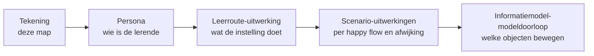

# Beeldmateriaal (profiel)

Beeldmateriaal op profielniveau: MORA-hoofdprocesmodellen en procesketens, Npuls-leerroutetekeningen, context- en informatiestromenplaten die het profiel onderbouwen.

## De negen leerroutetekeningen van Npuls

Npuls onderscheidt negen leerroutes en geeft elke route een persona. `npuls-leerroutes.png` toont het overzicht; per route staat de tekening hieronder. Een tekening is de ingang: wat OKx eraan uitwerkt staat in [de keten per leerroute](#de-keten-per-leerroute).

| Leerroute | Persona | Bestand |
|---|---|---|
| 1 Regulier | Jochem | `npuls-leerroute1-regulier-jochem.png` |
| 2 Temporiseren | Larissa | `Npuls-leerroute2-regulier-Larissa.jpg` |
| 3 Versnellen | Linda | `Npuls-leerroute3-regulier-Linda.jpg` |
| 4 Personaliseren binnen de instelling | Kyra | `npuls-leerroute4-personaliseren-binnen-de-instelling-kyra.png` |
| 5 Personaliseren buiten de instelling, binnen de sector | Macca | `npuls-leerroute5-personaliseren-binnen-de-sector-macca.png` |
| 6 Personaliseren buiten de instelling, over sectoren heen | Aurelie | `npuls-leerroute6-personaliseren-over-sectoren-heen-aurelie.png` |
| 7 Vrije keuze | Sinead | `npuls-leerroute7-vrije-keuze-sinead.png` |
| 8 Bundelen | Chen | `npuls-leerroute8-bundelen-chen.png` |
| 9 Stapelen | Michelle | `npuls-leerroute9-stapelen-michelle.png` |

## De keten per leerroute

Achter elke tekening hangt een reeks documenten, van de lerende tot de objecten die over de koppeling gaan.

| Leerroute | Persona | Uitwerking | Scenario's | Modeldoorloop |
|---|---|---|---|---|
| 1 Regulier | [Jochem](../doc/persona_jochem.md) | [hoofddocument](../doc/leerroute-uitwerking-lr1.md), met leerroute 1 als basis | [1.1 tot 1.4](../doc/scenario-uitwerkingen/README.md) | [Jochem in het informatiemodel](../../../../model/informatiemodel/modeldoorloop-leerroute-1-jochem.md) |
| 2 Temporiseren | [Larissa](../doc/persona_larissa.md) | als verschil in het hoofddocument | [2.1 tot 2.4](../doc/scenario-uitwerkingen/README.md) | open, zie [#442](https://github.com/Npuls-OKx/meta/issues/442) |
| 3 Versnellen | [Linda](../doc/persona_linda.md) | als verschil in het hoofddocument | [3.1 tot 3.4](../doc/scenario-uitwerkingen/README.md) | open, zie [#443](https://github.com/Npuls-OKx/meta/issues/443) |
| 4 tot en met 9 | open, zie [#441](https://github.com/Npuls-OKx/meta/issues/441) | open | open | open |

Het kaderscenario dat bij leerroute 1 hoort staat in Npuls-OKx/Public: [leerroute 1, regulier](https://github.com/Npuls-OKx/Public/blob/dev/Referentiemateriaal/kaderscenario's/leerroute-1-regulier.md). De werkwijze met deze drie lagen staat in [#440](https://github.com/Npuls-OKx/meta/issues/440), en de leerroutes komen samen in de milestone [Instellingsreizen per leerroute](https://github.com/Npuls-OKx/meta/milestone/24).

## Herkomst van de tekeningen

De tekeningen van 4 tot en met 9 zijn op 28 oktober 2026 uit de publicatie gehaald met `pdftoppm` op 150 dpi, bijgesneden tot de kaart zonder paginavoet en teruggebracht tot 128 kleuren. De persona's en omschrijvingen in de publicatie zijn fictief.

**Bron.** Wendbaar georganiseerd onderwijs (2024). *Leerroutes wendbaar georganiseerd onderwijs*. Utrecht: Npuls. Auteurs: Ashwin Brouwer, Bram van der Kruk, Ulrike Wild, Pauline Kamphorst en Kiki Leijdekkers. Op deze uitgave is de [Creative Commons Naamsvermelding 4.0-licentie](https://creativecommons.org/licenses/by/4.0/deed.nl) van toepassing.
