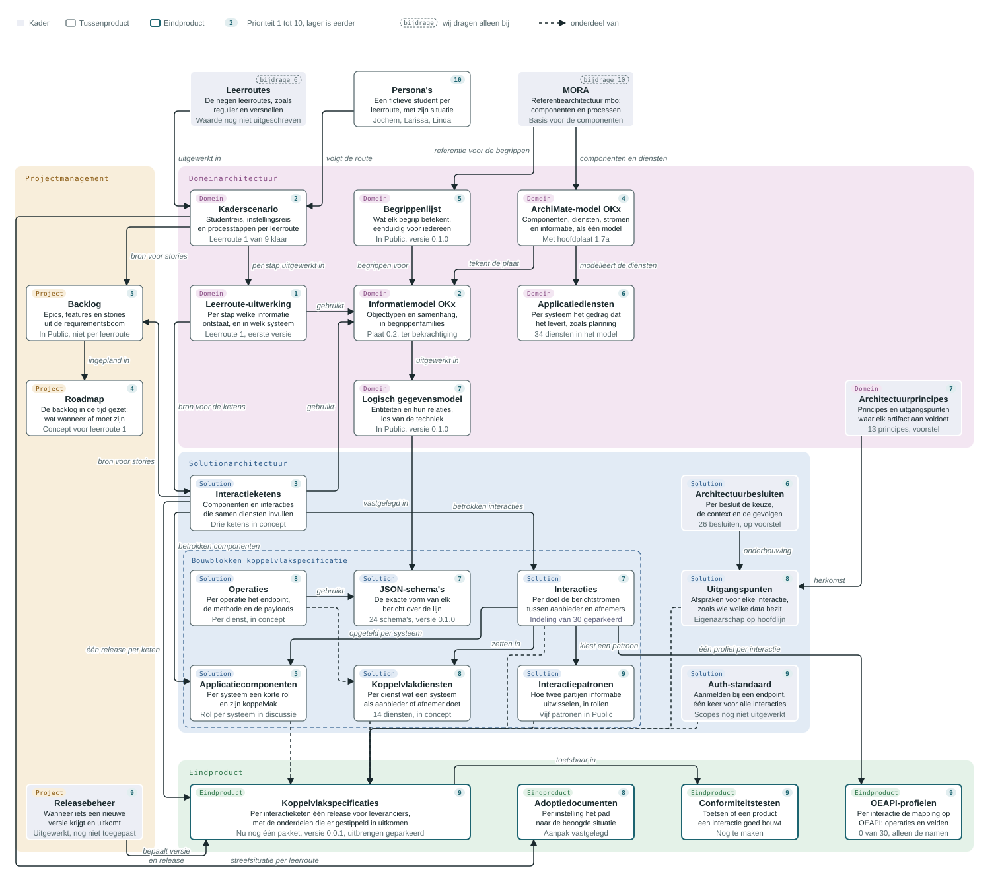
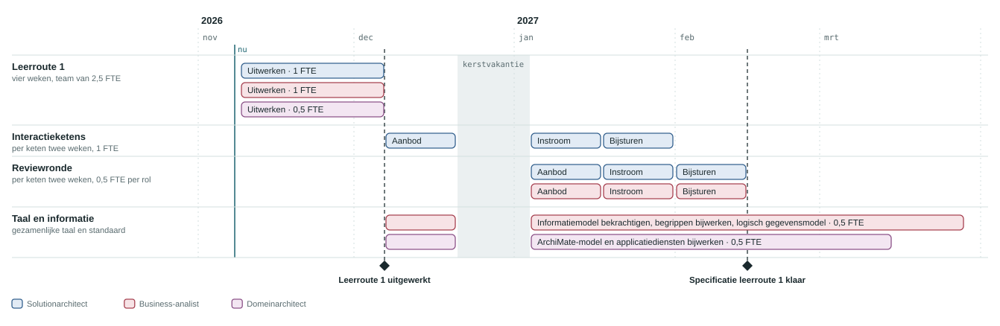

# Product breakdown OKx

De producten en artifacts van OKx in één overzicht: het eindproduct voor leveranciers en instellingen, de tussenproducten die er inhoud voor leveren en de kaders waarbinnen ze ontstaan. Per artifact staan de bron, de rol die het werk doet en de prioriteit. De roadmap zet leerroute 1 in de tijd, van leerroute-uitwerking tot specificatie, met de capaciteit per rol.

## Scope

In scope zijn de artifacts van OKx met hun relaties, rol en prioriteit, en de planning en capaciteit van leerroute 1 tot specificatie. Al het overige valt buiten scope, waaronder de planning van varianten, van leerroute 2 en 3, van conformiteitstesten en van adoptie.

## Overzicht

- Vlakken: projectmanagement plant en stuurt. Domeinarchitectuur beschrijft het onderwijsdomein zelf: processen, begrippen, informatie en systemen met hun diensten, met de principes als kader. Solutionarchitectuur beschrijft hoe OKx dat oplost, van interactieketens tot operaties; de bouwblokken van de koppelvlakspecificatie staan daar bij elkaar. Het eindproduct is wat leveranciers en instellingen krijgen.
- Bovenaan, los van de vlakken: de leerroutes, de persona's en de mbo-referentiearchitectuur (MORA). MORA beheert MBO Digitaal; OKx draagt eraan bij.
- Lijnen: een doorgetrokken pijl toont welk artifact de inhoud levert voor welk ander; met het label *gebruikt* gebruikt het ene artifact het andere. Een gestippelde lijn toont wat onderdeel is van iets anders.
- Prioriteit: het getal rechtsboven in een blok loopt van 1 tot 10, en hoe lager, hoe eerder. Bij een gestippeld getal draagt OKx alleen bij. De prioriteit is een relatieve volgorde; de planning in tijd staat bij de [roadmap](#roadmap-leerroute-1).

Elk artifact staat erop omdat het onderdeel is van het eindproduct, er inhoud voor levert, of er het kader voor is. Controles, zoals waartegen de leerroute-uitwerking wordt getoetst, staan in de tabellen.

## Capaciteit

Voltijdsequivalenten (FTE) per rol per maand om leerroute 1 tot specificatie te brengen, volgens de [roadmap](#roadmap-leerroute-1) en de [rekenregels](#rekenregels). Per maand staat het gemiddelde over de werkweken van die maand.

| Rol | Weken werk | Gemiddeld | nov | dec | jan | feb | mrt |
|---|---|---|---|---|---|---|---|
| Solutionarchitect | 13 | 0,7 | 1,0 | 1,0 | 1,5 | 0,3 |  |
| Business-analist | 14 | 0,8 | 1,0 | 0,7 | 1,0 | 0,8 | 0,5 |
| Domeinarchitect | 8 | 0,4 | 0,5 | 0,5 | 0,5 | 0,5 | 0,3 |
| Productowner | 3,6 | 0,2 | 0,2 | 0,2 | 0,2 | 0,2 | 0,2 |
| Totaal | 38,6 | 2,1 | 2,7 | 2,4 | 3,2 | 1,8 | 1,0 |

- In januari is er 1,5 FTE solutionarchitect nodig: de review van een keten loopt terwijl de volgende keten wordt uitgewerkt. Dat zijn twee mensen.
- De productowner werkt de hele periode 0,2 FTE aan backlog, roadmap en releases.
- Het totaal per maand is de som van de afgeronde waarden per rol.
- De telling omvat het werk uit de rekenregels en de schattingen daarbij. De besluiten onderweg vallen erbuiten.

## Artifacts

Per vlak de artifacts met hun bron, de rol die het werk doet en de prioriteit. De solutionarchitect doet ook het werk aan interacties, operaties en profielen op de Open Education API (OEAPI); de business-analist ook het werk aan begrippen, informatiemodel en logisch gegevensmodel.

### Buiten de vlakken

| Artifact | Rol | Wat erin staat | Beantwoordt | Nodig omdat | Prioriteit |
|---|---|---|---|---|---|
| [Leerroutes](https://github.com/Npuls-OKx/Public/blob/dev/Referentiemateriaal/kaderscenario%27s/leerroute-1-regulier.md#de-npuls-leerroutes) uit het Npuls-programma | Productowner | De negen leerroutes waarlangs een student flexibel kan leren, zoals regulier, temporiseren en versnellen. | Welke vormen van flexibel leren moet de keten aankunnen? | Ze zijn de aanleiding voor al het werk. De businesswaarde per leerroute moet nog worden uitgeschreven. | 6, bijdrage Bepalen welke leerroute na leerroute 1 komt; de businesswaarde per route moet daarvoor uitgeschreven zijn. |
| [Persona's](https://github.com/Npuls-OKx/Public/blob/dev/Referentiemateriaal/persona%27s/README.md) Public en meta | Business-analist | Per leerroute één fictieve student met zijn achtergrond en wensen: Jochem (regulier), Larissa en Linda. | Voor wie werken we een leerroute uit? | Maakt een leerroute concreet en bespreekbaar met instellingen. | 10 Klaar; alleen bijwerken als een volgende leerroute erom vraagt. |
| [MORA](https://mora.mbodigitaal.nl) referentiearchitectuur mbo | Domeinarchitect | De applicatiecomponenten die een mbo-instelling kent, hun diensten en het hoofdprocesmodel. | Welke systemen en processen kent een mbo-instelling al? | OKx bouwt voort op de indeling die scholen al kennen. | 10, bijdrage Stabiel referentiekader; wij melden alleen waar OKx iets mist. |

### Projectmanagement

| Artifact | Rol | Wat erin staat | Beantwoordt | Nodig omdat | Prioriteit |
|---|---|---|---|---|---|
| [Roadmap](#roadmap-leerroute-1) concept voor leerroute 1, in dit document | Productowner | De backlog in de tijd gezet: welke epics en features wanneer af moeten zijn. | Wat moet wanneer af zijn? | Maakt de volgorde zichtbaar voor programma en instellingen; de prioriteiten in dit overzicht zijn er de aanzet voor. | 4 Nodig om de volgende leerroutes en de capaciteit te plannen; voor leerroute 1 staat het concept hieronder. |
| [Backlog](https://github.com/Npuls-OKx/Public/blob/dev/Referentiemateriaal/requirementsboom/epics.md) Public, requirementsboom | Productowner | De opdracht, de epics, de features en de stories uit de requirementsboom, opgesteld vanuit de kaderscenario's en de interactieketens. | Wat moet er gebeuren, en waarom? | Maakt keuzes en prioriteiten verantwoordbaar, en is de bron voor de roadmap. | 5 Nodig om het werk aan de leerroute-uitwerking en de ketens te sturen en te verantwoorden. |
| [Releasebeheer](https://github.com/Npuls-OKx/Public/blob/dev/Algemeen/release-management/Release-management-algemeen.md) Public, algemeen en bij de koppelvlakspecificatie | Productowner | De regels voor versies en releases: wanneer iets een nieuwe versie krijgt, wat er in een release gaat en hoe dat in de praktijk loopt. | Wanneer brengen we wat uit, en onder welke versie? | Leveranciers moeten op een vaste versie kunnen bouwen. Het model is uitgewerkt en wordt toegepast zodra de inhoud er is. | 9 Het model is uitgewerkt; toepassen zodra er iets wordt uitgebracht. |

### Domeinarchitectuur

| Artifact | Rol | Wat erin staat | Beantwoordt | Nodig omdat | Prioriteit |
|---|---|---|---|---|---|
| [Architectuurprincipes](https://github.com/Npuls-OKx/Public/blob/dev/Referentiemateriaal/principes/principes.md) Public | Domeinarchitect | De principes en uitgangspunten van de OKx-architectuur waar elk artifact aan voldoet, deels afgeleid uit de visie van MBO Digitaal op sectorvoorzieningen in de mbo-sectorarchitectuur (MOSA). Ze zijn de herkomst van de uitgangspunten voor interacties. | Waar houden we ons altijd aan? | Houdt alle artifacts in dezelfde lijn. | 7 Liggen er als voorstel; de bekrachtiging kan op elk moment en moet nog gebeuren. |
| [Kaderscenario](https://github.com/Npuls-OKx/Public/blob/dev/Referentiemateriaal/kaderscenario%27s/leerroute-1-regulier.md) Public, eerder "leerroutedocument" | Business-analist met onderwijskennis | Per leerroute de studentreis, de instellingsreis en de processtappen van de instelling. | Hoe brengt een instelling deze student door de leerroute? | Instellingen kunnen het toetsen, en alle andere uitwerkingen bouwen erop voort. | 2 De basis van elke leerroute-uitwerking en wat instellingen in de proefopstelling (proof of concept, POC) toetsen. De varianten van leerroute 1 en de volgende leerroutes komen hierna. |
| [Leerroute-uitwerking](../model/informatiemodel/modeldoorloop-leerroute-1-jochem.md) meta, daar "modeldoorloop" genoemd | Solutionarchitect, business-analist en halve domeinarchitect | Per fase en stap van de studentreis wie handelt, welk objecttype ontstaat of stroomt en met welke waarde, met een beeld per stap. Gebruikt het informatiemodel en wordt getoetst tegen de hoofdplaat. | Welke informatie ontstaat waar, en wanneer gaat die naar welk systeem? | Hieruit ontstaan de interactieketens. Een objecttype dat in het informatiemodel ontbreekt, wordt hier zichtbaar. | 1 De poort voor al het andere: wat naar leveranciers gaat, wacht op een doorgerekende leerroute 1. De eerste versie bevat nog fouten. |
| [Applicatiediensten](../model/informatiemodel/componenten.json) ArchiMate-model en hoofdplaat, versie 1.7a | Domeinarchitect | Per systeem het gedrag dat het levert, zoals de hoofdplaat het in een component tekent, bijvoorbeeld periodeplanning in het planningssysteem. Het ArchiMate-model bevat er 34, verdeeld over 13 componenten. | Wat moet een systeem kunnen, los van het product? | Laat zien welk gedrag de systemen moeten leveren. Interactieketens vullen indirect een of meer diensten in. | 6 Nodig om te zien welke diensten de ketens invullen; volgt op de ketens zelf. |
| [Begrippenlijst](https://github.com/Npuls-OKx/Public/blob/dev/Informatie-en-gegevensmodellen/begrippen.md) Public, informatie- en gegevensmodellen | Business-analist | Per begrip de definitie, de vindplaats en de relatie met MORA en het Kernmodel Onderwijsinformatie. Het begrippenkader in meta draagt het volledige model van begrippen. | Wat betekent een begrip precies? | Zonder vaste begrippen praten mensen en systemen langs elkaar heen. | 5 Het informatiemodel bouwt op de begrippen; nieuwe begrippen uit de leerroutes moeten er eerst in. |
| [Informatiemodel OKx](https://github.com/Npuls-OKx/Public/blob/dev/Informatie-en-gegevensmodellen/informatiemodel.md) meta en Public, plaat versie 0.2 | Business-analist | De plaat met de objecttypen van kwalificatiekader tot resultaat en hun relaties, ingedeeld in begrippenfamilies, met de ontwerpkeuzes erachter. Gemodelleerd in het ArchiMate-model in meta, uitgebracht in Public. Voor reviewvragen worden er uitsneden van gemaakt. | Welke informatie bestaat er, en hoe hangt die samen? | Na bekrachtiging de gedeelde grondslag waar de gegevensmodellen en de interacties zich aan houden. | 2 Ligt ter bekrachtiging; de leerroute-uitwerking en de interactieketens gebruiken het, dus het moet vaststaan voordat zij verder kunnen. |
| [Logisch gegevensmodel](https://github.com/Npuls-OKx/Public/blob/dev/Informatie-en-gegevensmodellen/logisch-gegevensmodel.md) Public, informatie- en gegevensmodellen | Business-analist | Per begrippenfamilie de entiteiten en hun relaties, met de aantallen, los van de techniek, en de regels die buiten een schema vallen. | Hoe hangen de objecten in de berichten samen? | De brug tussen begrip en techniek: een schema kent alleen een verwijzing naar een ander object, hier staat hoe ze samenhangen. | 7 Bestaat in versie 0.1.0; wordt bijgewerkt zodra het informatiemodel is bekrachtigd, en de JSON-schema's volgen eruit. |
| [ArchiMate-model OKx](../model/README.md) meta | Domeinarchitect | Eén model met de componenten en hun MORA-beschrijving, hun diensten, de informatiestromen en de informatieobjecten. De hoofdplaat, de plaat van het informatiemodel en de conceptplaat worden eruit getekend. | Hoe hangen componenten, diensten, stromen en informatie samen? | Eén bron voor alle platen, zodat ze met elkaar kloppen. | 4 De platen waartegen de leerroute-uitwerking wordt getoetst, komen hieruit; het model moet bijblijven. |

### Solutionarchitectuur

| Artifact | Rol | Wat erin staat | Beantwoordt | Nodig omdat | Prioriteit |
|---|---|---|---|---|---|
| [Architectuurbesluiten](https://github.com/Npuls-OKx/Public/blob/dev/Referentiemateriaal/adr/README.md) Public | Solutionarchitect | Per besluit de keuze, de context en de gevolgen. Vijf besluiten onderbouwen een uitgangspunt, zoals het onderscheid tussen koppeling en koppelvlak en de keuze voor dunne meldingen. Andere leggen de rol van systemen vast (zoals het studentkeuzesysteem als eigen systeem), de begrippen in het informatiemodel (zoals de leeruitkomst als verbindende sleutel), de opzet van de requirementsboom, de werkafspraken voor het ArchiMate-model en de architectuurprincipes zelf. | Wat hebben we besloten, en waarom? | Een vastgelegd besluit sluit een discussie af. | 6 Doorlopend: een besluit volgt wanneer de uitwerking een keuze vraagt. |
| [Uitgangspunten](https://github.com/Npuls-OKx/Public/blob/dev/Koppelvlakspecificaties/uitgangspunten.md) Public, koppelvlakspecificatie | Solutionarchitect | De afspraken die voor elke interactie gelden, zoals dat elk systeem zijn eigen data bezit en er de enige bron van is, dat een melding alleen een verwijzing draagt, en dat het bericht vastligt en het kanaal vrij is. | Aan welke afspraken voldoet elke interactie? | Bepaalt wie een gegeven aanbiedt en wie het afneemt. Het eigenaarschap staat er op hoofdlijn, voor vier systemen; de uitwerking per objecttype volgt. | 8 Staan; aanvullen wanneer de uitwerking daar om vraagt. |
| [Auth-standaard](https://github.com/Npuls-OKx/Public/blob/dev/Koppelvlakspecificaties/auth-standaard.md) Public, koppelvlakspecificatie | Solutionarchitect met securitykennis | Hoe een systeem zich bij een endpoint aanmeldt, met OAuth 2.0 Client Credentials, één keer vastgelegd voor alle interacties. Elk systeem dat endpoints serveert, beheert zijn eigen tokens. | Hoe weet een aanbieder wie er aanroept? | Met één gedeelde afspraak sluiten twee leveranciers die allebei voldoen op elkaar aan. De rechten per token, op velden en operaties, volgen nog. | 9 Het mechanisme staat; scopes zijn pas nodig als er wordt gebouwd. |
| [Interactiepatronen](https://github.com/Npuls-OKx/Public/blob/feature/restructure-and-versioning/Koppelvlakspecificaties/Interactiepatronen/README.md) Public, koppelvlakspecificatie | Solutionarchitect | De vijf patronen waarmee twee partijen informatie uitwisselen, zoals een melding waarna de afnemer zelf ophaalt, beschreven in rollen, los van systeemnamen. | Hoe wisselen twee partijen dit uit? | Elke interactie kiest per berichtstroom een patroon en vult het in, zodat elk patroon op één plek staat. | 9 Vijf patronen staan beschreven en volstaan voor de huidige uitwerking. |
| [Interactieketens](../../project/img/interactieketens-in-concept-20261103.png) meta, concept | Solutionarchitect | De betrokken applicatiecomponenten en de interacties ertussen, met beveiliging en toegang. Een keten vult indirect een of meer applicatiediensten in en gebruikt het informatiemodel. Voor leerroute 1 liggen drie ketens in concept: onderwijsaanbod, student-instroom en bijsturen. | Wat zet een instelling in haar aanbesteding? | Een instelling heeft pas iets aan een werkende keten. | 3 De volgende stap na de leerroute-uitwerking: drie ketens liggen in concept, en de release van de specificatie gaat per keten. |
| [JSON-schema's](https://github.com/Npuls-OKx/Public/tree/dev/Informatie-en-gegevensmodellen/schemas) Public, informatie- en gegevensmodellen | Solutionarchitect | De exacte vorm van elk bericht, door een computer te controleren, met ingevulde voorbeeldpayloads. | Is dit bericht geldig? | Zonder één vorm wordt elke interactie maatwerk. | 7 Bestaan in versie 0.1.0; worden bijgewerkt zodra de interacties vastliggen. |
| [Interacties](https://github.com/Npuls-OKx/Public/blob/feature/restructure-and-versioning/Koppelvlakspecificaties/Koppelingen/README.md) Public, nu nog als koppelingen | Solutionarchitect | Per doel de berichtstromen tussen één aanbieder en zijn afnemers, met een eigen versie. | Wat moeten twee systemen voor dit doel uitwisselen? | Twee partijen die dezelfde interactie op dezelfde versie bouwen, sluiten zonder extra afspraken op elkaar aan. | 7 Volgen uit de interactieketens; de indeling is bewust geparkeerd tot leerroute 1 is doorgerekend. |
| [Koppelvlakdiensten](https://github.com/Npuls-OKx/Public/blob/feature/restructure-and-versioning/Koppelvlakspecificaties/Koppelvlakdiensten/README.md) Public, koppelvlakspecificatie | Solutionarchitect | Per dienst wat een systeem als aanbieder of afnemer moet doen: de verplichtingen en de operaties die erbij horen. | Wat moet mijn systeem precies kunnen? | Meerdere interacties gebruiken dezelfde dienst, zodat elke verplichting op één plek beschreven staat. | 8 Volgen uit de interacties en wachten dus op de ketens. |
| [Operaties](https://github.com/Npuls-OKx/Public/blob/feature/restructure-and-versioning/Koppelvlakspecificaties/Koppelvlakdiensten/README.md) Public, per koppelvlakdienst | Solutionarchitect | Per operatie het endpoint, de methode, de parameters, de request en response en de statuscodes. | Welke aanroep doe of beantwoord ik precies? | Hier wordt een dienst bouwbaar: een leverancier implementeert operaties. | 8 Volgen uit de koppelvlakdiensten en wachten dus op de ketens. |
| [Applicatiecomponenten](https://github.com/Npuls-OKx/Public/blob/dev/Koppelvlakspecificaties/Applicatiecomponenten/README.md) Public, koppelvlakspecificatie | Solutionarchitect | Per systeem een korte beschrijving van zijn rol en zijn koppelvlak: de interacties en diensten die het raken. | Wat doet dit systeem in de keten, en met wie wisselt het uit? | Een leverancier ziet in één document wat zijn product moet kunnen. De rol per systeem is nog onderwerp van discussie, bijvoorbeeld de taken van de onderwijscatalogus. | 5 De rol per systeem is nog in discussie, bijvoorbeeld de taken van de onderwijscatalogus. Zolang die schuift, schuift elke interactie mee. |

### Eindproduct

| Artifact | Rol | Wat erin staat | Beantwoordt | Nodig omdat | Prioriteit |
|---|---|---|---|---|---|
| [Koppelvlakspecificaties](https://github.com/Npuls-OKx/Public/blob/dev/Koppelvlakspecificaties/README.md) Public, nu één pakket versie 0.0.1 | Solutionarchitect | Per interactieketen één releasepakket voor leveranciers: de interacties, koppelvlakdiensten en applicatiecomponenten van die keten, met de uitgangspunten, de auth-standaard en de interactiepatronen. Nu staat alles nog in één pakket, versie 0.0.1. | Wat bouwt een leverancier voor deze keten, en tegen welke versie? | Een instelling heeft iets aan een werkende keten; daarom brengen we per keten uit. Uitbrengen wacht op een doorgerekende leerroute 1. | 9 Uitbrengen is geparkeerd tot leerroute 1 is doorgerekend. |
| [OEAPI-profielen](https://github.com/Npuls-OKx/Public/blob/feature/restructure-and-versioning/Koppelvlakspecificaties/Koppelingen/README.md) Public: profielnaam per interactie, profielen volgen | Solutionarchitect met OEAPI-kennis | Per interactie de mapping op de sectorstandaard OEAPI: welke operaties en velden verplicht zijn. Elke interactie komt één op één overeen met een profiel, met dezelfde naam en versie. | Hoe bouw en test ik dit op de standaard? | Leveranciers bouwen voort op wat ze al kennen. | 9 Volgen per interactie, dus pas na de interacties. |
| [Conformiteitstesten](https://github.com/Npuls-OKx/Public/blob/feature/restructure-and-versioning/Koppelvlakspecificaties/release-management.md#47-wat-een-component-ondersteunt) nog te maken; zie releasebeheer | Testspecialist | Tests waarmee een leverancier aantoont dat zijn product een interactie in een bepaalde rol en versie correct implementeert. | Voldoet dit product aan de specificatie? | Twee partijen moeten vooraf kunnen vaststellen of ze kunnen koppelen; conformiteit hangt aan de interactie, de rol en de versie daarvan. | 9 Pas zinvol als er een specificatie is uitgebracht. |
| [Adoptiedocumenten](https://github.com/Npuls-OKx/Public/blob/dev/Referentiemateriaal/principes/uitgangspunten.md#adoptie-en-transitie) Public, uitgangspunten: adoptie en transitie | Adoptieadviseur | Per instelling het transitiepad van de huidige naar de beoogde situatie, per aspect: beleid, organisatie, proces, systeem en informatie. Samen met de instelling opgesteld. | Wat moet deze instelling veranderen om de leerroutes te ondersteunen? | OKx helpt instellingen naast de standaard ook bij de invoering; het transitiepad brengt de standaard in de praktijk. | 8 Volgt op de POC en de best practices per leerroute: een transitiepad kan pas als de streefsituatie er ligt. |

## Roadmap leerroute 1

Leerroute 1 van leerroute-uitwerking tot een koppelvlakspecificatie per interactieketen, zonder varianten.

### Rekenregels

| Werk | Bezetting | Doorlooptijd |
|---|---|---|
| Leerroute uitwerken; hier komen de interactieketens uit | 1 solutionarchitect, 1 business-analist, 0,5 domeinarchitect | 4 weken per leerroute |
| Variant van een leerroute uitwerken | hetzelfde team | 2 weken per variant |
| Interactieketen uitwerken tot specificatie, met interacties, operaties en de andere bouwblokken | 1 solutionarchitect | 2 weken per keten |
| Reviewronde na elke keten | 0,5 solutionarchitect, 0,5 business-analist | 2 weken per keten |
| Informatiemodel bekrachtigen, begrippen bijwerken, logisch gegevensmodel | 0,5 business-analist | 14 weken, schatting |
| ArchiMate-model en applicatiediensten bijwerken | 0,5 domeinarchitect | 12 weken, schatting |
| Backlog, roadmap en releases | 0,2 productowner | de hele periode, schatting |

### Planning

- Ketens: uit leerroute 1 komen drie interactieketens, [onderwijsaanbod ontwerpen en ontsluiten](https://github.com/Npuls-OKx/meta/blob/386-interactieketen-aanmelden-tot-start/architecture/docs/specificatie/interactieketen-onderwijsaanbod/README.md), [student-instroom van aanmelding tot start](https://github.com/Npuls-OKx/meta/blob/386-interactieketen-aanmelden-tot-start/architecture/docs/specificatie/interactieketen-student-instroom/README.md) en [bijsturen van planning, aanbod en rooster tijdens de uitvoering](https://github.com/Npuls-OKx/meta/blob/389-interactieketen-bijsturen/architecture/docs/specificatie/interactieketen-bijsturen/README.md). Ze staan als voorstel op een branch in meta.
- Volgorde: in deze planning werkt één solutionarchitect de ketens na elkaar uit, en na de reviewronde kan elke keten als release uit. Met een solutionarchitect per keten lopen de ketens tegelijk in december en is de specificatie half januari klaar; dan zijn er in december drie solutionarchitecten tegelijk nodig. De keuze hangt af van wie er beschikbaar is.
- Mijlpalen: leerroute 1 uitgewerkt op 4 december 2026, specificatie leerroute 1 klaar op 12 februari 2027.
- Werkweken: de planning start op 9 november 2026; de kerstvakantie van 21 december tot 4 januari telt als vrij.
- Capaciteit: de FTE per rol per maand staat bij [Capaciteit](#capaciteit), onder het overzicht.

## Open punten

1. De data en de weken zijn een voorstel; ze worden afgestemd met het programmamanagement.
2. De drie ketens van leerroute 1 staan als voorstel op een branch; de set wordt bij de review vastgesteld.
3. Het werk aan taal en informatie, aan het ArchiMate-model en van de productowner is een schatting buiten de rekenregels.
4. Voor varianten en voor leerroute 2 en 3 gelden dezelfde rekenregels. De capaciteit volgt zodra het aantal varianten en ketens bekend is.
5. Een deel van de bronlinks wijst naar de branch `feature/restructure-and-versioning` in Public; na de merge gaan ze naar `dev`.
