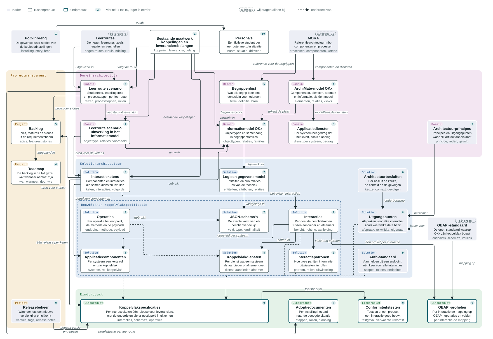

# Producten

Elk product uit de [product-breakdown](product-breakdown/README.md) dat in deze repository leeft, krijgt hier een eigen map: het eindproduct bovenaan, de bron, de versies en het werk eronder. Wat in [Npuls-OKx/Public](https://github.com/Npuls-OKx/Public) leeft, staat in de tabel met een link.

Relateert aan: #540, #542, #543

## Product-breakdown in het kort



- **Vier vlakken.** Projectmanagement plant en stuurt. Domeinarchitectuur beschrijft het onderwijsdomein: processen, begrippen, informatie en systemen. Solutionarchitectuur beschrijft hoe OKx dat oplost, van interactieketen tot operatie. Het eindproduct is wat leveranciers en instellingen krijgen: per interactieketen een koppelvlakspecificatie.
- **Bronnen bovenaan.** De leerroutes, de persona's, de mbo-referentiearchitectuur (MORA), de PoC-inbreng en de inbreng van leveranciers voeden de producten, en vallen buiten de vlakken.
- **Lijnen.** Een doorgetrokken pijl levert inhoud, het label *gebruikt* wijst naar een product dat het andere gebruikt, en een stippellijn wijst naar een onderdeel.
- **Prioriteit.** Het getal rechtsboven loopt van 1 tot 10: lager is eerder.

Per product de rol, de inhoud, de vraag die het beantwoordt en de prioriteit staan in de [product-breakdown](product-breakdown/README.md#artifacts), met de roadmap en de capaciteit erbij.

## Overzicht

| Product | Vlak | Plek | Versie |
|---|---|---|---|
| Roadmap | projectmanagement | [product-breakdown](product-breakdown/README.md#roadmap-leerroute-1) | concept |
| Backlog | projectmanagement | [Public, requirementsboom](https://github.com/Npuls-OKx/Public/blob/dev/Referentiemateriaal/requirementsboom/epics.md) | concept |
| Releasebeheer | projectmanagement | [Public, algemeen](https://github.com/Npuls-OKx/Public/blob/dev/Algemeen/release-management/Release-management-algemeen.md) | concept |
| Architectuurprincipes | domeinarchitectuur | [Public, referentiemateriaal](https://github.com/Npuls-OKx/Public/blob/dev/Referentiemateriaal/principes/principes.md) | concept |
| Kaderscenario | domeinarchitectuur | [Public, kaderscenario's](https://github.com/Npuls-OKx/Public/blob/dev/Referentiemateriaal/kaderscenario%27s/leerroute-1-regulier.md) | concept |
| Leerroute-uitwerking | domeinarchitectuur | [meta, informatiemodel](../model/informatiemodel/leerroute-uitwerking-model-lr1-jochem.md); map volgt in #542 | concept |
| Applicatiediensten | domeinarchitectuur | [meta, componenten](../model/informatiemodel/componenten.json); map volgt onder #540 | hoofdplaat 1.7.2 |
| Hoofdplaat | domeinarchitectuur | [meta, versiemappen](../model/informatiestromen%20hoofdplaat%20OKx/README.md); map volgt onder #540 | 1.7.2 |
| Begrippenlijst | domeinarchitectuur | [Public, informatie- en gegevensmodellen](https://github.com/Npuls-OKx/Public/blob/dev/Informatie-en-gegevensmodellen/begrippen.md) | concept |
| Informatiemodel OKx | domeinarchitectuur | [meta, informatiemodel](../model/informatiemodel/README.md); map volgt in #542. Uitgebracht in [Public](https://github.com/Npuls-OKx/Public/blob/dev/Informatie-en-gegevensmodellen/informatiemodel.md) | 0.3.0 |
| ArchiMate-model OKx | domeinarchitectuur | [meta, model](../model/README.md); blijft op zijn plek volgens harde regel 1 | concept |
| Architectuurbesluiten | solutionarchitectuur | [Public, adr](https://github.com/Npuls-OKx/Public/blob/dev/Referentiemateriaal/adr/README.md) | per besluit |
| Uitgangspunten | solutionarchitectuur | [Public, koppelvlakspecificaties](https://github.com/Npuls-OKx/Public/blob/dev/Koppelvlakspecificaties/uitgangspunten.md) | concept |
| Auth-standaard | solutionarchitectuur | [Public, koppelvlakspecificaties](https://github.com/Npuls-OKx/Public/blob/dev/Koppelvlakspecificaties/auth-standaard.md) | concept |
| Interactiepatronen | solutionarchitectuur | [Public, koppelvlakspecificaties](https://github.com/Npuls-OKx/Public/blob/feature/restructure-and-versioning/Koppelvlakspecificaties/Interactiepatronen/README.md) | concept |
| Interactieketens | solutionarchitectuur | [meta, plaat in concept](../../project/img/interactieketens-in-concept-20261103.png); map volgt onder #540 | concept |
| Logisch gegevensmodel | solutionarchitectuur | [Public, informatie- en gegevensmodellen](https://github.com/Npuls-OKx/Public/blob/dev/Informatie-en-gegevensmodellen/logisch-gegevensmodel.md) | 0.1.0 |
| JSON-schema's | solutionarchitectuur | [Public, schemas](https://github.com/Npuls-OKx/Public/tree/dev/Informatie-en-gegevensmodellen/schemas) | 0.1.0 |
| Interacties | solutionarchitectuur | [Public, koppelingen](https://github.com/Npuls-OKx/Public/blob/feature/restructure-and-versioning/Koppelvlakspecificaties/Koppelingen/README.md) | concept |
| Koppelvlakdiensten en operaties | solutionarchitectuur | [Public, koppelvlakdiensten](https://github.com/Npuls-OKx/Public/blob/feature/restructure-and-versioning/Koppelvlakspecificaties/Koppelvlakdiensten/README.md) | concept |
| Applicatiecomponenten | solutionarchitectuur | [Public, koppelvlakspecificaties](https://github.com/Npuls-OKx/Public/blob/dev/Koppelvlakspecificaties/Applicatiecomponenten/README.md) | concept |
| Koppelvlakspecificaties | eindproduct | [Public, koppelvlakspecificaties](https://github.com/Npuls-OKx/Public/blob/dev/Koppelvlakspecificaties/README.md) | 0.0.1 |
| OEAPI-profielen | eindproduct | [Public, per interactie](https://github.com/Npuls-OKx/Public/blob/feature/restructure-and-versioning/Koppelvlakspecificaties/Koppelingen/README.md) | volgt per interactie |
| Conformiteitstesten | eindproduct | volgt na de eerste uitgebrachte specificatie | volgt |
| Adoptiedocumenten | eindproduct | [Public, uitgangspunten](https://github.com/Npuls-OKx/Public/blob/dev/Referentiemateriaal/principes/uitgangspunten.md#adoptie-en-transitie) | concept |
| Sjablonen | werkwijze | [meta, sjablonen](../docs/sjablonen/README.md); map volgt onder #540 | concept |
| Product-breakdown | werkwijze | [productmap](product-breakdown/README.md) | 0.2.0 |

Het vlak *werkwijze* staat niet op de plaat: de product-breakdown en de sjablonen beschrijven hoe OKx de andere producten maakt en opschrijft. *Concept* betekent dat het product bestaat en nog geen uitgebracht versienummer draagt.

## Productmap

```text
producten/<product>/
├── README.md          wat het is, voor wie, de actuele versie, waar te beginnen
├── <eindproduct>      wat een mens leest: document, PDF, plaat
├── img/               de beelden die het eindproduct draagt, met de hand gemaakt
├── bron/              wat een mens bewerkt en een script leest: regeltabellen, schema's
├── gegenereerd/       wat een script schrijft, beelden in gegenereerd/img/
├── versies.json       per versie: nummer, commit, tag, datum, release-notes
└── agent-artifacts/   plannen, iteraties en onderzoek van dit product
```

Een map verschijnt pas wanneer zij iets bevat. De maat voor `bron/` en `gegenereerd/` staat in [mapindeling.mdc](../../.cursor/rules/mapindeling.mdc); de scripts blijven in [tools/scripts/](../../tools/scripts/).

## Versies

| Bestand | Wat erin staat |
|---|---|
| [manifest.json](manifest.json) | per product de map, de actuele versie (`huidig`), de commit en de tag |
| `<product>/versies.json` | per versie het nummer, de commit, de tag, de datum en de link naar de release-notes |

- **Commit.** Altijd de volledige veertigtekenhash: de commit waarop deze versie staat zoals zij is uitgebracht. Bij een plaat is dat de laatste commit die het beeld van die versie wijzigde, dezelfde regel als `beeld_commit` in het [versiemanifest van de platen](../model/bron/versiemanifest.json).
- **Tag.** Leeg tot er een git-tag voor de versie bestaat.
- **Release-notes.** Een link naar de plek die zegt wat er veranderde, zolang er geen release op GitHub is: bij de product-breakdown de versietabel in haar README.
- **Controle.** [`tools/tests/test_producten_manifest.py`](../../tools/tests/test_producten_manifest.py) faalt bij een versie zonder commit of met een afgekorte commit, bij een product in het manifest zonder map of zonder `versies.json`, en bij een map hier zonder regel in het manifest.

De hoofdplaat en het informatiemodel houden hun versies voorlopig in het versiemanifest van de platen; zij krijgen hun `versies.json` bij hun verhuizing.

## Buiten de productmappen

| Plek | Wat er blijft staan |
|---|---|
| [architecture/model/](../model/README.md) | het ArchiMate-model, de bron van de platen |
| [architecture/docs/](../docs/README.md) | externe kaders, onderzoek, het kwalificatiedossier en de specificaties die nog verhuizen |
| [architecture/meetings/](../meetings/) | de verslagen per sessie, gedeeld door alle producten |
| [architecture/agent-artifacts/](../agent-artifacts/README.md) | werk van agents dat bij geen enkel product hoort |
