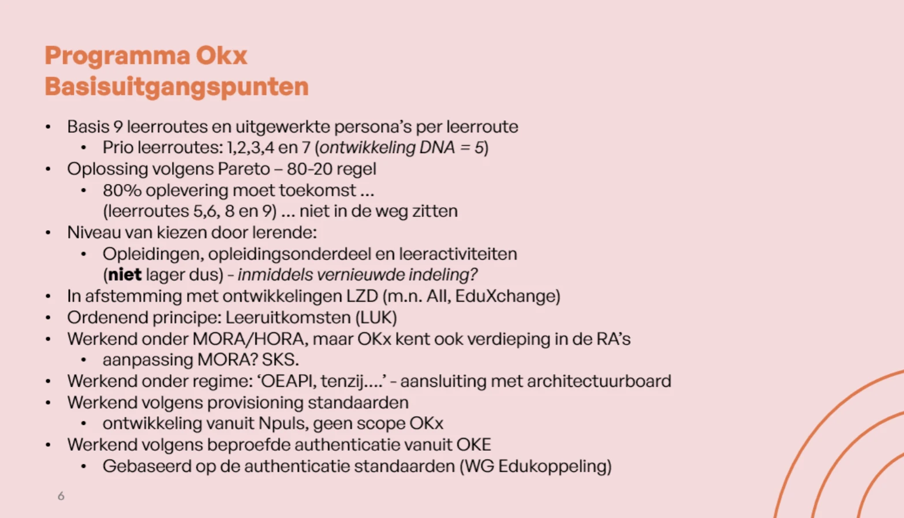
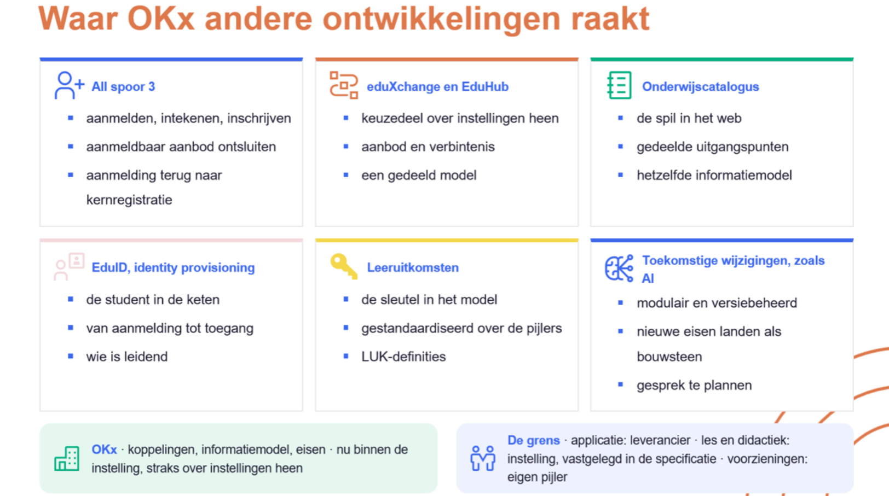
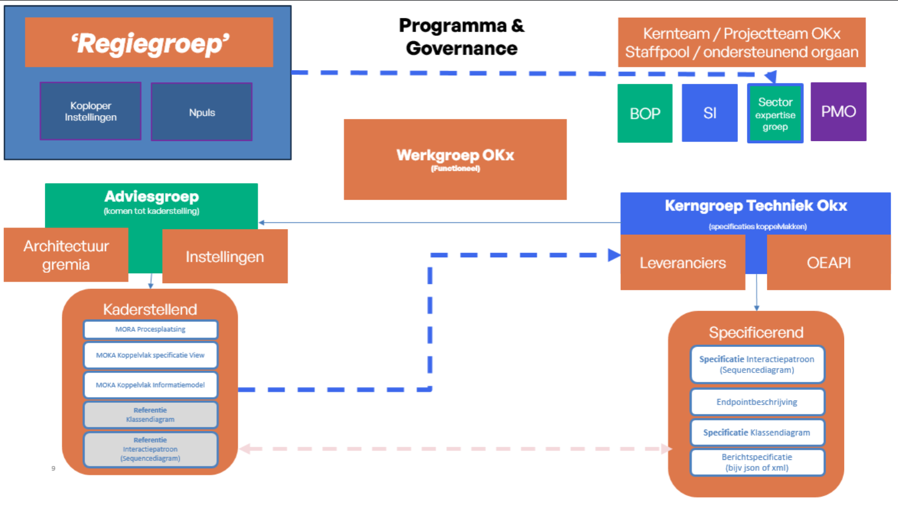
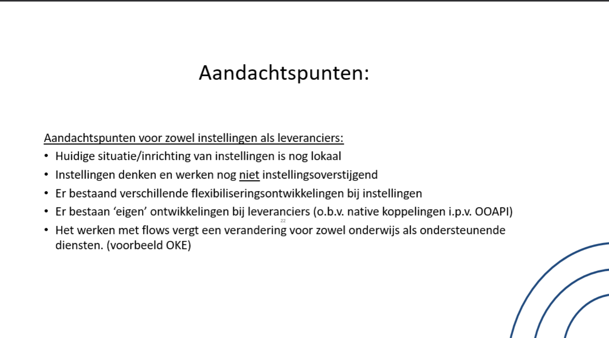

# OKx in context

Elke sectie draagt haar herkomst: het projectplan, een plaat van het programma, afstemming binnen het kernteam, of een eigen afleiding. Zolang het projectplan zelf niet in deze repository staat is die regel de enige controle; [#449](https://github.com/Npuls-OKx/meta/issues/449) draagt het voorstel om het plan als bron toe te voegen.

## Managementsamenvatting

Herkomst: projectplan voor de opdracht, de resultaten en de aanleiding. De drie fasen en de stand daarin komen uit afstemming binnen het kernteam, oktober 2026. De alinea over de benodigde tijd en over de vraagarticulatie is een eigen afleiding daaruit.

Een student volgt een module bij een andere instelling. De inschrijving loopt door, de planning houdt rekening met zijn rooster, en het resultaat komt terug op zijn eigen leerroute. Dat is het beeld waar de [leerroutes voor wendbaar georganiseerd onderwijs](https://npuls.nl/kennisbank/leerroutes-wendbaar-georganiseerd-onderwijs) van Npuls naartoe werken, en waarvoor OKx de koppelingen vastlegt.

Het project valt onder de transformatiehub Wendbaar georganiseerd onderwijs van Npuls, in samenwerking met Digitale sectorvoorzieningen. Drie resultaten dragen de opdracht:

1. Komen tot gezamenlijke taal en standaarden voor gegevensuitwisseling die een scala aan flexibilisering mogelijk maken in het mbo.
2. Komen tot functionele en technische gegevensuitwisseling voor het mbo, hbo en wo die studentmobiliteit ondersteunen.
3. Pilot studentmobiliteit starten in het mbo: implementatie en realisatie van de digitale koppelingen met eventueel gebruik van SURF-diensten.

De basis ligt binnen de instelling: de uitwisseling tussen de onderwijscatalogus, de kernregistratie, het studentvolgsysteem, het leermanagementsysteem en planning en roostering. Daar begint de keten die bij mobiliteit tussen instellingen doorloopt naar de landelijke voorzieningen.

Het werk kent drie fasen: de specificatiefase, de bouwfase en de implementatie- en adoptiefase. OKx staat in de specificatiefase. In het derde kwartaal van 2027 zijn de eerste specificaties gereed, zodat het technisch specificeren van een profiel op de Open Education API kan beginnen. Dat start bij drie informatiestromen: van de onderwijscatalogus naar planning en roostering, naar het studentinformatiesysteem en naar het leermanagementsysteem.

Die fase vraagt meer tijd dan voorzien. Specificeren op het detailniveau dat een bouwende leverancier nodig heeft, vraagt eerst een scherpe vraagarticulatie: wat de sector wil, waar, wanneer en waarom, concreet genoeg om binnen de kaderstelling van OKx gericht van start te gaan. Die articulatie wordt nu vastgelegd in een projectstartarchitectuur.

De opgave reikt verder dan techniek. Instellingen richten hun onderwijslogistiek vandaag lokaal in, met uiteenlopende flexibiliseringsontwikkelingen en met eigen koppelingen bij leveranciers. Een gedeelde afspraak vraagt daarom ook verandering in beleid, organisatie en proces.

## Opdracht

Herkomst: projectplan. Wat de x aanduidt komt uit afstemming binnen het kernteam.

OKx staat voor onderwijskoppelingen, waarbij de x het domein aanduidt waarop de koppelingen betrekking hebben. OKE, onderwijskoppelingen examinering, is het eerste ingevulde geval.

De hoofdopdrachtgever is de transformatiehub Wendbaar georganiseerd onderwijs van Npuls. Daarnaast loopt een samenwerking met Digitale sectorvoorzieningen voor de realisatie van de digitale sectorvoorzieningen rond studentmobiliteit.

## Aanleiding

Herkomst: projectplan, inclusief de zes use-cases.

De transformatiehub werkt aan leerroutes die een student in staat stellen vakken en modules te volgen bij mbo-, hbo- en wo-instellingen. Dat vraagt afspraken, standaarden en architectuur, zodat systemen samenwerken terwijl instellingen hun eigen onderwijsvormen en inhoud houden.

Zes use-cases zijn vanuit mbo, hbo en wo opgehaald:

1. Meer keuzemogelijkheden binnen de eigen opleiding, binnen de instelling.
2. Meer keuzemogelijkheden buiten de eigen opleiding, binnen de instelling.
3. Meer keuzemogelijkheden buiten de instelling, binnen de sector.
4. Meer keuzemogelijkheden buiten de instelling, over sectoren heen.
5. Meer keuzemogelijkheden buiten de instelling, over landsgrenzen heen.
6. Keuzemogelijkheden over sectoren heen, los van een inschrijving bij een instelling.

## Resultaten en implicaties

Herkomst: de resultaten uit het projectplan. De implicaties zijn een eigen afleiding, aangescherpt in afstemming binnen het kernteam, oktober 2026.

De drie resultaten staan hierboven in de samenvatting. Wat zij vragen van de uitwerking:

| Resultaat | Implicatie |
|---|---|
| 1. Gezamenlijke taal en standaarden | De kaderstellende producten dragen die taal: begrippenlijst, informatiemodel, procesmodel en applicatielandschap. Per leerroute komen zij samen in de instellingsspecificatie. Elke specificatie verwijst ernaar en voert geen eigen termen in |
| 2. Functionele en technische uitwisseling voor mbo, hbo en wo | De uitwerking is interoperabel met HORA en niet alleen met MORA, ook waar het werk in het mbo begint |
| 3. Pilot studentmobiliteit in het mbo | Een pilot vraagt een toetsbare koppeling. Een conformiteitstoets hoort daarmee bij de oplevering, naast de specificatie |

## Basisuitgangspunten

Herkomst: de plaat van het programma. De laatste uitgangspunten zijn daar door de programmaleiding aan toegevoegd.

| Uitgangspunt | |
|---|---|
| Basis | Negen leerroutes met een uitgewerkte persona per route. Prioriteit bij leerroute 1, 2, 3, 4 en 7; leerroute 5 als ontwikkeling van het eigen DNA van een instelling |
| Pareto | Wat nu wordt opgeleverd mag leerroute 5, 6, 8 en 9 later niet in de weg zitten |
| Keuzeniveau | De lerende kiest op opleiding, opleidingsonderdeel en leeractiviteit; fijnmaziger blijft bij de instelling |
| Ordenend principe | Leeruitkomsten |
| Kader | Werkend onder MORA en HORA, met verdieping daarin waar OKx die nodig heeft |
| Techniekregime | OEAPI tenzij, met aansluiting bij het architectuurboard |
| Inrichten van toegang | Volgens de standaarden die Npuls ontwikkelt, buiten de scope van OKx |
| Authenticatie | Volgens de beproefde aanpak uit OKE, op de standaarden van de werkgroep Edukoppeling |

## Scope

Herkomst: projectplan, met de afbakening uit [ADR 0008](https://github.com/Npuls-OKx/Public/blob/dev/Referentiemateriaal/adr/0008-scope-planning-eerst-intra-instelling.md).

De gegevensuitwisseling tussen de referentiecomponenten onderwijscatalogus, kernregistratie, studentvolgsysteem, leermanagementsysteem en planning en roostering, voor mobiliteit binnen de instelling. Dat is de opmaat naar mobiliteit tussen instellingen via de landelijke voorzieningen.

De reguliere leerroute komt eerst, met temporiseren en versnellen erna; de flexibele en modulaire routes volgen als verschil daarop. De [negen leerroutes van Npuls](../architecture/docs/specificatie/leerroute-uitwerking/img/README.md) staan als tekening bij elkaar, met per route de keten van persona, uitwerking, scenario's en voorbeeldregels.

De procesketens onderwijslogistiek, onderwijsontwikkeling en onderwijsuitvoering en begeleiding van [MORA](https://mora.mbodigitaal.nl/index.php/Hoofdpagina) vallen binnen deze scope. Andere procesketens worden geraakt en vragen afstemming. De onderwijskundige keuze van een instelling blijft bij de instelling. Al het overige valt buiten scope.

## Standaarden en referentiearchitecturen

Herkomst: de basisuitgangspunten van het programma, met de verhouding tot ROSA en het Kernmodel Onderwijsinformatie uit de architectuurbesluiten.

De uitwerkingen sluiten waar passend aan op de [Open Education API](https://openonderwijsapi.nl/v6.0/), als profiel bovenop de standaard en niet als afsplitsing ervan. Een eis die buiten een technische standaard valt, wordt een signalering richting die standaard in plaats van een aanpassing in de basis.

Met de sectorarchitecturen MORA en HORA houdt OKx nauwe verbinding zonder ze te wijzigen. Een uitwerking van OKx kan later als onderbouwd voorstel richting een referentiearchitectuur gaan. De verhouding met ROSA en het Kernmodel Onderwijsinformatie ligt vast in de architectuurbesluiten.

## Raakvlakken

Herkomst: de plaat van het programma. De rijen zijn ingevuld in afstemming binnen het kernteam, oktober 2026, en geven daarmee de stand van het team weer en geen vastgestelde afspraak met die initiatieven.

| Initiatief | OKx levert | OKx ontvangt | Open |
|---|---|---|---|
| OKE | De schaalsprong naar de bredere onderwijslogistiek | De beproefde vorm: begrippen, informatiestromen, gegevensmodel, koppelvlakken | Welke eigenschappen van die vorm overdragen |
| AII | Het onderwijsaanbod van de instelling | De aanmelding en inschrijving terug | Waar de aggregatie ophoudt en het koppelvlak begint |
| EduXchange en EduHub | Het aanbod dat landelijk vindbaar wordt | De inschrijving van een student van een andere instelling | De overlap met AII en met de eigen koppelingen van OKx |
| EduID | De uitwisseling die op een identiteit steunt | Identiteit binnen en tussen instellingen, en het inrichten van toegang | Hoe authenticatie en toegangsinrichting zich verhouden tot identity lifecycle management |
| OEAPI | Signaleringen en wijzigingsverzoeken uit de praktijk van het mbo | De standaard waarop OKx een profiel bouwt | Wat als profiel naar buiten gaat |
| Edu-V | Op termijn mogelijk dezelfde borgingsconstructie voor de OKx-deliverables | Een volwassen beschrijvingswijze en een keurmerk met een compliance- en conformance-model | Edu-V werkt op de leermiddelenketen in het primair onderwijs, OKx op de onderwijslogistiek in mbo en ho; op korte termijn raken zij elkaar niet |

De grens die de plaat trekt: de applicatie is van de leverancier, les en didactiek zijn van de instelling en worden in de specificatie vastgelegd, en de landelijke voorzieningen horen bij hun eigen pijler.

## Status van het werk

Herkomst: afstemming binnen het kernteam en de SI-afstemming van 28 oktober 2026. De verwijzingen wijzen naar wat er ligt.

OKx staat in de specificatiefase. Wat er ligt is genoeg om het gesprek met de sector te voeren, en nog niet genoeg om tegen te bouwen.

| | |
|---|---|
| Wat er ligt | Het [informatiemodel](https://github.com/Npuls-OKx/Public/blob/dev/Informatie-en-gegevensmodellen/informatiemodel.md) met de begrippenlijst, de [hoofdplaat informatiestromen](OKx_Informatiesstromen.md), een eerste pakket [koppelvlakspecificaties](https://github.com/Npuls-OKx/Public/tree/dev/Koppelvlakspecificaties) in Public, het [kaderscenario van leerroute 1](https://github.com/Npuls-OKx/Public/blob/dev/Referentiemateriaal/kaderscenario's/leerroute-1-regulier.md) en de [voorbeelduitwerking daarvan per processtap](../architecture/model/informatiemodel/voorbeeld-leerroute-1-jochem.md). Daarnaast lopen proefopstellingen met koploperscholen |
| Wat nu bepaald wordt | De vorm waarin de oplevering uitkomt: hoe de set wordt opgedeeld, op welk niveau zij wordt uitgegeven, en met welke woorden de lagen worden benoemd. Dat vastzetten wacht op een scherper beeld van wat de keten nodig heeft |
| Waar het naartoe gaat | Per leerroute een best practice die een instelling voor ongeveer tachtig procent herkent, en daarnaast de capabilities die een voorziening daarvoor moet hebben. De voorbeelduitwerking per processtap verbindt die twee |

Het werk dat daarvoor nu loopt gaat over een vraag: genoeg inzicht krijgen in wat een instelling doet, en een vorm vinden om dat uit te drukken. Die vorm bestaat uit drie lagen, een persona, een leerroutedocument daarop en informatiemodel-voorbeeldregels per fase. Leerroute 1 draagt die drie; de volgende leerroutes staan in de milestone [Instellingsreizen per leerroute](https://github.com/Npuls-OKx/meta/milestone/24).

## Stip op de horizon

Herkomst: afstemming binnen het kernteam, oktober 2026.

In het derde kwartaal van 2027 zijn de eerste specificaties gereed, zodat het technisch specificeren van een OEAPI-profiel kan beginnen. Dat start bij drie informatiestromen vanuit de onderwijscatalogus: naar planning en roostering, naar het studentinformatiesysteem, en naar het leermanagementsysteem.

## Governance

Herkomst: de bijlageplaat bij het projectplan. De omschrijving per gremium komt uit afstemming binnen het kernteam.

| Gremium | Rol |
|---|---|
| Regiegroep | Koploperinstellingen en Npuls, met het programma en de governance eromheen |
| Werkgroep OKx | De stuurgroep van het project, functioneel |
| Kernteam OKx | Stelt de specificaties op, met de deelteams beleid, organisatie en proces, systeem en informatie, de sectorexpertisegroep en het projectbureau |
| Kerngroep techniek OKx | Toetst de specificaties op technische haalbaarheid en bewaakt de standaarden, met leveranciers en OEAPI aan tafel |
| Adviesgroep | Komt tot kaderstelling, met architectuurgremia en instellingen |
| Pilotgroepen | Testen de gebouwde koppelingen in verschillende configuraties en geven akkoord op de werking |

De deelteams beleid, organisatie en proces valideren de specificaties en deelresultaten in afstemming met instellingen, onder meer via de proefopstelling met koploperscholen.

## Uitdagingen

Herkomst: de plaat van het programma. De rij over de OKE-vorm komt uit het onderzoek in [#422](https://github.com/Npuls-OKx/meta/issues/422) en de SI-afstemming van 28 oktober 2026.

| Uitdaging | Wat zij vraagt |
|---|---|
| De inrichting van instellingen is lokaal | Een gedeelde afspraak die ruimte laat voor lokale inrichting |
| Instellingen werken nog binnen de eigen muren | Processen en afspraken die over de instelling heen reiken |
| Flexibiliseringsontwikkelingen lopen uiteen | Een afspraak die de verschillende snelheden verdraagt |
| Leveranciers bouwen eigen koppelingen | Een standaard die genoeg oplevert om op over te stappen |
| Werken met flows vraagt verandering | Verandering in beleid, organisatie en proces, naast de techniek |
| De OKE-vorm schaalt niet mee | OKE kwam uit met het benoemen van functiegebieden op een afgebakend procesgebied. In de scope van OKx hangt de rol van een component af van de leerroute, en daarmee van het proces- en informatiemodel eronder. Dat vraagt applicatieservices en koppelvlakdiensten per keten |

Relateert aan: #426, #421, #422.
