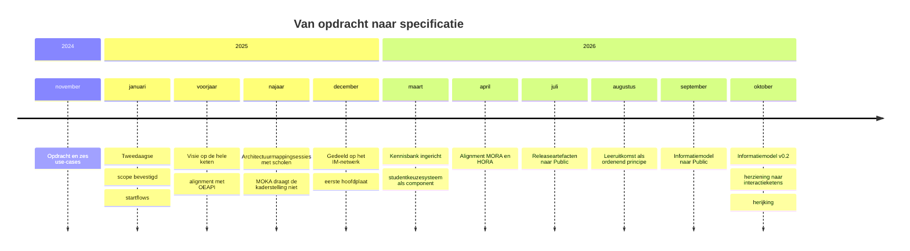

# Historisch overzicht OKx

Rode draad: OKx begon als specificatieproject en ontdekte dat de kaderstelling eronder ontbrak. Elke verschuiving sindsdien legt die kaderstelling alsnog.

## November 2024 tot februari 2026

Bron: het projectplan en het geheugen van het team. De kennisbank en de meetingverslagen beginnen in maart 2026.

| Wanneer | Keerpunt | Bron |
|---|---|---|
| november 2024 | De opdracht wordt vastgelegd, met zes use-cases voor studentmobiliteit van binnen de eigen opleiding tot over landsgrenzen heen | [OKx in context](OKx_Context.md) |
| januari 2025 | Een tweedaagse met instellingen, ondersteunende organisaties en leveranciers bevestigt de scope en kiest voor een hoofdproces met varianten. Daar ontstaan de startflows | [De startflows](../img/OKx_startflows_doelgebied_20251217.png) |
| 2025 | Het team vormt een interne visie op de hele keten, van onderwijsontwerp tot onderwijsuitvoering en leven lang ontwikkelen. Die procesmodellen dragen alles wat er daarna uit voortkomt | [Leerroute-uitwerking](../architecture/docs/specificatie/leerroute-uitwerking/) |
| 2025 | Alignment met de Open Education API, gericht op het formaliseren van wat OKx van de standaard nodig heeft | [Definitiemapping MORA en OEAPI](../architecture/docs/definitie_mapping_MORA_OEAPI_excel/) |
| september tot november 2025 | Architectuurmappingsessies met scholen: procesmapping, informatieobjecten ophalen, het instellingsperspectief ophalen, en de toets of werken vanuit MORA houdbaar is | [Mappingsessies met instellingen](../architecture/docs/mappingsessies-instellingen/) |
| 2025 | De MOKA-werkgroep wordt klaargemaakt voor de kaderstellende rol van gatekeeper en reviewer. Die rol blijkt op vrijwillige inzet niet te dragen, waarna OKx de kaderstelling zelf gaat maken | [MOKA-templates](../moka-koppelvlakspecificaties/) |
| december 2025 | De startflows en het doelbeeld worden gedeeld op het netwerk van informatiemanagers, met de eerste hoofdplaat informatiestromen als uitkomst | [Doel en resultaten](../img/OKx_doel_en_resultaten_20251217.png), [de huidige vorm van onderwijslogistiek](../img/OKx_onderwijslogistiek_huidige_vorm_20251217.png), [de aandachtspunten](../img/OKx_aandachtspunten_20251217.png) |

## Maart 2026 tot vandaag

| Wanneer | Keerpunt | Bron |
|---|---|---|
| maart 2026 | De kennisbank wordt ingericht: architectuurprincipes, de procesmodellen uit de mappingsessies, en het studentkeuzesysteem als zelfstandige referentiecomponent | [ADR 0005](https://github.com/Npuls-OKx/Public/blob/dev/Referentiemateriaal/adr/0005-student-keuze-systeem-zelfstandige-referentiecomponent.md) |
| april 2026 | Alignment met het initiatief dat de informatiemodellen van MORA en HORA op elkaar afstemt | [Begrippenkader](../architecture/docs/specificatie/leerroute-uitwerking/doc/begrippenkader.md) |
| juli 2026 | Architectuurbesluiten en koppelingspecificaties verhuizen naar `Npuls-OKx/Public`. Meta wordt kennisbank, Public draagt de release | [pull request 127](https://github.com/Npuls-OKx/meta/pull/127) |
| augustus 2026 | De leeruitkomst wordt het ordenend principe van het model, en de requirementsboom wordt als proefopstelling gebouwd om business aan techniek te koppelen | [ADR 0026](https://github.com/Npuls-OKx/Public/blob/dev/Referentiemateriaal/adr/0026-leeruitkomst-als-verbindende-sleutel.md), [pull request 131](https://github.com/Npuls-OKx/meta/pull/131) |
| september 2026 | Het informatiemodel en de begrippenlijst gaan naar Public, met de mapping naar MORA en het Kernmodel Onderwijsinformatie | [pull request 233](https://github.com/Npuls-OKx/meta/pull/233) |
| oktober 2026 | Het informatiemodel bereikt v0.2. De voorbeelduitwerking van leerroute 1 toetst het model aan een echte opleiding. De koppelvlakspecificaties worden herzien naar interactieketens. De planning wordt herijkt | [Public pull request 131](https://github.com/Npuls-OKx/Public/pull/131), [meta pull request 252](https://github.com/Npuls-OKx/meta/pull/252), [373](https://github.com/Npuls-OKx/meta/pull/373) en [387](https://github.com/Npuls-OKx/meta/pull/387) |
| lopend | Een proefopstelling met instellingen haalt userstories op, om de hoofdvraag te beantwoorden: wat moet er gebouwd worden | [Projectstartarchitectuur](https://github.com/Npuls-OKx/meta/issues/421) |

Relateert aan: #427.
